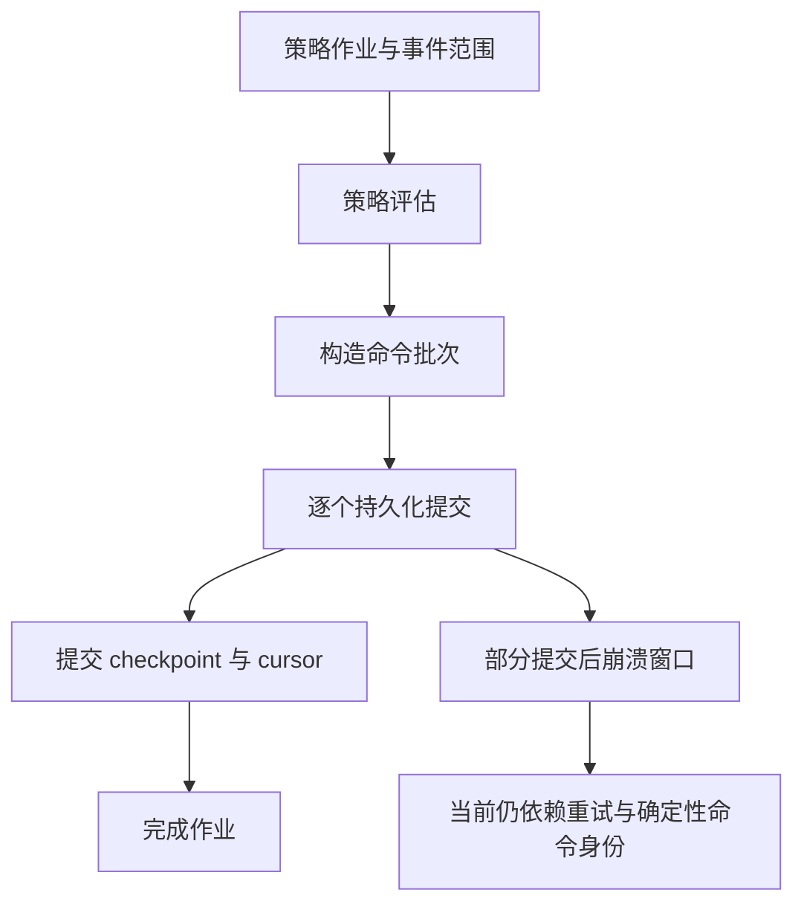

# 牵星 Qianxing 架构复核、开源框架对标与本地/服务端运行重构方案

日期：2026-10-28（Asia/Shanghai）  
状态：设计与执行任务清单；**不代表全部实现**。  
范围：当前工作区源代码、已有运行证据、官方开源框架文档。代码包含未提交增量，因此以本文代码路径和复核日期界定基线，不把整个工作区状态归结为某个已发布版本。

## 1. 结论与实施原则

项目已经具备值得保留的基础：Rust 统一计算与撮合、事件重放、精确金额、版本化输入/产物、Python 策略回调、HTTP/CLI/SDK 入口，以及近期补充的项目运行记录、能力校验和服务端状态观察。当前主要问题是这些能力尚未形成完整、稳定、易理解的运行产品。

本地用户仍需理解项目清单、策略清单、BacktestSpec、RuntimeConfig、原生扩展、Rust CLI 和数据规则之间的关系；服务端用户看到进程启动或 running 时，尚不能据此确认策略完成初始化、账户对账或提交恢复。接下来应优先把“计划—冻结输入—执行—恢复—查询—报告”的流程做实，再逐步拆分大模块。

原则：

1. 保留确定性核心、精确金额和 Rust 报告事实来源；Python/HTML 不另算一套交易账。
2. 以项目为用户入口，以不可变 ExecutionPlan 为内部执行依据；不同运行模式明确能力差异。
3. 单机安装和单进程运行保持简单；SQLite/文件与单节点先形成闭环，PostgreSQL/消息系统按实际规模启用。
4. 把命令受理、持久化、执行中、交易所结果和对账结果分开建模；网络超时不等于订单失败。
5. 采用小步可回退重构，不重写全部 crate；不通过放宽未知能力、数据缺口或恢复门槛换取“能跑”。

## 2. 本次审查方法与证据边界

- 阅读当前源文件、Cargo 分层约束、策略/报告相关文档及前序证据；本次是架构审查与方案编写，没有重新运行全量回归、真实交易所或浏览器截图验收。
- 外部比较只使用维护方官方文档。`latest`/`stable` 是访问时的滚动文档，并非固定发布版本；实现时必须记录所依据的版本/提交。
- “确认问题”表示当前源代码足以支持结论；“待验证”表示需要场景重现或故障注入；两类不能混写为已发生生产事故。
- 既有少量通过的测试证明相应路径，不证明整套框架正常。合成 Bar、6根 A 股示例和真实长区间行情必须区分。
- 沪深300 2010年至今历史回测仍为数据阻断状态，见[实际状态](hs300-sma-2010-present/status.json)；不能把执行器存在认定为真实历史报告已交付。

## 3. 开源框架对标

下表比较工作流和设计取舍，不按功能数量或未经测试的性能排名。对应资料列于文末。

| 框架 | 官方文档确认的可借鉴做法 | 本项目差距与取舍 |
|---|---|---|
| NautilusTrader | 同一策略/执行算法可用于回测与实时节点；文档明确讨论未知命令结果、持久化、实时对账及模拟差异 [E1][E2] | 借鉴节点与宿主能力边界、启动对账和恢复门槛；不能因共用策略代码就宣称回测与实盘行为完全等价，也不能假设竞品已提供所有外部副作用的原子提交保证 |
| Freqtrade | 官方入口覆盖 Docker、策略、回测、dry-run、Web UI；策略文档说明启动样本与未来数据/递归偏差检查 [E3][E4] | 借鉴默认模拟运行、数据准备、诊断和一套用户教程；保留本项目多资产/多语言定位，不复制仅适合特定交易模式的抽象 |
| LEAN / LEAN CLI | 按项目执行本地回测，支持显式参数、输出目录、引擎镜像和数据提供者选择 [E5] | 借鉴项目作为稳定入口及运行环境身份；原生安装继续支持，容器作为可选可复现分发方式；不把 Docker 变为所有本地研究的前置条件 |
| VeighNa / vn.py | CTA 界面提供初始化、启动、停止、参数编辑与实例管理，并区分初始化和交易状态 [E6] | 借鉴生命周期展示和实例操作；跨进程部署仍需独立的租约、权限、版本和对账机制，不能直接照搬桌面生命周期为分布式保证 |
| Backtrader | 用最小样本周期和 prenext/nextstart/next 描述策略/指标预热过程 [E7] | 借鉴容易学习的回调和历史可见性；本项目已有类似辅助接口，应补行为一致性，不因方法名兼容就声称整个框架兼容 |

**本项目的定位建议：** 面向多市场研究与交易运行的 Rust 核心框架，以 Python 项目工作流服务研究人员，以受版本约束的部署契约服务运维。易用性优先体现为清楚的命令、可定位的错误、可复现的输入和明确的运行状态。

## 4. 当前架构与真实执行链

### 4.1 分层与职责

| 层 | 当前主要模块 | 应保留的边界 |
|---|---|---|
| 用户入口 | `qx-cli`、`python/qianxing`、`qx-api`、Web Console | 参数解析、授权、展示和适配；不各自实现一套撮合/收益计算 |
| 应用用例 | `qx-app`、`qx-spec` | 输入验证、研究流程、结果身份、报告事实；不依赖 CLI、HTTP、Runtime 或存储实现 |
| 运行装配 | `qx-service`、`qx-runtime`、`qx-orchestrator` | 节点装配、连接器、宿主启动、worker 生命周期；通过窄端口接入核心 |
| 策略/执行域 | `qx-strategy`、`qx-risk`、`qx-zhenlu`、`qx-xingban`、`qx-core` | 策略决策、风控、执行治理、模拟、账务与重放 |
| 数据/基础设施 | `qx-data`、`qx-guanxing`、`qx-storage`、`qx-adapter`、`qx-execution` | 数据语义、提供者、持久化及外部执行端口 |
| 控制与作业 | `qx-control`、`qx-scheduler` | 控制审计、作业租约、状态与重试；不能用作业完成替代交易所成交 |

现有依赖关系并非简单的“所有入口都经过 service”：Python 原生绑定可以直接调用 app；API host 在 service 装配；service 本身也依赖 API。重构不得引入 `qx-app -> qx-service/runtime/storage/api` 或 `qx-api -> qx-service -> qx-api` 循环。详细现状见 [module-map](module-map.md) 和各 crate 的 Cargo.toml。

### 4.2 本地路径

当前 `qianxing project run`：读取项目 → Python 本地预检 → 导入策略与归一化清单 → Rust 执行预检 → 递归调用 `main(run-strategy …)` → Rust RunHandle → 结果与 `.qianxing/runs/<id>` 记录。

`project report` 先核对已索引文件摘要，再启动单独的 Rust CLI 渲染。`tools/hs300_backtest.py` 则直接组装 RuntimeConfig 并启动 Rust CLI/Python worker，是另外一条路径。入口虽可用，配置、状态和报告能力尚未统一。

### 4.3 服务端路径

RuntimeConfig → worker 宿主启动 → 控制作业和执行事件收集 → 策略评估 → 构造一个或多个命令 → 逐个提交 → cursor/checkpoint 提交 → 作业结束。新加的部署观察通过共享数据目录写入，由 API 查询。

确认问题是批次决策、提交进度和 checkpoint 尚未通过一个可恢复协议绑定。现有命令去重、作业 fencing 和 checkpoint 对已覆盖场景有价值，但不自动消除此窗口。

## 5. 已有增量与尚缺闭环

| 能力 | 当前证据 | 当前状态 |
|---|---|---|
| 项目入口 | `strategy_project.py`、`project_runs.py`、原生项目测试文件 | 已有；仍有全局 cwd、CLI 内部耦合、版本约束问题 |
| 本地运行记录和取消 | UUID运行目录、原子JSON替换、Rust协作取消 | 已有；不是可恢复服务端部署，不支持强制中断任意挂死Python回调 |
| 宿主能力声明 | `qx-strategy/src/capabilities.rs` 与Python预检 | 部分已实现；不是所有语言/宿主均已完成握手与一致性验收 |
| Python Runtime构造确认 | 独立启动标记和超时清理 | 已有；不证明后续on_init、预热、状态恢复、账户对账完成 |
| Pause/Resume持久状态 | control投影与worker生命周期模块 | 已有；停止策略、撤单、平仓仍须分别定义语义 |
| 服务端部署观察 | `/strategies/deployments`、SDK、Console | 已有只读观察；无完整部署修订控制；`trading_enabled=null` |
| HTML报告布局/字段 | 独立CSS、币种、明细与离线脚本校验 | 已改进；此前浏览器实际视口复核仍阻断 |
| 沪深300长区间入口 | 严格CSV/日历校验、只做多SMA、合成链路验证 | 已有执行器；真实历史行情/报告仍阻断 |
| 原子评估与外部未知结果恢复 | 现有部分机制与明确剩余窗口 | 未闭环；作为P0恢复任务 |

## 6. 架构与开发细节问题清单

严重度说明：P0影响交易恢复、数据或产物完整性；P1影响稳定使用和部署操作；P2为维护、规模与体验改进。优先级不等于已确认发生损失。

| ID | 级别 | 代码依据与确认问题 | 改进及验收要点 |
|---|---|---|---|
| A01 | P0 | `strategy_worker.rs:673/703/741`：逐命令提交之后才提交checkpoint；期间可能部分命令已受理 | 持久化PreparedEvaluation、逐命令进度与恢复协议；每个持久化边界崩溃后均能明确续执行/阻断 |
| A02 | P0 | 部署观察 `strategy_deployments.rs:198/262` 始终含未评估原因，交易授权为unknown | 就绪计算必须接入实际执行门禁；需逐路径审计现有交易授权，不能只改API字段 |
| A03 | P0 | `project_runs.py:311/315` 用户输出路径直接交给CLI；此包装层未保护策略源、数据、摘要及运行记录 | 共享保护路径集合；多文件报告先暂存验证再发布，拒绝覆盖输入和证据文件。CLI下层已有保护仍需端到端覆盖 |
| A04 | P0 | `hs300_backtest.py:157/178`：先从原文件计算/执行，末尾再复制源文件；存在文件在两次读取间变化的证据风险 | 执行前冻结输入到独立目录，散列、引擎、归档读取同一份字节；策略包也固定到实际执行版本 |
| A05 | P1 | `strategy_project.py:169`、`project_runs.py:137`使用进程级`os.chdir` | 引入ExecutionContext显式base_dir与PathResolver；允许同进程并发运行两个项目且路径不串扰 |
| A06 | P1 | `strategy_project.py:179`从CLI导入加载/验证函数；`cli.py:1738`递归调用main | 抽取Python项目应用服务，CLI仅解析/呈现，Notebook和API复用服务；直接运行与project run保持一致 |
| A07 | P1 | `project doctor` 静态路径解析清单、路径与 Python 语法；显式动态 doctor 使用独立进程组/Windows Job Object 和限时回收。`project plan --profile local` 仍会导入策略；跨平台进程树验收待完成 | 保持静态 doctor 不导入用户代码；标注所有执行用户代码的入口，并记录 Windows/Linux 后代回收验收 |
| A08 | P1 | 运行配置分散于ProjectManifest、策略manifest、BacktestSpec、RuntimeConfig和脚本参数 | 增加归一化计划及字段来源；拒绝身份、市场、资金、数据级别冲突；不把所有配置拼成一个巨大可选对象 |
| A09 | P1 | 本地、Runtime Python类、模块函数、原生/C ABI/远端支持不同 | 由实际宿主产生版本化能力清单，显式事件顺序/持久性/限额；未知必需能力在工厂副作用前拒绝 |
| A10 | P1 | server_project_plan返回未评估；运行观察字段名容易被误当完整部署管理 | 分开展示desired/observed/readiness；提供revision、operation和last_error；运行心跳不是交易授权 |
| A11 | P1 | 观察文件以完整RuntimeConfig摘要绑定 | 保留全配置摘要追溯，另算部署相关语义摘要；与本策略无关的API配置不应无说明地使策略“配置改变” |
| A12 | P1 | 观察数据依赖共享目录，限制1024个owner，超限503且无自动归档 | 单机先实现保留/归档和确定性上限错误；多节点再引入受认证聚合接口，观察不能承担分布式锁 |
| A13 | P1 | 本地状态仅检查PID存在；`project_runs.py:232`没有稳定进程出生身份/租约 | 记录host/boot/process-start身份或监督进程租约；PID复用不当成原owner活着；取消命令不得杀错进程 |
| A14 | P1 | `result()`现将声明但缺失/不可读的artifact登记到独立integrity问题；receipt本身写失败时仍不能持久表达“引擎已完成、产物/receipt失败”，也未按outcome区分必需和可选产物 | 继续分开execution_status与artifact_integrity，按outcome验证必需产物；receipt/磁盘失败时保留可恢复的状态证据 |
| A15 | P1 | `generate_project_report`依赖外部CLI路径，未见匹配引擎版本准入 | doctor一次报告SDK/native/CLI/schema/platform身份；不匹配提供精确安装命令，兼容矩阵而非盲目要求字符串相等 |
| A16 | P1 | 内置SMA负信号可给出负目标仓位；只做多SMA另有Python实现 | 将position_mode=long_only/long_short成为明确策略语义；不静默改变老策略，迁移时使用新版本和差异报告 |
| A17 | P1 | HS300把指数放在合成spot研究模型，交易日历source/coverage由输入声明 | 单独标注instrument_role及可交易性；校历和来源真实性分级；指数不能沿用股票/ETF实盘规则和收益命名 |
| A18 | P1 | 历史脚本指标包含预热，费用是恒定研究假设 | 统一warmup/evaluation区间、基准价格/全收益口径、逐期费用及年化基数；报告展示起止和指标适用范围 |
| A19 | P1 | 报告只显示有限权益行、CSS已有修复但无浏览器证据 | 列清全量/抽样范围和CSV下载；桌面/手机/打印真实验收，绘图降采样不能改变统计与逐笔证据 |
| A20 | P2 | `app.py`5055行、`cli.py`2570行、execution_updates.rs1749行 | 按项目服务、读写客户端、报告、事件交付等职责拆分；保留公共导入兼容；不以行数减少作为唯一成功条件 |
| A21 | P2 | 方案和验收文档持续追加，用户多次询问“是否全部完成” | 唯一任务台账关联代码/证据/阻断；supersedes字段明确方案关系，禁止仅凭叙述把阶段标记完成 |

行号为本次工作区快照定位提示，后续编辑可能变化。A03/A04是可从调用顺序确认的缺口，尚未在本次审查中实施破坏性重现；A02要求继续审计所有执行路径，不据此断言当前所有路径都没有风控。

## 7. 目标设计

### 7.1 Project → ExecutionPlan → Run/Deployment

不强迫用户手写运行时拓扑。用户维护策略代码、参数、数据引用和profile；计划器将它们转换为不可变执行计划，检查冲突后交给对应runner。保持已有ProjectManifest v1兼容，新增信息采用版本化扩展/独立锁文件。

ExecutionPlan建议字段：

| 字段组 | 内容 |
|---|---|
| 身份 | plan_id/schema_version、project/strategy版本、bundle摘要 |
| 运行环境 | backtest/paper/live；inprocess/subprocess/remote宿主；SDK/native/CLI构建身份 |
| 输入 | 数据内容摘要、来源、市场规格、日历、复权/公司行为、预热/评估范围 |
| 规则 | position_mode、资金、费用/滑点/撮合、风控版本、时区/时间单位 |
| 能力 | required、host_supported、协议版本、帧限额、事件顺序、状态恢复语义 |
| 路径 | 显式base_dir、输入快照根、只写产物根；所有相对路径都有字段来源 |
| 追踪 | config semantic digest、完整输入摘要、计划生成原因、迁移信息 |

plan_id不包含credential值；凭据使用受作用域限制的引用，审计也不记录值。现有摘要/结果身份规则不能直接修改；新增身份版本时并存读取并说明差异。

### 7.2 模块边界

- `qx-spec`：计划/部署/操作的可序列化契约，尽量不做IO。
- `qx-app`：研究用例、报告事实、计划纯语义检查；继续保持对runtime/storage/service无依赖。
- `qx-strategy`：事件、宿主能力、checkpoint与策略协议。
- `qx-service`：运行用例装配、路径与环境绑定、部署协调；存储实现经现有基础设施端口接入。
- `qx-runtime/orchestrator`：runner/进程监督；CLI/API/Python通过各自装配使用共享服务，避免反向依赖。
- Python增加`project_service`和`execution_context`等小模块；不在cli.main内完成应用流程。
- 只在确有独立依赖方向与复用者时增加crate；第一阶段不新建编排微服务。

### 7.3 两类生命周期

本地Run记录：preparing → validating → running → succeeded/failed/cancelled；owner丢失是interrupted/unknown观察结果，不能编造成cancelled或成功。报告生成有独立状态、日志和摘要，不改变已经成功的引擎结果。

服务端将状态拆成三组：

1. desired：部署修订、目标模式、desired_running、operator action。
2. observed：owner、revision、process_phase、last_event/heartbeat、checkpoint/cursor进度。
3. readiness：宿主构造、on_init、预热、checkpoint恢复、行情新鲜度、账户/订单对账、风控、lease/fence、未知提交是否解决。

就绪检查返回`passed/failed/unknown/not_applicable`及原因和证据时间；实际live admission要求必需项全部passed且授权有效。`not_applicable`需由市场/宿主规则推导，不能由调用方任意设置。状态API标记通过但执行路径仍绕开门禁，不算实现完成。

## 8. 本地体验设计

### 8.1 默认用户流程

现有命令保留：`project init/show/doctor/plan/run/runs/status/logs/artifacts/cancel/report/deployments`。第一阶段先改善其行为和帮助文本，不立即引入第二套别名。

目标体验：

1. init生成能离线运行的小例子，显示数据性质为fixture；选择A股/数字货币模板时给出正确position_mode和币种。
2. doctor静态列出Python/native/CLI版本、可用宿主、数据路径和缺项；动态策略检查作为显式步骤，结果标明用户代码是否执行。
3. plan显示参数来源、数据区间、模式、预热、能力、费用、输出路径；不下载数据或连接交易所。
4. run在受保护目录冻结输入，执行一次共享项目服务；实时输出run_id、阶段、可用日志和取消方式。
5. 报告自动关联运行记录；一次命令获得HTML与机器可读结果；失败时给出原因码和下一条可执行修复命令。

目标接口：`project run --profile backtest/paper`、`project report --format html,xlsx,json`、`project doctor --dynamic`。【已实现】`project report --format html,xlsx,json`（含同路径拒绝、受保护路径校验、JSON 原子落盘、逐格式产物摘要与 `REPORT_FAILED` 错误信封）与 `project doctor --dynamic`。【设计意图，未排期】`project run --profile backtest/paper` 尚未实现：paper 会话的持续运行边界、账户模型与 RuntimeConfig 组合仍是产品决策，不是缺一个参数。

### 8.2 环境和路径

默认本地可信Python回调可以保留，但文档注明用户代码运行权限。并发或需要超时终止时使用监督子进程；不能声称RunHandle协作取消能强制打断任意Python/C扩展。

内部全部传绝对解析路径；兼容旧输入时相对路径锚定于其所属配置文件，并显示迁移解析结果。Windows空格/Unicode/长路径、只读输入、跨盘符、符号链接别名都在验收范围。进程级cwd只允许出现在专属子进程启动参数中。

### 8.3 错误与日志

统一错误信封包含`code/category/retryable/correlation_id/stage/project_run_id/cause/remediation`。例如数据不可得为DATA_UNAVAILABLE，不应变成回测收益0；能力不匹配列出required与supported；报告缺CLI提供匹配构建信息。

结构化事件与stdout/stderr分开保存，后者有大小/轮转限额；Notebook/CLI可订阅相同事件。项目列表坏一条记录时展示该记录损坏，不让全部运行不可见。无效JSON、权限错误、磁盘满等必须保持可定位且不误判成功。

## 9. 服务端部署与提交恢复设计

### 9.1 部署修订与操作

先做单节点deploy coordinator：不可变bundle+plan生成revision，通过已有控制授权创建幂等operation，协调目标状态。API先返回operation_id/accepted，之后由operation查询结果；不把HTTP 202当成部署完成。

当前已实现的基础：revision 保存 SHA-256 绑定的完整 RuntimeConfig JSON；API 限制变更范围为目标 Strategy worker，并保存经摘要核验的单文件策略工件至内容寻址目录。内置策略绑定宿主可执行文件摘要。待实现：多文件 bundle/依赖清单与还原、coordinator 对 worker 生命周期的实际控制、旧 owner fence、readiness 校验及由观察结果推进 operation 终态。当前 store 的 queue/outcome 原语尚未接入 worker 协调循环。

停止语义分开：pause阻止新决策；stop停止策略执行；cancel-orders撤销范围内订单；flatten按显式授权平仓。各动作说明未成交订单、待确认命令和行情订阅如何处理，不能由停止按钮隐含卖出全部持仓。

升级顺序：校验新修订 → 禁止旧owner发新意图 → drain/对账 → 保存旧checkpoint → 迁移并验证新状态 → 切换有效fence → 启动新owner → 门禁通过才允许live。迁移失败保持阻断，不能自动用不兼容checkpoint启动。回滚代码不会撤销已成交订单，必须重新对账。

### 9.2 PreparedEvaluation与Outbox

建议持久对象包括evaluation_id、job/input范围和摘要、bundle/config版本、前checkpoint身份、完整决策批次、后checkpoint候选、command_ids、owner fence及提交进度。顺序：

1. 恢复已准备但未完成的evaluation，优先于再次调用策略。
2. 对新输入评估，完整验证所有意图和checkpoint可序列化性。
3. 在任何外部提交前持久化PreparedEvaluation和待发送命令。
4. dispatcher只发送已持久化命令，逐条保存结果：accepted/rejected/unknown及venue/client order身份。
5. 未知结果先按client_order_id查单与对账；不支持可靠查单的venue进入人工/阻断状态，不盲目重发。
6. 持久化所有恢复所需状态后完成cursor/checkpoint与evaluation记录；区分“决策已提交”和“订单终态已确认”。

SQLite/PostgreSQL实现用事务提交本地数据；文件后端采用WAL/提交标记和校验恢复，不声称多文件rename等同数据库事务。恢复失败要能诊断并保留原始日志。所有提交和进度推进检查fence，不能只在领取Job时检查一次。

保证范围：可实现本地决策批次与投递恢复一致性；外部交易所是否支持幂等client_order_id和可查结果决定远端重试策略。**不承诺跨交易所exactly-once或多腿同时成交。** 多腿风险仍需要敞口限额与补偿策略。

### 9.3 能力与监督

所有宿主握手绑定host_id、profile、协议、bundle、事件类型、顺序、ack、checkpoint大小与兼容版本。构造完成、初始化完成、恢复完成分阶段确认；限时、限帧、背压和退出原因统一。未知required capability拒绝启动；可选能力允许明确降级。

本机共享内存是传输优化选项，不能成为远端RPC保证。服务重启后的恢复语义由持久协议定义，不由“使用JSONL或共享内存”定义。

## 10. 数据与完整报告改进

建立统一DatasetSnapshot：数据源/抓取时间、instrument role、频率、时区/时间戳代表开盘或收盘、精度/单位、真实覆盖、交易日历版本、缺口、复权/公司行为、内容摘要。网络不可达区分数据未取得、缓存过时和源不可用；不静默改源、填充缺日或延长截止日。

沪深300需求首先区分指数择时、ETF交易、历史成分股组合。ETF不能补造上市前行情；成分股组合需要历史成分与退市样本，避免幸存者偏差。价格指数、全收益指数和ETF分红再投资口径必须分别命名。

完整报告目标：

- 概览：数据性质、实际起止、初始/最终权益、币种、模式、参数、未平仓估值和拒单数量。
- 绩效：总收益、按明确年度基数计算的年化/波动/Sharpe/Sortino、最大回撤与持续区间；预热不参与评估指标，零样本/零波动用不可计算原因。
- 对照：同评估区间同时间戳的基准、主动收益；指数/全收益/可交易跟踪物口径明确。
- 交易：逐笔成交、往返交易定义、胜率/盈亏比/持有期、敞口、换手、费用及分项、滑点、T+1/整手/涨跌停/停牌等模型限制。
- 时间分解：年度/月度收益、分段回撤、权益/现金/持仓；全量CSV/XLSX，页面表格分页/虚拟化。
- 可信度：输入/策略/引擎/规则身份、重放结果、诊断和复现命令；指标每项有单位与计算版本。

统计仍由Rust app报告事实产生。新增指标需要统一口径和版本，不在每种页面重算。抽样用于绘图传输，不用于金融指标。blocked报告不显示模拟绩效卡片；engine完成但报告生成失败展示两个独立状态。

## 11. 实施工作包与验收

状态基线：部分=已有实现但未达本表门槛；待开发=本次设计，未落地；阻断=缺外部证据。任务负责人按职责角色分配，不虚构具体人员。

| 工作包 | 优先级/状态 | 主要交付与代码落点 | 依赖 | 完成门槛 |
|---|---|---|---|---|
| R01 环境身份与兼容检查 | 部分 | Python doctor、native/CLI版本接口、兼容矩阵 | 无 | 部分：doctor 可比对 Python wheel 与 Rust 扩展编译版本并提示修复；qx-cli 对照/安装器仍缺 |
| R02 PathResolver与执行上下文 | P1/部分 | project_service/strategy_project/project_runs | — | 预检与受管执行不切换进程 cwd；受管执行将输入规格和引用的数据文件冻结到 Run 目录。策略包快照、服务层解耦及并发集成验收仍未完成 |
| R03 项目应用服务 | P1/完成 | strategy_project/strategy_execution/project_runs | R02 | CLI不递归main、不被应用层反向导入；传统 `run-strategy` 与 `project run` 共用应用服务并保持结果契约 |
| R04 静态/动态doctor | P1/部分 | 元数据与限时检查进程树 | R01,R03 | 静态 doctor 与 server plan 不导入策略；dynamic doctor、本地 plan、run 的执行边界有文档；动态路径在 POSIX 清理 session、Windows 使用 kill-on-close Job Object，跨平台后代进程验收仍未闭环 |
| R05 不可变计划与输入快照 | P0/部分 | qx-spec、service、项目runner、hs300工具 | R02 | 执行/散列/归档同字节；源中途改变也不污染结果 |
| R06 报告输出保护 | P0/完成 | project_runs + Rust报告发布 | R02 | 输入别名/符号链接覆盖被拒；普通失败回滚；事务日志支持进程退出后的恢复；报告与可选 EvidenceBundle 同包提交 |
| R07 运行状态与产物完整性 | P1/部分 | run receipt、owner身份、错误信封 | R03,R05 | 缺产物、损坏记录、PID复用、磁盘满均可诊断 |
| R08 宿主协商一致性 | P1/部分 | qx-strategy、orchestrator、Python/C ABI/remote | R01,R05 | 所有声称支持的能力均有实际交付与负例；未知先拒绝 |
| R09 部署修订/operation | P1/部分 | qx-spec、service、control、API | R05,R08 | 部分：不可变配置载荷、单文件工件快照、幂等受理和终态存储已实现；多文件bundle与worker实际切换、fence/readiness证据仍未完成 |
| R10 readiness与执行门禁 | P0/部分 | service、worker、execution | R08,R09 | 缺行情/对账/恢复/fence任一必需证据时不得发新live命令 |
| R11 PreparedEvaluation存储 | P0/部分 | strategy worker、storage、窄恢复端口 | R05,R08 | 发送前持久化命令批次/checkpoint候选及逐命令本地进度；重启时核验job/config/执行事实摘要后重放幂等本地命令并提交checkpoint/cursor。崩溃注入与多后端验收未完成 |
| R12 Outbox与未知结果恢复 | P0/部分 | execution/control/storage/venue适配 | R10,R11 | 提交前后断网/崩溃/重启均可查清或明确阻断，不盲重发 |
| R13 状态迁移和修订切换 | P0/待开发 | checkpoint版本、部署协调 | R09,R12 | 不兼容状态拒绝；旧owner不可继续提交；切换与回滚后对账 |
| R14 观察保留与聚合 | P1/部分 | strategy_deployments、归档任务 | R09 | 超限有诊断；归档不删活跃owner；多节点状态不靠共享本机目录假设 |
| R15 数据快照与交易角色 | P1/部分 | data/spec/hs300工具/导入入口 | R05 | 缺日/过时/复权与角色冲突先拒绝；指数不能进入真实下单路径 |
| R16 策略模式和预热一致性 | P1/部分 | builtin config、Python SMA、manifest | R08,R15 | long_only死叉只平多；预热/评估分开；本地与paper信号对齐 |
| R17 报告统一事实与指标 | P1/部分 | qx-app report、HTML/XLSX/JSON | R06,R15,R16 | 同源指标跨格式一致；基准/年化/费用口径齐全 |
| R18 Console部署操作与状态 | P1/部分 | web/console、API | R09,R10,R14 | desired/observed/readiness清楚；操作失败可追踪；权限不被绕开 |
| R19 按职责拆模块 | P2/部分 | app.py/cli.py/strategy_host/execution_updates | R03,R08,R11 | 行为契约不变、依赖无环；删除重复而非仅转移大文件 |
| R20 安装分发与平台矩阵 | P1/部分 | wheel、CLI、可选镜像、CI | R01,R08 | Windows/Linux目标架构全新环境验收；源码树外可运行 |
| R21 性能与故障恢复验收 | P1/待完善 | 固定基准、故障注入、容量上限 | R12,R17,R19 | 固定数据/硬件/版本记录p50/p95/RSS/恢复时长，无无界积压 |
| R22 真实数据和外部验收 | P1/阻断 | HS300与crypto历史、paper/testnet证据 | R10,R12,R15,R17 | 实际覆盖、数据来源、报告和恢复证据齐全；blocked不算通过 |
| R23 唯一任务台账/文档入口 | P1/部分 | docs索引、maturity任务清单 | 无 | 已有逐工作包的机器可读状态、代码/证据入口和阻断/下一步，CI会校验ID、状态及链接存在性；逐场景Run身份和产物摘要关联尚未接入 |

执行顺序：

1. **阶段A，先解决本地可用与输入完整性：** R01—R07、R23；R05/R06优先。交付一个从安装到报告的可重复项目流程。
2. **阶段B，服务端可管理但尚未全面开放live：** R08—R10、R14、R18。所有未就绪检查仍明确阻断。
3. **阶段C，恢复闭环：** R11—R13，配套故障注入。提交恢复通过后再评估相应venue的live验收。
4. **阶段D，数据/报告与交付质量：** R15—R17、R19—R22；可独立推进不依赖live的报告和数据任务，最终必须汇合验收。

工作量应在各阶段前做小范围技术验证后估算；团队人数、venue数量、平台矩阵和已有失败率未知，不给出“几天全部完成”的无依据承诺。

## 12. 核心验收矩阵

| 场景 | 必须观察到的结果 |
|---|---|
| 干净环境离线例子 | 一套安装文档，源码树外能执行，数据为fixture显式标注 |
| 同进程双项目/Notebook | cwd不变；输出、导入、数据与取消标记各自隔离 |
| 报告路径指向summary、源文件或别名 | 在写入前拒绝，原字节不变；无空成功报告 |
| 数据校验后原文件变化 | 执行已冻结快照，身份与归档一致；不混用后来的文件 |
| doctor遇到导入副作用/挂死 | 静态阶段不执行，动态阶段超时且留下可定位错误 |
| 同策略Bar/Tick/L2/Timer/远端 | 支持项实际收到，未支持项在构造前拒绝；事件顺序可验证 |
| 第一条命令提交后崩溃 | 重启加载prepared批次，恢复命令进度，不重新生成不一致决策 |
| 交易所已受理但响应丢失 | 状态unknown，查单/对账后确认；不能仅凭超时重发 |
| 双owner/过期fence/配置切换 | 只有有效owner能推进提交；观察冲突不等于已实现fencing |
| checkpoint版本不兼容 | 保留原状态并阻断，不清空状态后悄然运行 |
| 行情过时或账户对账失败 | readiness原因明确，实际live执行路径拒绝新意图 |
| 历史区间含节假日/停牌/退市 | 根据对应角色与日历处理，未取得行情不能随意向前填值 |
| HS300指数/ETF/组合 | 分别使用正确起点、数据与规则；报告名称能区分研究与可交易模型 |
| 桌面1440/手机390/打印 | 页面无整体横向溢出，宽表局部滚动，图例/币种/明细可读 |
| 大样本报告/长运行 | UI分页/降采样而全量统计不变；日志与队列有明确上限 |

验收应使用有意义的集成/故障场景，避免只断言实现中某个字符串存在。测试通过后记录版本、输入、命令、结果与范围，不把重复执行的同一组测试累计为新的覆盖项。

## 13. 迁移与完成定义

- 老命令和SDK导入先保留兼容适配；新项目工作流成为推荐入口。兼容层最终调用同一服务，不维持两套业务逻辑。
- v1清单与旧RunManifest继续可读；迁移先生成差异和新计划，不原地修改历史证据。金额/时间单位转换拒绝有损投影，无法表示的精确数据保留sidecar并明确限制。
- 新恢复协议先在离线故障注入、paper、可控testnet逐级开放；不把生产未知订单当作回归素材。
- 单文件报告和旧JSON读者保持可用；新多格式产物用版本化manifest登记，摘要包含实际工具版本和内容散列。
- 每个工作包至少具有：实现路径、兼容策略、可重复验收、产物、已知限制。外部依赖缺失时保持blocked，不能标为done。
- **整个方案完成**要求R01—R23达到对应门槛，数据/部署/恢复/交付证据均可追溯。新增类、API、schema或通过短样本回测，都不能单独证明全部完成。

## 14. 文档关系与后续维护

本文件是对当前代码的补充复核与下一轮执行基线。旧[本地与服务端方案](牵星Qianxing-本地与服务端策略运行架构对标及重构实施方案-2026-10-28.md)保留设计与14.x实施历史；旧记录中的“已通过”应按当时范围解释。本文件R01—R23用于剩余闭环，不能反向抹去已存在能力。R01—R23的当前状态和代码/证据入口以机器可读[策略运行重构台账](../maturity/strategy-run-refactor-work-packages.json)为准，每次实现与验收后同步更新。

相关材料：[项目运行](strategy-project-runs.md)、[能力支持](strategy-host-capabilities.md)、[部署观察](strategy-deployment-observations.md)、[报告修复](backtest-report-layout.md)、[本地验收](local-backtest-validation.md)、[沪深300数据阻断](hs300-sma-2010-present/README.md)。

建议下一次开发从R05/R06输入与产物保护、R02/R03项目服务入手；服务端同时以R11/R12恢复协议技术验证作为前置，不先增加“部署成功”的UI按钮。

### 15.1 落地执行记录

2026-10-28 首个增量完成R06的一部分：`generate_project_report`会解析最终输出路径并与已索引的run产物、项目清单所指策略/输入/Runtime文件、BacktestSpec递归引用的文件、执行计划及receipt/evidence文件比较；同路径或Windows短路径别名命中后，在启动Rust CLI前拒绝。既有默认报告和带空格的自定义报告路径仍可生成。完整两阶段发布、跨格式bundle原子性仍未解决，故R06保持“部分”。

验证：`python -m unittest discover -s python/tests -p test_project_runs.py`，15项通过、1项因Windows符号链接权限跳过。直接命中摘要和run.json的测试确认源文件字节不变且Rust CLI未被启动。此次没有声称R05冻结输入、R02/R03 cwd并发或整个R06输出bundle原子性已完成。

随后完成R05的一段：`tools/hs300_backtest.py`现在先把行情CSV、独立日历、策略源文件与运行脚本快照复制到新run目录，数据校验、BarFrame制作和证据ZIP均读取同一份行情/日历快照，并登记内容SHA-256与CLI二进制SHA-256。校验器7项和一组真实Rust合成数据端到端回测/重放/重复运行通过。此工具仍有模块导入代码绑定、全项目ExecutionPlan与通用managed runner等R05缺口，因此状态仅为部分；合成数据不构成沪深300绩效证据。

## 15. 官方参考资料

以下资料访问于2026-10-28，只支撑第3节相应描述，不作为本项目已具备某能力的证据。

- [E1 NautilusTrader：Live Trading](https://nautilustrader.io/docs/latest/concepts/live/)
- [E2 NautilusTrader：Execution Reconciliation](https://nautilustrader.io/docs/latest/concepts/execution/reconciliation/)
- [E3 Freqtrade：Strategy Customization](https://www.freqtrade.io/en/stable/strategy-customization/)
- [E4 Freqtrade：Docker Quickstart](https://www.freqtrade.io/en/stable/docker_quickstart/)
- [E5 LEAN CLI：Backtesting Deployment](https://www.quantconnect.com/docs/v2/lean-cli/backtesting/deployment)
- [E6 VeighNa：CTA Strategy](https://www.vnpy.com/docs/cn/community/app/cta_strategy.html)
- [E7 Backtrader：Operating the Platform](https://www.backtrader.com/docu/operating/)

2026-10-28 继续完成 R02 的本地预检一项：`local_project_preflight` 不再调用 `os.chdir`。新增的 `_resolve_input_paths` 深拷贝输入规格，将已知数据文件引用按项目根目录转成绝对路径后交给 Rust 预检，并报告缺失文件；原始规格不变。运行目录切换在 `run_project` 执行回调期间仍存在，因为既有 CLI 业务逻辑和 Rust 数据读取仍依赖 cwd；R02 因此保持部分完成，不能将此改动视为完整的 PathResolver/执行隔离。

验证：`python -m unittest discover -s python/tests -p test_strategy_project_plan.py`（6 项通过），其中覆盖相对路径解析、缺失路径、原规格不变和 cwd 不变。

2026-10-28 继续完成 R01 一部分：Rust PyO3 模块新增 `__version__` 编译期标识，Python `native.extension_version()` 读取它，`doctor()` 输出 `native_extension_version`、`native_extension_compatibility`（matched/mismatch/unknown/unavailable）和可操作的 `native_extension_action`。此状态只核验 Python SDK wheel 与已加载 Rust 扩展；当前尚未核验独立 `qx-cli` 版本，也没有自动修复安装命令，因此 R01 保持部分。

验证：doctor 定向测试 `python -m unittest test_app_use_cases.AppUseCaseTests.test_doctor_reports_complete_native_use_case_catalog` 通过；`cargo check -p qx-python --features extension-module` 通过；`cargo fmt --all -- --check` 与本次文件 `git diff --check` 通过。整文件 `test_app_use_cases.py` 共 43 项，其中 38 项通过、4 项失败（多账户/多市场 generation probe）、1 项错误（既有 `qty_exact` 成交字段断言）。该套件当前不是全绿；doctor 定向用例独立通过，本次没有将上述失败归因于版本诊断改动。

2026-10-28 继续推进 R02/R05：受管 `project run` 已移除进程级 `os.chdir`。启动策略引擎前，将输入 JSON 中由 PathResolver 识别的本地文件引用按项目根目录解析，并按 SHA-256 将文件内容写入该 Run 的 `input-files/`，冻结规格写入 `preflight-input.json`；预检和执行都读取该文件。引擎收到的输出隔离 payload 单独保存在 `execution-input.json`。Run receipt 记录原始输入摘要、两份规格摘要及每份数据文件的来源、快照路径、字节数和内容摘要；`project artifacts` 校验这些输入快照及结果产物的字节完整性。这样回测读取的是受管 Run 中的输入快照，且嵌入式调用者的工作目录不被项目执行修改。

此增量没有冻结策略源码及其依赖包，也没有把 CLI 递归 dispatch 抽离成项目应用服务；宽泛 `path` 字段仍沿用已有 PathResolver 识别规则。R02 与 R05 维持部分状态；该增量尚无新的运行验收记录。

2026-10-28 后续完成 R03 应用服务抽取，并继续推进 R02/R05：`project run` 在预检之前将策略主文件及其声明/已加载的项目内 Python 源依赖复制到 run 的 `strategy-bundle/`；预检和实际执行均以该快照主文件为入口。Run receipt 记录每个策略文件的来源、快照位置、字节数和 SHA-256、bundle digest 及计划；执行服务对比预检和执行时的 bundle digest，`project artifacts` 逐文件及整体复核策略 bundle。报告输出保护也将策略快照视为受保护输入。定向测试覆盖源文件在快照后被改写、快照篡改检测以及 project run 使用快照入口；`test_project_runs`、策略计划、CLI 策略和 native run 测试共 44 项通过、1 项按平台条件跳过。

本项仍为部分：Python 动态导入和外部运行时依赖无法由当前声明/已加载源码扫描完全枚举；并发项目的 `sys.modules` 隔离、真实 native 端到端源修改场景和最终报告归档绑定仍需 acceptance 证据。

2026-10-29 继续推进 R02：策略动态导入现由进程内锁串行保护，导入期间精确恢复 `sys.path`；加载器收集当前策略目录中的主模块和 eager-import 源模块，保存在策略模块的私有导入清单中，并从 `sys.modules` 清理项目模块缓存。策略 bundle 的依赖发现改为消费该私有清单，不再扫描全局模块表，避免并发项目把对方的本地 helper 纳入快照。架构门禁固定锁保护、路径恢复、缓存清理和无全局依赖扫描。R02 仍为部分：两个项目并行加载不同 helper 树的运行验收尚未执行；懒加载源码仍应显式写入 `STRATEGY_DEPENDENCIES`。

同日继续推进并完成 R06：新增 `report_publish::ReportOutputBundle`，单市场及多市场 Bar/深度、多账户和横向比较报告先准备 HTML、SVG、XLSX、CSV 文件，再经共享 `artifact_store::sink::publish_bundle` 提交。发布器在每个目标目录留下可恢复的事务日志和目标备份；下一次报告发布时，未提交事务恢复完整旧文件集，已有提交标记的事务保留完整新文件集。可选 EvidenceBundle 先序列化并进入同一文件事务，既有内容相同可幂等重复，内容不同则在提交前拒绝。注入安装失败后旧文件全部恢复且无暂存/备份残留；磁盘态模拟验证 prepared/committed 两种重启恢复；报告 HTML 定向测试验证带证据包导出和发布失败保留旧产物。Rust 发布层 10 项、报告 HTML 26 项通过，`cargo check -p qx-cli` 和 `cargo build -p qx-cli` 通过。R06 的路径别名保护、普通回滚、崩溃恢复及可选证据联动验收已闭环。

同日继续推进 R05：受管项目报告状态现在记录渲染前后已验证的 strategy-bundle 摘要、报告文件 SHA-256 与 Python 运行环境摘要；若报告渲染期间冻结策略 bundle 或输入产物变化，报告状态会标记失败。运行回执增加解释器身份和已安装 distribution 名称/版本清单，`project artifacts` 复核运行环境摘要。惰性本地导入必须写入 `STRATEGY_DEPENDENCIES`；distribution 清单能检测环境漂移，但第三方包字节仍未归档。HS300 ZIP 现包含冻结输入、运行目录和报告，`archive-manifest.json` 把全部成员大小与摘要绑定到 run_id、result_hash、策略/runner/Rust CLI 与数据输入身份；单元测试验证成员摘要和 ZIP 确定性。R05 因缺少第三方包内容锁定/归档仍保持部分。

同日推进 R07：`project run` 的成功终态现在要求执行回执包含非空且完整的产物索引，并在标记 succeeded 前重算报告产物、输入快照、策略 bundle 与运行环境摘要；产物在索引后丢失会将执行改标 failed 并附逐项检查。缺失/损坏的 `run.json` 返回 `corrupt` 诊断，不再令查询或列表直接崩溃；PID 复用判定增加 macOS `ps lstart` 支持（精度为一秒）。项目运行单测 23 项通过。R07 仍部分：磁盘满时 receipt 自身无法写入的诊断/恢复未做故障注入；macOS 身份精度及三平台验收尚未完成。

同日补充 R07：Run receipt 保存 Windows/Linux 可读的进程启动身份；状态查询比较启动身份，发现 PID 已复用时报告 `interrupted`，无法读取身份时报告 `unknown`。产物索引保留无效、缺失和不可读引用的独立 integrity 问题，运行终态与产物完整性分开记录。macOS 等无法读取进程启动身份的平台仍只能报告 PID 可见性，磁盘写满时 receipt 本身无法保证落盘。R07 仍为部分，当前增量尚无新的运行验收记录。

同日推进 R23：新增 `maturity/strategy-run-refactor-work-packages.json` 作为 R01—R23 的机器可读状态台账，列出代码路径、证据路径、阻断项和下一动作；项目指南及本方案链接到该台账。`tools/check_strategy_refactor_ledger.py` 检查 23 个唯一ID、状态、路径存在性和缺口说明，并已接入 CI 的 workflow-lint 作业。本地运行该门禁通过。它尚未将每个验收场景绑定到带输入/产物摘要的 Run 身份，故 R23 仍为部分。

同日推进 R04：`qianxing project doctor` 默认执行不导入用户模块的静态检查，覆盖清单、策略源码语法、输入规格及本地数据引用、可选 Runtime 配置和 SDK 环境信息。显式 `--dynamic` 会在子进程中运行策略预检，支持 1–300 秒超时，并在结果中说明用户代码已执行及 trusted-local 边界。此路径没有操作系统沙箱，也不能保证清理由用户策略创建的后代进程；`project plan --profile local` 仍为兼容而直接加载策略。R04 保持部分，尚无新运行验收记录。

2026-10-28 推进 R10：Runtime Strategy worker 在 live intent 新提交与 PreparedEvaluation 恢复路径中，逐条命令重新领取 job lease/fencing 权限，并要求匹配 strategy account/venue 的最新对账报告在 60 秒内且订单/余额差异均为空；新意图还会复核当前 live market digest，恢复则沿用已冻结且此前通过 admission 的意图身份。每个匹配账户/venue 且仍在 60 秒窗口内的对账报告都必须干净，避免多个 reconciler 并发时同时间戳选择歧义。需要持久 checkpoint 的 live 策略先完成只提交 checkpoint 的冷启动轮次，恢复时若预备批次没有命令则只恢复 checkpoint 并丢弃候选意图；预备批次已有命令时 fail closed，等待未知提交恢复。Runtime Python class 策略还要求 checkpoint 的 `warmup_completed` 包含本次所有候选 intent 标的后才允许生成 live intent；host 构造或 `on_init` 出错会在订单生成之前终止该轮。Venue 风控提交闸门再检查当前 EventLog 中同账户的 `PendingSubmit`/`Submitted`/`CancelPending`/`Unknown` 订单，存在任何未确认操作就拒绝新增单；spread recovery 可排除正在核对的当前腿，同时拦截同账户其他未确认订单。`reconcile_report` 单测覆盖缺失/错误身份/过期/未来/差异和并发报告情形，Python-class warmup、策略 worker 与 live pending order 定向用例通过，`CARGO_PROFILE_DEV_DEBUG=0 cargo check -p qx-cli -j1` 通过。部署观察 endpoint 仍显示 readiness unknown，避免把观测误作授权。R10 继续保持部分：其他 host 类型缺少等效 typed init/warmup evidence，完整 command-to-venue unknown-outcome recovery 尚未并入统一 live admission。

推进 R11/R12：Runtime Strategy worker 在持久化订单命令前写入 PreparedEvaluation，保存 job 输入摘要、worker/run/job 身份、租约 fencing token、游标范围、订单、完整命令批次、多腿组标识和 checkpoint 候选；每条本地命令提交后更新已完成命令集合。journal 更新采用临时文件与恢复副本。重启后校验 worker/run/job、job摘要、所选策略配置摘要以及按固定 JSON 序列化的游标范围和已提交订单/成交/行情/账户事实摘要，重新领取当前租约，重放幂等本地提交，提交 checkpoint/cursor、完成 job 并确认队列；命令提交依赖既有 command ID 与 payload digest 幂等核验。`PreparedEvaluation` schema v2 保存每条命令的本地提交结果；任一持久提交错误先写入有界 `OUTCOME_UNKNOWN` 结果，再通过相同 command ID/digest 的重放恢复已受理/已执行状态。v1 journal 可读取并迁移写回 v2；若命令已 terminal Failed，当前恢复仍阻断，尚未接通 venue EventLog 对账后的续跑。定向用例覆盖本地已受理结果、未知结果回环和 v1→v2 加载迁移；`cargo check -p qx-cli`、格式检查通过。venue 后续处理的未知远端结果仍未并入 journal，worker级崩溃注入和多后端恢复验收仍缺，R11/R12 保持部分。

R12 后续加固：live Strategy 在新评估和 PreparedEvaluation 恢复两条 checkpoint 提交路径中，都会重读控制面、核对命令 ID 对应的 payload digest，并检查账户/venue 配置的只读 EventLog 中该 client order ID 的最新事实。控制命令 `Accepted`、缺 EventLog 事实、订单仍 Submitted 或最新事实为 ReconcileRequired/Unknown 时保留 PreparedEvaluation，不提交 checkpoint/cursor；Accepted、Rejected、Cancelled 或 Fill 事实可确认 venue 操作结果。控制命令 `Failed` 仅在 EventLog 已有可确认订单结果，且有失败审计时间戳之后、60 秒内的干净账户/venue 对账报告时解除。可重试的待处理状态继续由 worker 轮询，并在 job lease 到期后按相同命令 ID/digest 重试；审计/摘要身份损坏仍 fail closed。命令状态、订单事实和失败后对账时间边界有定向策略用例，`cargo check -p qx-cli -j1` 通过。worker级崩溃注入和多后端恢复验收仍缺，R11/R12 保持部分。

R11 crash 边界补强：凡带 PreparedEvaluation 的成功路径，在 cursor/checkpoint 持久化之后写入 `committed_run_id`；non-checkpoint 策略也使用同一提交标记。每次 worker tick 开始时，若 journal 对应 run 已有此标记，就清理 journal 主文件与恢复副本，因此 ack 成功后、journal 清理前掉电不会把旧 journal 留给后续 run。清理后会在 Unix 同步父目录；定向恢复用例覆盖 committed 标记回读及主文件缺失、恢复副本仍在时的孤儿清理。`cargo test -p qx-cli --bin qx-cli workers::strategy_worker::execution_updates::tests::prepared_evaluation_round_trips_and_recovers_interrupted_replace -j1` 与 `cargo check -p qx-cli -j1` 通过。仍需实际 worker 级崩溃注入与各后端验收，R11 保持部分。

R13 状态协议首轮落地：策略执行 cursor 升级为 schema v2，先结构校验、大小校验并计算 checkpoint SHA-256，再兼容迁移 v1 状态；checkpoint 限 64 KiB、完整 cursor 限 2 MiB。cursor 写入经过独占文件锁，在锁内复读持久版本，拒绝回退 EventLog 游标、run ID 或 fencing token；相同 run/fence 不允许替换已提交 checkpoint。v1→v2 迁移记录持久化来源 schema、目标 schema 和校验/checksum 结果；迁移写入时保留恢复副本，只有新主文件落盘后才清理副本。现在可用 `checkpoint_state_migration` 在不可变 deployment revision 中声明一次受限状态迁移，精确绑定 source/target revision、source strategy-binding digest 与 source checkpoint digest；worker 仅替换策略拥有的 JSON state，保留 adapter state，并在启用新 revision 前写入迁移 manifest/source/target 摘要回执。迁移声明被排除于行为 identity，避免后续修订重复携带历史迁移物。没有精确匹配的声明仍拒绝跨 identity 恢复。run commit 持久化 lease fencing token，worker 的 checkpoint/cursor 提交传入当前 lease token。R13 仍部分：跨修订迁移、回滚与 pause/resume 的存储后端故障恢复证据未完成；仍需把 cursor fence 接入部署 owner 交接验收。

2026-10-28 补充 R01：`qianxing doctor` 报告 Python implementation/version/cache tag/platform、versioned application contract catalog，以及 PATH 中 `qx-cli version` 返回的版本、目标三元组和构建身份。`qx-cli` 与原生扩展在构建时对仓库全部顶层 JSON Schema 文件名和内容计算同一 SHA-256；doctor 比较两侧摘要，并记录原生扩展与 CLI 各自的编译 target，并依据 Python OS/架构/libc 分别检查兼容。qx-cli 使用同一 SDK major/minor 时报告兼容，匹配版本报告精确匹配，其他版本或无法读取身份会给出状态。SDK/native 与 qx-cli 都给出匹配当前 SDK 版本的精确修复命令。CLI 构建身份中的 schema 摘要与当前 150 份 schema 文件计算结果一致；使用刚构建的原生扩展加载 doctor 后，版本、扩展、扩展 target、schema、CLI 与 Windows 平台各项均报告 matched；干净 Windows/Linux 安装矩阵证据仍缺，因此 R01 仍为部分。

本次 `cargo check -p qx-cli -p qx-python --features qx-python/extension-module`、`cargo build -p qx-python --features extension-module`、`cargo run -q -p qx-cli -- version`、doctor 三项定向 Python 测试、Python 源文件语法检查、`cargo fmt --all -- --check` 及 ledger 门禁通过。

2026-10-28 推进 R03：`strategy_project` 不再反向导入 `qianxing.cli`；用户策略模块加载、源码/依赖 bundle 摘要、slot 选择和参数配置验证由 project service 持有，CLI 私有辅助函数降为兼容转发。`project run` 不再调用公开 `main()` 入口，而由统一 `_dispatch_command` 解析旧 `run-strategy` 命令，保留已有 Python SDK 结果与异常映射。R03 仍部分完成：具体 run-strategy 评估/组装/执行分支尚未从 CLI dispatcher 抽到应用服务。

同步修订过时的 project-run 测试：预检和执行不得改变调用进程 cwd，mock 支持 `input_spec_override`，受管项目清单提供完整输入引用。`test_strategy_project_plan`、`test_project_runs`、`test_native_project_runs`、`test_cli_strategy_file` 合计 43 项通过、1 项按构建条件跳过；Python 语法检查通过。后续动作是在项目服务中实现独立 `run_strategy_project`，让 legacy CLI 和 `project run` 共用该服务，再验证命令结果契约。

继续收口 R03：新增 `strategy_execution.run_strategy_file` 作为应用服务，legacy `run-strategy` 与 `project run` 都调用它。服务统一处理 Bar、L1/L2 深度及多市场 slot 的策略加载、manifest/config 验证、Rust preflight、实例化和结果等待；project 路径在执行前校验 bundle 摘要与预检一致，提交 Run receipt 后由外层保持既有 JSON 输出。CLI 的搜索/实验分支仍使用 CLI 私有逻辑，但不再承担项目运行路径。

R03 验收通过：`strategy_project.py`、`project_runs.py`、`strategy_execution.py` 均不导入 CLI；策略命令测试和 project run 端到端用例验证结果字段、输出和错误码。相关 43 项测试通过、1 项构建条件跳过；Python 语法检查通过。R03 标记完成。源文件/依赖冻结和并发项目隔离仍按原计划由 R02/R05 跟进。

2026-10-29 继续推进 R18：`GET /strategies/deployments` 现读取持久化 reconciliation reports，并按策略配置中精确的 account/venue 身份核验 fresh、future、stale、discrepant 与 clean 状态，返回匹配报告数和最新年龄；缺少账户或 venue 身份明确报告 `not_configured`。控制台展示该只读证据，status schema 同步登记。部署状态还提供按请求时间倒序、每 worker 最多 20 条的 operation history，控制台显示最近 5 条。对账 clean 仍只是 live admission 的一项输入，`trading_enabled` 保持 `null`，避免把单项对账状态冒充完整交易授权。完整 readiness contract 与打包控制台的授权/CSRF 验收仍待完成。

2026-10-29 继续推进 R19：将 Python 策略回调诊断输入组装从 CLI 提取到 `qianxing.strategy_diagnostics`，包括常用输入文件引用扫描、单市场 BarFrame/Rust 数据集校验、多市场策略槽定位与 peer BarFrame 可见性裁切。CLI 保留三个原私有名称的兼容导入，因此既有调用和 monkeypatch 扩展点不变；新模块只依赖 `qianxing.app` use case，不导入 CLI。随后将实验候选展开、候选配置恢复和逐候选偏差诊断从 CLI 主体提取到 `qianxing.experiment_diagnostics`；CLI 私有入口保留为薄适配器，并显式注入候选构造与多市场/单市场请求构造器，使 monkeypatch 扩展点保持有效。模块地图、R19 台账和静态依赖方向门禁同步更新。R19 仍为部分：app.py、剩余 CLI 编排及 Rust worker 状态机的职责拆分仍未闭合。

2026-10-29 继续推进 R19：将实验结果的紧凑摘要投影从 `qianxing.cli` 提取到 `qianxing.experiment_summary`；CLI 的 `_experiment_summary` 保持兼容门面。模块地图与架构门禁同步更新，静态边界要求摘要实现只在独立模块中，且不反向依赖 CLI。R19 仍为部分：`app.py`、剩余 CLI 编排及 Rust worker 状态机职责拆分和行为验收尚未闭合。

2026-10-29 继续推进 R19：将多市场实验候选到 `create_strategy` 工厂的 slot 定位与参数绑定适配提取到 `qianxing.experiment_strategy`，CLI 保留原 `_multi_market_experiment_factory` 兼容门面。架构门禁覆盖独立定义、门面委托与禁止反向依赖。R19 仍为部分，剩余 CLI 分派、app.py 与 Rust worker 状态机仍需按行为职责继续拆分。

2026-10-29 R19 去重：CLI 的策略身份解析、manifest 参数配置工厂与 warmup 工厂不再保留第二份实现，兼容私有入口委托给 `qianxing.strategy_execution`；架构门禁钉住委托边界。Python 语法、工作包台账与全量架构门禁作为静态检查；按当前验收约束未运行测试。

2026-10-29 R19 worker 拆分：将 Strategy worker 的 live intent 对账门、远端命令结果与 EventLog 事实核验、结果重试分类、Python class warmup admission 和 execution-update 能力判据移入 `strategy_worker/admission.rs`。主模块继续通过兼容导入给 worker 与既有单测提供同名符号；架构门禁保证这些判据不回流到 worker 主循环。首次 MSVC 构建受 D8050 调试符号限制，设置 `CARGO_PROFILE_DEV_DEBUG=0` 后 `cargo check -p qx-cli -j1` 通过；测试未运行。

2026-10-29 继续推进 R19 app 边界：将 `RemoteRunHandle` 与 `AppClient` 的 HTTP 路由/生命周期方法提取到 `qianxing.client_remote`；`qianxing.app` 保留模型、用例和唯一 `APP_ROUTE_TEMPLATES` 声明，通过模块级延迟兼容导出维持 `from qianxing.app import AppClient, RemoteRunHandle`，`qianxing.client` 原导入也不变。路由声明、方法取用、远端语言契约和 SDK 层级门禁更新到新实现位置。

2026-10-29 R19 SDK doctor 拆分：将 Python/native/CLI 安装兼容性探测和 doctor 报告投影移至 `qianxing.sdk_diagnostics`；`qianxing.app.doctor` 保持稳定薄委托，历史私有诊断 helpers 继续从 app 以兼容导入暴露。架构门禁要求 diagnostics 不反向依赖 app。

2026-10-29 继续推进 R19 app 边界：将 `TradeCommand` 与 Paper/Live HTTP 控制客户端从 `qianxing.app` 提取到 `qianxing.client_trading`；`app.py` 保留延迟兼容导出，原 `qianxing.app`、顶层 SDK 与 `qianxing.paper`/`qianxing.live` 导入不变。传输实现仍复用唯一 JSON HTTP client 与路由声明，不复制账户或控制路由。

2026-10-29 再推进 R19 本地客户端边界：将 `AsyncCoreClient`、`RunHandle`、`AsyncRunHandle` 与 `RunEvent` 从 `qianxing.app` 移至 `qianxing.client_local`，异步门面显式复用本地同步用例与 Rust RunHandle，`app.py` 通过兼容导出保持旧入口。远端、交易控制、本地异步三个客户端归属现由架构门禁分别核对；其余大型 DTO/用例仍待继续拆分。

2026-10-29 R19 app 边界继续拆分：共享 JSON HTTP 传输实现从 `qianxing.app` 移入 `qianxing.client_transport`，远端与 Paper/Live 客户端直接复用该实现；路由声明仍由 app 持有，传输层复用稳定错误与 payload 编码契约，但不依赖业务路由表或 CLI。架构门禁锁定 transport 唯一归属和依赖方向。R19 仍为部分，应用/CLI/worker 编排及 DTO/use-case 耦合仍待继续拆分与行为验收。

2026-10-29 R10 host capability negotiation：Runtime Python class 的 Rust capability catalog 现在同时覆盖本地进程与 E2B、OpenSandbox、llm-sandbox、Microsandbox 隔离 guest；各 provider bridge 通过显式 guest 环境白名单转发，由同一个 worker 在构造策略前校验 required capabilities。Strategy worker observation 也记录 sandboxed Runtime Python class 的能力契约。该证据仅说明已声明的回调/检查点交付能力，不代表 provider 可用、行情健康或 live 就绪；外部进程/C ABI 的统一生命周期与 warmup 证据仍待补齐。

2026-10-29 R10 warmup fail-closed 扩展：live admission 不再把 Python class 以外的宿主无条件视为 warmup 完成。外部进程必须在 durable checkpoint `adapter_state.warmup_completed` 明确报告完成标的；C ABI 必须在 snapshot `strategy_state.warmup_completed` 报告。缺 checkpoint、缺字段、非法/重复标的均拒绝生成 live intent；内置 Rust StrategyRuntime 根据无用户态 warmup 生命周期的 host 契约视为 not applicable。Python class 继续使用其 adapter checkpoint 的逐标的 warmup 状态。

2026-10-29 R10 module-function lifecycle contract：Runtime Python module-function 策略现在也必须在 ready 前声明 `snapshot_state`/`restore_state` 或显式 `STRATEGY_STATELESS`，并统一通过 durable checkpoint 回包；可交易 live module-function 需实现 `warmup_completed_instruments()`，将逐标的 warmup 证据绑定在 checkpoint adapter state。缺失 warmup 证据时任务只提交 checkpoint、不发出 live 命令，缺少恢复状态契约则 worker 不进入 Ready。四类隔离 provider guest 显式转发 checkpoint 要求。

2026-10-29 R10 lifecycle observation v2：strategy worker 现在持久化 host_id、host construction、首个成功初始化/评估、checkpoint input presence 及逐标的 warmup applicability/required/completed。Supervisor 新 worker 启动要求 v2 construction evidence；Service 对旧 v1 记录保持读取兼容，并将生命周期未初始化/预热不足投影为可解释状态。观察字段仍不构成交易授权。

2026-10-29 R19 Strategy worker replay 拆分：将 EventLog Order/Fill 状态归约、策略订单归属识别、更新 DTO 构造与排序移入 `workers/strategy_worker/execution_updates/replay.rs`。游标模块继续负责 log 范围、事件窗口、账户/行情组装与 durable cursor，不再持有订单/成交 replay 实现；现有 replay 回归用例随实现模块归位，未运行测试。架构门禁检查唯一实现和调用方向，R19 仍为部分，application facade 与 worker 其余编排职责继续拆分。

2026-10-29 R19 Strategy worker journal 拆分：将 PreparedEvaluation v3 DTO 的 bounded JSON/SHA-256 编解码、8 MiB 限额、备份恢复和提交后清理移入 `execution_updates/prepared_evaluation.rs`；worker 原有 `execution_updates::...` 入口由兼容重导出维持。架构门禁核对实现唯一归属和该 schema 的版本/完整性条件；与 replay 投影拆分合计，本次不改恢复语义，不运行测试。R19 仍为部分。

2026-10-29 R19 Strategy worker cursor 拆分：将 cursor schema 迁移、checkpoint 身份校验、持久化 fencing、原子写入与恢复副本处理移入 `execution_updates/cursor_state.rs`；worker 继续通过 `execution_updates::cursor_path/load_cursor/save_cursor` 兼容门面工作。新增架构归属检查，并将 cursor 文件记录为运行期恢复状态写点。`cargo check -p qx-cli -j 1` 通过；未运行测试。R19 仍为部分。

2026-10-29 R19 Strategy execution facts 拆分：将 account/venue EventLog 范围扫描、有限批次预算、订单/成交 DTO 聚合、账户更新以及 Tick/OrderBook 投影移入 `execution_updates/execution_facts.rs`。worker 继续经 `execution_updates::collect_pending` 和 `execution_updates_for_ranges` 调用；新增唯一 owner 门禁。`cargo check -p qx-cli -j 1` 通过，未运行测试。

2026-10-29 R19 测试源码编译闭环：全目标编译此前发现 replay 测试迁入子模块后依赖父 facade 的私有项、示例 include_str 相对路径未随目录层级调整，以及 HTML 报告测试缺 `std::io::Write`。通过只对 recovery helpers 扩大到 facade/后代可见、测试专用 facade import、修正资源路径和 test module import 修复；`cargo check -p qx-cli --all-targets -j 1` 通过。未执行测试，R19 仍需行为级回归和剩余职责拆分。

2026-10-29 R19 Strategy checkpoint 状态机拆分：checkpoint digest 身份绑定、cursor 推进、committed run fencing 与 deployment revision 迁移现由 `execution_updates/checkpoint.rs` 单独拥有；旧 worker 调用经 facade 重导出保持不变。新增静态唯一归属门禁。

2026-10-29 R15 多市场回放快照准入：新增 `DatasetSnapshotV1::validate_for_replay`，对已提供快照核对确切 instrument、拒绝 unknown role 与重复/乱序观测，同时允许 Index 等研究角色。Bar/Depth 回测创建和报告读回均调用同一校验；快照仍可省略，已提供快照摘要仍进入规范输入身份。新增架构门禁锁定校验 API 与四处生产/复核接入；供应方签名角色目录和可复现真实历史数据仍未闭环。

2026-10-29 R15 live 角色来源闭环：新增 `DatasetInstrumentRoleCatalogV1`，目录将 canonical InstrumentId → known role、supplier、source version 与有效区间纳入 Ed25519 签名；Non-Paper Execution 读取 `QX_DATASET_ROLE_TRUSTED_PUBLIC_KEYS` 中按 key-id 固定的 supplier ID/公钥，验证目录签名、supplier 绑定、标的角色及当前有效期，失败即拒绝启动/运行。新增版本化 JSON Schema 与登记，并扩展 worker market spec。实现已具备，仍需真实供应方目录发布与生产信任根配置；真实历史来源验收也未完成。

2026-10-29 R15 历史数据来源验收：新增 `tools/acquire_binance_history.py`，按 Binance Vision 官方月度 ZIP 和 SHA-256 `.CHECKSUM` 获取 BTCUSDT Spot 日线；对 2017-2024 毫秒与 2025 起微秒时间戳做显式单位验证和规范化，检查 OHLC、每日连续覆盖并可按既有证据的月度归档哈希复取。验收得到 2017-08-17 至 2026-09-30 共 3,332 根连续日线，BarFrame content SHA-256 `fa21e9081e498bde9e35ef78b789f41773fde007718758e28926afebb84f061c`，DatasetSnapshot SHA-256 `106301d497c484e8b3f3afbd1fa69675d2d9d3149d5db7d7ac72dae16719f74c`；`qx-cli data-validate` 与重复 `data-snapshot` 复核通过。按 Binance Vision CC BY-NC-SA 4.0 条款，原始档案与衍生 BarFrame 仅保留在本机忽略目录，不随仓库再分发，验收范围限非商业历史研究，不能据此开放生产/商业交易。哈希证据、条款边界和复现步骤登记于 `maturity/evidence/binance-spot-btcusdt-2017-2026-09.json` 及对应 schema/doc。HS300 完整且有权使用的历史数据、外部供应方角色目录签发及部署信任根配置仍未解决，R15 保持 partial。

2026-10-29 R19 报告模型分层：将跨 CLI/API/Python 共用的 Bar/Depth 核心报告、Provider 报告与多市场事件分页请求/结果 DTO 从 `qx-app::report_read` 读取流程移入 `report_read/model.rs`；原 `report_read` 和 `qx-app` crate 根保留相同重导出路径，ArtifactReader 文件读取、EventLog 重放和报告组装继续只归原 use-case owner。新增架构门禁核对 DTO 唯一定义、兼容导出和模型无存储/用例依赖。`cargo check -p qx-app -j 1` 在 `CARGO_PROFILE_DEV_DEBUG=0` 下通过；测试未运行。R19 仍部分，报告读用例及大型实验/编排模块还需继续拆分。

2026-10-29 R19 多市场事件报告分层：将多市场 EventLog 重放核验、Bar/Depth 分页、read model 组装及 legacy 事件报告 reader（约 855 行）移入 `report_read/multi_market_events.rs`。普通/provider reader 与跨市场共享底层解析 helper 留在原 owner；所有既有 `qx_app::report_read::*` 和 crate 根 reader 导出保持兼容。架构门禁锁定 8 个公共 reader 的唯一 owner 与两层兼容导出；`cargo check -p qx-api -p qx-cli -p qx-python -j 1` 通过。未运行测试；普通/provider 报告 reader 及实验、worker 编排边界仍需继续拆分，R19 保持 partial。

2026-10-29 R19 标准报告 reader 分层：将单次 Bar/Depth 与 Provider Bar/Depth 报告读取、Provider Depth provenance 校验及其报告错误构造移入 `report_read/standard.rs`（约 340 行）。报告 DTO model、standard 与 multi-market event 模块均由原 `report_read` 门面和 `qx-app` crate 根兼容导出；底层 bounded artifact/CSV helper 与单市场 EventLog 流程暂留原文件。架构门禁检查 DTO/read API 的唯一 owner 及兼容路径；`cargo check -p qx-api -p qx-cli -p qx-python -j 1` 与 Rust 格式检查通过，未运行测试。R19 仍部分。

2026-10-29 R19 单市场事件报告分层：将单市场 EventLog 重放、分页和成交身份核对入口移入 `report_read/single_event.rs`（约 159 行）；通用 bounded artifact/CSV reader 留在原文件供报告模块复用。原 `report_read` 与 crate 根导出保持兼容。架构门禁增加唯一 owner 与兼容路径检查，消费端 `cargo check` 与 Rust 格式检查通过，测试未运行。`report_read.rs` 当前集中核心摘要/CSV 组装和 bounded storage primitives，R19 仍部分。

2026-10-29 R19 报告产物通用层分离：将报告摘要/有界样本组装、JSON/CSV 行解析、文件大小预算和格式错误构造移入 `report_read/artifact_views.rs`；`standard`、`single_event`、`multi_market_events` 通过显式共享 helper 导入，DTO 层不触及 ArtifactReader。Facade 除 `multi_market_bar_context` 外只保留 module/re-export 声明；多市场订单归属辅助也已收回其 reader 子模块。架构门禁核对 15 个 shared helpers 的唯一 owner 与 reader 依赖路径。`cargo check -p qx-app -j 1`、Rust 格式检查通过；测试未运行。R19 后续转向 qx-app 实验/报告其余大模块及 worker/use-case 结果映射。

2026-10-29 R19 实验产物持久化分层：将实验 RunManifest 构造、结果哈希后的报告/RunRecord 发布、持久化结果复核与候选回测结果核验移入 `cases/run_experiment/persistence.rs`；run_experiment 编排模块保留兼容 helper 导出并委托给新 owner。架构门禁检查四项职责唯一归属和兼容入口，`cargo check -p qx-app -j 1` 及 Rust 格式检查通过；未运行测试。R19 仍部分，其他实验搜索/报告装配及 worker/use-case 映射继续拆分。

2026-10-29 R19 连续实验搜索分层：将连续 stepped-grid 搜索状态、TPE/Pareto proposal、Parzen/KDE 密度和候选抽样移入 `cases/experiment_search/continuous.rs`；Seeded `SplitMix64` 唯一归属 `experiment_search/rng.rs`，离散 SearchState 继续经原模块门面调用 proposal。新增唯一 owner/facade 架构门禁；`cargo check -p qx-app -j 1` 通过，测试未运行。R19 仍部分，邻域报告、实验编排及 worker/use-case 结果映射尚需继续整理。

2026-10-29 R19 实验身份与结果摘要分层：将 `CanonicalRunSpec` 构造、精确整数 token/value 规范化、身份及 artifact envelope 校验、位置无关报告哈希和专用 JSON 解析器移入 `cases/run_experiment/identity.rs`。`run_experiment` facade 保留原 helper 导出，Depth 实验与 artifact store 继续复用原入口。唯一 owner 架构门禁已添加，`cargo check -p qx-app -j 1` 通过；测试未运行。R19 仍部分。

2026-10-29 R19 多市场实验候选搜索分层：将 `CandidatePlan` 与 `MultiMarketSearchGenerator`（离散/连续 proposal、训练观测反馈与 drawdown 筛选）移入 `cases/run_multi_market_experiment/search.rs`；父模块保留原候选装配与运行流程并通过兼容导入使用。唯一 owner 架构门禁新增，`cargo check -p qx-app -j 1` 通过；测试未运行。

2026-10-29 R19 多市场实验结果映射分层：将候选按收益/回撤/序号稳定排序、训练/测试折 DTO 构造与失败候选投影移入 `cases/run_multi_market_experiment/result_mapping.rs`；运行 facade 保留原调用。架构门禁增加三个函数的唯一 owner 与兼容接线检查；`cargo check -p qx-app -j 1` 通过，未运行测试。

2026-10-29 R19 实验邻域报告分层：将离散/连续候选邻居枚举、训练窗覆盖计数、中心选择及 drawdown assessment 移入 `cases/experiment_search/neighborhood.rs`；稳定 `ExperimentNeighborhoodReport` DTO 留在 facade，兼容导出继续服务 fold/search 用例。新增唯一 owner/DTO/facade 门禁；`cargo check -p qx-app -j 1` 通过，未运行测试。

2026-10-29 R19 多市场实验规格 contract 分层：将 RunMultiMarketExperimentSpec/Result 的 JSON 读写与输入校验实现移入 `cases/run_multi_market_experiment/spec.rs`；versioned DTO 保留在 `types.rs`，原类型方法签名和 facade 使用路径不变。新增 impl/DTO owner 架构门禁，`cargo check -p qx-app -j 1` 通过，未运行测试。

2026-10-29 R19 实验报告 assembly 分层：将 `run_experiment_inner` 的候选比较、OOS/折内搜索与基准装配、cost/neighborhood robustness 汇总、SearchReport 和最终 `RunExperimentResult` 构造移入 `cases/run_experiment/report_assembly.rs`。编排 facade 以 `ExperimentResultAssemblyInput` 交接，发布/复核继续委托既有 persistence owner。唯一 owner/委托门禁新增，`cargo check -p qx-app -j 1` 无 warning 通过，未运行测试。

2026-10-29 R19 Strategy worker 结果/lifecycle 映射分层：将 checkpoint/warmup/orders 到执行结果字符串的投影、durable-effect 失败的 typed disposition 判定、Scheduler JobRun 成功/失败写回委托归入 `workers/strategy_worker/lifecycle.rs`；主 worker 仅按 disposition 继续恢复、停止供恢复或终态失败。新增唯一 owner/调用方向门禁；`cargo check -p qx-cli -j 1` 通过，未运行测试。

2026-10-29 R19 深度实验身份与持久化分层：将 `run_depth_experiment` 的 CanonicalRunSpec 构造移入 `identity.rs`，候选回测产物复核、RunManifest/RunRecord 与报告发布、旧结果升级、结果 envelope 校验和读回核验移入 `persistence.rs`；父模块继续保留 DTO、编排和兼容调用入口。新增唯一 owner/facade 静态门禁；`cargo check -p qx-app -j 1` 通过，未运行测试。R19 仍部分。

2026-10-29 R19 多市场盘口实验身份/持久化/候选复核分层：CanonicalRunSpec 与 RunManifest 构造移入 `run_multi_market_depth_experiment/identity.rs`；报告和 RunRecord 幂等发布、读回复核移入 `persistence.rs`；候选产物身份及 EventLog 重放核验、既有实验恢复移入 `candidate_verification.rs`，父模块保留搜索/DTO/编排门面。新增三类 owner 静态门禁；`cargo check -p qx-app -j 1` 与 `cargo check -p qx-api -p qx-cli -p qx-python -j 1` 无 warning 通过，全量架构门禁 4 片覆盖 257 项检查且无重复；未运行测试。R19 仍部分。

2026-10-29 R19 折内搜索 checkpoint 生命周期分层：将 FoldCandidate 与 CostScenario checkpoint DTO、cache 身份验证、Run 产物复核、原始产物指纹和幂等写入集中到 `experiment_fold_search/checkpoint.rs`；fold-search 主体继续负责 proposal、运行和训练评分，既有跨用例函数经 facade 重导出。新增唯一 owner/facade 静态门禁；`cargo check -p qx-app -j 1` 无 warning 通过，未运行测试。

2026-10-29 R19 参数实验恢复边界分层：搜索候选 checkpoint DTO、按身份/数据/Run 路径核对与产物复核、训练指标绑定写入、已有报告身份确认和 retryable 失败判定移入 `run_experiment/recovery.rs`；`run_experiment` 保留原调用顺序和兼容 DTO。静态门禁确保恢复逻辑唯一归属 recovery owner；`cargo check -p qx-app -j 1` 无 warning 通过，未运行测试。

2026-10-29 R19 多市场 Bar CLI 报告诊断分层：将共享账户策略槽的内置诊断生成、逐运行身份绑定、对照诊断输入解析、HTML/XLSX 投影及专用资源上限移入 `report_multi_market/diagnostics.rs`；报告 facade 保留已复核报告构建并兼容导出诊断生成入口。新增唯一 owner/上限归属静态门禁；`cargo check -p qx-cli -j 1` 无 warning 通过，未运行测试。

2026-10-29 R19 多账户报告输出目标去重：Bar/Depth 原来各自维护一份覆盖保护循环，现合并为一个共享产物/Evidence 路径 owner；薄适配器保留不同输入错误文案和快照保护条件（Depth 在 evidence 模式总保护，Bar 仅在诊断输入启用时保护）。新增唯一实现/策略静态门禁；`cargo check -p qx-cli -j 1` 无 warning 通过，未运行测试。

2026-10-29 R19 多账户报告渲染分层：公平分配逐账户报告行预算、权益序列降采样、有界 HTML 明细投影/事件关联裁剪与 HTML 渲染移入 `report_multi_account/render.rs`；Bar 与 Depth 报告继续通过 facade 共用同一视图实现，单测访问路径通过 test-only 导入保持。新增唯一 owner/facade 静态门禁；`cargo check -p qx-cli -j 1` 无 warning 通过，未运行测试。

2026-10-29 R19 多账户报告工件细节层：将 Bar/Depth 成交 DTO 投影、多账户策略诊断 v1 输入读取/身份表及运行级诊断快照命名与幂等写入归入 `report_multi_account/details.rs`；Bar/Depth 组装复用同一 reader，保留原 facade 和测试可见导入。新增唯一 owner/资源预算归属门禁；`cargo check -p qx-cli -j 1` 无 warning 通过，未运行测试。

2026-10-29 R19 Strategy worker 控制命令生命周期分层：Pause/Resume 命令补入持久队列、领取 fencing lease、幂等跳过已终态命令、控制面终态写回、运行态迁移与确认移入 `workers/strategy_worker/commands.rs`；主 worker 每轮只调用控制命令阶段，随后继续原作业处理顺序。新增唯一 owner/委托静态门禁；`cargo check -p qx-cli -j 1` 无 warning 通过，未运行测试。

2026-10-29 R19 Strategy worker 控制命令分层复核：将 lease 秒域静态约束迁到 `commands.rs` 后，`python tools/check_architecture.py --fast` 四分片全量通过，共 264 项、无重复；`cargo check -p qx-api -p qx-cli -p qx-python -j1` 在 `CARGO_PROFILE_DEV_DEBUG=0` 下通过，Rust 格式与架构脚本语法检查通过。未运行测试。R19 仍 partial，下一步处理 live input 收集与作业 claim/recovery 阶段。

2026-10-29 R19 Strategy worker live input 分层：实时 digest 检查、EventLog pending batch、空策略事件范围 cursor 确认、live job 构造/范围绑定及 digest 持久化移入 `workers/strategy_worker/live_input.rs`；主循环只装配客户端能力并调用阶段函数，cursor/checkpoint bootstrap 条件仍按 Python/native/external 能力决定。新增唯一 owner/facade 静态门禁；`cargo check -p qx-api -p qx-cli -p qx-python -j1` 与 Rust 格式检查通过，完整架构快速门禁四分片通过，共 265 项、无重复。未运行测试；R19 仍 partial，下一步拆分作业 claim/recovery。

2026-10-29 R19 Strategy worker live input 最终复核：针对范围附着条件恢复 checkpoint-capable 策略的原有语义后重跑消费端 `cargo check`、Rust 格式检查、live-input 定向门禁及完整架构快速门禁；四分片覆盖 265 项、无重复，全部通过。此前 live-input 复核结论由本条最终结果替代。未运行测试；R19 仍 partial，后续继续处理 queued job claim/recovery。

2026-10-29 R19 Strategy worker queued job recovery 分层：领取后的 Scheduler JobRun 终态识别与幂等 ack、cursor/checkpoint 已提交运行的 fresh fencing lease 重领、非 live JobRun 恢复终态写回、PreparedEvaluation 按 run 清理移入 `workers/strategy_worker/job_recovery.rs`；未完成运行的 PreparedEvaluation reconciliation/replay 仍留主流程。新增唯一 owner/facade 门禁，并将旧生命周期与秒域租约判据改为跨 recovery/lifecycle 模块验证其原有约束。`cargo check -p qx-api -p qx-cli -p qx-python -j1`、Rust 格式检查通过；完整架构快速门禁四分片通过，覆盖 266 项、无重复。未运行测试；R19 仍 partial，下一步拆分 PreparedEvaluation reconciliation/replay。

2026-10-29 R19 PreparedEvaluation recovery 身份阶段分层：job/facts/config digest 复核、PreparedEvaluation 的 worker/job/run 身份校验、fresh fencing lease 重领及 legacy journal 升级持久化移入 `workers/strategy_worker/prepared_recovery.rs`；命令 reconciliation/replay 和 checkpoint commit 顺序仍留主流程。新增唯一 owner/facade 静态门禁；`cargo check -p qx-api -p qx-cli -p qx-python -j1` 与 Rust 格式检查通过，完整架构快速门禁四分片通过，共 267 项且无重复。未运行测试；R19 仍 partial，下一步拆分 PreparedEvaluation command replay 与 checkpoint commit/queue acknowledgement。

2026-10-29 R19 PreparedEvaluation command replay 分层：逐条恢复提交、live strategy command 前的 fencing lease 刷新与 intent reconciliation、completed command/result journal 更新及 unknown outcome 持久化移入 `workers/strategy_worker/prepared_command_replay.rs`；PreparedEvaluation 初始持久化仍先于 spread-group side effect，command replay 后的 resolved check 与 checkpoint/cursor commit 顺序未变。新增唯一 owner/facade 门禁；`cargo check -p qx-api -p qx-cli -p qx-python -j1` 和 Rust 格式检查通过，完整架构快速门禁四分片通过，共 268 项且无重复。未运行测试；R19 仍 partial，下一步拆分 checkpoint/cursor commit 与最终 queue acknowledgement。

2026-10-29 R19 PreparedEvaluation finalize 分层：resolved command results 后的 durable checkpoint commit 或 cursor advance/save、无 durable checkpoint 时的 committed-run 标记、非 live JobRun 成功收口、fresh lease-domain queue ack、journal 清理与 processed 计数移入 `workers/strategy_worker/prepared_finalize.rs`。主流程仍保留 live bootstrap 的 checkpoint-only 特例；成功收口共用 helper 的静态判据已改为跨 facade/finalize 模块核对。新增唯一 owner 顺序门禁；`cargo check -p qx-api -p qx-cli -p qx-python -j1`、Rust 格式检查通过，完整架构快速门禁四分片通过，共 269 项且无重复。未运行测试；R19 仍 partial，下一步收敛 checkpoint-only bootstrap 与普通 outcome completion/ack。

2026-10-29 R19 checkpoint-only live bootstrap 复用 PreparedEvaluation finalize：live bootstrap 与普通 PreparedEvaluation recovery 现在调用同一 checkpoint/cursor commit、非 live JobRun completion、lease-domain ack、journal cleanup helper；参数保留 bootstrap「先清 journal 再 ack」与普通恢复「先 ack 再清 journal」两种原有顺序及各自错误上下文。成功 helper 两处分支共用门禁已强化。`cargo check -p qx-api -p qx-cli -p qx-python -j1`、Rust 格式检查及完整架构快速门禁通过，四分片覆盖 269 项、无重复。未运行测试；R19 仍 partial，下一步使普通 Strategy outcome 与 recovery 共用最终收口。

2026-10-29 R19 普通 Strategy outcome 接入共享 finalizer：普通执行、PreparedEvaluation recovery 与 checkpoint-only live bootstrap 三条成功路径统一委托 `prepared_finalize::finalize_strategy_run`；显式 journal 策略保留普通 outcome 先清当前 journal 再 JobRun/ack、PreparedEvaluation recovery 先 ack 再清 run journal、bootstrap 先清 run journal 再 ack。非 durable run 的 committed 标记仅在普通执行确有 PreparedEvaluation 时写入，恢复路径沿用既有规则。静态门禁核对三处委托与三种清理顺序；消费端构建、Rust 格式检查、完整架构快速门禁通过，四分片覆盖 269 项、无重复。未运行测试；R19 仍 partial，下一步拆分普通 job execution closure 的输入装配与 adapter dispatch。

2026-10-29 R19 普通 Strategy execution preparation 分层：live Job manifest 校验、首个 stale market gate、Job cursor range/EventLog facts 装配、checkpoint bootstrap/input checkpoint 判定、external checkpoint restore 要求和 instrument 解析移入 `workers/strategy_worker/execution_preparation.rs`。stale job 仍由主循环按原路径增加 processed 并跳过；评估后、intent 前 stale gate 继续复用同一 StrategyJobLease。新增唯一 owner/facade 门禁；`cargo check -p qx-api -p qx-cli -p qx-python -j1`、Rust 格式检查与完整架构快速门禁通过，四分片覆盖 270 项且无重复。未运行测试；R19 仍 partial，下一步拆分 adapter dispatch/warmup lifecycle 与 order intent 投影。

2026-10-29 R19 Strategy adapter evaluation 分层：contract adapter dispatch、live bootstrap 缺 checkpoint 拒绝、host lifecycle initialized/checkpoint restore acknowledgement 证据、warmup required/completed instruments 与 live warmup readiness 计算移入 `workers/strategy_worker/strategy_evaluation.rs`。普通 worker orchestration 只传入 execution preparation、adapter clients 和 lifecycle 状态并消费 target/output/checkpoint；外部 restore ack 的 digest-bound 静态门禁同步追踪新 owner。`cargo check -p qx-api -p qx-cli -p qx-python -j1`、Rust 格式检查与完整架构快速门禁通过，四分片覆盖 271 项、无重复。未运行测试；R19 仍 partial，下一步拆分 order-intent 到 Order 投影及配额/组装。

2026-10-29 R19 普通执行 order-intent 投影/命令构造分层：checkpoint-only readiness gate、contract intent 与 target quantity 到 Order 投影（含 exact quantity 读取）、spread-group ID 生成、Strategy quota reserve 及 submit command 构造移入 `workers/strategy_worker/order_intents.rs`。主循环保留投影后 lease refresh/二次 stale gate，再构造 commands 并落盘 spread-group，因此 quota/序列化失败仍不会留下孤儿 spread-group。新增唯一 owner/facade 与 quota-before-command 门禁；`cargo check -p qx-api -p qx-cli -p qx-python -j1`、Rust 格式检查及完整架构快速门禁通过，四分片覆盖 272 项、无重复。未运行测试；R19 仍 partial，下一步拆分普通 outcome PreparedEvaluation write-ahead 与逐命令提交/journal。

2026-10-29 R19 普通 Strategy outcome write-ahead 与命令提交分层：`strategy_submission.rs` 独立创建并先持久化 PreparedEvaluation，再持久化 spread-group；逐条命令提交前刷新 lease 并复核 live market digest，提交未知结果和完成结果均回写 journal；live command reconciliation 的 retryable outcome 返回 facade 延迟 finalization。主循环仍负责依策略提交结果执行 stale skip、retry pending 或共享 finalizer，原有 side-effect/恢复边界不变。新增唯一 owner/facade 与 PreparedEvaluation→spread-group→submit、lease/stale gate 和 journal 回写顺序门禁；消费端编译通过，两个改动 Rust 文件单独格式化。全仓 `cargo fmt --all -- --check` 因已有其他文件格式差异未通过，本次不格式化无关文件；未运行测试。R19 仍 partial，下一步拆分普通 outcome 成功/失败收口周边的 outcome 编排和 residual lease/reconciliation orchestration。

2026-10-29 R19 普通 Strategy outcome 失败收口分层：`lifecycle.rs` 现集中依据 committed cursor、可能已持久化 effects 与 retryability 判 disposition；对可重试结果留给下一次恢复，对不可重试且未提交结果先刷新 owner lease，再写 Scheduler JobRun Failed。worker facade 只消费 Retry/Stop 结果，防止转租后错误地覆盖 JobRun 终态。强化 lifecycle 唯一归属门禁；`cargo check -p qx-api -p qx-cli -p qx-python -j1`、本轮改动文件 rustfmt 检查通过；全量架构快速门禁四片覆盖 273 项、无重复。未运行测试；R19 仍 partial，下一步继续降低 Strategy worker 普通执行闭包剩余的 outcome 编排耦合，并推进计划中其他未闭合的 qx-app/CLI 边界。

2026-10-29 R19 ordinary success commit lease refresh 纳入共享 finalize：普通 outcome 的 cursor/checkpoint commit 前 owner lease refresh 从主循环移入 `prepared_finalize.rs`，并使用请求上的显式 flag 区分普通成功需要 refresh 与 recovery/bootstrap 已持有 fresh lease 的分支；refresh 失败时在持久化 checkpoint 前退出。扩展 finalize 唯一 owner/刷新顺序门禁及 lease-clock 检查；消费端编译、改动文件格式检查、targeted gates 与全量架构快速门禁通过，四片覆盖 273 项且无重复。未运行测试。R19 仍 partial。

2026-10-29 R19 qx-app 多市场回测报告持久化分层：`run_multi_market_backtest/report_persistence.rs` 接管已 `report.verify()` 的 PortfolioBarSessionReport 后续产物 assembly、canonical RunManifest、精确权益与逐标的贡献材料、已有 artifact conflict 校验、event trace 与幂等产物修复/写入；engine facade 只传递验证后的 report 与 identity/context 数据。既有产物校验先于任何写入、相同报告只补缺失产物的顺序保持不变。新增唯一 owner/facade 与 artifact 冲突/写入次序门禁，`cargo check -p qx-api -p qx-cli -p qx-python -j1` 与本次文件 rustfmt 检查通过；扩展后的完整架构快速门禁四片覆盖 275 项且无重复。未运行测试，R19 仍 partial。

2026-10-29 R19 qx-app 多市场准备阶段分层：`run_multi_market_backtest/market_preparation.rs` 接管逐市场 BarFrame 读取、instrument 与样本数量校验、内容/quality fingerprint、market contract 与 margin/fee 投影、自定义/built-in strategy slot 构造，以及确定性的 strategy-set/data identity。engine facade 仍负责共享账户 PortfolioBarEngine 运行和把验证后的 report 交给独立 persistence owner。新增唯一 owner/facade 门禁；消费端编译及本次 app 文件 rustfmt 检查通过；完整架构快速门禁四片覆盖 275 项且无重复。未运行测试，R19 仍 partial。

2026-10-29 R19 qx-app 多市场 engine 执行分层：`run_multi_market_backtest/engine_execution.rs` 接管 prepared market 向 runtime market 转换、共享账户 PortfolioBarEngine/funding 配置、lifecycle 执行、取消传播，以及 `trade_start_ts` 下订单和决策事实 gate；facade 保留身份计算、report.verify 与 persistence owner 的编排。消费端编译通过，改动 app 文件 rustfmt 检查和新增 engine 唯一归属/取消/时间窗语义门禁通过；完整架构快速门禁四片覆盖 276 项且无重复。未运行测试，R19 仍 partial。

2026-10-29 R19 参数实验既有报告恢复分层：`run_experiment/recovery.rs` 新增 `resume_existing_experiment`，集中负责既有报告 spec/data 身份核验、retryable 失败判定、成功候选产物复核、legacy report 升级和 experiment-input artifact 修复/复用；`run_experiment_inner` 只组装恢复请求，并在无可复用结果时继续候选循环。既有成功 checkpoint 仍为真相来源，retryable failures 保持重跑语义。新增 recovery owner/facade 门禁；消费端 `cargo check -p qx-api -p qx-cli -p qx-python -j1`、相关文件 rustfmt 检查、targeted gate 与全量架构快速门禁通过，四分片完整覆盖 276 项且无重复。未运行测试，R19 仍 partial；下一步继续拆分 Strategy worker outcome 编排和其余 qx-app/CLI 大型用例边界。

2026-10-29 R19 普通 Strategy Job outcome 编排分层：新增 `workers/strategy_worker/strategy_outcome.rs` 接管普通 Job 从 execution preparation、adapter evaluation、二次 fencing lease/stale gate、order intent/quota 到 PreparedEvaluation submission、共享 finalize 和失败分流的单次结局。worker facade 仅组装引用并依据 Retry disposition 推进队列；未提交 cursor/checkpoint 的失败仍由 lifecycle 写失败终态，已提交事实仍交给下一 lease owner 恢复。`cargo check -p qx-cli -j1`（本机 MSVC 对 ring 调试对象失败后以 `CARGO_PROFILE_DEV_DEBUG=0` 完成）、改动文件 rustfmt 检查及新增唯一 owner/lease/stale/提交顺序门禁通过；全量架构快速门禁四分片覆盖 277 项且无重复。未运行测试，R19 仍 partial；后续继续 qx-app/CLI 边界及行为验收缺口。

2026-10-29 R19 多市场 Bar 实验既有报告恢复分层：新增 `run_multi_market_experiment/recovery.rs`，将既有报告 legacy/canonical 身份匹配、spec sidecar 校验、完整 result envelope 复核、候选数据绑定和 legacy schema 升级移出 `run_inner_experiment`；facade 只交付身份与 artifact 路径，并在无既有结果时进入候选搜索。升级只在候选数据身份通过后写入，既有 envelope 仍先复核再复用。`cargo check -p qx-app -j1`（`CARGO_PROFILE_DEV_DEBUG=0`）及本次 Rust 格式检查、recovery 唯一 owner/校验写入顺序门禁通过；全量架构快速门禁四分片覆盖 278 项且无重复。未运行测试，R19 仍 partial；下一步拆分 `run_multi_market_experiment` 剩余候选/折执行编排，并继续收敛其它 qx-app/CLI 边界与验收缺口。

2026-10-29 R19 多市场 Bar 实验 walk-forward 折执行分层：新增 `run_multi_market_experiment/fold_execution.rs`，接管折内候选训练/搜索、drawdown 筛选、训练候选稳定选择、OOS 窗口执行和逐折取消传播；输入包含首折训练候选、候选计划、联合时间轴与自定义策略注入回调，输出折报告、失败列表、排序及 fold-search 报告，facade 再组装结果 DTO。`cargo check -p qx-app -j1` 与本次 Rust 格式检查通过；新增唯一 owner/训练→选择→OOS→汇总顺序门禁通过。全量架构快速门禁四片覆盖 279 项且无重复；未运行测试，R19 仍 partial。

2026-10-29 R19 多市场 Bar 实验首轮候选执行分层：新增 `run_multi_market_experiment/candidate_execution.rs`，接管初始 search generator 生命周期、离散/连续 proposal 推进、每个训练候选执行与 trial observation，并生成首折 fold-search 报告；返回的候选计划和候选结果继续交给 `fold_execution`，使首折训练与 walk-forward 后续折保持同一计划契约。`cargo check -p qx-app -j1`、改动文件格式检查及 candidate/fold/search 定向 owner/顺序门禁通过；全量架构快速门禁四片覆盖 280 项且无重复。未运行测试，R19 仍 partial。

2026-10-29 R19 多市场 Bar 实验 preparation 与报告组装分层：新增 `preparation.rs`，集中解析 target strategy、确定参数空间/网格、构造候选计划、读取并校验联合 Bar 时间轴、验证折执行预算及准备首训练窗口；新增 `report_assembly.rs`，集中组装搜索/候选/OOS 报告 DTO，在取消确认后创建目录、写输入 sidecar、委托 artifacts 发布并读回复核。Facade 仅连接恢复、preparation、候选执行、fold execution 与最终组装。`cargo check -p qx-app -j1`、本次相关文件 rustfmt 检查及 recovery/preparation/candidate/fold/report assembly/search 定向门禁通过；全量架构快速门禁四片覆盖 282 项且无重复。未运行测试，R19 仍 partial。
2026-10-29 R19 多市场 Bar 实验候选边界继续拆分：新增 `candidate_spec.rs` 统一构造初始与 walk-forward 候选规格、运行路径和参数应用；新增 `factory_binding.rs` 集中调用自定义 Strategy factory，并以原始内置 slot 合同校验注入策略身份。Facade 只提供回调桥接，候选/折执行继续共享同一工厂绑定行为。更新模块地图、R19 文件台账及静态 owner 门禁。`cargo check -p qx-app` 与新增文件定向 rustfmt 检查通过；架构快速门禁四片覆盖 283 项且无重复。未运行测试，R19 仍 partial。
2026-10-29 R19 RunExperiment 成本敏感性职责分层：新增 `run_experiment/cost_sensitivity.rs`，接管训练窗选定基线、成本情景与邻域回测、情景 checkpoint 复用/写入、权益序列核验以及训练/样本外折 delta 和邻域稳健性评分。`run_experiment.rs` 只装配请求并消费可取消结果；两个被 `experiment_fold_search` 共用的评分 helper 通过稳定 facade 重导出。新增静态 owner/委托顺序门禁，并更新模块地图和 R19 台账。`cargo check -p qx-app` 与修改文件定向 rustfmt 检查通过；架构快速门禁四片覆盖 284 项且无重复。未运行测试，R19 仍 partial。
2026-10-29 R19 RunExperiment 候选执行分层：新增 `run_experiment/candidate_execution.rs`，集中离散/连续 proposal、逐候选 spec 构造、search checkpoint 读回复核/写入、早停与训练指标计算、adaptive 搜索反馈。主流程继续负责输入/折预算预检，传入准备好的执行上下文，并接收候选结果、组合与搜索轨迹供成本敏感性和报告组装使用；恢复实现仍唯一归属 recovery owner。新增候选执行顺序/owner 门禁并更新恢复门禁、模块地图和 R19 台账。`cargo check -p qx-app` 与修改文件定向 rustfmt 检查通过；架构快速门禁四片覆盖 285 项且无重复。未运行测试，R19 仍 partial。
2026-10-29 R19 qx-cli HTML EventLog 追溯分层：新增 `report_html/event_trace.rs`，统一校验 JSONL 顺序/唯一性、摘要 digest 与事件数，并提供订单关联事件类型映射及最多 5,000 行内嵌投影。`report_html.rs` 以兼容导出供单次和多账户报告复用，模块/调用边界与 bounded trace 门禁同步更新。`cargo check -p qx-cli` 和修改文件定向 rustfmt 检查通过；架构快速门禁四片覆盖 286 项且无重复。未运行测试，R19 仍 partial。
2026-10-29 R19 qx-cli 多市场 Bar HTML 报告分层：新增 `report_multi_market/render.rs`，接管单次/对照报告模板渲染及 HTML 前的 bounded equity/fill/event payload 投影；父 facade 保持已验证报告构造、诊断绑定和报告输出顺序。更新报告可读性支持模块清单、render owner/bounds 静态门禁、模块地图与 R19 台账。`cargo check -p qx-cli`、修改文件定向 rustfmt 检查及 report readability/render 定向 owner 门禁通过；架构快速门禁四片覆盖 287 项且无重复。未运行测试，R19 仍 partial。
2026-10-29 R19 qx-cli 多市场 Bar 报告投影分层：新增 `report_multi_market/projection.rs`，承接 verified artifact 到 JSON report 的转换、market id 提取和 artifact 相对路径解析；保留 ReplayVerifier、数据质量清单、CanonicalRunSpec/RunManifest、精确权益、成交与 v1/v2 EventLog 校验及分页语义。facade 与 diagnostics 继续通过 parent module 的既有函数可见性调用 projection，测试辅助的诊断 parser 也显式兼容导入。新增 projection 唯一 owner/身份复核顺序门禁，更新模块地图和 R19 台账。`cargo check -p qx-cli`、修改文件定向 rustfmt 检查及 diagnostics/projection/render/readability 定向门禁通过；架构快速门禁四片覆盖 288 项且无重复。未运行测试，R19 仍 partial。
2026-10-29 R19 qx-cli 多市场深度报告诊断分层：新增 `report_multi_market_depth/diagnostics.rs`，集中内置 Rust 策略 startup/lookahead 重放诊断、多市场诊断身份绑定、逐运行对照诊断解析/投影及 Evidence 引用复核；先重新构造并复核报告身份，再执行策略代码；保留 1 MiB 文件、32 项诊断/对照预算与受保护输入路径限制。报告 facade 保留稳定 crate 导出，测试 helper 通过 cfg(test) 兼容导入。新增 diagnostics owner/身份顺序门禁，更新模块地图与 R19 台账。`cargo check -p qx-cli`、修改文件定向 rustfmt/空白检查和 artifact publish/diagnostics 定向门禁通过；架构快速门禁四片覆盖 289 项且无重复。未运行测试，R19 仍 partial。
2026-10-29 R19 qx-cli 多市场深度报告投影分层：新增 `report_multi_market_depth/projection.rs`，独立拥有 `market_instruments`、应用层 `MultiMarketDepthResearchReportReadRequestV1` 投影及 `SelectedDepthArtifactReader`；仍将 CLI 实际选择的 summary 文件绑定到 outcome canonical locator 再委托 qx-app 做完整报告身份/事件/质量复核。诊断 owner 继续从 facade 调用同一 `build_report`，不绕过 selected-artifact reader。新增 projection/selected-artifact 绑定门禁并更新模块地图、R19 台账。`cargo check -p qx-cli`、修改文件定向 rustfmt/空白检查及 diagnostics/projection selected-artifact 定向门禁通过；架构快速门禁四片覆盖 290 项且无重复。未运行测试，R19 仍 partial。
2026-10-29 R19 qx-cli 多账户报告 workflow 分层：新增 `report_multi_account/bar.rs` 与 `depth.rs`，分别接管经过共享 qx-app 报告读取器复核后的多账户 Bar/Depth 逐账户投影、诊断附件、输出路径保护调用、Evidence/XLSX/HTML 发布与结果输出；`report_multi_account.rs` 保留输入形状识别和流程分派，既有 details/render 模块继续共享。新增 Bar/Depth workflow owner/分派门禁并更新模块地图和 R19 台账。`cargo check -p qx-cli`、修改文件定向 rustfmt/空白检查及 multi-account workflow/输出保护门禁通过；架构快速门禁四片覆盖 291 项且无重复。未运行测试，R19 仍 partial。

2026-10-29 R19 qx-cli HTML 策略正确性诊断分层：新增 `report_html/strategy_bias.rs`，集中负责 PIT 可见性、未来数据扰动、预热窗口/历史轨迹与复权链例项的 bounded 诊断表投影；`report_html.rs` 保留页面组装并调用该 section。新增唯一 owner、每类诊断条数上限与动态 HTML 字段转义静态门禁，更新模块地图及 HTML 可读性支持模块清单。`rustfmt --check` 与架构快速门禁四片 292 项且无重复通过；`cargo check -p qx-cli -j 1` 被本机 MSVC `cl.exe` 编译第三方 `ring` 依赖时 D8050（无法生成命令行调试记录）阻断，尚未进入 qx-cli 类型检查。未运行测试，R19 仍 partial。

2026-10-29 R19 qx-cli XLSX 策略诊断工作表分层：新增 `report_xlsx/strategy_diagnostics.rs`，承接策略诊断摘要行、可还原 JSON 证据行及 Excel 单元格 UTF-16 安全分片；XLSX facade 保留调用顺序与共享 Cell/Sheet 表示。新增唯一 owner、StrategyDiagnostics/DiagnosticEvidence sheets、30,000 UTF-16 分片上限和证据序列化静态门禁，更新模块地图。修改文件 rustfmt 检查及架构快速门禁四片 293 项且无重复通过；`cargo check -p qx-cli -j 1` 仍被本机 MSVC 在编译第三方 `ring` 时的 D8050 阻断，未进入 qx-cli 类型检查。未运行测试，R19 仍 partial。

2026-10-29 R05 受管运行时 import 来源清单：`project_runs.py` 为每个受管运行启用 ContextVar 隔离、50,000 项上限的 Python import audit；在预检与完成清单中记录模块名/来源，按来源补入已从 `sys.modules` 移除的普通模块文件，并对 ZIP/wheel/egg 内模块绑定容器字节。普通策略 `.py` 继续由 strategy-bundle 覆盖；非文件/消失且无法归属的来源明确标记 unresolved/opaque，使 artifact verification 不会把不完整清单判为 verified。保留 v1 清单读取并生成 v2 清单摘要。更新 R05 机器台账、运行文档和架构门禁。Python `py_compile`、R01-R23 ledger 门禁通过；架构快速门禁四片覆盖 294 项且无重复。尚未做导入器运行验收，R05 仍 partial。

R05 import 清单边界复核：Python import audit 在解析前触发。为避免把策略捕获的可选依赖缺失误判为运行损坏，无来源且结束时不在 `sys.modules` 的条目明确记为 `attempt`，单独不阻断运行；仍存活的自定义不透明模块、已消失的文件来源与无法解析的文件路径会使清单无法通过。该边界已写入运行文档与静态架构门禁；Python `py_compile`、R01-R23 台账校验及架构快速门禁四片 294 项无重复通过。非文件模块移除场景仍待受管运行验收。

2026-10-29 R08 Runtime module-function 能力协商：新增 Rust-owned `runtime_python_module_function` catalog，声明 StrategyInput 协议确实承载的 Bar/Tick/OrderBook/BarHistory、成交/订单状态及持久 checkpoint；Timer 不支持，账户/持仓能力要求 account 与 venue 同时配置。Runtime worker 无论 class spec 是否提供都会向本地或隔离 guest 传递对应能力目录，Python 在 module handler 构造前校验目录身份、能力名、重复项和 required_capabilities；观测现在记下该宿主类型。更新能力文档、R08 台账与 architecture gate。C ABI、外部 executable、本地 callback 和 Rust host 能力目录仍未闭合，R08 仍 partial。`CARGO_PROFILE_DEV_DEBUG=0 cargo check -p qx-strategy -p qx-cli -j 1`、修改 Rust 文件定向 rustfmt、Python worker 与 architecture checker `py_compile`、R01-R23 台账校验及架构快速门禁四片 294 项无重复通过；未运行测试。

2026-10-29 R08 C ABI 生命周期能力观测：server Strategy worker 根据已校验动态库实际导出的订单状态、成交、账户更新及成对 checkpoint 回调构造 `c_abi` 宿主目录，账户/持仓能力还要求 account 与 venue 已配置；不协商市场数据级别，因此不声明 bar/tick/orderbook。架构门禁锁定目录基于真实导出，文档和台账区分已观测能力与仍缺的声明/预构造校验。`CARGO_PROFILE_DEV_DEBUG=0 cargo check -p qx-strategy -p qx-cli -j 1`、Rustfmt、architecture checker `py_compile`、R01-R23 台账和架构快速门禁四片覆盖 294 项无重复通过；未运行测试。C ABI 本地回调/准入、外部进程、内置 Rust 能力协商仍未闭合，R08 仍 partial。

2026-10-29 R08 built-in Rust server 能力目录：worker 对 `builtin_strategy` 配置记录 `builtin_rust_strategy_runtime`，能力限定为实际逐根处理的 BarFrame (`bar`, `bar_history`)，不声明 timer、执行更新或用户态 checkpoint；更新架构门禁、能力文档与 R08 台账。`CARGO_PROFILE_DEV_DEBUG=0 cargo check -p qx-strategy -p qx-cli -j 1`、Rustfmt、checker `py_compile`、R01-R23 台账及架构快速门禁四片覆盖 294 项无重复通过；未运行测试。目录仍是观测信息，built-in requirement declaration/pre-construction validation、外部进程与本地回调握手仍未完成。

2026-10-29 R08 外部 Strategy 进程能力目录：server worker 启动前通过保留环境变量 `QX_STRATEGY_HOST_CAPABILITIES_JSON` 注入基于 StrategyInput 交付路径的 Rust catalog，本地跨语言回测注入仅含 Bar/history 的 `local_external_process`；用户 external_env 无法覆盖该目录，序列化上限 16 KiB。server catalog 支持输入协议的 Bar/history、tick、orderbook、fills/order status、checkpoint 及显式 scoped account/position。任意外部二进制仍无统一 required-capability declaration 或 startup ack，因此本次只实现宿主目录传递与 observation，不声称它已预先自检。`CARGO_PROFILE_DEV_DEBUG=0 cargo check -p qx-strategy -p qx-runtime -p qx-orchestrator -p qx-cli -j 1`、Rustfmt、checker `py_compile`、R01-R23 台账通过；架构快速门禁四片覆盖 294 项且无重复；未运行测试。

2026-10-29 R08 配置级能力要求与 C ABI 构造前检查：`StrategyRuntimeConfig.required_capabilities` 作为可选稳定枚举字段加入配置；空数组省略以保持旧序列化形状，重复项由配置校验拒绝、未知名称由 serde fail-closed。Strategy worker 在创建 Runtime 子进程前按实际 host catalog 检查；本地 contract 回测对 builtin/Python/external 先检查，C ABI verified loader 在解析 exports 后且调用 `qx_strategy_create_v1` 前按真实回调能力检查。Python manifest 的策略自声明仍在 factory 前另行验证。生产 crate 编译、Rustfmt、checker `py_compile`、R01-R23 台账通过，架构快速门禁四片覆盖 294 项且无重复。完整 `--all-targets` 编译暴露 qx-cli 现有分模块测试源码的可见性/import/path 编译问题，尚未处理，本轮未运行测试。

2026-10-29 R08 外部 server process 能力确认闭环：非空 `required_capabilities` 时，Rust 注入保留的 requirements、合同版本及唯一 ACK 文件路径；外部进程必须在进入 JSONL/QXSF/QXRB 输入循环前原子发布 `StrategyHostCapabilityAckV1`。新增 ack JSON Schema、golden fixture 和 schema registry 条目，并将 capability enum 列表提为共享 schema definition。Rust 在进程超时内轮询，限制响应 64 KiB，并核对 ack schema、host_id/profile、合同版本、完整 supported catalog、原样 requirements 与 ready 标志；缺失、超时、超限或不匹配均阻止 worker 启动。空 requirements 保持兼容旧外部程序。C++ 示例实现该握手，架构门禁检查 ack schema 和 ACK 在三类传输输入前，能力文档与 R08 台账同步。`CARGO_PROFILE_DEV_DEBUG=0 cargo check -p qx-strategy -p qx-runtime -p qx-orchestrator -p qx-cli -j 1`、`cargo check -p qx-cli --all-targets -j 1`、C++ JSONL 示例 Release 构建、改动 Rust 文件 rustfmt、Python checker `py_compile`、R01-R23 台账及架构快速门禁四片 294 项无重复通过；`git diff --check` 通过。未运行测试。R08 仍 partial，后续聚焦 standalone/local callback catalogs 和 built-in/C ABI host-specific declaration surfaces。

2026-10-29 R08 本地 Python module-function catalog：跨语言本地 Bar contract 根据实际 `python_strategy_spec.data_level` 生成 `local_python_{bar|tick|orderbook}` catalog，并在启动 Python worker 时通过 host-owned 环境变量注入；Python 在构造 handler 前按 `profile=local` 与对应 host_id 验证目录，再以此检查 module 的 `STRATEGY_MANIFEST.required_capabilities`。server provider/class/module 路径保持原有独立 catalog。修正文档与 R08 台账，明确本地文件 manifest preflight、external local/server ACK、C ABI 构造前 exports check 和 builtin config gate 的现状及真实剩余项。`cargo check -p qx-cli --all-targets -j 1`、Python worker/checker `py_compile`、本地/server catalog forwarding 定向架构判据、R01-R23 台账及架构快速门禁四片 294 项无重复通过；未运行测试。R08 仍 partial：静态 server plan 无法导入用户源证明 manifest requirements，built-in/C ABI 尚无策略自身的 requirements 声明格式，且跨宿主支持/拒绝行为验收未完成。

2026-10-29 R08 server 静态 plan 能力协商投影：`qx-python` plan 从所选 Rust Strategy 配置导出同源 host catalog，并明确报告 runtime config requirements 的 `satisfied`/`unsupported`/`deferred_to_verified_library_load` 状态。Python `server_project_plan` 展示 catalog 与 negotiation DTO；unsupported config requirement 进入 readiness blocking gates。plan 不导入 Python 源，将 `STRATEGY_MANIFEST.required_capabilities` 标为 `not_imported`，C ABI 则标为等待 verified library exports；文档和静态门禁对应更新。`cargo check -p qx-python -p qx-cli --all-targets -j 1`、相关 Python `py_compile`、server plan 架构定向判据、R01-R23 台账及架构快速门禁四片 294 项无重复通过；未运行测试。R08 仍 partial，后续处理 C ABI/built-in strategy-owned requirement declarations 和跨宿主行为验收。

2026-10-29 R08 策略自声明能力落地：C ABI 插件可通过可选 qx_strategy_required_capabilities_v1 返回受 16 KiB 上限约束的版本化 JSON 声明；Rust 在 qx_strategy_create_v1 前解析并按实际导出的宿主能力校验，旧插件缺少该可选导出时保持兼容。内建策略将 Bar 写入类型级能力声明，并由本地合同入口和服务端 worker 在执行前校验；Python server plan 对内建需求投影 supported/unsupported，对 Python 源码策略继续标记 not_imported，避免静态计划导入用户源码。新增 schema、fixture、schema registry 条目及架构门禁。验证：cargo check -p qx-strategy -p qx-cli -p qx-python --all-targets -j 1（CARGO_PROFILE_DEV_DEBUG=0）、C++ Release 示例插件编译、schema/fixture 检查、R01-R23 ledger 检查及完整 check_architecture.py --fast 四分片 294 项全部通过；未运行测试。全仓 cargo fmt --all -- --check 因工作区其他既有 Rust 文件格式差异未通过，本次修改文件已单独 rustfmt。R08 仍 partial：R08-AC01 要求的所有受支持 host 正反向运行时能力夹具尚未执行，跨 host 一致性不能仅由静态门禁代替。

2026-10-29 R08 multi-instrument capability semantics：新增 `multi_instrument` 稳定能力名并同步 Rust enum、host/manifest schemas 与 Python process validator。仅本地 Python Bar/Tick/OrderBook event adapters 声明支持；server class/module/external-process 和 server builtin catalog 保持单标的闭集，不将 StrategyInput 的可表达性误报成 worker 的实际 delivery。四个套利 BuiltinStrategyKind 增加 MultiInstrument 要求，local dual-leg builtin 使用独立 `local_multi_builtin_rust` catalog，并在 frame facade 及 qx-app execution boundary 校验。更新 capability matrix、方案 §14.6、R08 ledger 与 architecture gate。Rust all-targets compilation、schema validation、schema registry、R01-R23 ledger、capability forwarding static gate 均通过；未执行测试。R08-AC01 仍 planned，跨宿主正反运行时行为证据尚未满足。

2026-10-29 R10 外部进程 checkpoint restore ack 协议闭环：Rust `StrategyContractInput::to_json` 与列式输入编码在识别 `external-process` checkpoint 后生成仅出站 v10 envelope，将 Rust 计算的 checkpoint SHA-256 交给 worker；Python worker 在 checkpoint handler 与策略回调成功后、响应交回 host 前回显版本化 `checkpoint_restore_ack`，C++ JSONL 示例同步回显。Host 既有响应校验继续以 Rust 原始 checkpoint digest 比较 ack，并在 cursor commit 前拒绝缺失或不匹配回执。新增 v10 schema、schema registry 记录和架构门禁；v10 保留 v9 精确账户字段但不强制它们，且只允许 external-process checkpoint。`CARGO_PROFILE_DEV_DEBUG=0 cargo check -p qx-strategy -p qx-cli -p qx-python --all-targets -j 1`、Windows Release C++ JSONL 示例编译、Python `py_compile`、输入/schema registry 定向门禁、R01-R23 台账及完整架构快速门禁（4 片覆盖 294 项且无重复）通过；`git diff --check` 通过。Rustfmt 检查在已有 `qx-strategy` 源文件格式差异处失败，本轮未格式化无关代码；未运行测试。R10 仍 partial：command/venue unknown-outcome recovery 与跨宿主 live 验收尚未闭合。

2026-10-29 R10 未知提交恢复静态门禁：将 Strategy live 收尾的 command audit + account/venue EventLog 事实判定，与 ExecutionGateway 的 ambiguous-submit 阻断纳入同一架构检查。静态门禁要求已有 PendingSubmit/Submitted/CancelPending/Unknown 订单时先追加 ReconcileRequired 并在任何 Venue 调用之前返回；venue submit 错误需留下待对账事实；Strategy admission 对 Submitted/未决事实拒绝完成并要求失败后的新鲜干净对账。定向 architecture check、Python checker `py_compile`、R01-R23 台账和 `git diff --check` 通过。该门禁证明源码顺序，不代替各 venue/存储组合的崩溃验收。

2026-10-29 R14 多节点部署投影、接收与发布链路：`qx-api` 增加显式注册节点、传输认证 operator、接收时间与完整本地部署列表的类型；聚合器校验节点/operator 唯一性、身份匹配、时间顺序、快照/worker 上限及重复 worker，并将 freshness 与部署行按 node_id 保留，不跨节点合并同名 worker。`RuntimeConfig` 只接受 mTLS ReadOnly 注册身份；新增 `/strategies/deployment-nodes` GET/POST、状态与输入 schema/fixture、registry 条目、文档及静态架构门禁。接收端按注册 operator 绑定 mTLS 身份，采用跨进程锁定的 JSON 状态文件单调保存最新快照并限制节点数/字节数；读取返回各节点 Fresh/Stale/Unobserved。`api.strategy_deployment_publisher` 配置使用独立 server CA 和客户端证书，`serve_api` 周期发布本机完整部署投影，发包受限于 API 1 MiB 请求上限，服务停止时 join 发布线程。配置解析、R14 定向门禁、`cargo check -p qx-adapter -p qx-runtime -p qx-api -p qx-service -j 1` 与 R01-R23 台账校验通过；跨节点真实 mTLS/重启/freshness 验收仍未完成，R14 仍 partial。

2026-10-29 R19 HTML/XLSX 成交 reader 拆分：将四种 fills CSV 行契约、精确数量/价格/多币种费用解析、成交身份投影和 bounded tail 读取迁入 `qx-cli::report_html::fills`。HTML 报告 facade 保留兼容重导出，XLSX 与多账户详情继续复用相同 FillPoint/reader；模块地图、R19 台账及唯一 owner/限额/定点精度架构检查同步更新。`CARGO_PROFILE_DEV_DEBUG=0 cargo check -p qx-cli -j 1`、reader 架构判据、Python checker `py_compile`、R01-R23 ledger 与 `git diff --check` 通过；未运行测试。R19 仍 partial，其他大型报告/编排边界及行为验收尚未闭合。

2026-10-29 R19 XLSX 工作表行投影拆分：Overview、Equity、Fills、Benchmark 的结构化行构造迁入 `qx-cli::report_xlsx::rows`；工作簿 facade 保留输入绑定、可选工作表选择、兼容 cell helper 与发布，比较报告/多账户报告继续复用既有 helper。模块地图、R19 计划台账及行投影 owner 静态门禁同步更新。`CARGO_PROFILE_DEV_DEBUG=0 cargo check -p qx-cli -j 1`、R01-R23 ledger、行投影 owner 判据、`py_compile` 与 `git diff --check` 通过；未运行测试。R19 仍 partial。

2026-10-29 R19 多账户深度证据包路径拆分：便携相对路径校验、证据包内既存/声明缺失文件的 canonical containment 检查，以及账户数据/质量清单/产物路径投影迁入 `run_evidence_multi_account_depth::paths`；facade 保留打包/复核/复算的原有调用顺序。新增唯一 owner 与 containment 架构门禁，并更新模块地图及 R19 计划路径。随后执行 qx-cli 编译、台账和架构快速门禁；未运行测试。

2026-10-29 R19 已验证 summary 读取拆分：Bar/Depth summary 的 artifact identity 对照、Outcome 重建与 qx-app 共享 readback 迁入 `report_command::verified_summary`；report command 保持原分支调用位置和后续 report 输出顺序。更新 R19 路径与模块地图，新增唯一 reader owner 门禁；未运行测试。

2026-10-29 R19 策略诊断绑定拆分：20 MiB bounded diagnostics JSON 读取、schema/status 与 strategy/instrument/reverified-data identity 校验，以及 app Bar HTML 诊断展示投影迁入 `report_command::diagnostics`。原 report_command 仅保留读取调用点和对外 crate-private 重导出，其他 Bar/Depth/multi-market/evidence consumer 继续共用同一校验函数。更新 R19 计划与模块地图；未运行测试。

2026-10-29 R19 多账户深度证据输入核验拆分：逐账户 manifest coverage、spec path identity、DepthFrame 与质量清单摘要、声明缺失输入核验迁入 `run_evidence_multi_account_depth::verify_inputs`。主 workflow 仍在哈希校验后进入原来的 portable evidence 和独立复算阶段。加入输入覆盖/摘要 owner 架构断言并同步计划记录；未运行测试。

2026-10-29 R19 Strategy host provider 配置拆分：Python worker mode 选择、五类 provider-specific 配置与 TTL 校验从宿主生命周期迁入 `strategy_host::providers`。provider API key / TLS Docker endpoint 仍只进入隔离的 host-provider 环境；local/remote policy 判定、capability negotiation、startup marker、进程启动与响应解析继续在 host facade。新增 provider owner/凭证隔离静态检查并同步模块图与台账。

2026-10-29 R19 builtin Strategy host adapter 拆分：内建 Rust 策略的 contract input、运行配置与 primary/reference account-market binding、双腿 BarFrame 加载、确定时间顺序的 MarketEvent 回放和统一 contract 输出迁入 `strategy_host::builtin`。facade 通过 crate-private 重导出维持既有消费者路径；新增唯一实现与双腿/事件顺序架构检查。

2026-10-29 R19 C ABI Strategy host adapter 拆分：trusted plugin admission、required-capability verified loader、初始化与 checkpoint restore、按 EventLog 时间顺序归约 order/fill/account 回调、native event 和错误 envelope 映射迁入 `strategy_host::c_abi`。稳定 crate-private facade 重导出保留，callback order helper 与既有调用顺序一起移动。新增 owner/契约静态判据。
2026-10-29 R19 Python Strategy host 生命周期拆分：Python client 启动、隔离 provider 环境接线、startup marker、请求/响应和 durable checkpoint 协议迁入 `strategy_host::python_client`；通用 process spawn、reserved capability environment、host-provider environment 与 capability acknowledgment 清理/核验归 `strategy_host::process_client`。稳定 client 类型、外部进程入口、冷启动 invoke 和带 client invoke 仍由 host facade 重导出。provider 配置、builtin adapter 与 C ABI adapter 保持各自唯一 owner；新增生命周期/process owner 与兼容入口架构门禁，模块地图及 R19 路径同步更新。`cargo check -p qx-cli -j 1`、架构快速门禁四片 308 项完整覆盖、R01-R23 台账与 `git diff --check` 通过；R19-AC01 记录为 `601c1cd9-54ad-423b-bf9e-97c0abc29491`，未运行测试。R19 仍 partial，剩余 CLI/app/worker 编排和行为级验收未闭合。
2026-10-29 R19 联合账户 Evidence portable reader 拆分：市场路径重定位/复核、父级产物来源绑定、子账户 summary 与 RunManifest/equity/fills/event-trace/市场输入映射，以及拒绝未登记绝对路径的 `ArtifactReader` 迁入 `run_evidence_multi_account_joint::portable_paths`。pack/verify/recompute facade 保留原来调用位置与读面复核顺序；更新模块地图、R19 路径并新增唯一 owner/路径映射架构门禁。
2026-10-29 R19 多账户 Bar Evidence 路径与输入核验拆分：portable path containment、缺失输入检查、summary bundle 定位及产物路径投影迁入 `run_evidence_multi_account::paths`；legacy v1/v2 inputs manifest coverage、账户状态、声明缺失与摘要校验迁入 `verify_inputs`。Facade 继续先核输入清单再进入独立复算；新增唯一 owner、路径 containment、全账户 coverage 与验证顺序静态门禁，更新模块地图和 R19 台账。`cargo check -p qx-cli -j 1`、架构快速门禁四片 311 项完整覆盖、R01-R23 台账与 `git diff --check` 通过；R19-AC01 记录为 `02a2d4c6-b808-4d3e-a1a9-73f340f193e2`，未运行测试。R19 仍 partial，CLI/app/worker 其余编排及行为验收未闭合。

2026-10-29 R19 StrategyContractInput 装配分层：新增 `qx-cli::strategy_binding::contract_input`，集中拥有契约输入构造/更新合并、执行账户持仓投影、Bar/Event 输入加载及事实指纹计算；`strategy_binding` 保留稳定构造入口重导出，evaluator 边界不变。模块地图与 R19 路径台账同步。新增静态唯一 owner、兼容入口及 evaluator 边界检查，并更新链路入口、研究快照解析与 production consumer 的所有者登记。`CARGO_PROFILE_DEV_DEBUG=0 cargo check -p qx-cli -j 1`、Rust 格式检查及定向架构检查通过；完整 `python tools/check_architecture.py --fast` 四分片覆盖 312 项且无重复。R19-AC01 源码绑定运行 `7e152707-503f-4a6a-9d47-9dc0b7f77730` 已记录 compile 与唯一 owner/兼容入口门禁，证据日志位于 `maturity/acceptance-artifacts/7e152707-503f-4a6a-9d47-9dc0b7f77730.log`。未运行测试；R19 仍 partial，剩余 CLI/app/worker 编排拆分与场景行为验收尚未闭合。

2026-10-29 R19 多账户深度 Evidence 复算分层：新增 `run_evidence_multi_account_depth/recompute.rs`，集中拥有父 RunManifest/code revision 绑定、逐账户包内 depth/quality 输入重定位、隔离 staging 目录、批次复算及 summary/spec/RunManifest/逐账户身份对拍；verify facade 仍在 manifest 输入与账户 Evidence 全部校验后才按请求调用复算，staging RAII 清理不变。模块地图与 R19 路径台账同步，架构门禁覆盖唯一 owner、校验先后、revision gate、结果复核与清理。`CARGO_PROFILE_DEV_DEBUG=0 cargo check -p qx-cli -j 1`、Rust 格式检查和定向门禁通过；完整架构快速门禁四分片覆盖 313 项且无重复。R19-AC01 源码绑定运行 `e6d03728-71f3-4172-bdbe-80b48253d5a8` 已记录 compile 与 verify-before-recompute 门禁。未运行测试；R19 仍 partial。

2026-10-29 R19 联合账户 Bar Evidence 复算分层：新增 `run_evidence_multi_account_joint/recompute.rs`，统一拥有父级 RunManifest/code revision 绑定、包内市场输入定位、隔离目录回测、RunManifest/联合结果/报告汇总对拍及 staging 清理；facade 保留账户 Evidence 与便携联合报告复核，并在二者完成后才按请求复算。模块地图与 R19 路径台账同步；架构门禁钉住唯一 owner、报告复核顺序、revision gate、市场输入回放和结果复核。`CARGO_PROFILE_DEV_DEBUG=0 cargo check -p qx-cli -j 1`、相关 Rust 格式检查和定向门禁通过；完整架构快速门禁四分片覆盖 314 项且无重复。R19-AC01 源码绑定运行 `7cb7637d-f913-4759-a4b1-e63e008aefc0` 已记录 compile 与顺序门禁。未运行测试；R19 仍 partial。

2026-10-29 R19 单市场 Bar/Depth 实验包 I/O 分层：新增 `single_market_bundle/bundle_io.rs`，独立拥有相对源 locator 的确定性解析与歧义拒绝、来源文件去重/引用摘要映射、包内 ArtifactReader containment 与 ArtifactId 读取；单市场 pack/verify facade 保留 spec/report identity 校验与副作用顺序。模块地图、R19 路径台账及静态 owner gate 同步，覆盖 source/reference 去重、未登记 locator 拒绝和 canonical path containment。`CARGO_PROFILE_DEV_DEBUG=0 cargo check -p qx-cli -j 1`、相关 Rust 格式检查和定向门禁通过；完整架构快速门禁四分片覆盖 315 项且无重复。R19-AC01 源码绑定运行 `d4824f0d-9e30-4089-8951-ddcbc5a49b79` 已记录 compile 与 ArtifactReader 门禁。未运行测试；R19 仍 partial。

2026-10-29 R19 多账户深度 Evidence pack 编排分层：新增 `run_evidence_multi_account_depth/pack.rs`，接管成功/失败账户的输入清单、来源 Evidence 复核、账户 bundle 便携导出与再次复核、质量清单 digest、portable spec/result 指纹协调及 manifest staging 原子发布；CLI facade 保留稳定 pack 入口，verify/recompute 流程未改序。模块地图与 R19 路径台账同步，架构 gate 覆盖唯一 pack owner、身份校验先于 staging、来源与便携 Evidence 双重验证及最终 rename 发布。`CARGO_PROFILE_DEV_DEBUG=0 cargo check -p qx-cli -j 1`、Rust 格式检查和定向门禁通过；完整架构快速门禁四分片覆盖 316 项且无重复。R19-AC01 源码绑定运行 `e88bac99-7ef5-4427-bbac-628a4bbed030` 已记录 compile 与 pack 顺序门禁。未运行测试；R19 仍 partial。

2026-10-29 R19 multi-market PnL attribution 校验分层：新增 `qx-app/src/multi_market_report/pnl_contributions.rs`，集中拥有两个 PnL contribution verifier；保留原 module path 的公开重导出，sidecar parser、输入身份与报告校验入口不变。实现继续强制有界采样、exact/raw 权益时间轴对齐、spec 市场集合全覆盖、共享权益贡献求和及逐标的期末账簿/冻结市场规格重估。新增静态唯一 owner 与这些财务核验约束门禁，并更新模块地图与 R19 路径台账。`CARGO_PROFILE_DEV_DEBUG=0 cargo check -p qx-app -p qx-cli -j 1`、Rust 格式检查和定向门禁通过；完整架构快速门禁四分片覆盖 317 项且无重复。R19-AC01 源码绑定运行 `3f1920ce-7779-4b6b-840d-5722282b884f` 已记录消费端编译与唯一 owner 门禁。未运行测试；R19 仍 partial。

2026-10-29 R20 Windows clean-install acceptance：新增 `tools/accept_clean_install.py`，用 maturin 从混合项目元数据构建 wheel，在隔离 venv 安装 SDK，并在独立安装 root 安装 qx-cli，核对 doctor/schema/capability、quickstart 与 Python 示例契约。验收时发现并修复两个实际缺陷：`init --strategy` 绑定了不含 `DatasetSnapshotV1` 的旧 Bundle 模板，现改为绑定生成的 BarFrame；Python SDK 的 `app.py` 有误置 `@dataclass`，`sdk_diagnostics.py` 缺少 `Path` 导入。Windows 11 AMD64 / CPython 3.12.13 的 `R20-AC01` 运行 `b82ef62c-d3a3-47ad-bbb3-ffca6901ccd7` 通过：CP310 abi3 wheel 安装，CLI/native schema catalog 匹配，quickstart 16 文件，13 个示例模块编译且 momentum callback 契约运行。日志见 `maturity/acceptance-artifacts/b82ef62c-d3a3-47ad-bbb3-ffca6901ccd7.log`；Linux 腿未验收，R20 保持 partial。

2026-10-29 R21 PreparedEvaluation 文件 journal 容量与崩溃恢复：增加仅由 `bench-prepared-evaluation` Cargo feature 编入的隐藏测量命令和驱动器，覆盖 1–16,384 条合成命令、8 MiB 写入 cap、每档 25 次读写样本，以及 7 个原子替换边界的进程硬退出和每点 5 次新进程恢复。Windows 11 Release 下最大 journal 7,083,209 bytes；16,384 批次写入 P50/P95 46.220/53.489 ms、读取 34.687/40.745 ms、进程树峰值 RSS 约 39.2 MiB。崩溃后新进程启动加恢复 P50 472–492 ms、P95 494–504 ms，35/35 次均符合旧/新批次预期。R21-AC01 记录为本次源码绑定测量。该范围不覆盖 worker/scheduler backlog、真实副作用恢复、SQLite/PostgreSQL 或 Linux，因此 R21 仍 partial；未运行测试。

2026-10-29 R21 SQLite JobQueue 容量运行验收：将 owner-limited fetch 暴露为共享 `JobQueueBackend` 方法，复用同一 benchmark 驱动覆盖文件、SQLite 与可选 PostgreSQL 后端；增加队列单项模式和租约/确认清理。Windows 11 上 SQLite 实际写入 4,096 条未确认任务，第 4,097 条被容量门拒绝，完整读取仍为 4,096 条，owner poll 限于 256 条，随后 4,096 条任务均成功租用并确认。基准 P50/P95 为 2.508/3.037 ms，子进程树峰值 RSS 约 15.4 MiB，运行约 31.0 秒。对应 `maturity/evidence/job-queue-capacity-sqlite-2026-10-29.json`。本机没有隔离 PostgreSQL DSN；PostgreSQL 运行验收、Linux 和实际 worker dispatch/checkpoint/ack 崩溃恢复仍未覆盖，R21 保持 partial。

2026-10-29 R21 ControlCommandQueue 容量封顶：文件、SQLite、PostgreSQL 后端新增事务/跨进程锁内的未确认条数上限 4,096，通用入队校验拒绝超过 16 KiB 的命令；幂等重入仍先于容量判断。文件实现只在 enqueue 全局锁下计待读取中的记录文件，避免逐次反序列化整个队列。新增 feature-only 控制命令队列容量测量，Windows 11 对文件与 SQLite 均实际填满 4,096 条，拒绝第 4,097 条与超长命令，逐条租约确认后队列清空。文件 P50/P95 4.831/6.694 ms、峰值 RSS 约 8.4 MiB；SQLite P50/P95 2.512/3.111 ms、峰值 RSS 约 10.9 MiB。证据分别在 `maturity/evidence/control-command-queue-capacity-file-2026-10-29.json` 与 `maturity/evidence/control-command-queue-capacity-sqlite-2026-10-29.json`。PostgreSQL、Linux 与真实 worker dispatch 到 checkpoint/ack 的崩溃恢复仍待验收。

2026-10-29 R21 durable JobQueue 有界入队与 worker 分批读取：`scheduler.max_pending_jobs` 默认 4,096、最大 4,096，文件队列通过跨进程 enqueue lock、SQLite 通过 IMMEDIATE transaction、PostgreSQL 通过事务 advisory lock 原子检查未确认项数量；每个序列化 Job envelope 限 16 KiB，拒绝时保留原队列数据并返回 Conflict。Strategy worker 改为只返回当前 owner/通配 owner 的前 256 条可执行作业，避免跨 worker 饥饿；SQLite/PostgreSQL 在 SQL 查询中筛选 owner 并 limit，文件后端在 4,096 条/64 MiB 的硬上界内扫描以保留确定顺序；部署样例与运行文档同步。SQLite+PostgreSQL feature 下 `cargo check -p qx-cli --features postgres,bench-prepared-evaluation -j 1` 通过；R21-AC01 源码绑定 benchmark `7c6ddfa8-9f79-4da0-86dc-418ca33a50f1` 实际填满 4,096 条并证明第 4,097 条拒绝，256 条 poll 上限生效。

2026-10-29 R11/R12/R21 Paper Strategy worker 崩溃恢复：新增 `benchmarks/run_strategy_worker_crash_recovery.py`，通过 benchmark feature-only failpoint 在真实 worker 调度链路的命令持久化、命令结果、cursor/checkpoint、scheduler 完成、queue ack 和 ack 后 journal 清理六处硬退出；短 lease 覆盖也仅存在于 benchmark feature。Windows 11 debug + 文件后端 6/6 重启恢复通过，每轮控制面只有一个命令、一次 `Accepted` 与一次 `Executed`，Paper 只产生一笔订单和四条 ledger entry。`R21-AC01` 运行 `7649b9e8-aef9-4e8b-b5ad-c484d9110c59` 记录源码与驱动指纹，结果为 `maturity/evidence/strategy-worker-crash-recovery-2026-10-29.json`。另修复 Strategy worker 构造 PreparedEvaluation 时仍写 schema v1、与当前 v3 保存校验不符的问题。R11/R12/R21 仍 partial：SQLite/PostgreSQL worker recovery、Linux、PostgreSQL 容量验收及 live venue Failed/Unknown + reconciliation 边界未覆盖。

2026-10-29 R11/R12/R21 SQLite worker 崩溃恢复：同一驱动增加 `--backend sqlite`，把 Paper runtime、控制面、JobQueue 和 ControlCommandQueue 指向每轮独立数据库，六个 dispatch-to-ack 崩溃点全部恢复并保留 exactly-once command/audit 与订单/Ledger 结果。Windows 11 debug 证据 `maturity/evidence/strategy-worker-crash-recovery-sqlite-2026-10-29.json` 由 `R21-AC01` 运行 `e7c8960a-f0fc-4b2e-82be-f806bc8bf40e` 绑定。R11/R21 剩余 PostgreSQL 与 Linux；R12 还需 live venue Failed/Unknown、对账时间边界及 PostgreSQL/Linux recovery。

2026-10-30 R08 跨宿主能力构造/派发行为验收：Windows 本机新增 external-process 实际启动/ACK 正反向校验，Runtime Python class 走真实 Runtime host 在四种 transport 下执行，本地 Python file 与 Runtime module-function 完成正向请求和不支持 Timer 的 handler 前拒绝；built-in worker 对显式要求和算法自身要求统一在 dispatch 前按真实 Bar-only catalog 校验；运行时编译并装载的 legacy C ABI 插件未导出可选 required-capabilities 符号时仍接受空要求，而 unsupported FillUpdates 在 create 前拒绝。R08-AC01 八次记录中六次通过、两次为迭代初始 fixture/MSVC debug-symbol 构建失败，修正后的定向验收均通过。证据记录：`83b507fd-fce1-4ebe-917c-7835975a1bb8`、`f1aa248a-8b36-4451-8957-b5cf82d9bb44`、`613599c9-e643-489c-8978-bbebb9206596`。Windows 已覆盖宿主的行为证据齐备；Linux/POSIX 矩阵与人工审阅仍待完成，R08 保持 partial。

### R17 多市场 Bar/深度基准报告投影（2026-10-30）

多市场 Bar 与深度 report 命令接入 `--benchmark-bars` 和可选 `--benchmark-calendar`，JSON、HTML、XLSX Benchmark 工作表及 CSV 共享严格时间戳对齐分析；against 比较 CSV 用 `run_id` 标识运行。Bar 同时间戳事件以该时点最后一笔已验证权益作比较，深度分析使用 qx-app 完整复核曲线，不受有界展示采样影响。相关投影/输出实现位于 `report_multi_market*`、`report_benchmark.rs` 和 `report_xlsx.rs`；定向端到端验收 [`c0c8ecbf-56d1-43ed-8b02-a622a381f704.log`](../maturity/acceptance-artifacts/c0c8ecbf-56d1-43ed-8b02-a622a381f704.log) 通过。

### R19 多账户 Bar Evidence 身份校验边界（2026-10-30）

`run_evidence_multi_account::validation` 现在独立拥有成功账户结果与规格身份校验，以及来源 EvidenceBundle 与 batch result、账户规格和 BarFrame 数据类型的身份校验。Pack/verify facade 在原调用位置复用这些函数，复核顺序和拒绝条件保持不变；模块地图与 R19-AC01 标准同步。架构快速检查也更新为核对诊断路径显式禁用基准分析，以及报告 facade 按基准请求传递完整权益曲线的当前接口形状；全量快速扫描四片覆盖 318 项且无重复。

### R19 report summary schema gate 归属（2026-10-30）

将当前支持的 v5-v7 与完整 qx-app RunSummary v1 schema 接受规则迁入 `report_command::verified_summary`，与摘要 artifact identity 核验和共享 qx-app readback 由同一 owner 负责。`report_command` 保留 crate 内稳定重导出，`report_comparison_command` 继续调用同一规则；唯一 owner 门禁和模块地图同步。

### R19 report command workflow 边界（2026-10-30）

将报告族识别/分派、单次回测摘要复核、基准及诊断投影、报告格式 staging 与 Evidence 同步发布迁入 `report_command::workflow`。`report_command` 保留命令参数门面和稳定重导出；比较报告、统一入口与 CLI 调用路径不变。新增架构检查约束唯一 owner、报告族检查顺序和 Evidence 进入原子提交包的顺序。

### R19 multi-account depth Evidence validation boundary（2026-10-30）

`run_evidence_multi_account_depth::validation` now owns batch/spec identity and stable fingerprint validation, successful member binding, depth Evidence identity, and source summary account containment. Pack and verify retain their original call order and share the same validation owner; the architecture gate checks unique ownership and the critical identity conditions.
2026-10-30 R19 联合账户 Evidence identity 拆分：批次结果/规格身份、稳定规格 fingerprint、子账户 Evidence run/result/data fingerprint/市场数量和 dataset kind 校验迁入 `run_evidence_multi_account_joint::validation`。Pack 与 verify 共享同一 owner；新增唯一 owner 和拒绝条件静态门禁，模块地图及 R19 追踪同步更新。
验证结果：`cargo check -p qx-cli --offline` 无警告通过；`python tools/check_architecture.py --fast` 四片完整覆盖 321 项且无重复；R01-R23 台账、Rust 格式检查与 `git diff --check` 通过，未运行行为测试。
2026-10-30 R19 多账户 Bar Evidence 独立复算拆分：将父 RunManifest revision 约束、临时目录 containment、便携 Bar 输入定位、app 批次复跑以及摘要/规格/账户结果身份对拍迁入 `run_evidence_multi_account::recompute`。Facade 仍先执行逐账户输入清单核验；新增唯一 owner 与顺序门禁，模块地图及验收要求同步更新。
验证结果：`cargo check -p qx-cli --offline` 通过；架构 `--fast` 四片完整覆盖 322 项且无重复；R01-R23 台账和 Rust 格式检查通过，未运行行为测试。
2026-10-30 R19 多账户 Bar summary 归属核验分层：Evidence generation 类型、summary 文件 containment 与 `account_id` 核对加入 `run_evidence_multi_account::validation`，由 pack/verify 经同一 facade 调用；唯一 owner 静态门禁同步覆盖这些拒绝条件。
验证结果：`cargo check -p qx-cli --offline` 通过；架构 `--fast` 四片覆盖 322 项且无重复；R01-R23 台账、Rust 格式与 `git diff --check` 通过，未运行行为测试。
2026-10-30 R19 多账户 Bar Evidence IO 分层：EvidenceBundle 反序列化、原子 create-new、SHA-256 文件验证、staging 名称分配与 Drop 清理迁入 `run_evidence_multi_account::io`；facade 通过稳定内部导入复用，新增唯一 owner、写入与清理静态检查。
验证结果：`cargo check -p qx-cli --offline` 通过；架构 `--fast` 四片覆盖 323 项且无重复；R01-R23 台账、Rust 格式与 `git diff --check` 通过，未运行行为测试。
2026-10-30 R19 联合账户 Evidence IO 拆分：bundle 读取、digest 校验、同步 create-new 写入、staging 序列及 Drop 清理迁入 `run_evidence_multi_account_joint::io`；joint recompute 改从该 owner 读取 staging 序列。新增 IO 唯一 owner 与 fsync 架构门禁，调用顺序和同步写语义保持不变。
验证结果：`cargo check -p qx-cli --offline` 通过；架构 `--fast` 四片覆盖 324 项且无重复；R01-R23 台账、Rust 格式与 `git diff --check` 通过，未运行行为测试。
2026-10-30 R19 多账户深度 Evidence IO 拆分：bundle 读取、create-new 写入、digest 校验、staging 序列与 RAII 清理迁入 `run_evidence_multi_account_depth::io`，供 pack、verify、recompute 使用；新增唯一 owner 与写入/清理不变量门禁，现有调用顺序不变。
验证结果：`cargo check -p qx-cli --offline` 通过；架构 `--fast` 四片覆盖 325 项且无重复；R01-R23 台账、Rust 格式与 `git diff --check` 通过，未运行行为测试。
2026-10-30 R19 联合账户 portable path 边界收敛：`account_directory_id`、portable relative 拒绝规则及包内文件/目录 canonical containment 从 facade 迁入 `run_evidence_multi_account_joint::portable_paths`。pack、verify、recompute 通过稳定导入共用路径 owner；唯一 owner 门禁扩展到四个边界 helper 与 containment 条件。
2026-10-30 R19 联合账户 Evidence verify 编排迁入 `run_evidence_multi_account_joint::verify`：批次 manifest 与 spec identity、完整账户覆盖、子账户 Evidence containment/identity、便携报告汇总及最后的可选复算由单一 owner 执行。根 facade 保留 `verify_multi_account_joint_run` 稳定委托；架构门禁验证 owner 与顺序。
验证结果：`cargo check -p qx-cli --offline` 通过；架构 `--fast` 四片覆盖 326 项且无重复；R01-R23 台账、Rust 格式与 `git diff --check` 通过，未运行行为测试。
2026-10-30 R19 联合账户 Evidence pack 工作流迁入 `run_evidence_multi_account_joint::pack`：保留输出目录拒绝覆盖、批次 identity 与来源 report 先行、逐子账户 source/portable Evidence 双验、portable market path 绑定、父级工件归包和最后原子 rename。Facade 继续导出原有 CLI 入口；新增完整顺序及唯一 owner 架构门禁。
验证结果：`cargo check -p qx-cli --offline` 通过；架构 `--fast` 四片覆盖 327 项且无重复；R01-R23 台账、Rust 格式与 `git diff --check` 通过，未运行行为测试。
2026-10-30 R19 多账户 Bar Evidence pack 工作流迁入 `run_evidence_multi_account::pack`：批次与 outcome 身份、来源 Evidence 和 summary 归属、便携导出二次验真、BarFrame/工件路径绑定、失败账户输入快照及 manifest 原子提交由同一 owner 编排；根 facade 保留原 CLI 委托。架构门禁固定唯一 owner 与整段步骤顺序。
验证结果：`cargo check -p qx-cli --offline` 通过；架构 `--fast` 四片覆盖 328 项且无重复；R01-R23 台账、Rust 格式与 `git diff --check` 通过，未运行行为测试。
2026-10-30 R19 多账户 Bar Evidence verify 工作流迁入 `run_evidence_multi_account::verify`：包 manifest 与 digest、批次/spec/outcome 身份、输入清单覆盖、逐账户便携 Evidence 及 summary 归属和最后的可选隔离复算由同一 owner 编排；根 facade 保留稳定入口，架构门禁覆盖调用顺序。
验证结果：`cargo check -p qx-cli --offline` 通过；架构 `--fast` 四片覆盖 329 项且无重复；R01-R23 台账、Rust 格式与 `git diff --check` 通过，未运行行为测试。
2026-10-30 R19 多账户深度 Evidence verify 主流程迁入 `run_evidence_multi_account_depth::verify`：manifest 与批次 identity、成功账户规格身份、DepthFrame/质量清单输入、便携子 Evidence 与 summary 归属和完整账户覆盖由唯一 owner 顺序执行，全部通过后才可复算；根 facade 保留稳定入口。
验证结果：`cargo check -p qx-cli --offline` 通过；架构 `--fast` 四片覆盖 330 项且无重复；R01-R23 台账、Rust 格式与 `git diff --check` 通过，未运行行为测试。
2026-10-30 R19 Depth Evidence paths owner 补齐：`locate_account_bundle` 的 report evidence sidecar 后缀定位和 `account_directory_id` 稳定目录键从 facade 迁入 `run_evidence_multi_account_depth::paths`；pack/verify 复用同一实现，唯一 owner 与路径约定门禁同步扩展。
2026-10-30 R19 Depth Evidence wire model 收敛：固定文件名、schema version、digest/member/input 记录与批次 manifest DTO 迁入 `run_evidence_multi_account_depth::model`，facade 只对内部子模块重导出。新增静态门禁校验所有 wire 类型/常量唯一归属及严格未知字段和缺省字段策略；不改变 JSON schema、pack/verify 顺序或稳定 CLI 入口。
验证结果：`cargo check -p qx-cli --offline -j 1`（`CARGO_PROFILE_DEV_DEBUG=0`）通过；`cargo fmt --all -- --check`、架构脚本 `py_compile` 通过；架构 `--fast` 四片完整覆盖 331 项且无重复。未运行行为测试。
2026-10-30 R19 Bar 与联合账户 Evidence wire model 收敛：manifest/账户输入/父工件记录、schema 版本和固定文件名迁至各自 `model` 子模块，保留 legacy Bar schema、未知字段拒绝和缺省字段兼容。架构门禁确认 DTO/常量唯一归属。验收记录 `6702946e-d0bd-4b00-98cd-3c20c122c777`：`cargo check -p qx-cli --offline -j 1`（`CARGO_PROFILE_DEV_DEBUG=0`）、Rust/Python 格式检查通过；架构 `--fast` 四片完整覆盖 333 项且无重复。未运行行为测试。
2026-10-30 R19 多市场 Depth Evidence assembly 拆分：600 行来源验证/回放/sidecar 处理及 EvidenceBundle 发布迁入 `run_evidence_multi_market_depth::assembly`，原 CLI 入口保持薄委托；同步更新共享 EvidenceBundle 规范化序列化门禁所引用的实现路径。验收记录 `d2752588-034d-4d19-9f85-3ef1ddb034f8`：`qx-cli` 编译、Rust/Python 格式、底层 Evidence 契约与 assembly 顺序门禁通过；架构 `--fast` 四片完整覆盖 334 项且无重复。
2026-10-30 R19 多市场 Bar Evidence assembly 拆分：多市场 Bar 与 Depth 的来源身份、事件重放、输入/sidecar 复核和 EvidenceBundle 发布分别归各自 assembly；Bar 对 Depth 产物的现有路由、公共序列化漏斗和稳定 CLI 委托保持不变。验收记录 `9a0a8ee2-73ed-4d96-b1d2-c6a74ea08797`：`qx-cli` 编译、Rust/Python 格式检查、统一 EvidenceBundle 契约及两条 assembly 顺序门禁通过；架构 `--fast` 四片完整覆盖 335 项且无重复。未运行行为测试。
2026-10-30 R19 多市场 Bar Evidence 复算拆分：逐市场输入/质量清单身份重建、build revision 绑定、隔离 backtest 和 RunManifest 对拍移入 `run_evidence_multi_market_recompute`；稳定 facade 重导出保持调用点不变。验收记录 `599274e4-b224-44e1-a1e7-46f431aab8c6`：`qx-cli` 编译、Rust/Python 格式、重算与 assembly 契约门禁通过；架构 `--fast` 四片完整覆盖 336 项且无重复。
2026-10-30 §8.1 报告格式：`qianxing project report --format html,xlsx,json` 落地。`generate_project_report` 在启动 Rust 前校验格式名、同路径冲突和受保护路径集合；XLSX/JSON 以 HTML 目标同 stem 派生，JSON 通过临时文件 + `os.replace` 落盘（Rust 只把投影打到 stdout）；`report-status.json` 记录逐格式 `path`/`present`/`sha256`/`bytes`，成功要求全部请求产物存在且渲染后源 Evidence 复验不变。失败以 `REPORT_FAILED` 信封和不改变引擎终态的方式上报。验证：`test_project_runs.py` 30 项通过（覆盖命令形状、未知格式不启动 Rust、同路径拒绝、失败信封、JSON 内容与 XLSX 摘要）。
2026-10-30 §8.3 错误信封：`run_project` 终态失败与 `report-status.json` 失败统一写成 `code/category/retryable/correlation_id/stage/project_run_id/cause/remediation`，保留旧 `type`/`message` 键；SDK `AppError` 载荷自带分类、action 码与 `safe_to_retry` 时不再回退。`action`（如 `FIX_INPUT`）是码不是句子，remediation 改为按分类给出可执行指令。验证：新增两条信封用例并纳入 `test_project_runs.py`。
2026-10-30 R05/R07 缺陷修复：managed run 的导入代理 `_RuntimePathFinder` 只转发 `find_spec`，`importlib.metadata.distributions()` 经由 `sys.meta_path` 的 `find_distributions` 发现发行版，因此安装审计钩子后 receipt 里的发行版清单被清空（同一缺陷会让 wheel/`RECORD` 归属核对失去依据）。现已转发 `find_distributions`/`invalidate_caches` 并对未知属性委托 `PathFinder`；`test_runtime_import_hook_preserves_distribution_discovery` 固定前后发行版数量相等。
2026-10-30 R19 Python facade 拆分收尾：`client_local.RunEvent` 在拆分中丢了 `@dataclass(frozen=True)`，`RunHandle.events()` 直接抛 `TypeError`；已恢复。`test_app_use_cases.py` 里仍 patch `qianxing.app.urlopen`/`app.shutil`/`app.subprocess` 的用例改为指向真实调用点所属模块（`client_transport`、`sdk_diagnostics`）——patch facade 拦不住已迁移的调用。验证：`test_app_use_cases.py` 45 项通过（此前 9 项报错）；本机 `_qianxing_native.pyd` 为 10 月 26 日旧构建，已用 `cargo build -p qx-python --features extension-module` 重建并覆盖，`require_dataset_snapshots` 与 `app_validate_strategy_project_v1` 恢复可用。
2026-10-30 R03 测试补正：`run-strategy` 已委托 `strategy_execution.run_strategy_file`，但 `test_strategy_manifest.py` 仍 patch `cli.run_backtest_with_strategy` 与 `cli.validate_strategy_execution_preflight_v1`，mock 拦不住服务模块内的调用——三个正向用例实际执行了真实引擎、以 `BacktestSpec JSON 无效` 失败，负向用例的“预检/运行未被调用”断言则在空转。patch 目标改到 `strategy_execution` 后 28 项通过，负向断言重新有效。
2026-10-30 R15 Provider 契约补正：`fetch_bar_dataset` 带着 Rust 侧 `provider_bar_dataset_json` 不接受的 `snapshot_context`（body 未使用、调用方也不传），已从签名移除；`run_backtest_with_manifest` 的 body 已读取 `snapshot_context` 而签名漏参，真实调用会 `NameError`，现补为必填参数。另 `qx-data` 的 BarFrame→manifest 构造原先无条件写 `schema_version = 2`，而 `validate_snapshot_data` 按 `exact_ohlcv` 推导 1/2，raw-only 帧因此报「DatasetManifestV2 与数据帧不匹配或时间轴不适合快照」；现按 `frame.exact_ohlcv.is_some()` 写 2/1。验证：重建 `_qianxing_native.pyd` 后 `test_provider_sdk` + `test_ccxt_provider_adapter` 12 项通过；`provider-backtest-report-v1.json` 的 `dataset_snapshot` 引用 `dataset-snapshot-v1.json`，报告 schema 校验的本地 registry 已补登记该文件。
2026-10-30 R19 测试补正：facade 拆分的第二类漂移——`test_async_sdk.py` 仍 patch `qianxing.app.<name>`，而同步入口已迁到 `client_local`，18 项报错；改指 `client_local` 后 10 项通过。`test_sdk_layering.py` 的顶层公开面静态扫描只看 `app.py`，拆分出的 `client_local`/`client_remote`/`client_trading`/`client_transport`/`sdk_diagnostics` 未纳入，已合并扫描；`qianxing.experiments` 的引导式研究入口（`research`/`start_research`/`GuidedResearch*`）按 `__init__` 注释刻意不进顶层 `__all__`，在子层名册放行。验证：`test_sdk_layering` 39 项通过。
2026-10-30 R05/R07 导入审计健壮性：`_RuntimePathFinder.find_distributions` 原先直接转发 `PathFinder.find_distributions`，但 Python 3.13 下导入 `importlib_metadata` backport 会删掉该属性，任何已加载 backport 的进程执行受管 run 都会 `AttributeError`；改为统一经 `__getattr__` 委托——属性在时照常提供发行版发现，不在时该 finder 被 `_discover_resolvers` 跳过，由 stdlib `MetadataPathFinder` 兜底。验证：`test_strategy_project_import_audit` 3 项通过；用例的路径比较两侧 `resolve()`（Windows 8.3 短 TEMP），并在清理时丢弃 `importlib.metadata` 为 zip 路径缓存的句柄，否则临时目录删不掉。
