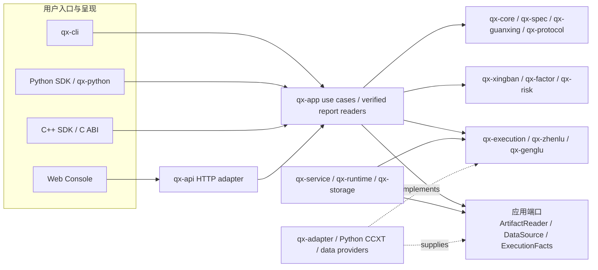
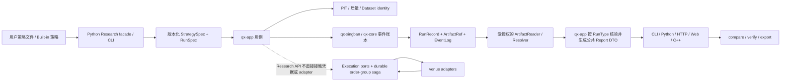
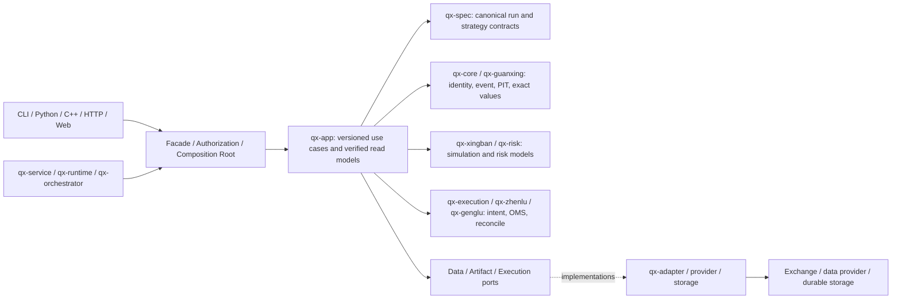
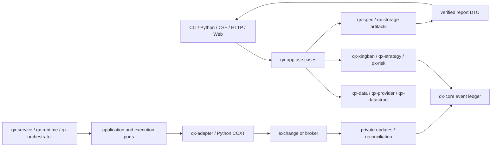

# 牵星 Qianxing：GitHub 竞品与架构深度复核及优化重构方案

> 精简执行版（竞品对标、架构问题单、R0–R6 路线及独立发布门）见[牵星Qianxing-GitHub竞品对标与架构优化重构执行方案-2026-10-25.md](牵星Qianxing-GitHub竞品对标与架构优化重构执行方案-2026-10-25.md)。本文保留逐轮源码复核与实现记录。

> 方案日期：2026-10-25
> 复核对象：D:\aex_work\qianxing 当前工作树、Cargo workspace 依赖、模块地图、Python SDK/CCXT 包和 Web 控制台
> 目的：为后续实现确定架构边界、优先级、具体模块和发布条件
> 状态说明：本文是审查与实施方案，不代表所有工作包已完成，也不代表实盘能力已通过交易所验收。
> 外部资料：于 2026-10-25 浏览各项目公开 GitHub 仓库及官方文档；链接指向可变分支，未来内容可能变化。竞品能力只按公开资料比较，不推断未公开的内部实现。

## 1. 结论摘要

牵星的底层方向合理，不需要推倒重建。Rust 领域内核、策略/数据身份、PIT 可见性、事件账本与重放、应用用例层和多语言边界构成了可持续发展的基础。与许多仅面向历史回测的库相比，牵星已经把运行时、风控、订单生命周期、账户查询、供应商适配和研究产物纳入同一仓库。

现阶段的主要问题是“能力面广于可直接交付的连贯工作流”：

1. 报告读取、核验、数据解析和 HTTP DTO 投影仍有一部分集中在 qx-api。当前工作树已接入 RunRecord V2、内容寻址 ArtifactId、部分生产写入/读取、CLI 证据和 Python 报告；但不同 Run 类型的覆盖、所有入口的统一读模型及不依赖文件路径的存储 resolver 仍未全部完成。
2. 目录层级和 crate 数量较多，边界虽有检查保护，但若用户入口和报告读面仍各自编排，分层本身不会自动带来低耦合。
3. Python、Rust、C++、Web 和 JSON schema 需要共同遵守字段单位、精度、空值、错误和兼容规则；目前仍有重复 DTO/解析边界。
4. 价格、数量、资金的历史 fixed-point 字段与精确 Decimal 路径并存。Base 数量、合约张数、报价预算和结算币种必须用类型表达，不能靠字段名或约定猜测。
5. 多账户、多交易所组合只能通过订单组状态机补偿恢复，不能获得跨所原子事务或共享购买力。现有 spread recovery 是基础，发布前还需要完整的耐久性与故障恢复证明。
6. 多个核心源文件过大。大文件本身不是缺陷，但会扩大改动冲突和审查范围；应按业务责任渐进拆分，不做全仓机械搬移。
7. 数字货币真实链路仍需按 venue、产品、账户模式、订单类型逐项做沙盒验收。离线测试和代码实现不能代替外部回报、成交、撤单及恢复证据。
8. Canonical RunSpec 与 RunRecord V2 已覆盖多种回测及单市场 Bar/Depth 参数实验，但仍非所有实验、多市场/多账户组合和入口共用；不同用例各自保存规格、指纹、种子和市场信息，后续应继续统一“影响结果的输入身份”，再扩大报告读面。

优化应分为两条发布线：先让 Research profile 的“安装包 → 策略文件 → 数据校验 → 回测/搜索 → 样本外分析 → 报告 → 复算”成为单一、易用、可重复的旅程；另行收敛 Live candidate 的能力门控、精度单位、订单组恢复和逐 scope 沙盒证据。研究可发布不表示实盘可发布。

## 2. 复核范围与证据口径

### 2.1 本地源码范围

本次核对了：

- 根 Cargo workspace 与本地 crate 依赖关系；
- docs/module-map.md、docs/牵星Qianxing-GitHub竞品对比与架构优化重构方案-2026-10-24.md、docs/crypto-live-core-audit-2026-10-23.md、docs/工业化易用性收口指南-V1.md；
- crates/qx-core、qx-app、qx-xingban、qx-risk、qx-zhenlu、qx-execution、qx-adapter、qx-runtime、qx-service、qx-storage、qx-api、qx-cli、qx-sdk、qx-python；
- python/qianxing、python/qianxing_ccxt、cpp、web/console、schemas、maturity 和 tools/check_architecture.py。

工作区当前存在大量未提交改动。本文初稿按当时可见源码和已有证据文档完成静态架构复核，不将工作区改动称为已合并或已发布版本；初稿没有运行测试、交易所连接或沙盒订单。后续实现与本地验收另记在 §11，仍不代表沙盒或生产验收。

### 2.2 证据等级

以下状态必须分开表达：

- 实现：有对应源码路径；
- 代码验证：本地契约、单元、集成或构建检查通过；
- 沙盒验证：在官方测试环境完成授权、下单、回报、撤单及恢复流程；
- 生产批准：完成发布、安全、运维和真实账户范围审查。

只有对应证据齐全才能提升状态。Adapter 可加载市场或离线 request fixture 通过，不等于交易所接受订单。回测策略与实盘策略使用同一 API，也不等于成交、时序和资金行为完全相同。

## 3. 项目架构与主要调用链

### 3.1 模块分层

| 分层 | 主要模块 | 责任 |
|---|---|---|
| 领域语义和确定性事实 | qx-core、qx-guanxing、qx-spec、qx-protocol | 身份、精确数值基础类型、事件与账本、PIT 可见性、质量语义和跨边界契约 |
| 数据和存储 | qx-data、qx-provider、qx-datastruct、qx-storage | 行情摄取、数据集、来源选择、列式视图、事件/快照和持久化后端 |
| 研究与仿真 | qx-app、qx-xingban、qx-factor、qx-risk | 研究用例、Bar/Tick/L2 仿真、实验搜索、指标和风险 |
| 策略与执行 | qx-strategy、qx-execution、qx-zhenlu、qx-genglu | 策略生命周期、执行事实端口、风控/OMS/路由、回报归约与对账 |
| 运行时和服务 | qx-runtime、qx-orchestrator、qx-service、qx-scheduler、qx-control | worker、生命周期、调度、控制命令、授权、审计和应用宿主 |
| 供应商和协议适配 | qx-adapter、python/qianxing_ccxt、qx-python、cpp | HTTP/WebSocket、交易所映射、语言 FFI、策略协议和外部数据接口 |
| 用户入口 | qx-cli、qx-api、qx-sdk、Python SDK、Web 控制台 | 命令行、本地/远端 API、安装包、桌面/网页读面与控制面 |

Cargo workspace 当前有 29 个成员，其中 28 个 qx-* crate 与纯测试用 contract-tests。较多 crate 有利于守住稳定边界，但也增加了认知、版本升级和跨层排错成本；每个 crate 必须有独立且不可互换的责任，不能仅以目录数量作为模块化质量指标。

### 3.2 目标依赖方向

目标方向为：

用户入口（CLI / Python / C++ / HTTP / Web）
→ qx-sdk 或 qx-app 用例
→ 领域和执行端口
→ 运行时组合层与存储/网络适配器
→ 具体数据源或交易所。

qx-app 应继续只依赖领域类型和抽象端口；不依赖 HTTP、CLI、Python、具体 adapter、qx-storage 或宿主文件路径。API 和 CLI 可以作为 composition root 装配授权路径与 adapter，但研究业务事实和报告指标应由同一应用用例校验。运行时进程可以依赖多个 crate 装配 worker，这是 composition root 的职责；这不应被复制到普通业务模块。

检查 Cargo metadata 后，qx-api 除 qx-app 外还直接依赖 qx-xingban、qx-data、qx-datastruct、qx-strategy 等模块。它们部分用于传输 DTO、解析和报告投影，未必全是错误依赖；但报告核验规则因此仍有机会绕过 qx-app，应该逐项迁移或记录保留原因。qx-cli 和 qx-service 对很多 crate 的依赖主要是装配职责，不应与 API 的业务重复实现混为一谈。

qx-execution 对 qx-adapter 的 Cargo 关系只出现在 dev-dependencies，用于本地测试，并非生产依赖反向耦合。后续评审不能将测试依赖误报成运行时架构环。

### 3.3 研究与报告调用链

数据源或文件 → 数据集、PIT 与质量校验 → Python/Rust/C++ 策略绑定 → qx-app 用例 → qx-xingban 撮合与 qx-core 账本 → EventLog、RunManifest 和 sidecar → qx-app 核验/报告 DTO → CLI、Python、HTTP/Web 展示。

当前已有 Bar、Tick/L1、L2、双腿、多市场、搜索、OOS 和偏差诊断等多条实现路径。需要进一步统一的是“产物如何被引用、授权、核验和投影”，以及不同产物类型是否共享相同的报告身份。不能让 API 与 CLI/Python 分别重算收益、回撤或成交归因。

### 3.4 真实执行调用链

策略输入 → 领域订单意图 → 能力与账户模式预检 → 风险检查与账户限额 → OMS / 幂等 client order ID → 交易所适配器 → 接受、拒绝、部分成交、成交、撤单或未知结果 → 事件归约、账本、对账和报告。

请求超时不一定代表订单未提交。结果未知时要用原幂等键和对账路径查询外部事实，禁止直接生成新订单重发。多账户只共享上层订单组和归因，不共享余额或购买力，也不具备跨交易所原子提交。

### 3.5 目标依赖和调用图

下图描述后续要稳定下来的边界。实线表示入口调用/依赖方向；虚线表示基础设施适配器实现应用或执行端口。`qx-app` 是研究用例和报告事实的唯一 owner；CLI、HTTP、Python 与 C++ 负责协议转换、授权或呈现。



CLI、HTTP 与 PyO3 初始化可以依赖多个 crate，因为它们是 composition root。普通领域模块不应反向依赖入口、路径布局或交易所 JSON。跨所组合由执行端口和持久化订单组协调；报告中的汇总视图保留账户/结算币边界。

## 4. GitHub 竞品对比

对比以产品定位为准，不把研究库、交易引擎和完整交易平台直接按功能数量排名。

| 项目与公开定位 | 强项与可借鉴点 | 对牵星的启发及牵星差异 |
|---|---|---|
| [Freqtrade](https://github.com/freqtrade/freqtrade)：Python 加密货币交易机器人；文档覆盖策略、数据下载、回测、结果导出、分析、参数优化、dry-run 和 Web/Telegram 控制 | 从策略文件到回测和 dry-run 的流程连贯；回测报告可导出；提供参数优化和 lookahead/recursive 诊断入口；用户上手旅程明确。官方文档同时说明回测是模拟，详细周期可改善 bar 内撮合假设，但不会使历史结果等同真实成交。 | 牵星的 Rust 确定性账本、PIT/质量门、A 股规则和 L1/L2 模拟更强调可审计语义；牵星安装后的策略研究入口、报告对比和参数搜索默认体验仍更复杂。优先借鉴“一个命令做预检/回测/分析”的引导，不复制为仅 crypto 的产品边界。[回测文档](https://github.com/freqtrade/freqtrade/blob/develop/docs/backtesting.md) · [基础循环](https://github.com/freqtrade/freqtrade/blob/develop/docs/bot-basics.md) |
| [RQAlpha](https://github.com/ricequant/rqalpha)：支持多证券的 Python 回测/交易框架，强调可扩展组件 | Python 策略 API 和组件替换的产品表达清楚，适合参考研究者 API 和组件接缝。公开仓库许可文件对商业用途有单独授权要求，集成或借鉴代码前应重新审查当前许可证。 | 牵星以 Rust 运行核心、多语言策略和更细的市场/执行身份为优势；应继续降低策略 API 概念数量，并用版本化端口支撑替换。RQAlpha 的许可说明见[仓库 LICENSE](https://github.com/ricequant/rqalpha/blob/master/LICENSE)。 |
| [NautilusTrader](https://github.com/nautechsystems/nautilus_trader)：Rust 原生、多资产、多 venue 的事件驱动回测与实盘引擎 | 与牵星技术路线最接近；公开文档明确描述共享的 backtest/sandbox/live 核心、Rust/Python 两种开发路径、高低层回测 API、数据目录和执行对账。它也显式写出 transport、timing、持久化和 reconciliation 导致的回测/实盘差异。 | 牵星的 A 股规则、数据 PIT/质量门和跨语言策略协议是差异点；Nautilus 展示的高层节点/低层引擎双 API、目录流式运行和执行核对材料值得借鉴。牵星需要继续证明统一的事件生命周期，不应只按“共享策略代码”宣传“共享成交逻辑”。[架构概览](https://github.com/nautechsystems/nautilus_trader/blob/develop/docs/concepts/overview.md) · [Rust API](https://github.com/nautechsystems/nautilus_trader/blob/develop/docs/concepts/rust.md) · [回测/实盘差异](https://github.com/nautechsystems/nautilus_trader/blob/develop/docs/concepts/live.md) |
| [VeighNa / vn.py](https://github.com/vnpy/vnpy)：Python 交易框架及 gateway/app 扩展生态 | 国内交易渠道、Python gateway、事件引擎和 GUI 生态成熟；README 还展示了 `vnpy.alpha` 的因子、模型、策略与研究流程，适合作为 A 股渠道和本地研究体验的对标。 | 牵星的 Rust 确定性账本、PIT/质量门和运行身份是差异点；需要把已具备的研究能力收敛成同样连贯的策略文件到报告流程，并公开渠道/产品/账户模式验收矩阵。每个 gateway 的存在都不能直接推导为某账户已验收。[英文 README](https://github.com/vnpy/vnpy/blob/master/README_ENG.md) |
| [Microsoft Qlib](https://github.com/microsoft/qlib)：AI/量化研究平台 | qrun 把数据、模型、评估、回测串成完整工作流，并配有实验记录和图表分析；适合作为实验管理、训练/OOS、信号质量和策略对比工具的对标。 | 牵星已有下单/风控/OMS/执行适配边界，Qlib 不替代这些交易职责；牵星应把研究 Run、参数搜索、OOS 与报告归档关联成可查询的实验记录。[qrun 工作流](https://github.com/microsoft/qlib/blob/main/docs/component/workflow.rst) |
| [vectorbt](https://github.com/polakowo/vectorbt)：向量化策略研究与组合分析库 | pandas/NumPy 风格批量研究、灵活广播与组合统计让参数和资产横向扫描很快；当前公开仓库还提供可选 Rust 后端和引擎分派，说明 Python 易用性与热路径加速可以按调用逐步组合。 | 牵星不应把逐事件撮合硬改成向量化：订单队列、部分成交、资金费率与多账户状态必须保留因果事件语义。可借鉴的是独立的批量因子/参数候选生成器、清晰的 Python→Rust dispatch，以及与事件回测共享同一费用、精度和报告合同。适用范围要明确区分信号快速筛选与精细撮合回测。[组合实现](https://github.com/polakowo/vectorbt/blob/master/vectorbt/portfolio/base.py) · [发布说明](https://github.com/polakowo/vectorbt/releases) |
| [QuantConnect LEAN](https://github.com/QuantConnect/Lean)：开源事件驱动多市场算法引擎及配套 CLI 产品流程 | README 展示 project-create、research、backtest、optimize 和 live 的完整入口；可插拔组件及环境配置有利于从本地研究转向执行部署。 | 牵星已具备更细的输入质量和本地可重放证据，但“初始化项目—运行—比较—部署检查”的端到端路径还不够紧凑。LEAN 配套数据/券商与云功能要按其适配器和部署条件核对，不能只凭命令名称判断能力。[官方 README](https://github.com/QuantConnect/Lean/blob/master/readme.md) |
| [Backtrader](https://github.com/mementum/backtrader)：Python 回测库 | Cerebro 将策略、数据 feed、broker、analyzer、observer 和 writer 组合，易于理解和快速试验；可参考低门槛门面以及可扩展分析器。 | 牵星有更显式的账户/订单身份、多粒度撮合和审计账本；但高层 API 仍可以更短，让初学者快速建立“绑定数据 → 策略 → 运行 → 分析”流程。[Cerebro 实现](https://github.com/mementum/backtrader/blob/master/backtrader/cerebro.py) |

### 4.1 牵星的相对优势

- **确定性与可复算**：Rust 内核、事件账本、输入指纹、RunManifest 和重放核验让结果可追溯。
- **数据语义清晰**：PIT、质量等级、数据来源身份和 Bar/Tick/L2 分层使“数据无法支持时拒绝运行”成为可能。
- **执行关注面完整**：领域内已有 OMS、风险、对账、worker、能力门控和供应商映射，不止一个历史回测脚本。
- **跨语言可扩展**：Rust/Python/C++ 入口围绕共享策略/领域契约，适合将高热路径与用户策略语言分离。
- **面向不同市场的基础覆盖**：A 股与数字资产规则及现货/合约方向均有代码路径；具体可用范围需以成熟度登记为准。

### 4.2 牵星的相对短板

- **用户路径较长**：配置、数据、策略 manifest、运行 profile、产物核验和报告概念多；初次成功路径仍需要更多默认值和明确错误。
- **功能清单多于闭环说明**：多个能力已存在，但用户要弄清适用产品、账户模式、精度、外部证据和限制仍然困难。
- **报告实现横跨层**：报告 DTO、文件解析、路径授权和部分领域复核混在 API，其他入口也有各自投影。
- **精度和单位演进成本高**：遗留 raw fixed-point 与更精确 Decimal 并存；小币种与合约容易让单位误用变成真实订单风险。
- **研究报告产品化不足**：离线报告和样本外链路存在，但研究实验管理、图表比较、成本敏感性和稳健性结论未完全形成统一体验。
- **外部交易证据有限**：任何没有用户授权 sandbox 的真实下单/撤单/恢复行为都不能宣称已经验证。
- **维护边界有膨胀趋势**：核心业务文件、报告文件和架构 gate 大；同一概念在 Rust、Python、JSON schema 和 UI 之间维护成本高。

### 4.3 竞品适用边界与牵星取舍

| 项目 | 公开资料能确认的适用边界/代价 | 牵星应吸收的做法 | 不应直接照搬的部分 |
|---|---|---|---|
| Freqtrade | 以加密货币交易为主，策略、回测、dry-run/live 与 Web/Telegram 控制形成顺畅的一体化体验；其文档也指出动态 pairlist 会依赖当前状态影响复现，回测输出只打包策略及配置等指定内容，不含策略的任意外部依赖。 | 从安装和策略文件开始给出短路径；自动保存可加载报告、分析表和来源假设；策略依赖和运行环境需要纳入产物身份。 | 不把单一加密资产交易机器人的产品结构当作 A 股、多市场和多账户通用模型；不把历史回测结果当作真实成交保证。[回测输出与复用](https://github.com/freqtrade/freqtrade/blob/develop/docs/backtesting.md) · [Lookahead 分析](https://github.com/freqtrade/freqtrade/blob/develop/docs/lookahead-analysis.md) |
| RQAlpha | Python 策略 API 和 Mod 扩展点清晰；其仓库许可证对商业用途存在额外限制，且 `pyproject.toml` 的包元数据与 LICENSE 正文表达不完全一致，代码复用前必须以 LICENSE 和权利方授权为准。 | 给出简单的策略入口和明确可替换组件示例，减少新手需要理解的 crate/schema 数量。 | 不复制源代码或假设包元数据就是完整许可证；牵星以窄端口和版本化 schema 实现扩展。[事件源/Mod 机制](https://github.com/ricequant/rqalpha/blob/master/docs/source/development/event_source.rst) · [LICENSE](https://github.com/ricequant/rqalpha/blob/master/LICENSE) |
| NautilusTrader | 公开架构明确分离数据、风险、执行、组合、缓存和消息总线，并复用 backtest/live 核心；文档明确说明网络、时序、持久化和对账造成差异，也说明当前一个进程内不能并行运行多个 node。 | 清晰展示 kernel 组件边界、高低层 API、执行差异和恢复/对账责任；以同一事件语义支撑研究与执行。 | 不照搬全局运行状态或把“策略代码相同”宣传成“成交结果一致”；牵星需要定义自己的运行隔离和多账户进程模型。[架构](https://github.com/nautechsystems/nautilus_trader/blob/develop/docs/concepts/architecture.md) · [Backtest/Live 差异](https://github.com/nautechsystems/nautilus_trader/blob/develop/docs/concepts/live.md) |
| VeighNa / vn.py | Python gateway、事件引擎和国内渠道生态较直观；当前 README 还列出 `vnpy.alpha` 的因子数据、模型、策略与 lab 研究工作流。Gateway 能力仍随具体接口而异。 | 对本地用户提供易懂的渠道、事件流、研究流程和扩展示例；逐个 adapter 暴露受支持产品、账户模式和验证级别。 | 不用“存在 gateway 类”推出“某交易所订单链路已验收”；保留 capability scope 和外部证据的细粒度。[README](https://github.com/vnpy/vnpy/blob/master/README_ENG.md) · [Gateway](https://github.com/vnpy/vnpy/blob/master/vnpy/trader/gateway.py) · [事件引擎](https://github.com/vnpy/vnpy/blob/master/vnpy/event/engine.py) |
| Microsoft Qlib | 强项是数据/model workflow、指标分析和带 artifacts 的 experiment/recorder；其公开工作流面向量化研究和模型实验。 | 统一 Experiment → Run → Candidate/Fold → Artifact 的查询、记录、对比与报告体验。 | 不把研究记录器当作 OMS、账户风险或交易所执行引擎；这些能力仍需由牵星的执行域负责。[Recorder](https://github.com/microsoft/qlib/blob/main/docs/component/recorder.rst) · [Workflow](https://github.com/microsoft/qlib/blob/main/docs/component/workflow.rst) |
| QuantConnect LEAN | 官方仓库把项目初始化、research、backtest、optimize、live 作为完整命令旅程展示，并提供多市场引擎。不同数据源、券商和部署方式仍需具体配置；命令存在本身不代表用户已具备其数据或券商条件。 | 让项目创建、策略运行、优化、报告查看、部署检查有一致命令和状态模型。 | 不在没有数据/券商与账户证据时承诺开箱即用；保留本地运行和安装后离线能力。[LEAN README/CLI](https://github.com/QuantConnect/Lean/blob/master/readme.md) |
| Backtrader | `Cerebro` 将 data feed、strategy、broker、analyzer、observer 和 writer 放进易学习的组合 API，适合作为低门槛研究库对标；其产品边界与带持久服务、细粒度执行治理的引擎不同。 | 为高层 Python API 提供少量默认参数，几行代码建立数据—策略—运行—分析链路，同时保留低层接口。 | 不牺牲确定性、账户/订单身份和可复算证据，只为模仿轻量 API；保持高层门面下的契约边界。[Cerebro 文档](https://github.com/backtrader/backtrader-docs/blob/master/docs/cerebro.rst) |

## 5. 具体架构不合理项及开发细节

### 5.1 报告读链跨层过多

现有报告代码横跨 qx-app、qx-api、qx-cli 与 Python。当前 Bar/深度核心核验和部分多市场核验已迁入 qx-app，但 API 仍负责多市场报告编排和较大块的投影、上下文绑定和校验。当前工作树中 `crates/qx-api/src/app_surface/research_artifacts.rs` 仍有约 5,478 行，函数包含 Bar、深度、多腿、多市场、多账户等不同报告分支；此前已经将多市场报告拆出子模块，但报告读取/展示边界仍未完全收敛。

问题不是“API 不能依赖数据类型”，而是同一运行结果的事实核验和指标口径不应由入口层重写。修复方向：

1. 将完整报告读取接口放在 qx-app，以 ArtifactReader 接收经过授权的只读数据源。
2. qx-app 负责 schema、运行身份、输入指纹、账本重放、摘要/成交/权益一致性及统一报告 DTO。
3. qx-api 的 adapter 只负责授权根目录、解析 ArtifactId、限流/大小、调用 use case、转换 HTTP 状态码。
4. CLI/Python/Web 消费相同 DTO；只做展示和导出，不重算领域事实。
5. 每种 Run 类型必须在统一 report manifest 里声明支持的事件、sidecar、质量证据和缺失时的 incomplete 状态。

### 5.2 ArtifactReader 仍是路径兼容接口，身份未完全逻辑化

当前工作树已实现内容寻址 ArtifactId、reader-aware 校验和部分 RunRecord V2 写入/读取；V2 引用包含 kind、schema version 与 byte length，历史 V1 仍按 path + digest 读取。摘要中的 `run_record` / `run_manifest` 指针及 `artifact_locations` 目前仍提供文件位置，文件存储 adapter 也仍以 reference 字符串打开文件。根目录授权 adapter 是必要安全边界，但路径仍参与存储定位；后续逻辑存储 resolver、非文件存储后端及所有 Run 类型迁移尚未完成。

改进细节：

- 先引入 RunId、ArtifactId、ArtifactKind、schema_version 和内容 digest 的强类型引用；ArtifactId 由已验证的内容身份产生，不直接包含宿主绝对路径。
- 保留兼容的 FileArtifactReader，由外层 Resolver 通过 artifact root 和 metadata 把逻辑引用映射为文件位置。
- 后续实现 SQLite/对象存储时复用相同 qx-app 读端口，不改变报告核验算法。
- 读取时逐项验证 artifact kind、RunId、manifest digest、长度上限和内容哈希；拒绝跨 run 引用、同名不同内容和目录越界。
- 迁移期间读旧 V1 RunRecord，写新引用版本；旧产物只读不重写，保证既有 digest/replay 可复算。

### 5.3 全量 EventLog 内存占用尚未被界定

多市场 Bar/Depth v2 的报告、证据和复算读侧已能通过 qx-app 流式读取 JSONL 并重放；历史 v1 与多腿 artifact 仍保留内嵌完整事件序列，部分生产流程也会在写入 JSONL 前持有完整 EventLog。最大输入可被限制不代表峰值 RSS 已受控，端到端容量基线仍缺失。

改进细节：

- 定义流式逐行解析和连续 replay API，输入顺序由 EventLog 因果序校验器确认。
- Replay validator 只保留账本状态和必要的 bounded indexes；成交核对改用排序游标/哈希摘要/有界分页状态，避免为全量报告复制整个事件集。
- 设定最大事件、最大行长、最大聚合条目、超时和内存预算；超限给出明确的 report-incomplete 或 reject reason。
- 以固定规模梯度采集 peak RSS 和耗时，给出硬上限；基线测量后再把大文件格式/索引调整纳入方案。

### 5.4 数值与单位边界需要版本迁移设计

历史 Price、Quantity、Money 的 raw 值按固定 1e9 scale 传递；另有 ExactDecimal/精确字符串路径。它们不能被统一描述成“全链路支持任意小数精度”。

改进细节：

- 先写 V2 ADR：字段语义、十进制表示、溢出、rounding mode、serde 格式、hash 版本、旧事件读写规则、C ABI/Python/JS 序列化格式和升级/降级策略。
- 引入带单位类型：Price、BaseQty、ContractQty、QuoteBudget、FeeAmount<Currency>、Money<Currency>；不同单位间禁止隐式转换。
- 市场规则快照带 tick size、lot size、min notional、contract multiplier、settlement currency 和有效区间。
- 转换必须显式指定向下/向上/最近舍入；不合法小数、合约张数和名义额不满足交易所约束时 fail closed。
- 旧 v1 event/RunRecord 仍能读和 replay；新写入使用 versioned values。跨语言 golden fixtures 覆盖小币种、多币种、多合约单位、边界值和负值。
- 在完成迁移并具备旧产物兼容证据前，不改变现有哈希或批量重写用户数据。

### 5.5 端口与供应商实现需要保留单向依赖

qx-execution 是领域执行边界，真实 HTTP/WebSocket、密钥和供应商结构应留在 qx-adapter 或 Python CCXT connector。当前 Cargo metadata 中 qx-execution 对 qx-adapter 的关系为开发测试依赖，不属于生产依赖；这个方向当前没有因 dev dependency 而形成生产架构环。

后续保持这些职责：

- qx-execution 定义可表达未知提交结果的订单生命周期端口/事实类型；
- qx-adapter 将供应商请求、回报、限频和断线恢复映射到稳定领域事实；
- qx-service/qx-runtime 装配 credentials、worker、超时、持久化和启动/停止；
- qx-zhenlu/qx-risk 管理风险和 OMS 决策，不承载供应商 JSON 字段；
- 市场数据和账户只读能力按独立 MarketDataPort、AccountQueryPort、VenueRulesPort 暴露，禁止万能 gateway trait 强迫所有 venue 模拟同一能力。
- gateway capability 必须按 venue × product × account mode × order shape × operation 细化，不给一个笼统的“交易所已支持”布尔值。

### 5.6 策略接口应统一生命周期，不统一继承语言结构

Rust Strategy trait 与 Python/C++ callback 不需要拥有相同的面向对象结构。跨语言真正应统一的是版本化生命周期、可见事件、输出 intent、错误和身份字段。

策略协议需要显式约定：

- artifact ID、版本、源码摘要、参数 schema 与策略环境；
- init、market event、timer、order update、fill、stop 和 error 生命周期；
- 每个回调可见的数据时间边界和 PIT 规则；
- 回调超时、失败、取消后的确定状态；
- order intent 的价格/数量单位和账户身份；
- deterministic seed、warmup/ready 状态、行为限制和诊断记录；
- schema 兼容策略和语言侧 golden fixtures。

Python 与 C++ 可以提供可选 BaseStrategy/helper 降低样板；核心契约仍由版本化 schema/trait/函数调用定义，不能以强制继承当作协议。

### 5.7 订单组要有耐久 Saga 生命周期

多交易所/多账户交易无法原子化，应使用持久订单组 Saga：

创建组 → 账户与能力预检 → 每腿风险预留 → 提交各腿 → 逐腿回报/成交 → 不平衡补偿/对冲 → 组级对账 → 完成或人工介入。

每条腿至少保存账户、venue、产品、方向、数量单位、client order ID、外部订单 ID、提交尝试、最近外部事实、成交累计、费用、结算币种和版本化市场规则。超时为 unknown 时先 reconcile；补偿需上限、deadline 和人工终态。进程重启后根据已持久状态推进，不得只靠内存重试循环。跨账户净值可用于展示，不得作为共享购买力。

### 5.8 研究执行工作流应区分两层 API

对标高层研究 API 的简洁性，同时保留底层组合能力：

- 高层：给出策略文件、数据源/数据集、日期、账户和 profile，一条 API 完成 validate → run/search → diagnose/OOS → report → verify。
- 低层：高级用户可独立装配 AppClient、Strategy、MarketSpec、ExecutionModel、SearchPlan 和 Storage。
- 单次运行的 run_id、ExperimentId、strategy digest、dataset digest、ExecutionModel、参数和样本切分必须进入产物身份。
- 参数搜索报告默认显示训练、验证与 OOS 结果；没有 OOS 时明确标为“仅样本内，不足以判断策略有效性”。
- 一个安装后示例应从真实 wheel 使用策略文件完成整条流程，不能只在源码仓库 cargo run 成功就算用户体验完成。

### 5.9 运行身份尚未收敛为 Canonical RunSpec

当前源码有多个按场景拆分的运行规格、规格指纹、配置哈希和数据指纹，也有搜索 seed、回测 seed、策略身份及市场输入身份。2026-10-25 已建立 v1 Canonical RunSpec，并接通单市场 Bar、Depth、共享账户多市场 Bar/Depth、联合账户 Bar、普通多账户 Bar/Depth、多腿 Bar、Provider Bar，以及单市场 Bar/Depth 和多市场 Depth 参数实验的写入和读侧核验；多腿/多账户实验、provider 其他形态及跨语言等价仍待迁移。分场景规格仍是合理的扩展点，风险在于基础身份字段各自拼装，新增字段时可能漏入某条指纹路径，导致等价输入身份不一致或影响结果的假设没有改变 Run identity。

Canonical RunSpec 应由稳定基础段和类型化扩展段组成：

- 基础段绑定策略代码摘要/版本/参数、数据集摘要和可用时间边界、运行区间、市场/产品/账户模式、市场规则快照、执行模型版本、手续费/滑点/资金费、时间精度/时区、随机种子及 schema 版本。
- 不将本机绝对路径、密钥、展示名称或临时输出目录纳入行为指纹；数据内容身份和规则内容必须纳入。将 provenance（来源/下载时间）与行为输入分开记录，避免“来源变化但内容相同”无故改变仿真身份。
- Canonical JSON 固定字段顺序、Decimal 文本、缺省值和集合排序规则；每个 RunType 仅能添加显式声明的扩展字段。新旧 schema 的 reader 保留旧产物复算能力。
- 所有入口在调用仿真前先生成同一 canonical bytes 与 fingerprint；改变任一影响成交、费用、风险或可见数据的输入，fingerprint 必须随之变化。

### 5.10 文件过大需按职责渐进拆分

本轮从当前工作树读取到的物理行数（含测试、注释和空行，不等于生产逻辑行数；行数用于定位维护风险，不作为重构完成目标）：

| 路径 | 约行数 | 拆分建议 |
|---|---:|---|
| crates/qx-api/src/app_surface/research_artifacts.rs | 3,766 | 已抽出多市场、multi-leg、multi-account 等报告子模块；继续把 schema/身份/重放事实迁入 qx-app，API 留授权、resolver 与投影 |
| crates/qx-api/src/lib.rs | 3,555 | 按路由、HTTP 编解码、WebSocket 和控制命令拆分，先锁定 route/error contract |
| crates/qx-app/src/cases/run_experiment.rs | 2,961 | candidate 调度、fold 执行、样本外汇总和报告组装分离 |
| crates/qx-app/src/cases/experiment_search.rs | 1,913 | 参数空间、proposal、候选排名、停止条件与诊断分离 |
| crates/qx-adapter/src/binance.rs | 3,080 | 按市场规则、行情、账户读取、订单命令/回报、签名传输分职责 |
| crates/qx-runtime/src/pipeline.rs | 2,562 | 保持 validate/reserve/execute/commit/publish 阶段边界，每阶段独立输入输出 |
| crates/qx-cli/src/report_multi_market.rs | 1,538 | CLI 只解析参数并投影应用层验证后的 DTO；移除重复业务判断 |
| python/qianxing/app.py | 3,925 | 保持公开 re-export，内部拆 specs、local/remote clients、reports、research operations |
| python/qianxing_ccxt/__init__.py | 3,553 | 保持兼容导入，内部拆 market rules、orders、account reads、Binance/OKX/Bitget overrides |
| web/console/app.js | 3,445 | API client、state model、页面 controller、event stream、report components 分模块 |
| tools/check_architecture.py | 25,062 | 按稳定 rule ID 拆依赖、schema、API/CLI/语言边界、发布和 workflow checks |

以上为 2026-10-25 当前工作树的行数快照（`Get-Content` 行统计），不是质量指标，也不是要求按固定行数机械拆文件。旧快照显示更高行数，说明已有拆分发生；评估后续进展应看责任边界、行为基线与依赖方向，而不是只看 diff 的行数。

拆分标准：先有当前行为/响应基线，一次移动一个责任域，保持公开导入、HTTP/CLI JSON 和 C ABI 稳定；确认新模块由行为测试或结构化规则保护后，才删旧实现。不能为了降低行数而拆成大量只有转发的文件。

### 5.11 项目事实在文档与代码之间发生漂移

本次复核中，`cargo metadata --no-deps` 返回 29 个 workspace members（28 个 `qx-*` crate + `contract-tests`），但 README 的交付面快照仍写 25 个成员（24 个 `qx-*` crate + `contract-tests`）。这类数字不影响交易结果，但会让用户误判维护规模；CLI 命令、HTTP 路由、部署模板、语言用例和 capability 状态也存在多份文档/生成产物，手工改动容易让它们彼此失配。

处理方式：

- 以 `cargo metadata`、clap/API 路由表、`maturity/capabilities.yaml`、schema registry 和发布矩阵分别作为事实源。
- 为可机械取得的数量和枚举建立单一生成器，README、模块地图、接口文档和语言绑定只消费生成结果；生成器支持 `--check` 并进入发布门。
- 对不能自动生成的产品限制/模型假设保留人工说明，但每段绑定代码路径、能力登记键和最近验证日期。
- 生成差异必须阻止发布构建，避免只更新 README 数字而漏更新真正的能力事实源。

## 6. 优化与重构实施路线图

| 阶段 | 优先级 | 交付工作 | 关键模块 | 完成门槛 |
|---|---|---|---|---|
| A. Canonical RunSpec、产物身份与报告读面 | P0 Research / Live 基础 | 先统一行为输入 canonical bytes/fingerprint，再按 RunId/ArtifactId 绑定版本化报告 DTO、跨产物 digest/身份和 replay 验证；按 Bar、depth、多市场、多腿、多账户、provider/实验扩展覆盖 | qx-spec、qx-app spec/artifact_store/report_read、qx-api research_artifacts、qx-cli report、Python reports | CLI/Python/API 对等价输入产生相同 canonical identity；所有影响结果的假设改变 fingerprint；各入口报告身份/状态/指标一致；path 只由授权 resolver 解析；旧 RunRecord 可读 |
| B. Research 安装后最短闭环 | P0 Research | 高层 Python API/CLI profile；策略文件 preflight；确定默认数据、费用和执行模型；run/search、OOS、未来数据/预热诊断、HTML/CSV、verify/replay 一路贯通 | qx-app use cases、qx-sdk、qx-python、python/qianxing、qx-cli、web/console | 最终 wheel 安装后按单一 quickstart 完成完整路径；所有阶段产物能相互定位；没有 OOS 的结果明示不可判定；与低层调用结果一致 |
| C. 报告产品化和策略比较 | P1 | 交互式报告与多 run 对比；收益、回撤、基准、成本敏感性、交易分布、分时/分市场/币种归因、数据质量和假设说明 | qx-app report DTO、Python/HTML、Web 报告组件 | 报告只渲染已验证事实；所有图表可导出且绑定数据身份；缺项为 incomplete 而不是显示伪零 |
| D. 精度与单位 V2 协议 | P1 Live blocker | 编写 ADR、类型定义、旧数据兼容、精度和交易规则转换，接 Rust/CCXT/Python/C++/Web | qx-core numeric/trading、qx-protocol、schemas、qx-adapter、python/qianxing_ccxt、FFI | tick/lot/min notional、contract multiplier 和币种路径精确；所有语言 golden fixtures 一致；旧 v1 replay 与哈希保留；禁止静默截断/浮点舍入 |
| E. 单 venue 沙盒执行 conformance | P1 Live evidence | 固定 Binance/OKX/Bitget 的 venue × product × account mode × order type profile；测试权限、开平、撤单、查询、部分成交和重启恢复 | qx-app capability gates、qx-service、qx-adapter、qianxing_ccxt、maturity | 每个 scope 有用户授权的官方 sandbox 证据包；请求/回报已脱敏；成熟度只提升到该证据所支持级别。无凭据时只能报告 code-tested/implemented-unverified |
| F. Durable 多账户订单组 Saga | P1 | 将已有 spread recovery 和 order lifecycle 收敛到持久 OrderGroup/LegState；unknown 对账、幂等、补偿和人工介入 | qx-zhenlu、qx-execution、qx-service、qx-storage、qx-runtime | 对每种崩溃窗口执行故障注入；重复提交/入账为零；重启可继续或安全终止；组状态、每腿事实与账户风险可审计；不提供跨账户共享购买力语义 |
| G. 研究/交易两类作业的耐久性 | P1/P2 | 区分可恢复任务和进程内任务；定义任务快照/检查点、恢复策略、取消与终态；策略 callback 的恢复边界写入 manifest | qx-app RunHandle、qx-service、qx-storage、qx-runtime、API/Python clients | 服务重启后状态明确；可恢复任务从合法检查点继续，不可恢复任务失败时有唯一终态和产物；幂等取消/等待/重试 |
| H. 按职责拆分和容量画像 | P2 | 渐进拆大文件、拆架构 gate、生成器事实源；发布构件和固定输入数据集跑容量基线；区分研究/Paper/单账户/多账户 profile | §5.10 路径、§5.11 事实生成器、CI、benchmarks、安装包流程 | 各平台最终安装产物完成 quickstart；按 markets × rows/ticks × candidates × concurrent runs 记录耗时、peak RSS、磁盘增长和 p95；架构规则 ID/输出不丢失，事实生成器 `--check` 无漂移 |

### 6.1 实施顺序与依赖

1. 先完成 A 的 Canonical RunSpec 与基础身份字段，再完成 RunId/ArtifactId、读取授权与统一验证入口；不改变历史 digest 算法，采用新 schema 版本并保持旧产物只读兼容。
2. 以 A 为基础完成 B 的安装包研究旅程和 C 的报告消费。
3. D 的 ADR 可以同步设计，但在协议决策前不写破坏性 raw 数据迁移。
4. E 按单一 sandbox profile 独立进行；没有凭据时继续完成可离线验证的代码，但不能冒充沙盒验收。
5. F 依赖精确单位模型和 E 中稳定的单腿外部生命周期；先做代码与故障场景，再逐账户/venue 验收。
6. G 明确哪些 Run/订单状态是可恢复的，避免将线程存活误报成作业耐久。
7. H 分批穿插，每次只拆一块并保留对照证据，不延迟对外可用的 Research profile。

### 6.2 切片拆分的次序

报告模块：先让所有 run 用例消费同一 Canonical RunSpec；再把身份/验证放入 qx-app，将 qx-api 的各类投影拆到独立文件，最后迁移多账户、多腿及 Tick/L2 DTO。

Python：首先保持 qianxing.app 的兼容 re-export，然后将 specs/client/report 分离；CCXT 包随后拆 registry/market rules/account/orders/venue override。每次拆分保持 wheel 内 import 路径兼容。

Rust 执行：先定义不依赖供应商 JSON 的 port 和 side-effect outcome；在 adapter 边界转换；服务层负责 worker 及持久状态。执行 trait 不纳入所有行情、账户、规则和交易服务的全能 ExchangeGateway。

门禁：为现有有效检查加稳定 rule ID、来源和 owner，再按依赖、schema、surface、release、workflow 拆文件；生成式 capability catalog 以 `maturity/capabilities.yaml` 等事实源为准，通过 generator drift 检查同步 Rust、Python 和文档副本。任何过期检查先以替代证据覆盖并比较结果，避免把“删历史无效门禁”误用成删除有效架构保护。

## 7. 发布条件

### Research profile

- 使用声明支持的平台最终安装包，而非仅源码工作区。
- 一份策略文件和一份数据配置可预检、回测/搜索、输出样本外结果、偏差诊断、交互报告和 verify。
- 相同输入/参数/策略身份产生相同 Run identity；报告中明确撮合、手续费、滑点、数据质量及范围假设。
- 多入口读取同一个逻辑 Run 和报告 DTO；未验证产物标记 incomplete/error。
- 安装、升级、导入兼容、示例策略和结果复算都按发布构件验证。

### Live candidate

- 每个 venue/product/account mode/order shape 有独立 capability ID、代码证据和 sandbox evidence 状态。
- 关键数字/单位路径不进行隐式换算；规则快照绑定运行与订单。
- unknown、部分成交、撤单、断线重启和人工外部操作均有订单对账策略。
- 多账户组合支持独立限额、持久 order-group、补偿和人工终态；不宣传原子交易或共享购买力。
- 未完成官方 sandbox 证据的能力保留为代码实现/离线验证，不能标记为生产批准。

## 8. 架构决策

- **不新增全能 ExchangeGateway。** 通过市场数据、账户查询、市场规则、订单执行和对账等窄端口组合；交易所特有能力作为 capability/profile 明确表达。
- **不要求跨语言继承 BaseStrategy。** 核心统一生命周期和序列化策略契约；每种语言可提供可选 helper/base class。
- **保留 Rust 共享核心。** Python/C++/HTTP/Web 不复制账本、风险、回放和成交计算。
- **先修身份、单位与读写语义，再拆物理文件。** 仅机械移动容易把耦合藏在更小文件中。
- **研究与实盘分开设发布门。** Research 能发布并不代表 live 能力已验收。
- **逐步兼容，不批量破坏既有产物。** schema、RunRecord、digest、C ABI、Python import 和 HTTP JSON 的变化需要明确迁移/兼容策略。

## 9. 相关本地资料

- [2026-10-24 GitHub 竞品对比与架构优化重构方案](牵星Qianxing-GitHub竞品对比与架构优化重构方案-2026-10-24.md)
- [项目模块地图](module-map.md)
- [数字货币真实执行链审计](crypto-live-core-audit-2026-10-23.md)
- [工业化易用性收口指南](工业化易用性收口指南-V1.md)
- [发布场景与验收入口](发布场景与验收入口-V1.md)
- [策略未来数据与预热偏差诊断](策略未来数据与预热偏差诊断.md)
- [自适应参数搜索](自适应参数搜索.md)

## 10. 外部官方对标资料

- [Freqtrade GitHub](https://github.com/freqtrade/freqtrade)
- [Freqtrade 回测文档](https://github.com/freqtrade/freqtrade/blob/develop/docs/backtesting.md)
- [Freqtrade 回测/实盘循环说明](https://github.com/freqtrade/freqtrade/blob/develop/docs/bot-basics.md)
- [RQAlpha GitHub](https://github.com/ricequant/rqalpha)
- [RQAlpha LICENSE](https://github.com/ricequant/rqalpha/blob/master/LICENSE)
- [NautilusTrader GitHub](https://github.com/nautechsystems/nautilus_trader)
- [NautilusTrader 概览](https://github.com/nautechsystems/nautilus_trader/blob/develop/docs/concepts/overview.md)

## 补充：竞品能力刷新与差距判断

本节将公开项目文档中可直接确认的产品能力，与牵星当前源码结构对照。它是工作流和边界比较，不是吞吐量、交易质量或生产成熟度排名；各项目仓库的默认分支会变化，采购或集成决策前应重新核对。

| 维度 | 竞品公开实践 | 牵星现状与实际差距 | 方案决定 |
|---|---|---|---|
| 策略研究闭环 | Freqtrade 把数据下载、回测、交易导出、图表分析、策略对比和 Hyperopt 连在 CLI/Web 流程里；导出包包含 JSON 报告、市场数据、策略、参数和脱敏配置。 | 牵星的运行、诊断、报告、搜索能力分布在 CLI、Python、API 和 Web 多入口。能力广，但安装后的“选脚本—检查—运行—比较—解释”仍有较多术语和配置。 | B 阶段先做统一 Quick Research 门面与最终 wheel 快速旅程；报告产物应内含策略、参数、数据/规则版本和配置摘要，机密字段不落盘。 |
| 研究记录 | Qlib 的 `qrun` 将数据、模型、评估/回测放入一次 execution，并将实验信息与产物记录关联。 | 牵星有 RunManifest、RunRecord、sidecar、搜索 fold 和诊断产物，但逻辑身份与文件位置仍有耦合，跨入口按同一实验/候选/折叠查询不够统一。 | 使用 ExperimentId → RunId → ArtifactId 关系组织产物；折叠、候选和最终 OOS 结果都保留父子身份及输入指纹。 |
| 共享回测/实盘核心 | NautilusTrader 明确提供 Rust 实现与 PyO3 Python 面，backtest/sandbox/live 共用系统核心；同时说明网络传输、时序、持久化及 reconciliation 会造成环境差异，并提供高层节点和低层引擎 API。 | 牵星同样有 Rust 核心、多语言策略和不同运行环境，但应以事件生命周期及可验证一致性描述“共享”，避免笼统宣传成交结果一致。当前能力门控与外部 sandbox 证据要按具体交易范围展示。 | 对外契约统一生命周期、事件排序、规则快照和执行事实；使用低层专家 API 与高层简单 API 两层门面；Live 仅对已验收 scope 放行。 |
| 组件接缝 | RQAlpha 使用 Mod Hook 扩展账户、分析、风控、定时器、撮合、费用等功能；Backtrader 的 Cerebro 用 feed、strategy、broker、analyzer、observer 和 writer 组合研究流程。 | 牵星以 crate/端口/schema 建立显式边界，强类型和离线验证更适合多市场与可审计路径；用户端的扩展教程和组合方式仍较分散，内部 crate 数量也增加接线成本。 | 不模仿继承树或新增万能 Gateway；给策略、市场数据、账户查询、市场规则、订单执行和报告定义稳定窄接口，并提供最小可运行扩展示例。 |
| 多市场与适配器 | LEAN 将多市场引擎能力与 project-create、research、backtest、optimize、live 等命令放在一条开发旅程中；NautilusTrader 描述多 venue/多 instrument 的历史数据与 live execution。 | 牵星的 A 股/数字资产、现货/合约、账户/订单链路覆盖目标广，但交易所“支持”容易被误解为每种产品和账户模式都可实盘。 | capability key 必须精确到 venue × product × account mode × order type × operation；支持范围从 maturity registry 和 CLI/API 同一数据源读取。 |
| 回测报告与偏差控制 | Freqtrade 支持交易导出、策略比较、Hyperopt 结果分析、lookahead 和递归指标分析，并提醒详细周期仍只是改善 bar 内撮合假设，不能取代 dry-run。 | 牵星有未来数据/预热诊断、搜索和报告基础，但“诊断—搜索—稳健性—报告结论”还没有统一默认出口。 | 默认报告同时展示交易成本敏感性、样本内/验证/OOS、搜索试验数量、偏差诊断、数据缺口及模拟假设；如果未跑 OOS，不给“最佳策略”定论。 |
| 许可证与依赖风险 | RQAlpha README 与 LICENSE 表明商业用途需额外授权；仓库当前 `pyproject.toml` 的包元数据写 `Apache-2.0`，与 LICENSE 正文中的商业限制需要一并审阅。 | 对标或复制代码、示例与依赖时，不能仅看语言/包元数据或 README 简述。 | 竞品借鉴只采纳公开架构思想；复制源码前由项目维护者审查 LICENSE、NOTICE、依赖许可证与商用兼容性。RQAlpha 商用判断以 LICENSE 正文和权利方授权为准。 |

### 牵星竞争定位

牵星最适合定位为“多市场、可审计、可重放、能从研究接到执行治理的本地量化引擎”。这条路线不要求覆盖每个竞品的托管数据、券商渠道、社区服务或云端协作。近期产品竞争力不应靠增加功能名词，而应由以下三件可体验的事证明：

1. Python 安装后可以指定策略文件和数据集，预检后直接回测、搜索、样本外评估并生成可复算报告。
2. 报告能比较多个策略/参数/市场/费用假设，并说清数据、规则和执行模型；用户可以从图表追到成交与账本事实。
3. 实盘候选能力在交易前显示精确的交易所 scope、代码验证级别、外部证据状态、账户模式和未支持条件。

在实现这些体验前，继续扩展新的交易所、前端页面或语言绑定会进一步拉大“源码能力”与“用户可验证能力”的差距。

## 补充：逐项开发任务与实现边界

下面的任务编号用于把 §6 的阶段拆成可独立审查的开发单元。每个任务必须更新源码、对应 schema/文档和证据登记；只改调用方或只加展示页面不算完成。

| 任务 | 修改责任域 | 开发交付 | 必需的兼容/错误行为 | 验收证据 |
|---|---|---|---|---|
| QX-RUN-01 Canonical RunSpec | qx-spec、qx-app spec、所有 run use case | v1 基础类型、严格 schema、稳定 JSON/FNV 指纹已建立；单市场 Bar、L1/L2 Depth、共享账户多市场 Bar/Depth、联合/普通多账户 Bar/Depth、多腿 Bar、Provider Bar、单市场 Bar/Depth 参数实验及多市场 Depth 参数实验已接入标准身份与相应读侧核验。联合运行父 manifest 绑定每个账户的子 manifest 与身份摘要。 | 读侧核对 canonical bytes、指纹及代码版本/数据/市场规则/时钟/seed/runtime 与旧 manifest；旧 manifest 可读且 digest 不变。剩余类型必须补各自数据、时钟和执行假设，不得以现有切片推断覆盖。 | qx-spec、qx-core、qx-app 已覆盖多个 run 的写读、旧兼容、路径稳定性及摘要校验；多市场/多腿/多账户实验、provider 其他形态、跨 CLI/Python/HTTP 入口等价与所有假设指纹敏感性仍待完成。 |
| QX-ART-01 ArtifactId 与 RunRecord V2 | qx-spec schema、qx-app artifact_store、qx-api 授权 adapter、CLI/Python report reader | 业务引用从本地路径迁移到 `(artifact_id, kind, schema_version, byte_len)`；文件系统位置只由经授权的 resolver 提供；迁移期同时读 V1、写 V2。 | 拒绝路径越界、SHA 不匹配、长度超限、跨 Run/跨 schema 引用；不得因兼容解析而接受 V2 中的 path 字段。 | 黄金 JSON fixtures；旧 V1 报告回归；V2 目录搬迁后读取一致；越界/篡改/未知版本均 fail closed。 |
| QX-REPORT-01 统一报告读用例 | qx-app report_read/report_analysis、qx-api research artifacts、qx-cli/Python/Web | qx-app 负责解析、验证身份、重放和形成统一报告 DTO；各入口只做授权/运输/展示。每类 run 注册其可提供的事实和缺项规则。 | 缺失 equity/trades/market data 必须给 `incomplete` 与原因，不能投影为 0；客户端错误不会改变 artifact 校验结果。 | 同一 Run 经 API、CLI、Python 返回相同指标、状态、单位与 artifact identity；统计计算只有一个生产实现。 |
| QX-RESEARCH-01 策略文件研究门面 | qx-python、Python package、qx-sdk、qx-cli、qx-app cases | 提供固定入口完成 inspect/load → preflight → validate dataset → run/search → leakage/warmup diagnose → OOS → report → verify；面向新用户提供简洁默认，保留低层组合 API。 | 动态代码加载必须明确执行环境；策略加载失败显示文件和行级错误；默认配置必须显示费用/撮合/时区假设。 | 从发布 wheel 安装，在仓库外以指定策略文件完成端到端；发布物自带示例和数据配置，不依赖源码目录。 |
| QX-EXP-01 搜索与有效性分析 | qx-app experiment/search、qx-factor、Python 报告 | 统一 grid/random/adaptive proposal 接口，记录 objective、预算、seed、候选状态和失败；训练/验证/OOS 时间切分不可重叠；提供 cost, benchmark, trade-count, drawdown 和稳定性筛选。 | 搜索终止条件、超时、取消及失败候选必须有确定状态；禁止把训练最佳候选直接标为策略有效。 | 相同 seed 可复算候选序列；参数越界/泄漏切分拒绝；报告列出 trials、择优准则与 OOS 区间。 |
| QX-NUM-01 精度与单位协议 | qx-core numeric/trading、qx-protocol、schemas、CCXT、C++ ABI、Python/JS | 先发布 ADR 和 v2 canonical decimal；Quantity 分为 base/contract，资金标注 currency；市场规则版本化；统一量化、舍入及序列化。 | 不允许 float 作为订单权威数值；小币种 lot/tick/min-notional 与合约乘数不满足时拒绝；旧事件仍可 replay。 | Rust/Python/C++/JS 对同一边界 fixture 输出逐字节一致 canonical 值；旧 v1 digest/replay fixture 不变。 |
| QX-EXEC-01 Venue capability gate | qx-adapter、qx-execution、qx-service、maturity、API/CLI capability output | 以结构化 capability profile 描述数据、账户、下单、改单、撤单、杠杆、持仓模式、reduce-only、client ID 和回报渠道；每条 capability 绑定代码与证据。 | capability 未知或证据过期时不可默认 true；只读行情可用不得推导订单可用；secret 与签名不进入日志/RunRecord。 | 三交易所逐 scope offline contract + sandbox checklist；未授权时明确显示 `implemented_unverified`，拒绝 live submit。 |
| QX-SAGA-01 多账户订单组 | qx-execution OrderGroup、qx-storage、qx-runtime/service、qx-genglu | 每组/每腿持久状态机、限额预留、client ID、unknown→reconcile、补偿/对冲、人工终态和审计事件；账户资金彼此隔离。 | 状态迁移幂等；重复提交不产生重复订单；未知结果不得换新 id 重发；Saga 不承诺跨交易所原子性。 | 在每个 durable transition 前后注入退出，重启后可继续或停在可解释安全终态；检查重复成交、账本入账和风险预留。 |
| QX-OPS-01 Job durability / cancel | RunHandle、qx-service、qx-storage、API/SDK clients | 区分 in-process 和 durable job；定义状态、取消语义、checkpoint、重试、到期和产物提交边界。 | 取消/等待/重试幂等；不可恢复任务重启后必须失败并有唯一终态，不能长期卡 Running。 | 服务进程退出、worker 崩溃、重复取消/重试的状态机验收；API 与 CLI 终态一致。 |
| QX-PKG-01 多语言发布契约 | Python wheels、Rust crates、C++ C ABI、schemas、examples、release pipeline | 发布矩阵声明 OS/arch/Python/Rust/C++ ABI 支持；示例使用同一 schema；包版本与 native extension 版本绑定。 | 缺失平台 wheel 必须构建失败/报告 unsupported；导入兼容和 ABI 版本不匹配给明确错误。 | 从每个发布构件的干净环境安装，运行一个策略回测和 schema fixture；检查 wheel/sdist/headers/examples 清单。 |
| QX-SIZE-01 文件拆分与规则维护 | research_artifacts.rs、qx-api/lib.rs、run_experiment.rs、experiment_search.rs、adapter、Python、web、architecture checks | 每次只迁移一个领域责任；规则 gate 给稳定 rule ID、责任人、证据来源及替代关系；UI bundle 不再以单一大文件承载业务状态。 | public import、CLI JSON、HTTP JSON、C ABI 和现有 artifact path 兼容期有明确结束版本；不产生仅转发的空壳文件。 | 行为基线测试不变；gate 检查 rule count/ID 稳定；旧 import/API contract fixture 可继续用；差异审查确认无领域逻辑复制。 |
| QX-DOC-01 项目事实与文档生成 | `cargo metadata`、clap/API route registry、schema registry、maturity、README、module-map、build scripts | 生成 workspace/crate、命令、路由、部署模板、用例与 capability 版本信息；人工说明绑定事实源和复核日期。 | 生成失败、来源缺项或快照漂移时发布门失败；不把人工文案作为能力事实源。 | 清洁工作树执行生成后无 diff；改动事实源能定位到所有生成目标；README 数量与 Cargo/API 现状一致。 |

### 数据与模拟模型验收维度

每个市场 profile 需要先声明“模拟知道什么、假设了什么、缺什么”。A 股至少覆盖交易日历、停复牌/涨跌停、T+1、整手、公司行动/复权口径、费用和结算；数字资产现货与合约至少覆盖 base/quote/settlement currency、tick/lot/notional、资金费、标记价格、杠杆、逐仓/全仓、单向/双向持仓、强平和交易所订单限制。输入缺失不能静默回退到不适用的统一模型。

报告每个订单与权益曲线都应能追溯到输入市场规则版本。若数据时间粒度无法判定 bar 内先后、队列位置或流动性，则在结果中明确说明 fill model 边界，不得让更密的图表伪装成真实成交证据。

### 跨语言合同与发布矩阵

Rust 领域/schema 是事实源；Python/C++/Web 仅是绑定或读面，不能各自定义另一套单位、枚举或精度规则。每次 schema 变更必须同时更新：JSON Schema、兼容策略、Rust 类型、语言绑定、golden fixture、示例策略和发布说明。公开入口至少维护以下矩阵并由 CI 校验：

| Surface | 应固定的契约 | 必须覆盖的用户流程 |
|---|---|---|
| Rust crates | feature、MSRV、public types、error code、schema version | 最小 feature build、示例、跨 crate contract |
| Python wheel/sdist | 支持的解释器/OS/架构、导入路径、Rust 扩展版本 | 干净环境安装、读取策略文件、运行并读取报告 |
| C++ library/headers | C ABI version、结构体大小/字段、错误码和内存所有权 | CMake consumer 示例、ABI 协商和释放生命周期 |
| HTTP/Web | endpoint/version、请求/响应 schema、错误码、分页/限制 | 回测任务到报告页面的完整同一 Run 旅程 |

## 补充：本次复核新增结论

- 竞品当前证据优先取自官方 GitHub 源码仓库与仓库自带文档；性能优势和商业可用性不从 README 宣传语推断。
- RQAlpha 当前 `LICENSE` 写明商业用途需授权，而 `pyproject.toml` 元数据给出 `Apache-2.0`。这项冲突应作为复用与依赖审查风险记录；此方案不引入 RQAlpha 源码。
- NautilusTrader 的公开架构确认了“共享策略/组件”和“运行条件一致”并非同一主张。这支持本方案将回测/实盘一致性表述限定为共享版本化契约与内核路径，并单独验收 venue、transport、timing 和恢复差异。

## 11. 本轮实施记录（2026-10-25）

按阶段 A 开始实现报告产物身份切片：

- qx-app 新增 SHA-256 校验型 ArtifactId；ArtifactReader 可按逻辑 ID 打开产物，并保留旧 V1 path 作为兼容定位方式。
- RunRecord 的四个 SHA-256 引用现在转换为 ArtifactId；其摘要、权益、成交和 manifest 内容核对通过注入的 ArtifactReader 读取。
- RunManifest 与 RunRecord 增加 reader-aware 验证入口；Bar 和 Tick/L2 报告核验将同一个 reader 传入应用层身份核对。
- Bar 与 depth 报告读取在通过 RunRecord 核验后，按 ArtifactId 读取权益、成交及 manifest；旧版本仍回退到兼容路径。
- qx-app 的内存 reader 测试适配器改为只按内容 ID 返回产物，已有 bounded report 用例因此覆盖了逻辑 ID 读取路径。
- 移除报告读取入口在 ID 核验前按四个旧路径逐一预读的重复检查；各实际读取操作继续执行有上限的流式读取，避免内容寻址 reader 被无关 path lookup 阻断。
- ArtifactId 文本读取现在在有界读取时核对 SHA-256；权益/成交 CSV 复核和报告投影在逐行流式解析时同步核对内容摘要，不需要把整份 CSV 装入内存。
- 按 ID 发现的内容冲突会保留为 RunRecord 完整性失败；修复了 API 曾把同计数成交篡改降级成 HTTP 200 未验证报告的问题，篡改成交验收现已拒绝。
- qx-core 新增增量 EventLog 重放器，保持现有 `(ts, prio, seq)` 顺序、seq 唯一、账簿重建及 EventLog 摘要格式；Bar JSONL 报告和 qx-app 的持久事件重放逐条消费事件，不再同时构造完整 EventLog。
- 多市场深度报告复用同一增量重放器，并从已核验的事件 JSON 页面直接投影，移除了第二份完整 EventLog；事件报告只保留请求页、成交总数与成交序列摘要。
- SHA-256 流式工具新增字节上限，内容验证不需要把权益/成交等完整文件装入内存。
- API 的通用 JSON 产物读取现在从有界 ArtifactReader 流直接反序列化，避免先构造完整 UTF-8 文本再构造 JSON 树；同时根据实际读取字节数二次检查上限，防止底层文件在元数据检查后增长而绕过限制。
- 多市场 Bar 与多市场深度产物升级为 schema v2：完整 EventLog 从主 JSON 移到独立 JSONL 文件，事件数与路径保留在主产物；发布逐事件序列化到临时文件，重复运行逐行对比，保持幂等和原子发布。
- qx-app 新增多市场 JSONL 报告读取器，逐行重放并核对事件数、RunManifest digest 和完整账簿；只保留请求页、成交总数、订单到标的索引与成交序列 SHA-256。成交 sidecar 逐行归一后按顺序指纹核验，避免再构造完整的 Filled 事件数组。
- 多市场事件读取不再按每笔成交保存完整身份计数表；成交总数以 checked counter 维护，完整顺序与身份仍逐事件进入 SHA-256，并与 fills sidecar 核验。
- API 的多市场 Bar/深度投影改为直接消费 qx-app 返回的成交总数，不再折叠应用层成交身份表。
- 多市场 v2 报告的订单归属索引改为按请求页相关订单做第二次 JSONL 扫描，最多保留 300 个订单；第二遍用原始 trace 字节 SHA-256 与第一次重放内容比对，阻止两遍读取之间的文件变化。
- 按 §5.10/§6.2 将多市场 Bar/深度报告构建器及对应诊断绑定器从 qx-api 主文件拆到 `crates/qx-api/src/app_surface/research_artifacts/multi_market_reports.rs`；HTTP 分派和现有 DTO 形状保持稳定。主文件现有约 5.2k 行，multi-leg、multi-account 和通用投影后续继续按职责拆分。
- qx-api 按 schema 版本读取多市场报告：v2 使用 JSONL 流式读取，历史 v1 仍读取内嵌事件数组；Bar 与深度回测的成功、分页及事件篡改路径均有实际入口回归覆盖。
- 多市场 DepthFrame 身份、L1 档位形状、DatasetManifestV2 字段绑定及连续性统计迁入 qx-app 的 `verify_multi_market_depth_input_v1`；qx-api 仅保留数据根目录路径授权、有界读取和报告投影，与多市场 Bar 的分层方式一致。历史空帧行为保持兼容，质量清单记录和内容仍按配置成对校验。
- 多市场深度生产工作流与 API 报告读侧改为共用 qx-app 的 `multi_market_depth_input_set_identity_v1` 和 `multi_market_depth_spec_fingerprint_v1`，统一配置顺序、可选质量组件、路径清理及策略身份集合校验；增加路径迁移稳定性、档位/质量声明不匹配、重复/孤儿策略身份测试，并用手工 FNV 期望值锁定旧深度规格指纹写入顺序，避免切换实现时悄悄改写已有摘要。

这仍是迁移中的一部分：RunRecord V1 仅作为历史读格式保留；V2 新写入已在后续实施记录中接通。摘要仍保留兼容的 `run_record`、`run_manifest` 文件指针，并通过 `artifact_locations` 提供经授权的存储定位；当前默认发布端仍是文件存储，尚无对象存储 resolver。多市场 v2 主产物的 spec、市场输入和账簿仍解析为完整 JSON Value；历史 v1 与多腿 artifact 仍内嵌完整事件数组；多账户各成员报告尚未共用完整 qx-app DTO。订单归属索引受分页大小限制，但必要时要二次扫描完整 trace；端到端峰值 RSS/p95 容量画像和基于测量结果的外部 spill/排序设计仍未完成。

**本轮检查：** 上轮 `cargo test -p qx-app -p qx-api --no-default-features --quiet` 全部通过（qx-app 113 个、qx-api 111 个库测试及所有执行的集成目标无失败）；覆盖多市场 v2 写入、报告重放、分页和深度事件篡改拒绝。本轮 `cargo test -p qx-api --no-default-features --quiet` 全部通过（111 个库测试及所有执行的集成目标无失败），验证报告模块拆分；此前 `cargo test -p qx-api --no-default-features multi_market` 的 6 项入口回归及 qx-app 分页索引单测 1 项也通过。`cargo check -p qx-api --no-default-features`、新模块 `rustfmt --check`、`git diff --check` 和 `python tools/check_architecture.py` 通过。架构门禁首次发现 qx-api 多市场报告读取中两处依赖 v1/v2 分支约束的 `expect`；已改成结构化无效产物错误，上一轮及本轮门禁均通过。`cargo fmt --all -- --check` 目前报告工作区多处既有格式差异；未对其他已修改文件执行批量格式重写。上一轮 qx-core 106 个测试通过；qx-strategy 默认临时目录对当前进程账户不可写，相关历史复测将 TEMP/TMP 限定到工作区临时目录。本轮未执行交易所联网或沙盒验收，未验证事项不提升成熟度状态。

追加验收：本轮 `cargo check -p qx-app -p qx-api --no-default-features` 通过；`cargo test -p qx-api --no-default-features multi_market --quiet` 的 6 项匹配回归通过（深度报告篡改输入及 DatasetManifestV2 后均按预期拒绝），`cargo test -p qx-app --no-default-features --test multi_market_depth_backtest --quiet` 的 5 项测试通过；共享深度输入集身份、路径无关规格指纹及旧 FNV 拼接顺序单测通过。新建的 qx-app 报告核验模块、生产工作流和 API 多市场报告子模块定向 rustfmt 检查、`git diff --check` 通过。qx-api 父级报告文件的全文件 rustfmt 检查仍显示大量既有格式差异，本轮未批量重写。`python tools/check_architecture.py` 本轮全部 1,356 项不变量检查通过。本次未运行完整 workspace 测试或交易所联网验收。

本轮继续补齐 RunRecord V2 合同：新增严格的 `schemas/run-record-v2.json`，在 schema registry 和 baseline 冻结表登记 v2；`qx-spec::describe("run-record", ...)` 保留 V1 并按版本校验 V2。新增 path 字段拒绝、摘要格式/重复名称拒绝、V1 兼容和未知版本拒绝用例。`cargo test -p qx-spec --no-default-features --quiet` 通过（33 个单元测试、7 个集成测试），schema 与 registry JSON 可解析，`python tools/check_architecture.py` 的 1,356 项不变量检查通过。**截至本条记录完成时** V2 的回测产物写入和报告/证据读侧尚未迁移；后续部分类型的接线记录见本节下方。阶段 A 尚未完成。

### RunRecord V2 生产与读侧接线（2026-10-25）

- Bar 和多腿回测摘要统一写出 `artifact_locations`；RunRecord 新写入 schema v2，以 `artifact_id + kind + schema_version + byte_len` 绑定摘要、权益、成交和 RunManifest。V1 仍可读。
- qx-app 在验证时把 V2 内容身份通过 `ArtifactReader` 解析为存储位置后复核长度和 SHA-256；API 先将全部声明位置限制在配置的 artifact root 内。CLI 证据包和 Python 交互报告已接入 V2，并保留旧格式读取。
- 多市场 Bar/Depth CLI 报告、诊断、EvidenceBundle 和实验复算现已识别 v2 JSONL 事件轨迹；通过 qx-app 流式读器复核事件数、重放摘要、账簿与成交 sidecar。报告只保留最多 300 条事件行，证据包将事件轨迹作为独立、带 SHA-256 的工件引用。
- 新增回测和多腿 V2 读写验收；Python 同长度内容篡改、路径越界、字节长度变化均被拒绝。
- 验收：`cargo test -p qx-spec --no-default-features --quiet`（33 单元 + 7 集成）、`cargo test -p qx-app --no-default-features --test use_cases --quiet`（18）、`cargo test -p qx-app --no-default-features --test multi_leg_backtest`（11）、API 路径越界定向测试（1）、CLI 证据拒绝定向测试（1）、CLI `artifact_quality`（14）和 Python `test_experiment_html.py`（12）通过；架构门禁 1,356 条不变量、相关 Rust `rustfmt --check` 和 `git diff --check` 通过。
- 完整 workspace 测试、默认 SQLite feature 的 CLI 测试和交易所外部链路验收未通过本轮验证；默认 feature 尝试在 `libsqlite3-sys` C 编译阶段因 MSVC `D8050` 失败，无默认 feature 的定向验收通过。**本批次**只完成 RunRecord V2 切片；后续实现状态以 §12 为准，整体重构方案仍未达到发布条件。

## 12. 当前实现状态、剩余差距与建议推进顺序（2026-10-25）

本节按当前工作树源码和 §11 已记录的本地验收刷新任务状态。它描述的是实现与证据的范围，不把未提交代码称为发布版本；未做交易所 sandbox 或最终安装构件验证的事项，状态保持“未验收”。

| 工作包 | 当前已有基础 | 剩余差距与风险 | 优先级 |
|---|---|---|---|
| QX-RUN-01 Canonical RunSpec | v1 schema、规范化 JSON/指纹及单市场 Bar、Provider Bar、L1/L2 Depth、共享账户多市场 Bar/Depth、联合账户 Bar、普通多账户 Bar/Depth、多腿 Bar、单市场 Bar/Depth、多市场 Depth 参数实验及多腿参数实验的生产身份已接通；旧产物仍可解析。 | 多账户实验与 provider 其他形态仍待接入；跨入口等价性、所有运行假设指纹敏感性及不同数据/时钟类型的 schema 行为需逐类验收。 | P0，继续补齐标准产物身份并串到 API/CLI/Python 共同读面。 |
| QX-ART-01 ArtifactId / RunRecord V2 | V2 schema、内容寻址 ArtifactId、reader-aware 长度/SHA 校验、Bar/多腿回测、单市场/多市场 Depth 实验和多腿参数实验写入、API root 校验、CLI evidence 与 Python 报告读取已接线；多市场 Bar/Depth JSONL 有 qx-app 流式读取链路。多腿参数实验现在具备 path-independent CanonicalRunSpec、RunManifest/RunRecord V2、不可变报告及 portable bundle 重绑。 | 并非所有 Provider、深度、多账户、组合产物都采用一致版本化引用；多腿 v4 回测仍将 EventLog 内嵌在主 JSON；`run_record`、`run_manifest` 与 `artifact_locations` 仍有文件定位适配，尚无对象存储 resolver。 | P0，接续 §6 A；V1 保留只读，V2 仅新增 schema，不重写历史摘要。 |
| QX-REPORT-01 统一报告读用例 | qx-app 已承接 ArtifactReader、部分报告事实校验和多市场事件读模型；多账户 Bar/Depth 有父子清单核验；多腿有聚合 `MultiLegResearchReportFactsV1`；单市场 Bar/Depth 实验报告核验标准身份；API Depth 报告使用 artifact-root reader。 | `research_artifacts.rs` 当前工作树约 5,478 行；跨 RunType 的 DTO/投影仍未全部统一，Provider 与不同粒度的核验路径分散；多腿交互事件页和其它报告事实仍在 API；API/CLI/Python 对实验报告的分页、钻取与比较仍需共用读模型。 | P0，逐 RunType 扩大 reader 覆盖并连接 CLI/Python。 |
| QX-RESEARCH-01 / QX-EXP-01 | Windows/Python 3.13 的 cp310-abi3 wheel 已在仓库外隔离环境无额外依赖安装；策略文件预检、离线搜索、OOS、未来数据/预热诊断、交互 HTML 和全部成功候选回测验证已贯通。`doctor` 当前按 PyO3 实际入口动态报告 34 项能力。 | 当前只验收一台 Windows x64/Python 3.13 机器和 wheel；sdist、其它操作系统/架构/Python 版本仍未验收。示例搜索 1 个 OOS fold 仅 +1 bps，训练收益为 0，属于链路示例而非策略有效性证据；继续要求足量样本、样本外稳健性、基准与费用压力分析。 | P0 Research，扩展发行矩阵和搜索结论证据。 |
| QX-NUM-01 精度与单位 | `qx-core` 有 ExactDecimal、舍入策略、精确市场规则路径；历史 Price/Quantity/Money 固定精度路径仍需兼容。 | 订单/成交金额中仍有未显式区分 base quantity、contract quantity、quote budget 和结算币种的 ExactDecimal 字段；Rust/Python/C++/JS 需以同一 V2 fixture 固定序列化与舍入。 | P1 Live blocker，ADR 决策后分 schema 迁移。 |
| QX-EXEC-01 / QX-SAGA-01 | Binance/OKX/Bitget 适配器、能力清单生成、风险/OMS/恢复代码和多账户组合入口已存在。 | 每个 venue × product × account mode × order type 的外部回报、撤单、部分成交、unknown reconcile、重启恢复需要独立 sandbox 证据；跨账户需 durable OrderGroup 与故障注入，不能把单腿离线测试外推为整组生产能力。 | P1 Live blocker；代码实现和 sandbox 成熟度分开登记。 |
| QX-OPS-01 作业耐久性 | worker、scheduler、pipeline 和 RunHandle 等运行组件存在。 | 需统一持久作业状态、checkpoint、取消/重试语义以及进程重启后的终态；区分进程内可用与 durable，防止长任务重启后永远显示 Running。 | P1/P2，明确后再扩多账户运行规模。 |
| QX-PKG-01 多语言发布 | Rust、Python、C++、Web 和 JSON schema 的代码面与示例已建立；Windows x64/Python 3.13 wheel 已仓库外安装并跑策略研究闭环。 | 需要按支持 OS/arch/Python/Rust/ABI 完成 wheel 与 sdist 矩阵；C++ headers 与 CLI 二进制的干净链接/执行验收仍缺；MSVC 默认 SQLite 构建失败需单独恢复或明确支持矩阵。 | P1 Research 发布门。 |
| QX-SIZE-01 容量与拆分 | API 多市场报告已拆出子模块；已有性能 benchmark 与架构检查。 | `qx-api` 报告、Python facade、CCXT facade、Web 控制器和架构 gate 仍较大；尚无按市场数、数据行/tick 数、候选数和并行数分档的 p95、peak RSS、磁盘画像。 | P2，按职责渐进拆分，并以实测结果驱动优化。 |

### 12.1 建议的执行依赖

1. **锁定运行输入身份**：Canonical RunSpec v1 基础 schema 与单市场 Bar、Provider Bar、L1/L2 Depth、共享账户多市场 Bar/Depth、联合账户 Bar、普通多账户 Bar/Depth、多腿 Bar、单市场 Bar/Depth、多市场 Depth 与多腿参数实验已接通标准身份和部分 RunManifest/RunRecord V2；继续迁移多账户实验及其他 RunType，并验证跨语言入口等价及每种运行假设的指纹敏感性。
2. **完成研究产物事实链**：将 RunSpec、RunRecord V2、ArtifactReader、run/report DTO 串成同一读写路径；多腿参数实验的父级 manifest/record 与 portable/recompute 已接通，继续覆盖 Bar、depth、多市场、多账户、provider/其他 experiment，并让 API、CLI、Python 使用同一事实。
3. **交付安装后研究流程**：从干净 Python 环境用用户指定策略文件完成预检、回测/搜索、OOS、偏差诊断、报告、复算；缺数据或依赖时给明确动作和失败原因。
4. **收敛精度协议与实盘门控**：先定义货币/数量/合约张数与市场规则类型，再对三个交易所按能力 scope 做沙盒验收；未获外部证据的 scope 保持 `implemented_unverified`。
5. **耐久运行和容量**：对多账户订单组和后台 job 做 crash/restart fault matrix，随后基于最终发布构件测 p95、峰值内存和磁盘增长；按真实瓶颈渐进拆分热点文件。

此方案的发布判断仍分为 Research 和 Live candidate 两条线。Research 只有在最终包独立可用并能复算报告后才可发布；Live 只有在精度协议、durable state 和对应 scope sandbox 证据齐全后才能提升成熟度。

### 12.2 QX-RUN-01 首个生产切片：Bar RunSpec 与兼容读侧（2026-10-25）

- `qx-spec` 新增 `CanonicalRunSpec` v1、严格 JSON Schema 和 `plan canonical-run-spec <file>` 读入类型；身份包含 `code_revision`、策略版本/参数/可选源码 SHA-256、数据内容指纹与时间边界、市场规则、UTC 毫秒时钟、十进制文本 seed、行为与生效执行模型。稳定序列化不写本地路径；浮点数与跨语言不安全整数被拒绝。
- `qx-app` 单市场 Bar 回测写入规范 JSON 和指纹。行为段剔除 run ID、输入路径与输出目录，并把定点原值/seed 规范为十进制文本；执行段记录运行时、撮合内核、风险规则、账户及成交模型。
- RunManifest 以可选字段承载新身份；新字段缺席时序列化与 digest 仍沿用旧顺序。Bar 读侧校验 canonical bytes/fingerprint，并将代码修订、数据、市场规则、时间、随机种子、标的及运行时同 RunManifest/summary 逐项对账。历史 manifest 继续读取。
- 新增跨路径稳定性、语义错配、legacy digest 和 `plan` 全类型夹具验收。实施时 workspace 编译首先发现 `plan` 漏接新 enum 分支，已补齐 CanonicalRunSpec 合法夹具与坏载荷测试；该入口问题已修复。
- 在该切片完成时仅证明单市场 Bar 路径；后续 Depth 与多市场 Bar 的扩展分别记录于 §12.3、§12.4。本切片本身不表示阶段 A 或发布门完成。
- 本轮验收：`cargo test -p qx-spec --no-default-features`（35 单元 + 7 集成）、旧 RunManifest digest 兼容测试、qx-app canonical 读侧 2 项测试、qx-app `use_cases` 19 项、qx-cli `plan` 新 FoundationKind 冒烟 1 项均通过。`cargo check --workspace --no-default-features` 通过；首次编译曾发现并修复 `qx-cli::plan_commands` 漏接新 FoundationKind。最终 `python tools/check_architecture.py` 通过 1,356 项，受影响 Rust 文件 `rustfmt --check` 与目标文件 `git diff --check` 通过。CLI 测试需将 TEMP/TMP 指向 workspace 下可写目录，因为系统临时目录对当前进程返回拒绝访问。默认 SQLite feature 构建、完整 workspace 测试、所有 RunType 迁移和外部交易所验收仍不属于本切片证据。

### 12.3 QX-RUN-01 第二个生产切片：Depth RunSpec 与读侧对账（2026-10-25）

- `qx-app` 的 L1 Tick/L2 OrderBook 写入 `depth_backtest` CanonicalRunSpec；绑定代码版本、策略身份/参数/自定义策略源码 SHA-256、单一 `depth_snapshots` 帧内容指纹与首末时间戳、市场规则、UTC 毫秒时钟、固定 seed `0`、行为配置、有效账户和撮合描述。输入/输出路径、run ID 与来源标签原文不进入规范身份；内容指纹由帧哈希构成并与摘要的输入帧哈希复核，旧 `data_fingerprint` 契约继续保留在 RunManifest/summary；质量清单 fingerprint 进入扩展字段。
- 原始数量、资金、合约乘数、tick/lot/min-notional 等 i128 精确整数序列化为十进制文本；禁止浮点与跨语言不安全整数。L1/L2 共用一个数据身份，撮合内核和档位按实际运行配置记录。
- `RunManifest` 仍通过两个可选字段承载 CanonicalRunSpec；Depth 读侧校验规范字节/指纹、代码/数据/市场规则/时钟/seed/runtime，并将档位、账户、策略参数、摘要时间、数据指纹、执行模型描述和质量清单指纹逐项对账。旧 Depth manifest 未携带新字段时仍可读取。
- 本轮验收：qx-app `depth_backtest` 10 项、`custom_depth_strategy` 2 项通过；CanonicalRunSpec Bar/旧清单兼容与 Depth 读侧绑定测试 3 项、精确整数规范化/浮点拒绝 2 项通过。Depth 路径稳定性验证确认不同 run ID、输入路径和输出目录产生相同 canonical fingerprint，且两个结果都能被 `verify_depth_run` 复核。`cargo check --workspace --no-default-features` 与 `python tools/check_architecture.py`（1,356 项）通过；本次触及 Rust 文件定向 `rustfmt --check` 和 `git diff --check` 通过。`cargo fmt --all -- --check` 仍报告其他任务前已有修改文件的格式差异。
- 该切片未迁移多市场 Depth、多账户 Depth、provider Depth、Depth experiment 及其他 RunType，也未证明 CLI/Python/HTTP 入口指纹等价；QX-RUN-01 与阶段 A、Research 发布门仍未完成。

### 12.4 QX-RUN-01 第三个生产切片：共享账户多市场 Bar RunSpec（2026-10-25）

- `multi_market_backtest` 写侧为每个市场生成稳定的 `bars` 数据身份，使用帧内容指纹和完整输入帧首末时间戳；策略槽位、参数、源码/版本身份、UTC 时钟、seed、有效市场规格、费用/保证金/资金费率、逐市场订单策略和执行窗口均纳入规范运行假设。
- Canonical JSON 去除 run ID、输出目录、Bar 路径和数据清单路径。交易所原始规格先归一化为生效 `TradingInstrumentSpec`，精确整数以十进制文本表达；质量清单指纹进入扩展身份，数据质量事实同时由既有产物验证链核对。
- `RunManifest` 多市场读侧重建并校验规范字节和指纹，核对代码/运行时/策略/seed/窗口/市场与每份数据指纹；API 多市场报告读侧调用同一 verifier，CLI 报告读侧也校验 manifest 和输入帧边界。旧 manifest 缺少 CanonicalRunSpec 时仍沿用兼容路径。
- `multi_market_backtest` 回归新增 6 项覆盖（含多市场身份、路径稳定性、去除本地路径和读侧重建），qx-api 多市场报告过滤测试 6 项通过，qx-cli 多市场报告过滤测试 7 项通过；CLI 首次测试因系统临时目录拒绝访问失败，将 TEMP/TMP 指向仓库 `.tmp/cargo-tests` 后重跑通过。`cargo check --workspace --no-default-features`、`git diff --check` 通过；`python tools/check_architecture.py` 通过 1,356 项。架构审计首次因新增 verifier 合并导出打破既有文本判据而失败，恢复原有单项导出形状后完整重跑通过。
- 该切片尚未迁移多市场 Depth、多账户/联合账户、多腿、provider 和 experiment，也尚未证明同一 RunSpec 在 Rust/Python/C++/HTTP/CLI 入口生成字节级相同身份；QX-RUN-01、§6 阶段 A 和 Research 发布门仍未完成。

### 12.5 QX-RUN-01 第四个生产切片：共享账户多市场 Depth RunSpec（2026-10-25）

- `multi_market_depth_backtest` 为每个市场写入 `depth_snapshots` 数据身份，绑定 DepthFrame 内容指纹、来源/档位声明及首末时间；组合运行时钟必须覆盖所有市场的输入首末时间。Canonical JSON 不写本地输入/输出路径、dataset manifest 路径、run ID 或原始来源标签。
- 每个市场的有效 `TradingInstrumentSpec`、默认化后的数据档位与订单策略、共享账户行为、各策略槽位/参数/版本或外部源码 SHA-256、seed `0`、运行时、风险规则及逐市场订单簿执行描述均进入规范身份；精确整数按十进制文本规范化，浮点及跨语言不安全整数拒绝。质量清单 fingerprint 进入扩展字段。
- `RunManifest` 读侧按 artifact 中的规格、输入身份、策略身份、时间和实际执行模型重建 canonical bytes，核对指纹、代码修订、运行时、市场规则、数据身份、账户、策略、时钟、seed、结果摘要与质量指纹。API 报告、CLI 报告和 CLI evidence 入口均接入此核验；读取实际 DepthFrame 时还核对可选首末时间声明。旧 manifest 缺少两个 canonical 字段时保留兼容读取，字段只出现其一则 fail closed。
- 多市场 Depth v2 主产物保留 event trace 路径和事件数，完整事件写入 JSONL；报告和 evidence 读侧按流重放事件、核对账簿/摘要，并核验 fills sidecar 的数量与顺序指纹。
- 本轮验收：`qx-app` 多市场 Depth 集成 6 项、RunManifest 专项单测 4 项、qx-api 深度报告重放 1 项、qx-cli 多市场深度报告 4 项，以及 CLI 多市场 Depth 质量清单相关用例通过；`cargo check --workspace --no-default-features` 通过。目标 Rust 文件定向 `rustfmt --check` 与 `git diff --check` 通过。`python tools/check_architecture.py` 全部 1,356 项通过。
- 本切片未迁移多账户、联合账户、多腿、provider 或 experiment，也未证明 Rust/Python/C++/HTTP/CLI 入口生成字节级相同身份；QX-RUN-01、§6 阶段 A 和 Research 发布门仍未完成。

### 12.6 QX-RUN-01 第五个生产切片：多交易所联合账户 Bar 父子身份（2026-10-25）

- 联合账户回测为父级产物新增 `multi_account_joint_backtest` CanonicalRunSpec 与 RunManifest。父规格按交易所和账户稳定排序，去掉本机输入/输出路径与 run ID；每个数据集、策略、市场规则及执行模型按 exchange/account 作用域区分，允许不同隔离账户持有同一标的而不发生身份冲突。
- 每个子账户运行前读取并验证其 `multi_market_backtest` CanonicalRunSpec；父 RunManifest 以账户键保存子 RunManifest 和有限身份摘要（行情输入、质量事实、策略身份、结果），不复制完整事件账簿、成交或权益序列。父读侧重新构建每个子规格并校验账户、交易所、标的、策略数、seed、代码修订、运行时和子结果；再重建父 canonical bytes/fingerprint 并核对聚合摘要。
- 父级 `result_hash` 绑定父 canonical fingerprint、子账户结果哈希及组合汇总指标。联合 outcome 兼容增加可选 `run_manifest_path`，联合 artifact schema 升至 v2；旧结果仍可解析。写入前核查已有文件冲突，权益与成交先写，manifest 后写，父 artifact 最后写，避免发布一个指向缺失 manifest 的成功产物。
- 集成验收覆盖 OKX、Binance、Bitget 三个隔离账户、账户余额不净额、相同标的跨账户复用、重复运行幂等、篡改子行情时间被读侧拒绝，以及不同本地目录/run ID 下父 fingerprint、数据 fingerprint 和结果 hash 稳定。
- 验收：`cargo test -p qx-app --no-default-features --test multi_account_joint_backtest -- --nocapture` 通过（2 项）；`cargo check --workspace --no-default-features` 通过；`python tools/check_architecture.py` 通过全部 1,356 项；受影响 Rust 文件 `rustfmt --check`、目标变更 `git diff --check`、方案内相对链接与 Markdown 尾随空白检查通过。初次编译因测试局部变量遮蔽 `spec()` 构造函数失败，已改名并重跑通过。该证据只覆盖联合账户 Bar 父子身份和指定集成目标；未运行完整 workspace 测试、默认 SQLite feature、普通多账户与多账户 Depth、所有报告入口 DTO、跨语言逐字节等价及交易所 sandbox。阶段 A 和整体发布门尚未完成。

### 12.7 QX-RUN-01 第六个生产切片：普通多账户 Bar 父级身份与校验（2026-10-25）

- 普通多账户 Bar 批次现在以 `multi_account_backtest` CanonicalRunSpec 和父 RunManifest 表达。账户按 ID 排序；成功账户把已核验的子 CanonicalRunSpec、数据、策略、市场规则、执行模型和子 RunManifest 汇入父身份；失败账户把状态与错误类别纳入身份。父级明确声明每个账户独立撮合、独立账簿且不做跨账户保证金净额。
- 新增 `verify_multi_account_backtest_result` 读侧并接入 CLI 多账户报告：核对账户成员及顺序、账户 outcome、子 manifest、代码/运行时/seed、父子 CanonicalRunSpec 的 behavior/dataset/strategy/market rule/clock/input component、汇总本金/成交/加权收益，以及父 canonical bytes/fingerprint 和 result hash。只对至少有一个成功账户的结果生成数据运行 manifest；全失败批次保留失败明细，不伪称消费过行情数据。
- 输出新增带显式 `schema_version: 2` 的 `multi-account-backtest-result-v2` schema，旧 v1 JSON 缺省按版本 1 读取；这样 CLI 能区分历史结果与被删掉父 manifest 的新结果。旧 v1 schema 保留供历史结果读取，研究产物请求 v5 同时接受新旧结果。Python SDK DTO 增加父 RunManifest。契约回归同时发现联合账户 Python DTO 漏接 Rust 已有的 `run_manifest_path`，已同步 DTO，schema 原字段为可选。
- 验收：`cargo test -p qx-app --test multi_account_backtest` 通过（6 项）；构建最新 `qx-python` 扩展后，`cargo test -p qx-cli --no-default-features --test app_three_entrypoints isolated_multi_account_backtest_is_shared_by_cli_http_and_python` 通过，并核对 Python/Rust 父 manifest fingerprint 一致；`python -m unittest python.tests.test_sdk_layering` 通过（38 项）。CLI 报告集成首次运行使用了旧 native 扩展并返回旧字段，重建扩展后复跑通过。`cargo check --workspace --no-default-features` 通过；本切片还未完成多账户 Depth、完整 workspace 默认 feature、全量架构门及 API/Python 实际产物报告互通验收；QX-RUN-01、§6 阶段 A 与整体发布门仍未完成。

### 12.8 QX-RUN-01 第七个生产切片：普通多账户 Depth 父级身份与 API 报告校验（2026-10-25）

- 普通多账户 L1/L2 Depth 批次现在写入 `multi_account_depth_backtest` CanonicalRunSpec 和父 RunManifest。父身份按账户 ID 稳定排序，逐账户保留深度数据集/策略/市场规则/执行模型及子 manifest 身份；明确不跨账户净额。部分失败批次保留成功子运行和失败类别，全部失败时不伪造数据 RunManifest。
- 新增 ArtifactReader 感知的 `verify_multi_account_depth_backtest_result`，核对父 canonical bytes/fingerprint、schema/类型、子 RunManifest、子 CanonicalRunSpec、账户与标的、数据/策略/市场规则/执行模型、汇总本金/成交/加权收益和父 result hash；支持普通文件 reader 及受限 reader。API 深度报告通过 artifact-root reader 调用 verifier，子产物路径不绕过配置的产物根目录。
- Depth 结果升级为 `multi-account-depth-backtest-result-v2`，新增 `schema_version`、`result_kind: multi_account_depth` 与可空父 `run_manifest`；旧 v1 JSON 缺省仍映射到 v1 并可读。类型标记还解决了全失败 Depth 批次没有 outcome 可供旧 API 猜类型、可能被误当 Bar 的问题。研究产物请求 v5、schema registry、app use-case 登记和 Python SDK DTO/解析同步更新。
- 验收：`cargo test -p qx-app --no-default-features --test multi_account_depth_backtest -- --nocapture` 通过（4 项，覆盖完整/部分/全失败、身份核验和篡改拒绝）；普通多账户 Bar 回归 6 项通过；API `verified_multi_account_depth_report_exposes_independent_depth_drilldowns` 通过（含全失败 Depth 类型识别）；`python -m unittest python.tests.test_sdk_layering` 通过（38 项，覆盖 v1/v2 Schema 与 Python DTO）；`cargo check --workspace --no-default-features`、目标 Rust `rustfmt --check`、JSON 解析、目标 `git diff --check` 通过；`python tools/check_architecture.py` 全部 1,356 项通过。
- 本切片不代表所有研究 RunType 或发布门已完成：多腿/provider/experiment RunSpec 迁移、完整 API/CLI/Python 产物旅程、完整 workspace 默认 SQLite feature、最终 wheel/sdist 外部安装、容量画像和交易所 sandbox 验收仍未通过本切片覆盖；§6 阶段 A 与整体发布判断继续保持未完成。

### 12.9 QX-RUN-01 第八个生产切片：多腿 Bar CanonicalRunSpec 与报告核验（2026-10-25）

- 多腿 Bar 回测现在生成 `multi_leg_backtest` CanonicalRunSpec 和 RunManifest。身份覆盖主腿/对冲腿各自的 BarFrame 指纹与时间边界、可选质量清单、策略参数及自定义源码 SHA-256、实际账户、代码修订、运行时、seed、两侧生效市场规格、逐腿费用、撮合模型、资金费输入和 PortfolioBar session clock；本机文件路径、run ID 和 output 目录从行为字段剔除。
- 多腿产物升至 v4，新增 `start_ts_ms/end_ts_ms`、EventLog digest、session clock 和 RunManifest 路径；RunManifest 固定保存于运行目录。新增 `multi-leg-backtest-artifact-v4` schema 与登记。API 对 v4 路径执行 artifact-root 授权，重建并比对 CanonicalRunSpec/RunManifest，再核对真实 BarFrame 时间区间并重放共享 EventLog；历史 v3 仍走原读取路径。
- 新增 API 篡改回归：改变产物中的 strategy version、但不改变 RunManifest 时，报告读侧拒绝返回。多腿规格和旧 CLI/Python outcome DTO 未改变。
- 验收：`cargo check -p qx-app -p qx-api --no-default-features` 通过；`cargo test -p qx-app --no-default-features --test multi_leg_backtest -- --nocapture` 通过（11 项）；API 多腿报告成功重放、策略身份篡改和有效市场规则篡改用例分别通过（各 1 项）；`python -m unittest python.tests.test_sdk_layering` 通过（38 项）；新增 artifact schema 与 schema registry JSON 解析通过；架构门禁全部 1,356 项通过；本切片涉及的 use-case、canonical spec、manifest verifier、API 报告文件定向 `rustfmt --check` 与 `git diff --check` 通过。
- 本切片尚未迁移 Provider/Experiment；多腿 v4 仍把完整 EventLog 放在 JSON 主产物，未来应与 JSONL 事件轨迹/ArtifactId 迁移一起解决。未运行完整 workspace、默认 SQLite feature、最终 Python 安装包、容量画像或交易所 sandbox；全量架构门已通过，但 §6 阶段 A 与整体发布门仍未完成。

### 12.10 QX-RUN-01 第九个生产切片：Provider Bar 来源身份与标准读回（2026-10-25）

- Provider Bar 继续调用共享 `run_backtest` 内核，同时把 Provider ID/version、request ID、retry chain、source hash、规范化 DataRequest 和 DatasetManifestV2 JSON/SHA-256 写入 CanonicalRunSpec `provider_lineage` 扩展；路径不进入规范身份。
- 新增严格 `provider-run-lineage-v1` schema 并登记到 schema registry，固定 Provider lineage 的字段、摘要和散列格式。
- 同一 lineage 同步写入标准摘要 `input.provider_lineage`。RunManifest 读侧要求扩展与摘要完全相同，并校验请求规范 JSON/查询摘要/唯一标的、Provider Manifest 结构和 SHA-256、来源/版本及内容指纹。报告无需依赖 ProviderBacktestOutcome 的内存包装即可保留来源证明。
- Bar 幂等冲突检查现在也比较 CanonicalRunSpec 指纹，防止相同 run ID、相同 Bar 数据但来源请求/Provider lineage 不同而覆盖身份；已有 legacy manifest 可继续由普通 Bar 流程读取，Provider 请求遇到缺少 canonical identity 的旧同名产物时拒绝复用。
- 新增 Provider 端到端回归：本地 Provider 取数、冻结、运行共享内核、RunManifest/摘要双写、标准读回验证及摘要 lineage 篡改拒绝。app use-case 登记同步说明新的身份和幂等语义。
- 验收：Provider lineage 端到端用例通过；`cargo check -p qx-app -p qx-api --no-default-features` 通过；`python tools/check_architecture.py` 全部 1,356 项通过；相关 Rust 文件已定向格式化。该切片未迁移实验 RunSpec，也未覆盖实际 API 报告 DTO 展示 Provider 来源、跨语言入口指纹等价、完整 workspace/default SQLite、wheel/sdist 外部安装、容量画像或交易所 sandbox；QX-RUN-01 阶段仍未完成，整体发布门保持未完成。

### 12.11 QX-RUN-01 第十个生产切片：单帧实验报告的路径无关身份（2026-10-25）

- `run-experiment-result-v1` 以可选字段保存规范化 CanonicalRunSpec JSON 与 FNV-1a 指纹；旧 v1 报告不含新字段时仍可读。行为身份剔除 `experiment_id`、基础回测 `run_id`、数据文件位置和输出目录，绑定实际 BarFrame 内容指纹、标的/时间范围、内置或外部策略源身份、参数空间、搜索/切分/OOS/成本压力输入及撮合/风险版本。
- 实验结果读回验证 CanonicalRunSpec schema、规范 JSON、指纹、单数据集身份、实际 BarFrame 指纹和成功候选标的；JSON 与指纹必须成对出现。结果复用优先比较新规范指纹；对没有规范身份的历史报告仅在旧规格指纹完全相同时按兼容路径复用。
- Python `RunExperimentResult` 与 JSON Schema 同步新增可选身份字段；`maturity/app_use_cases.yaml` 更新输出契约。该改动仍处于现有结果 v1 的可选字段兼容路径，不把该报告身份描述成标准 RunManifest/RunRecord V2。
- 新增回归证明更换同内容数据文件路径及实验 ID 不改变规范指纹，更改成交模型会改变指纹，篡改指纹读回失败；历史无新字段报告复用路径继续覆盖。
- 验收：`cargo test -p qx-app --no-default-features --test experiment_split`（25 项）、`cargo test -p qx-app --no-default-features --test use_cases parameter_experiment`（2 项）、`cargo check -p qx-api --no-default-features`、Python 结果契约单测、Schema Draft 2020-12 检查、相关 Rust `rustfmt --check`、`git diff --check` 和全量架构不变量（1,356 项）通过。完整统一报告读链、RunManifest/RunRecord V2 写入、API/CLI/Python 报告对等、完整 workspace/default SQLite、wheel/sdist 外部安装、容量画像与交易所 sandbox 仍未完成；QX-RUN-01 和整体发布门保持未完成。

### 12.12 QX-RUN-01 第十一个生产切片：单帧实验报告进入 RunManifest/RunRecord V2（2026-10-25）

- 参数实验发布稳定索引 `artifact_path`，同时生成不可变的内容版本报告、RunManifest 与 RunRecord V2；RunRecord 以 SHA-256 `ArtifactRefV2` 绑定报告和 manifest 的类型、schema 版本与字节长度，报告通过 `artifact_locations` 提供独立定位。发布顺序为 manifest、record、不可变报告、稳定索引；读侧遇到半成品或内容不符时拒绝复用。
- RunRecord 核对实验 ID、规范配置指纹、输入数据指纹、代码/运行时、时钟、状态与能力级别；逐个按 ArtifactId 复算报告和 manifest 摘要，并将报告解析为类型化 `RunExperimentResult` 后核对 envelope。RunManifest 核验 CanonicalRunSpec、策略集、数据集、市场规则、执行模型和结果指纹。实验结果复用与新写入前，逐个复核候选以及折内/成本压力的 BacktestOutcome。
- 历史 v1 实验报告仍可按原规格与数据身份读取；下一次成功复用时自动补写 CanonicalRunSpec、RunManifest 与 RunRecord V2。`artifact_path` 继续指向稳定索引，RunRecord 的不可变报告定位放在 `artifact_locations`，删除索引后既有检查点恢复语义保留。
- Python `RunExperimentResult`、`run-experiment-result-v1` Schema 与用例登记同步新增可选持久化 envelope 字段，Schema 要求四项持久化字段成组出现。结果指纹在保留 `i128` 大整数词法值的同时排序 JSON 对象键，并剔除路径与运行定位字段；不通过 `serde_json::Value` 中转完整实验结果，避免溢出候选被校验逻辑误判为序列化故障。
- 验收：实验切分集成 25 项、参数实验 use-case 2 项通过；Python SDK 契约 38 项、Python 应用入口 1 项通过；`cargo check -p qx-api --no-default-features`、`cargo build -p qx-python`、Schema Draft 2020-12 检查、目标 Rust `rustfmt --check`、目标 `git diff --check` 与全量架构不变量 1,356 项通过。RunRecord 报告篡改和 RunManifest 字节篡改均被拒绝；`i128::MAX` 失败候选仍被单独隔离。
- 本切片只迁移单帧 Bar 参数实验，不代表 Depth、多腿、多市场/多账户实验的产物契约已统一；API/CLI/Python 的完整报告读取和交叉往返仍待联通。完整 workspace 默认 feature、最终 wheel/sdist 外部安装、容量画像、外部交易所 sandbox、QX-RUN-01 阶段 A 与整体发布门继续未完成。

### 12.13 QX-RUN-01 第十二个生产切片：Tick/OrderBook 参数实验进入 RunManifest/RunRecord V2（2026-10-25）

- 深度参数实验新增路径无关 `depth_experiment` CanonicalRunSpec：身份包含 DepthFrame 内容指纹、标的与快照区间、策略集合/源码版本、参数网格、交易规则、撮合内核、费用、延迟、队列、冲击、账户、风控版本及经复核的数据质量清单；本机数据/清单/输出路径、run ID 和实验 ID 不进入规范行为身份。实验级 RunManifest 保存深度数据组件、模型与结果指纹。
- 成功候选发布前均通过 `verify_depth_run` 复核，并核对候选 CanonicalRunSpec 的标的和 DepthFrame 内容指纹。已存在报告在复用前重验候选；规范化报告按 CanonicalRunSpec 指纹比较，历史报告只有在旧规格指纹相同且所有已有候选可以复核并绑定当前深度帧时才升级。
- 深度实验发布稳定 `artifact_path` 索引、不可变报告、RunManifest 和 RunRecord V2；RunRecord 用 SHA-256 ArtifactRef 绑定报告/manifest 类型、schema 与长度。发布后立即从标准 RunManifest/RunRecord 读链复核。读侧根据 `run_type` 分派 Bar/Depth 类型 DTO，校验报告、内容地址和清单身份；大于安全 JSON 整数的 i128 候选值通过类型化/raw JSON 路径保真核验。
- Python `RunDepthExperimentResult`、`run-depth-experiment-result-v1` JSON Schema 和 maturity 用例输出合同增加可选身份/产物信封字段；Schema 约束旧报告全缺省或新信封成组出现。已覆盖相同数据更换本地路径后的规范复用、旧报告核验后升级、篡改不可变报告拒绝及 `i128::MAX` 参数保存。
- 验收：`cargo check -p qx-app --no-default-features`、`cargo check -p qx-api --no-default-features` 通过；`cargo test -p qx-app --no-default-features --test depth_experiment` 通过（7 项）；单帧实验切分 25 项与参数实验 use-case 2 项回归通过；`cargo build -p qx-python` 通过；Python SDK 契约 38 项、Python 深度策略参数实验端到端用例通过；Schema Draft 2020-12 与 maturity YAML 解析通过；全仓架构不变量检查通过 1,356 项；目标 Rust `rustfmt --check` 与 `git diff --check` 通过。完整 workspace/default SQLite、wheel/sdist 外部安装、容量画像及真实交易所 sandbox 仍需另外验收。
- 本切片只迁移单标的 Depth 参数实验；多腿、多市场、联合账户、多市场 Depth 实验及 Provider/实验跨类型报告读取仍需逐条迁移。仍不构成 QX-RUN-01 阶段 A 或整体发布通过结论。

### 12.14 QX-RUN-01 第十三个生产切片：多市场 Depth 参数实验进入标准身份与不可变产物链（2026-10-25）

- 多市场 Depth 参数实验新增父级 `multi_market_depth_experiment` CanonicalRunSpec，绑定每个市场的 DepthFrame 内容指纹、标的、L1/L2 档位、来源、首末时间、质量清单身份、策略及策略源码身份、有效市场规则、成交模型、实验参数网格和策略类型。输入文件路径不参与规范身份；同样的盘口数据复制到不同目录后保持 fingerprint 与报告稳定。
- 父 RunManifest 对照核验市场/数据集集合、来源与档位、质量清单聚合、市场规则、目标策略、参数候选和输入指纹；成功候选逐个约束在实验根目录，检查子 RunManifest/CanonicalRunSpec 与行情、市场、执行身份，并流式重放事件报告。重复运行只复用完成所有读侧核验的报告。
- 实验结果发布稳定索引、内容哈希不可变报告、RunManifest 和 RunRecord V2。旧格式报告只有在候选产物验证成功后才补写标准身份与产物信封；不可变报告内容被修改时，RunRecord 读回拒绝并阻止实验结果复用。
- Python DTO、`run-multi-market-depth-experiment-result-v1` JSON Schema 与 `maturity/app_use_cases.yaml` 同步新增可选规范身份及持久化信封字段；旧报告形状仍允许读取。
- 验收：`cargo test -p qx-app --no-default-features --test multi_market_depth_backtest` 通过（6 项，含 L1/L2 多市场实验、路径迁移复用、旧报告升级及不可变报告篡改拒绝）；`cargo check -p qx-api --no-default-features` 通过；Python SDK 契约 38 项通过；Draft 2020-12 Schema 与 maturity YAML 解析、`python tools/check_architecture.py` 1,356 项、目标 Rust `rustfmt --check` 与 `git diff --check` 通过。全仓 `cargo fmt --all -- --check` 仍会报告其他现存工作树文件格式差异，本切片不以全仓格式门通过作为结论。
- 本切片补齐多市场 Depth 参数实验的身份、候选核验与报告信封，不代表多腿/多账户实验、Provider 其他数据形态、所有 API/CLI/Python 报告互通或 Research 发布门已经完成；完整 workspace/default SQLite、最终 wheel/sdist 外部安装、容量画像和交易所 sandbox 仍需另外验收。

### 12.15 QX-RESEARCH-01 首个发行构件外部闭环（2026-10-25）

- 以当前源码构建 `qianxing-0.2.2-cp310-abi3-win_amd64.whl`，在仓库外新建 Python 3.13.13 隔离虚拟环境，仅安装该 wheel（`--no-deps`）。wheel 内可导入 `qianxing` CLI、strategy manifest、偏差诊断及 HTML 报告模块；安装后 `doctor` 确认原生扩展可用并报告 34 项实际入口能力。
- 从 wheel 安装后的 `qianxing run-strategy` 读取外部 `create_strategy(spec)` 文件和 BarFrame，成功写出 outcome；随后 `qianxing verify` 独立复核 RunManifest、RunRecord、权益/成交产物和 EventLog，返回 `verified=true` 且无 mismatch。
- 从仓库复制离线 BarFrame fixture 与 `create_strategy(spec)` 示例至外部目录，重写策略搜索 JSON 中的数据/输出路径后，从外部目录依次执行 `diagnose-strategy`、`search-strategy --summary --html --diagnostics`。六个参数候选均完成；报告包括训练/OOS 区间、基准、成交/回撤与排名；HTML 成功生成。
- 用 wheel 暴露的 `verify_run` 对六个成功候选逐个独立验证，结果全部 `verified=true` 且无 mismatch。诊断运行分别检查 future-Bar 扰动与请求 warmup 窗口；诊断输出保留抽样和外部数据访问等范围限制。
- 外部 wheel 验收发现 `doctor` 的手写能力列表漏报多账户/多市场功能，且 `app_assemble_dataset_bundle` 未计入旧扩展世代探针。现改为按具备的 PyO3 入口动态生成 capability 列表，并由 34 组入口到能力的覆盖测试防止清单再次漂移。
- 示例数据的策略结果仅是安装和链路冒烟：一个 OOS fold 为 +1 bps，训练收益为 0，不能据此判定策略有效。已将这一限制写入研究发布验收口径。
- 该证据仅覆盖当前 Windows x64/Python 3.13 的 wheel 与本地离线 fixture；sdist、Python 3.10–3.12、Linux/macOS、额外架构、C++ 和 CLI 独立发行物仍待验收。不能据此宣称 QX-RESEARCH-01 完成或 Research 发布门通过。

### 12.16 QX-RUN-01 多腿参数实验输入身份（2026-10-25）

- `run_multi_leg_experiment` 在执行前读取并校验主腿/对冲腿 BarFrame，计算两个内容指纹、样本边界、生效市场规则、账户、策略源码身份和质量清单指纹；实验 CanonicalRunSpec 将完整参数空间、策略选择维度、候选数、排序目标、运行时和撮合假设绑定到同一身份。
- CanonicalRunSpec 从实验行为中剔除 experiment/run ID、数据路径、质量清单路径和输出目录；跨语言不安全整数在身份 JSON 中保留为十进制文本。相同内容放在不同路径会得到相同 canonical JSON/fingerprint，输入内容变化会得到不同身份。
- 相同 experiment_id 的既有新报告必须同时匹配 CanonicalRunSpec JSON、指纹和输入数据指纹；旧报告如缺少数据级身份，将以 Conflict 拒绝复用，要求使用新 experiment_id 重跑，避免沿用无法证明数据来源的结果。候选级 RunManifest 仍由各次多腿回测分别产生。
- 每个成功候选在新写入和缓存读回时都会核对小型 RunManifest：RunId、输入指纹、版本、时钟、seed、市场规则、CanonicalRunSpec fingerprint、策略源码身份、质量指纹及执行模型必须与实验身份一致；不为此把完整事件日志重新载入内存。
- 本轮验收：`cargo test -p qx-app --no-default-features --test multi_leg_experiment` 通过 8 项，包括 path independence、内容变化冲突、无身份历史报告拒绝复用、候选 manifest 脱链拒绝、候选失败隔离、内置/外部策略网格和 RunHandle。
- 本切片只完成多腿实验输入身份和缓存复用闸门；实验顶层结果尚未迁移到 RunRecord V2/ArtifactId，也未建立 qx-app 统一实验报告 reader，旧 sidecar/候选 artifact 的深度核验及多账户实验仍待完成。

### 12.17 QX-ART-01 多腿参数实验父级产物与 portable bundle（2026-10-25）

- 多腿参数实验结果现在可附带 `result_hash`、`run_manifest`、`run_record` 和 `artifact_locations`。成功发布会生成不可变内容寻址报告、RunManifest、RunRecord V2 与稳定报告索引；旧报告只有在输入身份可核验时才可升级，部分 envelope 或身份不完整时 fail closed。
- RunRecord/RunManifest 读侧校验 canonical spec、输入数据指纹、候选及父级报告身份；portable bundle 复制输入、候选 manifest 和可选数据质量清单，改写为 bundle 根目录内相对位置，并通过受限 ArtifactReader 防止越根读取。移到新目录后可独立 verify 并复算。
- Sidecar 保存原始 spec JSON，避免 `i128::MAX` 等参数经过 `serde_json::Value` 后精度丢失；复算比较忽略本机路径差异，同时保留内容指纹与回放事实比较。
- Python `RunMultiLegExperimentResult` 和 `run-multi-leg-experiment-result-v1` schema 同步暴露持久化身份。该切片完成父实验 envelope 与 CLI portable/recompute 链接，但不是所有报告入口共享 qx-app 统一 DTO/reader 的完成证明。
- 验收：`cargo test -p qx-app --no-default-features --test multi_leg_experiment` 通过 8 项；`cargo build -p qx-python` 通过；`cargo test -p qx-cli --no-default-features --test app_three_entrypoints multi_leg_ -- --nocapture` 通过 4 项，覆盖 CLI/HTTP/Python 共用入口和 portable 包移动后的验证/复算；Python SDK 与 Schema 兼容回归通过；结果 schema 通过 Draft 2020-12 `check_schema`；目标 Rust 文件 `rustfmt --check`、目标文件 `git diff --check` 和架构门禁 --fast（226 项，无重复）通过。
- 本切片未覆盖全部 workspace/default SQLite feature、所有 experiment/run type、容量画像、其它 OS/Python 构件、外部交易所 sandbox 或完整发行验收。QX-RUN-01、QX-ART-01 与整体发布门仍未完成。

## 13. 多交易所、多账户研究易用性补充复核（2026-10-25）

### 13.1 复核判断

牵星的研究和交易能力已经横跨 Rust、Python、C++、CLI、API 与 Web；Python 包声明了 `qianxing` 命令入口，并有策略文件回测、多市场搜索和多交易所示例。主要问题不是缺少任何策略代码入口，而是用户还需要理解不同 spec、运行类型、数据质量、搜索切分与产物校验，再把多个结果拼在一起。竞品对比显示，牵星应优先缩短“策略文件 → 检查 → 搜索/回测 → 诊断 → 比较 → 可复算报告”路径，而不是继续增加彼此独立的参数入口。

该结论按当前工作树静态复核；示例与绑定存在不等于最终 wheel/sdist 已在仓库外成功安装，也不证明所有市场、账户和语言入口能以相同输入生成相同结果。发布证据继续以 §12 工作包和 §7 门槛为准。

### 13.2 产品与架构需要补齐的点

| 问题 | 当前代码基础 | 需要优化的细节 |
|---|---|---|
| 策略文件快速启动 | Python app/CLI 已有策略加载、执行预检、回测、实验和验证用例；`python/examples/strategy-file-*.json` 覆盖单市场/多市场回测与搜索形状。 | 发布的高层 API 只收策略文件、数据/市场范围、时间范围和研究 profile；先静态检查必需函数/参数和数据，再展示成本、时区、撮合、预热及依赖假设。低层 spec API 保持可用，不要求新用户先理解所有 Rust crate 和 schema。 |
| 快速判断策略有效性 | 已有参数搜索、时间切分/OOS、未来数据与预热诊断相关路径，Freqtrade 对 lookahead、recursive bias 和回测假设也有明确 CLI 工作流可借鉴。 | “最优参数”不得只按训练集收益排序。报告需同时列出试验预算/种子/目标函数、训练/验证/OOS 区间、候选失败原因、交易数、回撤、基准、费用/滑点压力、泄漏和预热诊断；缺少 OOS 或诊断时标为证据不足，不给策略有效结论。 |
| 多交易所、多账户、多标的比较 | 当前有共享账户多市场、普通多账户及联合账户回测路径，也有账户查询/报告与多个交易所适配代码。 | 明确“单账户多标的”“多账户独立运行”“多交易所账户组合”三类拓扑。每账户分别计算现金、保证金、订单、持仓、费用、资金费和风险；组合视图只聚合收益/风险并保留账户钻取，不跨账户净额或共享购买力。跨币种汇总必须绑定汇率来源与 as-of 时间。 |
| 研究与交易查询混杂 | 账户查询、交易所订单链和回测 Run 报告都存在同一应用，但事实来源与更新时间不同。 | 回测 Run/策略实验报告与外部账户订单/成交查询使用不同 DTO、身份、时间语义和验证状态；UI 可以关联查看，不得将历史模拟 fills 冒充交易所实际 fills，也不应让某账户查询失败污染已验证的回测结果。 |
| 多语言功能被误认为完全对等 | Rust 是仿真与执行核心；Python、C++、HTTP/Web 通过 schema、FFI 或 DTO 暴露能力。 | 逐用例维护语言能力矩阵：接口可导入、完整执行、报告可读取、产物可复算分开标注。所有语言共享 schema 和 canonical fixtures，尚未覆盖的入口明确报 unsupported，而非静默降级。 |

### 13.3 建议实施切片与完成条件

1. **QX-RESEARCH-01：安装后单策略闭环（P0 Research）**。从最终 wheel/sdist 建立仓库外 quickstart：载入用户策略文件 → 行级/函数级预检 → 数据与 PIT/质量校验 → 默认 profile 回测 → verify。输出 RunId、规范输入摘要及可解释错误；没有网络或交易所凭据时也能用随包小样例完成离线流程。
2. **QX-EXP-01：有效性诊断与自适应搜索（P0/P1 Research）**。以固定、可复算的 train/validation/OOS 切分和泄漏检测为前置；先保证 grid/random 的身份与候选状态完整，再加入 adaptive proposer。每个 proposal、目标函数版本、seed、失败候选和停止原因写入实验身份/产物，避免优化算法变更后复用旧结果。
3. **QX-REPORT-01：多 Run 与组合比较（P1 Research）**。一个统一比较 DTO 支持策略版本/参数、交易所、市场、账户、币种和样本区间筛选；提供指标表、收益/回撤曲线、费用贡献、交易分布、分市场/分账户归因和 HTML/CSV 导出。汇总必须能钻取到底层已验证 Run 与数据证据。
4. **QX-ACCOUNT-01：账户隔离与组合归因（P1 Research / Live）**。报告分别给每个账户独立曲线与限额状态；组合层只做明确标记的展示性聚合，使用可复算的 FX snapshot，绝不将账户间资金当作可调拨购买力。真实账户查询保留来源、时间戳、分页/游标和不完整状态。
5. **QX-LANG-01：语言与发行物对等（P1）**。同一策略、spec 和数据 fixture 在 Rust/Python/C++/CLI/API 输出相同 canonical identity、数值单位和报告状态；最终 wheel/sdist、CLI 二进制与 C++ headers 分别用干净环境安装/链接并跑示例。对不支持功能返回明确 capability 状态。

Research 发布验收至少应证明：仅从发布构件，在仓库外读取指定 Python 策略文件，完成预检、搜索、OOS、未来数据/预热诊断、HTML 报告与 Run 验证；对同一组单市场/多市场输入生成可比的已验证结果；多账户报告保持独立账本并可钻取；移动数据文件位置不改变内容相同输入的 CanonicalRunSpec；缺数据、坏策略、样本不足和诊断异常都给出明确状态。该闭环通过后仍只代表 Research 发布条件，不代表真实交易 scope 已获得 sandbox 或生产批准。

## 14. 本轮源码定位与竞品差距收敛（2026-10-25）

本节将前述架构建议收敛到当前工作树中可以直接定位的模块。它是静态代码复核，不替代回归测试、容量测量或交易所 sandbox 证据。

### 14.1 竞品长处对应的牵星改进

| 对标项目 | 从公开仓库/文档可核对的做法 | 牵星需要补上的具体实现 | 完成条件 |
|---|---|---|---|
| [Freqtrade](https://github.com/freqtrade/freqtrade) | 回测命令、结果导出、策略对比和参数优化形成短路径；导出包包含报告、行情变化数据、策略副本、参数和脱敏配置；lookahead 与递归指标诊断有独立入口。 | 将 `strategy-file → preflight → backtest/search → OOS/偏差诊断 → compare → HTML/JSON → verify` 收敛为安装包可直接调用的高层入口；每个结果保存可复算的运行身份和外部依赖摘要。 | 干净环境从 wheel/sdist 执行一个策略文件；报告能重新载入、比较并校验；未做 OOS/诊断时明确标为证据不足。 |
| [NautilusTrader](https://github.com/nautechsystems/nautilus_trader) | 提供低层 `BacktestEngine` 与高层流式 `BacktestNode`；Rust 核心和 Python 绑定覆盖策略、数据、执行、风控和账户；文档明确列出 backtest/live 的传输、时钟、持久化和对账差异。 | 保留牵星低层 Rust API，同时提供少量高层研究入口；通过统一事件顺序、精确数值和执行事实契约减少环境语义分叉；报告逐项说明模拟无法表达的实盘行为。 | 同一 canonical 输入在 Rust/Python/CLI 的身份和关键指标一致；Live 的未知回报、重启恢复和对账独立验收。 |
| [QuantConnect LEAN](https://github.com/QuantConnect/Lean) | 仓库展示项目创建、研究、回测、优化和 live 的端到端本地开发路径；策略运行采用事件/时间切片，强调可重复的流式数据语义。 | 将当前多个 spec、manifest、搜索、诊断和报告概念包在简明 quickstart 中；保留低层入口供专家使用，不让新用户手工组装所有 crate/JSON schema。 | 从项目初始化到回测报告只需文档承诺的最少命令；数据、券商和平台前置条件在运行前可检查。 |
| [VeighNa / vn.py](https://github.com/vnpy/vnpy) | Python gateway 和事件引擎接口直观，国内接入生态清晰；各 gateway 以明示能力边界接入系统。 | 在牵星的 Rust 执行端口外提供清楚的 venue/product/account-mode 能力页及最小 adapter 开发样例；禁止将某个 gateway 的编译通过等同于订单链路验收。 | capability 输出按操作细分到行情、账户、下单、撤单、杠杆、持仓模式和订单查询，并显示离线/沙盒/生产证据等级。 |
| [Microsoft Qlib](https://github.com/microsoft/qlib) | 数据、模型、评估与回测组成可记录的 workflow；实验与 recorder/artifacts 相连，便于比较和重做研究。 | 建立 `Experiment → Run → Candidate/Fold → Artifact` 父子身份与统一 reader；把目标函数、参数、seed、切分、失败候选和最终 OOS 结果放在同一可查询研究记录中。 | 由同一读用例返回各入口一致的指标、状态和 artifact identity；报告可从总体比较钻取到数据及成交事实。 |
| [RQAlpha](https://github.com/ricequant/rqalpha) / [Backtrader](https://github.com/mementum/backtrader) | Mod/组件接缝及 `Cerebro` 组合 API 把数据、策略、broker 和 analyzer 组织为容易理解的试验单元。 | 提供少量稳定窄端口及可选 `BaseStrategy`/helper，降低样板；不把账户查询、行情、规则和订单提交塞进全能 `ExchangeGateway`，不强制不同语言继承同一基类。 | 文档示例能够单独实现策略/行情/执行扩展；未支持的能力显式返回 unsupported，而不是默认空实现或静默降级。 |

上述对比是工作流、扩展边界和公开契约的比较，不是性能、实盘质量或交易收益排名。Freqtrade 的回测导出与 lookahead 文档、Nautilus 的 Rust/API 和 backtest-live 文档、LEAN 的 README、Qlib workflow 以及 vn.py 的 gateway/event engine 是本轮重点复核材料；默认分支内容可能变更，采用前应再次核对。

### 14.2 当前代码的优先整改清单

| 优先级 | 代码位置与现状 | 不合理点/风险 | 具体开发改动 | 验收证据 |
|---|---|---|---|---|
| P0（首个切片已完成） | `crates/qx-app/src/cases/run_multi_leg_experiment.rs` 与 `crates/qx-cli/src/run_evidence_experiment_recompute/multi_leg_bundle.rs`；多腿实验现在保存 path-independent CanonicalRunSpec、内容寻址报告、RunManifest、RunRecord V2 和 ArtifactLocations；portable bundle 会复制候选/质量清单并重绑根内相对引用。 | 父实验链路已闭合，但所有实验/RunType 尚未统一；存储定位仍含文件路径适配，尚无对象存储 resolver。多腿 v4 回测主产物仍内嵌 EventLog。 | 保留本切片作为模板，继续迁移多账户实验和剩余 Provider/深度/组合类型；将路径定位逐步收敛到可替换 resolver，并把大事件轨迹迁至独立 JSONL ArtifactRef。 | 已通过移动 portable bundle 后的验证与复算，以及 CLI/HTTP/Python 共用入口回归；后续类型仍逐一要求创建、读回、校验、移动/打包、旧格式读取证据，未知/不完整 V2 fail closed。 |
| P0（模块拆分已部分完成，事实迁移未完成） | `crates/qx-api/src/app_surface/research_artifacts.rs` 当前约 3,735 行；多腿、Depth、多账户投影已分别位于 `research_artifacts/{multi_leg_reports,depth_reports,account_reports}.rs`，多市场也有独立模块；API 主模块保留共享 DTO、授权路径、路由和跨类型核验辅助。 | 按文件拆分降低了审查冲突，但核心 ArtifactReader、产物解析、部分重放/一致性判断仍由 qx-api 拥有。仅拆目录不会形成共享事实源，也不能保证 CLI/Python 与 HTTP 返回同一报告状态。 | 下一步在 `qx-app` 定义由 RunId/ArtifactId 驱动的有界报告读取用例：输入逻辑 Run 引用、reader/store 端口和查询范围；输出验证状态、领域指标、归因行和分页游标。API 只完成授权与路径 resolver、大小/超时限制、HTTP DTO 转换；CLI/Python 调同一用例。逐类型迁移多腿、Depth、多账户和剩余 Bar/多市场逻辑，删除重复校验。 | API/CLI/Python 对同一固定 fixture 返回一致的状态、Run 身份、收益/回撤、成交与限制字段；API adapter 不再实现账本重放、指标计算或成交归因；缺失/超限/未知版本均有相同的 fail-closed 或 incomplete 状态。 |
| P0 | `crates/qx-app/src/artifact_store/run_record.rs`、`run_manifest.rs` 及仍未迁移的 run/experiment 用例。 | V1 路径引用、V2 内容寻址引用和场景专属 manifest 并存，迁移边界容易漏类型；只迁移写入而未迁移 reader 会形成半可读产物。 | 维护逐 run-type 的 writer/reader/schema 矩阵；补齐多腿、多账户实验和余下 Provider/多市场形态；统一验证 canonical bytes、数据/规则身份、输入输出事件摘要、结果摘要和父子 Run 关系。 | 每种已声明支持的 run 类型都有创建、读回、校验、移动/打包、旧格式读取证据；未知版本和不完整 V2 fail closed。 |
| P1 | `crates/qx-core` 数值模型、`qx-spec`、`qx-protocol`、CCXT/各交易所 adapter、Python/C++/Web 序列化。 | raw fixed-point 与 ExactDecimal 路径并存；base quantity、contract quantity、quote budget、fee currency 等单位不能靠调用者约定区分。小数位错误会改变交易所真实下单金额。 | 先冻结 Decimal V2 ADR，再增加带单位数值和 market-rule snapshot；固定 rounding/overflow/hash/serde/旧事件 replay 规则；Rust/Python/C++/JS 共享精度 golden fixtures。 | 各语言对小币种 tick/lot、合约乘数、报价预算、最小名义额、舍入和溢出得到逐字节一致结果；旧 v1 产物 digest/replay 不变。 |
| P1 | `qx-execution`、`qx-adapter`、`qx-service`、`qx-storage` 与多账户/多 venue order group。 | 超时/断线会出现提交结果未知；跨交易所多腿不能原子化；只有离线链路不能证明恢复不会重复下单或账本重复入账。 | 将订单组实现为耐久 Saga：账户/能力预检、逐腿限额预留、幂等提交、unknown 状态对账、补偿/减仓、人工终态；保存交易所事实与本地账本关联。 | 在每个持久化迁移点注入退出/重复消息；重启后无重复订单、无跨账户购买力共享、未知结果不会换新 client ID 重发，并可追溯每腿事实。 |
| P1 | Python SDK、CLI、HTML 报告与 Web console。 | 源码具备策略文件、搜索和诊断，不自动代表普通用户能快速判断有效性；若训练集最优被当作“最佳策略”，容易放大数据窥视偏差。 | 默认研究 profile 强制展示 train/validation/OOS、试验数、seed/目标函数、交易数、成本敏感性、基准、失败候选和未来数据/预热诊断；OOS 缺失时输出“证据不足”。 | 最终发行构件从仓库外加载策略文件完成预检、回测/搜索、诊断、交互报告、策略比较和 verify；报告把所有限制标出。 |

### 14.3 重构决策与推荐顺序

1. **先完成产物闭环**：继续 QX-RUN-01，按 Run 类型补齐 CanonicalRunSpec → RunManifest → RunRecordV2 → ArtifactId → reader → portable/recompute。多腿实验父记录与可搬运复算首个切片已接通，下一步补多账户实验和剩余 RunType。
2. **再统一报告事实源**：将读取/校验和报告分析收回 qx-app，qx-api/CLI/Python 只授权、选择 run、呈现和导出；把超大报告模块按领域边界拆开并删除重复计算。
3. **同步降低新用户入口成本**：提供 high-level Python quick research API/CLI profile，底层 spec API 保留；新用户不需要了解 RunRecord、artifact 路径或 Rust crate 才能跑一个示例。
4. **并行完成 Live 风险边界**：先完成 Decimal/单位 ADR 和各 venue 精度规则，再实现持久 order-group Saga；capability 只能在对应沙盒 scope 验收后升级，外部 sandbox 之前状态保持 implemented/unverified。
5. **最后扩大覆盖面和拆文件**：以 stable module/use-case 为边界渐进拆分大文件；每次改一个 run 类型或一项职责，维持旧 schema/CLI/ABI 兼容，不做全仓大迁移。

不得把代码路径存在、离线合同通过、最终安装成功和真实账户成交混成一个“已支持”状态。Research 发布与 Live candidate 分别由 §7 的门槛判定。
- Freqtrade 的回测输出与多策略对比表明，可复用产物、可加载报告、按成本重算和上手命令是可见的产品能力；牵星的优先改进点是缩短并联通用户旅程，不是照搬仅加密资产的产品边界。
- 当前工作树不仅有 `qx-spec::RunRecordV2` / `ArtifactRefV2` 契约，也已接通 Bar/多腿回测与多腿参数实验 V2 写入、API 根目录授权、CLI 证据及 Python 报告读取，并让多市场 Bar/Depth 的 CLI 报告、证据与复算消费 JSONL 事件轨迹。仍未覆盖所有 Run 类型，也尚未移除文件路径型存储定位；所以 §6 阶段 A 仍未完成，发布条件不变。详细切片和验证范围见 §11 与 §12。

### 刷新使用的官方仓库资料

- [Freqtrade 回测与结果导出](https://github.com/freqtrade/freqtrade/blob/develop/docs/backtesting.md)、[Hyperopt](https://github.com/freqtrade/freqtrade/blob/develop/docs/hyperopt.md)、[Lookahead 分析](https://github.com/freqtrade/freqtrade/blob/develop/docs/lookahead-analysis.md)、[基础循环](https://github.com/freqtrade/freqtrade/blob/develop/docs/bot-basics.md)
- [NautilusTrader 架构](https://github.com/nautechsystems/nautilus_trader/blob/develop/docs/concepts/architecture.md)、[Rust API](https://github.com/nautechsystems/nautilus_trader/blob/develop/docs/concepts/rust.md)、[Backtest API](https://github.com/nautechsystems/nautilus_trader/blob/develop/docs/concepts/backtesting/index.md)、[Live 差异](https://github.com/nautechsystems/nautilus_trader/blob/develop/docs/concepts/live.md)
- [RQAlpha README](https://github.com/ricequant/rqalpha/blob/master/README.rst)、[事件源/Mod 机制](https://github.com/ricequant/rqalpha/blob/master/docs/source/development/event_source.rst)、[LICENSE 正文](https://raw.githubusercontent.com/ricequant/rqalpha/master/LICENSE)、[Python 包元数据](https://raw.githubusercontent.com/ricequant/rqalpha/master/pyproject.toml)
- [Qlib qrun 工作流](https://github.com/microsoft/qlib/blob/main/docs/component/workflow.rst)、[Recorder 与实验记录](https://github.com/microsoft/qlib/blob/main/docs/component/recorder.rst)
- [QuantConnect LEAN README/CLI 工作流](https://github.com/QuantConnect/Lean/blob/master/readme.md)
- [VeighNa 英文 README](https://github.com/vnpy/vnpy/blob/master/README_ENG.md)、[Gateway](https://github.com/vnpy/vnpy/blob/master/vnpy/trader/gateway.py)、[事件引擎](https://github.com/vnpy/vnpy/blob/master/vnpy/event/engine.py)
- [Backtrader Cerebro 文档](https://github.com/backtrader/backtrader-docs/blob/master/docs/cerebro.rst)
- [vectorbt Portfolio 实现](https://github.com/polakowo/vectorbt/blob/master/vectorbt/portfolio/base.py)、[Rust 后端与引擎分派的发行记录](https://github.com/polakowo/vectorbt/releases)

上述竞品页面均于 2026-10-25 复核。vectorbt 的发布记录尤其可能变化；其可选 Rust 后端用于研究计算与分派，不能据此推断其与牵星的逐事件交易内核等价。若方案进入实现评审，外部资料应重新核验分支、文档和许可证状态。

## 15. 当前工作树复核补充与下一批实施卡（2026-10-25）

本节按当前工作树重新校准文件状态。工作区含尚未提交的实现，以下“已拆分/已实现”只描述可见源码，不表示已合并、发行或通过完整回归；竞品结论只据各项目公开仓库与文档。

### 15.1 竞品结论的收敛

| 需求面 | 竞品可借鉴项 | 牵星当前相对优势 | 牵星当前不足与决定 |
|---|---|---|---|
| 加密策略开发与参数研究 | Freqtrade 把创建策略、取数、回测、结果分析、参数优化和 lookahead/recursive 检查做成显式 CLI 工作流。 | 牵星同时支持研究与交易执行领域，且可以保留精确账本和 Run 证据。 | 入口需要更短，参数搜索应同时提供 validation/OOS、搜索预算、seed、成本敏感性和过拟合警示；不能把训练得分最高的候选直接叫“最佳策略”。 |
| 多市场确定性引擎 | NautilusTrader 将 Rust 核心、事件总线、执行/风险/组合状态和 backtest/live 环境边界公开描述，并区分高低层 API。 | 牵星已有 deterministic ledger、PIT/质量门、多个市场规则和多语言策略面。 | 需要减少每个 Run 类型各自编排的差异，优先统一事件序、回放事实和共享报告读模型；回测与实盘差异必须按 transport、clock、partial fill、资金、重启恢复逐项标注。 |
| 国内证券和组件扩展 | RQAlpha 的 Mod/事件接缝、VeighNa 的 Gateway/事件引擎，以及 Backtrader 的 Cerebro 组合入口都降低扩展或快速实验成本。 | 牵星可以将 A 股制度、现货/合约、账户身份和执行事实放在统一领域模型下。 | 应提供窄接口和最小样例；不引入会同时包揽行情、账户、合约元数据、订单和风控的全能 `ExchangeGateway`，也不强制 Python/Rust/C++ 共用继承结构。 |
| 研究工作台与结果复用 | Qlib 通过 workflow/recorder 将数据、训练、评估、回测和图表分析挂在实验记录下；vectorbt 展示批量数组计算与事件/组合分析的不同适用面。 | 牵星已保留运行身份、输入质量、事件复算与交易账本的扩展空间。 | 将实验/父子 Run/候选/OOS/报告放入一个可钻取身份树；可选快速筛选引擎只产生候选，最终由因果事件回测复核。 |

竞品对照结论：牵星的差异化资产是交易生命周期覆盖、精度/账本语义、数据质量和跨语言 Rust 内核；现阶段最应提升的是从策略文件到可信对比报告的端到端产品化、跨入口共用产物事实、以及每个外部执行 scope 的可证验收。项目不宜以功能条目数直接和任何单一竞品竞争。

### 15.2 架构设计剩余不合理项

1. **横向入口仍可能重复事实**：API 近期按领域拆开报告模块，但 qx-api 仍拥有部分文件读取和回测核验。边界目标要从“拆成小文件”提升到“只在 qx-app 计算一次领域事实”。
2. **Run 身份和存储定位仍未完全解耦**：V1 path+digest、V2 ArtifactRef 和文件 reader 并存。调用者必须以逻辑 Run/Artifact identity 表达查询，由有授权的 resolver 解释物理位置；否则移动 bundle、切换存储和权限审查仍受文件路径形状影响。
3. **单体领域 crate 与单体职责同时存在**：crate 边界能保护编译依赖，但 3,735 行 API 报告主文件与多个较大的 use case 文件显示，crate 内职责仍需按稳定业务行为拆分。拆分时应先定义输入/输出/owner，再迁移，不以文件行数本身做模块边界。
4. **精度政策尚有多种表示**：历史 1e9 raw、精确字符串/Decimal、Python Decimal、C++/Web 数值类型必须有版本化统一矩阵。合约张数、base qty、quote budget、合约乘数、手续费币种和最小名义额应成为不同单位类型或 tagged amount。
5. **报告产物缺少全类型/容量的统一上限**：多种 JSONL 与内嵌事件仍并存。应声明文件/行长/事件/聚合/并发上限、分页语义和超限状态，并以固定负载采集峰值 RSS/耗时；不能仅凭流式 API 声明支持大数据。
6. **组合交易不能伪装成分布式原子事务**：多账户/跨所只能用耐久 Saga 与补偿、逐腿可用资金和事实对账。报告组合视图必须保留账户边界，不能将展示性 FX 总值冒充共享抵押品或可下单资金。
7. **多语言接口的一致性证据不足以由同名 schema 推定**：Rust/Python/C++/CLI/Web 需要运行同一 canonical fixtures，明确 null/zero、时间戳、单位、错误码、舍入及版本升级；可用 API 等价不等于完全功能等价。

### 15.3 下一批实施卡与依赖关系

| 顺序 | 工作卡 | 具体改动 | 退出条件 |
|---|---|---|---|
| P0-A（多市场 Depth 实验已修，其他 RunType 仍需矩阵核对） | 实验输出位置与发布顺序修正 | 统一 app use case 的输出根目录约定；API 与 async RunHandle 不要预先拼接 experiment id；先完成不可变产物和稳定 index 发布，再验证 RunRecord。本轮已修正同步/异步多市场 Depth 实验路径，并把真实产物位置加入 API 回归。 | 同步/异步多腿、Depth、多市场、多市场 Depth 路径都只出现一个 experiment id；产物/索引齐全后才允许报告验证通过；失败时不发布“成功”状态。 |
| P0-B | qx-app 共用报告读取用例 | 将 API 当前保留的产物 schema/identity/replay/summary facts 逐 RunType 下沉到 qx-app reader port；API 做授权和 resolver，CLI/Python 复用该 use case。 | 对同一个固定产物集，三个入口的核心数据和状态一致；缺字段、超限、错误引用、坏 digest 的结果一致拒绝或标 incomplete。 |
| P0-C | RunType 全覆盖矩阵 | 对 Bar、Depth、Tick/L1、OrderBook、multi-leg、multi-market、multi-account、provider、experiments 建立 writer/reader/schema/recompute/portable 测试登记，移除“有 writer 无 reader”的孤儿产物。 | 每个 declared capability 能从创建走到搬移、加载、身份验证、报告和复算；未完成类型在 capability 与 CLI 帮助中明确标为不可用/实验性。 |
| P1-A | 研究文件策略一条命令 | 发行包读取仓库外 Python 文件，做静态 manifest 预检、依赖检查、warmup/lookahead 诊断、参数搜索、walk-forward/OOS、报告生成与策略对比。 | 干净环境安装后不需工作树；失败原因可定位；每个候选保留输入/参数/目标函数/seed/切分/限制；报告能独立打开并回查 Run。 |
| P1-B | 数值与合约单位 ADR | 先冻结 Decimal V2/单位版本迁移设计，再按 Spot/linear/inverse/A股股数建类型、schema 和语言 fixture；禁止先做不兼容 serde 改动。 | 三语言对精度、步长、乘数、名义额、费用、舍入和溢出得到同一结果；旧快照和回测产物保持可读/可重放。 |
| P1-C | 可恢复订单组 | 持久化 group/saga 状态、逐腿幂等 ID、余额预留边界、unknown/external fact、补偿计划与人工介入状态。 | 在提交/超时/回报/落账各点重启与重复消息，无二次下单和重复入账；无法自动恢复时保留可查询终态与审计证据。 |
| P2 | 容量画像与用户文档收敛 | 对数据量×事件密度×策略数×市场数×账户数设基准矩阵；将安装、单策略、组合搜索、报告和能力限制收敛到当前指南。 | 有 RSS、吞吐、产物体积、耗时及线程配置基线；所有公开命令和报告字段有可复制示例及版本信息。 |

依赖顺序是 P0-A → P0-B → P0-C；P1-A 依赖可复用 Run/report contract；P1-B 可并行设计，但其破坏性实现须先过兼容性决策；P1-C 依赖单位、账户与订单事实定义；P2 以真实闭环通过的实现为测量对象。每张工作卡都需分别记录代码实现、代码测试、离线链路、sandbox 和发布构件状态，不跨级提升成熟度。

### 15.4 当前结论与发布判断

从静态代码看，项目已有可持续演进的层次和核心交易领域，不建议整体重写。最需尽快收敛的架构工作是共享报告事实读取、Run/Artifact 身份到存储位置的适配隔离、跨语言单位合同，以及跨 venue 多腿交易的 Saga 与能力矩阵。最需产品化的工作是策略文件一键预检/搜索/OOS/报告/对比，以及每类 Run 的容量上限。

本方案所述工作树有未提交改动，且现有报告模块拆分和路径/发布顺序修改尚需全仓回归；因此本文不据此宣称 Research release-ready，更不宣称 Binance/OKX/Bitget 的真实账户链路已 sandbox 验收。发布判断必须引用实际 CI/安装构件和外部验收证据。

### 15.5 本轮实现与验证记录

- 将 API 报告实现按多腿、Depth、多账户领域拆到独立子模块，保留原路由和 DTO；主模块从此前约 5,478 行减至约 3,735 行。该变化改善文件职责，但读事实、解析产物、授权路径与一部分重放核验仍留在 API，因此 QX-REPORT-01 仍未关闭。
- 修正多市场盘口参数实验的同步 API 输出根目录重复拼接；修正 async RunHandle 装配中仍提前追加 experiment id 的路径缺陷。用例先发布不可变报告/RunRecord，再发布稳定索引，之后执行持久化读回核验。
- 回归用例现在分别确认同步和异步报告路径存在，且其父目录恰为单层 `<artifact_root>/<experiment_id>`。该断言首次暴露了异步路径仍重复嵌套，修复后通过。
- 已完成 `cargo check -p qx-api --no-default-features`；定向同步/异步多市场 Depth 实验测试通过；`cargo test -p qx-api --no-default-features --lib` 为 113 passed / 0 failed。
- 本轮 `python tools/check_architecture.py --fast` 四分片通过，共 226 项、无重复；扫描首次发现 API/Python 生成能力目录及 Markdown 摘要过期，已重新生成，`python tools/generate_capability_catalog.py --check` 通过。
- 后续 P0 切片将多腿报告中的资金费按账户/标的筛选和逐腿收益重算从 API 下沉至 `qx-app::multi_leg::report_facts`；API 仅提供 ledger、market spec、BarFrame、成交和初始资金等已验证输入并映射错误。新增两个领域用例，覆盖账户/标的隔离及未实现盈亏、费用、资金费对最终收益的共同影响；原多腿 API 报告回归 9/9 通过。模块地图与能力证据已更新。
- 又将多腿质量 manifest 证据校验收敛到 qx-app 已用于多市场产物生产的 `verify_dataset_quality`，由 `verify_multi_leg_report_quality_evidence_v1` 统一复核帧内容、manifest 字节摘要、指纹、样本范围/缺口及产物侧证据字段；API 留下授权路径解析和状态投影。一个测试先发现旧 BarFrame provider 身份函数产生的 dataset_id 与多腿 quality manifest 的显式 dataset_id 不同，因此没有复用那条错误口径；改用生产侧同源合同后，成功与篡改证据用例通过。
- 当前切片完整验证：`cargo check -p qx-api --no-default-features` 通过无警告；`cargo test -p qx-app --lib` 125/125、`cargo test -p qx-app --test multi_leg_backtest` 11/11、`cargo test -p qx-api --no-default-features multi_leg -- --nocapture` 9/9 通过。
- 更新能力证据并重新生成 API/Python 目录后，`python tools/generate_capability_catalog.py --check` 通过；`python tools/check_architecture.py --fast` 四分片通过 226 项、无重复。
- 新增 `qx-app` 模块地图角色后，架构门禁暴露 D21 英文 allowlist 遗漏 workspace 中的 `qx-app`；已将其纳入期望角色集合，保留对该模块文档完整性的检查，而不是省略模块记录。修正后架构门禁四分片再次通过，共 226 项、无重复。
- 多腿报告的共享账户摘要现在由 `qx-app::multi_leg::report_facts` 单源生成并验证：生产端 `portfolio_ledger` 调用同一构造器，API 在 EventLog 重放后调用同一 verifier 校验产物声明，并把返回的 canonical 摘要放进交互报告；账户现金、两腿持仓、已实现盈亏、事件数和 `replay_verified` 不再由 API 重复投影。初始资金格式、字段名与类型保持旧产物兼容；标的数量不为两条腿时 fail-closed。
- 本切片验证：`cargo check -p qx-api --no-default-features` 无警告；`cargo test -p qx-app report_facts --lib` 3/3、`cargo test -p qx-app --test multi_leg_backtest` 11/11、`cargo test -p qx-api --no-default-features multi_leg -- --nocapture` 9/9 通过。
- 报告指标边界继续收敛：原来留在 API 通用报告 helper 中的权益最大回撤算法移入 `qx-app::report_analysis::equity_max_drawdown_bps_v1`；多腿和多市场（含深度）adapter 仍负责验证行结构、顺序和读取边界，再把精确整数权益交给应用层计算。单测覆盖运行峰值、亏损封顶、负权益及整数溢出时按满额回撤保守处理。
- 多腿报告的总费用、总资金费、总成交额和成本 bps 复算及归因核对也下沉到 `qx-app::multi_leg::report_facts::verify_multi_leg_cost_facts_v1`。API 只解析不可信产物中的分组/残余/待配对声明，再由应用层用逐腿 Fill 与市场规格复算并验证；单测覆盖两腿 notional、费用、资金费、成本 bps，以及篡改待配对成交额后的拒绝路径。
- 多腿和多市场深度报告的权益总收益复算统一到 `qx-app::report_analysis::equity_total_return_bps_v1`，与前一切片的最大回撤函数共用同一应用层报告事实模块；分母非正、乘法溢出和结果越界统一 fail-closed。API 继续验证权益数组结构、首末权益与摘要身份。
- 最新回归：报告事实单测 4/4；报告分析总收益/回撤单测 2/2；`cargo test -p qx-app --test multi_leg_backtest` 11/11；多腿报告 API 用例与多市场深度报告用例各通过；API 全库 `cargo test -p qx-api --no-default-features --lib` 113/113；`cargo check -p qx-api --no-default-features` 无警告，定向 rustfmt 和能力目录校验通过。最新架构门禁 4 片完整覆盖 226 项、无重复。
- 多账户 Bar/Depth 生产、CanonicalRunSpec 复核与 API 交互报告原先分别实现账户本金加权收益；现统一使用 `qx-app::report_analysis::WeightedReturnAccumulatorV1`，以同一个 checked accumulator 处理贡献乘法、本金与分子合计、i32 取整。成功账户本金必须为正；全失败批次继续按既有契约返回 `None`，Depth verifier 仍要求至少一个成功账户。
- 多账户加权收益切片验证：`cargo test -p qx-app report_analysis --lib` 6/6，Bar/Depth 多账户回测集成分别 6/6、4/4，API 多账户报告读回用例通过，API 全库 113/113，`cargo check -p qx-api --no-default-features` 无警告；架构门禁四分片完整覆盖 226 项、无重复，能力目录 drift check 和定向 rustfmt 通过。
- 深度检查发现 API 多账户 Bar 报告此前只复核成功子运行与聚合值，没有复核 schema-v2 父级 `RunManifest`；Depth 已有该校验。新增 qx-app reader-aware Bar verifier，让 API 在 `artifact_root` 授权边界内使用 `RootedArtifactReader` 复核父清单和子运行身份，并保持无父清单的旧 schema-v1 兼容路径。回归用例篡改父 `config_hash` 并确认 API 拒绝。
- 该修复验证：`cargo test -p qx-app --test multi_account_backtest` 6/6，`cargo test -p qx-app --test multi_account_depth_backtest` 4/4，定向 API 篡改回归 1/1，API 全库 113/113；三个改动 Rust 文件的定向 rustfmt 检查、`git diff --check`、能力目录 drift check 通过。`python tools/check_architecture.py --fast` 四分片完整覆盖 226 项、无重复，扫描墙钟 110.04 秒。
- P0-B 深度报告读面继续收敛：Python SDK 新增 `read_depth_run_report_v1`，PyO3 将 DepthBacktestOutcome 交给 qx-app 版本化 reader，报告层与顶层 SDK 公开该函数，并在 bridge capability list 和语言 API helper 契约登记；Python 集成回归读取刚生成的 L1 产物并核对验证状态、run_id、权益/成交行数。
- 深度 L1 Python 集成回归最初在新增报告断言之后继续运行时发现 Depth 参数实验的 RunManifest/RunRecord 读回早于稳定索引发布；现已将持久化顺序统一为不可变报告/RunRecord → 稳定索引 → qx-app 标准读回复核，并在重用已有索引时复核其 parent identity。`cargo test -p qx-app --test depth_experiment` 7/7、Python L1/typed SDK 端到端方法及 bridge doctor 检查、SDK 分层合计 40 项通过；`cargo check -p qx-python` 与 Windows `maturin develop` 成功，能力目录 drift check 通过。最新架构 fast 门禁四分片通过 226 项、无重复，墙钟 109.24 秒。
- P0-B CLI 读面继续接入：新增 `qx-cli app read-report` 与 `app read-depth-report`，均调用 qx-app 版本化 `ResearchRunReportV1` reader；Bar 与 L1 Depth 回归分别把同一份 outcome 交给 CLI 和 Python reader 并比较完整 DTO，均通过（各 1/1）。`qx-cli --no-default-features` 检查通过；默认特性构建在本机 MSVC 工具链 `cl.exe` 报 C8050/c1.dll 环境错误，因此不把它记作通过。
- 多账户 Bar/Depth 报告中成功数、失败数、成交合计、本金加权收益、declared summary 比较和父报告子身份指纹现由 `qx-app::verify_multi_account_research_facts_v1` 单源复算；API 只把已逐账户复核的子报告事实交给用例，并保留交互账户投影与跨账户事件分页。应继续将该 typed reader 接到 CLI/Python，再逐步迁移账户/多腿/多市场报告的其它事实。
- 本切片回归：qx-app 新领域用例 3/3；API Bar 与 Depth 多账户交互报告 2/2，包含父 `RunManifest` 验证路径；定向 Rust 格式通过。首次回归指出各子运行指纹未保证 16 位长度，因此批次用例仅要求非空，并把具体格式继续交由子运行 reader 验证，维持已发布行为。
- 本轮继续将共享读面接入 CLI/Python：新增 `read_multi_account_report_v1` 和受限 reader 变体，逐个复核 Bar/Depth 成功子运行并返回版本化有界批次 DTO；API 用 rooted reader 复核后复用子报告核心事实。Python 原生扩展、bridge facade 与 `qianxing`/`qianxing.reports` 公开入口均已接线。还补上此前缺失的 `app multi-account-depth-backtest` CLI 执行命令，使 Depth 批次可由 CLI 运行后直接交给共享报告 reader。
- 本轮验证：qx-app 多账户 Bar/Depth 6/6、4/4；qx-api rooted 多账户 Bar/Depth 2/2；Python 原始和 typed Bar/Depth SDK 2/2；CLI/Python Bar reader 对同一 outcome 的完整 DTO 相同；CLI 多账户 Depth 运行并读取报告通过。首次跨入口验收发现 `qianxing_bridge.app` 漏了 Python 包装，补齐后回归通过。CLI 命令清单和能力目录重生成/漂移检查通过；`python tools/check_architecture.py --fast` 4 分片覆盖 226 项、无重复。其他 RunType、容量画像及发布门仍未完成，整体 P0-B / 发布门未关闭。
- 扩展验证：`cargo test -p qx-api --no-default-features --lib -j 1` 113/113、`cargo check -p qx-cli --no-default-features -j 1` 通过；能力目录 drift check 通过；`python tools/check_architecture.py --fast` 四分片覆盖 226 项且无重复，最新一次耗时 113.68 秒。定向 Rust 格式和 `git diff --check` 通过。
- 本次收尾门禁：定向 Rust 格式检查、Python `py_compile`、能力目录 `--check`、CLI 命令清单刷新与 `git diff --check` 通过；`python tools/check_architecture.py --fast` 四分片通过 226 项且无重复，耗时 110.07 秒。该结果只证明架构静态门禁和本切片回归通过，不代表所有 RunType、完整产品报告、安装发行构件或外部实盘链路已验收。
- P0-B 仍未完成：跨入口共用读模型 DTO 仍只覆盖单次 Bar/Depth；qx-app 已单源复算多账户批次汇总和子身份指纹，但多账户 rich drilldown/跨账户事件页、API 多市场/多腿产物事实、完整 EventLog 读用例仍未全迁移。Rust CLI 的 `app read-report` / `app read-depth-report` 返回核心 DTO，但原 `qx-cli report` HTML/XLSX 产品面尚未迁为统一读用例，Python 报告/候选读取也未覆盖全部类型。所有 RunType 输出路径合同、容量画像和发布构件验证也未完成，不能据此升级完整 P0 或 release 状态。

## 16. 本次复核定稿：当前差距、竞品取舍与重构执行单（2026-10-25）

本节按当前工作树补齐上一节的结论，作为后续实施的执行入口。竞品资料只用于对照公开产品流程和架构说明；本次没有运行 workspace 全量测试、发行包构建或交易所联网验收，也不把未提交工作树视作已发布版本。

### 16.1 当前项目架构的判断

牵星的依赖主方向已经具备良好基础：策略/用户入口通过 qx-app/qx-sdk 进入应用用例；qx-app 不依赖 qx-api、qx-cli、qx-python、qx-adapter、qx-runtime 或 qx-storage；领域账本、因果事件和回放留在 Rust 核心；HTTP/CLI/Python/Web 是外围入口。当前最明显的结构风险不是缺少抽象层，而是有些事实仍跨层重复，以及模块数量增长快于用户工作流收敛。

| 审查项 | 当前证据与判断 | 优先处理 |
|---|---|---|
| 报告业务事实归属 | 单次 Bar/Depth 与多账户部分批次事实已经进入 qx-app；API 仍有文件授权、JSON/CSV 解析、完整事件页、若干 RunType 的报告核验/投影。多腿模块仍约 811 行，父报告事实没有全部统一成同一个应用 DTO。 | 不再以“API 拆文件”作为完成标准；逐 RunType 迁移解析后的领域验证、摘要和指标到 qx-app。API 仅持有授权 resolver，CLI/Python 调同一版本化 reader，Web 走 API。 |
| 未接线源文件 | 本节首次记录时 `crates/qx-app/src/multi_leg/report_reader.rs` 尚未在模块树注册；本轮已注册并 re-export，API 多腿报告已改为使用这些 qx-app 事实函数。 | 本轮 `report_reader` 单测 3/3、qx-api 多腿报告回归 9/9、多腿回测集成 11/11 通过。仍需将剩余多腿 artifact 字段/事件页读事实纳入统一 reader，不把本切片当作完整 QX-REPORT-01。 |
| 产物身份与存储定位 | CanonicalRunSpec、ArtifactId、RunManifest/RunRecord V2 已在若干运行/实验类型接入；历史路径兼容、文件根目录 resolver 和 V2 artifact_locations 仍共存。不是所有 RunType/sidecar/portable 包都具有相同身份合同。 | 每种 RunType 均登记写入、读取、迁移、portable、recompute 与报告覆盖；新 DTO 只表达 ArtifactId，存储层再根据已授权 resolver 解析路径。 |
| 运行与搜索易用性 | 目前存在策略文件执行、preflight、实验搜索、偏差诊断和 HTML 报告入口；首个 Windows wheel 外部冒烟已覆盖离线样例，但不是所有 Python 版本、OS、sdist/C++/CLI 构件的发行验收。 | 固定面向新手的单条研究旅程，默认提供费用/成交假设、数据质量检查、warmup/future-data 诊断、OOS 与比较报告；保留专家低层接口。 |
| 数值/单位 | Rust 与 Python 边界已有精确金额/Decimal 处理的增量，但旧 raw fixed-point、浮点外围表示、合约张数、base quantity、quote budget 等历史字段仍需全链路矩阵验证。 | 先完成单位 ADR 和版本化 wire contract；任何订单权威量不通过 `f64`/JS `Number` 往返；用跨语言 golden fixtures 锁舍入、溢出和最小量拒绝语义。 |
| 多账户与多交易所执行 | 账户隔离、能力门控、订单生命周期、对账与 spread recovery 代码已存在；多账户/跨 venue 不具备原子提交或共享购买力。多腿报告事实与持久 order-group saga 也不是同一能力。 | 明确每账户独立资金/风险/成交，组级状态只做关联；补持久 Saga、unknown outcome reconciliation、重启恢复与人工终态证据。 |
| 性能和容量 | 已有 Rust 性能基准和有界/流式报告路径，但没有统一固定工作负载下的 peak RSS、磁盘放大、p95 时延与并发画像。 | 对 Bar、L1/L2、事件报告、搜索候选、账户数建立容量矩阵；结果记录 revision、硬件、profile、输入量和重复次数，再决定 spill/并行策略。 |
| 大模块 | 当前仍有约 3.4k–3.9k 行的 API、Python 和 Web 文件，以及 25k 行的架构 gate。行数不是缺陷证明，但已提高单次改动冲突和遗漏检查的成本。 | 按稳定责任渐进迁移，每次保持 public API、错误码、DTO 和 ABI；架构 gate 按 rule ID/责任人拆分，删除规则前必须有等价替代证据。 |

### 16.2 GitHub 竞品对照后的明确取舍

| 竞品 | 公开实现值得借鉴 | 牵星应吸收的改进 | 不直接照搬的边界 |
|---|---|---|---|
| Freqtrade | 策略文件、数据准备、回测、交易导出/分析、Hyperopt 和 lookahead/recursive 诊断形成清晰路径；回测假设与 dry-run 差异有文档说明。 | 发布包的 Quick Research 命令、策略有效性分析工作流、候选/报告导出和明确的偏差诊断入口。 | 它主要面向加密机器人；牵星继续保留 A 股规则、跨市场账户和 Rust 事件账本。历史回测或更细 bar 不能宣传成真实成交证明。 |
| NautilusTrader | Rust common kernel、Python PyO3 面、backtest/sandbox/live 生命周期复用，同时公开高层节点和低层 engine API；明确网络、时序、持久化和对账差异。 | 统一生命周期合同与两级 API，并逐项证明回测和实盘共用哪些核心事实。 | “策略代码可复用”不代表成交结果或运行环境完全相同；不采用未经测量的性能/安全宣传。 |
| RQAlpha、VeighNa/vn.py | 插件/gateway 接缝、Python 策略体验和国内市场生态入口。 | 增加适配器最小实现模板、配置/扩展教程、A 股默认场景示例。 | 不引入万能继承体系；引入外部代码或依赖前审许可证、NOTICE 与商用条款。 |
| Qlib | `qrun` 把数据、模型、评估/回测和记录产物组成一次 execution。 | 把策略、候选、fold、OOS、基准、报告和 Run identity 放进可钻取的 Experiment→Run→Artifact 图。 | Qlib 的研究工作流不能代替牵星的订单/账户执行风控。 |
| LEAN | Project 创建、research、backtest、optimize、live 的用户旅程连续。 | 让安装、初始化、运行、比较、验证和 capability 检查有统一产品入口。 | 不将第三方托管数据/券商/云部署能力视为本地开源引擎天然具备。 |
| vectorbt | 高吞吐向量/批量信号实验、显式计算引擎 dispatch；当前项目公开了可选 Rust 路径。 | 可评估独立快速筛选候选器，随后由牵星事件撮合器复核最优候选。 | 不把有因果状态的订单簿、部分成交、资金费和跨账户资金流硬改成静态向量模型。 |
| Backtrader | Cerebro 将数据 feed、策略、broker、analyzer 等组合，学习成本低。 | 提供高层简洁门面与默认 analyzer，同时保留显式精细 execution API。 | 不以“配置更少”为由隐藏撮合、时间、单位和成本假设。 |

主要结论是：竞品优势集中在入口清楚、研究闭环、分析诊断和实验记录；牵星的优势在确定性领域核心、数据质量/PIT、账本重放、多市场和交易治理。未来改进应同时缩短用户旅程并维护领域语义，而不是增加与主流程无关的能力入口。

### 16.3 重构执行单与完成条件

| 优先级/工作包 | 具体开发细节 | 完成条件 |
|---|---|---|
| P0 — QX-REPORT-01 全 RunType 共用 reader | 按 Bar、Depth/Tick/L2、多市场、多账户、多腿、Provider、各类实验建立 `writer → manifest → record → reader → report → portable/recompute` 对照矩阵。每类事实由 qx-app 版本化 DTO 和 verifier 持有；API 通过 rooted resolver 做授权/有界输入，CLI/Python 调同一 use case，Web 只呈现 API 投影。补齐 `report_reader.rs` 接线或移除孤儿实现。 | 相同产物经 CLI/Python/API 的身份、complete/incomplete、核心指标、单位、失败码相同；任一输入篡改/跨 Run 引用/路径越界均一致拒绝；架构检查证明统计事实没有第二份生产实现。 |
| P0 — QX-RUN-01 / ART-01 身份和存储解耦 | 建立所有 RunType 的 canonical bytes/fingerprint 覆盖表，绑定实际数据内容、代码/参数、市场规则、时钟、随机种子、风险与成交模型；不把本机路径、输出目录和临时 Run ID 放进行为身份。对 V1 path 与 V2 ArtifactId 定义读兼容、写入门槛、resolver 权限和迁移版本。 | 参数/规则/数据等行为输入变化必改变身份；移动同内容数据不改变身份；旧摘要逐字节兼容；新引用无 path 字段；不可变报告写入、manifest、record、索引发布顺序可恢复。 |
| P0 — QX-RESEARCH-01 安装后的短研究流程 | 建立安装构件上的策略文件 preflight → 数据/质量检查 → 默认 profile 回测 → 参数搜索 → lookahead/warmup 检查 → validation/OOS → 交互报告 → verify/replay；报告中列出费用、滑点、撮合精度、时区、数据缺口、试验数、搜索目标和诊断限制。 | 干净仓库外环境执行；没有 OOS 时不给“策略有效/最佳”判断；发布 wheel/sdist 按承诺的 OS/Python matrix 安装并完成同一示例；候选和最终 OOS 报告可反查/复算。 |
| P1 — QX-NUM-01 精度/单位协议 | 对 A 股股/手、Spot base/quote、linear/inverse contract、合约乘数、结算币、tick/lot/min notional、保证金、杠杆、资金费建立有维度的类型/schema；Rust 是数值事实源，Python Decimal/C ABI/Web number 做受控映射。 | Rust/Python/C++/JSON fixtures 在上下边界逐字节一致；低价/小数位长的小币种不会先转二进制浮点；超限/步长不符/币种不符/溢出均拒绝；历史 Run 可读可重放。 |
| P1 — QX-EXEC-01 窄交易端口与能力门控 | 不建立包揽行情/账户/规则/资金/下单/仓位的全能 `ExchangeGateway`。拆 `MarketDataSource`、`InstrumentRules`、`AccountQuery`、`OrderExecution`、`Reconciliation` 等小端口；以 venue × product × account mode × position mode × order type × operation 登记 capability。定义跨语言同语义的 `Strategy` 生命周期契约，`BaseStrategy` 仅作各语言可选的便利封装。 | 新 venue 的实现只需依赖所需窄端口；不支持组合返回明确 capability error；策略可跨语言保持事件/决策合同一致，但语言特有 helper 不成为互操作前提。 |
| P1 — QX-SAGA-01 持久多账户/多所订单组 | 持久 group/leg 状态、账户独立限额与预留、幂等 client ID、提交后未知状态、查询/对账、补偿与人工终态；每条腿都有原始交易所订单/成交证据。明确跨所不原子、账户不共享购买力。 | 在提交、超时、部分成交、撤单、对账和持久化每个窗口注入退出/重复消息；恢复后零重复下单、零重复入账，无法补偿时进入可查询人工状态。 |
| P1 — QX-LANG-01 发布合同 | 发布 Rust feature/API、Python wheel/sdist、C++ ABI、JSON Schema、HTTP DTO、Python examples、Web 字段矩阵；同一 golden fixtures 覆盖 null/zero、错误码、时间、精度和 artifact reference。 | 每个声明支持的发行构件在干净环境跑通一个回测/读报告；明确 unsupported platform 和语言/用例差异；旧 Python import、CLI JSON、HTTP schema、C ABI 变更按版本兼容。 |
| P2 — QX-SIZE-01 模块与架构门禁拆分 | 先为现有结构/逻辑 gate 增加稳定 rule ID、owner、证据和替代关系；按业务责任拆 API/Python/Web/Rust 大模块，确保每次只移动一个逻辑。 | 每次拆分前后有行为快照与定向测试；公共入口不变；不新增只转发空壳；规则移除有等价替代校验且 fast/full 结果可比较。 |
| P2 — QX-CAP-01 容量画像 | 固定硬件、操作系统、构建 feature 与数据样本，对 Bar rows、ticks、L2 events、候选数、市场/账户数和并行 Run 数做矩阵；采集吞吐、p50/p95、peak RSS、临时盘/报告字节和冷/热启动。 | 公布每个 profile 的实测推荐资源与边界；发现超额时可提前拒绝/限流；优化目标由真实瓶颈选择 streaming、spill、缓存或并行策略。 |
| P2 — QX-DOC-01 事实源与文档 | `cargo metadata`、CLI 命令注册、HTTP routes、schema registry、capability registry 和构建矩阵分别是事实源；生成 README/模块地图/capability catalog/语言表。人工说明注明复核日期与源码入口。 | 每次发布前 generator `--check` 无漂移；文档的命令、crate、路由、支持平台与能力状态能回溯到单一事实源。 |

依赖顺序：先修 P0-REPORT / RUN / ART，才能可靠做跨入口分析和搜索报告；QX-RESEARCH 可与报告 DTO 平行，但最终输出要绑定同一 Run/Artifact 身份。QX-NUM 先出 ADR 和 fixtures，再接实时订单序列化。QX-EXEC 的交易端口可先做代码实现，Saga 依赖其稳定的 outcome 与单位语义；无沙盒凭据时不阻塞离线代码，也不得把该部分写成 sandbox-tested。模块拆分与容量画像按可运行闭环逐段实施。

### 16.4 发布判断

- **当前可确认：** 多个研究和报告用例已在源代码与本地定向测试接通；一个 Windows x64 / Python 3.13 wheel 的离线研究示例已完成外部安装冒烟。它们是切片级证据，不等于所有 RunType、所有语言、所有平台都已发布验收。
- **Research 发布前必须补：** 全 RunType 报告/portable 矩阵、sdist 和承诺平台 wheel、非源码目录策略 quickstart、诊断/OOS 比较报告完整体验、固定容量画像、完整 workspace/默认 feature 的构建与回归。
- **Live 发布前必须补：** 精度/单位版本合同、各 venue scope 的能力矩阵、订单组故障恢复和所需官方 sandbox 证据。当前没有外部账户证据的能力保持 `implemented`/`code_tested`，不能标成 `sandbox_tested`/`production_approved`。
- **工程结论：** 不建议整体重写；先收敛身份与报告事实，再收敛安装后研究体验和跨语言合同，之后完成持久多账户执行，最后依据基线拆模块与优化吞吐。

### 16.5 本次复核引用的竞品资料

- Freqtrade：[回测与结果分析](https://github.com/freqtrade/freqtrade/blob/develop/docs/backtesting.md)、[Hyperopt](https://github.com/freqtrade/freqtrade/blob/develop/docs/hyperopt.md)、[Lookahead 分析](https://github.com/freqtrade/freqtrade/blob/develop/docs/lookahead-analysis.md)、[递归/预热分析](https://github.com/freqtrade/freqtrade/blob/develop/docs/recursive-analysis.md)。
- NautilusTrader：[架构概览](https://github.com/nautechsystems/nautilus_trader/blob/develop/docs/concepts/architecture.md)、[回测 API](https://github.com/nautechsystems/nautilus_trader/blob/develop/docs/concepts/backtesting/index.md)、[实盘差异](https://github.com/nautechsystems/nautilus_trader/blob/develop/docs/concepts/live.md)。
- RQAlpha：[GitHub 仓库](https://github.com/ricequant/rqalpha)；VeighNa：[GitHub 仓库](https://github.com/vnpy/vnpy)；Qlib：[workflow / qrun](https://github.com/microsoft/qlib/blob/main/docs/component/workflow.rst)。
- LEAN：[GitHub README](https://github.com/QuantConnect/Lean/blob/master/readme.md)；vectorbt：[发布说明与 Rust backend](https://github.com/polakowo/vectorbt/releases)；Backtrader：[Cerebro 源码](https://github.com/mementum/backtrader/blob/master/backtrader/cerebro.py)。

竞品分支与发行说明可变；上述结论截至 2026-10-25 按仓库公开页面复核，不表示任何项目的最新商业授权、支持矩阵或实测性能结论。

## 17. P0-B 多腿报告事实下沉记录（2026-10-25）

- 将 `crates/qx-app/src/multi_leg/report_reader.rs` 注册为 qx-app 多腿 reader 子模块，并在 crate 根层导出其稳定事实 DTO/函数；原先该文件未进入 Rust 模块树，属于没有编译/调用的孤儿实现。
- API 多腿报告现复用 qx-app 的初始资金 checked 求和、成交数量与双侧内容摘要验证、待对账 turnover checked 汇总、权益时间轴与金额校验、组合收益对账和最大回撤计算。API 仍负责 artifact root 授权、JSON 读取、EventLog 重放与呈现。
- 首轮测试发现 API 投影还引用局部 `final_equity`；已改用 reader 返回的已核验 `final_equity_raw`，避免投影读取未经应用层核验的旁路值。
- 本轮定向验收：`cargo test -p qx-app --no-default-features --lib report_reader -j 1` 通过（4/4，含初始资金溢出）；`cargo test -p qx-api --no-default-features multi_leg --lib -j 1` 通过（9/9）；`cargo test -p qx-app --no-default-features --test multi_leg_backtest -j 1` 通过（11/11）。
- 下沉的是一组事实核验 helper，不代表多腿交互报告整体已变成 qx-app reader；事件分页/上下文与其余 RunType 仍需按 QX-REPORT-01 矩阵迁移。
- 能力目录证据字段已改为纯文件路径，避免路径解析器把路径后的说明当成路径的一部分；重新生成并 `--check` 的 API/Python/Markdown 目录与来源一致。目标 Rust 文件 `rustfmt --check`、目标变更 `git diff --check` 通过。
- 首次全快门禁指出能力证据把说明文字黏在文件路径后导致路径失效；已将成熟度证据改为纯路径，并重新生成 API/Python/Markdown 目录。最终 `python tools/check_architecture.py --fast` 四分片通过，完整覆盖 226 项具名检查且无重复（墙钟 107.05 秒）。这只证明本切片的架构门禁，不表示全 workspace、发行构件或外部交易链已验收。
- 初始资金加总的 checked overflow 单测补齐后，`report_reader` 过滤测试为 4/4；目标 Rust 格式检查通过。前述 API 多腿报告 9/9 与多腿回测 11/11 覆盖同一生产实现；没有运行全 workspace 测试或发行构件/交易所验收。

## 18. P0-B 多腿聚合报告事实 DTO（2026-10-25）

- 在 `qx-app::multi_leg::report_reader` 新增 `MultiLegResearchReportFactsV1` 与输入 DTO，将 spec/outcome、版本产物、EventLog 重放 Ledger、BarFrame 和逐腿 Fill 聚合为一个核验结果；qx-app 在 reader 内完成 EventLog digest/账簿对账、订单到标的索引和逐腿成交提取，API 不再自行解析 Fill 归属。
- 聚合入口复核请求/outcome/产物 run 与 account 身份、schema 3/4、两条不同且规范的 InstrumentId、v4 event hash 与 event clock、未声明标的订单/成交、冲突订单身份、冻结有效市场规格、共享账户账簿摘要、逐腿成交数与 FNV 指纹、资金费与收益、费用/资金费/成交额归因、pending reconciliation 成交额，以及有序共享权益曲线和组合收益/最大回撤。
- 发现并修正旧实现的边界缺口：产物中的有效市场规格此前只做反序列化，未在 reader 内验证其规则有效性及与请求冻结规格/标的绑定；现在执行校验，并对可选 `outcome.account_id` 执行身份比对。
- 新增 API 端到端篡改回归：只改产物 `primary_return_bps` 必须由多腿报告读链拒绝，并命中“逐腿收益”错误。API 多腿回归 10/10、qx-app 多腿回测 11/11、qx-app `report_reader` 4/4 通过。
- 目录与结构检查：能力目录 drift check、目标 Rust `cargo fmt --check`、目标变更 `git diff --check` 通过；`python tools/check_architecture.py --fast` 四分片完整覆盖 226 项且无重复（109.50 秒）。
- API 多腿报告现在保留路径授权、BarFrame/质量清单读取、事件页/Bar 上下文与交互投影；这些 I/O 授权与展示职责不下沉到 qx-app。
- 本切片仍不覆盖完整 qx-app 交互投影 DTO、事件分页/上下文及所有 RunType。多腿事实 reader 已由 `qx-cli app read-multi-leg-report` 与 Python `read_multi_leg_report_facts_v1` 共用；入口的 schema、账号身份和成交合计由定向回归守护。此项不构成 QX-REPORT-01 完成或 release gate 通过；接续任务仍是按 RunType 补齐 reader/API 对等 DTO，并控制完整 JSON 与事件流峰值内存。

## 19. 当前复核增补与跨入口状态（2026-10-25）

### 19.1 GitHub 上游资料刷新

本次再次检查竞品公开仓库和文档，结论仍按产品定位和公开证据作比较，不以 star 数、未公开实现或未复现的性能作排名：

- [Freqtrade 回测文档](https://github.com/freqtrade/freqtrade/blob/develop/docs/backtesting.md)公开了交易导出、报告复用、多策略比较、回测缓存限制及蜡烛内价格路径假设；[Hyperopt](https://github.com/freqtrade/freqtrade/blob/develop/docs/hyperopt.md)与[Lookahead 分析](https://github.com/freqtrade/freqtrade/blob/develop/docs/lookahead-analysis.md)形成紧邻回测的研究工具。这支持牵星优先缩短策略文件到可比较报告的路径，也提醒运行身份必须覆盖数据宇宙、缓存来源和依赖版本。
- [NautilusTrader 架构](https://github.com/nautechsystems/nautilus_trader/blob/develop/docs/concepts/architecture.md)、[Rust API](https://github.com/nautechsystems/nautilus_trader/blob/develop/docs/concepts/rust.md)及[Backtest API](https://github.com/nautechsystems/nautilus_trader/blob/develop/docs/concepts/backtesting/index.md)明确说明 Rust/Python 两种开发路径、backtest/sandbox/live 共用领域核心和高低层回测 API；[Live 差异](https://github.com/nautechsystems/nautilus_trader/blob/develop/docs/concepts/live.md)列出 venue、网络、时序、持久化和对账差异。其架构文档还列明部分运行状态是进程级的，因此牵星应独立定义多 Run/多策略的进程隔离与并行限制，不应从“支持多策略”推导任意同进程并发安全。
- [VeighNa README](https://github.com/vnpy/vnpy/blob/master/README_ENG.md)公开列出国内外交易接口及组合策略生态；这类生态广度适合作为渠道覆盖参考，但接口列表不等于具体账户模式的验收证据。
- [LEAN README](https://github.com/QuantConnect/Lean/blob/master/readme.md)将项目创建、Research、Backtest、Optimize 与 Live 放在连续 CLI 工作流中。牵星需要提供同样易找的入口，同时保留离线本地运行和对外部数据/券商能力的细粒度门控。
- [Qlib Workflow](https://github.com/microsoft/qlib/blob/main/docs/component/workflow.rst)与[Recorder](https://github.com/microsoft/qlib/blob/main/docs/component/recorder.rst)的实验记录思路适合用于牵星的 Experiment → Run → Candidate/Fold → Artifact 关联；研究记录组件不能取代交易 OMS、账户风险和执行对账。

### 19.2 方案执行的边界决策

| 设计点 | 复核判断 | 采用的改进方向 |
|---|---|---|
| `ExchangeGateway` | 不建立包揽行情、市场规则、账户、仓位、风控和下单的全能接口；这种接口会把产品能力差异变成大量可选方法与隐式状态。 | 按 `MarketDataSource`、`InstrumentRules`、`AccountQuery`、`OrderExecution`、`Reconciliation` 切分端口；由组合根按 venue/product/account-mode 登记实现能力。 |
| `BaseStrategy` | 跨语言强制继承不适用于 Rust trait、Python class、C ABI 和配置策略的共同边界。 | 定义版本化生命周期/输入输出合同；Python `BaseStrategy` 可作为便捷封装，Rust trait/C++ vtable 可各自映射该合同，不成为跨语言互操作条件。 |
| 回测与实盘复用 | 相同策略回调不足以证明相同订单时序、成交或资金行为。 | 共用身份、事件和订单意图语义；把时钟、撮合、手续费、资金费、网络结果未知、外部活动、部分成交和重启恢复分别写入环境 profile 与报告假设。 |
| “最佳策略”输出 | 搜索最高分只是给定样本、目标函数和试验预算下的候选，不是已证实策略优势。 | 默认保留 train/validation/OOS 与试验数、seed、目标函数、基准和成本敏感性；OOS 缺失或诊断失败时标为“证据不足”，不得把收益排名直接展示为有效性结论。 |
| 大模块拆分 | 行数本身不是边界，机械移动可能制造更多薄转发文件和循环依赖。 | 先定义事实 owner、端口、DTO 和故障边界；一个业务责任一个切片；以行为等价、依赖方向和容量实测决定是否拆分。 |

### 19.3 本轮代码状态与验证边界

多腿聚合报告事实已通过 `qx-app` reader 暴露给 CLI `app read-multi-leg-report <MultiLegBacktestOutcome.json>` 和 Python `read_multi_leg_report_facts_v1(outcome)`。CLI/Python 读取同一产物并返回相同 JSON；测试显式绑定账户身份，避免将未提供的 outcome 账户字段误当作有效校验值。bridge doctor 的 use-case catalog 也登记了该入口。

- `cargo check -p qx-app -p qx-cli -p qx-python --no-default-features -j 1` 通过。
- qx-app 多腿质量清单/报告回读定向测试 1/1、qx-api 多腿报告回归 1/1、CLI ↔ Python native 多腿报告一致性测试 1/1 通过；后者运行时确实加载了本轮构建的 PyO3 扩展。
- Python bridge doctor 能力目录单测通过。未运行完整 Python 测试文件（当前环境缺少 `pytest`；指定多腿测试运行到后续 `jsonschema` 用例时因缺少 `jsonschema` 未完成），也未运行全 workspace 验收、发行构件矩阵或交易所联网/沙盒测试。
- 因此本轮只关闭一个多腿报告入口切片；全 RunType reader、交互报告一致性、portable/recompute、容量画像及 Research/Live 发布门仍按 §16.4 保持开放。

## 20. P0 报告读链：多市场 v1 内嵌 EventLog 事实归属（2026-10-25）

多市场 v2 报告已经由 qx-app 流式重放 JSONL；旧版 v1 artifact 把整个 EventLog 嵌入 JSON，API adapter 仍重复做 replay、Filled 事件计数与 order→instrument 归属。该分支还用 `collect::<BTreeMap<_, _>>()` 处理重复 order ID，跨标的冲突会被后一个值覆盖。

- 新增 `qx_app::read_multi_market_legacy_event_report_v1`：复核内嵌 EventLog digest 和 replay ledger，按上限返回事件页，计算成交数/序列摘要，并核对订单与标的映射；同一订单关联不同标的时 fail-closed。
- 多市场 Bar 与 Depth API 的 v1 兼容路径现调用同一 reader；API 继续负责 artifact root、输入字节/行数限额、请求 offset 的旧错误形状、BarFrame 上下文和 HTTP DTO。旧 Depth sidecar 与事件行的逐值兼容比较下沉到 `verify_multi_market_legacy_event_fill_sidecar_v1`，避免转换为新规范 hash 后改变旧产物接受语义。
- 定向验证：`report_read::event_report_tests` 10/10；legacy Depth sidecar 单测通过；qx-api 多市场 Bar/Depth/路由 6/6。此前 v2 streaming report reader 与 API 的多市场成功回归继续覆盖新旧路径。
- 这只关闭多市场 legacy EventLog 的重复复核；`ResearchArtifactView` 的完整跨 RunType reader、实验输出/报告 DTO、portable/recompute 和内存容量门仍未完成，不提升整体 release 状态。

## 21. 当前工作树架构复核增补与竞品差距（2026-10-25）

本节是在 §20 之后按当前工作树追加的架构评审，不取代前面已经记录的切片实施与测试证据。行数是源码物理行数，仅用于定位审查半径，不作为代码质量指标。当前工作树包含未提交改动；下列结论不代表代码已合并或发行。

### 21.1 当前架构的有效设计与应保留部分

- **分层依赖有可检查的方向。** workspace 有 29 个成员（28 个 `qx-*` crate 加 `contract-tests`）；`qx-app` 的生产依赖没有 `qx-api`、`qx-cli`、`qx-python`、`qx-adapter`、`qx-execution`、`qx-runtime` 或 `qx-storage`。`tools/check_architecture.py` 将禁止依赖边做成门禁。这是可以继续扩展的应用边界，不应因 crate 数量多就合并或推倒重写。
- **组合根允许较宽依赖。** `qx-service` 装配 worker、runtime、存储和 adapter，直接依赖范围比领域 crate 宽是其职责的一部分；`qx-cli` 也承担命令装配。评审应检查业务计算是否越界，而不是要求所有入口只依赖一个 crate。
- **执行端口方向当前正确。** `qx-execution -> qx-adapter` 只在开发测试依赖中出现，生产依赖没有反向依赖。不要把测试装配误判成生产循环依赖。
- **能力证据分层清楚。** `maturity/capabilities.yaml` 区分实现、代码测试、外部沙盒和生产批准；回测与 Paper 另有验收记录。应保留这套状态模型，禁止从离线测试、接口存在或能加载市场元数据直接推导供应商已验收。
- **报告事实已开始有唯一 owner。** qx-app 已有单次运行、多腿、多账户和多市场报告事实 reader；§17–§20 记录了从 API 下沉多腿、多市场 v1/v2 的具体事实。应该继续迁移剩余 RunType，而不是重新建立一套 API 报告计算器。

### 21.2 仍需处理的架构不合理项

| 优先级 | 当前问题与代码证据 | 影响 | 重构决定 |
|---|---|---|---|
| P0 | **研究产物读链还没有全类型单一应用入口。** `crates/qx-api/src/app_surface/research_artifacts.rs` 当前约 3,774 行，另有多腿、Depth、多账户、多市场子模块；qx-app 已接走一部分核验，但 API 仍包含产物装配、上下文、事件分页和展示投影。 | 同一份产物在 API、CLI、Python 可能走不同校验或缺失处理；新 RunType 容易只有 writer、没有可移植 reader。 | 建立 RunType × schema 版本登记与 qx-app 读模型注册；每类读模型由 qx-app 复核核心身份/账务/摘要，adapter 只做授权、有限读取和协议投影。对每种 RunType 明确 unsupported、incomplete、verified 三态。 |
| P0 | **canonical 运行身份尚未覆盖所有用例。** 已有 Canonical RunSpec 与 V2 artifact 片段，但多账户/多腿实验、Provider 的部分形态和跨语言等价仍有场景化拼装。 | 参数、策略依赖、可见数据边界、合约规则或撮合假设漏入 fingerprint 时，结果身份不能说明实际运行条件。 | 保留 RunType 扩展，不造一个超大平面 struct；定义基础必需字段、带版本扩展字段和规范序列化。逐类验证改变任一结果相关输入必然改变 identity，展示名称/临时路径/密钥不进入行为指纹。 |
| P0 | **研究用户旅程仍需要理解多个内部概念。** 当前 API 组织了数据集、策略、Run、实验、诊断、报告和核验等能力，但没有证据证明任意干净 Python 环境均可从用户策略文件一次完成闭环。 | 安装成功仍不等于用户能运行指定文件、找到候选并判断证据强弱。 | 增加受支持的高层 Research facade 和单条主路径；低层 qx-app/qx-sdk 保留高级组合。高层不得绕过 qx-app，也不得将单次样本内最高收益叫作最佳策略。 |
| P0 | **实盘跨账户组合只能部分恢复，不能跨 venue 原子提交。** `qx-execution` 有 spread barrier/recovery 基础，但仍需验证所有提交未知、重启、重复消息、部分成交与补偿分支的耐久状态机。 | 丢失一个腿的外部事实或重启时只依赖内存状态，可能重复提交或留下裸露仓位。 | 采用持久订单组 Saga；每腿保存 venue/account/product、规则快照、client order ID、提交 attempt、已确认外部事实、累计成交/费用及补偿状态。未知结果先 reconcile，同一幂等键不得换单重发。 |
| P1 | **数值表示和交易单位有历史并存路径。** fixed-point raw 值、精确 Decimal/string、Python `Decimal` 及 C++/Web 数值存在，字段 scale、舍入、货币和合约乘数必须逐字段证明。 | 小币种精度、张数与币数混用、反向合约面值和多结算币账务可能在边界转换时静默改变。 | 先出 Decimal/Units V2 ADR 与兼容矩阵，再以 tagged amount/value types 迁移。`BaseQty`、`ContractQty`、`QuoteBudget`、`Price`、`Fee<Currency>`、`Money<Currency>` 不做隐式互转；每个转换声明方向、舍入和溢出行为。旧产物保持只读复算。 |
| P1 | **公共 Rust SDK 的“稳定”承诺与实际版本边界不一致。** `qx-sdk` 描述自己是 semver 边界，但主要公共面直接重导出 `qx-app`，workspace 版本共享 `0.2.2`，其文档也写明会跟随 `qx-app` 一起变动。 | 使用方很难区分内部用例的重构与真正的公共 API 破坏；“不依赖内部 crate 布局”与暴露内部类型的数量可能逐渐冲突。 | 在发布前二选一：继续 0.x alpha，明确尚无独立稳定保证；或建立窄而 owned 的 SDK 类型、兼容层和单独版本策略。对外承诺只能覆盖通过兼容测试的类型，不承诺内部 qx-app 全量结构稳定。 |
| P1 | **核心源文件仍有较大审查半径。** 当前约 `qx-api/src/lib.rs` 3,555 行、`qx-app/src/cases/run_experiment.rs` 2,961 行、`experiment_search.rs` 1,913 行、`qx-adapter/src/binance.rs` 3,080 行、`qx-runtime/src/pipeline.rs` 2,562 行、`qx-cli/src/report_multi_market.rs` 1,536 行。 | 修改跨越过多用例或状态阶段时，审查、冲突定位和失败归因变慢；文件拆分本身不能保证职责变清晰。 | 只按稳定责任拆：API 路由/授权/报告投影；搜索空间/候选策略/停止条件/fold 报告；adapter 市场规则/市场数据/账户读/订单命令/回报归约；pipeline validate/reserve/execute/commit/publish。先定义类型和所有权，再移动代码。 |
| P1 | **Python、CCXT 和 Web 展示层仍有大型入口文件。** `python/qianxing/app.py` 约 3,930 行，`python/qianxing_ccxt/__init__.py` 约 3,553 行，`web/console/app.js` 约 3,445 行。 | 公开 import、兼容 facade、领域逻辑和展示状态互相牵连，变更常需跨语言重复修改。 | Python 保留 `__init__`/`app.py` 兼容 re-export，内部拆 use-case specs、local/remote client、reports、research；CCXT 按 market rules、orders、account reads、venue overrides 拆；Web 先拆 API client、state、report models、views、event stream 为 ES modules，暂不为文件拆分引入重型前端框架。 |
| P1 | **多语言契约仍以“能构建”替代了部分语义等价。** Rust、Python、C++、JSON schema、CLI 和 Web 有不同 DTO 与序列化边界。 | `null`/`0`、时间戳、Decimal、错误码、账户/venue 身份和 schema 兼容可能在一条语言入口中偏离。 | 建立共享 golden fixtures 与 schema-version ledger；对同一策略输入、订单意图、事件片段、报告和边界数值，由 Rust/Python/C++/HTTP 逐字段比较规范输出。生成型 DTO 只用于无行为的传输结构，领域类型仍显式转换。 |
| P2 | **容量与资源边界还没有覆盖所有端到端场景。** 文件大小限制、JSONL reader 与 benchmark 存在，但尚需完整容量画像覆盖 RunType、策略数量、账户数、市场数、事件密度和搜索并发。 | “有流式读取”不能说明生产峰值内存、并发上限或完成时间；完整 EventLog、候选结果和报告上下文可能同时驻留内存。 | 给数据字节、最大行长、事件数、索引项、候选数、并发任务数和墙钟超时设有版本的硬预算；记录 peak RSS、吞吐、产物大小、CPU/线程和失败原因，并让 API/CLI/Python 使用同一预算定义。 |

**工作树物理行数快照：** `qx-api/src/app_surface/research_artifacts.rs` 3,774 行；`qx-python` 对应的 Python app、CCXT facade 与 Web `app.js` 如上。各项拆分建议不是强制行数上限，模块改造必须以单一 owner、较小接口和行为测试证明价值。

### 21.3 对照 GitHub 竞品后的相对位置

以下对比使用各项目公开 README/官方文档，评估产品定位、公开流程和责任边界；没有对竞品做同机性能测试，不构成性能排名。

| 竞品 | 可确认的优势 | 牵星的相对优势/差距 | 具体吸收项 |
|---|---|---|---|
| [Freqtrade](https://github.com/freqtrade/freqtrade) | 加密交易策略的下载数据、回测导出、多策略比较、结果分析、Hyperopt 与 lookahead 分析紧邻策略文件工作流。 | 牵星领域范围包含 A 股、多市场 Rust 内核、账本/PIT 和跨语言入口；Freqtrade 的“策略文件 → 回测 → 报告 → 优化”用户路径更短。 | 发布包中提供单策略预检与一键研究流程；报告可重复加载，并清楚显示 pair universe、手续费与 K 线成交假设。把优化结果显示为候选，附训练/验证/OOS 和搜索预算。 [回测](https://github.com/freqtrade/freqtrade/blob/develop/docs/backtesting.md) · [Hyperopt](https://github.com/freqtrade/freqtrade/blob/develop/docs/hyperopt.md) |
| [NautilusTrader](https://github.com/nautechsystems/nautilus_trader) | 公开描述共享 backtest/sandbox/live kernel、Rust/Python 节点、高低层 API、多 venue/多 instrument 回测及执行对账。技术路线最接近牵星。 | 牵星额外强调 PIT/质量门、A 股制度和多语言策略；Nautilus 的共用生命周期和 Backtest/Live 差异文档更清楚。 | 统一三个环境的策略生命周期、clock/order event 语义；明确环境特有的网络、外部状态、恢复与撮合差异。提供低层引擎和易上手高层节点两种稳定 API。 [架构](https://github.com/nautechsystems/nautilus_trader/blob/develop/docs/concepts/architecture.md) · [回测](https://github.com/nautechsystems/nautilus_trader/blob/develop/docs/concepts/backtesting/index.md) · [环境差异](https://github.com/nautechsystems/nautilus_trader/blob/develop/docs/concepts/live.md) |
| [QuantConnect LEAN](https://github.com/QuantConnect/Lean) 与 [LEAN CLI](https://github.com/QuantConnect/lean-cli) | 官方 CLI 连续呈现项目创建、research、backtest、optimize、live 和报告入口。 | 牵星支持本地无凭据研究与细粒度能力门控；项目初始化、安装后运行、结果查看和发布前检查还不够产品化。 | 增加 `init/inspect/run/compare/report/verify` 的受支持旅程；默认离线工作，不暗示任意券商/数据源已经可用。 [CLI 工作流](https://github.com/QuantConnect/Lean/blob/master/readme.md) · [本地 CLI](https://github.com/QuantConnect/lean-cli) |
| [Microsoft Qlib](https://github.com/microsoft/qlib) | Workflow/Recorder 把实验参数、指标与产物组织到一个记录中，便于比较、复现和追踪训练结果。 | 牵星的订单、风控、交易账本和执行领域超出 Qlib 的研究记录职责；牵星的实验/候选/OOS/报告关联仍不够统一。 | 建立 Experiment → Run → Candidate/Fold → Artifact 查询树；把数据摘要、源码摘要、环境、参数、seed、切分和指标写入可复算记录。 [Workflow](https://github.com/microsoft/qlib/blob/main/docs/component/workflow.rst) · [Recorder](https://github.com/microsoft/qlib/blob/main/docs/component/recorder.rst) |
| [VeighNa / vn.py](https://github.com/vnpy/vnpy) | 国内交易渠道、Gateway、事件驱动和 GUI/策略生态为中国市场用户提供直观入口。 | 牵星的 Rust 确定性和统一事件账本更适合跨语言/多资产；本地渠道生态的覆盖度和用户认知仍需从具体 adapter 与外部验收逐项证明。 | 每个 venue × product × account mode × order type 发布能力清单、示例和证据等级；绝不将 gateway 类存在当成实盘 scope 已验证。 [README](https://github.com/vnpy/vnpy/blob/master/README_ENG.md) · [Gateway 接口](https://github.com/vnpy/vnpy/blob/master/vnpy/trader/gateway.py) |
| [Backtrader](https://github.com/mementum/backtrader) | `Cerebro` 容易组合 data feed、strategy、broker、analyzer、observer 与 writer，Python 入门样例直观。 | 牵星有更完整的交易身份、持久产物、确定性账本和执行治理；高层 Python API 概念更多、第一步更重。 | 提供低配置 Python facade 和报告分析器；高级能力继续下沉到可显式控制的 spec，不要求所有用户理解 Rust crate 和产物 schema。 [Cerebro](https://github.com/mementum/backtrader/blob/master/backtrader/cerebro.py) |

### 21.4 改造后的目标调用链



**关键边界：** report 业务事实只在 qx-app 重算；入口不得自建第二套收益、成交或摘要规则。ArtifactReader 通过授权 Resolver 打开逻辑 ArtifactId，不把宿主路径写入 Run 的行为身份。实时执行独立使用账户/市场/订单端口与 saga，不把研究报告 facade 变成万能交易对象。

### 21.5 优化实施顺序与验收卡

| 阶段 | 工作项 | 主要改动位置 | 验收条件 |
|---|---|---|---|
| A0：冻结契约 | 建立 RunType/schema/产物/语言入口矩阵；确定 supported、experimental、unsupported 状态；做 SDK semver 决策。 | `schemas/`、`crates/qx-spec`、`maturity/`、`docs/module-map.md`、`crates/qx-sdk` | 所有公开 RunType 都有 writer、reader、verify/recompute、portable 和 owner 列；SDK 文档、版本和实际 API 承诺一致。 |
| A1：报告读链收口 | 将剩余 schema/identity/replay/summary/sidecar facts 按 RunType 迁入 qx-app；保留 API 的授权、限额和 DTO 投影；CLI/Python 使用同一版本 DTO。 | `crates/qx-app/src/report_read*`、`crates/qx-api/src/app_surface/research_artifacts*`、`crates/qx-cli/src/report_*`、`crates/qx-python` | 固定产物在 API/CLI/Python 读到同一 RunId、identity、账务事实和状态；坏 digest、跨 Run 引用、缺字段、超限和截断均一致拒绝或标 incomplete。每个 RunType 至少有可移植 bundle 回读用例。 |
| A2：研究主旅程 | 建立 Python/CLI 高层门面：发现策略文件 → 依赖与 schema 检查 → 数据集/时间范围校验 → 诊断 → 单次回测/搜索 → walk-forward/OOS → 交互报告 → verify/export。 | `python/qianxing`、`crates/qx-cli`、`qx-app` 的 Research use case、`docs/installation.md`、`docs/multi-language-strategies.md` | 在无源码仓库、无凭据、干净 Python 环境安装后的示例中，仅用策略文件和本地数据完成全链路；报告列出输入摘要、参数、基准、成本、搜索数、OOS、诊断和限制，并可以独立校验。 |
| A3：报告分析产品 | 统一资产/策略/账户/市场组合维度；加入净值、回撤、成交、费用/资金费、暴露、周期收益、成本敏感性和候选并排差异；支持静态 HTML 及结构化 JSON。 | `qx-app` Report DTO、`python/qianxing/reports`、`web/console` | 一个基线和多个候选能共用同一数据 universe/费用/切分配置比较；缺失值与不适用字段不伪造成 0；筛选、分页、下载和身份回查一致。 |
| B1：数值与合约语义 | 对 Spot、linear/inverse perpetual、delivery 与 A 股数量/费用定义各单位、舍入、乘数、结算与规则有效期；实现版本化迁移。 | `qx-core`、`qx-spec`、`qx-adapter`、Python/C++/schema | 含极小数量、最小名义额边界、tick/lot 变化、负费用/返佣、不同结算币、溢出及旧版事件的跨语言 golden fixtures 一致通过；拒绝交易所约束外数量。 |
| B2：多账户与实盘恢复 | 将多账户/跨 venue 的多腿订单建成耐久 saga，持久化 intent/outbox、回报/inbox 去重、对账游标、补偿和人工介入终态。 | `qx-execution`、`qx-storage`、`qx-service`、`qx-adapter`、`maturity/evidence` | 对每个阶段做进程重启、重复事件、超时未知、迟到成交、部分成交、撤单失败、断连恢复演练；无重复下单/重复入账，无法自动恢复时能定位 account/venue/order group 和风险余额。 |
| C1：拆分维护面 | API route/use case 分离；Python、CCXT、Web 模块化；策略参数搜索按 proposal/evaluation/pruning/report 拆；pipeline 每阶段明确输入输出。 | §21.2 表内所列文件及其测试 | 公共入口兼容、行为输出保持一致；依赖图不新增反向边；每个拆出的模块有一个明确 owner 与至少一个针对行为的契约，不以新增文件数作为完成证据。 |
| C2：容量与性能画像 | 定义负载矩阵，采集冷/热运行、RSS、CPU、I/O、事件吞吐、报告时间和产物大小；据数据决定流式/索引/并行策略。 | `benchmarks/`、`maturity/targets.yaml`、数据/报告 reader | 至少覆盖单市场/多市场、多账户、Bar/Depth、不同 EventLog 体积、不同候选数和并发数；提供最大可支持输入范围与失败前的可预测上限，不以缩短算法语义换速度。 |

阶段依赖：A0 → A1 → A2/A3；B1 可在 A0 后并行设计但须先通过兼容方案；B2 依赖已冻结的数值、账户与订单身份合同；C1 在行为 owner 固定后逐块进行；C2 以已收敛的运行/报告链为测量对象。任何一阶段都要更新成熟度登记和用户文档。

### 21.6 发布门与明确暂缓项

**Research 发布门：** 干净环境 wheel 安装与策略文件 quickstart；声明的 RunType 全部可读/可校验/可移植，或准确标为不支持；搜索报告分开 train/validation/OOS 并保存数据/策略/参数/环境身份；交互式报告字段可回查、成本假设清晰；Rust workspace、Python 平台 wheel、C++ SDK 和 Web 合约按发布矩阵通过；容量画像对外给出机器与数据规模假设。

**Live/venue 发布门：** 依 venue × 产品 × 账户模式 × 下单模式列明能力；官方 sandbox/模拟账户逐 scope 完成取行情、账户快照、规则校验、开仓、部分成交/撤单、杠杆与双向模式（适用时）、重启恢复和对账；证据持久化并关联 adapter/build/schema 版本；没有证据的 scope 保持不可交易。用户本轮没有授权实际下单，因此本方案不把任何交易所沙盒步骤记为已验收。

**暂缓：** 不整体替换现有 Rust 内核；不为界面拆文件盲目迁移到 React 等新框架；不强制所有语言实现相同继承类；不设计声称跨交易所 ACID 的“联合账户”；不为了基准数字而弱化确定性、PIT、费用和撮合因果。

### 21.7 本次外部资料

- [Freqtrade 回测与产物](https://github.com/freqtrade/freqtrade/blob/develop/docs/backtesting.md)、[Hyperopt](https://github.com/freqtrade/freqtrade/blob/develop/docs/hyperopt.md)。
- [NautilusTrader 架构](https://github.com/nautechsystems/nautilus_trader/blob/develop/docs/concepts/architecture.md)、[Backtesting](https://github.com/nautechsystems/nautilus_trader/blob/develop/docs/concepts/backtesting/index.md)、[Live 与 backtest 差异](https://github.com/nautechsystems/nautilus_trader/blob/develop/docs/concepts/live.md)。
- [LEAN README](https://github.com/QuantConnect/Lean/blob/master/readme.md)、[LEAN CLI](https://github.com/QuantConnect/lean-cli)。
- [Qlib Workflow](https://github.com/microsoft/qlib/blob/main/docs/component/workflow.rst)、[Qlib Recorder](https://github.com/microsoft/qlib/blob/main/docs/component/recorder.rst)。
- [VeighNa README](https://github.com/vnpy/vnpy/blob/master/README_ENG.md)、[Backtrader Cerebro](https://github.com/mementum/backtrader/blob/master/backtrader/cerebro.py)。

本节所述 GitHub 默认分支和文档可能变化；比较按 2026-10-25 可见的公开材料完成。方案文件继续作为后续实施与逐项验收记录的主文档；新增实现不能仅通过改写此方案的状态文字关闭工作项。

## 22. P0-A1 多市场 Bar CLI 复用应用层报告事实（2026-10-25）

### 22.1 发现与修复

此前 `qx-api` 已调用 qx-app reader 复核多市场 v1/v2 EventLog 和逐标的权益贡献，但 `qx-cli report` 的 `report_multi_market.rs` 仍有自己的 v1 replay 与 `verify_market_equity_contributions`。CLI 版本只核对各曲线采样轴和贡献和是否还原共享权益，没有像 qx-app 一样将最终贡献重新对账到 replay Ledger 与冻结市场规格。这样同一产物在 API 和 CLI 的拒收条件不同：攻击者可对两个市场的最终贡献做等量反向修改，维持组合总权益不变，却使逐标的归因与账簿真实估值不同。

现在 CLI 统一使用：

1. `read_multi_market_event_report_v1_with_reader` 复核 v2 JSONL；
2. `read_multi_market_legacy_event_report_v1` 复核 v1 内嵌事件。v1 CLI 保留历史全事件 JSON 展示，但 replay、订单标的事实和 Ledger 由应用层提供；
3. `verify_multi_market_pnl_contributions_v1` 核对标的集合、字段/采样轴、共享权益守恒，以及从 Ledger、冻结 `TradingInstrumentSpec` 与末根 Bar 收盘价复算的末值贡献。

CLI 仍负责本地 artifact 相对路径解析、HTML/XLSX 投影与原有 v1/v2 报告页形状。删除 CLI 内部重复的 raw amount 解析及 contribution verifier，避免将领域账务再次复制回 adapter。

### 22.2 回归与验收范围

- 新增 CLI 报告集成覆盖：把新产物 EventLog 转成 v1 legacy 形状后可以成功读取；v2 JSONL 原路径仍可生成报告；将两个市场最终贡献分别加减一个 raw unit、保持贡献和/权益曲线不变，并同步更新 sidecar SHA 与 RunManifest 组件身份后，报告仍因最终贡献与重放账簿估值不符而拒绝。
- 验收：`cargo test -p qx-cli --no-default-features --test multi_market_quality_manifest -j 1` 通过，2/2；定向 `rustfmt --check --edition 2021` 对 CLI 报告文件与集成测试通过。
- 该切片将 CLI 与 API 的多市场 Bar 关键领域事实核验统一到 qx-app；没有覆盖其它 RunType，也不代表完整 reader、portable bundle 矩阵、全 workspace 默认 feature、容量画像或发布门完成。A1/QX-REPORT-01 继续开放。

## 23. P0-A1 多市场 Depth CLI 复用应用层输入与质量事实（2026-10-25）

### 23.1 发现与修复

多市场 Depth API adapter 已将 DepthFrame、质量清单、数据指纹及 RunManifest 输入组件交由 qx-app 复核，但 CLI 仍自行重算质量报告，并按产物中的路径直接读取质量清单。该分支缺少 spec 市场集合/顺序与市场输入路径的绑定；内容相同的 DatasetManifestV2 可以被替换为另一条本地路径，导致 CLI 和 API 对路径身份的解释不同。

CLI 报告现在先解析并验证 `MultiMarketDepthBacktestSpec`，按配置市场装配产物输入，并要求 spec 与产物记录的 DepthFrame/质量清单路径解析到同一文件。DepthFrame JSON、记录的质量字段和清单原文交给 `verify_multi_market_depth_input_v1`；所有市场的验证身份再交给 `multi_market_depth_input_set_identity_v1`，统一生成最终数据指纹与 RunManifest 输入组件。删除 CLI 内部的 `verify_quality` 和本地 FNV 输入组合算法。HTML/XLSX 所需的既有 report 字段保持不变。

### 23.2 回归与验收范围

- 扩展多市场质量集成用例：正常多市场 Depth 报告、HTML/XLSX、EvidenceBundle 和离线重算仍通过；将同一质量清单复制为内容完全相同的新文件，并只改写产物中的 `manifest_path` 后，CLI 因该路径不等于 spec 声明而拒绝。
- 验收：`cargo test -p qx-cli --no-default-features --test multi_market_quality_manifest -j 1` 通过，2/2（同一集成入口覆盖 Bar 和 Depth）；Rust 文件通过 rustfmt。
- 本切片仅统一 CLI 多市场 Depth 的输入、质量及组合身份核验，不等于所有 RunType reader 收口或完整 portable/recompute 矩阵通过。A1/QX-REPORT-01、全 workspace 发布验收和容量画像继续开放。

## 24. P0-A1 多市场 Bar CLI 复用应用层输入与质量事实（2026-10-25）

### 24.1 发现与修复

Bar API 已复用 qx-app 复核 BarFrame 与 DatasetManifestV2，但 CLI 还自行实现 SHA、质量统计和 FNV 数据指纹，并且没有统一校验质量清单记录集合是否与 spec 声明完全一致。入口分叉可能让未知质量记录被忽略，或让 CLI 与 API 对损坏时间戳、清单字段和 RunManifest input component 得出不同结论。

CLI 现在先验证质量记录集合，再逐市场调用 `verify_multi_market_bar_input_v1`；质量清单原文、Frame 原文、产物声明与配置 spec 由 qx-app 一次复核。经验证的市场身份交给 `multi_market_input_set_identity_v1` 产生组合数据指纹和输入组件；本地 duplicate SHA/缺口统计与 FNV 汇总已移除。CLI 继续负责报告输入文件解析、有效市场规格装配、权益侧车清单、事件分页与 HTML/XLSX 渲染。

### 24.2 回归与验收范围

- 扩展多市场 Bar 质量集成用例：将内容完全相同的 DatasetManifestV2 复制到另一条路径，并只改写产物的清单路径，CLI 报告必须因路径与 spec 不一致而拒绝；正常报告、v1 legacy/v2 EventLog、账本归因和 Depth 回归仍需通过。
- 验收：`cargo test -p qx-cli --no-default-features --test multi_market_quality_manifest -j 1` 通过，2/2；Rust 报告和集成文件通过 rustfmt；架构 `--fast` 在 Bar/Depth 切片后通过 4 分片、226 个具名检查。
- 本切片覆盖 CLI 多市场 Bar 输入与质量，不代表所有 RunType reader、portable/recompute、语言包矩阵、容量画像或发行发布门完成。A1/QX-REPORT-01 继续开放。

## 25. P0-A1 多账户 Bar CLI 富报告复用 qx-app 批次事实（2026-10-25）

### 25.1 发现与修复

`app read-multi-account-report` 和 HTTP 研究报告已经调用 qx-app `read_multi_account_report_v1`，但 CLI 的富报告 `qx-cli report <batch>` 仍自己校验批次计数、重复验证父 RunManifest，并为每个成功账户单独调用 `verify_run`、再读取 summary 获取身份。由此同一个批次虽然有共享 DTO，HTML/XLSX 产品入口却仍有第二套批次和子报告判断。

CLI 富报告现在先读取 qx-app 版本化批次 DTO，并以其中的子账户 `ResearchRunReportV1` 提供已验证 summary、运行身份、验证状态及数据指纹；批次 summary 也使用 qx-app 复算结果。移除 CLI 的局部 `validate_batch`、重复父运行身份复核、逐账户 `verify_run` 和 summary 身份二次解析。CLI 保留成交 CSV、EventLog 明细、净值系列和证据附件的交互投影。

### 25.2 回归与验收范围

- 扩展 CLI/API/Python 多账户集成用例，比较 CLI core DTO 和 rich report 的批次汇总、账户数据指纹；篡改子账户 equity Artifact 后，rich report 仍必须拒绝。
- 验收：`cargo test -p qx-cli --no-default-features --test app_three_entrypoints isolated_multi_account_backtest_is_shared_by_cli_http_and_python -j 1` 通过，1/1；多账户 Depth core reader 集成 1/1；Rust 实现与测试通过 rustfmt；架构 `--fast` 4 分片、226 个具名检查通过。
- 该切片只覆盖多账户 Bar rich report 的核心 DTO 接线；多账户 Depth 富报告已在 §26 实施。完整报告矩阵或 portable/recompute 验收仍未完成。

## 26. P0-A1 多账户 Depth CLI 富报告接入共享 reader（2026-10-25）

### 26.1 发现与修复

CLI 帮助和 API/qx-app 已支持多账户 Depth 回测，但富报告命令此前只反序列化 Bar 批次。Depth 结果会落入通用报告分支而缺少账户组合报告，也就无法从统一命令得到 Depth 的成交、净值、事件和 HTML/XLSX 分析。另一个关键风险是批次子报告与事件明细如由 CLI 自行读取并完整载入，会和 qx-app reader 分叉且没有稳定的内存上界。

现在 `report_multi_account.rs` 按结果 kind 分派 Depth；父批次、子运行报告 DTO、验证状态与汇总由 qx-app `read_multi_account_report_v1` 提供。EventLog 使用 `read_event_report_v1_with_reader` 重放并分页，Depth fills 按其 11 列产物 schema 从已验证报告读取。输出 JSON 含 tier、snapshot 数、事件分页及账户事实；HTML 增加深度输入展示，XLSX 账户表增加 tier/snapshots 字段。HTML/XLSX 输出目标会在生成 EvidenceBundle 等副产物前校验，成交/权益采样的截断标志同时反映 qx-app 与 CLI 层的行数上限。

### 26.2 回归与验收范围

- 多账户 Depth 集成用例现在执行 `qx-cli report` JSON、HTML 与 XLSX，检查报告 kind、tier、snapshot 数、事件页、深度输入展示和 XLSX 账户表字段；定向用例 1/1 通过。
- 多账户 Bar CLI/API/Python 共用入口回归 1/1 通过；涉及 Rust 文件通过 `rustfmt --check`；工作树差异检查退出码为 0（Git 对大量现存文件提示 LF/CRLF 转换警告）。
- 架构 `--fast` 通过，4 片覆盖 226 个具名检查且无重复（112.36 秒）。此实现不代表其它 RunType reader、完整 portable/recompute、全 workspace/默认 feature、容量画像、Python 安装矩阵或发行验收完成；A1/QX-REPORT-01 继续开放。

## 27. 用户场景复核：账户分析、策略有效性与安装即用（2026-10-25）

本节把“多交易所、多账号查询分析”“能否快捷判断策略有效性”“安装 Python 包后直接运行策略文件并搜索参数”拆成可验收的用户能力。它补充 §16 的架构判断和工作包；出现口径差异时，以源码、`python/README.md`、maturity 证据和实际构件测试为准，不把已存在的命令误报成缺失，也不把局部实现写成全场景完成。

### 27.1 当前能力与实际边界

| 用户场景 | 当前代码/文档可确认 | 尚需收敛的产品问题 | 结论 |
|---|---|---|---|
| 多账户账户状态查询 | HTTP 与 Python `AppClient` 已有账户快照、余额、持仓、订单、账本、对账及组合读面；账户级查询要求明确的 `account_id + venue_id`，组合可按配置的 `portfolio_id` 汇总，币种仍保留原币，`reporting_currency` 使用服务配置的参考换算。 | 统一最近订单/成交/费用/资金费/余额快照的时间和来源身份；跨交易所同名资产、重复账户别名、过期汇率、缺价格和部分可用字段须呈现为明确状态，不能把缺数据折算成零。将命令行/网页/Python 的查询过滤、分页与错误模型收敛为一份合同。 | 基础查询链存在；“多所账户运营分析”仍需数据新鲜度、统一比较维度和完整交易事实。组合读面不代表资金共享、保证金可互抵或交易所之间有原子性。 |
| 多标的、多账户回测 | qx-app 有共享账户多市场 Bar/Depth 组合、互相隔离账户批次和跨 venue 联合账户回测等不同场景。三者资金语义不同：共享组合按同一账户账本撮合；隔离账户分别运行；跨所联合账户是父子运行聚合，不是交易所共同账户。 | 每个公开 RunType 需登记支持的 Bar/Tick/L2、Spot/linear/inverse、账户模式、策略组合、币种、能力限制和报告/导出覆盖；不允许用“多账户支持”隐去资金隔离、结算币或风险隔离差异。联合账户报告还需接入全部用户入口。 | 代码模型覆盖较广，但对外产品必须按拓扑和产品规则细化声明能力。 |
| 从 Python 文件运行策略 | 已有 `qianxing run-strategy`、`inspect-strategy`；策略文件约定 `STRATEGY_MANIFEST` 与 `create_strategy(spec)`，文件及本地依赖摘要绑定到运行身份。 | 发行 wheel/sdist 的干净环境验收还未覆盖所有承诺 OS/Python 版本；策略文件的错误定位、依赖清单、运行超时/资源限制与跨 RunType 模板仍需整理。 | 这条快捷路径已在源码和 README 中，不应再列为“从零开发”；发布包与多场景完整性仍是缺口。 |
| 搜索参数、比较候选 | 已有单市场与多市场实验/搜索、TPE/连续空间搜索、walk-forward split、候选 HTML；多市场搜索有候选数量和训练/OOS 总运行预算上限。 | 多市场自适应报告仍不支持 early pruning、鲁棒子窗口目标和 neighborhood 报告；新增 `search-strategy --diagnose-candidates` 已能按主候选和 fold-local 候选分别绑定参数、candidate fingerprint、数据 fingerprint 与策略 SHA 做未来数据/预热诊断。剩余未采样点、外部文件/网络及未覆盖市场状态不可判定。用户需要知道 objective、trial 数、搜索预算、候选失败和样本内/外的区别。 | 能给候选排序，不能无条件称“找到最佳策略”。要使用 OOS 和成本稳健性才可讨论有效性；没有运行或失败的诊断必须作为单独状态显示。 |
| 交互式研究报告 | Python 单/多市场 Bar HTML 已有候选对比、净值/成交明细上限、数据身份校验和导出；CLI 有 JSON/HTML/XLSX 的多市场及多账户 Bar/Depth 报告切片。 | Python 报告文档明确列出交互式多账户归因、Tick/L2 报告附件和跨币种估值尚不支持；全 RunType reader/portable/recompute 仍未完成。多交易所联合账户报告 reader 当前只在工作树有 qx-app 实现与单测，尚未接入 CLI/API/Python/Web，也未进入发行验收。 | 有实用报告切片，但“完整交互式多维研究报告”尚未交付。 |
| 安装 Python 包 | `python/pyproject.toml` 提供 `qianxing` CLI，运行时基础依赖为空，CCXT/A 股数据依赖拆为可选 extras；Python 包包含 Rust 原生扩展。 | 需以发布到用户可安装来源的 wheel/sdist 为对象，覆盖 Windows/Linux/macOS、Python 版本、干净虚拟环境和离线/在线安装；版本、feature、系统库、平台不支持说明与实际 `pip install` 结果要由 release artifact 证明。 | 接口设计支持“安装后运行”；是否能对用户宣称即装即用取决于发行矩阵，而不是本机源码测试。 |

### 27.2 面向用户的目标研究旅程

当前可以沿着已有入口执行以下流程，后续应把默认参数、错误提示、报告关联和验收统一起来：

```text
pip install qianxing
qianxing doctor
qianxing inspect-strategy ./my_strategy.py --out ./runs/strategy-manifest.json
qianxing run-strategy ./my_strategy.py ./backtest-spec.json
qianxing diagnose-strategy ./my_strategy.py ./run-experiment-spec.json --out ./reports/diagnostics.json
qianxing search-strategy ./my_strategy.py ./run-experiment-spec.json --summary --html ./reports/research.html --diagnose-candidates
qianxing verify ./runs/backtest-outcome.json
```

命令中的策略文件和规格必须对应被支持的 RunType；`search-strategy` 的单市场/多市场能力、预算和限制见 [`python/README.md`](../python/README.md)。后续不应让每个用例再造一套简化格式：保留版本化 spec 和现有低层 SDK，增加稳定的高层 preset/init 入口、默认输出目录、错误定位和统一报告入口即可。CLI 帮助、Python 函数、HTTP 能力目录和能力成熟度表必须由各自唯一注册表生成/核对。

策略研究的默认顺序应为：

1. **预检**：加载策略 manifest，校验策略类型/市场槽、参数边界、依赖文件哈希、时间范围、市场规则和数据粒度。
2. **数据门**：检查数据覆盖、缺失/重复/时区、质量等级、PIT 可见性、幸存者偏差/复权口径、warmup 可用样本和市场日历。缺数据只能标为不可判定或失败，不能静默填零。
3. **基线运行**：记录买入持有/空仓或明确业务基准，并冻结费用、滑点、撮合、杠杆、资金费、结算币和风险模型。
4. **训练搜索**：只在训练分区提案和排序参数，保存随机种子、搜索器、目标函数、约束、试验预算、失败/剪枝原因及每次候选身份。
5. **稳健性分析**：跑时间序列 walk-forward、未触碰的 OOS、成本/滑点压力、邻域扰动、不同市场阶段/品种分组与未来数据/预热诊断。诊断覆盖范围与未覆盖范围要随结果展示。
6. **最终验证**：冻结选择规则后只在保留 OOS 上评估一次；同一数据和成本假设下与基准比较，输出收益、回撤、波动风险、交易次数、换手、暴露、费用/资金费、集中度与失败样本。
7. **归档与复算**：把策略包、参数、数据集身份、市场规格、代码/依赖 hash、运行器版本、搜索计划、全部候选和最终 OOS 报告连到 Experiment → Run → Artifact 图；当前 `qianxing verify` 接收 `BacktestOutcome` JSON，未来必须补齐 Experiment/portable bundle 级语义核验，确保整个候选集能离线复算。

报告中的“排名第一”只描述指定目标函数和搜索范围内的数值顺序；没有 OOS、样本数不足、数据诊断不完整或成本压力后失效时，必须显示“证据不足/不稳健”，不能输出“最佳策略”或“有效策略”结论。收益指标需要同时显示样本区间、频率、年化假设、无风险利率/基准、交易成本和计算版本。

### 27.3 架构与详细开发不合理项的收敛结论

| 不合理项 | 具体影响 | 重构动作 | 主要落点 |
|---|---|---|---|
| 能力声明粒度偏粗 | 单看 venue 或模块名称，无法表达 Spot/Swap、单向/双向持仓、账户模式、精度规则或下单能力；用户可能把实现误认为已沙盒验收。 | 用 `venue × product × account mode × position mode × operation × order shape` capability matrix 管理 `implemented/code_tested/sandbox_tested/production_approved`；每个状态链接可复查证据、适用配置和限制。 | `maturity/capabilities.yaml`、capability catalog、`qx-adapter`、CLI doctor、API capability route |
| 交易账户读面还未成为完整研究产品 | 快照、订单、持仓、账本和组合查询存在，但用户还要跨端点拼接时序、成交事实、费用、资金费、账户基准和异常说明。 | 建统一 `AccountActivityReportV1` 查询投影，输入必须有账户或 portfolio scope；按 cursor 分页并返回 as-of、currency、coverage/completeness、source identity；汇总仍可下钻至原账户/标的/订单/成交。 | `qx-app` read model、`qx-api` rooted reader/权限、Python/AppClient、Web 查询/比较面 |
| 报告和搜索 reader 覆盖不全 | 某些类型先有 writer/CLI/API adapter，reader 仍分散；产生第二套摘要/收益检查或“可运行但不可解释”的孤儿产物。 | 做 RunType × schema × language × portable × recompute 矩阵；所有业务事实读入 qx-app versioned DTO，边界 adapter 负责授权、有限读取和传输。对 joint-account reader 补 CLI/Python/API/Web 同源投影与污染拒绝。 | `crates/qx-app/src/*_report*.rs`、`qx-api/src/app_surface/research_artifacts/`、CLI、`qx-python`、`python/qianxing/reports/` |
| 搜索证据没有统一的防过拟合状态 | 同一个排名表可以混合样本内结果、OOS fold、诊断附件和不同数据/成本假设；最优值易被误读。 | 标准化候选状态：`in_sample_only`、`walk_forward`、`oos_evaluated`、`diagnostic_incomplete`、`cost_fragile`、`verified` 等；跨市场搜索要逐候选/逐 fold 绑定完整身份，禁止把 base-spec 的诊断直接传播成所有候选已通过。 | experiment schema、`qx-app` search/report analysis、HTML、Python typed SDK、JSON schema |
| Python 包/源码命令之间缺少发布事实闭环 | repo 根目录示例可运行，不代表 wheel/sdist 内含资源正确或安装后命令可用；Rust 扩展和不同 OS/Python ABI 是额外风险。 | CI 以构建后的 wheel/sdist 安装到干净虚拟环境，运行 `doctor`、策略文件 Bar、多标的、多语言报告读取；矩阵输出 artifact digest、Python/OS/feature 和结果身份，给出不支持组合。 | `.github/workflows/`、`python/pyproject.toml`、maturin、`python/tests/test_packaging_contract.py`、发布脚本 |
| 整体边界较细但面向用户术语过多 | RunSpec、Manifest、ArtifactRef、质量门、Experiment、RunRecord 对新用户形成串联负担；增加 crate 或多种入口不会自动降低使用成本。 | 保留内部强身份与证据，提供高层 preset / guided init；错误信息以“缺少何种数据/规则/依赖”定位到 spec 路径和修复命令；低层结构通过 `qx-sdk` 稳定暴露，不再复制快捷 facade 的业务规则。 | `qx-sdk`、`python/qianxing/cli.py`、`qx-cli` help、Quickstart、doctor |
| 容量依据不足，复杂度先于基线增长 | 全量 EventLog、候选搜索、多市场/多账号及交互报告可能高内存/高磁盘；没有统一基线无法决定缓存、streaming 或并行。 | 使用固定数据集梯度测 event/s、p50/p95、peak RSS、磁盘放大、报告加载时间；明确单进程并行与任务上限。超出上限时可提前拒绝、分块或 spill；不为没有基线的数字宣称机器配置。 | benchmarks、容量画像工具、`qx-app` readers、CLI doctor |

### 27.4 更新后的实施顺序与发布卡

| 阶段 | 任务 | 完成门槛 |
|---|---|---|
| R0：事实与能力快照 | 按公开入口登记账户查询、Bar/L1/L2、单/多市场、独立/联合账户、实验、诊断、报告、语言和产物覆盖；显式区分实现与证据级别。 | 公开表、CLI help、capability catalog 和 maturity registry 相互一致；不支持场景返回明确原因。 |
| R1：报告事实单源 | 完成全 RunType reader/manifest/portable/recompute 清单；先完成多账户联合回测，再补报告事件分页、账户 drilldown 和 API rooted identity。 | 同一 fixture 经 Rust、CLI、Python、HTTP 得到相同核心 DTO；身份或任一 sidecar 篡改、越界路径、未知 schema 均被拒绝。 |
| R2：策略快速研究产品化 | 固化 `pip install → doctor → inspect → preflight → run → search → diagnose → HTML → verify` 的离线主流程，提供可直接运行的单/多市场样例和包外策略目录示例。 | 干净环境不需要仓库路径或 Rust 工具链；错误可定位到策略文件或 JSON 字段；报告与 `verify` 可从生成的产物独立读取。 |
| R3：有效性和 OOS 合同 | 统一分区、搜索目标和统计结果结构；对每个被排名候选保存 fold/OOS、成本压力、未来数据与 warmup 诊断覆盖，新增“证据不足”状态。 | 不能只凭训练排名得出有效结论；同一候选在不同 entrypoint 的 OOS、失败数、费用和数据身份完全相同；无 split 时拒绝使用“最佳/有效”话术。 |
| R4：账户查询与比较 | 实现账户活动报表/portfolio drilldown 与跨 venue 对比，纳入费用、资金费、已实现/未实现损益、换算来源、as-of 时间和缺失字段。 | 查询返回完整性、分页和币种语义；原始账户事实可回溯；币种/估值不确定时显式降级，不合并为可用购买力。 |
| R5：发行、容量和发布 | 发布 wheel/sdist 与 Rust CLI/C++（如宣称）构件；运行平台矩阵，固定容量梯度和全 workspace 回归；Research 与 Live candidate 分开签发。 | Research 构件在承诺矩阵全部干净安装并完成金样流程；容量表可复算；Live 只有拿到每个 scope 的 sandbox 记录后才升档。 |

依赖关系：R0 的能力表是 R1/R4 的边界；R1 身份可靠后才扩大研究分析；R2 与 R3 可并行实现，但报告 DTO 必须使用 R1 共用 schema；R4 不得把组合报表映射成购买力；R5 汇总所有前项证据。阶段可按已有实现复用，不要求逐字重写现存命令或成熟领域内核。

### 27.5 当前工作树的状态备注

本次继续实现时，已把 `crates/qx-app/src/multi_account_joint_report.rs` 的同一 Rust reader 接到 CLI、PyO3/Python facade、API research-artifact 和 Web console。它校验父子 RunManifest/身份、重放各子 EventLog、校验 Bar/权益/成交 sidecar，并重算联合权益及成交。API 先用 rooted artifact reader 限定读取根目录，再调用 qx-app 核心；Web 展示 venue/account 身份，并可按交易所和账户独立翻页读取事件。分页键包含 `exchange_id + account_id`，不同交易所即使使用相同 `account_id` 也不会串页；结果返回 offset、limit 和前后页游标。分页只表达各账户内部顺序，不宣称跨交易所全局因果顺序。CLI/Python 返回 qx-app 版 DTO，API 映射到 research-artifact DTO 与 schema v13。

当前验证证据：`cargo test -p qx-app --lib multi_account_joint_report::tests::joint_report_replays_children_and_rejects_modified_joint_curve -j 1` 通过；`cargo test -p qx-cli --no-default-features --test app_three_entrypoints joint_exchange_backtest_command_runs_okx_and_bitget_accounts -j 1 -- --nocapture` 通过，且本机 Python 调用未触发扩展缺失跳过，Python/CLI DTO 相等断言通过；`cargo test -p qx-api --no-default-features verified_joint_multi_account_report_uses_rooted_shared_reader --lib -j 1` 通过；`cargo build -p qx-python --no-default-features --features extension-module -j 1` 通过；`node --check web/console/app.js` 通过；受影响 Python facade `py_compile` 通过，`git diff --check` 退出码为 0（Git 仅报告工作树换行符规范化提示）。首次运行 `python tools/check_architecture.py --fast` 暴露 Python native helper 未登记；已在 `maturity/language_api_contract.yaml` 明确登记，第二次快速架构门禁通过四分片完整覆盖的 226 项具名检查。CLI 联合场景覆盖 OKX + Bitget、API 检查 rooted reader 与篡改拒绝。上述不是发布验收：尚需补足多种独立失败注入、公开 DTO schema/兼容治理、报告深分页、打包后 Python 安装运行及发布平台矩阵。跨交易所事件仍只按账户有界采样，不提供全局时间线、全局 offset 或跨账户因果排序；API 明确拒绝这些查询。工作树存在大量未提交改动，因此本记录不改变 §7/§16 的发布判断。

### 27.5.1 当前能力回答与使用边界

本节对 §27.5 的剩余事项做更新：联合账户 reader 的 API/Web 逐账户事件分页已经实现，旧段落中“报告深分页”应视为本次修复前的状态。分页不建立跨交易所全局顺序。

| 用户目标 | 当前实现与可用入口 | 尚未满足的边界 |
|---|---|---|
| 多交易所、多账户、多标的回测 | 有独立资金的联合账户回测，以及单账户共享资金的多市场组合；联合报告支持按交易所/账户分别翻页。Python SDK/CLI、Rust API 和 Web 有相应入口。 | 账户之间不共享购买力，也不存在跨交易所原子成交；交易所、现货/合约、持仓模式、订单类型仍须按 capability matrix 分别看实现与验收级别。 |
| 交易查询与比较 | `AccountActivityReportV1` 已贯通 qx-app、显式账户/venue 范围的 API、Schema registry、Python/C++ 客户端与 Web 控制台；包含余额、持仓、委托、成交、划转、保留事件页、as-of 与完整度，并提供有界前后分页。专项本地验收：Rust app 2 项、API 1 项、CLI 路由/查询 12 项、Python 7 项、C++ 2 项通过；路由清单已生成；架构快速门禁四分片覆盖 226 个具名检查并通过。 | 报告页限一个 account+venue scope，不提供跨账户购买力或跨 venue 全局事件顺序；币种换算不隐式合计。手续费/资金费等字段仍受底层投影事实与保留范围约束，未单独声明为完整历史账单。 |
| 安装 Python 包后运行策略文件 | `qianxing` 包实现 `run-strategy`、`search-strategy`、`research`、`inspect-strategy`、`diagnose-strategy`；策略文件导出 `create_strategy(spec)`，搜索规格声明候选参数空间和数据需求。本轮 Windows `cp310-abi3-win_amd64` wheel 在新虚拟环境安装、公开 smoke 和两候选 `qianxing.exe research` 闭环通过。 | 证据仅覆盖一台 Windows x64 环境与离线 Bar 样例；Linux/macOS、sdist、完整 Python 版本矩阵、完整 OOS、全 RunType 报告和 Live sandbox 仍未验收，不能标记完整 Research/Live release。 |
| 快速评估策略并挑选参数 | `search-strategy --summary --html --diagnose-candidates` 可排名候选、输出 walk-forward/OOS、基准、成本敏感度、交互 HTML，并为每个 materialized candidate / fold 单独生成诊断。 | “最佳”仅指给定数据、费用、撮合假设、候选范围与训练目标下排名靠前。必须有 `split_plan` 才能给出 OOS 证据。候选诊断只证明受控的可见 Bar callback 扰动与指定 warmup 窗口；未采样点、外部文件/网络及未覆盖市场状态仍不可判定。多市场自适应报告仍不支持早停、稳健性子窗口目标和参数邻域报告。 |

本地快速流程为 `qianxing doctor` → `qianxing inspect-strategy strategy.py` → `qianxing research strategy.py experiment.json --html ./reports/research.html` → 检查 OOS/证据状态并对选中运行 `verify`。`research` 已默认执行搜索摘要和逐候选诊断；需要完整结果 JSON、单独控制底层流程或挂接 base-spec 诊断时，使用 `search-strategy`。发行包可用性应以承诺矩阵为准；截至本轮只验证 Windows CPython stable-ABI wheel，不代表其他 OS、sdist 或完整 Research release。

### 27.6 本次刷新的竞品官方资料

- [Freqtrade GitHub](https://github.com/freqtrade/freqtrade)、[Backtesting](https://github.com/freqtrade/freqtrade/blob/develop/docs/backtesting.md)、[Hyperopt](https://github.com/freqtrade/freqtrade/blob/develop/docs/hyperopt.md)、[Lookahead Analysis](https://github.com/freqtrade/freqtrade/blob/develop/docs/commands/lookahead-analysis.md)：用于确认 crypto 产品的策略/优化/诊断流程；实际能力与差异以所引用文档版本为准。
- [NautilusTrader GitHub](https://github.com/nautechsystems/nautilus_trader)、[Rust API 与 backtest/live](https://github.com/nautechsystems/nautilus_trader/blob/develop/docs/concepts/rust.md)、[共同核心概览](https://github.com/nautechsystems/nautilus_trader/blob/develop/docs/concepts/overview.md)：用于确认 Rust/Python 路径、API 层级和共享系统核心；官方文档也说明 live 的外部不确定性与回测差异。
- [QuantConnect LEAN GitHub](https://github.com/QuantConnect/Lean)：用于确认本地 CLI 的 project/research/backtest/optimize/live 用户路径及可插拔引擎定位。
- [Microsoft Qlib GitHub](https://github.com/microsoft/qlib)：用于确认面向 AI 量化研究的定位以及 `qrun` 工作流。
- [VeighNa/vn.py GitHub](https://github.com/vnpy/vnpy)：用于确认国内 gateway、CTA、组合策略、回测与 GUI/应用生态。
- [Backtrader GitHub](https://github.com/mementum/backtrader)：用于确认低层 Python 回测 API 和数据/broker/分析器组合。

所有比较是公开定位和开发体验对照，不是相同硬件、相同数据下的性能/交易质量评测。项目规模、维护状态、许可和平台支持会变化；涉及引入代码/依赖时必须重新阅读上游当前 LICENSE、NOTICE、发行矩阵与安全说明。

## 28. QX-RESEARCH-03 安装包 Quick Research 入口（2026-10-25）

新增 `qianxing research <strategy.py> <experiment.json>` 快捷入口。参数空间、行情/费用/市场规格仍由显式版本化 `RunExperimentSpec`/`RunMultiMarketExperimentSpec` 提供；命令将该 spec 送入现有 Rust 参数搜索，默认生成候选级未来数据与预热诊断、compact ranking 和交互式 HTML。可指定 `--html PATH`、诊断启动窗口/采样预算与 candidate limit；限额或失败会保留明确状态。没有 `split_plan` 的报告只说明样本内排序，不推断策略有效。

Python CLI 新增 alias/preset 路由，`maturity/schema-registry.json` 纳入 strategy manifest 消费者，`maturity/capabilities.yaml` 区分 base-spec sidecar 和逐候选诊断；能力目录重新生成。`python/README.md` 更新快速用法和诊断边界。该实现复用已有 `search-strategy` 与报告路径，没有复制 Rust 搜索、风险、账务或报告核验逻辑。

本轮验收：新增 CLI preset 用例；Python 全量 358 项通过、3 项可选用例跳过；架构快速门禁四片覆盖 226 项无重复；capability catalog `--check` 通过。Windows CPython stable-ABI wheel 检查和新建 venv `--no-deps` 安装通过；公开 wheel smoke 通过。真实调用安装后的 `qianxing.exe research` 对两个参数候选完成搜索，候选参数与 fingerprint 均区分，诊断 coverage 完整且 HTML 报告带逐候选诊断表。wheel 为 `qianxing-0.2.2-cp310-abi3-win_amd64.whl`，4,977,792 bytes，SHA-256 `a7a329492a813585d60d6f5cb6b2261098cbd73aec5647f46bc7074716215073`。

此切片不关闭整体发布门：仅一台 Windows x64、离线合成 Bar fixture；完整 OOS 与策略有效性依赖用户给定的 split/数据和后续分析；Linux/macOS、sdist、完整 Python 版本矩阵、其它 RunType 交互报告、容量画像和交易所 sandbox 仍须另验。

## 29. QX-REPORT-01 多市场 EventLog 共享分页读用例（2026-10-25）

qx-app 新增版本化 `MultiMarketEventReportReadRequestV1` / `MultiMarketEventReportPageV1`，把多市场 EventLog 全量流式重放和有界分页投影形成明确的共享用例。请求只包含完整 outcome 与页参数；reader 从 outcome 指向的产物派生 RunManifest、事件轨迹、预期账簿和策略/市场映射，校验 outcome 与产物内嵌身份一致、spec fingerprint、CanonicalRunSpec/RunManifest 字段，再完整重放后返回事件页。调用方不能把其它运行的 digest、账簿或映射拼进请求；v2 offset 越过 event_count 会被拒绝。CLI、Python 和 API 共用 qx-app 读模型；API 使用其中已验证的产物/spec/manifest/账本，保留数据根目录授权和输入/市场上下文投影。schema registry 已登记。多市场 outcome schema 的 markets/strategies 最小值同步修正为实现允许的 1。

验收：qx-app 报告读测试 15/15；qx-api 多市场报告/入口定向测试 6/6；`qx-python --features extension-module` 构建通过；真实双市场 outcome 的 CLI/Python 完整 DTO 一致回归 1/1，且该入口测试覆盖伪造 outcome run_id 与 v2 页 offset 越界两种拒绝场景。架构 `--fast` 通过，4 片覆盖 226 项具名检查且无重复（107.69 秒）。跨入口验收使用 `--no-default-features` 成功运行；默认 qx-cli SQLite 构建仍受本机 MSVC D8050/c1.dll 环境错误影响，不能据此宣称默认发行构建通过。

该切片只关闭一个共享 EventLog 页面读口；多市场完整报告的指标/侧栏统一 DTO、API rooted 事实与展示、全部 RunType 跨语言矩阵和报告 HTML/XLSX 共用读面仍未完成，QX-REPORT-01 及总体发布门保持未关闭。

## 30. QX-REPORT-01 多市场 Depth EventLog 共享读模型（2026-10-25）

- 新增 `MultiMarketDepthEventReportReadRequestV1` 和 qx-app verified read model；读取时以完整 `MultiMarketDepthBacktestOutcome` 绑定 artifact、Depth spec fingerprint、执行模型、RunManifest、事件 digest、重放 ledger 与成交计数。v1 inline EventLog 与 v2 JSONL 共用同一有界分页/重放事实。
- qx-api `multi_market_reports::build_depth` 改为消费 qx-app 已验证的 artifact/spec/manifest/page，不再自行解析 outcome/RunManifest 后重复调用低层 EventLog replay；API 继续按 artifact/data root 授权，复核 DepthFrame、质量清单、收益与成交 sidecar并生成市场投影。
- CLI 新增 `app read-multi-market-depth-event-page`，Python 原生与 `qianxing` / `qianxing.reports` 门面新增 `read_multi_market_depth_event_report_page_v1`；schema registry、能力证据、语言合同和 CLI 命令清单同步登记。
- 验收：qx-app 报告 reader 15/15；qx-api 多市场定向测试 6/6；Python extension-module build 成功；真实双市场 Depth 运行的 CLI/Python DTO 对比 1/1，并拒绝修改 outcome run_id 与超出 event_count 的 offset。Python compileall、JSON schema parse、能力目录 `--check` 通过；架构 `--fast` 四片覆盖 226 项且无重复（110.19 秒）。
- 边界：本项只贯通多市场 Depth EventLog reader，不代表其它 RunType 报告或 portable/recompute 闭环完成。

## 31. QX-REPORT-01 多腿报告双根共享读模型（2026-10-25）

- qx-app 新增 `MultiLegResearchReportReadModelV1` 与 `read_multi_leg_report_read_model_v1_with_readers`。产物和 RunManifest 通过 artifact reader 读取；BarFrame 与质量清单通过 data reader 读取，因此 API 可保留各自的根目录授权，同时不在入口层重复验证 spec、输入行数/哈希、质量证据、数据指纹和 CanonicalRunSpec。
- `read_multi_leg_report_facts_v1_with_readers` 复用同一个 read model，并保留现有单 reader 接口的兼容性。模型返回已验证的 artifact/spec/frames/数据指纹/质量指纹/报告事实。
- qx-api 多腿报告 adapter 现在只装配两个独立的 `RootedArtifactReader`，消费 qx-app 的验证结果，再负责事件上下文、分页、诊断绑定和 HTTP `ResearchArtifactView` 投影。其交互 JSON 形状与既有 schema 不变。
- 验收：`cargo check -p qx-app -p qx-api -j 1` 通过；多腿报告端到端回归 `verified_multi_leg_report_replays_shared_account_and_exposes_both_leg_timelines` 通过。该 fixture 将 artifact root 与 data root 分开，覆盖双根授权；qx-app 质量清单产物回归 `multi_leg_quality_manifests_are_verified_and_bound_into_the_artifact` 通过。
- 边界：这只收敛多腿报告输入身份/质量证据的事实 owner；EventLog 行分页现由 qx-app 共享，API 仍负责逐事件 Bar 上下文和 HTTP 报告投影。多腿完整报告 CLI/Python/HTTP DTO 统一与其它 RunType 读口矩阵仍需继续完成，QX-REPORT-01 和总体发布门保持未关闭。

## 32. QX-REPORT-01 多腿 EventLog 共享分页与跨入口对拍（2026-10-25）

- qx-app 新增版本化 `MultiLegEventReportReadRequestV1` / `MultiLegEventReportPageV1`。页面请求绑定已验证 outcome，包含 offset/limit；limit 限定为 1–300，offset 必须不超过事件总量。返回分页元数据、当前页 rows、event hash 与 fill count。reader 在返回页面前完整验证并重放 EventLog，分页仅限制响应行数，不缩减输入事实校验。
- API 多腿报告改为消费 qx-app 的事件页，只为当前页构建事件到 Bar 的因果上下文；fills 与 digest 仍来自完整验证过的 outcome。移除页面 DTO 中全量 `order_markets` 映射，避免有界分页返回被无限映射撑大。
- CLI 新增 `app read-multi-leg-event-page`；PyO3 原生绑定、`qianxing.app`、包根门面、`qianxing.reports` 与 `qianxing_bridge` 同步提供相同版本 DTO。新增 JSON Schema，更新 schema registry、CLI 命令清单、语言合同、能力证据和 changelog。
- 验收：qx-app 分页上限单测通过；qx-api 双根目录多腿报告回归通过；CLI/Python 对真实多腿运行同一请求进行完整 DTO 对拍通过，并拒绝越界 offset；qx-app/qx-api/qx-cli/qx-python `cargo check --no-default-features`、Python extension build、Python compileall、40 项 app use-case unittest、schema JSON parse、能力目录生成器 `--check` 均通过；`git diff --check` 退出码为 0（仅有工作树换行符提示）。
- 架构门禁：首次运行发现命令行为证据映射和生成式 CLI 命令清单各漏登记新子命令，已补齐映射并运行 `python tools/generate_cli_command_manifest.py` 刷新清单；随后 `python tools/check_architecture.py --fast` 通过，4 片完整覆盖 226 项具名检查且无重复（108.47 秒）。多腿完整报告 CLI/Python/HTTP DTO 与所有 RunType 读口矩阵仍未完成，QX-REPORT-01 和发布门保持未关闭。

## 33. QX-REPORT-01 多腿权益与成交面板事实下沉（2026-10-25）

- qx-app 多腿共享读模型新增 `MultiLegReportRowsV1`，集中产出有界权益采样与成交预览：权益面板最多 1,000 行并保留首尾点，成交面板最多 200 行且按最新成交优先；行总量与 `truncated` 来自已验证产物。
- 成交投影只物化有界最新窗口，不再由 API 先收集整条 Filled 事件列表再反转/截断。qx-app 检查 Filled 总量与 verified facts 一致，并要求所选成交能通过 order_id 关联到已声明标的；权益时间与金额也在核心投影中作严格 raw 整数解析。
- qx-api 多腿报告改为直接消费 qx-app 的 equity/fill panels；移除了该 adapter 对原始 EventLog 全量成交扫描和权益行采样的重复实现，HTTP `CsvView` 形状、行上限及最近成交顺序保持兼容。
- 验收：`cargo check -p qx-app -p qx-api --no-default-features -j 1` 通过；qx-app 多腿定向库测试 5/5 通过，其中新增测试覆盖 2,001 点权益曲线有界采样/首尾点，以及 205 笔成交的 200 行上限/最新优先/总数不符拒绝；qx-api `verified_multi_leg_report_replays_shared_account_and_exposes_both_leg_timelines` 通过；`git diff --check` 通过；架构 `--fast` 通过，4 片覆盖 226 项具名检查且无重复（107.15 秒）。
- 边界：此项把 API 使用的权益/成交行投影归到 qx-app，未新增 CLI/Python 完整交互报告 DTO，也未关闭其它 RunType 的 reader/portable/recompute 矩阵；QX-REPORT-01 和 Research/Live 发布门继续开放。`cargo fmt -p qx-app -p qx-api -- --check` 报出两个 crate 内既有的大量未格式化差异，本次未对无关源文件进行全量重排。

## 34. QX-REPORT-01 多腿完整有界报告跨入口共享（2026-10-25）

- qx-app 新增 `MultiLegResearchReportReadRequestV1` / `MultiLegResearchReportV1`。DTO 统一绑定 outcome、策略身份、数据指纹、共享账户/逐腿/成本/权益摘要、市场规则与执行费用/撮合/资金费、两腿 Bar/质量指纹，以及权益、成交和 EventLog 三类有界面板。raw 资金/数量字段在 DTO 中用十进制字符串，订单到市场的全量辅助映射留在核心 reader 内部，不进入响应。
- `market_specs_json` 明确以 JSON 文本携带，避免固定宽度数值经 IEEE-754 JavaScript Number 舍入；权益最多 1,000 点并保留首尾，成交最多 200 笔且最新优先，事件页最多 300 行。所有面板都在完整 outcome/产物/输入身份与 EventLog 重放核验后才生成。
- 新增 CLI `app read-multi-leg-research-report` 和 Python `read_multi_leg_research_report_v1`；原有 facts-only helper 和事件页入口保持兼容。API 适配器从同一 DTO 取核心摘要、执行假设和 panels，继续负责 HTTP ResearchArtifactView 与因果 Bar 上下文。
- 请求/响应 JSON Schema、schema registry、Python native use-case catalog、language helper contract、成熟度证据、CLI 命令清单/行为证据及 changelog 已登记。
- 验收：跨入口真实双腿回测 CLI/Python 完整 DTO 对拍 1/1（PyO3 扩展实际运行，非跳过），覆盖 panel 上限和越界页拒绝；qx-api 既有多腿报告回归通过；qx-app 多腿定向测试 5/5；四 crate `cargo check --no-default-features`、Python extension build、Python app use-case 40 项、SDK layering 39 项、compileall、schema JSON parse、capability catalog `--check`、`git diff --check` 均通过；架构 `--fast` 通过，4 片完整覆盖 226 项具名检查且无重复（108.74 秒）。
- 边界：这统一了多腿核心报告 DTO，并不等于所有 RunType 的报告、交互诊断附件、portable/recompute 与发行矩阵完成；API 专属 Bar 因果上下文仍在展示投影层，QX-REPORT-01 和 Research/Live 发布门保持未关闭。

## 35. 标准策略函数对比与吸收决策（2026-10-25）

- 新增[标准策略接口经典框架对比与改进方案](牵星Qianxing-标准策略接口经典框架对比与改进方案-2026-10-25.md)，把策略 API 分为稳定事件协议、可选语言 helper、独立向量化研究 adapter 三层；逐类对比 Freqtrade、Backtrader、VeighNa CTA、RQAlpha、Qlib 的初始化、预热、市场事件、执行反馈、session 与研究接口。
- 明确普通策略只需一个市场决策入口；`on_init/on_start/on_stop`、history warmup、执行 facts 和 session hooks 均为可选。推荐 helper 将 `MarketEvent` 分派到 Bar/Tick/OrderBook/Timer；所有返回值仍只是决策/订单意图，必须通过 Rust 的能力门、风险、OMS、执行和 Ledger。
- 吸收：Freqtrade 将向量化指标/信号和高频运行 callbacks 分层；Backtrader 将预热阶段与 order/trade/account 通知分开；VeighNa 的 CTA 回调命名贴近交易事件；RQAlpha 交易日与竞价阶段由市场日历驱动；Qlib 显式传回上轮执行结果。明确不照搬策略直连 broker、A 股 session 强加给加密、以向量化结果替代路径依赖撮合。
- 当前实现复核：Python 可选 `BaseStrategy`、Bar/Tick/OrderBook/Timer 分派、Bar warmup、fill→`on_trade` helper 与纯构造 `order_intent` 已有代码；跨 host readiness、typed order/position/account updates、session callbacks、可恢复 snapshot/restore 和独立 vectorized adapter 仍未完整实现。Python `BaseStrategy` 12 项定向测试通过。
- 本轮按宿主逐条追到运行链：Rust/Python callback 的 `StrategyUpdate` v1 只在账本/OMS/replay 提交 fill 后投递；CLI 策略文件实时 worker 使用 `StrategyContractInput -> StrategyContractOutput`，输入不含执行更新，worker 持久化 submit command 后完成本次 job。故“策略类已有 `on_order_update` 方法”不能作为实盘订单回报已贯通的证据。完整修复需要统一版本化状态 DTO、EventLog/OMS 权威状态来源、稳定去重序号、实时 worker 的可恢复投递游标，并同时覆盖 Rust/Python/C ABI/策略文件宿主。
- 该结论与源码/API 当前边界一致；上游链接采用可变分支，引用见专项文档 §8–9。本方案不把此项用户 API 梳理写成 R6 全部落地。

## 36. QX-REPORT-01 多市场 Bar 完整有界研究报告共享 DTO（2026-10-25）

- qx-app 新增 `MultiMarketResearchReportReadRequestV1` / `MultiMarketResearchReportV1`，先验证 outcome/spec/RunManifest、逐市场 BarFrame 与质量证据、EventLog 重放、权益/成交 sidecar 和逐市场 PnL 贡献，再组装共享 DTO。API 使用独立 rooted readers 保留 artifact/data 授权边界；CLI 与 Python 调用同一版本化读口。
- 报告响应有界：权益最多 1,000 点、成交 200 笔、EventLog 300 行、每市场 Bar 与 PnL 贡献预览各 1,000 行、资金费率与保证金阶梯各 100 行。超过上限的完整输入保留 total/truncated/SHA-256；精确 market spec 保留原始 JSON 文本，避免 i128 经 IEEE-754 舍入。构建因果上下文时逐市场处理并释放完整 BarFrame，降低多市场峰值内存。
- 测试发现旧 stride 采样在 2,001 个样本下只展示 668 行；已改为等距选取上限内的索引并保留首尾。请求/响应 schema、registry、language helper、capability evidence、CLI command manifest 和行为映射已登记。
- 验收：qx-app 有界摘要/采样测试 2/2；qx-api 共享账簿重放与逐市场面板回归 1/1；CLI/Python 对真实双市场产物 DTO 对拍 1/1；qx-app/qx-api/qx-cli/qx-python `cargo check --no-default-features` 通过；Python extension-module build 通过；新生成报告实例通过 Draft 2020-12 schema；capability catalog `--check` 通过；架构 `--fast` 4 片、226 个具名检查完整覆盖且无重复（122.83 秒）。
- 边界：只打通共享账户 Bar 的多市场完整报告读口；没有关闭所有 RunType 的 reader、portable/recompute 矩阵、全平台发行矩阵或供应商 sandbox 验收，Research/Live 总发布门保持开放。

## 37. GitHub 竞品综合结论与下一阶段重构总单（2026-10-25）

本节将竞品比较、当前源码结构和前述逐项实现记录收敛成一个可执行的架构决策。竞品资料按 2026-10-25 可见的公开仓库/官方文档核对；上游默认分支会变化，功能比较不代表本地运行验收。

### 37.1 竞品对照：牵星该吸收什么

| 项目 | 公开优势 | 牵星应吸收的做法 | 不应照搬的边界 |
|---|---|---|---|
| [Freqtrade](https://github.com/freqtrade/freqtrade) | 加密货币策略开发、回测、dry-run、参数优化和报告流程短；策略文档把向量化信号生成与逐周期运行回调区分，并提供 lookahead 与 recursive 诊断入口。 | 安装后快速成功路径；策略文件自检；搜索结果、诊断、报告一条命令串联；以失败案例和未覆盖范围说明诊断能力。 | 回测会把全区间传入向量化方法，策略作者仍可能引入未来数据；官方也明确偏差检查只是辅助工具，不能证明无偏差。不要将单一 crypto bot 的产品边界套到 A 股、跨资产和多账户框架。[策略文档](https://www.freqtrade.io/en/stable/strategy-customization/) · [递归预热分析](https://www.freqtrade.io/en/stable/recursive-analysis/) |
| [NautilusTrader](https://github.com/nautechsystems/nautilus_trader) | 与牵星最接近：Rust 原生、事件驱动、多资产多 venue，并区分 Rust 内核和 Python 控制面；文档细分事件、精确值类型、账户、组合、执行、仿真和实盘差异。 | 以固定事件顺序驱动回测和实盘；明确 Price/Quantity/Money 与 instrument/venue 精度；明确数据粒度决定撮合可信度；保持可重放的运行身份。 | 同策略代码不等于历史仿真可以复现网络延迟、外部活动、持久化和交易所对账；数据精度不足时不得将 Bar 回测包装成真实成交预测。[概览](https://nautilustrader.io/docs/latest/concepts/overview/) · [回测数据与 venue](https://nautilustrader.io/docs/latest/concepts/backtesting/data-and-venues/) |
| [VeighNa / vn.py](https://github.com/vnpy/vnpy) | 国内交易接口和应用生态丰富，策略、Gateway、事件引擎和桌面工具贴近中国量化开发者；其公开 README 展示因子、模型、策略与研究流程。 | 降低 A 股/期货用户的接入门槛；把 Gateway 能力、产品模式、示例策略和安装体验写成可操作的能力矩阵。 | Python 插件生态与牵星 Rust 核心、多语言 ABI 的约束不同；不能把某个 Gateway 的代码存在视为所有账户、合约模式和订单类型都已验收。[仓库 README](https://github.com/vnpy/vnpy) |
| [QuantConnect LEAN](https://github.com/QuantConnect/Lean) | 模块化事件驱动引擎、Python/C# 策略入口、多个资产类别和完整的本地命令行项目旅程；边界可插拔。 | 为数据、撮合、费用、Brokerage/venue、报告和优化器定义可替换模型；本地初始化、回测、参数搜索与结果核验使用一致项目配置。 | 某些数据、券商和托管能力受其外围服务/配置影响；牵星需要逐项明确本地独立能力，不用“支持多市场”代替逐品种规则覆盖。[仓库](https://github.com/QuantConnect/Lean) |
| [Microsoft Qlib](https://github.com/microsoft/qlib) | `qrun` 将数据处理、模型训练/推理、评估、回测和实验产物归档成配置驱动的研究工作流。 | 保存实验配置、训练/验证/OOS 分段、指标和产物关系；让用户能从同一实验记录复现模型、信号和组合结果。[Workflow](https://github.com/microsoft/qlib/blob/main/docs/component/workflow.rst) | Qlib 的研究/机器学习工作流不替代交易所适配、订单状态机、风险门和真实成交对账。 |
| [vectorbt](https://github.com/polakowo/vectorbt) | 向量化组合分析适合快速扫描信号、资产和大量候选参数；Python 研究体验紧凑。 | 把向量化候选筛选做成可选的快速研究后端，并把候选输入、筛选口径和最终事件回测绑定到同一报告。 | 不能用向量化净值替代有路径依赖的订单、部分成交、保证金、资金费、多账户资金隔离或订单簿队列模拟。[仓库](https://github.com/polakowo/vectorbt) |

**竞品结论：**牵星不应追求功能清单比竞品更长。近期竞争力来自把已有的 Rust 账本、市场数据质量、跨语言策略和多 venue 执行变成更短、更可信、可重放的用户旅程。Freqtrade 的易用性、NautilusTrader 的事件/数值模型、vn.py 的国内接入体验、LEAN 的模型边界、Qlib 的实验记录、vectorbt 的快速筛选分别是可吸收的实践，不意味着要更换牵星核心。

### 37.2 当前架构的优势与不合理项

**建议保留的设计：**

- 以 Cargo workspace 组织的 Rust 模块化单体；领域核心、仿真、执行、适配、应用用例和用户入口已有明确 crate 归属。当前 workspace 有 28 个 `qx-*` crate 及独立契约测试 crate，规模已经足以支撑并行职责，不建议为“微服务化”而拆进程。
- `qx-core` 的事件、身份和确定性事实，`qx-xingban` 的撮合仿真，`qx-execution`/`qx-zhenlu` 的执行与风险边界，以及 `qx-adapter` 的 venue 映射构成了正确的核心方向。
- `qx-app` 正在成为回测、运行身份和已验证报告事实的 owner；CLI、HTTP、Python 应作为装配/授权/展示适配器。最近的多市场、多账户和多腿报告切片已经按这个方向归并事实。
- Python、C++ 与 Rust 共用显式协议是牵星的差异优势；它应建立在同一组版本化语义、精度与错误合同上，而不是各语言各自维护“相似但不完全一样”的 API。

**当前优先解决的不合理项：**

| 编号 | 问题 | 现状影响 | 改造决策 |
|---|---|---|---|
| A | 应用层功能扩张过快 | `qx-app` 已包含运行流程、产物存取、运行身份和多类报告读口；当前部分报告源文件达到 40–90 KB。按文件大小本身不能判错，但跨 RunType 继续堆进一个 reader 会让规则难以独立评审。 | 按输入核验、EventLog 重放、账务投影、搜索诊断、输出 DTO 拆内部模块；公共入口只保留版本化 use case。禁止机械拆小函数后又把跨层编排搬回 CLI/API。 |
| B | RunType 之间的产物合同不齐 | 单市场 Bar/Depth、组合、多账户、provider 和实验逐步迁移；仍有实验类型缺少完整 CanonicalRunSpec/Manifest/RunRecord、sidecar 与可移植复算链的覆盖。 | 建立 `RunType × input identity × manifest × record × reader × portable/recompute × language` 清单；每个格子必须是“已实现、明确不适用、未实现”之一，并挂证据。多市场 Bar 参数实验已按 §37.7 完成；继续逐项收敛其他差集。 |
| C | Adapter 与核心读侧边界正在收敛但尚未完成 | 一些 CLI/API/Python 的读面已经共用 `qx-app`，但本地文件解析、批次聚合、EventLog 页面和业务展示仍分散；出现“能运行但在入口间不能同义重读”的风险。 | `qx-app` 负责验证后事实和有界 DTO；CLI/API/Python 只负责授权根目录、调用 reader、协议投影与 HTML/XLSX 渲染。相同产物跨入口的拒收、身份和统计结果必须一致。 |
| D | 数值精度和数量单位尚未全域统一 | ExactDecimal 与历史 fixed-point/raw 字段并存；Base 数量、合约张数、报价预算、结算金额、币种精度在字段间可能被误读。 | 建立强类型 `Price/Quantity/ContractCount/QuoteAmount/Money/Leverage`，绑定 instrument 与 settlement currency；按 schema 版本迁移，不用裸 `f64` 或泛化十进制字段表达所有经济量。 |
| E | Gateway 与策略 API 容易成为“万能对象” | 交易网关同时处理行情、下单、账户查询会产生巨型接口；强制继承 `BaseStrategy` 会限制 Rust/C++/WASM 等策略形态。 | 领域稳定协议使用组合接口：`MarketDataGateway`、`ExecutionGateway`、`AccountReadGateway` 和 `InstrumentRules`；提供可选 Python `BaseStrategy` helper，不把语言继承结构写入内核协议。策略输出 intent，所有真实副作用仍经能力预检、风控、OMS、路由和 Ledger。 |
| F | 多 venue/多账户订单组不能原子提交 | 交易所之间没有通用跨所事务；部分成功、超时未知、成交/撤单和进程恢复需要持久状态。 | 订单组实现 durable Saga：幂等 client order ID、阶段状态、外部订单关联、部分成交补偿策略、重启恢复和对账；清楚声明账户资金和保证金不可自动共享。 |
| G | 研究体验的概念数量大于首次成功路径 | 策略 manifest、spec、数据质量、运行身份、artifact、搜索预算和报告读口分别存在；用户要理解内部结构才能运行自己的策略。 | 只增加稳定高层门面，不替换底层协议：`doctor → inspect → backtest → search → diagnose → compare/report → verify`；自动生成默认 spec、报告位置和可复制错误上下文。 |
| H | 能力和发布状态难以从“代码存在”判断 | 代码实现、离线合同、供应商沙盒、真实账户范围容易被混为“支持”。 | 统一按 venue/product/account mode/position mode/order kind/report type 记录 `implemented → code_tested → sandbox_tested → production_approved`，能力目录和 CLI `doctor` 从一个注册表生成。 |
| I | 容量与性能缺少可复现画像 | Rust 内核快不等于全流程在指定数据、账户、策略数下满足内存/延迟要求；全量事件和历史帧会拉高峰值内存。 | 固定数据规模和硬件，分别测数据加载、策略回调、撮合、EventLog、报告与参数搜索；报告峰值内存、吞吐、P50/P95 延迟及并行度，标注缓存和数据格式。 |

### 37.3 目标依赖和数据流



必须守住的依赖规则：领域 crate 不依赖用户入口、具体交易所或文件布局；`qx-app` 不依赖 HTTP/CLI/Python host；host/adapter 可以实现端口但不得复制收益、质量、权益或成交归因规则；所有策略下单副作用只由执行栈产生。文件路径只能是受授权 reader 的定位信息，不能代替 ArtifactId/RunId。

### 37.4 可交付的重构顺序

| 阶段 | 优先级 / 交付 | 完成定义 |
|---|---|---|
| R0 基线 | P0；RunType、语言、报告、数据、venue 能力和外部证据状态矩阵；明确 Research 与 Live 两条发布线。 | 每个能力有唯一 owner、schema/version、实际入口、证据链接和未覆盖范围；文档与源码可互相追溯。 |
| R1 运行身份 | P0；统一 CanonicalRunSpec、数据/策略/规则/运行器指纹、RunManifest、RunRecord、ArtifactId；先完成缺口最大的实验类型，再补 portable bundle/recompute。 | 同一输入从 CLI、HTTP、Python 产生同一运行身份；文件移动后仍可核验；输入或侧车被改动时报告拒绝。 |
| R2 报告读侧 | P0；按 ReportReader 的职责拆分，覆盖全部公开 RunType；根目录授权、有限读取、完整验证、分页和跨入口共享 DTO。 | 每个支持类型有 Rust 用例 reader；CLI/Python/HTTP 对拍关键统计与错误；报告不能自行重算一套领域事实。 |
| R3 研究主旅程 | P0 Research；策略文件检查、数据预检、基线、参数搜索、train/OOS、未来数据/预热诊断、成本敏感性、交互报告和复算归档串联。 | 一条高层命令可导出包含全部输入与限制的 bundle；搜索结果明确标注“候选排序”而非无证据地称“最佳策略”；交互报告显示失败、未覆盖和样本不足。 |
| R4 策略与网关合同 | P1；固定事件生命周期与 Strategy API v2；Python `BaseStrategy` 为可选 helper；把行情、执行、账户只读、合约规格拆成窄端口。 | Rust/Python/C++ 示例能表达同一组策略事件和订单意图；无 gateway 直接绕过风控/OMS 的能力；接口版本和错误模型进入跨语言合同测试。 |
| R5 真实执行可靠性 | P0 Live blocker；强精度语义、venue capability gate、订单状态机、持久化订单组、幂等重试和 reconcile。 | 每个 venue × 产品 × 账户模式完成供应商沙盒验收：行情、权限、规则、最小量、精度、杠杆、单双向、下单、部分成交、撤单、超时未知、重启恢复和账务对账；未完成 scope 不开放。 |
| R6 容量与发布 | P1；可复现容量报告、平台安装矩阵、配置迁移、操作手册和发行物校验。 | 给出数据规模、并发账户/策略/标的、运行耗时、峰值内存、吞吐和降级边界；wheel/sdist/原生库在声明平台干净安装并执行示例。 |

依赖顺序为 `R0 → R1 → R2 → R3`；`R4` 与 Research 的 R2/R3 可以并行推进但必须共用策略/执行合同；`R5` 只能在 R4 和精度迁移决策后按能力 scope 验收；`R6` 记录所有可发布能力的实测画像。建议每阶段以小切片合入，不做一次性全仓重写。

### 37.5 发布策略与停止条件

- **Research release**：R0–R3 的核心 RunType 产物读写、输入身份、搜索/OOS/诊断、跨入口报告、portable/recompute 和声明的平台安装通过；Live 的 sandbox 不作为 Research 发布的前置条件，但任何 Live 能力都必须明确标为未验收。
- **Live candidate**：R4–R6 的目标 venue scope 通过离线合同、沙盒订单生命周期、重启恢复、对账、精度/单位和运行容量验收；只开放已验收的 venue/product/account/order capabilities。
- **本方案不授权实盘操作**：未给出 API key、公共测试账户或实盘验证结果时，文档只定义代码和验收流程，不声称外部链路已验证。需要用户本地环境变量时，示例只读取用户自有 key，日志不得回显秘密。
- **不采用的方向**：不整体替换 Rust 核心、不强制所有策略继承同一个类、不将向量化回测等同于精细撮合、不拆成无状态微服务来掩盖领域边界问题、不把代码行数/文件拆分数/竞品 feature 数量当作完成标准。

### 37.6 源码与外部依据

本节对照当前工作树的 `Cargo.toml`、[`docs/module-map.md`](module-map.md)、`crates/qx-app/src/`、`crates/qx-api/src/`、`crates/qx-execution/`、`crates/qx-adapter/`、`python/qianxing/`、`cpp/`、`schemas/` 和 `maturity/`。当前工作树包含大量未提交改动，因此此处是工作区源码复核，不代表提交或发布状态。文件大小只用于定位评审热点，不作为模块质量的独立结论。

竞品公开资料：[Freqtrade 策略接口与偏差诊断](https://www.freqtrade.io/en/stable/strategy-customization/)、[NautilusTrader 架构概览](https://nautilustrader.io/docs/latest/concepts/overview/)、[NautilusTrader 回测数据/venue](https://nautilustrader.io/docs/latest/concepts/backtesting/data-and-venues/)、[VeighNa 仓库](https://github.com/vnpy/vnpy)、[LEAN 仓库](https://github.com/QuantConnect/Lean)、[Qlib 实验工作流](https://github.com/microsoft/qlib/blob/main/docs/component/workflow.rst)、[vectorbt 仓库](https://github.com/polakowo/vectorbt)。上游文档链接均可能变化，所有结论限于其公开文档描述。

### 37.7 R1 实施进展：多市场 Bar 参数实验输入证据（2026-10-25）

已完成 R1 当前差集中的多市场 Bar 参数实验产物身份切片：结果现在绑定 CanonicalRunSpec、BarFrame/质量清单指纹、RunManifest、RunRecord V2 和原始实验规格 sidecar；RunRecord 记录 sidecar 的 SHA-256 与字节长度，读回核验会验证规范身份、数据组成、结果哈希和工件绑定。缓存复用比较规范身份而非本地输入路径，因此完全相同的 BarFrame 移动目录后仍可复用；任何 BarFrame 内容变化仍拒绝。旧稳定报告在能验证现有候选数据的前提下升级 envelope，不需要重跑网格。Rust 结果、Python DTO、JSON Schema、CLI/HTTP/Python 入口与 use-case 目录已同步；16 位指纹约束与实际 CanonicalRunSpec/FNV wire 一致。

- 验收：`cargo test -p qx-app --test multi_market_experiment -j 1` 9/9；新增回归证明相同 BarFrame 移动目录后重用相同 CanonicalRunSpec/结果，原路径数据内容变化仍返回 Conflict。Python schema layering 合同、Python 多市场 AppUseCase 与 RunRecord sidecar 摘要绑定通过；`cargo build -p qx-python --no-default-features --features extension-module -j 1` 通过；CLI/HTTP/Python 多市场参数实验跨入口对拍 1/1，覆盖每个入口 RunRecord 对原始规格 sidecar 的 SHA-256/长度绑定。
- 篡改覆盖：sidecar 被追加字节后 RunManifest/RunRecord 读回拒绝；恢复原字节后验证通过。旧报告升级后保留候选排序并通过完整 envelope 验证。
- 剩余边界：此记录只关闭多市场 Bar 参数实验这个 R1 差集项。多市场 Depth、多账户联合与其他实验类型的矩阵仍需逐项确认；portable/recompute、全部 RunType 报告读侧、外部供应商 sandbox 和容量画像不随本切片关闭。

## 38. 当前工作树复核与重构任务细化（2026-10-25）

本节是对 §37 的当前状态更新，尤其更新 §37.7 写作时仍在排队的多账户联合产物。复核对象是 2026-10-25 的本地工作树和下列竞品官方仓库/文档；工作区有大量未提交文件，因此源码存在只代表当前 checkout 可见，不代表已合并、已发布或已完成外部验收。本节只做静态结构与合同审查，没有运行构建、自动化测试或交易所连接。

### 38.1 当前实现状态的更正

- **多账户联合回测父产物已接入 RunRecord V2。** `run_multi_account_joint_backtest` 为父级联合权益、成交、父组合和 RunManifest 建立内容摘要与字节长度，读回时核验父记录、路径、结果哈希及工件内容；联合研究报告也从该链路复核。旧报告只有在完整读报告复核通过后才允许补写新封套。相关源码位于 `crates/qx-app/src/cases/run_multi_account_joint_backtest.rs`、`crates/qx-app/src/artifact_store/run_record.rs`、`crates/qx-app/src/multi_account_joint_report.rs`，测试用例位于 `crates/qx-app/tests/multi_account_joint_backtest.rs`。因此 §37.7 “多账户联合仍需确认 RunRecord 覆盖”只描述了较早状态；现在该特定缺口有实现和定向测试，**RunType 全矩阵仍未关闭**。
- **多市场 Bar 参数实验对本机路径变更更稳健。** §37.7 已记录：相同输入移动目录后按规范运行身份复用，数据内容改变仍冲突。这是一个 RunType 切片，不能推断多市场 Depth、双腿、provider 和其他实验也已具备相同保证。
- **Python `BaseStrategy` 已经是可选 helper。** `python/qianxing_strategy/base.py` 将 Bar/Tick/OrderBook/Timer 生命周期路由到可覆盖 hook；它没有强制策略继承，也没有把风险、OMS 和交易所副作用放在 Python 类中。`on_stop` 目前没有停止原因/上下文，策略声明的 warmup 与 manifest 绑定仍要由宿主执行并留证。后续应补统一生命周期和跨语言行为合同，不应再把“增加 BaseStrategy 类”列为待做架构目标。
- **共享研究读口已覆盖若干重要路径。** 多市场 Bar 报告由 `qx-app` 验证输入、RunManifest、EventLog 重放和有界 DTO；联合多账户报告现在也通过父级记录验证。其余公开 RunType、分页端点、HTML/XLSX 视图、CLI/Python/HTTP 的错误同义性仍须逐格清点。

### 38.2 源码结构复核：真正需要收敛的热点

当前 workspace 有 28 个 `qx-*` crate。crate 数本身不是缺陷；在当前边界上继续拆进程或大规模移动目录，会加大回归面，并不能自动消除业务重复。静态文件长度盘点发现以下文件达到约 80 KB 以上：

| 源码热点 | 当前体量（字节，约） | 审查判断 | 重构目标 |
|---|---:|---|---|
| `crates/qx-api/src/lib.rs` | 165 KB | HTTP host、查询/控制与若干历史兼容面集中，首次理解和变更审查成本偏高。 | 保留 crate 与路由行为；把 route 注册、读查询、控制授权、事件流、兼容 DTO 分区。业务事实必须调用 `qx-app`，不要在 adapter 拆分时复制验证规则。 |
| `crates/qx-api/src/app_surface/research_artifacts.rs` | 164 KB | 虽已有独立路由域，仍承载多种报告的请求转换、授权读文件、分页和响应投影。 | 以每种稳定报告合同拆内部模块；逐个将输入核验、结果重算、报告事实归属迁到 `qx-app`，API 只保留根路径授权、查询参数和传输封装。 |
| `crates/qx-app/src/cases/run_experiment.rs` | 131 KB | 实验调度、候选生成、评分与落盘/身份责任耦合风险高。 | 先列清策略搜索算法与报告合同，再拆 `search plan / candidate runner / scoring / artifact publication` 私有模块；公共用例保持兼容。 |
| `crates/qx-adapter/src/binance.rs` | 127 KB | 单 venue 文件内可能同时承载市场数据、认证、请求签名、订单转换、错误映射和精度规则。 | 按 `market data / account reads / order submit / order query / venue metadata` 拆分实现，统一共享的 transport/限流/时钟；Binance 特例明确留在 venue 层。 |
| `crates/qx-storage/src/sqlite.rs`、`crates/qx-runtime/src/pipeline.rs`、`crates/qx-zhenlu/src/lib.rs`、`crates/qx-app/src/artifact_store/run_manifest.rs` | 约 106–108 KB | 持久化、事件编排、风险/路由和运行身份属于高风险核心路径，拆分若跨职责会伤害事件顺序与事务边界。 | 先用状态转换/数据依赖图分段，再按 transaction boundary、event phase、manifest validation 分私有模块；每次只提取一个行为切片。 |
| `crates/qx-app/src/report_read.rs`、`crates/qx-cli/src/report_multi_market.rs`、`crates/qx-cli/src/report_multi_account.rs` | 约 77–90 KB | 部分报告语义已经迁进 `qx-app`，CLI 仍存在本地路径解析、兼容结果组装和展示代码；要逐函数确认哪些是真正 presentation。 | CLI 只负责授权后的本地定位、格式化与 HTML/XLSX 渲染。报告统计和错误裁决应由同一个应用 reader 返回。 |

上表只表示审查热点，不以文件体积决定拆分。验收条件是依赖方向变清楚、单一业务规则只有一个 owner、外部行为和 schema 不因内部拆分漂移。禁止用“文件小于 N 行”作为完成门槛。

另一个具体边界信号是 `crates/qx-api/Cargo.toml` 同时列出 `qx-app` 与 `qx-data`、`qx-datastruct`、`qx-strategy`、`qx-xingban`、`qx-provider` 等正常依赖。单独存在依赖并不能证明错误：API 作为 host 可以做装配；但每条正常依赖必须说明是 composition root 还是遗留业务逻辑。实施 R2 时按调用点清理，只有当读侧事实已迁到 `qx-app` 且 API 不再需要它时，才移除依赖。

### 38.3 对照 GitHub 竞品后的取舍

比较范围按各项目公开仓库/官方文档，不推断内部实现，也不把策略研究库、交易引擎和机器人按功能数量排名。

| 竞品 | 可确认的优势 | 对牵星的具体改进 | 不能套用的部分 |
|---|---|---|---|
| [Freqtrade](https://www.freqtrade.io/en/stable/strategy-customization/) | 面向加密策略的策略模板、回测、参数优化与偏差诊断入口连贯。文档明确提醒全区间向量化计算可能引入未来数据，并把 lookahead/recursive 检查定位成辅助工具。 | 提供安装后“一条命令跑策略文件”的引导；预热、未来数据诊断直接从策略运行入口触发；报告默认导出且可再分析。[回测分析](https://www.freqtrade.io/en/stable/advanced-backtesting/) | 其全区间 DataFrame 及币对机器人模式不是 A 股、订单簿撮合、多账户资金隔离的通用领域模型；诊断通过不构成无偏证明。 |
| [NautilusTrader](https://nautilustrader.io/docs/latest/concepts/) | 与 Rust 事件引擎路线接近；文档将精确 `Price/Quantity/Money`、instrument、执行、回测 sequencing、event sourcing 和实盘差异作为一体化概念呈现。实盘文档明确列出 venue、transport、timing、持久化和 reconciliation 差异。 | 明确 InstrumentSpec 中 tick/lot/contract/settlement 语义；让事件顺序、回测撮合和实盘适配共享可核验的状态机；把实盘差异写成用户可见限制。 | “共享策略/执行算法代码”不等于真实交易所成交复现；牵星保留自身 A 股 PIT 和质量门，避免为接口相似而重写领域核心。 |
| [VeighNa / vn.py](https://github.com/vnpy/vnpy) | 国内交易接口、Gateway/App 扩展和交易者工作流贴近 A 股及期货开发习惯。 | 发布可运行的 A 股/期货/数字资产能力矩阵、账户模式示例、网关入门流程；以实际 capability manifest 说明每个产品可用操作。 | 网关代码存在不等于该 venue/product/account/order scope 沙盒验收通过；其 Python-first 扩展方式也不能直接替代 Rust ABI/多语言合同。 |
| [QuantConnect LEAN CLI](https://github.com/QuantConnect/lean-cli) | 公开 CLI 把项目创建、本地回测、研究、优化、报告和 live 命令收在同一用户入口；本地运行依赖配置/容器环境。 | 为牵星研究路径提供 project scaffold、`doctor`、策略文件运行、搜索、分析和报告导出统一命令；让报告可从 CLI 与 API 重新打开。 | 产品外围数据/经纪商/部署条件需按实际 adapter 核实；命令表齐全不等于每个本地 venue 能力可用。 |
| [Microsoft Qlib](https://github.com/microsoft/qlib/blob/main/docs/component/workflow.rst) | 配置驱动串联数据处理、训练、预测、评估、回测和实验记录。 | 搜索任务保存 train/validation/OOS、代码/参数/数据身份、失败候选和报告 URI；允许从实验产物复算。 | 模型实验流程不能替代有路径依赖的订单、保证金、资金费、执行适配和 reconciliation。 |
| [vectorbt](https://github.com/polakowo/vectorbt) | Python 研究 API 支持信号、标的与参数批量筛选，形成候选的速度和表达能力强。 | 加可选的快速候选筛选层，筛后必须送入统一事件回测与完整报告；候选排序需保存搜索空间与筛选口径。 | 向量化净值结果不等于部分成交、挂单队列、强平、资金费或多账户现金流回放。 |
| [RQAlpha](https://github.com/ricequant/rqalpha) 与 [Backtrader](https://github.com/mementum/backtrader) | Python 策略 API 与组合式组件入口易理解，用户上手快。 | 设计简短的高层 `Strategy + Data + Backtest + Analyze` 门面，内部仍调用 qx-app 的版本化用例；策略 API 保持组合式回调。 | 借鉴接口体验，不复制其实现；RQAlpha 使用前须独立审阅当前 LICENSE/授权。 |

**竞品结论更新：**牵星在数据身份、PIT、审计回放、多市场精细仿真和多语言扩展方面有差异化基础；当前最大差距是第一次成功运行的步骤、报告/实验的统一入口、跨 RunType 身份和读模型完整度、精度语义贯穿，以及每个 live scope 的证据展示。近期不应再以“新增更多功能模块”作为竞争力目标。

### 38.4 架构决策与问题清单

| 优先级 | 问题与源码边界 | 决策 | 可审核的完成条件 |
|---|---|---|---|
| P0 | RunType 产物合同仍按切片推进：`qx-spec` / `qx-app::artifact_store` / 多类 `run_*` 用例 / `schemas/`。 | 维护唯一覆盖矩阵：`RunType × CanonicalRunSpec × Manifest × RunRecord × ArtifactReader × portable/recompute × CLI/HTTP/Python`。路径作为定位，内容身份作为核验；记录旧版读取/升级规则。 | 所有公开 RunType 的每格有代码证据或明确 N/A；输入/sidecar 篡改都拒绝；搬移等价输入不会因绝对路径误判；入口对拍身份、数值、拒绝语义。 |
| P0 | 报告读侧仍有 API 与 CLI 残留：`qx-api/src/app_surface/research_artifacts.rs`、`qx-cli/src/report_*`、`qx-app/src/report_read.rs`。 | 每个 RunType 只有一份验证后事实 reader；host 传 `ArtifactReader`/授权 root，app 返回版本化有界 DTO；渲染层只能排版，不能重算收益、回撤、资金费、费用或成交归因。 | 全部公开报告入口都能核验身份和附件；超大内容有界分页与摘要；CLI、Python、HTTP 对同一产物统计、错误分类和截断信息一致。 |
| P0 Research | 研究主旅程仍由多个概念拼接：`qx-cli`、`python/qianxing`、`qx-app`、实验/报告模块。 | 提供稳定门面 `doctor → inspect → backtest → search → diagnose → compare → report → verify`；默认配置生成、策略文件直接执行；自动跑预热/未来数据/样本切分诊断；完整交互研究报告含输入、成本假设、失败候选、风险和样本不足提示。 | 干净环境按 README 只走一条命令即可运行示例策略并重开报告；搜索报告明确说明搜索空间、失败项、样本外和过拟合限制；最终“最佳”只表示指定目标/约束下候选。 |
| P0 Live | 精度和 venue capability 分散在 `qx-adapter`、`qx-core`、`qx-execution`、Python CCXT 与 schema。 | 以 InstrumentRules/交易所元数据为订单校验单一事实源：price tick、base lot、contract multiplier、min notional、settlement currency、leverage/position mode；资金量、价格、数量维度分离。禁止先转 `f64` 再修精度。 | 合约/现货、多账户、单双向和每个 venue 的价格/数量/金额往返无损；小币种最小 step/min notional 与舍入拒绝可离线合同证明；未声明 capability 的订单在发送前拒绝。 |
| P0 Live | 跨 venue 的订单组可能部分成功，`qx-execution` / `qx-zhenlu` / `qx-genglu` / `qx-storage` 必须共同处理恢复。 | 多账户多交易所采用持久化 Saga，不承诺事务原子性：client order ID 幂等，超时未知进入查询/对账，部分成交按可配置补偿动作，重启读取 durable state，撤单和外部活动生成审计事实。 | 每个 venue × product × account/position mode × order kind 有单独沙盒证据；覆盖提交、接受/拒绝、部分成交、撤单、超时、重启、资金/持仓对账。未验收 scope 由能力门关闭。 |
| P1 | `qx-api` 与高体量内部模块增加协作成本。 | 不新拆微服务；先拆私有模块和职责清单，再按真实数据/事务边界拆少量 crate。保留清晰 composition root。 | 每次拆分都有 owner 表、调用图、兼容策略和可复现行为证据；依赖检查拒绝领域反向依赖 host/adapter。 |
| P1 | 策略生命周期与多语言边界：Rust `qx-strategy`、Python `BaseStrategy`、C++ ABI、策略文件实时 worker。 | 保持领域协议为版本化事件/意图/回报；语言层可提供 BaseStrategy/模板，但不能成为必需继承树；把 init/start/warmup/event、完整订单状态/成交、session/stop/error 钩子和可用账户/行情能力写清楚。异步 worker 用权威 EventLog 和持久化游标投递更新，重启可恢复且幂等。 | 同一事件序列在 Python/Rust/C++/策略文件宿主产生一致订单意图和错误；拒绝/部分成交/撤单、乱序/重复与恢复后投递有合同证据；所有副作用仍经过风险、OMS、venue gate。 |
| P1 | 容量和全链路延迟目前不能由 Rust 内核 benchmark 推断。 | 单独定义稳定数据集和硬件 profile，分解读数/解析、策略回调、撮合、账本、日志、报告、参数并行阶段；测峰值 RSS 和延迟分布。 | 发布可重复的规模档位（标的数、账户数、bar/tick/depth 行数、事件数、并发度），注明冷/热缓存、机器和资源上限；不再以单组件 benchmark 代替产品容量画像。 |
| P2 | 文档、schema、能力目录与 SDK 同步容易产生漂移。 | Schema registry / capability catalog 作为生成式或合同校验入口；SDK 尽量由稳定 schema 生成，手写仅保留明确适配代码；旧版本支持窗口和弃用策略统一。 | CI 证明 schema、Rust、Python、C++、CLI/API manifest 与样例一致；升级/降级示例可运行；发布说明列兼容变化。 |

### 38.5 RunRecord schema 语义差异（已形成修复切片，见 §39）

复核确认联合父组合 JSON 的 envelope 为 v2，嵌套对外 Outcome DTO 为 v1；此前 RunRecord 把整个 envelope 字节流标为 ArtifactRef v1，且 verifier 仅按旧标记核验。这使“整个内容的 schema”与“嵌套 DTO schema”被混在一起。已新增独立 envelope schema，区分 `artifact envelope schema`、`payload DTO schema`、`RunRecord schema`；新 ArtifactRef 记录 envelope v2，Outcome 继续使用 DTO v1。旧的错误引用标记只在 envelope 内容摘要、字段和 v2 版本完整核验后规范化，并在同身份重跑时原子升级记录。具体实施和定向证据见 §39。

### 38.6 分阶段实施顺序和发布门

建议沿用 §37 R0–R6，但以下顺序以 2026-10-25 的当前工作树校正：

1. **R0 能力与 owner 清单（P0）**：盘点真实使用的入口和 RunType；把“实现/代码验收/沙盒/生产批准”分层；每个责任点只登记一个业务 owner。产出矩阵，不拆代码。
2. **R1 运行身份合同（P0）**：多市场 Bar 参数实验已落地；多账户联合父 RunRecord 已接入；按矩阵继续处理 Depth、双腿、provider 和其他实验，统一 ArtifactId、spec、manifest、record、portable/recompute 的规则。先为 schema 版本语义写清合同。
3. **R2 报告读侧（P0）**：完成全部公开 RunType 的 `qx-app` verified reader；逐步削减 API/CLI 业务读取和聚合，不先大规模挪文件。实现跨入口行为对拍以及有界读。
4. **R3 研究可用性（P0 Research）**：收敛策略文件、数据诊断、快速候选搜索、正式事件回测、样本外验证、交互报告和复算为连续旅程；用用户任务完成时间、失败分类和报告可读性评估，不拿命令数量当目标。
5. **R4 语义与语言合同（P1）**：完成 InstrumentRules 与数量/资金单位；对齐 Python/Rust/C++ 的 Strategy lifecycle、订单意图、错误和能力清单；保留可选 BaseStrategy helper。
6. **R5 实盘订单可靠性（P0 Live blocker）**：逐 scope 建 capability gate，完成 durable Saga、幂等、unknown outcome、reconcile、恢复；这条线可继续开发代码，但没有供应商沙盒证据就不得标记为 `sandbox_tested`。
7. **R6 容量和发行（P1）**：固定负载基准、打包安装矩阵、升级/恢复手册，分别发布 Research profile 与已验收 Live capability。

**Research release 门：**目标 RunType 输入身份、结果记录、共享报告读侧、策略诊断、搜索与 OOS、交互报告、便携复算和声明平台安装通过；Live scope 单独标记，不阻断离线研究版本。

**Live release 门：**仅针对逐一明确的 venue/product/account/position/order scope；需要真实供应商 sandbox 的 API、回报、部分成交、撤单、未知结果恢复和对账证据，外加精度、风控和容量门。代码路径已存在或离线 fixture 通过不构成外部验收。

### 38.7 本次依据

- 本地源代码与结构：`Cargo.toml`、`crates/qx-api/Cargo.toml`、`docs/module-map.md`、`crates/qx-app/src/`、`crates/qx-api/src/`、`crates/qx-execution/src/`、`crates/qx-adapter/src/`、`python/qianxing_strategy/base.py`、`schemas/`、`maturity/capabilities.yaml`。
- [Freqtrade 策略接口与偏差诊断](https://www.freqtrade.io/en/stable/strategy-customization/)、[Freqtrade 高级回测分析](https://www.freqtrade.io/en/stable/advanced-backtesting/)、[NautilusTrader Concepts](https://nautilustrader.io/docs/latest/concepts/)、[NautilusTrader Live Trading](https://nautilustrader.io/docs/latest/concepts/live/)、[VeighNa GitHub](https://github.com/vnpy/vnpy)、[LEAN CLI GitHub](https://github.com/QuantConnect/lean-cli)、[Qlib workflow](https://github.com/microsoft/qlib/blob/main/docs/component/workflow.rst)、[vectorbt GitHub](https://github.com/polakowo/vectorbt)、[RQAlpha GitHub](https://github.com/ricequant/rqalpha)、[Backtrader GitHub](https://github.com/mementum/backtrader)。
- 外部文档在本复核日可访问；链接内容会变化。这里只提取对方自己公开描述的产品能力，不使用竞品的功能宣传推断牵星的测试状态。

## 39. R1 实施：联合回测父产物 envelope 与 RunRecord schema 对齐（2026-10-25）

完成了 §38.5 的一项合同差异修复：

- 新增 `multi-account-joint-backtest-envelope-v2`，定义完整联合父组合 JSON 的 v2 外层 envelope；原 `multi-account-joint-backtest-result-v1` 仍只定义嵌套的 `MultiAccountJointBacktestOutcome` DTO v1。
- 新 RunRecord 将 `joint_portfolio` 引用声明为 `multi-account-joint-backtest-envelope-json` / schema v2；equity、fills、RunManifest 仍分别使用自身 schema v1。写 envelope 的版本号与读回版本门禁共用同一常量。
- 旧 RunRecord 中的 `multi-account-joint-backtest-result-json` / schema v1 只作为已知迁移输入；读侧先核验内容 SHA-256、长度、外层 schema v2、结果与 RunManifest，再允许同身份重跑将 RunRecord 原子替换为当前 envelope 引用。未知 envelope schema 仍 fail closed。
- 更新 `maturity/schema-registry.json`、`maturity/artifact_migration.yaml`、`maturity/app_use_cases.yaml` 和 Python schema layering 合同，避免 DTO v1、envelope v2 与 RunRecord v2 再混称为同一个 schema。

本切片验证入口：`cargo test -p qx-app --test multi_account_joint_backtest -j 1` 覆盖三交易所联合回测、完整工件核验、旧 ArtifactRef 完整核验后升级和旧父报告升级；`cargo test -p qx-app joint_portfolio_envelope_ -j 1` 覆盖当前版本接受与未来版本具名拒绝；Python schema layering 用例核对 envelope JSON Schema、registry 与 Rust 常量/迁移函数。该切片只关闭联合父产物 schema 语义，不代表 R1 全部 RunType、portable/recompute、R2 全报告读面或 Live 外部验收完成。

## 40. 项目架构和开发细节复核：依赖、事实所有权与执行反馈

### 40.1 领域分层与实际入口

牵星当前是模块化 Rust workspace，而不是微服务集合。29 个 workspace 成员中，领域和应用职责由多个 crate 承担，CLI、Python、HTTP、C++、Web 作为不同入口，运行时 worker 和 service 负责装配。应保留模块化单体和进程边界，不因 crate 数量继续拆进程。

```text
研究入口：CLI / Python / HTTP / SDK
    → qx-app 用例与版本化 RunSpec
    → qx-data / qx-provider 提供数据和质量证据
    → qx-xingban / qx-strategy 执行策略与仿真
    → qx-app 写 RunManifest / RunRecord / Artifact
    → qx-app verified reader 输出统一研究事实
    → CLI / Python / HTTP / Web 渲染或导出

交易入口：行情和账户 worker
    → 策略宿主读取 PIT/账户上下文并产生 intent
    → 风险门 / OMS / OrderExecutionPort
    → Venue adapter 与交易所
    → 外部回报归约为 EventLog/OMS 事实
    → 对账、恢复、账户活动读面
    → 策略宿主可恢复地消费执行更新（当前仍有宿主断点）
```

第一条链的主要架构约束是“回测、实验、报告的可复算事实只有一个 owner”；第二条链的主要架构约束是“外部订单事实和策略决策之间有持久、幂等、可恢复的事件闭环”。两条链共享身份、精度、市场规则和版本合同，但 Research 的离线通过不能代替 Live 的沙盒证据。

### 40.2 当前依赖方向和维护风险

`cargo metadata --no-deps` 显示 `qx-app` 有 11 个内部依赖，`qx-api` 有 12 个，`qx-python` 有 7 个，`qx-service` 有 19 个，`qx-cli` 有 24 个。数字本身不是质量指标；风险来自入口直接拥有业务事实或重复拼装不同的用例语义。

| crate/目录 | 当前应拥有的责任 | 重点核查与改进 |
|---|---|---|
| `qx-core`、`qx-guanxing`、`qx-spec`、`qx-protocol` | 交易事实、身份、时间与 PIT、版本化 wire 合同。 | Decimal/单位合同和历史 replay 迁移须集中定义，避免 Rust/Python/JS 各自舍入。 |
| `qx-data`、`qx-provider`、`qx-datastruct`、`qx-storage` | 数据质量、来源、列式数据、数据集与耐久事实。 | Artifact 逻辑 ID 与本机文件位置分离；EventLog/report reader 按预算流式读取并保留可重放事实。 |
| `qx-xingban`、`qx-strategy`、`qx-factor`、`qx-risk` | 策略事件/意图、仿真时序、成交与研究模型。 | 将预热、事件顺序、成交假设和 callback 更新写入同一跨宿主合同；研究向量化与事件撮合明确隔离。 |
| `qx-zhenlu`、`qx-execution`、`qx-adapter`、`qx-genglu` | 风险 admission、OMS、窄执行端口、venue 映射、外部事实归约和对账。 | Venue 能力按 product/account/position/order scope 声明；提交超时作为 unknown 进入查询/对账，不能盲目重试。 |
| `qx-app`、`qx-sdk` | 应用用例、Run identity、已核验研究/账户事实、面向第三方的有限门面。 | `qx-app` 仍跨多个领域是合理的应用编排；`qx-sdk` 的稳定承诺必须通过 owned DTO/兼容测试收窄，不应裸露所有内部用例类型。 |
| `qx-api`、`qx-cli`、`qx-python`、`web/console` | 请求/命令入口、权限、DTO 映射、语言绑定、展示。 | 它们可以依赖领域模块完成装配；但收益、回撤、身份验证、订单状态机不得各自维护生产实现。CLI 应逐渐从 24 项内部依赖收敛为明确组合根和应用服务入口。 |
| `qx-runtime`、`qx-service`、`qx-orchestrator`、`qx-scheduler` | Worker 生命周期、配置验证、运行拓扑、租约/重试、停机和监督。 | 作为 composition root 可以较宽；不要在 worker 中重复订单、报告或策略语义。可恢复工作必须以存储事实为准，而非仅依赖进程内状态。 |
| `tools/check_architecture.py`、`maturity/`、`schemas/` | 架构不变量、产品能力范围和跨语言合同登记。 | 当前检查脚本体量很大，应按规则族拆文件、保留统一入口与稳定规则 ID；能力清单区分实现、代码测试、沙盒和生产批准。 |

### 40.3 交易与策略主链的具体断点

当前工作树已存在 `StrategyOrderStatusUpdate` 版本化 DTO、稳定 `event_seq`，Bar/Depth 回测适配器能在状态事实形成后通知 Rust 策略，Python callback bridge 也有单独状态更新分发。这是 callback 路径的进展，尚不能作为所有宿主已贯通的证据。

策略文件实时路径从 `crates/qx-runtime/src/strategy_contract/context.rs` 构造 `StrategyContractInput`，由 `crates/qx-cli/src/workers/strategy_worker.rs` 调用 Python/外部进程或 C ABI 后，把返回意图转换成 submit command 并完成当前 job。**本方案编写时**，输入协议没有执行更新字段，worker 也没有可恢复消费 EventLog 的持久游标，所以策略文件宿主无法稳定处理订单后续事实。

设计要求是兼容的 execution-update 输入协议和按 worker 持久化的投递游标：先从权威 EventLog/OMS 读取确定序列范围，将事件及 `event_seq` 交给策略；成功处理后推进游标。若进程在游标写入与队列确认之间退出，队列保留的作业携带原范围并允许重投，策略侧可用 `event_seq` 去重。订单状态、成交、持仓和账户快照不能互相推导，每种更新都要指定可信事实源。

**后续实现状态（2026-10-25）：** `strategy-api-input-v2` 已增加非空 `execution_updates`，输出继续使用 v1；worker 按已配置 Execution worker 的 account/venue EventLog 收集范围、重建 OMS 状态、固定范围到幂等作业，并在新鲜行情快照存在时投递。游标以 worker 为作用域原子替换落盘；只在成功处理后推进，重启时作业范围可重放。Python bridge 做严格 v1/v2 解析，C ABI 在导出 `qx_strategy_on_order_status_v1` 时接收逐事件回调；不支持该回调的旧 C ABI 插件不消费执行更新。当前验证限于离线代码/协议测试，尚不代表 Binance、OKX、Bitget 沙盒或真实账户验收。

建议逐个核对以下实现点：

| 实现区 | 代码位置 | 责任 |
|---|---|---|
| 策略统一协议 | `crates/qx-strategy/src/lib.rs`、`python/qianxing_strategy/base.py`、`schemas/strategy-order-status-update-v1.json` | 版本、状态枚举、事件序号、身份校验、旧 fill callback 兼容。 |
| 回测状态产生与通知 | `crates/qx-xingban/src/backtest/order_admission.rs`、`fill_application.rs`、`portfolio_session.rs`、`strategy.rs` | 在权威 EventLog/OMS 提交后发出 accepted/rejected/partial/full 更新；决策延至下一个边界。 |
| Python callback 宿主 | `crates/qx-python/src/strategy_callback/strategy_impl.rs`、`python/qianxing_bridge/app.py` | callback adapter 映射和错误处理；保持老策略只收 fill 的兼容语义。 |
| 实时进程宿主 | `crates/qx-cli/src/workers/strategy_worker.rs`、`crates/qx-runtime/src/strategy_contract/` | 执行更新的 durable query、游标、重投、回执及恢复；不是只扩展 Python helper。 |
| C ABI/外部协议 | `crates/qx-strategy/src/c_api.rs`、`cpp/include/qianxing_strategy.h`、`crates/qx-process-io` | ABI 版本/可选符号探测、缓冲大小、超时、错误和旧插件兼容。 |

### 40.4 模块拆分和维护性改进

当前大文件包括 `qx-api/src/app_surface/research_artifacts.rs` 4,001 行、`qx-api/src/lib.rs` 3,755 行、`qx-app/src/cases/run_experiment.rs` 3,010 行、`qx-adapter/src/binance.rs` 3,080 行、`qx-runtime/src/pipeline.rs` 2,562 行、`python/qianxing/app.py` 4,056 行、`python/qianxing_ccxt/__init__.py` 3,553 行、`web/console/app.js` 3,718 行及 `tools/check_architecture.py` 25,088 行。先拆职责与 owner，再移动实现；不要机械要求某行数上限。

推荐拆分：报告读链按 RunType reader、身份/产物核验、统计 DTO、分页/呈现边界拆；实验按参数空间、切分/搜索调度、候选评价、产物保存拆；adapter 按 InstrumentRules、market data、account query、order command、private update/reconcile 拆；runtime pipeline 按 validate/reserve/execute/commit/publish/recover 拆；Python 与 Web 按稳定公共 facade、use case wrapper、传输 DTO、UI 状态与视图拆；架构检查按领域规则族拆成模块。每个拆分都保留公开合同和旧产物读兼容，并以行为对拍证明没有复制第二份逻辑。

### 40.5 竞品能力的吸收边界

| 参考项目 | 适合吸收 | 牵星应保留的差异 |
|---|---|---|
| Freqtrade | 清晰的策略模板、数据下载/回测/优化/偏差诊断路径、默认导出与 dry-run 用户旅程。 | 多交易所、多账户、A 股制度、账户资金隔离和订单生命周期仍走牵星类型/风控/OMS；lookahead 诊断是证据之一，不是无偏证明。 |
| NautilusTrader | Backtest/Live 共用核心组件、低层 engine 与高层 node 两级 API、明确写出时序/持久化/对账造成的环境差异。 | 不能把“同策略代码”宣传为“同成交结果”；保留牵星 PIT/数据质量和多语言语义。 |
| LEAN | 项目初始化、研究、回测、优化、报告和 Live 的单一 CLI 工作流；扩展点边界。 | 不把命令数量当产品易用性；每个命令必须复用相同 app use case 和能力门。 |
| RQAlpha、Backtrader、VeighNa | 生命周期/交易阶段易理解、事件回调清晰、gateway 概念直观、配置门槛低。 | 不把策略基类绑定到交易所副作用；交易日阶段按市场日历提供；接口存在不等于 venue scope 已验收。 |
| Qlib、vectorbt | 实验记录、批量候选筛选、实验追踪和模型研究体验。 | 快速筛选只负责减少候选，最终绩效需由包含费用、滑点、资金约束与撮合规则的事件引擎复核。 |

以上是公开仓库和官方文档的产品/架构对照，不是同等硬件上的性能排名；实现路线与代码级验收卡见[执行方案 §23](牵星Qianxing-GitHub竞品对标与架构优化重构执行方案-2026-10-25.md)。

## 41. 竞品对比与架构重构基线（2026-10-25）

本节把前文的多轮复核和实施记录收敛为当前决策基线。实现状态以本节核对到的工作树为准；历史章节保留当时状态，不能把单个切片的完成推断为整个能力面完成。

### 41.1 竞品优缺点和牵星的取舍

比较按产品定位、公开接口和官方文档进行，不构成同机性能排名。竞品能力会随版本变化，接入或复用前还需核对对应版本和许可证。

| 项目 | 已公开的强项 | 适用边界 | 牵星应吸收的做法 |
|---|---|---|---|
| [Freqtrade](https://github.com/freqtrade/freqtrade) | 加密策略模板、历史回测、Hyperopt、交易回调和偏差诊断形成较连贯的上手流程；其接口明确把一次性向量化的指标/入场/出场函数与按需调用的交易回调分开，并提醒回调保持轻量。[策略定制](https://github.com/freqtrade/freqtrade/blob/develop/docs/strategy-customization.md) [策略回调](https://github.com/freqtrade/freqtrade/blob/develop/docs/strategy-callbacks.md) | 面向加密交易机器人。批量 DataFrame 信号和模拟交易不能替代 A 股制度、订单簿队列、多账户资金隔离或交易所真实回报。 | 安装后从策略文件直接运行；把预热、未来数据检查、搜索、样本外验证和报告放进同一研究旅程；保留向量化研究 adapter，但不要把它当作 Tick/L2 与实盘 callback 合同；明确不同运行模式的回调频率。 |
| [NautilusTrader](https://github.com/nautechsystems/nautilus_trader) | Rust 原生事件驱动核心，Backtest、Sandbox、Live 共享 kernel 组件；公开高低层 API、消息总线、缓存、独立 Data/Execution/Risk/Portfolio 组件，并明确外部传输、时序、持久化与 reconciliation 的差异。[架构](https://github.com/nautechsystems/nautilus_trader/blob/develop/docs/concepts/architecture.md) [系统概览](https://github.com/nautechsystems/nautilus_trader/blob/develop/docs/concepts/overview.md) [回测时序](https://github.com/nautechsystems/nautilus_trader/blob/develop/docs/concepts/backtesting/execution-flow.md) [实盘差异](https://github.com/nautechsystems/nautilus_trader/blob/develop/docs/concepts/live.md) | 生命周期、adapter 和配置面较专业；共用策略/核心代码仍不能消除外部网络、撮合、时序和恢复差异。 | 提供高层、低层两级 API；把事件顺序、价格数量类型、撮合假设、恢复和对账作为统一概念文档；对成交的先后阶段做跨宿主合同；避免把“同策略”描述成“成交相同”。 |
| [QuantConnect LEAN](https://github.com/QuantConnect/Lean) | 多资产、Python/C#、可插拔模型和从项目到回测/部署的工作流较完整。[算法引擎](https://www.quantconnect.com/docs/v2/writing-algorithms/key-concepts/algorithm-engine) | 数据、经纪商、容器/云和具体产品需要各自配置；CLI 或 adapter 存在不代表本地每个交易范围可用。 | 收敛 `init → doctor → run/search → compare → report → verify` 的体验；能力矩阵按产品和账户细化，不以入口数量代表成熟度。 |
| [Jesse](https://github.com/jesse-ai/jesse) | 加密策略研究 API、参数优化、显著性/蒙特卡洛分析及交互式交易图表；公开区分回测数据源和实盘交易所。[研究与报告文档](https://docs.jesse.trade/) [交易所范围](https://docs.jesse.trade/docs/supported-exchanges/) | 回测和实盘支持的交易所集合并不完全相同，外部产品对执行端的开放程度也不同。 | 研究报告应能交互查看蜡烛、指标、订单和成交；报告不能只给收益数值，还应显示输入、假设、候选和样本外证据。 |
| [Hummingbot](https://github.com/hummingbot/hummingbot) | 数字资产连接器、Paper 流程，以及从脚本到 Controller/Executor 的策略组合方式适合长时间运行的交易机器人。[Strategy V2](https://hummingbot.org/strategies/v2-strategies/) | 重点在 crypto execution/bot，不替代 A 股 PIT、回测账本或研究产物核验。 | 吸收“简单策略起步、可组合执行单元扩展”的渐进式开发体验；执行单元仍经过牵星风控、OMS 和持久化状态。 |
| [RQAlpha](https://github.com/ricequant/rqalpha)、[Backtrader](https://github.com/mementum/backtrader)、[VeighNa](https://github.com/vnpy/vnpy) | 生命周期、市场阶段、Broker/Gateway、Analyzer 和事件通知等概念更容易学习；VeighNa CTA 的 `on_tick/on_bar/on_order/on_trade` 直观，Backtrader 的 `prenext/nextstart/next` 能显式表达指标预热阶段，RQAlpha 适合说明 A 股交易日阶段。[VeighNa CTA 策略文档](https://github.com/vnpy/vnpy/blob/master/docs/community/app/cta_strategy.md) | 不同框架定位和维护状态不同；策略 API 简单不代表覆盖多 venue 的精度、恢复、账户隔离和容量治理。 | 采用小而清晰的策略/数据/执行/分析入口。交易日阶段由 market calendar 提供，策略只能生成 intent，不直接绕开风险和 OMS；将 warmup/ready 与常规决策显式区分，订单/成交/账户更新保持来源和类型明确。 |
| [Qlib](https://github.com/microsoft/qlib)、[vectorbt](https://github.com/polakowo/vectorbt) | 前者擅长可追踪的研究实验和模型工作流，后者擅长向量化批量候选筛选。 | 研究或向量化结果不等于有订单状态、部分成交、费用、保证金和多账户现金流的事件回测。 | 允许快速候选预筛，并将搜索空间、训练/验证/OOS 与产物保存；排名候选必须回到牵星事件引擎作最终评估。 |

**牵星的相对优势：** Rust 确定性内核和事件账本、PIT/数据质量证据、多档行情仿真、A 股与数字资产覆盖、多语言边界，以及区分代码实现与供应商验收的成熟度模型。它的差异化不在于“功能最多”，而在于让结果可说明、可重放、对越界输入可拒绝。

**当前短板：** 首次运行路径仍有较多概念；Run 输入身份、报告事实和重算能力按 RunType 分批收敛；精确数量单位横跨 Rust、Python、C++、JSON 和交易所规则；实盘状态反馈与组级恢复并非所有宿主贯通；容量和跨平台安装证据不足以给出统一规模承诺。

### 41.2 当前架构与主要调用链

当前工作区是 **29 个 workspace 成员（28 个 `qx-*` crate 和 `contract-tests`）的模块化单体**，并不是微服务集合。目标依赖方向为：用户入口 → `qx-sdk`/`qx-app` 用例 → 领域/执行窄端口 → runtime composition root 与存储/网络 adapter。CLI、HTTP、Python、C++、Web 是不同入口；worker/service 可作为装配根依赖较多模块，但不能各自成为研究指标、订单状态或风险语义的 owner。



**研究调用链：** 策略/参数与数据 → PIT/质量/精度预检 → 版本化 RunSpec → 回测或搜索 → 事件账本/RunManifest/RunRecord → 验证后的有界报告事实 → CLI、Python、HTTP/Web 展示。每种 RunType 的输入身份、sidecar、reader、报告、portable/recompute 与兼容迁移都要逐格闭环。

**交易调用链：** 行情/账户输入 → 策略 intent → 产品/账户/持仓/订单能力预检 → 风控/OMS 与幂等命令 → venue adapter → 外部订单事实 → EventLog/账本 → 对账、恢复和账户报告 → 策略执行反馈。提交超时视为结果未知，应查询和对账；多 venue、多账户没有跨所原子事务，需持久化订单组 Saga 和显式补偿。

### 41.3 架构不合理项与代码边界

| 优先级 | 当前风险 | 代码边界 | 目标改造 |
|---|---|---|---|
| P0 | 同一 Run 的规范身份、产物核验和报告事实覆盖不均；旧路径引用与内容寻址身份并存。 | `qx-spec`、`qx-app/src/artifact_store/`、各 `run_*` 用例、`schemas/`、`qx-api/src/app_surface/research_artifacts.rs`、`qx-cli/src/report_*` | 建 RunType 矩阵；以 canonical spec 和内容摘要确立逻辑身份；路径只负责定位；每种 RunType 有唯一验证 reader 和版本 DTO，旧版只读兼容并有迁移规则。 |
| P0 Research | 策略文件、预检、搜索、偏差诊断、比较和报告尚未完全形成最短用户旅程；不能仅凭搜索排名称“最佳有效策略”。 | `python/qianxing/`、`crates/qx-cli/src/strategy_*`、`crates/qx-app/src/cases/experiment_*`、报告 reader 和 Schema | 增加高层 Quick Research 门面，复用现有 use case；候选级记录 warmup/future-data 诊断、训练/验证/OOS 和失败原因；同一候选的 OOS 只用于最终评价，不再反复调参。 |
| P0 Live | 小币种和衍生品的 Price/BaseQty/ContractQty/QuoteBudget/settlement currency/乘数/舍入语义尚须统一到所有订单路径。 | `qx-core`、`qx-protocol`、`qx-adapter`、`qx-execution`、Python CCXT、C++ SDK、公开 schemas | 以版本化 InstrumentRules/CapabilityProfile 为单一规则源；权威值不得经 `f64`/JS `Number` 有损往返；未支持的产品/账户/持仓/订单组合须提交前拒绝。 |
| P0 Live | Python/外部/C ABI 策略宿主已有 EventLog 序列范围、持久游标和重投实现；多账户/多 venue 订单组 Saga、供应商沙盒回报覆盖及人工接管仍需闭合。 | `qx-strategy`、`qx-python`、`qx-runtime/src/strategy_contract/`、`qx-cli/src/workers/strategy_worker.rs`、C ABI、`qx-execution` | 继续验证乱序/重复回报、worker 重启、游标写入失败与队列确认失败；再补齐 OrderGroup/LegState 恢复及逐 venue × product × account scope 沙盒证据。 |
| P0 Live | 多交易所/多账户组合可能部分提交，进程内状态不足以恢复。 | `qx-execution`、`qx-zhenlu`、`qx-genglu`、`qx-storage`、venue adapters | 持久化 OrderGroup/LegState、幂等键、外部订单号、提交尝试、部分成交、补偿状态、人工接管和 reconciliation。不能假装跨所事务原子化。 |
| P1 | `qx-api`、`qx-cli`、`qx-service` 面向装配依赖较宽；报告/订单语义存在被入口复制的风险。 | `crates/qx-api/Cargo.toml`、`qx-cli/Cargo.toml`、应用与报告模块 | 逐调用点标记“composition root”或“业务规则”；只有业务事实已迁到 `qx-app` 且调用点不再需要时才移除依赖，不做批量减依赖。 |
| P1 | Python/Rust/C++ 策略生命周期和执行事实尚未形成完全一致的合同；C++ 的杠杆/保证金/持仓模式本轮补入可选扩展，尚无生成 DTO 和完整跨宿主 golden matrix。 | `qx-strategy`、`python/qianxing_strategy/base.py`、`cpp/include/qianxing_strategy.h`、`schemas/c-strategy-order-policy-v1.json`、策略文件 JSON schema | 用版本化事件/intent/update 协议统一语义；Python `BaseStrategy` 是可选便利 helper，Rust trait/C++ ABI 可直接实现；保持老 fill-only 策略兼容；继续把策略状态、目标持仓和执行政策纳入跨宿主 golden cases。 |
| P1 | 多个核心文件集中度高，拆文件有误伤交易顺序、事务边界和schema的风险。 | `qx-api` 报告路由、`qx-app` 实验与报告、`qx-adapter` venue 实现、`qx-runtime` pipeline、Python facade、Web 和架构检查器 | 先标 owner、状态机和依赖图，再按职责私有模块渐进拆分；不以行数为完成目标；每片保持外部 schema/行为不变。 |
| P1 | 没有由固定工作负载组成的产品级容量画像；Rust 微基准不能代表全链路 RSS。 | 数据读取、搜索并发、撮合、EventLog、报告导出、wheel/CLI 发行 | 固定 bar/tick/depth、标的/账户/候选规模，记录吞吐、p50/p95、峰值 RSS、磁盘与失败边界；跨 Windows/Linux/macOS 和声明的 Python 版本核对安装。 |
| P2 | Schema、能力目录、命令/路由、README、示例和 maturity 清单可能漂移；架构检查器自身也大。 | `schemas/`、`maturity/`、CLI/API manifest、`tools/check_architecture.py` | 明确各事实源与生成方向；检查项有稳定 ID、owner、风险理由和替代关系；发布前检查生成文档、样例配置和语言合同一致。 |

**本轮源码状态校正：** C ABI 的 `qx_strategy_on_order_status_v1` 已作为独立可选符号加入，Rust 动态加载器可探测并在实时调用时逐事件分发，旧 vtable 布局和旧 fill-only 回调保持兼容。此前 C ABI 订单意图无法表达保证金模式、持仓模式和杠杆；本轮新增 `qx_strategy_get_order_policy_v1` 可选导出及独立 JSON schema，Rust host 按 intent_id 读取并严格校验这些字段，仍不改变 ABI v2 struct/vtable 布局。Python/外部策略输入 v2、worker EventLog 范围投递和持久游标也已实现。该结论只覆盖离线源码路径；供应商私有流、沙盒状态差异、多账户订单组恢复与实盘安全证据仍待逐 scope 验收。

### 41.4 分阶段重构任务和验收门

| 阶段 | 任务 | 主要产出 | 完成条件 |
|---|---|---|---|
| R0 基线与能力事实源 | 锁定代码版本、公开 RunType、venue capability、策略宿主、Schema、安装目标和证据等级。 | RunType × writer/reader/report/recompute 矩阵；venue/product/account/position/order capability 矩阵；dirty worktree 与 release baseline。 | 每个格子有代码入口、合同版本和证据链接，未知项标注 unknown；源码存在不自动升级为 sandbox/production 状态。 |
| R1 Run 身份与共享报告（P0） | 补齐 CanonicalRunSpec、RunRecord/ArtifactRef、reader 和 portable/recompute 的差集；报告事实集中至 `qx-app`。 | 分 RunType 的 schema/迁移清单、唯一 verified reader、有界报告 DTO、兼容升级路径。 | CLI、Python、HTTP/Web 对同一工件身份、指标、状态和错误一致；改动影响结果的输入必改 fingerprint；输入搬移不改变内容身份；损坏和越权引用 fail closed。 |
| R2 Quick Research（P0 Research） | 让安装包从策略文件进入 inspect/preflight/backtest/search/diagnose/OOS/compare/report/verify。 | 一个高层 CLI/Python 流程、可重新打开的交互报告、候选诊断与失败解释。 | 干净环境可按短示例运行；每个候选记录参数、数据、费用/撮合假设和偏差诊断；无独立 OOS 时不标为有效最佳策略。 |
| R3 数值与交易所能力合同（P0 Live blocker） | 统一 instrument rules、精度、数量维度、杠杆、持仓模式、结算币种和 order capability。 | ADR + 版本化 Rust/JSON/Python/C++ 类型和 golden vectors。 | Binance/OKX/Bitget 每个已声明 scope 对 tick/lot/min notional、合约乘数、精度、舍入和拒单语义逐项一致；未声明 scope 被提交前阻断。 |
| R4 执行反馈与订单组恢复（P0 Live blocker） | 先闭合单账户单 venue 生命周期，再扩展多账户/多 venue；权威回报持久化，超时未知先查询。 | Durable execution-update cursor/outbox、OrderGroup Saga、恢复和对账报告。 | 对乱序/重复回报、重启、部分成交、撤单和未知提交有确定性状态；重放不重复下单/记账、不漏策略更新；不可自动修复则进入明确人工状态。 |
| R5 易用性和代码可维护性（P1） | 收敛稳定的高层策略/研究门面，逐片拆分大模块，减少多语言合同手工重复。 | `ExchangeGateway` facade + 窄端口；统一策略生命周期协议 + 可选语言 helper；按职责拆分计划。 | 新手路径能从模板到可复现报告；应用层拥有业务事实；adapter 与入口只转换/装配/展示；每次拆分保持 schema 与行为兼容。 |
| R6 容量与发布（P1/P2） | 固定工作负载画像、安装矩阵、升级/恢复和公开能力门禁。 | benchmark/profile 报告、平台包矩阵、release evidence index。 | 报告包含硬件、版本、数据规模、吞吐、延迟分位、峰值 RSS、磁盘和超限行为；只对声明且有证据的平台/产品/账户范围发布。 |

实施依赖：`R0 → R1 → Research release`；`R0 → R2 → Research release`；`R0 → R3 → R4 → Live release`；`R5/R6` 横跨两条线。研究版和实盘版必须分别设准入条件：研究版可在离线能力完整时发布；实盘只按逐个 venue × product × account mode × position mode × order type 的证据放行。

### 41.5 必须稳定的架构决策

1. **保留模块化单体，不做全仓推倒重写或提前拆微服务。** 先验证边界是否拥有唯一事实，再决定是否提取 crate/进程。
2. **`ExchangeGateway` 作为可发现的用户门面，不作为万能领域接口。** 内部按行情、InstrumentRules、账户查询、下单、撤单/改单、对账和行情订阅等窄端口注入；每个操作带能力检查。
3. **`BaseStrategy` 作为语言层可选 helper，不成为协议本身。** 协议统一生命周期、PIT、warmup、typed market/execution facts、intent、错误、停止和恢复；Rust trait、Python duck typing、C++ ABI 都能实现。策略只产生 intent，风险、OMS、venue 和账本仍由引擎控制。
4. **研究预筛不能替代事件回测。** 快速向量化用于压缩候选集；最终候选仍经过声明过成本、滑点、账户资金和撮合假设的事件引擎。
5. **实盘证据按 scope 管理。** 本地离线合同、模拟、编译和包安装都不能等同于 sandbox 下单、外部回报、恢复和对账。

### 41.6 主要参考资料

- Freqtrade：[仓库](https://github.com/freqtrade/freqtrade)、[策略定制](https://github.com/freqtrade/freqtrade/blob/develop/docs/strategy-customization.md)、[策略回调](https://github.com/freqtrade/freqtrade/blob/develop/docs/strategy-callbacks.md)。
- NautilusTrader：[仓库](https://github.com/nautechsystems/nautilus_trader)、[架构](https://github.com/nautechsystems/nautilus_trader/blob/develop/docs/concepts/architecture.md)、[系统概览](https://github.com/nautechsystems/nautilus_trader/blob/develop/docs/concepts/overview.md)、[回测时序](https://github.com/nautechsystems/nautilus_trader/blob/develop/docs/concepts/backtesting/execution-flow.md)、[实盘差异](https://github.com/nautechsystems/nautilus_trader/blob/develop/docs/concepts/live.md)。
- LEAN：[仓库](https://github.com/QuantConnect/Lean)、[算法引擎](https://www.quantconnect.com/docs/v2/writing-algorithms/key-concepts/algorithm-engine)。
- Jesse：[仓库](https://github.com/jesse-ai/jesse)、[官方文档](https://docs.jesse.trade/)、[交易所支持范围](https://docs.jesse.trade/docs/supported-exchanges/)。
- Hummingbot：[仓库](https://github.com/hummingbot/hummingbot)、[Strategy V2](https://hummingbot.org/strategies/v2-strategies/)。
- RQAlpha：[仓库](https://github.com/ricequant/rqalpha)；Backtrader：[官方文档](https://www.backtrader.com/docu/cerebro/)；VeighNa：[仓库](https://github.com/vnpy/vnpy)、[CTA 策略文档](https://github.com/vnpy/vnpy/blob/master/docs/community/app/cta_strategy.md)；Qlib：[仓库](https://github.com/microsoft/qlib)；vectorbt：[仓库](https://github.com/polakowo/vectorbt)。

### 41.7 复核后实施增量（2026-10-25）

Provider Bar/Depth API 报告读回已补入本地工作树。`/app/research-artifacts` 识别两类 Provider 外层 DTO，以 qx-app 的 Provider reader 复核数据集来源或重新读取冻结的 DepthFrame，再交给共享报告装配生成有界结果；新增 `/app/read-provider-report` 与 `/app/read-provider-depth-report` 直接返回与 qx-app reader 完全相等的版本化 DTO。Python 和 C++ 远端 AppClient 已声明并调用相同路由，Python 提供同步/async 方法，C++ smoke 逐条调用。API 把冻结输入根限定到本次运行的 artifact root，Web 区分 Provider Depth 和普通深度视图并显示数据源身份。Provider API 用例 8/8、Python AppClient 用例 40/40、部署端点表逐表核对 1/1 通过；分片 1/4 和 3/4 定向复核无失败，完整门禁复跑中。越界的 Bar manifest 与 Depth 输入引用均被拒绝。该进度不改变 §41.4 的矩阵退出条件：还需核对其它 RunType 的输入身份、portable/recompute、CLI/Python/API DTO 一致性和 schema 兼容。

### 41.8 Provider 报告 ownership 登记复核（2026-10-26）

`maturity/language_api_contract.yaml` 已登记 Python 与 C++ 的 Provider Bar/Depth 版本化报告读取方法为 report helpers；这保留“用例入口”和“读取辅助入口”的边界。更新后架构分片 2/4 覆盖 333 项且零失败；完整 `python tools/check_architecture.py --fast` 覆盖 226 项、无重复并通过（108.33 秒）。Provider 读链专项行为证据仍以 §41.7 和执行方案 §22.6 为准；其它 RunType 的身份/reader/portable/recompute 矩阵继续开放。

### 41.9 多账户联合报告 HTTP/SDK 读链复核（2026-10-26）

此前多账户联合报告已有 qx-app 的版本化核验 DTO，也已由通用研究报告投影支持交互查看，但缺少 Python/C++ 可直接消费同一 DTO 的专用远端路由。现新增 `POST /app/read-multi-account-joint-report`，经 API dispatcher 调用 qx-app 的 `read_multi_account_joint_report_v1_with_reader`，返回与原生 reader 完全相等的 DTO。RootedArtifactReader 锚定 API artifact root；回归明确验证根外路径失败。新增 route 同步进入 API capability、生成式 HTTP route manifest、CLI 静态 dispatch 路由审计、Python sync/async AppClient、C++ AppClient smoke 以及部署端点文档。

定向证据：qx-api 全部 117/117 单测；API shared-reader DTO equality 和 traversal rejection 1/1；qx-app 多账户联合集成 4/4；capability route 1/1；Python registered endpoint matrix 1/1；CLI dispatch matrix 1/1；HTTP manifest freshness、Rustfmt、差异空白检查通过。完整 `python tools/check_architecture.py --fast` 四片覆盖 226 项，无重复，110.33 秒。当前机器未安装 MSVC/Clang/GCC，故没有 C++ 编译证据；C++ smoke 已加入但未执行。此切片将 R1 的联合账户报告远端读口接通，不代表多账户结果 writer/reader 全入口、portable/recompute、其它 RunType、安装包或 Research 发布门完成。

### 41.10 多腿完整报告 API 与 SDK 读链复核（2026-10-26）

多腿 qx-app `MultiLegResearchReportV1` 已用于 CLI/Python 和通用 API 投影，但远端 Python/C++ AppClient 无专用 endpoint，无法直接消费与 qx-app 完全相同的报告 DTO。新增 `/app/read-multi-leg-report`，请求使用既有 `MultiLegResearchReportReadRequestV1` schema，API 分别以配置的 artifact root 和 data root 构造 bounded `RootedArtifactReader`，调用 qx-app reader 后序列化原 DTO；未知字段、页参数和版本规则继续由 qx-app 请求类型/read model 统一校验。路由登记进入 capability、静态 dispatch audit、Python sync/async、C++ client smoke、语言 ownership、HTTP route manifest 和部署文档。

证据：真实双腿回测 outcome 经 API dispatcher 读取，与 qx-app native reader 的完整 JSON DTO 相等；越界 attribution ArtifactRef 被拒绝（1/1）。qx-api 全单测 118/118，capability、Python sync endpoint matrix 1/1、Python async route 1/1、CLI route matrix、Schema parse、route manifest freshness、Rustfmt、差异检查通过；架构 `--fast` 4 片覆盖 226 项且无重复，最终复跑 108.43 秒。该回归未在本机编译/运行 C++ smoke，因为没有 MSVC/Clang/GCC。现有 multi-leg 完整报告 API/CLI/Python path 与新增远端 typed read path 共享事实 reader；此切片不关闭其它 RunType、portable/recompute 和 Research 发布门。

### 41.11 多腿回测 portable/recompute 路径修复（2026-10-26）

对 `multi_leg_manifests_are_bound_reported_and_rechecked` 增加严格迁移场景：源输入与产物位于 source workspace；证据包导出后先搬到另一目录，再删除整个 source workspace，最后执行 `verify-run --recompute`。测试先复现了真实断链：包内 BarFrame 已存在，但 composition summary 仍指向已删除的原始主腿文件。

修复将 EvidenceBundle 的双腿行情和质量清单定位覆写到内存摘要后，由 qx-app evidence 专用复核读包内文件；已加载且验证的父级 RunManifest 提供双腿输入/结果组件身份，复核不再依赖源目录中的腿级摘要路径。完整离线回测仍会在隔离目录执行，并与目标 RunManifest 全量比较。搬迁+删除源目录回归 1/1、`artifact_quality` 14/14、qx-app 多腿定向 16/16、multi-leg backtest 10/10 通过；`python tools/check_architecture.py --fast` 四片 226/226、无重复，114.61 秒。受影响 Rust 文件定点格式检查和差异检查通过；全工作区格式检查仍报告其它已有格式差异。该范围仅是 multi-leg builtin run 的 portable/recompute；共享 helper 尚不能说明所有 RunType 的便携能力已覆盖，R1 总矩阵与发布门继续开放。

### 41.12 多市场 Bar 搬迁复算改用已绑定权益贡献工件（2026-10-26）

回归将三市场 BarFrame 和可选质量清单放在 source workspace，生成多市场运行、导出 run EvidenceBundle、移动 bundle 并删除整个 source workspace，再要求 `verify-run --recompute`。旧实现从 summary 里的原路径读取 `instrument_equity_contributions_path`，因此删除来源后失败；新实现从已声明且 SHA-256 已验证的 `instrument_equity_contributions` ArtifactRef 读取，并对账 RunManifest 的 derived 输入组件。现有 3 项多市场 Bar/Depth 证据集成全部通过，覆盖新增 portable recompute 和原有质量/报告/实验路径；架构 `--fast` 四片覆盖 226 项且无重复，111.38 秒。其它 RunType、真实供应商和跨平台发行门仍未关闭。

### 41.13 单市场深度质量清单随包复算（2026-10-26）

严格回归将 DepthFrame、质量清单和 RunManifest 置于 source workspace，导出 run EvidenceBundle、搬迁包并删除整个来源，再运行 `verify-run --recompute`。首次复算在受控临时目录中稳定复现 RunManifest 不一致：原运行包含 `dataset_quality_fingerprint`，而 `rerun_depth_backtest` 没有将质量清单传回深度回测。修复从已由 EvidenceBundle verifier 校验 SHA-256 的 `quality_manifest_path` 调用 `--dataset-manifest`，因而质量指纹和原始运行输入相同。

验收：单市场深度质量集成 1/1；`backtest_contracts` 50/50；`multi_market_depth_quality_manifest` 1/1；`multi_market_quality_manifest` 3/3。默认 Windows 临时目录曾拒绝创建目录，正式复验将本次测试进程 TEMP/TMP 指向 `target` 下专用目录。受影响 Rust 文件定点 rustfmt 与 `git diff --check` 通过；架构 `--fast` 四片覆盖 226 项、无重复，112.69 秒。此项只闭合 depth-backtest 的质量清单传递；剩余 RunType 的 portable/recompute 仍开放。

### 41.14 多账户 Evidence v2 与部分失败批次复算（2026-10-26）

多账户批次 Evidence 以前只封装成功账户 EvidenceBundle；portable verifier 可验身份，但没有独立重跑整个批次的入口。现在 `verify-multi-account-run` 支持 `--recompute`，要求当前构建 revision 与父 RunManifest 匹配，并在隔离临时目录调用 qx-app 多账户用例后比较批次摘要、规范 spec 指纹、父 RunManifest 和各账户结果身份。隔离目录用 RAII 清理；路径复核确保数据只能来自证据包根目录。

Evidence manifest 升为 v2，并新增按账户绑定的 BarFrame 输入路径/摘要。成功成员引用已随账户 bundle 搬运的数据；失败成员的原始 BarFrame 若存在则复制并做 SHA-256 校验，输入原本缺失时记录缺失标记并验证包中该路径仍不存在。部分失败批次可从记录的输入复现相同的失败状态；环境型失败若重跑结果不同则父 RunManifest 对拍失败。全失败批次没有数据驱动的父 RunManifest，仍拒绝 `--recompute`；历史 v1 包继续离线验真，缺少失败成员输入登记的 v1 部分失败包明确拒绝复算。

验收：成功双账户与部分失败（成功成员 + 缺失 BarFrame 成员）在包目录搬迁并删除完整 source workspace 后各自复算通过 1/1；成功输入摘要被篡改和缺失标记被文件复活均拒绝；CLI 路由行为 1/1；Schema JSON 解析、定点 rustfmt 与差异检查通过；`python tools/check_architecture.py --fast` 四片完整覆盖 226 项、无重复，109.38 秒。`maturity/capabilities.yaml` 更新后，能力目录按生成器重建。此切片只闭合多账户 Bar batch Evidence；全 RunType reader、portable/recompute 和供应商验收矩阵继续开放。

### 41.15 多账户 Tick/OrderBook Evidence 搬迁复算（2026-10-26）

逐 RunType 复核发现，多账户独立 L1 Tick/L2 OrderBook 已有批次应用用例、报告与父级 RunManifest，但缺少批次级 portable package 和完整重算入口。新增 `evidence pack-multi-account-depth-run <result> --spec <spec> --output-dir <dir>` 与 `evidence verify-multi-account-depth-run <dir> [--recompute]`；每个成功账户导出并复核其 run EvidenceBundle，批次规格中的 DepthFrame、RunManifest、summary、equity、fills 与 event_trace 路径全部改为包内相对引用。

深度质量清单也纳入便携合同。成功账户沿用 EvidenceBundle 中已核验的清单字节和摘要；失败账户逐项封装原 DepthFrame 与质量清单，记录 SHA-256 或原始缺失状态。验证阶段确认状态、路径、摘要与规格一致；复算阶段从包内重建输入路径，在隔离目录执行 `run_multi_account_depth_backtest`。临时目录首选系统 TEMP；受限时回退到证据包父目录下唯一的同级暂存目录，最终由 RAII 清理。

成功和部分失败批次均经删除源 DepthFrame 与质量清单、搬迁 package 后独立复算。部分失败用例同时确认缺失行情和缺失质量清单在新位置仍保持缺失。测试发现批次 `spec_fingerprint` 曾包含 `quality_manifest_path`，搬迁会改变身份；新指纹忽略 depth/output/quality/runtime/market-spec 位置，由子运行 RunManifest 绑定输入数据和质量内容。打包入口先核验历史路径敏感指纹，再将便携结果及父级 RunManifest.config_hash 规范化为无路径指纹。

验收：多账户深度完整 CLI 链路 1/1，部分失败深度证据复算 1/1，qx-app 多账户深度集成 4/4，Bar 多账户 Evidence 回归 1/1，CLI Evidence 路由失败行为 1/1，命令帮助 1/1；`cargo check -p qx-cli` 与架构 `--fast` 通过（四片 227 项、无重复）。新增 `multi-account-depth-run-evidence-v1` schema 并登记。

此切片只闭合独立多账户深度回测 Evidence；多账户联合、其它 RunType 的 portable/recompute、共享报告读面、供应商验收与 Research 发布门仍开放。

### 41.16 1–2 市场 Bar Evidence 与运行规格对齐（2026-10-26）

源码复核发现 `MultiMarketBacktestSpec` 和市场回测引擎接受 1..=32 个市场，但 EvidenceBundle 构建器、`RunEvidencePayload` validator、portable 身份复算和 schema v3 对 `multi-market-barframe` 固定要求至少 3 项。该限制与公开运行合同冲突，也阻断多账户联合运行中单市场账户的独立证据封装。

现将 multi-market Bar Evidence 的合法组件数改为 1..=32，并在 schema 内明确保留 `multi-barframe` 恰好两腿、multi-market Depth 至少两市场的原合同。qx-spec 结构用例通过一/二/三市场；真实 CLI 单市场和双市场成功运行并完成 EvidenceBundle 打包、portable export、搬迁、删除源工作区及 `verify-run --recompute`。原三市场迁移复算回归也通过。此修复只扩大符合既有 BacktestSpec 的 multi-market Bar Evidence 支持，不代表多账户联合/全 RunType portable 矩阵闭合。
