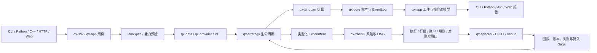

# 牵星 Qianxing：GitHub 竞品与架构重构决策主方案

> 复核日期：2026-10-25 
> 用途：集中说明竞品取舍、当前架构判断、详细重构任务和发布门。 
> 范围：当前工作树的 Rust workspace、Python、C++、Web、协议 Schema、成熟度目录和相关文档。 
> 状态：决策与开发方案，不代表未提交源码已经合并、发行，或实盘供应商链路已经验收。 
> 深入源码记录和逐切片进展见[竞品与架构深度复核](牵星Qianxing-GitHub竞品与架构深度复核及优化重构方案-2026-10-25.md)和[执行方案](牵星Qianxing-GitHub竞品对标与架构优化重构执行方案-2026-10-25.md)。

## 1. 决策摘要

牵星已有值得保留的底座：Rust 事件与账本内核、PIT 数据语义、Bar/Depth 仿真、研究用例、风险与订单管理、多语言入口，以及逐步形成的 RunSpec、不可变产物和核验读模型。当前问题不是缺少更多子系统，而是能力多、入口多、交付旅程长；部分事实合同和验收证据仍按运行类型、语言和交易所分散。

建议采取**模块化单体、窄端口、共享事实、渐进迁移**。不推倒重写，不把 ExchangeGateway 做成包揽一切的巨型接口，也不强迫 Rust、Python、C++ 策略继承同一套语言基类。

近期顺序：

1. 为每种运行类型统一输入身份、工件版本、核验读模型和跨入口结果。
2. 固定市场数量/价格/资金/合约单位合同，并让交易所能力在下单前按 scope 校验。
3. 把策略预检、回测、搜索、偏差检查、样本外比较和报告收敛为 Python 用户的一条短旅程。
4. 对多账户、多交易所订单组补足耐久恢复和故障证据；明确不存在跨交易所原子成交。
5. 先测量真实工作负载，再拆热点模块、优化容量和收紧发行包。

Research 与 Live 是两条独立发布轨道。研究报告通过不提升真实交易能力等级；Live 必须按交易所、产品、账户模式、持仓模式、订单形状和操作分别登记代码、离线、沙盒与生产证据。

## 2. 复核口径与当前项目画像

当前 Cargo workspace 有 29 个成员：28 个 `qx-*` crate 和 `contract-tests`。主要对外交付面包括 Python SDK/CCXT、C++ SDK、CLI、HTTP API、Web 控制台及 Schema/能力登记。架构形态是模块化单体加明确的进程/worker 边界，不是微服务网格。

本方案检查了仓库模块图、主要 Rust/Python/Web 目录、workspace 依赖概览和能力证据；对竞品只依据其公开仓库与官方文档。没有进行同机性能对照，也没有连接真实账户或交易所沙盒。当前工作树存在大量未提交改动，因此这里描述的是本地源码快照，不能据此宣称是已发布版本。

证据状态必须分开：

| 状态 | 可作出的结论 |
|---|---|
| `implemented` | 找到生产代码实现。 |
| `code_tested` | 对应本地单元、集成、契约或构建验收通过。 |
| `packaged` | 声明支持的平台发行包在干净环境安装并完成用例。 |
| `sandbox_tested` | 指定供应商/产品/账户模式完成请求、回报、撤单、对账和恢复。 |
| `production_approved` | 该实盘范围另行通过安全、运行和账户授权审查。 |

能力目录里的历史进展按当时快照阅读；本方案不把某个局部切片的完成外推到全矩阵。

## 3. GitHub 竞品比较与应吸收的做法

下表比较公开定位和接口工作流，不是功能数量或性能排名。每个项目覆盖的市场和模拟假设不同。

| 项目 | 公开优势 | 适用边界 | 牵星应吸收 |
|---|---|---|---|
| [Freqtrade](https://github.com/freqtrade/freqtrade) | 加密策略模板、数据准备、回测、Hyperopt、结果导出，以及 lookahead/recursive 诊断连成清晰路径。 | 重点是加密交易机器人；向量化信号回测和 dry-run 不能代替 A 股制度、L2 撮合或供应商成交验收。 | 安装后直接运行策略文件；把预热、未来数据检查、参数搜索、候选复核和报告做成一条研究旅程；把信号计算和逐事件交易回调区分清楚。[Backtesting](https://github.com/freqtrade/freqtrade/blob/develop/docs/backtesting.md) · [Hyperopt](https://github.com/freqtrade/freqtrade/blob/develop/docs/hyperopt.md) · [Lookahead analysis](https://github.com/freqtrade/freqtrade/blob/develop/docs/commands/lookahead-analysis.md) · [Recursive analysis](https://github.com/freqtrade/freqtrade/blob/develop/docs/recursive-analysis.md) |
| [NautilusTrader](https://github.com/nautechsystems/nautilus_trader) | Rust 内核配合 Python/Rust API，Backtest、Sandbox、Live 共用大量运行组件；公开高低层 API、数据目录、订单/持仓模型和恢复概念。 | 抽象和配置面较专业；策略代码复用并不消除网络、时钟、撮合、外部活动和恢复差异。 | 采用高层与低层 API、共同生命周期和清楚的 backtest/live 差异说明；将事件顺序、数值模型和恢复定义为跨宿主合同。[Architecture](https://github.com/nautechsystems/nautilus_trader/blob/develop/docs/concepts/architecture.md) · [Backtesting](https://github.com/nautechsystems/nautilus_trader/blob/develop/docs/concepts/backtesting/index.md) · [Live](https://github.com/nautechsystems/nautilus_trader/blob/develop/docs/concepts/live.md) |
| [Hummingbot](https://github.com/hummingbot/hummingbot) | Connector 统一交易所连接面，策略由单文件 Scripts 逐步发展到可复用 Controllers 和管理订单生命周期的 Executors。 | 核心定位是数字资产持续运行的交易机器人，不等价于 A 股 PIT 研究、可复算报告或通用组合回测。 | 提供从简单策略到可组合执行单元的渐进扩展；所有下单仍经牵星风控、OMS、持久事件和账户约束。[Strategy V2](https://hummingbot.org/strategies/v2-strategies/) · [Repository](https://github.com/hummingbot/hummingbot) |
| [QuantConnect LEAN](https://github.com/QuantConnect/Lean) | Python/C# 多资产引擎和 CLI 支持项目、研究、回测、优化、Live 等贯穿式工作流。 | 数据、经纪商、容器/云和具体产品有独立配置与边界；存在 CLI 入口不代表每种本地运行范围都可用。 | 收敛 `init → inspect → preflight → run/search → compare → report → verify`；命令调用统一应用用例与能力门。[LEAN](https://github.com/QuantConnect/Lean) · [LEAN CLI](https://github.com/QuantConnect/lean-cli) |
| [Microsoft Qlib](https://github.com/microsoft/qlib) | 面向研究、机器学习、工作流、实验记录和产物追踪，强调模块可独立组合。 | 研究/模型工作流不能替代订单、部分成交、账户隔离、保证金和供应商执行治理。 | 实验应可查询、可复现；候选、fold、数据、配置和产物需要同一 Run 身份与 lineage。[Qlib](https://github.com/microsoft/qlib) · [Workflow](https://github.com/microsoft/qlib/blob/main/docs/component/workflow.rst) |
| [vectorbt](https://github.com/polakowo/vectorbt) | 向量化和批量组合适合快速扫描大量参数、资产和周期，带交互式图表；当前亦公开可选 Rust 加速路径。 | 快速矩阵筛选不宜替代带资金约束、事件顺序、队列、部分成交和费用的因果引擎。 | 让向量化承担候选预筛；最终候选交给牵星事件仿真重算，再做样本外验证。[Getting started](https://github.com/polakowo/vectorbt/blob/master/docs/docs/index.md) |
| [VeighNa / vn.py](https://github.com/vnpy/vnpy) | 国内 gateway、事件引擎、CTA 策略与 GUI 生态易理解；`on_tick/on_bar/on_order/on_trade` 形成清楚的基础回调模型。 | 每个 gateway、产品和账户的实际支持范围不同；接口存在本身不是实测证据。 | 采用易学的策略模板、Gateway facade 和账户/订单通知；能力清单必须按实际 scope 门控。[Gateway](https://github.com/vnpy/vnpy/blob/master/vnpy/trader/gateway.py) · [CTA](https://github.com/vnpy/vnpy/blob/master/docs/community/app/cta_strategy.md) |
| [RQAlpha](https://github.com/ricequant/rqalpha) | Python 策略 API、组件/Mod 扩展和回测用例简洁，适合借鉴策略编写者视角。 | Python 框架及自身扩展生态决定适用面；公开 API 的简洁不能推导交易执行、精度和多语言语义相同。 | 降低新用户需接触的概念数量；提供成熟的初始化、数据、下单、查询、收尾函数，同时保留底层 Rust 能力。[RQAlpha](https://github.com/ricequant/rqalpha) |

### 3.1 牵星的相对优势

- **可追溯内核方向明确：** 事件、账本、Run 身份、PIT/数据质量和回放可构成可核验研究基础。
- **研究与执行覆盖面广：** 同一仓库有 Bar/Depth 仿真、A 股和数字资产相关代码、风险/OMS、供应商适配及 Rust/Python/C++/Web 入口。
- **安全边界意识较强：** 已有 capability/maturity 证据分级、受控命令边界、订单组状态和多入口报告核验设计。
- **适合复杂场景：** 目标用户可在同一框架组合多标的、多策略、多账户和不同市场类型。

这些是代码结构的相对优势，不等于每个产品 scope 都已经完成发行或外部验收。

### 3.2 牵星目前的相对短板

- 首次使用要理解的概念和命令偏多，竞品里容易复制的“策略文件→完整结果”体验尚需进一步变短。
- RunSpec、RunRecord、报告读模型和 portable/recompute 已逐类建设，但声明支持的 RunType × 入口覆盖仍要以能力矩阵逐项核实。
- Rust、Python、C++、Schema、JSON 和前端之间的数值单位、缺省值、舍入和兼容策略有持续漂移风险。
- 交易所、产品、账户模式、订单形状和真实支持能力不能由单一 `supports=true` 表示；外部供应商验收证据必须逐 scope 记录。
- 多账户订单组只能提供 Saga 补偿和恢复，不能提供跨交易所原子成交或共享购买力。
- 核心源文件与架构检查脚本很大，增加了代码审查、跨模块修改和知识迁移成本。
- 容量结论必须绑定数据规模、机器、版本、并发和完整工作负载；合成基准只能回答其所覆盖部分。

## 4. 当前架构和主链

### 4.1 分层及事实所有权

| 层 | 主要模块 | 应唯一拥有的责任/事实 |
|---|---|---|
| 领域与稳定协议 | `qx-core`、`qx-guanxing`、`qx-spec`、`qx-protocol` | 身份、精确类型、事件/账本、市场可见性、版本化跨边界合同。 |
| 数据与存储 | `qx-data`、`qx-provider`、`qx-datastruct`、`qx-storage` | 数据集、来源与质量、列式数据、耐久存储和读取端口。 |
| 研究与仿真 | `qx-app`、`qx-xingban`、`qx-strategy`、`qx-factor`、`qx-risk` | 用例、策略事件和意图、撮合模型、研究事实、指标和报告核验。 |
| 交易执行 | `qx-zhenlu`、`qx-execution`、`qx-genglu`、`qx-adapter` | 风险准入、OMS/订单生命周期、窄执行端口、venue 映射、外部事实归约和对账。 |
| 运行时装配 | `qx-runtime`、`qx-orchestrator`、`qx-service`、`qx-scheduler`、`qx-control` | worker 生命周期、作业、拓扑、重试/恢复、权限与审计。 |
| 用户入口与绑定 | `qx-api`、`qx-cli`、`qx-sdk`、`qx-python`、`python/`、`cpp/`、`web/console/` | 参数、授权、绑定、DTO 映射、呈现；不重算领域结果。 |

### 4.2 目标调用链

`qx-app` 是应用用例和已核验研究事实的 owner；`qx-api`、CLI、Python 和 C++ 是适配入口；runtime/service/CLI 可以作为组合根装配多个实现。目录或 crate 数量本身不证明松耦合，关键在于状态机和计算事实是否唯一。

### 4.3 用户主链

**研究：** 策略文件与参数 → 数据/Schema/PIT/质量预检 → RunSpec → 回测或候选搜索 → 交易/账本事实 → 未来数据与预热诊断 → 时间切分/OOS → 比较与可交互报告 → 验证/复算。

**实盘：** 行情/账户事实 → 策略产生 OrderIntent → InstrumentRules 与 scope capability 预检 → 风险与限额 → 幂等 OMS 提交 → 外部回报归约 → EventLog、账本、对账 → 断线/重启恢复 → 策略接收执行更新。

当任意一段还需入口单独拼接、不保存输入身份、或者没有可查证的成功/失败结果时，端到端旅程还没有完成。

## 5. 架构和开发细节问题单

| ID / 优先级 | 现状与风险 | 代码/证据落点 | 目标改进 |
|---|---|---|---|
| A1 / P0 | 报告、参数实验和运行入口增长较快；若 CLI、API、Python 各自核验身份或重算收益，会产生相互矛盾的结果。 | `crates/qx-app/src/`；`crates/qx-api/src/app_surface/research_artifacts.rs`；`crates/qx-cli/src/report_*.rs`；`python/qianxing/app.py`。 | 以版本化 `qx-app` reader 为所有入口的事实源；入口只做授权、bounded resolver、预算和映射。用 RunType × reader × report × portable × recompute × entrypoint 矩阵追踪缺口。 |
| A2 / P0 | 逻辑身份与本机路径容易混为一体；老报告兼容、复制移动、内容校验和升级发布容易出现不同语义。 | `crates/qx-spec/`、`crates/qx-app/src/artifact_store/`、`schemas/`、maturity RunRecord 条目。 | 规范化 RunSpec 固定所有影响结果的输入、代码/策略/数据、seed、时钟和撮合假设；逻辑 ArtifactId 不依赖本机路径；新旧版本读取明确迁移，未来 schema 具名拒绝；portable bundle 能离线核验并复算。 |
| A3 / P0 Live | 价格、币数量、合约张数、乘数、报价预算、结算币种、最小数量和精度若只靠 `f64`/字段名约定，低价币、小数位和不同合约容易错量。 | `crates/qx-core/`、`crates/qx-adapter/`、`python/qianxing_ccxt/`、Schema 与 C ABI/JSON DTO。 | 统一定点/Decimal 线协议及舍入规则；区分 `Price`、`BaseQuantity`、`ContractQuantity`、`QuoteAmount`、`Money<Currency>`；冻结 InstrumentRules 快照，按 step/tick/min-notional 做精确预检。Rust/Python/C++/JS golden fixtures 对拍。 |
| A4 / P0 Live | 一个宽泛 Gateway 会把公共操作和 venue 特例揉在一起；简单 facade 可能掩盖产品/账户/持仓模式的具体能力差异。 | `crates/qx-execution/`、`crates/qx-adapter/`、`python/qianxing_ccxt/`、能力 manifest。 | 用户面可有组合 facade；内部分为 `MarketDataSource`、`InstrumentRulesProvider`、`AccountQueryPort`、`OrderExecutionPort`、`ReconciliationPort` 等窄端口。Capability key 使用 venue × product × account mode × position mode × order shape × operation，并在网络写入前 fail closed。 |
| A5 / P1 | 多语言策略都需要稳定 lifecycle 和反馈，但强制共同的 `BaseStrategy` 继承树会把语言限制带进 Rust/C ABI。 | `crates/qx-strategy/`、`crates/qx-python/`、`python/qianxing_strategy/`、`cpp/include/`、实时 worker。 | 稳定 versioned Strategy protocol；Python 提供可选 `BaseStrategy`/context helper；Rust trait 和 C ABI 各自做适配。统一 init/warmup/ready/start/event/order/fill/position/account/timer/stop 语义，明确允许更新策略状态的时点，并用 golden event 序列对拍所有宿主。 |
| A6 / P1 Live | 多交易所联合单/多腿无跨所原子提交；超时可能是外部已接收但本地未知，盲目重试会重复下单。现有订单组状态和持久存储是基础，但必须覆盖所有目标故障窗口。 | `crates/qx-execution/src/`、`qx-zhenlu` 的 SpreadOrderGroup store、`qx-storage/`、reconcile workers。 | 订单组按 Saga 持久化：reservation、leg 状态、幂等键、submit attempt、venue order ID、外部回报、补偿、重启恢复、reconcile 和人工终态。未知提交先查询/对账；没有共享余额或原子成交的承诺。 |
| A7 / P1 Research | 研究者仍要了解多个命令/API 才能串接策略导入、诊断、搜索、OOS 和交互报告；参数搜索排行榜可能使样本内结果被误解为有效策略。 | `python/qianxing/cli.py`、`python/qianxing/experiments/`、`python/qianxing/reports/`、`web/console/`。 | 提供两级 API：快速入口 `research(strategy_file, data, objective, budget)` 与底层高级用例；每个候选按真实参数和 fold 重建后做诊断，持久保存候选/OOS/成本/诊断/图表；没有 OOS 时显著标成样本内发现。 |
| A8 / P1/P2 | 模块/文件体量和规则脚本审查面偏大，跨语言重复 DTO、能力登记和手工索引增加漂移。 | 热点快照见下表；`tools/check_architecture.py`、`schemas/`、`maturity/`。 | 按事实 owner 拆模块；把架构检查按规则族拆为内部包但保留稳定 rule ID 和唯一入口；Schema、能力目录、命令索引尽量生成并做 CI drift check。先行为对拍，再搬代码。 |
| A9 / P1/P2 | 容量画像不覆盖全部真实 workload 时，单一 RAM/吞吐数字可能误导机器规划。 | `benchmarks/`、maturity 容量证据、Run/报告/搜索执行入口。 | 固定 CPU/内存/磁盘/OS/版本和数据身份；测 Bar、Tick/L2、组合市场、候选搜索、报告、并发和冷/热启动；报告 p50/p95、峰值 RSS、峰值磁盘、吞吐、失败阈值和参数预算。 |

大文件快照（本地统计，供确定审查半径，不作为硬编码行数限制）：

| 文件 | 行数 |
|---|---:|
| `crates/qx-api/src/app_surface/research_artifacts.rs` | 4,144 |
| `crates/qx-api/src/lib.rs` | 3,943 |
| `crates/qx-app/src/cases/run_experiment.rs` | 3,079 |
| `crates/qx-adapter/src/binance.rs` | 3,214 |
| `crates/qx-runtime/src/pipeline.rs` | 2,677 |
| `python/qianxing/app.py` | 4,785 |
| `python/qianxing_ccxt/__init__.py` | 3,762 |
| `web/console/app.js` | 3,855 |
| `tools/check_architecture.py` | 26,594 |

拆分不按行数做机械重写。一个模块要拆成什么，先由状态 owner、变更原因、输入输出和事务边界决定。

## 6. 目标架构决策

1. **维持模块化单体与明确 worker 边界。** 不以拆微服务或减少 crate 数量为目的；运行隔离、独立部署或资源控制有实测需求时再引入进程边界。
2. **唯一事实源。** 运行身份、研究指标、事件事实、订单状态和风险决定各有 owner；CLI/API/Python/前端不能私自补算。
3. **共享合同、语言适配。** 策略生命周期、精度单位和执行状态以版本化协议/Golden fixtures 对齐；语言各自可有自然 API，不共用继承结构。
4. **窄端口加组合 facade。** 用户可从 `ExchangeGateway` 风格 API 快速开始，内部端口仍分行情、规则、账户、执行和对账。
5. **快速筛选与因果复核并存。** vectorized/search 用于筛选；带真实市场约束、成本和账本的事件回测用于候选复核。
6. **外部事实优先。** timeout/unknown 不是 reject；先用原幂等身份查询和 reconcile，再进入可审计补偿或人工状态。
7. **存储身份不等于路径。** ArtifactId/RunSpec 描述逻辑内容和版本；path/object URI 是授权 resolver 提供的存储定位。
8. **门禁不能弱化事实。** 性能压测、发行测试、交易所验收和架构检查各有明确范围；删规则或改状态标签不算完成。

## 7. 优化改进与重构路线

| 阶段 | 优先级 | 工作内容与主要落点 | 可审查退出条件 |
|---|---|---|---|
| R0 事实与范围冻结 | P0 | 对齐 `maturity/`、Schema registry、workspace crates、CLI/Python/C++ 命令与发布包；给每项标 owner、RunType/scope、状态和 evidence。 | 没有把“代码存在”写成“供应商支持”；所有未验证项有明确范围和责任人。 |
| R1 Run 身份和报告读链 | P0 Research | 按 RunType 接完规范化 RunSpec → RunManifest/RunRecord → 不可变工件 → qx-app verified reader → CLI/Python/HTTP 等价 DTO → portable/recompute；兼容旧版本。 | 改变任何结果输入都会改变 fingerprint；移动同内容工件不改逻辑身份；不同入口完整核心 DTO 一致；损坏/超预算/未来 Schema 一致拒绝。 |
| R2 数值与执行能力合同 | P0 Live blocker | 冻结 Decimal、单位、舍入、InstrumentRules、产品/账户/持仓模式及 venue scope 能力；覆盖 Rust、Python、C++、Schema、adapter 和订单预检。 | 小数位、step/tick、乘数、quote/base、手续费币种 golden cases 一致；未知组合网络写入前拒绝；代码测试不被升级成 sandbox 状态。 |
| R3 策略 API 与 Quick Research | P0 Research / P1 API | 提供快速策略入口和可组合底层 API；闭合 warmup/ready/事件/订单状态/成交反馈；候选参数绑定未来数据、预热和 OOS 结果；生成可搜索、可筛选、带图表的离线报告。 | 在干净 venv 对任意可导入策略文件跑 `inspect → preflight → run/search → diagnose → split/OOS → compare → report → verify`；无 OOS 明确拒绝称为“有效/最佳”；Rust/Python/C ABI host 同序同事实。 |
| R4 多账户可恢复交易 | P1 Live | 把现有订单组能力收敛为 durable Saga；涵盖 reservation、幂等、unknown 查询、乱序/重复回报、补偿失败、恢复和人工终态；账户报告记录每腿 lineage。 | 故障注入覆盖每个写入/网络/回报窗口；重启后无重复委托/入账；未恢复订单可定位、审计、人工处理；不声称跨所原子。 |
| R5 容量画像与架构拆分 | P1/P2 | 建立代表性容量矩阵；按 owner 拆报告、实验、adapter、pipeline、Python facade、Web UI、architecture checks；自动生成索引。 | 报告固定机器/OS/版本/数据/并发以及 p50/p95、RSS、磁盘；拆分前后契约与产物一致；不以微基准代替端到端结论。 |
| R6 发行闭环 | P0 Research / 独立 Live | 构建 Python wheel、CLI/C++/Web 发行物；安装到干净平台环境运行公开示例；生成 SBOM/hash/兼容矩阵。Live 的沙盒流程按 scope 单独执行，用户要求先不验证时保持状态未验收。 | Research 门通过时发布 Research profile；Live 只有指定 scope 的 sandbox 证据齐全才升级；任何不能证明的支持矩阵项明确降级/拒绝。 |

依赖顺序：R0 是登记底线；R1/R2 可并行但不能共用完成声明；R3 要建立在稳定 Run 身份、策略合同与可核验产物上；R4 依赖精确单位和订单状态协议；R5 先建立基线再优化；R6 对 Research 与 Live 分别收口。

## 8. Research 和 Live 发布门

### 8.1 Research 发布

- 策略安装入口、支持版本与安全 import 行为有清楚说明。
- 策略代码和参数、数据来源/时间范围/PIT、成本/撮合假设、随机种子、执行版本均进入 Run identity。
- 参数搜索可以在预算内停止和恢复；候选评估标明搜索目标、多重试验风险和训练/验证/OOS 切分。
- Future leakage、warmup drift、数据质量和交易数量不足要显式诊断；未知不得显示为通过。
- 报告为离线可打开，交互图表不依赖外网；展示订单、成交、权益、回撤、费用、标的、候选与诊断；数据边界和截断样本有提示。
- 同一报告经过 Rust 核验；CLI/Python/API 对核心 DTO 一致；portable/recompute 有证据。
- 声明支持的操作系统/Python 发行包在干净环境安装并跑通示例。

### 8.2 Live 发布

- `venue × product × account mode × position mode × order shape × operation` scope 明确。
- tick/lot/min-notional、合约面值/乘数、保证金/杠杆、reduce-only/position side、结算币种和 fee 资产完成精确对拍。
- 请求幂等、超时 unknown、部分成交、撤单竞态、私有 WebSocket 与 REST reconcile、断线重启均有对应事实与恢复流程。
- 先保证只读凭据或 Testnet/Demo；逐笔沙盒验收覆盖下单、回报、成交、撤单、重启、对账和密钥隔离。
- 多账户风险预算和子账户资金隔离明确；Saga 补偿不是原子承诺。
- 成熟度状态只按证据升级；无供应商沙盒时保留 `implemented/code_tested`，不得写作“实盘验收通过”。

## 9. 暂不采用的方案

- 不推倒重写已有 Rust 核心，也不以 crate/微服务数量衡量架构质量。
- 不把全部交易所操作塞进一个不可拆解的 `ExchangeGateway` trait。
- 不让 `BaseStrategy` 成为跨语言强制继承类；也不让策略代码绕过统一风险、OMS 与能力检查。
- 不把单一回测收益、随机参数搜索冠军或样本内排名称作“最佳有效策略”。
- 不把 Paper、离线 fixture、mock adapter 或 API 连通当作供应商下单/恢复验收。
- 不在没有 workload 基线前添加缓存、并发、分布式队列或微服务作为默认优化。
- 不机械按行数拆文件，不通过删除历史验收门禁让 CI 变绿。

## 10. 官方竞品资料与结论边界

本方案检索官方 GitHub 仓库和其官方文档，链接指向可能变化的默认分支。比较总结的是公开能力与用户工作流；不代表代码审计、同环境性能测试、外部账户验证或许可证复核。引入代码或依赖前另审 LICENSE、NOTICE、安全公告、版本兼容和平台支持。

重点资料：

- [Freqtrade backtesting](https://github.com/freqtrade/freqtrade/blob/develop/docs/backtesting.md)、[Hyperopt](https://github.com/freqtrade/freqtrade/blob/develop/docs/hyperopt.md)、[lookahead analysis](https://github.com/freqtrade/freqtrade/blob/develop/docs/commands/lookahead-analysis.md)、[recursive analysis](https://github.com/freqtrade/freqtrade/blob/develop/docs/recursive-analysis.md)
- [NautilusTrader Rust architecture](https://github.com/nautechsystems/nautilus_trader/blob/develop/docs/concepts/rust.md)、[backtesting](https://github.com/nautechsystems/nautilus_trader/blob/develop/docs/concepts/backtesting/index.md)、[live trading](https://github.com/nautechsystems/nautilus_trader/blob/develop/docs/concepts/live.md)
- [Hummingbot repository](https://github.com/hummingbot/hummingbot)、[Strategy V2](https://hummingbot.org/strategies/v2-strategies/)
- [QuantConnect LEAN](https://github.com/QuantConnect/Lean)、[LEAN CLI](https://github.com/QuantConnect/lean-cli)
- [Microsoft Qlib](https://github.com/microsoft/qlib)、[workflow docs](https://github.com/microsoft/qlib/blob/main/docs/component/workflow.rst)
- [vectorbt](https://github.com/polakowo/vectorbt)、[getting started](https://github.com/polakowo/vectorbt/blob/master/docs/docs/index.md)
- [VeighNa / vn.py](https://github.com/vnpy/vnpy)、[BaseGateway](https://github.com/vnpy/vnpy/blob/master/vnpy/trader/gateway.py)、[CTA Strategy](https://github.com/vnpy/vnpy/blob/master/docs/community/app/cta_strategy.md)
- [RQAlpha](https://github.com/ricequant/rqalpha)

## 11. 本地项目资料

- [项目模块地图](module-map.md)
- [项目与文档指南](project-guide.md)
- [竞品与架构深度复核及逐轮记录](牵星Qianxing-GitHub竞品与架构深度复核及优化重构方案-2026-10-25.md)
- [竞品对标与执行方案](牵星Qianxing-GitHub竞品对标与架构优化重构执行方案-2026-10-25.md)
- [标准策略接口与经典框架对比](牵星Qianxing-标准策略接口经典框架对比与改进方案-2026-10-25.md)
- [能力成熟度登记](../maturity/capabilities.yaml)
- [工业化易用性收口指南](工业化易用性收口指南-V1.md)

## 12. 当前工作树复核后的执行基线（2026-10-25）

本节将本轮复核后的优先级和完成口径固定下来，供实施时避免重复盘点。前面章节是目标架构和完整路线；本节是当前快照的下一批工作入口。工作树有大量未提交改动，所有“已有”只表示本地源码可见，不表示已合并、已发行或已通过交易所验收。

### 12.1 竞品对比后的产品选择

本项目不应以“功能清单比竞品长”为目标。牵星应该把可审计的事件回测与多交易所执行作为差异化，把竞品已验证的低门槛流程吸收到产品表面：

| 竞品优势 | 牵星应实现的对应体验 | 实施边界 |
|---|---|---|
| Freqtrade 的策略模板、回测、参数搜索和 lookahead/recursive diagnostics 有明确入口。 | 新建项目后可直接运行用户的 Python 策略文件，默认给出 warmup、未来数据诊断、参数搜索和 HTML 结果。 | Freqtrade 的 DataFrame 信号生命周期不替换牵星的逐事件撮合、订单状态和多账户资金模型。 |
| NautilusTrader 以共享 kernel 贯穿 backtest/sandbox/live，并提供低层 engine 与高层 node。 | 为牵星保留底层研究/执行 API，同时提供短流程 facade；文档明确哪些规则共用、哪些环境事实不同。 | 共享策略代码不代表成交价格、网络顺序或恢复行为相同；live 的 transport、外部成交和 reconciliation 仍要独立验收。 |
| LEAN 将 project-create、research、backtest、optimize、live 收在一套命令体验中。 | 收敛 `init → inspect → preflight → run/search → compare → report → verify`。 | 命令必须调用同一应用用例和 capability gate，不能在 CLI 中再造领域逻辑。 |
| Qlib 的 qrun/recorder 记录 workflow 和产物；vectorbt 适合宽参数矩阵快速筛选。 | 参数、数据、代码、切分、评价标准、候选与报告放在同一 experiment lineage；快速筛选后由事件回测重算候选。 | 排名只说明给定目标函数下的搜索结果。没有独立 OOS、成本压力和诊断证据时，不向用户称“最佳有效策略”。 |
| vn.py/Backtrader/RQAlpha 的基础回调与组件概念易学；Hummingbot/Jesse 将策略推进至可组合运行和图形分析。 | 策略生命周期、数据订阅、订单/成交通知、账户查询、分析器和报告采用清晰的分组与示例。 | Python `BaseStrategy` 可选；Rust trait 与 C ABI 遵循同一版本化事件合同，不共享 Python 继承结构。Gateway 可作为 facade，底层仍是窄端口。 |

官方公开资料会随默认分支变化，本方案只比较仓库/文档公开的定位与使用流程，不声称做过同硬件性能排名、源码安全审计或账户实测。参考入口包括 [Freqtrade Hyperopt](https://github.com/freqtrade/freqtrade/blob/develop/docs/hyperopt.md)、[Freqtrade lookahead analysis](https://github.com/freqtrade/freqtrade/blob/develop/docs/commands/lookahead-analysis.md)、[NautilusTrader 架构](https://github.com/nautechsystems/nautilus_trader/blob/develop/docs/concepts/architecture.md)、[NautilusTrader Backtest API 层次](https://github.com/nautechsystems/nautilus_trader/blob/develop/docs/concepts/backtesting/index.md)、[LEAN CLI 工作流](https://github.com/QuantConnect/Lean)、[Qlib workflow](https://github.com/microsoft/qlib/blob/main/docs/component/workflow.rst)、[vectorbt README](https://github.com/polakowo/vectorbt)、[VeighNa CTA](https://github.com/vnpy/vnpy/blob/master/docs/community/app/cta_strategy.md)、[Backtrader Cerebro](https://www.backtrader.com/docu/cerebro/)、[RQAlpha](https://github.com/ricequant/rqalpha)、[Hummingbot Strategy V2](https://hummingbot.org/strategies/v2-strategies/) 和 [Jesse 文档](https://docs.jesse.trade/)。

### 12.2 当前架构的有效部分和真正问题

当前工程为 29 个 Cargo workspace 成员组成的模块化单体，具有 worker/进程隔离；它不是需要立即拆为微服务的系统。要保留的部分是领域事件与账本、PIT/数据质量、不同市场粒度的仿真核、应用层禁止反向依赖规则、订单风险/OMS 与成熟度证据分级。优化重点放在事实归属和可用工作流，不是删除 crate 或重写 Rust 内核。

源码结构按责任可归纳为：

| 责任 | 当前主要落点 | 目标边界 | 检查结果与改进方向 |
|---|---|---|---|
| 领域和协议 | `crates/qx-core/`、`qx-spec/`、`qx-guanxing/`、`qx-protocol/` | 事件、身份、时间、PIT、数值单位和 schema 合同只有一个定义来源。 | 保持 Rust 为事实主干；继续清理 `raw` 数值与精确 Decimal 的并存路径，按单位区分价格、基础数量、合约张数、报价预算和结算资金。 |
| 数据和仿真 | `qx-data/`、`qx-provider/`、`qx-datastruct/`、`qx-xingban/` | 数据来源/质量/时间可见性与 Bar、Tick/L1、L2 撮合假设可追溯。 | 搜索预筛与因果事件回测分开；RunSpec 必须记清实际使用的数据、时间切分和撮合配置。 |
| 应用与报告 | `qx-app/src/cases/`、`qx-app/src/report_read.rs`、`qx-app/src/artifact_store/` | 应用层写产物和唯一核验研究事实；各入口只做授权、定位、映射和展示。 | 单市场 Bar/Depth 实验首批 portable bundle 已支持搬迁、校验与整网格复算；Provider Bar/Depth 已接入 API/Web 统一报告 reader，HTTP 版本化 DTO 与 qx-app reader 等价，Python/C++ 远端 AppClient 也能读取。共享 reader、其它 RunType 及 portable/recompute 完整矩阵仍逐批迁移。 |
| API 和 CLI | `qx-api/src/app_surface/`、`qx-api/src/lib.rs`、`qx-cli/src/` | composition root 可以装配多个 crate；业务事实不得因入口不同重复计算。 | `qx-api` 和 `qx-cli` 依赖较多，只有在业务已迁移、无调用后才收窄依赖；先逐条审查报告、导出、验证和实验路由。 |
| 交易执行 | `qx-zhenlu/`、`qx-execution/`、`qx-genglu/`、`qx-adapter/`、`python/qianxing_ccxt/` | 风控/订单生命周期/外部事实归约/对账按窄端口串接；能力按具体 scope 生效。 | `ExchangeGateway` 仅可做用户组合门面；必须拆为行情、规则、账户、执行、撤单/改单、私有流、对账接口并由统一能力档案校验。订单超时进入 unknown + reconcile，不盲重试。 |
| 策略和运行时 | `qx-strategy/`、`qx-python/`、`python/qianxing_strategy/`、`cpp/`、`qx-runtime/`、`qx-service/` | 统一生命周期和事件语义，宿主分别适配；运行/执行状态以持久事实恢复。 | Python callback、策略 worker 执行更新和 C ABI 可选回调已在本机代码推进；仍需完整 host golden sequence、故障窗口覆盖和各 venue 沙盒范围证据。标准策略基础函数及 Freqtrade/Backtrader/VeighNa/RQAlpha/Qlib 的吸收边界见[策略接口对比方案](牵星Qianxing-标准策略接口经典框架对比与改进方案-2026-10-25.md)。 |
| 文档/能力合同 | `schemas/`、`maturity/`、`tools/check_architecture.py`、`web/console/` | schema/能力/命令事实源明确，生成物自动检查；控制台只显示 API 已验证状态。 | 大文件按变更责任拆成私有模块；禁止仅为缩短文件或让门禁变绿而机械搬移/删规则。先有 owner 和行为对照，再搬代码。 |

优先级最高的不是“文件很大”，而是以下四处仍可能形成断链：

1. **RunType 到可移动报告链。** `RunSpec → RunManifest/RunRecord → ArtifactReader → qx-app reader → CLI/Python/API DTO → portable/recompute` 需要按运行类型逐格登记。单市场 Bar/Depth 参数实验现已增加便携包、包内 reader、搬迁后校验及整网格复算；共享 experiment reader 和其它 RunType 的覆盖仍未全部关闭。当前验收使用单候选 Bar/L1 Depth 夹具，不能据此宣称所有实验变体已覆盖。
2. **研究者到可判断报告。** 安装后通过策略文件完成预检、未来数据/预热诊断、预算化搜索、候选逐一重算、样本外/稳健性分析、比较及可交互报告仍需一条默认路径。输出应同时呈现费用、回撤、成交数、数据身份、失败原因和 OOS 结论。
3. **策略到外部订单反馈。** 策略 intent 通过产品规则、账户能力、风控、OMS、venue、私有回报、EventLog、对账、状态反馈形成持久闭环。多 venue/多账户只能用持久订单组 Saga 编排，无法承诺跨交易所原子提交。
4. **声明能力到可证明能力。** 每项能力明确是代码存在、代码验证、平台包可用、沙盒验收还是生产批准。Binance/OKX/Bitget 必须按现货/合约、账户模式、单向/双向、订单类型和读写操作逐 scope 记录证据；本机离线结果不得上调沙盒状态。

### 12.3 下一批实施工作包

| 顺序 | 工作包 | 精确任务 | 退出条件与可检查产物 |
|---|---|---|---|
| 0 | `BASELINE-01`：事实矩阵 | 以 Rust/CLI/Python/HTTP/Web 入口和所有公开 RunType 为行；记录 writer、输入 identity、RunRecord 工件、reader、HTML/XLSX、portable、recompute、compat migration。另建 venue × product × account/position mode × order shape × operation 的能力矩阵。 | 每格链接源码/Schema/验收证据；unknown 留空并解释，不能默认为支持。清晰区分本地脏工作树与发行分支。 |
| 1 | `R1-PORTABLE`：便携实验输入 | **单市场 Bar 与 Depth 的首批范围已在当前工作树落地**：CLI `pack-experiment` / `pack-depth-experiment` 与 `verify-experiment` / `verify-depth-experiment` 会打包原始输入、身份 sidecar、父级 RunRecord/RunManifest 和候选产物；用包内 ArtifactReader 校验，再从包内输入复算。后续扩展质量清单、更多 market/runtime 配置变体及其它 RunType 时，继续沿用同一逐格矩阵。 | Bar 与 L1 Depth 的端到端夹具已搬迁到新目录；隐藏原始行情及旧输出后仍可校验并整网格复算；篡改包内行情会被 SHA-256 拒绝。该证据覆盖当前首批路径，不代表其它深度层级、可选清单组合或其它 RunType 已关闭。 |
| 2 | `R1-READER-MATRIX`：共享 reader | 盘点其它 RunType 尚未共用 `qx-app` 的校验和报告事实。Provider Bar/Depth API 已提供 `/app/read-provider-report` 和 `/app/read-provider-depth-report` 版本化 DTO reader，并接入 Web 报告投影；Python/C++ 远端 AppClient 增加同步读方法（Python 另有 async 包装）；后续仍每次迁移一个类型，CLI、Python、API 对同一事实返回同版 DTO，Web只呈现。 | Provider Bar/Depth HTTP DTO 对 qx-app reader JSON 等价，artifact-root 越权引用拒绝；Python 客户端路由用例和 C++ 路由冒烟接线已加入，C++ 本机实际编译取决于本机工具链。其它 RunType 的完整跨入口 DTO、path authorization、超大文件限额、schema 迁移、tamper negative cases 仍逐项覆盖，矩阵整体未关闭。 |
| 3 | `R2-QUICK-RESEARCH`：研究闭环 | 公开 `research()` 与 CLI quick-run；支持用户文件的安全导入、schema/preflight、暖机与 lookahead/recursive 诊断、搜索预算、OOS、费用敏感性、交互报告、verify/recompute。 | 干净 Python 环境安装后对示例策略只需一个快速命令/调用；OOS 缺失时不呈现“验证有效”；多个策略、标的、周期可在同一实验中对比。 |
| 4 | `R3-UNITS-CAPABILITY`：精度和能力 | 固定 Decimal/wire 规则和 InstrumentRules 快照；显式区分 Price/BaseQty/ContractQty/QuoteBudget/Money；串接杠杆/保证金/持仓模式、min qty、step/tick、min notional。 | Rust/Python/C++/JSON/前端 golden vectors 逐字一致；小币种极小数量和大数、逆向合约、费用币种等边界被覆盖；未登记 scope 在网络请求前拒绝。 |
| 5 | `R4-ORDER-SAGA`：多账户恢复 | 持久化 parent group/每腿状态、请求幂等键、尝试次数、venue order id、回报 offset、补偿和人工终态；未知结果先查订单和持仓/账单再定状态。 | 故障注入覆盖“请求前/已发未应答/部分成交/撤单竞态/事件未归约/重启/恢复仍失败”；无重复下单或记账，且能审计为什么未能自动补偿。 |
| 6 | `R5-CAPACITY-MAINTAINABILITY`：性能与拆分 | 先按真实负载记录吞吐、p50/p95、峰值 RSS、临时盘和并发；再按 owner 拆 `research_artifacts`、`run_experiment`、venue adapters、runtime pipeline、Python facade、Web UI 与架构检查脚本。 | 预先固定数据规模、机器、OS、commit、构建、并发及测量口径；拆分前后 golden artifact/合同不变；容量表给出适用范围和停止阈值。 |
| 7 | `R6-RELEASE`：双发行门 | Research 发布走 wheel/CLI/C++/Web 包和干净环境 quick-start；Live 按 scope 执行只读与 demo/testnet 实证、密钥隔离、回报和恢复。 | Research 可以在可复算研究闭环后单独发布；Live 仅在对应 scope 外部证据存在后单独放行；版本说明不把两者混为一谈。 |

依赖关系：`BASELINE-01 → R1-PORTABLE → R1-READER-MATRIX → R2-QUICK-RESEARCH → Research release`；`BASELINE-01 → R3-UNITS-CAPABILITY → R4-ORDER-SAGA → scope-specific Live release`。容量分析必须先于性能优化；事实 owner 明确后才能拆分大文件。每个工作包只修改自身责任范围，保留工作区已有改动，不通过批量重排/格式化制造巨大噪声。

**R1-PORTABLE 本轮验收记录（2026-10-25）**：增加单市场 Bar/Depth 包装、身份/产物验证、外部目录搬迁和可选复算命令；CLI 缺输入行为矩阵扩展到 22 条路由。验证：`cargo check -p qx-cli -j 1` 通过；`cargo test -p qx-cli --test cli_behavior_parity single_market_bar_and_depth_experiments_recompute_all_candidates -j 1` 通过；缺输入行为用例通过；`python tools/check_architecture.py --fast` 四片完整覆盖 226 项且无重复。全 workspace `cargo fmt --all --check` 因既有大量未格式化/脏改动未通过；本轮只格式化了直接修改的 Rust 文件，没有对工作区全量格式化。

**R1-READER-MATRIX 增量记录（2026-10-25）**：Provider Bar/Depth 的 `/app/research-artifacts` 识别外层结果并经共享投影提供有界交互明细；新增 `/app/read-provider-report`、`/app/read-provider-depth-report` 分别返回与 qx-app Provider Bar/Depth reader 同 JSON 的版本化 DTO。冻结 Provider 输入与产物必须解析到配置 artifact root 内；越界路径拒绝。Web 根据 `provider_depth` 选择深度视图并显示 Provider 身份，Python/C++ 远端 AppClient 通过相同 API 路由读取版本化报告。验收：Provider API 用例 `8/8`、Python AppClient 用例 `40/40`、部署 README 两张端点表逐表核对 `1/1` 通过；架构分片 1/4 和 3/4 定向复核分别 `378/378`、`338/338`，完整门禁复跑中。范围仅是 Provider Bar/Depth 报告读链；其它 RunType 的 portable/recompute、跨语言 DTO 与 schema 兼容矩阵继续开放。

### 12.4 发布结论

当前只能将实现状态描述为**本机工作树已有多条可测路径，端到端与发行覆盖仍需按工作包逐项关闭**。本地离线验收证明代码路径和确定性合同，不证明 Binance、OKX、Bitget 的外部真实回报/恢复。Research 与 Live 分开发布；完成一类单点报告或实验包不关闭整个 RunType 矩阵，也不关闭 Live gate。详尽逐轮证据和源码索引继续以[深度复核记录](牵星Qianxing-GitHub竞品与架构深度复核及优化重构方案-2026-10-25.md)与[执行方案](牵星Qianxing-GitHub竞品对标与架构优化重构执行方案-2026-10-25.md)为准。

### 12.5 2026-10-26 架构门禁复核

Provider Bar/Depth 远端报告方法已登记为 Python/C++ report helpers；分片 2/4 的 333 项和完整四片门禁均通过。`python tools/check_architecture.py --fast` 完整覆盖 226 项具名检查、无重复，墙钟 108.33 秒。R1 其余 RunType 的读口、portable/recompute 和 Research 发布门继续开放；本次全量静态门禁不替代相应行为/构建/发布验收。

### 12.6 2026-10-26 联合账户报告 HTTP 读链

新增版本化 `POST /app/read-multi-account-joint-report`，复用 qx-app `MultiAccountJointResearchReportV1` verified reader，API 对外只解析并投影共享核验结果；artifact root 之外的引用拒绝。能力声明、机读 HTTP 路由清单、Python 同步/async client、C++ client 和部署端点表已同步。qx-api 全部 117 个单测、qx-app 多账户联合集成 4/4、Python 与 CLI 路由定向检查均通过；完整架构门禁四片 226/226、无重复，墙钟 110.33 秒。C++ 编译器不在本机环境，未声称 C++ 构建通过。该切片只接通多账户联合报告的 HTTP/SDK 读口，R1 全 RunType、portable/recompute 和 Research 发行门仍开放。

### 12.7 2026-10-26 多腿完整报告 HTTP 读链

新增 `POST /app/read-multi-leg-report`，接收版本化 report request，复用 qx-app 完整多腿报告 reader，返回 `MultiLegResearchReportV1`；ArtifactRef 和行情/质量输入分别由 artifact root、data root 两个授权 reader 读取。Python sync/async、C++ client、API capability、路由审计、HTTP manifest 和部署端点表已同步。API 全单测 118/118，真实双腿产物与 qx-app DTO 一致且越界 artifact 引用被拒绝；完整架构门禁 226 项/4 片无重复，最终复跑耗时 108.43 秒。本机未安装 C++ 编译器，C++ 构建仍未验收。该切片补齐多腿 HTTP 版本化读口，不关闭其他 RunType 和 portable/recompute 矩阵。

### 12.8 2026-10-26 多腿回测证据包源目录解耦

搬迁测试证明多腿回测 EvidenceBundle 以前仍依赖 composition summary 中的绝对路径；即使行情与质量清单已随包复制，移动包并删除原始目录后复算仍失败。现将包内双腿组件/质量清单路径注入复核摘要；qx-app 使用已核验的父级 RunManifest 对账两腿数据指纹、子结果哈希和组合结果哈希，之后离线进程完整重跑并对拍 RunManifest。来源目录删除后的 portable/recompute 回归通过，`artifact_quality` 14/14、qx-app 多腿定向 16/16 和 backtest 集成 10/10；架构快速门禁 226 项通过。此实现只覆盖 multi-leg builtin run；RunType × portable/recompute 矩阵仍是 R1 未关闭项。

### 12.9 2026-10-26 多市场 Bar 贡献副件路径移入 EvidenceBundle 身份链

多市场 Bar 复算先前仍跟随 summary 中的权益贡献 sidecar 绝对路径。现按 bundle 的 `instrument_equity_contributions` ArtifactRef 读取并校验副件；RunManifest 的 `derived:instrument-equity-contributions` 继续提供内容哈希绑定。搬移 portable 包并删除原始运行、输入与副件目录的 `verify-run --recompute` 回归通过。多市场 Bar/Depth 质量和 portable 集成目标 3/3；架构快速门禁 226/226、无重复，111.38 秒。该修复只闭合这一 sidecar 定位断链，R1 其余 RunType 矩阵开放。

### 12.10 2026-10-26 单市场深度质量清单复算闭环

单市场 L2 深度 EvidenceBundle 的复算曾漏传质量清单，导致原始 RunManifest 含 `dataset_quality_fingerprint` 而复算结果缺少该扩展。`rerun_depth_backtest` 现在将 EvidenceBundle 中已校验的质量清单路径传入隔离深度回测。测试覆盖本地复算及 EvidenceBundle 导出、搬迁、删除输入/清单/运行目录后复算。回归先按身份摘要复现缺口，修复后 `backtest_contracts` 50/50、多市场深度目标 1/1、多市场质量目标 3/3 通过；Windows 测试使用隔离 TEMP/TMP。定点 rustfmt/差异检查通过，架构 `--fast` 四片覆盖 226 项、无重复，112.69 秒。R1 仍需逐 RunType 核对，未据此关闭全矩阵。

### 12.11 2026-10-26 多账户 Evidence v2 与部分失败复算

多账户证据包新增逐账户输入 SHA-256 与 missing 状态，验证器可用 `--recompute` 在搬迁后、删除原 source workspace 后重跑批次。完整成功批次与“成功账户 + 原本缺失行情的失败账户”均通过复算；输入摘要修改和缺失状态被改变时拒绝。旧 v1 包保持验真兼容；缺少失败账户输入证据的旧部分失败包 fail closed；全失败批次因缺少父级 RunManifest 不宣称独立复算。相关 schema v2、能力登记和生成目录已同步；定向用例三项通过，架构 `--fast` 226 项全过。该切片只完成多账户 Bar Evidence，其他 RunType 与外部供应商验收仍未关闭。
