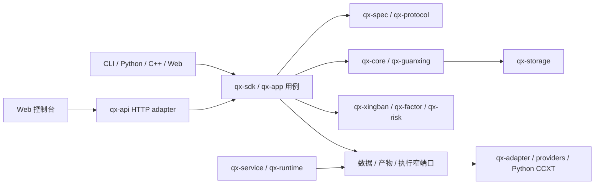

# 牵星 Qianxing：GitHub 竞品对标与架构优化重构执行方案

> 复核日期：2026-10-25
> 复核范围：当前工作树中的 Rust workspace、Python SDK/CCXT、C++ 绑定、Web 控制台、Schemas 与 maturity 登记
> 状态：这是审查和实施方案，不代表工作树中的未提交改动已合并、发布或通过交易所沙盒验收。
> 详细实现记录：[GitHub 竞品与架构深度复核及优化重构方案](牵星Qianxing-GitHub竞品与架构深度复核及优化重构方案-2026-10-25.md)

## 1. 决策摘要

牵星不需要推倒重写。Rust 领域内核、事件账本、PIT 数据语义、风险/OMS、研究用例和跨语言入口已经构成可复用基础。重构重点是让这些能力在所有 Run 类型和入口间使用同一身份、事实和生命周期，并为安装后的用户提供短而完整的研究旅程。

优先解决四类问题：

1. **同一回测的身份和报告事实未完全统一。** CanonicalRunSpec、RunRecord V2、内容寻址产物和 qx-app 报告读取器已在一部分路径使用，仍需覆盖所有 RunType、旧产物兼容、报告验证、CLI/Python/API 等价读取。
2. **高层体验不够集中。** 用户需要自行串接策略预检、数据质量、参数搜索、未来数据/预热诊断、样本外分析和报告。应提供默认安全的一条龙研究命令，同时保留高级 API。
3. **真实交易的精度和恢复合同需要收敛。** 小币种、合约张数/乘数、结算币种、数量步长、未知订单结果和多账户订单组必须由类型和可恢复状态机明确表达。
4. **工程规模增长快于可验证性。** 大模块、多个语言 DTO、schema、能力清单和手工文档增加维护成本；需要先建立事实源和行为基线，再渐进拆分并测量容量。

发布分成两条独立轨道：**Research 发布**验证策略文件到可复算报告；**Live 发布**按交易所、产品、账户模式和订单类型证明真实链路。Research 通过不能自动提升 Live 状态。

## 2. 复核范围与证据边界

当前 `cargo metadata --no-deps` 显示 workspace 有 29 个成员：28 个 `qx-*` crate 和 `contract-tests`。主要交付面包括 `crates/`、`python/`、`cpp/`、`web/console/`、`schemas/`、`maturity/` 与 `tools/check_architecture.py`。

工作树存在大量未提交文件和实现改动。本方案据源码结构、契约登记和已存在的测试/验收记录整理，不把“源码存在”当作“能力已完整”，也不把离线测试当作交易所沙盒或生产验收。成熟度使用以下区分：

| 状态 | 含义 |
|---|---|
| `implemented` | 有生产代码实现 |
| `code_tested` | 对应本地单元/集成/契约测试通过 |
| `packaged` | 声明的发行构件在干净环境安装并跑通用例 |
| `sandbox_tested` | 指定交易所 sandbox 的请求、回报、撤单、对账和恢复证据完整 |
| `production_approved` | 生产范围另经安全、运维和账户授权批准 |

## 3. 当前架构梳理

### 3.1 分层与职责

| 层 | 主要模块 | 应拥有的事实 |
|---|---|---|
| 领域与协议 | `qx-core`、`qx-spec`、`qx-protocol`、`qx-guanxing` | 订单/账户/市场语义、精确数值、事件、PIT 和版本化跨边界合同 |
| 数据与持久化 | `qx-data`、`qx-provider`、`qx-datastruct`、`qx-storage` | 数据集来源/质量、市场数据格式、持久化端口与存储实现 |
| 研究与仿真 | `qx-app`、`qx-xingban`、`qx-factor`、`qx-risk` | 应用用例、撮合仿真、研究/搜索、风险和报告事实 |
| 执行与适配 | `qx-strategy`、`qx-execution`、`qx-zhenlu`、`qx-genglu`、`qx-adapter` | 策略生命周期、订单意图、OMS/路由、供应商映射和外部回报 |
| 运行与编排 | `qx-runtime`、`qx-orchestrator`、`qx-service`、`qx-scheduler`、`qx-control` | worker 生命周期、作业状态、控制面、调度、重试和持久恢复 |
| 对外入口 | `qx-api`、`qx-cli`、`qx-sdk`、`qx-python`、`python/qianxing*`、`cpp/`、`web/console/` | 参数解析、授权、语言绑定、HTTP/CLI 契约、展示和导出 |

目标依赖和事件方向：



`qx-app` 应拥有应用用例和经过验证的研究事实；`qx-api`、CLI 与 Python facade 是入口和协议适配层。运行时组合根可以依赖多个 crate 装配 worker/adapter，但业务事实不得在入口之间复制。

### 3.2 当前主要用户链路

**研究链：** 策略文件/参数 → 数据集与时间可见性检查 → RunSpec → 仿真/搜索 → 账本和事件 → 不可变报告产物 → 验证/重放 → HTML/JSON/API 展示。

**交易链：** 策略事件 → 订单意图 → 账户/能力/数量预检 → 风险与 OMS → 幂等提交 → 交易所回报 → 账本归约 → 对账/恢复 → 账户报告。

代码已覆盖这两条链上的多个组件，但不能据组件数量推导“端到端已闭环”。重点补齐跨 RunType 身份、读回验证、断线恢复和发行安装路径。

## 4. GitHub 竞品对比

以下比较针对公开仓库、文档和产品流程，不是同一数据/硬件上的性能排名。

| 项目 | 优势 | 相对牵星的不足或适用边界 | 牵星应借鉴 |
|---|---|---|---|
| [Freqtrade](https://github.com/freqtrade/freqtrade) | 策略文件、行情准备、回测、结果导出、Hyperopt、lookahead/recursive 诊断和 dry-run 路径直观；面向加密交易的文档完整。 | 产品重点是加密交易机器人；其回测和 dry-run 仍是模拟，不能替代外部成交验证。 | 一个安装后可运行的策略入口、自动化报告、偏差诊断和明确回测假设。[Backtesting](https://github.com/freqtrade/freqtrade/blob/develop/docs/backtesting.md) · [Hyperopt](https://github.com/freqtrade/freqtrade/blob/develop/docs/hyperopt.md) · [Lookahead Analysis](https://github.com/freqtrade/freqtrade/blob/develop/docs/commands/lookahead-analysis.md) |
| [Hummingbot](https://github.com/hummingbot/hummingbot) | 面向数字资产交易，提供统一连接器、paper trading、单文件脚本、可复用 Controller 与管理订单生命周期的 Executor；V2 支持一个 bot 组合多个 controller。 | 重点是持续运行的 crypto bot 和执行编排，不等同于覆盖 A 股、PIT 研究、可复算回测报告与跨市场回测的研究内核。 | 借鉴“简单脚本 → 可复用策略 → 可组合执行单元”的渐进 API，以及 paper/live 共用连接器表面的用户旅程；牵星的 Executor 对应物仍须经过 Rust 风控、OMS、事件账本。 [README](https://github.com/hummingbot/hummingbot/blob/master/README.md) · [Strategy V2](https://github.com/hummingbot/hummingbot-site/blob/main/docs/strategies/v2-strategies/index.md) · [Paper Trade](https://github.com/hummingbot/hummingbot-site/blob/main/docs/client/global-configs/paper-trade.md) |
| [NautilusTrader](https://github.com/nautechsystems/nautilus_trader) | Rust/Python 双入口，共用 backtest/sandbox/live 核心；公开高层 node 和低层 engine；明确记载网络、时序、持久化和对账造成的 live/backtest 差异。 | 面向通用多资产交易引擎，接入和配置相对专业；同一策略代码也不能保证真实成交与仿真一致。 | 统一事件生命周期、分层 API、数据目录和执行恢复边界。[Overview](https://github.com/nautechsystems/nautilus_trader/blob/develop/docs/concepts/overview.md) · [Backtesting](https://github.com/nautechsystems/nautilus_trader/blob/develop/docs/concepts/backtesting/index.md) · [Live](https://github.com/nautechsystems/nautilus_trader/blob/develop/docs/concepts/live.md) |
| [QuantConnect LEAN](https://github.com/QuantConnect/Lean) 与 [LEAN CLI](https://github.com/QuantConnect/lean-cli) | 项目初始化、研究、回测、优化、报告和 live 命令形成完整用户旅程。 | 数据、券商、Docker/云等能力有各自配置和部署条件，命令存在不代表无条件可用。 | 让牵星的 init → run/search → compare → verify → capability check 有一致 CLI 体验。 |
| [Microsoft Qlib](https://github.com/microsoft/qlib) | `qrun` 将数据、模型、回测和评估组成研究工作流；Recorder 保存实验指标和产物。 | 定位在量化研究/模型工作流，不代替账户隔离、订单生命周期和交易所执行治理。 | Experiment → Run → Candidate/Fold → Artifact 的可查询实验记录。[Workflow](https://github.com/microsoft/qlib/blob/main/docs/component/workflow.rst) · [Recorder](https://github.com/microsoft/qlib/blob/main/docs/component/recorder.rst) |
| [VeighNa / vn.py](https://github.com/vnpy/vnpy) | 国内 gateway、事件引擎、CTA 策略和 GUI/应用生态广；gateway 抽象易于理解。 | 接口支持范围因 gateway、产品和账户而异；接口类存在不等于某链路实测通过。 | 国内用户易理解的 gateway/策略示例与明确的逐渠道能力矩阵。[Gateway contract](https://github.com/vnpy/vnpy/blob/master/vnpy/trader/gateway.py) |
| [RQAlpha](https://github.com/ricequant/rqalpha) | Python 策略 API、组件/Mod 接口与回测表达清楚。 | Python 栈和自身扩展生态决定其适用面；代码/依赖采用前应单独核实当期许可。 | 减少新手必须接触的概念，提供小而可组合的用户 API。[Repository](https://github.com/ricequant/rqalpha) |
| [vectorbt](https://github.com/polakowo/vectorbt) | 面向向量化和批量信号研究，适合大范围参数/资产候选筛选，并提供可选 Rust 后端路径。 | 静态向量化不宜替代含队列、部分成交、事件因果、资金费和状态依赖的执行仿真。 | 独立快速筛选器，筛出的候选再用牵星事件引擎精算。 |
| [Backtrader](https://github.com/mementum/backtrader) | Cerebro 将数据、策略、broker、analyzer 等组织成易理解的 Python 组合 API。 | 轻量回测库的用户体验和治理边界，与跨语言、持久运行、外部执行恢复不同。 | 提供短的高层 facade 和常用分析器，但不隐藏成本、撮合和数据假设。[Cerebro](https://github.com/mementum/backtrader/blob/master/backtrader/cerebro.py) |

### 4.1 牵星的相对优势

- Rust 领域内核、账本事件和重放提供了建立确定性与审计证据的基础。
- PIT/数据质量/来源身份让数据不足或越过可见时间时能够拒绝或标出限制。
- A 股、数字资产、多 venue、现货/合约和多语言都有代码路径，不局限单一研究范式。
- 风控、OMS、能力门控、对账、worker 和研究产物共处一套工程，具备向可运营平台发展的基础。
- 有成熟度登记、Schema 和架构检查工具，可以把“支持”细化为可检查的版本合同。

### 4.2 牵星的相对短板

- 初次运行路径和核心概念较多，功能入口比“一条可复制的工作流”更加突出。
- 同一 Run 的输入身份、报告核验和展示在不同 RunType/入口间尚未全部统一。
- 多语言存在重复 DTO、数值解析、Schema 与 UI 映射，字段演进容易产生漂移。
- 金额、价格、Base 数量、合约张数、报价预算和结算币种仍有旧 raw/新 exact 路径并存风险。
- EventLog/报告和搜索的峰值 RSS、磁盘增长、并发吞吐缺少一套统一容量画像。
- 真实执行代码、离线测试、官方沙盒证据和生产批准需要更严格地区分。

## 5. 架构问题清单

以下为当前需解决的设计问题，不等同于每条路径都没有实现。目录行数是维护风险信号，不是代码质量判决。当前统计来自本次工作树读取，文件后续会变化。

| ID / 优先级 | 发现与证据 | 目标改造 | 验收要点 |
|---|---|---|---|
| ARCH-01 / P0 报告事实多处维护 | `qx-api/src/app_surface/research_artifacts.rs` 约 4,182 行，`qx-api/src/lib.rs` 约 3,939 行；部分读取器/校验已迁入 qx-app，但各 RunType 与入口仍需对照。 | qx-app 持有 schema、输入身份、重放/指标、complete/incomplete 和版本化报告 DTO；API 做授权 resolver、请求限制和状态码；CLI/Python 消费相同 reader；Web 只展示。 | 同产物 CLI/Python/API 的身份、指标、状态、错误语义一致；跨 Run 引用、损坏摘要和超限输入一致拒绝。 |
| ARCH-02 / P0 Run 身份覆盖不全 | `CanonicalRunSpec` 与 RunRecord V2 已接入若干回测/实验，但存在旧产物兼容和 RunType 覆盖差异。 | 为每个 RunType 建立 `writer → manifest → record → reader → report → portable → recompute` 覆盖表；行为输入进入 canonical bytes，物理路径/密钥/显示字段不进入。 | 改变策略源码、数据内容、时区、规则、费用/滑点/执行模型、随机种子等影响结果的字段时 fingerprint 必变；移动相同内容不改变行为身份；旧 digest 可复算。 |
| ARCH-03 / P0 逻辑产物身份与物理存储耦合 | V1 path 兼容和 V2 ArtifactId/文件存储同时存在；不能让绝对路径成为业务身份。 | qx-app 通过 `ArtifactReader` 读取抽象逻辑引用；授权根目录到文件位置的映射只在外层 resolver；后续对象存储/SQLite 复用同一 reader。 | 越权路径、长度/类型/digest 不符拒绝；旧引用保持只读可读；新 schema 不泄露本机绝对路径。 |
| ARCH-04 / P0 精度与单位不具备单一合同 | `qx-core`/protocol/CCXT/语言 facade 同时存在 fixed-point raw 与 exact decimal；合约张数和报价预算不是同一单位。 | 定义带维度的 Price、BaseQty、ContractQty、QuoteBudget、Fee<Currency>、Money<Currency>；版本化 serde/schema；转换强制显式 rounding。 | 小数长币种、低价资产、逆向合约、乘数、手续费币种、上下限与舍入策略在 Rust/Python/C++/JSON fixtures 一致；禁止权威订单量经 `f64`/JS Number 往返。 |
| ARCH-05 / P1 交易所抽象过宽会抹平能力差异 | 当前 `qx-sdk` 有 `ExecutionGateway` 端口；adapter 对不同产品/持仓模式的能力并不完全同质。 | 保留窄端口：`MarketDataSource`、`InstrumentRulesProvider`、`AccountQueryPort`、`OrderExecutionPort`、`ReconciliationPort`。可提供 `ExchangeGateway` facade/组合对象，但不能要求所有 venue 实现一个全能 trait。 | capability 按 venue × product × account mode × position mode × order shape × operation 表达；不支持操作在下单前明确 fail closed。 |
| ARCH-06 / P1 策略 API 易出现重复生命周期 | 多语言生命周期和事实更新仍未完全对齐。Rust Bar/DepthBar 与 Python Bar callback 已实现逐标的 warmup gate；策略文件 worker 有 input v2 订单状态反馈和持久游标；C ABI 已有可选 typed 订单状态 v2 callback，v1 JSON 保持兼容。剩余缺口是跨 host lifecycle/golden 一致性、订单状态以外的 C++ typed DTO、完整 trade/position/account/session 事实、checkpoint 与部分高阶 helper。 | 收敛版本化生命周期语义：init/history warmup/ready/start、market/timer/session/order/fill、stop/error、PIT 边界、超时/取消、seed 与 intent。可选 `BaseStrategy` 只做语言 helper；向量化 Bar 研究另设 adapter。详细函数清单和现状见[标准策略接口经典框架对比与改进方案](牵星Qianxing-标准策略接口经典框架对比与改进方案-2026-10-25.md)。 | Rust/Python/C++/策略文件宿主对已支持事件的顺序、可见数据、intent 单位、重复/过时回报、错误和 stop 使用共享 golden cases；旧 `on_event` 继续兼容；用户不继承 BaseStrategy 仍符合协议；未实现的事实与 helper 不得作为已支持能力发布。 |
| ARCH-07 / P1 组合下单不能只依赖内存重试 | 多 venue/账户没有原子事务，超时可能是未知提交结果。已有 order lifecycle/recovery 代码不等于持久组级 Saga 已完成。 | 持久化 OrderGroup/LegState、幂等键、预留、提交尝试、外部事实、成交/费用、补偿计划、人工终态；未知先 query/reconcile。 | 在每个提交/落盘/回报/撤单/重启边界注入故障和重复事件，零重复订单/账本；无法自动恢复有可查询人工状态。 |
| ARCH-08 / P1 研究体验由多个命令拼接 | `run-strategy`、`search-strategy`、preflight、偏差诊断和报告能力分别存在；跨候选诊断及 OOS 解释仍需聚合。 | 提供 Quick Research 高层入口：inspect → data/quality preflight → run/search → diagnose → validation/OOS → compare/report → verify；保留低层 API。 | 干净安装后从策略文件起步完成旅程；未配置 OOS 时明确“仅样本内，不能判断有效”；每候选/数据/参数/执行假设均可追溯。 |
| ARCH-09 / P1 统一账户活动读面 | 已落地 `AccountActivityReportV1`：qx-app 投影、显式 account+venue 约束的 API 分页、Schema registry、Python/C++ 客户端、Web 控制台和 HTTP route manifest 已接通；本轮专项测试通过。 | 后续纳入其他账户查询/报告读面时复用版本化事实投影；估值换汇仍通过独立 portfolio 报告，标注来源/时点/缺失状态。 | 当前范围为单账户、单 venue 的有界快照与保留事件页；不同账户不得隐式净额或合并购买力；游标仅在 account+venue 范围有效。API/app/Python/C++/Web 专项检查通过，架构快速门禁结果见 §11。 |
| ARCH-10 / P2 峰值内存与并发容量未知 | 有流式/有界读路径和 Rust benches，但没有固定工作量的 peak RSS、p95、磁盘/并发画像。 | 固定 Bar、Tick、L2、候选数、市场数、账户数及并行 Run 矩阵；以流式解析、spill、限额和背压处理实测瓶颈。 | 文档列明机器、版本、数据规模、profile、吞吐、p50/p95、peak RSS、磁盘增量和失败阈值；运行前能估算或拒绝超限作业。 |
| ARCH-11 / P2 大模块与架构 gate 难维护 | 本次最新读取：`qx-api/src/app_surface/research_artifacts.rs` 4,043 行、`qx-api/src/lib.rs` 3,755 行、`qx-app/src/cases/run_experiment.rs` 2,961 行、`experiment_search.rs` 1,913 行、`qx-adapter/src/binance.rs` 3,080 行、`qx-runtime/src/pipeline.rs` 2,562 行、`python/qianxing/app.py` 4,027 行、`web/console/app.js` 3,718 行、`tools/check_architecture.py` 25,085 行。行数只说明改动/审阅集中度，不能单独证明设计质量或拆分优先级。 | 先定义模块 owner/依赖和稳定 rule ID；一次移动一个责任域，按输入/输出/状态边界拆；用行为证据保护，不因行数目标机械拆分。 | 行为与对外接口不变；无重复事实；架构检查规则逐项有 owner、证据和替代关系；不得以删除旧门禁代替修复代码。 |
| ARCH-12 / P2 文档与能力注册需防漂移 | 仓库有 `maturity/`、schemas、命令/路由清单及多种语言 README/示例。 | 以 cargo metadata、CLI 注册、HTTP route manifest、Schema registry、capability registry 和打包矩阵为事实源；生成文档并校验漂移。 | 发布前生成器 `--check` 通过；文档声明的命令、平台、能力范围能定位到事实源和证据。 |

## 6. ExchangeGateway 与 BaseStrategy 的架构决策

### 6.1 ExchangeGateway

**建议提供统一概念，不建议建立包揽所有能力的单体接口。** 用户层可用 `ExchangeGateway` 作为一个交易所连接/能力集合的 facade，内部组合市场行情、规则、账户查询、下单和对账接口。领域层按窄能力注入，以便某个 gateway 可以只实现只读行情或特定订单形态。

建议接口边界：

```text
VenueConnection
├─ MarketDataSource          # 历史/实时行情、订阅与数据质量
├─ InstrumentRulesProvider   # tick/lot/min notional/乘数/结算资产
├─ AccountQueryPort          # 余额、持仓、委托、成交、账单
├─ OrderExecutionPort        # 提交/撤销/改单及请求幂等语义
└─ ReconciliationPort        # 查询未知提交、回报补齐、重启对账
```

每种能力须关联 `VenueCapabilityProfile`，而非 `supports_trading: bool`。API 调用前检查权限、产品、账户/持仓模式、下单类型和规则版本。SDK 可以有 `ExchangeGateway` 聚合 facade；OMS/Risk 不直接依赖具体 CCXT/Binance/OKX/Bitget JSON。

### 6.2 BaseStrategy

**应统一策略生命周期，不强制统一类继承。** Rust `Strategy` trait、Python `BaseStrategy` helper、C++ 回调都绑定同一 `StrategyProtocolVersion`、事件合同和订单意图结构。BaseStrategy 适合放置 no-op hooks、日志、warmup 和参数读取便利函数；不应成为必须继承的跨语言 ABI。

必须统一的协议项：策略 ID/version/source digest、参数 schema、事件时间与可见数据截止、ready/warmup、seed、订单单位/账户身份、回调 deadline、失败/取消状态、order/fill 更新顺序、停止与恢复语义。策略只能表达 intent，撮合/风控/账本属于引擎。

基础函数按用途分组：实例工厂/`__init__`，生命周期 `on_init/on_start/on_stop`，历史声明与每标的预热 `history_requirements/on_warmup_complete`，行情/时钟 `on_bar/on_tick/on_order_book/on_timer`，交易日历可选 `on_trading_day_start/on_session_start/on_session_end`，执行事实 `on_order_update/on_trade/on_position/on_account`，研究/交易管理可选 `populate_indicators/populate_entry_trend/populate_exit_trend`、目标仓位和 exit policy。当前 readiness 用 `on_warmup_complete` 表达，不再另设语义重叠的 `on_ready`。后一组向量化函数只能属于独立 Bar 研究 adapter；不得让它和实时逐事件执行混为一个必需基类。逐个接口的当前证据、对照表、兼容方案和发布门见专门方案文档。

## 7. 优化重构执行路线

### R0 — 事实基线和合同盘点（先行）

- **范围：** `maturity/`、`schemas/`、Cargo workspace、CLI/API 路由、语言公开面、现有测试与发布 workflow。
- **工作：** 为每个 capability 和 RunType 标记代码入口、契约版本、运行入口、reader、测试、构件、外部证据；记录旧 JSON/CLI/API/Python/C++ 行为及 artifact digest。
- **产出：** 兼容性清单、RunType x writer/reader/report/recompute 矩阵、发行平台矩阵、当前性能 workload。
- **门槛：** 未知项明确标为未知，不以“源码可编译”推断能力；不删除历史验收门禁，除非有等价替代证据。

### R1 — Canonical RunSpec、ArtifactId 和共享报告读侧（P0）

- **范围：** `qx-spec`、`qx-app` 的 spec/artifact/report reader、`qx-api` 的 rooted resolver、CLI/Python reader、schemas。
- **工作：** 把 Run 输入分成行为输入与来源 provenance；统一 canonical bytes/fingerprint；逻辑 ArtifactId 不含宿主绝对路径；旧 V1 只读兼容，新版本分批接入。
- **顺序：** 单 Bar/Depth → Provider → 多市场 → 多账户/联合账户 → 多腿 → Tick/L2 与参数实验。
- **门槛：** 任一结果相关参数变化会改变 identity；同产物多入口报告等价；损坏/跨 Run 引用拒绝；搬迁产物仍可读取；流式 reader 有大小/行长/事件数限制。

### R2 — Quick Research 与策略有效性闭环（P0 Research）

- **范围：** `qx-app` use case、`qx-sdk`、`qx-python`、Python CLI、`qx-cli`、Web 报告。
- **工作：** `inspect → preflight → run/search → future-data/warmup diagnostics → split/OOS → compare → HTML/JSON report → verify/replay`；统一指定策略文件和 experiment spec 的运行方式；默认显式手续费、滑点、撮合、时区和数据质量假设。
- **参数搜索：** 小网格可 exhaustive；更大空间用预算受限的随机/TPE/自适应策略；训练集选参、validation 调参、OOS 只评估；避免同一 OOS 反复调参；记录搜索空间、种子、停止条件和每个候选状态。
- **报告：** 多 Run 交互图表、交易分布、基准、回撤、费用/滑点敏感性、walk-forward、市场/币种归因、数据缺口与诊断状态；报告由已验证 DTO 渲染。
- **门槛：** 干净 venv 安装构件可完成端到端样例；无 OOS 不称“最佳/有效”；分析结果能反查 Run identity、候选、数据和费用假设。

### R3 — 数值、单位和 Venue Capability V2（P0 Live blocker）

- **范围：** `qx-core` 数值类型、`qx-protocol`/schemas、adapter、CCXT、Rust/Python/C++/Web。
- **工作：** 先出 ADR 决定十进制 wire 格式、比例、舍入、溢出、哈希/schema 版本、旧数据读取；随后引入有量纲类型和版本化市场规则快照。
- **门槛：** Binance/OKX/Bitget spot、linear/inverse、单向/双向持仓等 capability 按 scope 编码；小币种精度/lot/tick/min notional/contract multiplier/settlement currency 在全部语言 fixtures 一致；不支持行为预先拒绝。

### R4 — 账户活动报告与持久多账户订单组（P1）

- **范围：** `qx-app` account read model、API/Python/C++/Web、`qx-execution`、`qx-zhenlu`、`qx-runtime`、`qx-storage`。
- **工作：** 账户活动分页和快照 as-of/完整度先做为只读读面；持久化 OrderGroup/LegState，加入幂等键、未知提交 reconciliation、补偿策略、人工终态和恢复审计。
- **约束：** 每账户独立余额和风险限额；跨交易所不是原子事务；组合报告可合计展示但不推断共享购买力；汇率换算注明来源、时间和缺失状态。
- **门槛：** 同账户/venue 游标隔离；重复消息不重复记账；在每个外部请求和本地持久化故障点可恢复或进入明确人工状态；无 sandbox 证据保持 `implemented`/`code_tested`。

### R5 — 容量画像、发行包和事实文档（P1/P2）

- **范围：** `benchmarks/`、Rust/Python/C++ release workflow、`maturity/`、docs generator、架构检查。
- **工作：** 固定 Bar/Tick/L2/候选数/市场数/账户数/并行度 workload，测吞吐、p50/p95、peak RSS、存储和冷启动；评估 streaming、spill、缓存、背压和并行；清洁环境安装 wheel/sdist、C++ 包和 CLI 示例；拆分大文件与 gate。
- **门槛：** 文档提供 workload 与机器信息；声明支持的平台通过安装后样例；文档生成无漂移；结构拆分有行为等价证据；限制超出资源前有可读错误。

### R6 — 策略生命周期与开发者接口（P1）

- **范围：** `qx-strategy`、`qx-python`、Python SDK/callback、C ABI/C++ helper、策略 manifest/schema、示例和策略开发文档。
- **已落地切片：** Python 可选 `BaseStrategy` 与 `Bar/Tick/OrderBook/Timer` 分派、init/start/stop、Bar warmup/readiness 和 intent builder；Rust fill/order-status DTO；Python callback 状态分发；Python/外部策略文件 input v2 的 EventLog 更新投递与耐久游标；C ABI 保持 vtable 不变，新增 typed order-status v2，可选 v1 JSON 继续兼容。Rust 映射测试、C++ SDK 编译合同和 CI 动态插件回调覆盖订单状态路径。此切片不代表 C++ 所有事件合同对齐或供应商沙盒验收。
- **剩余工作：** 收敛各 host 的完整 lifecycle 状态机和 PIT/warmup 证据；补独立 fill/position/account/session/error 事实、其它 C++ DTO/golden cases；定义版本化 checkpoint/restore；在有权威持仓和仓位侧语义的 callback/use-case 上评估更高阶目标仓位与退出策略 helper；向量化指标/信号 API 作为独立 Bar 研究 adapter 评估，不塞进 live event trait。诊断快照与可恢复 checkpoint 分离。
- **兼容：** 保留 Rust `on_event`、Python duck-typed callback 和已发布 JSON 契约；不得原地改变旧 C ABI vtable 布局；新增 C ABI lifecycle callback 必须走主版本或可探测的可选导出符号。
- **门槛：** Rust/Python/C++ golden fixtures 覆盖 init/warmup/ready/start/market/update/stop 顺序、PIT、精确小数、重复/stale 回报和异常；旧策略与新 helper 策略在相同输入下得到相同 `StrategyDecision`/intent；策略不得绕过 Risk/OMS/Gateway。

### 7.1 依赖关系

```text
R0
 ├─ R1 ──> R2 ──> Research 发布
 ├─ R3 ──> R4 ──> Live 代码完整性
 ├──────────────> R5 容量/发行/文档门
 └─ R1 schema 稳定 ──> R6 策略 lifecycle / 多语言兼容
```

R0 与性能样本准备可以并行；R3 的 ADR 可与 R1/R2 并行讨论，但精度破坏性迁移必须等合同冻结；R4 的只读账户报告可以先做，持久 Saga 依赖 R3 的数量/单位和单腿 outcome 稳定。R5 贯穿全部工作包；R6 可先冻结行为与兼容设计，正式改协议需等 R1 schema/version 规则稳定。最终发布门不得只看最后一阶段。

## 8. 发布验收

### 8.1 Research 发布门

- 声明支持的 OS/Python/CPU 构件能在干净环境安装；仓库外策略文件可运行。
- 策略 preflight、数据质量、搜索、未来数据/预热诊断、OOS、交互式比较、报告读取和 verify/replay 连贯可用。
- 所有报告显示 Run identity、数据范围、成本/撮合假设、样本内/外边界和 incomplete 原因。
- 主要 RunType 的 writer/reader/schema/portable/recompute 矩阵通过；未支持范围清楚拒绝。
- 固定基准给出运行时间、RSS、磁盘增长和并行上限。

### 8.2 Live 发布门

- 对每个 `venue × product × account mode × position mode × order type` 声明 capability 与当前证据级别。
- Rust/Python/C++/HTTP 对金额、数量、舍入、错误、时间和订单生命周期的 golden fixtures 一致。
- 指定 scope 完成沙盒行情、余额/持仓、开仓/平仓、回报、部分成交/撤单、杠杆/持仓模式、超时未知结果、重启恢复及对账。
- 多账户策略展示独立资金与风险；Saga 故障注入无重复订单/重复记账，补偿失败可进入人工状态。
- 未有外部证据的 scope 不开放为已验证可交易；本地代码测试不得替代 sandbox-tested。

## 9. 暂不采用的做法

- 不进行全仓 rewrite 或仅按行数机械拆文件。
- 不建立必须实现所有功能的万能 `ExchangeGateway` trait。
- 不要求 Python/C++ 用户必须继承 BaseStrategy 才能实现策略。
- 不把整个订单/账本域向量化来换取参数筛选速度；向量筛选与事件撮合保留不同模型并做候选复核。
- 不以删除、跳过或降级历史有效验收门禁来制造全绿；替代规则需覆盖相同风险和检查对象。
- 不宣传回测收益、代码覆盖交易所或接入了 API 就代表实盘已验证。

## 10. 竞品官方资料

- Freqtrade：[GitHub](https://github.com/freqtrade/freqtrade)、[Backtesting](https://github.com/freqtrade/freqtrade/blob/develop/docs/backtesting.md)、[Hyperopt](https://github.com/freqtrade/freqtrade/blob/develop/docs/hyperopt.md)、[Lookahead Analysis](https://github.com/freqtrade/freqtrade/blob/develop/docs/commands/lookahead-analysis.md)。
- Hummingbot：[GitHub](https://github.com/hummingbot/hummingbot)、[Strategy V2](https://github.com/hummingbot/hummingbot-site/blob/main/docs/strategies/v2-strategies/index.md)、[Paper Trading](https://github.com/hummingbot/hummingbot-site/blob/main/docs/client/global-configs/paper-trade.md)。重点核对脚本、Controller、Executor、连接器与 paper trading 的当前公开设计；paper trade 仍是模拟，不作为交易所沙盒或生产验收证据。
- NautilusTrader：[GitHub](https://github.com/nautechsystems/nautilus_trader)、[Overview](https://github.com/nautechsystems/nautilus_trader/blob/develop/docs/concepts/overview.md)、[Backtesting](https://github.com/nautechsystems/nautilus_trader/blob/develop/docs/concepts/backtesting/index.md)、[Live](https://github.com/nautechsystems/nautilus_trader/blob/develop/docs/concepts/live.md)。
- LEAN：[Engine](https://github.com/QuantConnect/Lean)、[CLI](https://github.com/QuantConnect/lean-cli)。
- Qlib：[GitHub](https://github.com/microsoft/qlib)、[Workflow](https://github.com/microsoft/qlib/blob/main/docs/component/workflow.rst)、[Recorder](https://github.com/microsoft/qlib/blob/main/docs/component/recorder.rst)。
- VeighNa：[GitHub](https://github.com/vnpy/vnpy)、[Gateway contract](https://github.com/vnpy/vnpy/blob/master/vnpy/trader/gateway.py)。
- RQAlpha：[GitHub](https://github.com/ricequant/rqalpha)。
- vectorbt：[GitHub](https://github.com/polakowo/vectorbt)。
- Backtrader：[GitHub](https://github.com/mementum/backtrader)、[Cerebro](https://github.com/mementum/backtrader/blob/master/backtrader/cerebro.py)。
- 策略生命周期专项对比与目标函数清单见[标准策略接口经典框架对比与改进方案](牵星Qianxing-标准策略接口经典框架对比与改进方案-2026-10-25.md)。

GitHub 默认分支会变化。正式接入第三方代码或运行依赖前，另行核实当时 LICENSE、NOTICE、版本、安全公告和平台支持；本方案不比较未经同环境复现的性能数据。

### 10.1 本轮竞品资料复核与吸收边界（2026-10-25）

本轮重新核对了竞品的官方 GitHub 仓库和官方文档。以下判断是产品流程和架构边界对照，不是 benchmark，也不表示要复制竞品实现。

| 竞品实践 | 公开实现所体现的优点 | 牵星应吸收的部分 | 不应照搬的部分 | 牵星落点与可验收结果 |
|---|---|---|---|---|
| Freqtrade 的命令式研究工作流与诊断 | 下载数据、回测、导出、参数优化、lookahead 与 recursive-analysis 入口完整；偏差诊断会通过重新运行并比较信号/指标结果发现问题，且文档解释覆盖盲区。 | 把策略文件、数据检查、回测/搜索、未来数据诊断、预热诊断、样本外验证和 HTML 报告收敛成安装后可直接执行的研究旅程；候选报告必须注明诊断覆盖和未触发信号。 | 不把全表向量计算当成所有资产、订单簿和状态依赖策略的唯一执行模型；研究偏差检测也不能代替 PIT 和逐事件回测。 | `python/qianxing/cli.py`、`python/qianxing_strategy/diagnostics.py`、`python/qianxing/reports/experiment_html.py`。干净环境中从外部策略文件跑完整流程；诊断结果按候选 fingerprint 绑定，不把未执行候选写成通过。参考 [Freqtrade 回测](https://github.com/freqtrade/freqtrade/blob/develop/docs/backtesting.md)、[lookahead-analysis](https://github.com/freqtrade/freqtrade/blob/develop/docs/commands/lookahead-analysis.md)、[recursive-analysis](https://github.com/freqtrade/freqtrade/blob/develop/docs/recursive-analysis.md)。 |
| NautilusTrader 的共享内核和环境上下文 | Backtest、sandbox、live 共享核心模型和大部分生命周期；数据、执行、风险、组合、cache、message bus 与 node 有明确边界；live 文档明确网络未知结果、外部订单和对账造成的差异。 | 用同一版本化 Strategy lifecycle 与领域订单/账本语义服务模拟和实时入口；以 BacktestNode/engine 式高层/低层两级接口承接易用性与定制；启动和持续 reconciliation 是显式执行阶段。 | 不承诺“同一策略代码等于相同成交结果”；不把内存 cache 或事件总线误作耐久存储；多账户隔离与同 venue 多 client 的限制必须显式建模。 | `qx-core`/`qx-strategy` 定义语义，`qx-app` 暴露用例，`qx-runtime` 装配上下文，`qx-execution` 承载窄执行端口，`qx-adapter` 做供应商转换，`qx-storage` 保存恢复事实。以共享行为 golden cases、未知提交恢复、重启对账和模式差异报告验收。参考 [Nautilus 架构](https://github.com/nautechsystems/nautilus_trader/blob/develop/docs/concepts/architecture.md)、[Backtesting](https://github.com/nautechsystems/nautilus_trader/blob/develop/docs/concepts/backtesting/index.md)、[Live 与回测差异](https://github.com/nautechsystems/nautilus_trader/blob/develop/docs/concepts/live.md)。 |
| Hummingbot 的 Scripts / Controllers / Executors | 将单文件脚本、可组合控制器和有限生命周期的下单执行器分层，控制器可以驱动多个执行器；连接器提供面向策略的统一操作入口。 | 采用“单策略快速开始 → 多策略组合 → 可复用订单工作流”的逐级抽象，并把有限的 TWAP、仓位、套利等执行流程做成有生命周期的组件。 | 不让策略直接拥有交易所密钥、跳过 Rust 风险门或自己维护第二份订单状态；connector facade 不得抹掉产品、账户、持仓模式和订单形状差异。 | Python helper/示例负责易用入口；`qx-strategy` 只产生意图；`qx-zhenlu`/`qx-risk`/`qx-execution` 决定准入和生命周期；`qx-adapter` 负责 venue。验收应证明策略不能绕过风险/OMS，Executor 状态可取消、可查询并能恢复。参考 [Hummingbot 官方策略文档](https://hummingbot.org/strategies/)、[Strategy V2 Controllers](https://hummingbot.org/strategies/v2-strategies/controllers/)、[Executors](https://hummingbot.org/strategies/v2-strategies/executors/)。 |
| LEAN CLI 的完整项目旅程 | 初始化、项目模板、研究、回测、优化、报告和 live 作为可发现的 CLI 操作串起来，减少用户手工寻找组件。 | 建立统一 onboarding、项目模板和 `research → compare → verify` 命令面；命令复用 qx-app 用例并输出可定位的 run/artifact，不让不同入口各自产生一套业务事实。 | 不假定 Docker、外部数据、云账号始终可用；依赖项与平台要求需在 preflight 中逐项报告，离线场景有明确能力边界。 | `qx-cli` 与 Python 命令显示统一 help、示例和下一步；安装后 smoke 完成模板策略、回测、报告读取；对未安装的外部服务提前给出可修复错误。参考 [LEAN CLI](https://github.com/QuantConnect/lean-cli) 和 [LEAN Engine](https://github.com/QuantConnect/Lean)。 |
| Qlib 的 Workflow / Recorder | 把数据集、模型/策略评估、回测与实验产物放在可查询的实验记录中，便于比较和复现。 | 将 RunSpec、输入数据身份、候选参数、fold、指标、日志和报告通过统一 Run/Artifact lineage 绑定，支持从候选回到完整输入。 | 不把实验指标记录器当作交易订单账本，也不把只有参数/收益摘要的 record 当作回测可复算证明。 | `qx-spec` canonical spec、`qx-app` 产物与报告事实、`qx-storage` 持久化；覆盖所有 RunType 的 writer→reader→verify→portable/recompute 矩阵。参考 [Qlib Workflow](https://github.com/microsoft/qlib/blob/main/docs/component/workflow.rst)、[Recorder](https://github.com/microsoft/qlib/blob/main/docs/component/recorder.rst)。 |
| VeighNa 的 Gateway / EventEngine 与 RQAlpha 的组件化策略入口 | Gateway、事件分发和策略回调容易理解；RQAlpha 用策略 API、simulation broker 和 Mod 扩展构成可组合回测。 | 保留“行情/交易连接”和事件回调的清晰概念；为国内用户提供少步骤策略模板和可插拔数据/执行提供方。 | 不因共同接口而假设所有 broker/venue 都有相同的资金、持仓、订单类型和交易日语义；插件/Mod 不允许变成无版本的隐式全局状态。 | 对每个 venue × 产品 × 账户/持仓模式登记 capability 与证据级别；入口只组装请求，domain 和 app 持有唯一业务规则。参考 [VeighNa Gateway](https://github.com/vnpy/vnpy/blob/master/vnpy/trader/gateway.py)、[RQAlpha event source](https://github.com/ricequant/rqalpha/blob/master/docs/source/development/event_source.rst)。 |

### 10.2 牵星竞争力判断与重构落点

**牵星的强项**是 Rust 领域内核与多语言策略入口并存；回测、A 股规则、数字资产、多 venue、深度行情和多账户研究具备较宽覆盖；PIT、来源身份、订单事件与风险/对账为确定性和审计提供基础。相较单一 crypto bot，牵星有机会把研究链和交易链纳入共享身份与账本语义。

**牵星的主要短板**不是功能数量不足，而是这些功能尚未全部收敛到一条稳定的用户链：首次使用需要跨多条命令/配置；RunSpec、产物和报告跨 RunType/入口仍有迁移差异；小数精度和合约单位有多种历史表示；跨账户/venue 订单组必须面对非原子提交与未知结果；workspace、Schema、语言 DTO、门禁和手工文档的事实源过多；资源容量与真实供应商证据不能由代码覆盖率推断。

针对这些差距，目标依赖方向固定为：

```text
用户入口（CLI / Python / C++ / Web）
        ↓ 只解析、授权、呈现
稳定应用用例（qx-sdk → qx-app）
        ↓ 版本化 RunSpec / 报告事实与窄端口
领域内核（qx-core / qx-spec / qx-protocol / qx-strategy / qx-risk）
        ↓ 事件、账本、仿真和执行决策
运行时及存储（qx-runtime / qx-service / qx-storage）
        ↓ 端口实现
交易所/数据适配器（qx-adapter / qx-provider / Python CCXT）
```

**架构不变量：** 每一种运行类型只有一个业务事实 owner；每个对外入口复用同一应用用例和报告 reader；入口层不得重算账务指标；策略只能发出类型化意图；能力和规则在提交订单前解析；执行结果未知时查询/对账而不是盲目重试；研究身份不含本地路径/秘密；迁移期间旧 schema 只读兼容且新写入版本显式登记。

落地顺序继续按 R0–R6 执行，关键路径是：先冻结 capability、RunType、DTO 和发行事实表（R0），再完成逻辑 Run 身份/共享报告 reader（R1）；在其上完成 Quick Research 与 OOS/偏差诊断（R2）。实盘代码单独按精度单位和 venue 能力合同（R3）、持久化订单组 Saga（R4）推进；容量、跨平台包、模块拆分与文档生成（R5）贯穿推进；策略生命周期/跨语言兼容（R6）作为共享协议改造。Research 与 Live 使用互不替代的发布门。

### 10.3 实施计划的检查方式

本方案的阶段验收采用“按产物闭环、按范围声明”，不以 TODO 清空或模块存在作为完成标准：

1. **每个 RunType**登记输入 spec、指纹、产物 writer、manifest/record、reader、HTML/JSON/API/Python 消费者、verify/replay 和 portable/recompute；未闭环项在 capability 中降级或拒绝。
2. **每个真实执行 capability**精确到交易所、现货/合约、线性/反向、账户/持仓模式、下单类型、精度/限额和证据档位；离线测试和 public market data 不能替代 sandbox 私有 API。
3. **每个跨语言公开字段**登记单一 Schema/序列化事实源，提供 Rust/Python/C++/HTTP/JS golden vectors；金额和数量包含单位、币种、scale 与 rounding，不用 `f64`/JS Number 往返作为权威订单值。
4. **每个容量声明**绑定固定输入规模、机器、提交版本、并行度和采集方式；至少报告吞吐、p50/p95、峰值 RSS、产物磁盘、冷启动和取消响应。
5. **每个模块拆分**先写出被移动的责任、调用方向和等价证据；不得为了缩短文件而复制业务逻辑，也不得删除仍覆盖有效风险的门禁。

本方案与深度复核文档配套使用：本文件作为执行索引，[深度复核](牵星Qianxing-GitHub竞品与架构深度复核及优化重构方案-2026-10-25.md)保存源码定位、阶段实施记录和未完成边界；策略 lifecycle 细节见[标准策略接口专项方案](牵星Qianxing-标准策略接口经典框架对比与改进方案-2026-10-25.md)。

## 11. 本轮账户活动读面落地记录

`AccountActivityReportV1` 已从 qx-app 投影贯通到 Rust HTTP API、Python 与 C++ 客户端、Web 控制台、JSON Schema/registry 和 HTTP 路由清单。API 要求显式 `account_id` 与 `venue_id`，只允许 `after` 或 `before` 单向游标，限制每页 1–300 条；Web 可跟随默认账户，也可由用户指定账户并翻页。报告展示快照时点、年龄、覆盖/完整度及余额、持仓、委托、成交、划转和投影事件；原生币种不被混算为总资产。

已通过专项验收：qx-app 2 项、qx-api 1 项、qx-cli 路由文档 3 项及 query 合同 9 项、Python 7 项、C++ 2 项；Python 编译、Web JavaScript 语法、Schema Draft 2020-12 元校验和 schema registry 引用检查通过。路由清单已重新生成并包含 `GET /account/activity`。`check_architecture.py --fast` 全量四分片通过，覆盖 226 个具名检查且无重复。

为保持门禁与新入口一致，本轮将 Web 表结构规则扩展到账户活动表，并将账户活动加入 Python/C++ 语言方法合同与 Python 路由声明；C++ 冒烟路由检查现在先去掉查询串再与声明路由匹配。定点路由/语言合同检查和全量快速架构门禁均通过。

此项只代表账户查询读面代码与本地专项验收完成；它不代表持久化多账户订单组 Saga、外部交易所沙盒验收或 Live 发布门完成。报告按单账户/单 venue 查询，事件页遵循投影保留范围，不构成跨账户购买力、跨市场统一时间序或自动换汇估值。

### 11.1 深度复核后的 R4/R5 修复与回归（2026-10-25）

本次追加复核发现并修复了以下问题：

- `SpreadOrderGroupStore` 不再提供“默认成功”的租约实现；文件存储的租约校验与 `save_claimed` 在同一文件锁内完成，避免旧 worker 校验后被新 worker 接管、再覆盖新状态的竞态。`qx-zhenlu` 48 项、`qx-execution` 31 项、`qx-service` 72 项定向单测通过。
- Paper Execution 的 `venue_id=paper` 与订单 `InstrumentId` 保留的市场 venue 不同，原账户/market spec 路由会漏配规格。账户选择、规格查找和策略多账户持仓投影现在共用同一匹配规则：Paper worker 可模拟任意明确绑定的市场标的，实盘 worker 仍按 exchange venue 精确匹配。小数数量按该标的冻结 `qty_step/min_qty` 校验。
- 修复/更新了 pipeline 打开点名册、EventLog 只读声明计数、内容寻址 RunManifest 防篡改断言和 `ExecutionCapabilityDecision` 摘要标签冲突；零读者导出门禁通过。
- `multi-builtin` composition summary 已输出 `artifact_locations`，相应 v7 JSON Schema 现将其列为必填并限制四个路径字段；旧 CLI 对拍测试改用独立 runtime 数据目录，消除默认目录残留产物造成的间歇失败。

已通过：`cargo test -p qx-cli --no-default-features -j 1` 的 425 项单元测试；CLI/HTTP/Python 三入口集成测试 26/26；`app_depth_entrypoints` 4/4、`app_run_lifecycle` 1/1；账户 pipeline 台账 2/2、EventLog 读写面 1/1、回测输入完整性 10/10、公共导出读者 2/2、事件 digest 标签 1/1。CLI 全量第一次执行暴露两项集成契约失败，本节中的 schema 与测试隔离修正后，分别重跑对应失败项及整个 26 项入口集成均通过。

当前只证明本地代码/离线集成链；workspace 默认 feature、干净环境发行包、容量画像和交易所沙盒仍需单独验收。完整 `python tools/check_architecture.py --fast` 四分片复跑通过，覆盖 226 个具名检查且无重复，用时 108.18 秒；期间门禁发现 VenueFamily 新消费者未登记及能力目录生成物过期，分别修正唯一消费者表并重生成 API/Python/Markdown 目录，`python tools/generate_capability_catalog.py --check` 通过。`ExecutionCapabilityDecision` digest 标签修复只解决重复类型标签；如该事件类型进入任何既有持久化发布版本，发布清单仍须保留旧版本读取/迁移验证证据。

### 11.2 标准策略 API 竞品复核（2026-10-25）

对照 Freqtrade、Backtrader、VeighNa、RQAlpha 与 Qlib 的公开策略接口后，已将目标分为三层：保持牵星的跨语言 `MarketEvent → StrategyDecision/intent` 核心协议；增加不强制继承的易用型事件策略 helper；把 Freqtrade 式向量化 Bar 研究适配器与 live callback 分开。借鉴 Backtrader 的 warmup/next 生命周期、VeighNa 的行情与交易事实回调、RQAlpha 的可选交易日阶段、Qlib 的执行结果反馈闭环。

本轮已开始落地 R6 的兼容性基础：Python SDK 新增可选 `BaseStrategy`，可按 Bar/Tick/OrderBook/Timer 分派 hook；Rust Python callback 转发 init/start/stop；Rust 单市场与多市场共享账户 Bar 应用宿主在首个事件前统一按 `on_init → on_start` 调用，市场路由、TradeStartGate、单策略与组合槽位共用生命周期包装，并在完成、取消、剪枝或失败后尝试 stop。Rust 增加版本化 `StrategyUpdate` / `StrategyOrderUpdate`，Bar/OrderBook 成交回调从 typed DTO 适配到旧 JSON hook；Python 导出 TypedDict，Rust 序列化和 Python Schema 校验共用一份 golden fixture。动态 C ABI 仅探测可选 start/stop 符号，旧 vtable 布局不变。定向验收为 Python helper 5/5、单市场和多市场 Python callback 生命周期用例通过、`cargo test -p qx-strategy -p qx-xingban -p qx-app -p qx-python --lib -j 1` 全部通过（qx-strategy 48 项、qx-xingban 152 项、qx-app 143 项），qx-zhenlu 50 项通过。Windows 默认 TEMP 首次导致 6 个文件/内存映射用例返回 `PermissionDenied`；仅为验收进程切换到仓库临时目录后复测全通过。`python tools/check_architecture.py --fast` 四片完整聚合通过，覆盖 226 项且无重复。C++ DTO/golden fixture 尚未接入；动态插件宿主测试当前由套件标为 ignored 且需要 C++ fixture，本机无 C++ 编译器，本轮未声称其构建通过。

**追加落地（C++ typed order-status v2，2026-10-25）：** 为不改写既有 C ABI vtable，增加独立可探测 `qx_strategy_on_order_status_v2`，C++ 收到带版本号、稳定状态码、事件序号、订单身份、raw 数值和 exact coefficient/scale 的结构体；动态宿主优先调用 v2，没有该符号时沿用 v1 JSON。Rust 单测对拍 C++ 映射并检查 exact decimal，CMake/CTest 新增 SDK DTO 编译合同，现有跨平台 CI 的 C++ 插件宿主回归扩展为真实发送 typed 状态并核对 callback 结果。当前 Windows 工作区无 C++ 编译器，本机未声称 C++ 构建通过；完整 C++ lifecycle/其他事实 DTO 仍未关闭。

本阶段仍没有实现跨所有 host 的统一 warmup/ready 状态机、交易日/时段 hooks、完整订单/trade/position/account `StrategyUpdate` variants 和 snapshot/restore。后续已将 Rust 原生 Bar 与 DepthBar 的逐标的预热门控接入；Native Tick/OrderBook 对非零 Bar 预热声明 fail closed。C++ typed DTO 已先覆盖订单状态 v2，但其它市场/fill/position/account/lifecycle DTO 和全语言共享 golden 仍缺。`on_start` 仍只代表第一条市场事件前，不自动代表所有标的预热完成。因此 R6 仍未达到全量发布门。具体函数、经典框架借鉴、兼容边界、代码现状和后续验收条件见[专项文档](牵星Qianxing-标准策略接口经典框架对比与改进方案-2026-10-25.md)。

**追加校验（2026-10-25）：** 回测的 `on_fill(order, fill)` 传入成交前克隆的订单快照和本次单笔成交；OMS/账本在回调前已提交本次成交，但快照里的累计 `filled` 不包含当前 fill。因此 typed DTO 校验核对订单/账户/策略身份、单笔成交正数量和精确金额，不用该旧快照推导成交后累计量；累计上限由 OMS 权威状态验证。此边界修正后，`cargo test -p qx-strategy -p qx-xingban --lib -j 1 -- --test-threads=1` 通过（qx-strategy 48 项、qx-xingban 152 项）。本结果仅覆盖所列 Rust 库测试，不替代 Python/C++ 全语言矩阵或 R6 发布门。

**追加落地（Python callback Bar warmup，2026-10-25）：** `BaseStrategy.history_requirements()` 可声明 `warmup_bars`；`run-strategy/search-strategy` 将完整策略 manifest 的阈值绑定到每个新实例，并拒绝方法声明与 manifest 不一致。callback host 为每个 instrument 单独计数，前 N-1 根 Bar 的订单意图被清空，第 N 根可见时先触发 `on_warmup_complete` 再调用策略 Bar hook；其决策最早在后续 Bar 撮合。配置 Bar warmup 的策略若收到 Tick/OrderBook 会失败关闭；运行在达到声明阈值前结束也失败关闭。真实 Python SDK → Rust Bar 回测用例验证首笔成交不早于 ready 边界并通过重放校验。

本续轮验证（早期状态快照）：Python 全量 unittest 从仓库根目录运行 352 项通过、3 项跳过；策略 API/CLI/manifest/preflight 定向组 42 项通过；`python tools/check_architecture.py --fast` 四分片完整覆盖 226 项且无重复，用时 114.31 秒。该次检查之后，Rust 原生 Bar/DepthBar 又补入逐标的 warmup；所有 host 尚未共用统一 lifecycle/readiness 合同，因此 R6 仍未完成。

### 23.6 R3 Python warmup callback 顺序合同（2026-10-25）

复核发现 BaseStrategy 类说明曾写成“最后一根 warmup Bar 更新状态之后通知”，与实现、Python README、策略专项方案和已存在的 Rust SDK→Bar 回测用例相反。统一按现有发布语义描述并加事件顺序回归：前 N−1 根 Bar 运行策略 hook 以累积状态但清空 intents；第 N 根 Bar 到达时先通知 `on_warmup_complete`，再运行该 Bar hook，该决策可被接纳、最早后续 Bar 成交；零预热仍在 `on_start` 后通知。代码行为保持不变，避免误改策略信号时点。

验收：`python -m unittest discover -s python/tests -p test_strategy_base.py` 16/16 通过；事件序列用例直接断言 ready 回调执行时该标的已处理 N−1 根，而第 N 根 hook 在其后执行。后续 Rust Native Bar/DepthBar 也接入逐标的 N>0 门控；Tick/OrderBook 不接受 Bar 计数预热，Live 与各语言的统一 ready 状态机仍未覆盖，R3/R6 未因此整体关闭。

### 23.7 订单/控制命令严格解析与多市场回调归属（2026-10-25）

关闭控制命令、订单及嵌套订单策略 DTO 静默丢弃未知字段的登记项。错拼字段在解析入口失败；旧订单省略新增可选 policy/exact amount 字段仍可读取；控制 API 在写入审计前拒绝错误请求。整包 qx-core/qx-control/qx-xingban/qx-api 验收还暴露出多市场订单状态被广播给所有组合篮子、非归属篮子误报未知 strategy_id 的问题，已改为根据策略身份唯一分发，零匹配或多匹配仍 fail-closed。

验收：`cargo test -p qx-core -p qx-control -p qx-xingban -p qx-api -- --test-threads=1` 全部通过；包括未知字段拒绝、旧 DTO 兼容、多市场同步/异步路由和共享研究产物回放。该切片只关闭 wire 解析和该订单回报断链，不表示 R3/R6 的跨 host 生命周期、外部供应商验收或整体发布门已完成。

## 12. QX-RESEARCH-02 参数候选级偏差诊断与发行包闭环（2026-10-25）

为避免把基线策略的诊断结果误贴到搜索出来的其他参数，`search-strategy` 增加可选 `--diagnose-candidates`。启用后对主搜索候选与 fold-local 候选分别按各自真实参数重建 callback，再运行可见 Bar 扰动（未来数据敏感性）和多个启动窗口（预热敏感性）诊断；诊断绑定候选 fingerprint、输入 fingerprint、策略代码 SHA、候选 scope/fold/参数。剪枝、候选失败、诊断失败和候选限额导致的跳过均保留独立状态，不得表现为诊断通过。

- `--diagnostic-startup-windows`、`--diagnostic-max-checks`、`--diagnostic-timeout-seconds` 控制每个候选的诊断预算；`--diagnostic-candidate-limit` 是显式限额，超出部分显示 `not_run_candidate_limit`。
- 完整 JSON 报告保留每候选诊断详情；`--summary` 输出候选身份、参数和状态摘要。实验 HTML 增加逐候选表，呈现 scope/fold、参数、诊断状态、lookahead 与 warmup 结果及诊断详情。
- 这是可见 Bar callback 的诊断证据，不证明外部数据文件、网络、全局变量或策略自行加载的未来数据不存在，也不替代独立 OOS；没有运行的候选保持未验证。

验收记录：Python 全量 unittest `Ran 357 tests`，`OK (skipped=3)`；候选诊断定向用例 10 项、实验 HTML 定向用例 13 项通过；改动文件的 Ruff 严重错误类别检查通过。按当前源码构建 `qianxing-0.2.2-cp310-abi3-win_amd64.whl`（4,977,089 bytes），结构检查确认 stable-ABI 标签和原生扩展；安装到新建 Windows 虚拟环境后，公开 wheel smoke 通过。另用该安装包真实调用 `search-strategy --diagnose-candidates` 跑两个候选，验证每候选参数、不同 fingerprint、完整 coverage 和 HTML 报告均存在。该证据仅覆盖本地 Windows wheel 与离线 Bar 样例；Linux/macOS、sdist/全 Python 版本矩阵、供应商 sandbox、完整 Quick Research/OOS 与交互报告仍未完成，Research/Live 发布门继续保持未完成。

## 13. QX-RESEARCH-03 一条命令完成策略搜索诊断（2026-10-25）

新增 `qianxing research <strategy.py> <experiment.json>` 作为 Quick Research 预设：要求调用者明确给出参数空间和市场/费用等版本化 spec；内部复用 `search-strategy`、Rust 参数搜索、候选级未来数据/预热诊断、紧凑排名以及已核验产物的交互 HTML 生成。默认诊断所有物化候选和 fold-local 候选；`--diagnostic-candidate-limit` 可限制诊断成本，未诊断项显示 `not_run_candidate_limit`。`--html [PATH]` 支持显式报表路径，不传路径时使用实验产物旁的默认路径。未提供 `split_plan` 时仍明确为样本内排名，不自动生成搜索空间或作有效性结论。

将新命令加入 `python/qianxing/cli.py`、策略 manifest schema consumer、`python/README.md` 与文档地图；更新成熟度证据，区分“附加的 base-spec 诊断”与“每个候选自己的诊断”。重生成 Python/API/Markdown 能力目录并通过 generator `--check`。

验收：新增 CLI preset 回归用例；Python 全量 `Ran 358 tests`、`OK (skipped=3)`；架构快速门禁四片覆盖 226 项、无重复、exit 0。当前源码构建 `qianxing-0.2.2-cp310-abi3-win_amd64.whl`（4,977,792 bytes，SHA-256 `a7a329492a813585d60d6f5cb6b2261098cbd73aec5647f46bc7074716215073`），wheel 结构检查通过；新建 Windows 虚拟环境无依赖安装成功，公开 wheel smoke 通过。通过安装的 `qianxing.exe research` 实际跑完两个 Bar 候选，验证逐候选 fingerprint、参数、完整诊断覆盖和 HTML 内容。证据只覆盖本地 Windows wheel 与合成 Bar 输入；多平台/sdist、全 RunType、外部供应商验收和完整容量/发布矩阵仍未关闭。

## 14. QX-STRATEGY-04 经典成交回调的兼容吸收（2026-10-25）

对照 Backtrader 的 `notify_trade` 与 VeighNa CTA 的 `on_trade`，Python callback `BaseStrategy` 新增 `on_trade(context, trade)` 便捷钩子。当前 `StrategyUpdateV1` 仅承载 fill，因此默认 `on_order_update` 将受 schema 限定的 `event=fill` 和 `fill` 对象转交给 `on_trade`；子类若覆写旧 `on_order_update`，仍沿用原行为并自行处理原始更新。未知事件或缺失 fill 在默认 helper 中失败关闭。

同一 SDK 新增纯构造 `order_intent(...)`：明确接受 raw 量价或十进制字符串形式的 ExactDecimal 量价，也支持 standalone market-buy quote budget；将 InstrumentId、Side、intent id、policy、reduce/post-only flags 编码成 Rust `StrategyOrderIntent` mapping。拒绝 float、非正/越界数值、冲突数量字段、raw/exact 限价混用、卖单 quote budget 与 post-only quote-budget 形状。它不提交订单，仍经 Rust DTO、市场规则、能力、Risk 和 OMS 校验。

Bar 回测边界已补齐：NativeBarStrategy 将 exact base quantity/limit price 无损投影到 `1e-9` 仿真账本；精度超过仿真刻度或使用 quote-budget 市价买单时明确失败，不允许静默零成交。策略决策审计事件保留原始 exact quantity/price，且这些字段参与回放摘要。实盘精度与 Bar 仿真刻度的差异仍须在各自 execution capability 中明确披露。

该变化没有添加订单状态、独立 trade stream、position/account 更新，也未改策略请求 DTO 或 C ABI；回放用 `StrategyIntentFact` 增加带默认值的可选 exact quantity/price 字段，并将非空字段绑定到事件摘要。回归覆盖共享 fill golden fixture 的 helper 分派、decision 返回、未知/malformed update 拒绝，以及 raw/exact/quote-budget DTO 编码和 float/冲突字段拒绝；`python -m unittest python.tests.test_strategy_base` 12 项通过。Rust 精确审计摘要定向测试 1 项通过、`qx-xingban` NativeBarStrategy 定向测试 6 项通过；构建新 Python 扩展后，Python callback 经 Rust Bar 回测与 replay verifier 的端到端用例 1 项通过。`rustfmt --check` 与改动文件 `git diff --check` 通过。

R6 仍未完成：Rust Native Bar/DepthBar 与 Python Bar 的 warmup gate、订单状态 DTO 和 C++ typed order-status v2 已有代码切片；仍需统一各 host lifecycle/readiness、独立 fill/position/account/session/error facts、其它 C++ typed DTO/golden、snapshot/restore、目标仓位与退出 policy helper，并按 R6 发布门验收。Tick/OrderBook 上非零 Bar 预热声明 fail closed。

## 15. QX-REPORT-01 多市场 Depth 共享事件报告读口

多市场 Depth 报告现在由 qx-app 的 `MultiMarketDepthEventReportReadRequestV1` 统一绑定 outcome、Depth spec fingerprint、执行模型、RunManifest、事件流和账簿，再进行完整重放与分页。API 消费该已验证读模型并保留数据根目录、行情/质量证据及收益 sidecar 核验；CLI、Python 原生函数及 SDK reports 门面使用同一版本化 DTO。相应 JSON Schema、schema registry、能力证据、语言合同和 CLI 命令清单已同步。

验收：qx-app 报告读模型 15/15，qx-api 多市场回归 6/6，Python extension-module 构建通过；CLI/Python 对同一真实双市场 Depth 产物完整 DTO 对拍 1/1，覆盖伪造 outcome 身份和分页越界拒绝。Python compileall、JSON Schema parse、能力目录 `--check` 通过；全仓架构 `--fast` 四片覆盖 226 项且无重复（110.19 秒）。该切片不关闭其它 RunType reader、portable/recompute 矩阵或 Research 发布门。

## 16. QX-REPORT-01 多腿事件页跨入口共享

实施边界：将多腿 EventLog 报告分页收敛为 qx-app 版本化读模型，由完整 outcome 驱动身份校验和 EventLog 全量重放；页面大小上限 300，越界 offset 拒绝。API 在根目录授权与完整事实验证后，只为当前页生成因果展示上下文。CLI、Python 原生接口与 Python SDK facade 共用同一 DTO 和 schema。不能仅因页面分页通过而认定整个多腿报告或全 RunType 读链完成。

完成项：qx-app reader/page request/response；qx-api adapter；CLI 子命令；PyO3 与 `qianxing`/`qianxing_bridge` 门面；JSON Schema、schema registry、语言合同、能力目录和 changelog 登记。实际双腿回测产物经 CLI 与 Python 对拍，DTO 相同，offset 越界被拒绝。qx-app、API、CLI/Python 定向回归，跨 crate `cargo check --no-default-features`，Python extension 构建、40 项 app use-case unittest、compileall、schema parse、capability `--check` 与 `git diff --check` 已通过。

状态：实现及上述定向验收完成；首轮架构门禁发现并修复命令行为证据映射和生成式 CLI 清单两项登记缺口，刷新清单后 `python tools/check_architecture.py --fast` 通过，4 片完整覆盖 226 项具名检查且无重复（108.47 秒）。后续仍需补齐多腿完整聚合报告共享 DTO、其余 RunType reader/portable/recompute 覆盖、全语言和发布矩阵，维持 QX-REPORT-01 与整体 Research 发布门开启。

## 17. QX-REPORT-01 多腿权益与成交面板事实下沉

qx-app 的多腿报告读模型新增共用 `MultiLegReportRowsV1`：权益曲线按最多 1,000 行采样并保留首尾，成交预览最多 200 行且最新优先。核心层验证权益行的 raw 时间/金额、filled 事件数量与已重放 facts 一致，并验证成交关联到已声明标的。qx-api adapter 已停止扫描全量 EventLog 生成成交列表和独立采样权益行，继续输出原有 HTTP DTO。

验收：qx-app/qx-api `cargo check --no-default-features` 通过；qx-app 多腿定向测试 5/5，API 双腿报告端到端回归通过；架构 `--fast` 4 片覆盖 226 项无重复（107.15 秒）；`git diff --check` 通过。crate 全量 `cargo fmt --check` 发现既有格式差异，未触碰无关文件。后续仍要将完整 report DTO/面板接入 CLI、Python，并扩展其它 RunType 的 reader 覆盖，故 QX-REPORT-01 与总体发布门未关闭。

## 18. QX-REPORT-01 多腿完整有界报告 DTO 跨入口共享

新增 qx-app `MultiLegResearchReportV1` 及版本化请求：统一报告身份、策略/数据指纹、精度安全的 raw 字符串、逐腿与共享账簿/成本/权益事实、执行假设、Bar/质量输入摘要，并返回有界权益/成交/事件面板。CLI 新增 `app read-multi-leg-research-report`，Python 提供 `read_multi_leg_research_report_v1`；API 从同一 DTO 装配既有交互报告。原 facts-only 与 EventLog page helper 继续兼容。

完成请求/响应 Schema、schema registry、语言 helper、native capability catalog、CLI command manifest 和行为证据登记。验收：CLI/Python 对真实双腿产物完整 DTO 相等 1/1（原生扩展实际执行）；API 回归通过；qx-app 定向 5/5；四 crate no-default-features check、Python 扩展构建、Python app 40 项、SDK layering 39 项、compileall、schema parse、capability generator `--check` 和 `git diff --check` 通过；架构快检 226 项/4 片无重复通过（108.74 秒）。

当前仅关闭多腿核心 DTO 的跨入口共享；完整交互诊断与其它 RunType reader/portable/recompute 矩阵及发行平台验收仍待后续路线实现，QX-REPORT-01 与整体 Research/Live 发布门继续开放。

## 19. 本轮官方资料再核验与最终架构判断（2026-10-25）

本节是对本执行方案的集中复核，不替代前面按切片记录的实现事实。竞品资料来自各项目官方 GitHub 仓库/官方文档；本轮只比较公开架构与开发工作流，不作同硬件性能排名，也不把竞品的公开支持范围推断成任一账户已验收。

### 19.1 对标结论：吸收用户旅程与边界，不照搬内部实现

| 官方项目公开做法 | 对牵星有价值的启发 | 牵星的具体落点与验收 |
|---|---|---|
| Freqtrade 的回测、Hyperopt 与 lookahead-analysis 命令构成完整研究链；其文档明确说明一次性全量计算指标可能暴露未来数据，诊断通过扰动后重复运行并比较指标/信号发现风险。 | 将策略文件研究收敛为一个可发现的安装后工作流，并为偏差诊断展示覆盖与盲区。 | `qianxing research` 继续复用 Rust 搜索、候选级诊断和报告；发布门要求样本外切分，逐候选绑定参数/指纹/诊断状态。没有运行的候选不能标为通过，扰动诊断不取代 PIT 和独立 OOS。参见 [Freqtrade lookahead-analysis](https://github.com/freqtrade/freqtrade/blob/develop/docs/lookahead-analysis.md) 与 [Hyperopt](https://github.com/freqtrade/freqtrade/blob/develop/docs/hyperopt.md)。 |
| NautilusTrader 同时提供低层 `BacktestEngine` 与面向数据目录/批量运行的高层 `BacktestNode`，并公开描述 backtest/sandbox/live 共用核心；它也说明节点全局状态和进程隔离的约束。 | 牵星需要两级用户 API、明确运行上下文与恢复边界；“共享核心”应指共享领域合同和生命周期，不声称撮合结果与网络实盘相同。 | 保持 `qx-app` 的任务级安全门面，并通过 SDK/高级 CLI 减少配置步骤；底层保留 Rust 用例和窄端口。每个环境报告执行模型差异；并发任务以进程/worker 边界和实测隔离为准。参见 [Nautilus backtesting APIs](https://github.com/nautechsystems/nautilus_trader/blob/develop/docs/concepts/backtesting/apis-and-runs.md)、[architecture](https://github.com/nautechsystems/nautilus_trader/blob/develop/docs/concepts/architecture.md) 与 [overview](https://github.com/nautechsystems/nautilus_trader/blob/develop/docs/concepts/overview.md)。 |
| RQAlpha 将策略入口表达为 `init`、`before_trading`、`open_auction`、`handle_bar`/`handle_tick`、`after_trading` 等生命周期回调，并以数据查询和交易 API 隔离框架细节。 | 把常见策略阶段做成可选、易理解的 helper，并明确数据可见边界、预热完成和会话顺序。 | 以 `StrategyLifecycle` 版本化协议为唯一语义；Rust/Python/C++ 对相同 golden events 给出一致调用次序。交易日/竞价回调只在市场日历和数据能力明确时触发；不要求用户继承某个基类。参见 [RQAlpha 策略教程](https://github.com/ricequant/rqalpha/blob/master/docs/source/intro/tutorial.rst) 与 [公开 run_func 回调](https://github.com/ricequant/rqalpha/blob/master/rqalpha/__init__.py)。 |
| Backtrader 的 `Cerebro` 把 feed、策略、broker、analyzer、observer 组合为一个入口，并支持优化场景只返回参数和分析器摘要以减少结果对象开销。 | 牵星的默认入口应是“配置 → 运行 → 标准摘要/分析”，高级用户仍能装配专用组件；参数搜索应限制驻留的候选完整对象。 | 提供短 facade 与原有高级 app/SDK 双层 API；搜索只长期保存候选身份、目标指标和产物引用，需要时再读取完整交易轨迹。所有摘要必须链接可验证的 Run 身份。参见 [Backtrader Cerebro](https://github.com/mementum/backtrader/blob/master/backtrader/cerebro.py) 和 [Cerebro 结果/分析器文档](https://github.com/backtrader/backtrader-docs/blob/master/docs/cerebro.rst)。 |
| Qlib 的 `qrun` 将 dataset、训练、回测和评估串成自动工作流，并生成研究分析结果；LEAN 的 CLI 将项目、回测、优化与 live 放在同一可发现命令面。 | 牵星已有分散的命令和 Run/Artifact 基础，需要把项目初始化、研究、比较、校验与能力检查变成一致旅程。 | 不新增第二套领域执行逻辑；CLI/Python 入口只编排 `qx-app` 用例。干净安装验收从策略文件完成 preflight、搜索、诊断、OOS、报告与 verify。参见 [Qlib quick workflow](https://github.com/microsoft/qlib/blob/main/docs/introduction/quick.rst) 与 [LEAN engine](https://github.com/QuantConnect/Lean)。 |
| VeighNa/vn.py 公开 Gateway 与 CTA/组合/价差等应用；组件生态把国内渠道和本地 GUI 研究作为主要使用路径。 | 用用户能理解的 gateway 和策略模板术语，并按适配器/产品具体列明能力。 | 只把 `ExchangeGateway` 作为用户层组合门面；核心依赖 `MarketDataSource`、`InstrumentRulesProvider`、`AccountQueryPort`、`OrderExecutionPort`、`ReconciliationPort` 等窄端口。每条能力必须细分到 venue/product/account/position/order 形状及证据级别。参见 [vn.py README](https://github.com/vnpy/vnpy/blob/master/README_ENG.md) 与 [Gateway contract](https://github.com/vnpy/vnpy/blob/master/vnpy/trader/gateway.py)。 |

### 19.2 复核后的架构判断

**应保留的设计：** Rust 确定性领域核心、事件/账本事实、PIT 与数据质量门、多撮合档位、窄执行端口、能力证据矩阵、Rust/Python/C++ 边界，以及 qx-app 作为 CLI/API/Python 共同用例层。当前多腿完整有界研究 DTO 已迁入 qx-app 并打通 CLI/Python/API，但它只覆盖一个报告类型，不能推导所有 RunType 已统一。

**最需要继续收敛的不合理项：**

1. **身份和报告事实有路径覆盖差异（P0）。** 多种 RunType 仍处于 CanonicalRunSpec、RunRecord、ArtifactId、reader、report、portable/recompute 不同完成度；若由入口重复校验/计算，就会产生跨语言结果漂移。按 RunType 建矩阵，逐条把 writer→reader→verify/replay→portable/recompute 接通，再淘汰旧读逻辑。
2. **“同一核心”边界描述易被过度承诺（P0）。** Bar、Tick、L2 与 Paper 的撮合并非同一个撮合器，供应商请求/回报也存在非确定性。统一的是策略 intent、风险规则、账本事件、身份和可说明的环境合同；每份结果必须绑定实际执行模型和输入版本。
3. **数值维度不是单纯小数位问题（P0 Live）。** 价格、base 数量、合约张数、乘数、报价预算、费用币种、结算币种不能共用一个无单位 raw 字段。类型/schema/签名/舍入需版本化；权威订单值禁止经 `f64` 或 JS Number 往返。
4. **入口和核心接口仍会发生契约复制（P1）。** CLI、Python、HTTP、C++、Web 对同一数据的字段、错误、页数上限和精度表达若各自实现，新增路径会重复出错。qx-app 应给出共享版本 DTO，schema registry 和语言 golden fixture 验证；adapter 仅授权、传输与展示。
5. **策略生命周期还未覆盖所有 host（P1）。** init/start/ready/warmup/session/market/order/fill/stop/error 的状态顺序应与策略语言无关；Rust Native Bar/DepthBar 与 Python Bar callback 已有逐标的 warmup gate，但 Tick/OrderBook 不接受 Bar 计数预热，Live/C++ 等 host 也尚未形成共同 readiness 状态机。应兼容旧 hook，按事件 golden matrix 扩展，不能以新增 `BaseStrategy` 继承义务解决。
6. **多账户联合交易需要持久 Saga（P1 Live）。** 多 venue 不能原子提交；超时结果可能未知，需先查询/对账。OrderGroup、LegState、预留、幂等键、外部订单 ID、补偿和人工终态必须耐久保存，并在每个崩溃点恢复验证。
7. **资源画像和大模块拆分缺少实测闭环（P2）。** EventLog 全量核验、搜索候选、深度簿、HTML 汇总可能成为内存/磁盘热点。先按固定场景测吞吐、p95、峰值 RSS、产物大小和并发，再流式化或分块；按单一责任渐进拆大文件，不以行数当目标。
8. **事实源过多会造成发布声明漂移（P2）。** Cargo/CLI/HTTP/Schema/能力、文档与安装矩阵应由清单生成或具名门禁核验。验收门禁不能因为阻塞而删除，替代检查必须维持相同保护范围。

### 19.3 优先实施顺序与完成定义

| 顺序 | 工作包 | 交付和完成定义 |
|---|---|---|
| P0-R | 研究事实闭环 | 每个 RunType 均有 canonical 输入身份、内容寻址产物、共享 qx-app reader、确定性 verify/replay；CLI/Python/API 返回相同核心事实；旧产物仅走兼容读。portable/recompute 未完成时明确显示限制。 |
| P0-L | 执行前置能力与精确单位 | 单位类型、市场规则快照、数量/价格 rounding、费用/结算币种和订单形态通过跨语言 golden tests；`live-check` 对不支持组合 fail closed；能力矩阵逐范围列实现与外部证据。 |
| P1-R | Quick Research 与策略协议 | 一条命令从策略文件到搜索、候选诊断、OOS、交互报告和 verify；统一 lifecycle/ready/warmup 与 typed order/fill 更新，低层运行 API 保留。 |
| P1-L | 多账户恢复语义 | 订单组 Saga 持久化，未知结果查询/对账，不重复提交或重复记账；补偿失败留下可运营人工状态。 |
| P2 | 容量、工程与发行 | 用固定数据矩阵完成资源画像；拆分高变更率大模块；命令、schema、能力、平台和文档由事实清单生成/核验；干净环境验证承诺的发行构件。 |

Research 与 Live 是分开的发布轨道：研究包可以先发布，但必须完整报告未验证项；Live candidate 只有在逐 venue/product/account/order scope 完成 sandbox 请求、回报、撤单、余额、对账、重启恢复并有可审计证据后才可提升。现有本地离线验收不等同于供应商 sandbox 或 production approval。

本轮核验来源均为上游可变分支，接入依赖或复制代码前要重查许可证、版本、安全公告和平台矩阵；详细的源码定位和既有实施证据仍以[深度复核及实施记录](牵星Qianxing-GitHub竞品与架构深度复核及优化重构方案-2026-10-25.md)为准。

## 20. 标准策略函数与经典 API 优点吸收（2026-10-25）

策略作者建议只实现一个市场决策入口，Python `BaseStrategy` 可将其写成 `on_bar/on_tick/on_order_book/on_timer`。`on_init/on_start/on_stop`、`history_requirements/on_warmup_complete`、执行事实通知、session hook 和交易管理 helper 均可选；向量化 `populate_*` 函数单独放入研究 adapter，不与 live event protocol 混用。

本轮已将推荐函数职责、调用时序、PIT/warmup/intent 边界及 Freqtrade、Backtrader、VeighNa CTA、RQAlpha、Qlib 的优点吸收/不照搬项写入[策略接口专项方案](牵星Qianxing-标准策略接口经典框架对比与改进方案-2026-10-25.md)。当前代码有可选 Python helper、事件类型分派、Rust Bar/DepthBar 与 Python Bar warmup、fill→`on_trade`、Python `on_order` 状态分派、C ABI typed order-status v2 和无副作用 `order_intent`。完整跨 host 订单/成交/持仓/账户事实、统一所有 host 的 readiness、市场 session 回调、策略 checkpoint 和向量化 adapter 仍未关闭。此前 Python 策略 helper 12 项定向测试通过；本次 C ABI typed order-status 的 Rust 定向/全策略测试通过，C++ 编译合同和动态插件回调已纳入跨平台 CI，本机 Windows 无 C++ 编译器，未声称本地 C++ 构建通过。

## 21. QX-REPORT-01 多市场 Bar 完整有界报告跨入口共享（2026-10-25）

完成 qx-app 的 `MultiMarketResearchReportV1` 读模型与 API/CLI/Python 接线。报告生成前完整核验输入质量、身份、重放与 sidecar；各面板有上限，贡献曲线保留首尾并等距采样，长资金费/保证金序列附摘要指纹，市场规则以精确 JSON 文本传输；多市场 Bar frame 逐市场释放。相应 schema、registry、语言 helper、能力 catalog、命令清单与行为证据已登记。

验收：四 crate no-default-features check、qx-app 定向 2/2、qx-api 定向 1/1、CLI/Python 真实产物对拍 1/1、Python extension build、报告实例 JSON Schema 和 capability catalog `--check` 均通过。架构门禁 `--fast` 4 片覆盖 226 项、无重复（122.83 秒）。此项不代表其它 RunType reader/portable/recompute、发布平台或外部供应商验收完成。

## 22. 最新源码复核：竞品取舍与架构改进重构补充（2026-10-25）

本节记录对当前工作树的再次复核，补充前文的竞品结论和路线安排。仓库有大量未提交变化；以下行数是读取时的源码快照，只用于定位高审阅成本文件，不是复杂度评分。未在本节重新运行测试、构建或交易所请求；历史验收只按各实施记录引用，不推断为全局发布通过。

### 22.1 竞品对比：按目标场景吸收能力

竞品定位差异很大：Freqtrade 是加密交易机器人；NautilusTrader 和 LEAN 是事件驱动交易引擎/开发环境；RQAlpha、Backtrader 更强调 Python 策略研究 API；vectorbt 和 Qlib 更适合快速组合研究/模型实验；VeighNa 则展示国内 Gateway 与 GUI 应用生态。以下是产品和架构对照，不是同机器性能排名，也不意味着牵星已对齐其全部功能。

| GitHub 项目 | 公开优势 | 牵星应吸收 | 不应照搬及适用边界 |
|---|---|---|---|
| [Freqtrade](https://github.com/freqtrade/freqtrade) | 数据下载、策略回测、结果导出、Hyperopt 和 lookahead/recursive 诊断有清晰命令；文档解释回测假设，并支持更细粒度数据辅助检查。 | 安装后“检查策略 → 检查数据 → 回测/搜索 → 偏差诊断 → 样本外比较 → 报告”的短路径；每个搜索候选都能导出并追溯。 | 产品聚焦加密交易；历史 bar 内撮合假设不能等同真实成交。保留牵星的 PIT、事件撮合、A 股规则和多资产领域合同。[Backtesting](https://github.com/freqtrade/freqtrade/blob/develop/docs/backtesting.md) · [Lookahead](https://github.com/freqtrade/freqtrade/blob/develop/docs/lookahead-analysis.md) |
| [NautilusTrader](https://github.com/nautechsystems/nautilus_trader) | Rust 原生、多资产/多 venue、事件驱动；公开架构复用 Backtest 与 Live 核心，同时区分高层节点 API 与低层引擎 API，并说明网络、时序、持久化和 reconciliation 会造成实时差异。 | 保持共享领域语义，提供易用的高层研究入口和可组合的低层 Rust 接口；订单回报、账本、恢复和回测/实时差异有明确事件/文档合同。 | 不宣称“同策略代码就有相同实盘成交”；不把共享内存状态当持久化。规模、隔离和并发能力需牵星自己测量。[Backtesting](https://github.com/nautechsystems/nautilus_trader/blob/develop/docs/concepts/backtesting/index.md) · [Design principles](https://github.com/nautechsystems/nautilus_trader/blob/develop/docs/developer_guide/design_principles.md) |
| [LEAN / LEAN CLI](https://github.com/QuantConnect/Lean) | 本地 CLI 将项目脚手架、数据、研究、回测、优化和部署入口组织成产品旅程；算法可按文件或项目运行。 | 策略模板、统一 help、环境预检、指定文件运行、报告目录和一致的下一步指引。 | 部分命令要求 Docker，配套数据/券商/云也有配置前提。牵星应在预检中展示依赖和缺项，而非以命令存在表示服务可用。[LEAN CLI](https://github.com/QuantConnect/lean-cli) |
| [VeighNa / vn.py](https://github.com/vnpy/vnpy) | Gateway 与事件引擎术语直观；CTA 回测、参数优化、组合策略和 GUI 贴近国内交易用户。 | 采用直观的 gateway/strategy/portfolio 术语，给国内用户开箱即用的示例和市场能力表。 | Gateway 名称不能代表所有产品、账户模式或订单都受支持；每个实现仍需版本/能力/外部证据。[README](https://github.com/vnpy/vnpy/blob/master/README_ENG.md) |
| [RQAlpha](https://github.com/ricequant/rqalpha) | 多证券回测、明确策略回调和可替换组件带来较易理解的策略心智模型。 | 用可选生命周期回调表达初始化、盘前/盘中/收盘阶段；通过组合组件隐藏框架内部细节。 | 公开仓库标明仅限非商业使用，复用代码前须另行审查许可；不把 Python 继承结构作为跨语言 ABI。[Repository](https://github.com/ricequant/rqalpha) |
| [Backtrader](https://github.com/mementum/backtrader) | `Cerebro` 将 Feed、Strategy、Broker、Analyzer、Observer、Writer 汇聚成简洁实验入口，策略快速试错成本低。 | 提供面向常见用例的 facade 和标准 Analyzer/报告组件，底层仍允许显式配置交易规则。 | 简短 API 不能代替耐久事件/回报账本、PIT 与多账户恢复；不要为易用性隐藏手续费、滑点和成交假设。[Cerebro](https://github.com/backtrader/backtrader-docs/blob/master/docs/cerebro.rst) |
| [vectorbt](https://github.com/polakowo/vectorbt) | Python 几行代码可运行组合回测；广播和批量参数组合适合大范围信号筛选与可视化。 | 将它定位为候选生成/快速粗筛层，再由 qx-xingban 精细回测；小空间网格和大空间自适应搜索共用候选身份与预算限制。 | 向量化不能完整表达队列、盘口、部分成交、资金费、双向仓位和订单状态因果；结果不得直接冒充精细撮合结果。[Usage](https://github.com/polakowo/vectorbt/blob/master/docs/docs/getting-started/usage.md) |
| [Microsoft Qlib](https://github.com/microsoft/qlib) | 数据、模型训练、回测评估与 Recorder 形成可追踪的量化研究实验工作流。 | 将 Run、候选、fold、指标、数据和报告统一成可查询 lineage，支持策略有效性和样本外研究。 | Qlib 的研究/ML 工作流不代替交易所连接、OMS、订单恢复和账户风控。[Workflow](https://github.com/microsoft/qlib/blob/main/docs/component/workflow.rst) · [Recorder](https://github.com/microsoft/qlib/blob/main/docs/component/recorder.rst) |

### 22.2 当前项目的优势、主要短板和代码证据

**应保留的基础：** Rust 领域核心和多语言 SDK、明确的 PIT/数据质量语义、事件/账本与重放、分层撮合、风险与 OMS、qx-app 用例层、Schema/能力登记，以及对 Research 与 Live 分离验收的认识。项目整体方向合理，当前不建议重写内核或合并所有 crate。

**当前短板集中在“广覆盖如何成为同一条可用链路”：**

| 方面 | 当前判断 | 改进重点 |
|---|---|---|
| 层次和事实归属 | workspace 由 28 个 qx crate 加 `contract-tests` 组成；模块边界有价值，但部分 API/CLI/Python 报告适配仍承担输入装配、路径解析、摘要/页面投影等多种职责。 | 让 qx-app 持有可复用的校验与报告事实；外层负责授权、物理路径解析、传输和 UI。仅在依赖和改动证据显示边界模糊时拆 crate。 |
| Run/Artifact | 多市场 Bar 和多腿等已经有共享 reader 切片，但不能把这些覆盖外推到全部 RunType。CanonicalRunSpec、RunRecord、ArtifactId、portable/recompute 仍要逐类型核对。 | 建立 RunType × writer/manifest/record/reader/report/portable/recompute 矩阵，把遗留只读兼容、未支持状态明确呈现。 |
| 数值和单位 | 小币种风险不仅是小数位：base 数量、合约张数、合约乘数、quote 预算、价格、费率和结算币种是不同维度。 | 引入精确十进制/有量纲类型，版本化序列化；金额传输不得经 `f64` 或 JS `Number` 造成有损往返。 |
| 策略 API | 多语言接口已有基础，但 callback 生命周期、warmup/ready、订单/成交/持仓通知、session 时间和错误/停止顺序尚未形成所有 host 共用的行为协议。 | 统一版本化事件合同与 golden fixture；`BaseStrategy` 只提供 Python helper，向量化研究 API 与逐事件执行分层。 |
| 多账户 Live | 多 venue 不能跨所原子提交，网络超时可表示“请求已接受但回报未知”。 | 用耐久 OrderGroup/LegState Saga 表达幂等、预留、成交、撤单、对账、补偿和人工终态。 |
| 研究易用性 | 参数搜索、偏差诊断、样本外报告和策略文件运行入口分散；指标比较本身不等于策略有效。 | 将候选、训练/验证/OOS、诊断覆盖、费用/滑点假设与报告 lineage 绑在一起。 |
| 工程与容量 | 读取时较大的源码文件包括 `qx-api/src/app_surface/research_artifacts.rs` 4,043 行、`qx-api/src/lib.rs` 3,755 行、`qx-app/src/cases/run_experiment.rs` 2,961 行、`python/qianxing/app.py` 4,027 行和 `tools/check_architecture.py` 25,085 行。 | 先划责任和建立等价行为保护，再局部提取模块；固定工作负载测吞吐、p95、峰值 RSS、磁盘和并发，不以行数或微基准替代产品容量画像。 |

### 22.3 目标结构与关键不变量

目标链路：

```text
策略文件 / 用户命令
  → CLI、Python、C++、HTTP/Web（解析、授权、传输、展示）
  → qx-sdk / qx-app（用例编排、输入校验、报告读模型、业务事实）
  → qx-spec / qx-core / qx-guanxing / qx-risk（Run 身份、精确数值、PIT、事件、风控合同）
  → qx-xingban（按 Bar/Tick/L2 等模型回测）或 qx-execution（OMS/执行端口）
  → qx-adapter / providers（外部交易所与数据系统）
  → qx-storage / runtime（产物、耐久事件、恢复和运行治理）
```

真实成交和仿真成交必须保留不同执行模型；共享的是类型化策略意图、风控合同、身份和账本事件。HTTP 路径授权/根目录 resolver 留在 API composition root，业务报告事实不得因此回到 API。研究结果要带输入、规则、策略、参数、随机种子和执行模型身份。执行未知状态必须 query/reconcile，不得盲目重发。

关键 ADR 维持：

1. `ExchangeGateway` 可作为用户层组合 facade；内部按 `MarketDataSource`、`InstrumentRulesProvider`、`AccountQueryPort`、`OrderExecutionPort`、`ReconciliationPort` 等窄端口组合，不要求单一 trait 实现所有能力。
2. `BaseStrategy` 可作为语言 helper；稳定合同是版本化生命周期、PIT/warmup、决策事件和类型化 intent，而非跨语言继承树。
3. 参数向量化筛选和因果事件撮合并存；候选筛选结果必须进入精细回测复核。
4. crate 拆分由责任、变化率和依赖方向驱动；不以“crate 越少/文件越短”作为优化目标。

### 22.4 补充实施卡与验收门

| 阶段 | 优先级与任务 | 主要触及 | 退出条件 |
|---|---|---|---|
| R0 事实冻结 | P0：盘点全部 RunType、命令、Schema、能力 scope、包平台和测试证据；为每项登记 owner、状态和限制。 | `maturity/`、`schemas/`、workspace manifests、CLI/API/Python/C++ 发布面、架构规则 | 无“仅源码存在即支持”的无证据能力；文档/生成器无漂移；Research 与 Live 的门分开。 |
| R1 研究产物一致性 | P0：逐 RunType 完成 canonical input identity → manifest/record → 共享 reader/report → verify/replay → portable/recompute；外层仅解析授权存储位置。 | `qx-spec`、`qx-app`、API/CLI/Python adapters、Schema registry | 同一产物多入口核心 DTO/身份/指标一致；更改结果输入改变 fingerprint；移动内容相同的产物不改变逻辑身份；损坏或越界数据一致拒绝。 |
| R2 Live 数值和能力 | P0 Live：定义 Decimal wire、精度/舍入、合约单位、市场规则快照和能力矩阵；按 venue × product × account/position mode × order shape 定义预检。 | `qx-core`、protocol/schema、adapter/CCXT、Rust/Python/C++/Web | 小币种、乘数/结算和舍入跨语言 golden cases 一致；未知/不支持能力 fail closed；代码、离线、sandbox 和生产状态分别登记。 |
| R3 策略与 Quick Research | P1 Research：策略文件 `inspect → preflight → run/search → future-data/warmup diagnosis → split/OOS → compare → interactive report → verify`；支持轻量和高级两级 API。 | `qx-app`、`qx-sdk`、`qx-python`、Python/qx CLI、report DTO/UI | 干净安装示例可完成旅程；候选参数、诊断和 OOS 可追溯；缺少 OOS 时不宣称“最佳/有效”；报告注明撮合、成本、数据和覆盖假设。 |
| R4 多账户恢复 | P1 Live：将多账户联合交易实现为持久 Saga，而不是伪造共享账户/原子成交。 | `qx-execution`、`qx-storage`、runtime、adapters、account reports | 对提交前后、超时、重复回报、断线/重启、补偿失败注入故障；不重复下单/记账，未能自动恢复时有明确人工终态。 |
| R5 容量和渐进拆分 | P2：覆盖 Bar、Tick、L2、参数候选、多市场、多账户、报告生成和并发的固定画像；按责任提取热点模块。 | qx-app 搜索/报告、qx-api、adapter、Python facade、Web 控制台、architecture checks | 报告机器/版本/数据规模、p50/p95、吞吐、peak RSS、磁盘和失败阈值；模块提取不改变 DTO/行为；架构规则有稳定 ID、owner 与证据。 |
| R6 发行闭环 | Research 与 Live 独立签门，构建声明支持的发行包并在干净环境验收。 | release workflow、Python wheels、CLI/C++/Web 发布物和 docs | Research 门通过不改变 Live 状态；Live 逐 scope 完成沙盒订单/回报/撤单/对账/恢复证据后才可标记 sandbox-tested。 |

每阶段完成后再推进依赖阶段；只有与实现对应的检查和真实构件证据通过，才能关闭阶段。P0 Research reader 与 P0 Live precision 可以并行推进但不能共用一个发布结论。此前的多市场 Bar 报告共享 DTO 是一个已验收切片，不代表 R1 覆盖全部 RunType。

**R1 当前进展：Depth 报告切片继续收口（2026-10-25）。** `qx-cli report <MultiMarketDepthBacktestOutcome>` 消费 qx-app `MultiMarketDepthResearchReportV1`；单标的 `qx-cli report <Depth summary>` 则通过 qx-app `read_depth_run_report_v1_with_reader` 复核 RunRecord、RunManifest 与权益/成交 sidecar，再输出 JSON/HTML/XLSX/Evidence。两条路径都绑定用户实际选择的摘要，篡改摘要或把它与工件定位拆开会被拒绝。回归覆盖 qx-app 多市场 Depth 6/6、CLI 多市场质量清单/Evidence/XLSX 1/1、单标的 Depth 跨入口 3/3、CLI/Python 多市场完整 DTO 对拍 1/1、Python extension build、真实双市场响应 Schema 校验、capability catalog drift check 和架构 `--fast` 226 项。该进度只关闭两个 Depth 报告切片；R1 全部 RunType、portable/recompute 与发行矩阵仍未完成。

**R1 单标的 Depth 身份跟进（2026-10-25）。** 真实摘要同时包含用户可读的 `run_id` 与供离线证据复算的 `manifest_run_id`；此前 CLI 读取器误将二者压成单一 ID，导致该类摘要无法通过共享 reader。现将 `DepthBacktestOutcome` 扩展为可选 manifest 身份，并分别核验摘要 `run_id`、摘要 `manifest_run_id` 与 RunManifest `run_id`；旧 outcome 未带该字段时保留原行为。该字段已同步 Python DTO、standalone/Provider/多账户 JSON Schema，并通过 Python→Rust 带不同双身份的真实运行回读、旧 DTO 缺字段解析和 Rust 旧 wire round-trip 检查。报告正常回读与篡改 manifest 身份拒绝均有回归覆盖。CLI 回测契约 50/50、CLI/HTTP/Python Bar 入口 30/30、深度跨入口 3/3、qx-app 深度回测 10/10、Depth outcome 旧 wire 兼容 1/1、Python SDK schema/DTO 39/39、Python→Rust 深度运行 1/1，架构快速门禁四片覆盖 226 项；此项仅修复单标的 Depth 身份语义，不代表 R1 全部 RunType 已完成。

### 22.5 竞品来源与结论边界

以上竞品结论按 2026-10-25 可访问的官方 GitHub 仓库/官方文档整理，默认分支随时会改变；本方案不测同环境吞吐、不验证竞品的外部账户，也不复制其实现代码。开源代码复用、依赖升级或商业发行前需单独审查对应版本 LICENSE、NOTICE、安全公告和平台兼容性。Research 发布、Live 沙盒验收和 Production 批准仍是三个不同状态。

### 22.6 R1 Provider Bar/Depth 报告读取切片（2026-10-25）

Provider Bar 与 Provider Depth 新增 qx-app 版本化报告读取器，并接到 CLI 与 Python SDK。Bar 读取器在共享报告完成 RunRecord/产物核验后，将外层 DatasetVerdict 和冻结 DatasetManifest 与摘要中的 provider lineage、manifest JSON/SHA、标的和数据 fingerprint 逐项绑定。Depth 读取器通过独立的输入 reader 重读冻结 DepthFrame，检查 Provider/version/request/query/source 身份，并重算输入 hash 与 report fingerprint，保留 API artifact root 和 data root 分离的装配方式。

`provider-depth-backtest-result-v1.json` 现在引用单一来源 `depth-backtest-outcome-v1.json`；独立 DTO schema 显式兼容 Python dataclass 的 `null` manifest identity、空 manifest digest 和可空 event trace。新报告 schema 的跨文件 `$ref` 由测试 registry 映射到仓库 schema，测试不再尝试访问 `qianxing.local` 网络地址。CLI 命令 manifest、Python native capability/helper、schema registry、语言 API helper 和能力目录已登记。

验收：qx-app Provider 相关测试 8/8；Python Provider SDK 与 SDK layering 48/48；新增 CLI 集成 1/1，并对同一真实 Bar/L1 Provider outcome 比较 CLI 与 Python SDK 的完整 DTO 相等；命令清单和能力目录重新生成且能力目录 `--check` 通过；架构 `--fast` 四片覆盖 226/226 个具名检查、无重复。fixture 使用本地内存 Provider，不访问真实供应商。

此切片关闭 Provider Bar/Depth 报告读取的 CLI/Python 入口与嵌套 schema 漂移问题。R1 的其他 RunType、portable/recompute、所有入口矩阵和 Research 发布构件仍未完成；也不构成外部供应商或 Live 验收。

### 22.9 Provider 报告远端 helper 登记与全量架构门禁（2026-10-26）

完整架构门禁发现 Python `read_provider_run_report_v1` / `read_provider_depth_run_report_v1` 与 C++ 对应读方法已经实现并接入路由，但未列入远端 helper 名册。由于它们消费 qx-app 核验后的版本化报告，不属于新增回测 use case，故在 `maturity/language_api_contract.yaml` 为四个读方法补充显式 ownership 和语义说明。

验收：架构分片 2/4 覆盖 333 项、零失败；`python tools/check_architecture.py --fast` 四片完整覆盖 226 项、无重复，墙钟 108.33 秒。该登记修复不关闭其它 RunType 的共享 reader、portable/recompute 或 Research 发布门。

### 22.10 联合账户报告版本化 HTTP 读口（2026-10-26）

为 R1 矩阵中的多账户联合回测补齐远端直接读口：`POST /app/read-multi-account-joint-report` 将用户提交的联合结果交给 qx-app 共享 reader 重放核验，返回与原生 `MultiAccountJointResearchReportV1` 相同的 DTO。API 使用已配置 artifact root 的 RootedArtifactReader；测试覆盖通过 API dispatcher 的成功响应、与 qx-app 原生 DTO 逐项 JSON 相等以及越界产物路径拒绝。路由进入 capability 和 HTTP manifest；Python sync/async 与 C++ AppClient 登记同一路由，部署 README 和语言 helper ownership 已同步。

验收：qx-api 全部 117/117 单测；API 读链/越界拒绝 1/1；qx-app 三交易所联合回测、历史 RunRecord/ArtifactRef 升级集成 4/4；API capability 1/1；Python endpoint matrix 1/1；CLI dispatch route matrix 1/1；route manifest 逐字节一致；Rustfmt 与 `git diff --check` 通过；架构门禁四片 226/226、无重复（110.33 秒）。本机未检测到 `cl`、`clang++` 或 `g++`，因此 C++ 仅完成源码/路由登记，不报告编译验收。研究报告明细分页仍走既有 `/app/research-artifacts` 页面接口。该切片只完成联合账户报告读取入口，RunType 矩阵、portable/recompute、包安装和发行验收仍未关闭。

### 22.11 多腿完整报告版本化 HTTP 读口（2026-10-26）

将多腿完整报告 reader 直接开放给远端 SDK：`POST /app/read-multi-leg-report` 收到 `MultiLegResearchReportReadRequestV1` 后调用 qx-app `read_multi_leg_research_report_v1_with_readers`，返回唯一共享 DTO `MultiLegResearchReportV1`。API 分别 canonicalize 并授权 artifact root 与 data root；回归使用由多腿 backtest 实际生成的产物，比较 HTTP DTO 与 qx-app 原生 reader JSON 相等，并验证 attribution artifact 越出 artifact root 时拒绝。事件页继续由请求中的 versioned `page` 参数控制。

Python `AppClient` 提供同步/async 方法，C++ `AppClient` 声明同一路由；API capability、CLI 静态 route audit、Python endpoint matrix、C++ route smoke、语言 helper ownership、HTTP route manifest 及 deploy README 同步。验收：qx-api 全单测 118/118；真实 multi-leg DTO 对拍/越界拒绝 1/1；capability 1/1；Python sync endpoint matrix 1/1、async route 1/1；CLI route matrix 1/1；请求/响应 Schema 解析、HTTP manifest freshness、Rustfmt 与 `git diff --check` 通过；架构门禁四片覆盖 226 项、无重复，最终复跑 108.43 秒。本机没有 MSVC/Clang/GCC，C++ 编译与 smoke 未运行。此切片接通多腿完整远端读口；RunType × portable/recompute、跨平台发行和 Research 发布门仍开放。

### 22.12 多腿回测 EvidenceBundle 搬迁后复算（2026-10-26）

回归审查新发现：`evidence export-run` 已将双腿 BarFrame 与质量清单复制进包，并改写 EvidenceBundle 组件引用；但复算读取的组合摘要仍保留来源工作区的绝对 BarFrame 路径和腿级摘要路径。原路径仍存在时测试通过，搬迁并删除来源目录后 `verify-run --recompute` 会尝试读取旧输入，违反 portable 的同内容搬迁合同。

修复后，EvidenceBundle 复算先把摘要的 primary/reference 输入路径映射到已授权的包内组件，并映射对应的质量清单。qx-app evidence 专用复核以调用方已逐字段核验的父级 RunManifest 为依据，重算两腿输入指纹和质量事实，再用 manifest 中的 `primary_result` / `reference_result` 与输入组件核对组合结果哈希；普通工作区复核仍继续核对两份腿级摘要和 RunRecord。复算子进程随后完整重跑 multi-builtin 并对拍目标 RunManifest。

回归将真实 BarFrame 和质量清单置于独立 source workspace，导出证据包后移动包目录并删除整个 source workspace；CLI `evidence verify-run --recompute` 成功，覆盖用例 `multi_leg_manifests_are_bound_reported_and_rechecked` 1/1，`artifact_quality` 全目标 14/14；qx-app 多腿定向测试 16/16、multi-leg backtest 10/10；架构 `--fast` 四片覆盖 226 项、无重复，114.61 秒。受影响 Rust 文件定点 rustfmt 与差异检查通过；全工作区 `cargo fmt --all -- --check` 仍被其它已有格式差异阻断。本条只关闭 multi-leg builtin run 的这一搬迁路径，不代表所有 RunType portable/recompute 已完成。

### 22.13 多市场 Bar EvidenceBundle 搬迁后复算（2026-10-26）

紧接着 R1 的多市场 Bar 路径审计发现，EvidenceBundle 已将按标的权益贡献 JSON 副件作为带 SHA-256 的 `ArtifactRef` 一并打包，但身份复核仍从多市场 summary 中的 `instrument_equity_contributions_path` 读取原始绝对路径。普通 portable verify 在原目录尚存时可以通过；搬包、删除原目录后，`--recompute` 会在输入身份阶段断链。

身份复核现从 EvidenceBundle 的 `instrument_equity_contributions` 工件引用解析副件，并仍以 RunManifest 中的 `derived:instrument-equity-contributions` 摘要二次核对；重复引用 fail closed。回归覆盖真实三市场 Bar 与质量清单：导出、移动包、删除全部 source workspace，再执行 `verify-run --recompute`。

验收：`cargo test -p qx-cli --test multi_market_quality_manifest -j 1` 3/3，含新搬迁+删源复算路径与既有多市场 Bar/Depth 质量证据用例；受影响 Rust 文件定点 rustfmt 和差异检查通过；架构 `--fast` 四片覆盖 226 项、无重复，111.38 秒。范围只覆盖 multi-market Bar run 的权益贡献副件定位，不代表其它 RunType portable/recompute 已完成。

### 22.14 单市场深度质量清单进入 portable/recompute 链（2026-10-26）

新增单市场 L2 DepthFrame 的严格复算回归，输入帧、质量清单和原始运行产物都位于 source workspace；EvidenceBundle 导出后搬到工作区外并删除来源目录，再执行 `verify-run --recompute`。测试先复现身份漂移：深度复算子命令没有接收已核验的 `dataset_manifest_path`，导致重建 RunManifest 缺少 `dataset_quality_fingerprint` 扩展。

`rerun_depth_backtest` 现在接收 verifier 已校验 SHA-256 的 quality manifest 路径，并把它传给隔离复算命令；portable 包内输入与质量清单均可独立重建原 RunManifest。回归同时验证本地 EvidenceBundle 复算和搬迁/删除 source workspace 后的复算。Windows 用例为复算子进程设置工作区内隔离 TEMP/TMP，避免默认用户临时目录权限影响结果。

验收：`depth_manifest_is_generated_bound_reported_and_rejects_quality_drift` 1/1；`cargo test -p qx-cli --test backtest_contracts -j 1` 50/50；`cargo test -p qx-cli --test multi_market_depth_quality_manifest -j 1` 1/1；`cargo test -p qx-cli --test multi_market_quality_manifest -j 1` 3/3；受影响 Rust 文件 rustfmt 和 `git diff --check` 通过；架构 `--fast` 四片覆盖 226 项且无重复，112.69 秒。该切片闭合单市场 depth-backtest 的质量清单复算传递；全 RunType 矩阵仍需继续核对。

### 22.7 单市场 Bar/Depth 参数实验保存可复算输入规格（2026-10-25）

R1 复核发现，普通 Bar/Depth 参数实验已有 CanonicalRunSpec、RunManifest、RunRecord 和完整候选报告，但缺少原始 `RunExperimentSpec` / `RunDepthExperimentSpec` sidecar；因此不能从实验产物完整还原参数网格与输入文件声明，也不能安全地继续做可移动 portable/recompute。现在两类新实验均保存 `<experiment_id>.experiment.spec.json` 或 `<experiment_id>.depth-experiment.spec.json`，保存精确 `spec_json`、代码身份及可选策略源码身份，并将 sidecar 的 SHA-256、长度与逻辑 ArtifactId 登记为 RunRecord 的 `experiment_input` 工件。读回时校验 sidecar schema、规范化规格、实验 ID、代码修订和外部策略源码身份。

旧两工件实验 RunRecord 继续按历史合同验证；既有结果重用时会通过 RunRecord 验证旧报告，再发布包含输入规格 sidecar 的新不可变报告/记录。比较旧 sidecar 与当前规格时忽略输入/输出路径和 run ID，真实输入内容仍由 BarFrame/DepthFrame fingerprint 绑定，因此同内容搬迁可复用，数据改变仍冲突。新增报告与记录使用 `input-v1` 后缀，避免升级时与旧 hash 路径的历史字节冲突。

验收：`cargo test -p qx-app --test experiment_split --test depth_experiment -j 1 -- --test-threads=1` 通过，Bar 25/25、Depth 7/7；覆盖 sidecar 缺失时旧结果升级、同内容不同路径复用、RunRecord 引用校验与旧结果验证。该切片补齐单市场 Bar/Depth 实验的原始规格保存和 sidecar 完整性绑定；portable 打包、离线完整候选重算、共享实验 reader 以及其它 RunType 覆盖仍待后续，R1 未关闭。

### 22.8 单市场 Bar/Depth 参数实验本机构建复算入口（2026-10-25）

新增 `evidence recompute-experiment <experiment.json>` 与 `evidence recompute-depth-experiment <depth-experiment.json>`。两个入口从实验 sidecar 恢复原始规格，并要求 sidecar 的 `code_commit` 与当前构建一致；含外部策略身份但没有第三方构建材料时拒绝以 builtin 替代。复算前逐个候选调用 qx-app `verify_run` / `verify_depth_run` 共享读者核验原始摘要、RunManifest、RunRecord 与账本副件；随后在隔离输出目录重跑完整候选网格，再对复算产物做同样验证。报告比较保留 path-independent `canonical_run_spec_fingerprint`、数据身份、候选结果、排名与所有研究事实；只忽略产物位置和历史 `spec_fingerprint`（它包含 `output_dir`）。

验收：`cargo check -p qx-cli -j 1` 通过；CLI 缺失输入/无副作用路由回归通过，新增长链路回归同时运行并复算单市场 Bar 与 L1 深度实验（1/1）；`python tools/check_architecture.py --fast` 四片覆盖 226 个具名检查、无重复并通过。该实现仍读取 sidecar 指向的原始输入路径，尚不支持单市场实验 portable bundle；深度 `quality_manifest_path` 的随包搬迁也未实现。共享实验 reader、完整 portable/recompute、所有 RunType 与入口矩阵仍未完成，R1 和 Research 发布门保持开放。

## 23. 当前架构与策略执行反馈补充复核（2026-10-25）

本节根据当前 Cargo workspace、Rust/Python 策略宿主和目录结构补充依赖与链路事实。它用于校正前述路线优先级；工作树源码、离线检查和发行/供应商验收是不同证据等级。

### 23.1 依赖图结论

当前 workspace 有 29 个成员。`qx-app` 直接依赖 11 个领域/端口 crate，`qx-sdk` 依赖 4 个内部 crate；应用层不依赖 API、CLI、Python facade、service、adapter 或 storage 的方向规则已明确。需要继续收窄的是入口和组合根：`qx-api` 有 12 个内部依赖，`qx-python` 有 7 个，`qx-service` 有 19 个，`qx-cli` 有 24 个。

这些宽依赖并非一概是错误：service、CLI 可以作为组合根装配实现。但 CLI/API/Python 的命令分支、报告投影或宿主代码若继续直接计算领域结果，就会绕开 `qx-app`，形成第二事实源。后续每次迁移应按“谁拥有状态/计算事实”判断，而不是单看 crate 数或依赖数。

| 边界 | 当前关注点 | 重构约束 |
|---|---|---|
| `qx-app` → 领域/端口 | 用例跨越数据、回测、策略与风险领域，范围较宽，但有禁止反向依赖的架构检查。 | 仅保留用例实际需要的依赖；报告校验、指标和账本事实只在应用用例/领域 owner 中计算。 |
| `qx-api` → `qx-app` + storage/data/strategy/xingban 等 | API 同时承担授权、装配、报告 adapter 和若干遗留业务读取。 | 先把每个公开路由标成 query/use case、command 或 infrastructure；逐 RunType 下沉验证与统计，API 只做授权、resolver、预算和 DTO 映射。 |
| `qx-cli` → 24 个内部 crate | CLI 同时是命令入口和运行组合根；大范围依赖提高命令与领域模块的构建/审查半径。 | 允许根入口做依赖装配；业务行为调用 `qx-app`/`qx-sdk` 或 `qx-service` 的窄入口。不得为每条命令复制一套读写/核算规则。 |
| `qx-python` → `qx-app` + 6 个领域/数据 crate | PyO3 扩展存在直接暴露领域类型的现实需要，长期可能把内部结构变成 Python 稳定 API。 | 按公开支持矩阵缩小绑定面；传输 DTO 经版本化 schema 转换，领域实现重构不直接改变 Python wire/API。 |
| `qx-service` → 19 个内部 crate | 作为 worker/API/provider 的组合根，依赖广度可以接受，但不是稳定业务 API。 | 将配置验证、依赖装配和生命周期放在此处；订单状态机、报告事实和策略规则仍归领域/应用 owner。 |

### 23.2 策略反馈链路的宿主差异

方案编写时，工作树已有 `StrategyOrderStatusUpdate` 与 `event_seq`，Bar/Depth 回测适配器可在执行事实提交后分发状态更新；Python callback bridge 也已有独立订单状态回调入口，但实时策略文件 worker 尚未接上反馈闭环。

**后续落地状态（2026-10-25）：** 输入协议已新增 `strategy-api-input-v2`，在 v1 市场/账户快照上增加非空 `execution_updates`，输出继续保持 v1。Strategy worker 现在从已配置 Execution worker 的账户 EventLog 读取序列范围，按 EventLog 前缀重放 OMS 状态，使用范围摘要扩展幂等键，并在有新鲜行情快照时创建作业。作业中的固定范围在处理后驱动 Python/外部策略输入或 C ABI 可选回调；游标通过临时文件与备份副本持久化，处理成功后先落游标再确认作业，崩溃时由仍在队列中的固定范围重投。旧 C ABI 插件缺少可选状态符号时继续走旧行情路径，不消费状态事实。Python bridge、Rust schema/worker 定向单测和架构总门禁均已通过；架构总门禁覆盖 1,361 项不变量。供应商沙盒与多账户订单组 Saga 仍是后续验收项。

**完整完成条件：** accepted/rejected/partial-fill/filled/cancel-pending/cancelled/expired/unknown/reconciled 的事实来源、顺序、去重键和时间字段有统一 schema；Rust、Python callback、策略文件进程、C ABI 及组合宿主在同一 golden event 序列下收到相同事实；worker 被杀、重复投递、EventLog 重放后不漏事件、不重复发单；缺失游标或未知 schema fail closed。当前策略文件与 C ABI 的离线投递切片已有实现和针对性单测，但这不等于所有组合宿主、供应商私有回报和沙盒订单路径都已完成；能力矩阵须按实际 scope 登记。

### 23.3 按责任边界拆分代码

当前热点文件的读取行数快照如下，只用于确定审查半径，不构成设计质量判决：`qx-api/src/lib.rs` 3,755 行，`qx-api/src/app_surface/research_artifacts.rs` 4,001 行，`qx-app/src/cases/run_experiment.rs` 3,010 行，`qx-app/src/cases/experiment_search.rs` 1,913 行，`qx-adapter/src/binance.rs` 3,080 行，`qx-runtime/src/pipeline.rs` 2,562 行，`qx-cli/src/report_multi_market.rs` 1,461 行，`python/qianxing/app.py` 4,056 行，`python/qianxing_ccxt/__init__.py` 3,553 行，`web/console/app.js` 3,718 行，`tools/check_architecture.py` 25,088 行。

拆分顺序应先定义每块唯一状态和输入/输出，再做纯移动：实验执行拆为规格校验、搜索策略、fold/候选调度、候选评价和产物发布；adapter 拆为市场规则/行情/账户查询/订单请求/回报归约；pipeline 拆为校验、限额与预留、外部执行、提交、对账和发布；Web/Python facade 拆为 client、DTO、use case wrapper 与呈现。架构门禁按规则族拆为私有模块，保留稳定规则 ID、唯一入口、同一输出格式和当前拒绝能力，禁止通过删规则“降噪”。每次拆分只移动一个 owner 的职责，保持公开 API 与工件字节不变并提交可复现对照证据。

### 23.4 修正后的实施顺序

| 顺序 | 优先级 | 工作项 | 退出门 |
|---|---|---|---|
| 1 | P0 | 继续完成 RunType × writer/identity/reader/report/portable/recompute/entrypoint 覆盖矩阵；报告事实统一由 `qx-app` 提供。 | 所有声明支持的运行类型可创建、读回、验证和跨入口等价展示；未覆盖项明确拒绝或标为实验性。 |
| 2 | P0 Research | 把策略文件、数据预检、搜索、未来数据/预热诊断、样本外分析、交互报告与 verify 串为安装包上一条完整流程。 | 干净环境从用户策略文件到可复算报告；没有独立 OOS 证据时不称策略有效或最佳。 |
| 3 | P0 Live blocker | 冻结 Decimal/单位/InstrumentRules 合同，覆盖小数位、tick/lot、合约乘数、报价预算、手续费币种、保证金与杠杆。 | Rust/Python/C++/JSON 边界 golden fixtures 一致；旧产物保持只读可回放；不支持的 venue/product/account/order 组合发送前拒绝。 |
| 4 | P0 Live blocker | 将订单状态和成交反馈从回测宿主扩展到策略文件、C ABI 和 worker 恢复路径。 | 持久游标、重投去重、终态及未知结果顺序得到故障恢复证据，策略决策在下一边界生效。 |
| 5 | P1 Live | 多账户/多交易所联合执行用持久 Saga 管理各腿、余额预留、幂等提交、unknown、对账、补偿和人工终态。 | 各故障窗口重启后不重复下单/入账；不能自动恢复的组合可查询、可审计。 |
| 6 | P1/P2 | 先建立容量基准，再按职责拆分热点模块和架构门禁；生成/核对 schema、能力、命令和文档索引。 | 固定 workload 报告 throughput、p50/p95、peak RSS、磁盘和上限；拆分前后行为/产物一致；干净发行包通过承诺场景。 |

顺序依赖：RunSpec 和 DTO 稳定后再扩大报告与语言接口；数值单位合同先于多腿 Saga；策略反馈协议先于跨宿主 lifecycle helper；容量数据先于优化线程/缓存和大文件拆分。Research 与 Live 使用独立发布门，离线 Research 通过不提升 Live 证据等级。

### 23.5 R2 精确 raw 整数 JSON 边界（2026-10-25）

关闭一个 `*_raw: i128` 经 `serde_json::Value` 读写时可能落入浮点精度的 P0 数值缺口：workspace `serde_json` 启用 `arbitrary_precision`，并分别用通用 raw DTO 和真实 `StrategyContractIntent.qty_raw` 验证超 `u64::MAX` 的 21 位整数以及 `i128::MIN/MAX` 边界不变。`maturity/capabilities.yaml` 已登记代码证据并删除对应限制项，`maturity/unverified.json` 和能力目录由生成器同步。

验收：`cargo check --workspace --all-targets`；`cargo test -p qx-core -- --test-threads=1`（108 个单测与全部集成用例通过）；`cargo test -p qx-strategy`（54 个单测、4 个集成用例通过，另有 1 个需 C++ fixture 的既有 ignored 用例）；能力目录生成器与未验证报告生成器 `--check`；架构 `--fast` 四片 226 项；本次涉及的两个 Rust 文件定点 rustfmt 检查。首次跑 qx-core 时系统默认 Temp 目录拒绝创建文件锁测试目录；指定工作区临时目录后全量通过。此切片只关闭 JSON i128 解析精度缺口，不代表跨语言单位/舍入 golden matrix、合约规则档案或任意 venue scope 的真实沙盒验收完成。

## 24. R1 多账户便携 Evidence 复算（2026-10-26）

### 24.1 交付

`verify-multi-account-run <DIR> --recompute` 会先核验批次结果、规格、每个成功账户的 Run EvidenceBundle 和全部 BarFrame 输入，再在隔离目录复跑 `qx_app::run_multi_account_backtest`。当前构建 revision 必须匹配父级 RunManifest；复算后比较父级摘要/spec 指纹/RunManifest，以及按账户排列的 outcome、run_id、result_hash 和 data_fingerprint。隔离目录通过 RAII 收尾。

Evidence manifest 升为 v2。成功账户的数据路径引用已核验的随包数据；失败账户的原始 BarFrame 会随包封装并绑定 SHA-256；如果原始输入确实缺失，清单绑定缺失状态，验证器要求包内同一路径保持不存在。重算可以重放这种失败成员。旧 v1 包继续离线验真；旧版部分失败包没有失败成员输入材料，因此 `--recompute` 明确拒绝。全失败结果没有数据驱动的父 RunManifest，也不宣称可独立复算。

### 24.2 验收

- 成功双账户：搬迁 package、删除 source workspace、`verify-multi-account-run --recompute` 通过 1/1。
- 部分失败批次（一个成功账户、一个原本缺失输入的账户）：同样搬迁并删除 source workspace 后复算通过 1/1。
- 篡改成功账户输入 SHA-256 或把缺失输入文件重新放回包内，均被 verifier 拒绝。
- CLI 缺输入行为回归 1/1；Evidence v2 JSON 和 schema registry 可解析；Rustfmt 与 `git diff --check` 通过。
- 架构 `--fast` 四片覆盖 226 个具名检查、无重复，通过（109.38 秒）。修改成熟度登记后，重新生成 API/Python 能力目录与 Markdown 表。

此交付只覆盖多账户 Bar Evidence。全 RunType portable/recompute 矩阵、Research 发布门、供应商沙盒证据和完整容量画像仍未完成。

## 25. 多账户 Tick/OrderBook portable/recompute（2026-10-26）

独立账户 Depth 回测已有 `app multi-account-depth-backtest` 与共享报告 reader，但原先没有批次级 portable Evidence。新增打包/验真命令与版本化 schema，覆盖 L1 Tick 和 L2 OrderBook 的每个账户输入、账户运行 EvidenceBundle、summary/equity/fills/event_trace，以及可选质量清单。

成功成员按 EvidenceBundle 中已校验的输入与质量清单搬运；失败成员保存原始输入和质量清单，分别固定 SHA-256 或原始缺失事实。`--recompute` 先验证输入必须位于 package 根下，再使用当前代码 revision 在隔离暂存目录重跑完整批次，并对比父 RunManifest、汇总、账户顺序和子运行身份。新批次 fingerprint 不含本机路径；打包入口先按旧路径敏感指纹校验来源结果，再把便携结果及父 RunManifest.config_hash 规范化为无路径指纹，便携验证统一按新指纹验真。

验收：成功批次和部分失败批次在移动 package、删除源 DepthFrame 与质量清单后均可重算；qx-app 多账户深度测试 4/4，Bar portable 回归 1/1，CLI 路由回归和命令帮助通过，架构 `--fast` 四片覆盖 227 个具名检查、无重复。测试不连接交易所。

这一项将多账户 Bar/Depth 的批次级便携复算补到本地离线矩阵；联合多账户、多市场/实验等其它 RunType 和跨入口发行矩阵仍开放，R1 及 Research 发布门不关闭。

## 26. 1–2 市场 Bar Evidence 合同对齐（2026-10-26）

`MultiMarketBacktestSpec` 的 markets 数量是 1..=32，但 EvidenceBundle 构建、运行证据验证与 schema 曾要求至少 3 个市场，导致规格合法的一至两个市场回测不能打包或 portable/recompute。现将多市场 Bar 组件合同统一为 1..=32；`multi-barframe` 仍必须恰有 primary/reference 两项，多市场 Depth 仍至少两项，彼此约束不放宽。

验收：qx-spec EvidenceBundle 用例覆盖 1/2/3 市场结构；CLI 用真实单市场和双市场 Bar 输入生成、导出、迁移证据包，删除源工作区后 `verify-run --recompute` 均通过；原三市场删除源工作区回归通过。该切片补齐合法小型多市场 Bar 的证据链，不关闭多账户联合、实验 RunType、其它入口/发行矩阵及 Research 发布门。
