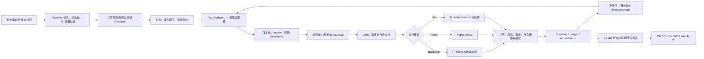

# 牵星 Qianxing：GitHub 竞品对标、架构复核与重构实施路线图

> 复核日期：2026-10-26<br>
> 目标：基于当前工作树和公开上游资料，梳理项目架构、工程细节、竞品取舍与下一阶段可验收的重构任务。<br>
> 状态：实施路线图；不代表本路线图所列事项已经全部完成，也不代表供应商沙盒或生产验证已经通过。<br>
> 配套总方案：[竞品对比项目架构与优化重构总方案（2026-10-26）](牵星Qianxing-竞品对比项目架构与优化重构总方案-2026-10-26.md)；[模块地图](module-map.md)；[标准策略接口对比](牵星Qianxing-标准策略接口经典框架对比与改进方案-2026-10-25.md)。

## 1. 评审结论

牵星已有确定性 Rust 交易与回测核心、PIT 数据语义、精确交易类型、策略多语言入口、订单风控/OMS、事件日志、研究报告 reader 和按账户隔离的 ExchangeGateway 路由目录。仓库当前采用模块化单体；29 个 workspace package 中有 28 个 `qx-*` crate 和一个跨 crate 契约测试 crate。

主要架构风险不是“核心能力空白”，而是**功能和合同已经增长，用户旅程与内部职责没有同比收敛**：公共入口多、schema 转换多、报告/配置/CLI/适配器局部热点过大；能力实现、离线验收、安装验收和供应商证据容易被概念混淆。后续应该先稳定事实 owner、单位和跨入口合同，再拆内部模块；不建议重写核心或拆成微服务。

建议按以下原则做决策：

1. 保持模块化单体；进程隔离只用于策略、连接器和故障域，不把拆服务作为整理代码的默认手段。
2. 回测、Paper、Live 共用策略事件、订单状态、精确单位和账务事实；明确表达时钟、撮合、网络和外部状态差异，不承诺三种环境完全等价。
3. `ExchangeGateway` 是按 venue/account 装配的组合门面和路由目录；行情、产品目录、账户查询、执行、私有流、对账仍是窄端口，不做巨型 trait。
4. Rust `qx-app` 是研究用例与报告事实 owner；CLI、HTTP、Python、C++ 和 Web 负责调用、授权、适配或展示，不重新计算收益和账务。
5. 小币种精度按全链路能力验收。价格、数量、报价币预算、合约张数/乘数、手续费币种、最小名义和舍入方式必须可追踪；不能用某一处 Decimal 类型推断整条交易链支持任意精度。
6. 代码实现、离线测试、可安装、供应商沙盒和生产批准分别登记。按当前项目约束，本路线图不要求实盘供应商验证；没有证据时能力等级必须保持未验证。

## 2. 范围、证据和复核边界

本次检查覆盖 Cargo workspace、`docs/module-map.md`、主要 crate manifest、Rust 执行端口与 ExchangeGateway 注册目录、Python SDK/策略入口、API 与报告模块、CLI 和已有总方案，并查看 NautilusTrader、Freqtrade、Hummingbot、VeighNa、Backtrader、RQAlpha、vectorbt 和 LEAN 的公开 GitHub 文档或源码。

行数和文件体量只用来识别维护热点，不等同于缺陷评分。竞品比较只讨论公开架构与工作流，不是性能排名。没有在同一机器、同一数据、同一编译配置下做牵星与竞品基准；本路线图也没有进行完整构建、供应商沙盒验收或生产安全批准。

结论与证据分级：

| 等级 | 表示什么 | 不能推导什么 |
|---|---|---|
| `implemented` | 当前源码存在指定能力。 | 不代表该路径已经运行通过。 |
| `code_tested` | 指定本地用例通过。 | 不代表已打包或真实交易所行为一致。 |
| `packaged` | 指定 OS/架构/安装方式的干净环境验收通过。 | 不代表所有平台和 Python 版本可用。 |
| `sandbox_tested` | 指定供应商、账户、产品、订单和恢复范围完成往返验收。 | 不代表其他产品模式或生产账户通过。 |
| `production_approved` | 精确生产 scope 已完成独立授权、操作和回滚审批。 | 不可由源码或离线测试自动获得。 |
| `unmeasured` | 指定容量 profile 尚无可重复测量。 | 不得用相邻 workload 推算资源承诺。 |

## 3. GitHub 竞品对照与吸收原则

| 项目 | 公开设计的优点 | 牵星可吸收的部分 | 不宜照搬的边界 |
|---|---|---|---|
| [NautilusTrader](https://github.com/nautechsystems/nautilus_trader) | Rust 核心、多语言接口、Backtest/Sandbox/Live 的共享组件、明确事件与执行时序。 | 统一事件模型、端口边界、回测先后顺序、故障和恢复边界。 | 同一策略代码不等于网络时延、盘口队列或交易所状态等价；不要把复杂度全暴露给入门用户。 |
| [Freqtrade](https://github.com/freqtrade/freqtrade) | 加密策略文件工作流清楚；指标/入场/出场和 runtime callback 分层；参数搜索与 lookahead/recursive 诊断容易发现。 | 安装后指定策略文件即可做基线、诊断、参数筛选和结果比较的单一路径。 | 快速向量化信号不能替代共享账户、部分成交、资金费、保证金、精度和订单状态的事件记账。 |
| [Hummingbot](https://github.com/hummingbot/hummingbot) | Connector 面向不同交易所；Strategy V2 将长期控制逻辑与有限生命周期的 Executor 区分。 | 将 TWAP、网格、分批执行和对冲腿做成有终态、有审计的 execution algorithm，由上层控制器管理。 | 执行算法不是通用交易所门面，也不应绕过牵星 Risk、OMS、账本、回放和组合资金边界。 |
| [VeighNa / vn.py](https://github.com/vnpy/vnpy) | 中文 CTA 策略回调直观，Gateway/事件引擎概念易找；订单和成交通知符合开发者习惯。 | 简短策略模板、可发现的生命周期回调和交易所能力查询。 | 不把回调易用误作连接器行为一致；保持事件身份、精确单位、版本和能力 scope。 |
| [Backtrader](https://github.com/mementum/backtrader) | `prenext/nextstart/next` 明确指标预热过程；订单/交易回报和 Analyzer/Observer 组合直观。 | 显式区分初始化、预热完成、可交易和停止状态；分析器作为独立报告扩展。 | 不引入不带账户/订单/事件身份的隐式回调语义。 |
| [RQAlpha](https://github.com/ricequant/rqalpha) | Python 策略入口简洁，事件源与 Mod 便于扩展，多标的研究流程清楚。 | 缩短策略作者需要学习的第一层概念；扩展点由稳定合同管理。 | 不让便利层变成另一套订单或账务实现，也不把特定数据生态当作通用能力。 |
| [vectorbt](https://github.com/polakowo/vectorbt) | 广播/向量化适合大批参数与标的组合预筛。 | 可选的快速候选筛选，用于缩小完整事件回测的搜索范围。 | 快筛必须标出近似假设；候选必须进牵星事件撮合和样本外验证，不能称为最终实盘结果。 |
| [LEAN](https://github.com/QuantConnect/Lean) | 多资产研究、回测、优化和部署入口成体系。 | 项目初始化、运行、搜索、报告和发布的用户旅程。 | 不按功能数量竞赛；连接器/data/brokerage 能力需要逐项证据，不能由平台覆盖面推断。 |

跨项目的吸收结论：把竞品的**短路径、可发现回调、显式预热、参数诊断和执行单元终态**移植到牵星自己的 `StrategyEvent → Decision → Risk/OMS → Ledger/EventLog → Report` 主链，不复制彼此不同的市场范围、撮合假设或云服务依赖。

## 4. 当前项目架构与事实流

### 4.1 当前模块层次

```text
外部入口：CLI / HTTP+WebSocket / Python SDK / C++ SDK / Web Console
                           │  请求适配、授权、呈现
                           ▼
应用用例：qx-app ─── 研究 RunSpec、回测/实验、产物、报告事实与核验
                           │
        ┌──────────────────┼──────────────────┐
        ▼                  ▼                  ▼
领域/策略/交易         数据与存储             运行装配
qx-core                qx-data               qx-runtime
qx-strategy            qx-provider            qx-service
qx-risk                qx-storage             qx-orchestrator
qx-zhenlu/qx-execution qx-datastruct          qx-scheduler
qx-xingban/qx-genglu   qx-guanxing/qx-factor  qx-control
        │                  │                  │
        └──────────────────┴──────────────────┘
                           ▼
连接与扩展：qx-adapter / Python CCXT / qx-plugin / strategy process / C ABI
```

### 4.2 目标交易与研究链



策略只产生经过校验的意图；实盘连接器不得绕过风控、OMS、EventLog 和账本。回测成交与供应商成交是不同证据类别。跨交易所两腿共享的是组合协调，不是共享账户购买力或原子提交。

### 4.3 代码职责基线

| 职责 | 当前主要 owner | 后续边界要求 |
|---|---|---|
| 身份、时间戳、事件因果、精确基础类型 | `qx-core` | 不把应用用例或 HTTP DTO 引入领域内核。 |
| PIT、质量、市场数据标准化和数据集 | `qx-guanxing`、`qx-data`、`qx-provider`、`qx-datastruct` | 每类事实只保留一个规范定义，入口只做来源映射。 |
| 策略事件、策略决策和策略 SDK | `qx-strategy`、Python `qianxing_strategy`、C++/C ABI | 协议版本 owner 明确；宿主差异由 adapter 显式说明。 |
| 撮合、风险、OMS、外部 Venue 与对账 | `qx-xingban`、`qx-risk`、`qx-zhenlu`、`qx-execution`、`qx-adapter`、`qx-genglu` | 订单状态和金额含义由合同贯通到恢复和报告。 |
| 研究用例、运行身份、产物、核验后的报表事实 | `qx-app` | CLI/API/Python/Web 不重算领域 KPI。 |
| 进程/服务装配和运行态目录 | `qx-service`、`qx-runtime`、`qx-orchestrator`、`qx-control`、`qx-scheduler`、`qx-storage` | 心跳、业务健康、能力声明、供应商证据分开。 |
| 外部消费 | `qx-api`、`qx-cli`、`qx-sdk`、`qx-python`、`python/`、`cpp/`、`web/console` | 共享用例和 DTO；入口之间以黄金样本对拍。 |

## 5. 架构合理处与需要改进处

### 5.1 应保留的设计

- Rust 模块化单体适合当前一个进程内确定性运行的回测/研究核心；拆成微服务会给事件顺序、账本事务和故障恢复增加额外变量。
- `qx-app` 已成为多类研究结果和报告读取的应用事实 owner，CLI/Python/API 通过共享用例复用，是正确方向。
- `VenuePort` 和 `VenueRouterPort` 维持执行职责窄；`qx-service::exchange_gateway` 按 `(venue_id, account_id)` 登记路由、能力摘要和 worker 健康投影。它目前是组合/注册和观测目录，不是一个可直接调用全部交易所功能的完整客户端。
- 策略进程隔离、JSONL/framed/shared-memory、C ABI 信任门分离了性能路径与不可信代码边界；应继续让所有策略输出经过公共决策校验和执行链。
- EventLog、Run identity、可复算证据包、PIT 数据和 exact quantity 是区别于轻量策略机器人的长期优势。

### 5.2 具体不合理项与整改决策

| 优先级 | 当前证据/位置 | 不合理处和风险 | 改造决定 |
|---|---|---|---|
| P0 | 策略核心、Python callback、Python 文件进程协议、C ABI/C++ 各有入口；Python Runtime Strategy worker 现通过显式 `python_strategy_spec` 适配 `BaseStrategy`，旧模块回调仍保持独立入口。 | 业务概念可对应，但生命周期、更新顺序和消费形态仍分宿主；类策略状态跨进程恢复、所有宿主的同一 golden 证据仍不完整。 | 以版本化 `StrategyEvent/Decision/Update` 为 wire 核心；typed hooks 是 helper。继续补能力/事件矩阵和跨宿主规范 fixture。账户/持仓回调只有在事实源、时间顺序和覆盖宿主确定后才加入。 |
| P0 | Rust 精确金额类型、策略 raw 字段、Python/CCXT Decimal 与交易所十进制字符串并存。 | 小币种数量和合约单位可能在某个转换点被截断、按错 scale 或错误舍入；局部精度类型不代表全链路精度。 | 建立版本化 `InstrumentRules` 与数值语义：value/unit/currency/scale/range/rounding；从行情和规格快照到下单请求、成交恢复、手续费和报告做往返守恒检查。不满足范围或规则过期时网络前拒绝。 |
| P0 | 真实订单横跨 `qx-zhenlu`、`qx-execution`、adapter、storage、service、reconcile；多 venue/多账号套利为异步多腿。 | submit 结果未知、partial fill、cancel/fill 竞态或重启时，如果盲目重发，会产生重复敞口。多账户联合不能视作一份购买力。 | 每个 leg 使用持久操作身份、状态机、fencing/idempotency key；结果未知只查单/对账。Saga 明确补偿和人工介入终态，每账户独立 ledger。离线故障注入先证明恢复，不假定跨所原子性。 |
| P0 | `qx-service::exchange_gateway` 已有 registry/health/profile，但 connector、one-shot 与各操作探针覆盖不完全。 | `ExchangeGateway` 名称可能被误读成统一客户端；进程心跳、配置存在和业务成功并非同一状态。 | 保留 route registry；展示 `configured / process / business / capability / evidence` 独立状态。统一 capability query 可按 venue × product × account mode × position mode × operation/order type 给出 scope 和拒绝原因。 |
| P1 | `qx-runtime` 的 `StrategyRuntimeConfig` 汇总策略、实时行情、产品/杠杆、Python/外部进程、共享内存、C ABI、A 股和研究输入等字段。 | 单一配置类型承担多个子域，默认值与兼容策略难审；新增字段会提升 schema drift 风险，序列化指纹又不能随意改变。 | 内部拆为有类型的 `strategy/runtime/transport/research/product/live` view；外部 JSON 保持兼容投影、显式版本迁移和 canonical fingerprint。禁止直接改一批 serde 默认值而不更新 fixture。 |
| P1 | `python/qianxing/app.py` 同步/异步方法覆盖多个 RunType；包内已有 `core/data/experiments/live/paper/reports` 子包。 | API 完整但新用户不知道首选路径；同步/异步包装和多 RunType 专用方法容易使 SDK 不断膨胀。 | 建立稳定的 `RunSpec/StrategySpec/RunHandle` 高层 facade；内部委托现有用例和子包。保留兼容方法，给单一 quick-research 旅程和最小策略模板。 |
| P1 | `qx-app` 报告 reader + `qx-api` adapter + 多个 CLI report renderer + Python report facade + Web 图表。 | 同一个报告跨入口扩字段，验证、分页和展示责任容易缠在一起；指标重算会让各入口答案不同。 | 先冻结统一报告 shell 与 typed section、身份化分页 cursor；`qx-app` 唯一核验/统计，API 转成 HTTP，CLI 转成 JSON/HTML/XLSX，Python/Web 只投影。跨入口以同一 run 对拍。 |
| P1 | 参数搜索、未来数据/预热诊断、OOS/walk-forward 与报告分别已有能力或入口。 | 缺少一个把它们串成“策略是否有效”回答的单一流程；最高分候选容易被误称为最佳策略。 | 提供 `preflight → baseline → bias diagnostics → bounded search → event replay → OOS/walk-forward → compare` 一条用例。必须记录数据 hash、空间、预算、切分、随机种子、成本假设、淘汰理由和失败态。 |
| P2 | workspace 含 28 个生产 `qx-*` crate；CLI/API/Python/Adapter 内部有增长热点。 | 模块很多会增加导航和映射负担；按行数机械拆 crate 会扩展依赖和发布接口，并不能保证职责清晰。 | 先按 owner 在 crate 内拆模块；只在出现独立演进、公共消费者、单向依赖和单独验收收益时新建 crate。机器可核对的命令/路由/schema/策略能力清单生成或双向门禁。 |
| P2 | 不同完整产品组合的容量项仍有 `unmeasured` 状态；Rust 优化常被误以为应先做。 | 没有统一工作负载和内存/延迟基线时，微基准不能说明多标的、多账户、L2 或搜索的真实机器要求。 | 固定工作负载 schema 与机器/Release 指纹；采集 p50/p95、峰值 RSS、吞吐、输入/产物体量。先 profile，再优化有证据的 Rust 热路径，并复核结果 hash。 |
| P2 | `module-map.md`、README、schema registry、CLI 命令、capability、maturity 和多入口文档都需同步。 | 文档或人工清单可能与当前实现漂移，贡献者无法快速定位改动应落在哪里。 | 将 crate、命令、HTTP route、schema 和 capability 由代码生成或双向校验；模块地图只维护 owner、依赖方向和用户入口。 |

### 5.3 大文件：维护热点而不是自动缺陷

当前工作树中，下列文件职责较多或体量较大，建议用作模块化拆分候选。行数受工作树版本影响，提交前应重新统计；不以行数单独作为拆分门槛。

| 热点 | 当前风险 | 目标拆分边界 |
|---|---|---|
| `crates/qx-api/src/lib.rs`、`crates/qx-api/src/app_surface/research_artifacts.rs` | API state、路由、授权、readiness、report adapter 聚合，局部改动需要理解过多路径。 | `state/readiness`、`research_routes`、`control/admission`、`transport`、按 report 类型的 HTTP adapter；授权和 wire contract 仍归 qx-api。 |
| `crates/qx-app/src/report_read.rs` 与多个多市场/多账户报告文件 | verifier、读模型、事件分页和汇总在一个逻辑区域内增长。 | 先分 `verify`、`reader`、`pagination`、typed section 聚合；仍由 qx-app 产生和核验事实。 |
| `crates/qx-cli/src/cli.rs`、`report_multi_market.rs`、`report_multi_account.rs` | 命令分派和 HTML/XLSX/JSON 投影承载过多实现；增加入口容易形成第二业务层。 | 保持唯一 clap 命令注册和显式分派；每个用例拆命令模块，renderer 按格式拆；业务数值只读 qx-app DTO。 |
| `python/qianxing/app.py` | 面向用户的同步/异步 API 总门面增长。 | 兼容导出 facade + `client`、`experiments`、`reports`、`paper/live` 子模块；返回 DTO 统一。 |
| `crates/qx-adapter/src/binance.rs`、`ccxt.rs` | 市场数据、规则、订单映射、账户和恢复逻辑交错，复制连接器时容易漂移。 | 按 connector 内部职责拆模块；跨交易所共性只抽数值/订单状态合同，不抽掉 venue 差异。 |
| `crates/qx-runtime/src/runtime_config/strategy_schema.rs` | 多类策略与运行配置集中增长，兼容序列化约束繁重。 | 内部有类型的子配置 + 兼容 wire projection；每步都比较旧/新 canonical serialization 和 fingerprint。 |

## 6. 目标设计决策

### 6.1 ExchangeGateway：组合 facade，不是超级接口

```text
ExchangeGatewayRegistry[(venue_id, account_id)]
├── CapabilityProfile       产品/账户/操作/订单类型声明及证据等级
├── MarketDataPort          历史、实时行情与时间戳/新鲜度
├── InstrumentCatalog       tick、step、min notional、contract multiplier 等规格快照
├── AccountQueryPort        余额、权益、保证金、持仓、开放订单
├── VenueExecutionPort      submit/cancel/replace 与统一回执
├── PrivateOrderStream      订单、成交、资金与仓位推送
├── ReconciliationPort      对账、差异分类、恢复游标
└── HealthProjection        configured/process/business/capability/evidence 状态
```

registry 只负责按账户绑定可用窄端口和 scope；策略只能收到 `StrategyContext`，不能直接拿交易所对象。回测、Paper、Live 的 adapter 接同一订单合同，但各自保留独立时钟和执行行为。健康读面不得把进程存活冒充连接业务正常，也不得把 connector 能力声明冒充沙盒验收。

### 6.2 BaseStrategy：简洁回调映射到版本化事件合同

Python 和 Rust 高层策略 API 提供清楚、可选的函数：`validate_config`、`history_requirements`、`on_init`、`on_warmup_complete`、`on_start`、`on_bar/on_tick/on_order_book/on_timer`、`on_order_status_update`、`on_fill_update/on_trade`、`on_stop`、`diagnostic_state`。策略只重写用到的 hook。Python `BaseStrategy.on_stop(context=None, reason="host_stop")` 兼容旧无参 override；Rust 已有版本化 stop context，C ABI 以可选 v2 JSON callback 保持旧插件兼容。现有 host 目前仍传通用 `host_stop`，完成、取消和失败的终态映射仍待全路径接通。共享交易请求由 `StrategyDecision/OrderIntent` 返回，不能在 hook 内直接 REST 下单。

共同事实仍是版本化事件和更新 DTO，带 `strategy/account/instrument/run` 身份和稳定 `event_seq`。同一更新按 at-least-once 重投时，策略用序号去重。Python Runtime Strategy worker 已提供显式 class adapter：`python_strategy_spec` 才启用，调用 `create_strategy(spec)` 或 `STRATEGY_CLASS(spec)`，复用完整 manifest 的参数默认值/类型校验/`validate_config`，并在四种传输下分派生命周期、Bar warmup、Bar/Tick/OrderBook/Timer、订单状态、fill 和账户/持仓快照；旧模块级 `on_event(request)` 默认路径不变。C ABI/C++ 动态策略现以可选 `history_requirements`、`on_warmup_complete` 和 `qx_strategy_on_stop_v2` 符号补齐部分生命周期合同；旧 vtable 不变，缺失声明按零预热及旧无参 stop 兼容。跨语言 warmup 与 stop-context fixture 已由 Rust、Python adapter 和 Rust 宿主加载的 C++ 示例共同消费。Runtime class adapter 将有界 JSON 策略状态、适配器去重游标、warmup 状态和行情 cursor 作为 checkpoint 提交；恢复校验策略身份/版本并采用 at-least-once 语义。各 host 仍需把完成、取消和失败映射到不同 reason；完整跨宿主事件/update golden、`on_error` 统一合同及更广泛进程/存储故障矩阵仍需单独验收。

### 6.3 研究/报告共同合同

- `RunSpec` 固定数据身份、策略/参数、产品规则、时间切分、成本假设、初始资金、运行环境和 deterministic seed。
- `ResearchRunReport` 共用 run identity、指标摘要、风险/成本分解、诊断结论、分页 cursor 和 typed sections。
- 多市场、多腿、多账户可以扩展领域 section，但不能复制净值/手续费定义。
- 报告对同一运行可重新核验；大事件和成交明细走身份化有界分页，不要求一次性把所有事件塞进 HTML 或 API JSON。
- 参数搜索产物保存训练/验证/测试边界、参数空间、预算、排序目标、随机种子、所有候选状态及失败原因；只在 OOS 和偏差门通过时才标为“候选”。

## 7. 分阶段实施工作包

每个工作包完成后再进入依赖它的下一阶段。每个改动需要说明：唯一事实 owner、wire/schema 版本、兼容方式、失败行为、幂等/恢复方式、证据等级和发布影响。

| 工作包 | 级别 | 范围与主要落点 | 交付 | 关闭条件 |
|---|---|---|---|---|
| R0：事实 owner 与入口清单 | P0 | `docs/module-map.md`、`qx-app`、`qx-xingban`、`qx-genglu`、`qx-runtime`、CLI/API/Python read paths。 | 订单、成交、费用、持仓、净值、报告 KPI、能力状态的 owner 表；命令/API/schema/strategy hook 的来源清单。 | 每个公开数字有一个计算者；所有消费端明确只是投影；自动门禁能发现孤儿/重复入口。 |
| R1：跨宿主策略合同 | P0 | `qx-strategy`、`python/qianxing_strategy`、JSONL/framed/shared-memory worker、C ABI/C++ adapter。 | Python Runtime class adapter、完整 manifest 参数绑定、四种传输、Bar/Tick/OrderBook/Timer、账户/持仓快照与有界 JSON checkpoint 已接通；继续补齐完整 stop/error/update 能力矩阵和跨故障/跨宿主 golden。 | 同 fixture 经 Rust/Python callback/Python class worker/C++ host 后在各自支持子集内规范化一致；旧模块策略兼容；unsupported 明确；超时重启和重复投递按 event sequence 可幂等消费。 |
| R2：金额/产品规则闭环 | P0 | `qx-core` numeric identity、`qx-spec`/capability、策略 DTO、`qx-execution`、Python CCXT、Rust adapters、报告。 | 版本化 InstrumentRules、unit/scale/rounding 合同和 connector mapping 表；BTC/USDT 与小数位极端资产、线性/币本位合约例子。 | 数量/价格/报价预算/乘数/手续费单位往返不变；不合法 step/minimum、溢出、未知币种/规则过期均在发请求前拒绝；无静默舍入。 |
| R3：多账户/多 Venue 恢复状态机 | P0 | `qx-service` ExchangeGateway registry、`qx-execution`、`qx-storage`、`qx-genglu`、reconcile workers。 | operation scope preflight、账户 route、持久订单/腿状态、Saga 补偿和运行状态投影。 | 对提交未知、重启、重复 fill、partial fill、cancel/fill 竞态、单腿拒绝和重复恢复做离线故障注入；每账户资金持仓隔离；unknown 不盲重下。 |
| R4：Python Quick Research | P1 | `python` facade、CLI research 命令、`qx-app` case/experiment/diagnostics。 | 一条从策略文件到基线、未来数据/预热诊断、参数搜索、OOS 复算与结果比较的流程。 | 指定文件可安装后运行；相同配置跨 CLI/Python 生成同 RunSpec/hash；候选有预算和失败原因；最终排序使用事件内核和 OOS，不虚报“最佳”。 |
| R5：统一报告与交互研究页 | P1 | `qx-app` report reader、`qx-api` read endpoints、CLI format renderers、Python reports、Web console。 | 报告 shell/typed sections/cursor 版本；HTML/JS 图表、候选筛选、区间切换、风险/成本拆解、事件/成交 drill-down。 | 同一 run 核心指标跨 JSON/HTML/XLSX/API/Python/Web 对拍；大数据分页有限；篡改或版本不支持有清楚拒绝。 |
| R6：高热点内部模块化 | P2 | API、app report、CLI/reporters、Python app、Binance/CCXT、runtime config。 | 按职责切文件/子模块，暂不新增 crate；稳定 facade 与 wire 内容。 | 拆分前后 canonical JSON、Run identity、订单/成交/资金事实和报告摘要一致；可单模块审阅；兼容入口有迁移策略。 |
| R7：容量画像与 Rust 性能 | P2 | `maturity/targets.yaml`、benchmark/profile tools、Bar/L1/L2/多市场/多账户/实验/报告全链路。 | 固定 workload manifest、同构建基线、Profile 结果和瓶颈报告。 | 每个 profile 记录 CPU/内存/OS/Rust build/data fingerprint/参数；提供 p50/p95、RSS、吞吐、I/O；优化热路径前后结果身份一致且瓶颈指标有改善。 |
| R8：发行和成熟度账本 | P0/P1/P2 汇总 | Rust wheel/package、Python、C++ examples、README、capability/maturity、发布脚本。 | research release 与 live-code capability ledger 分开；quickstart 和安装矩阵。 | 清洁环境安装及最短研究旅程通过；每项能力列 `implemented/code_tested/packaged/sandbox_tested/production_approved`；未测容量标 `unmeasured`。按本期要求，不把发布门设置为供应商真实验证。 |

### 7.1 依赖和顺序

```text
R0 owner/证据清单
 ├── R1 策略协议 ───────────────┐
 ├── R2 数值/规则合同 ── R3 执行恢复与 Gateway
 └──────────────────────────────┤
                                 ▼
                      R4 Quick Research
                                 ▼
                     R5 统一报告/交互页面
                                 ▼
                    R6 兼容拆分内部热点
                                 ▼
                  R7 容量测量与 Rust 热点优化
                                 ▼
                      R8 发布与能力账本
```

R1/R2/R3 可以分别实施，但同一交易链的发布必须同时满足相关合同；R4 依赖 RunSpec、指标 owner 和结果身份稳定；R5 依赖 qx-app report shell；R6 不得先于对应 owner 固定；R7 先测再改。R8 汇总各 scope 证据，不以单个测试通过替代其他发布项。

## 8. 发布验收和停止条件

| 面向 | 必须可回答的问题 |
|---|---|
| 策略作者 | 如何加载文件、校验参数、声明预热、看订单/成交更新、检查停止原因和诊断态？未支持的宿主能力是否明确？ |
| 研究用户 | 一条命令能否生成基线、偏差诊断、有限预算搜索、OOS 重跑和交互报告？哪个结果是训练内排名，哪个是样本外结果？ |
| 交易使用者 | 这个 venue/account/product/mode/operation 具体支持什么？小币种数量按什么 scale？未知回执如何恢复？这些结论是什么证据等级？ |
| 运维使用者 | 进程、业务调用、账户查询、行情新鲜度和供应商验收是否分别呈现？无请求的端口是否标为 `unobserved`？ |
| 容量使用者 | 目标 workload 的设备、峰值内存和耗时在哪一台机器测得？尚未测量的 profile 是否明确标未知？ |
| 发布负责人 | 本次发布包含哪些 OS/Python/C++ 消费方式？哪些能力只是源码实现/离线测试？实盘代码与供应商验证是否分开记录？ |

下列任一情况应阻止对应能力 scope 发布为可用：订单/持仓账务出现单位歧义；规则失配仍能出网；未知订单状态会自动重发；报表入口对同一 run 计算出不同核心结果；策略更新重投无法按序号去重；包在声明支持的干净环境无法加载；容量宣传从未测 workload 外推。

## 9. 不采用的方案

- 不重写 Rust 核心、不将整个系统改成微服务，也不因 crate 数量多就进行大迁移。
- 不把所有市场、账户、行情、下单、对账、恢复和健康合成一个 `ExchangeGateway` 巨型 trait。
- 不让策略直接调用 Venue 或把 Bar 向量信号当作实时订单实现。
- 不宣称跨交易所原子套利或跨账户共享购买力；按账户记账，用可恢复 Saga 协调。
- 不为统一外观而把不同交易所产品差异压成会静默舍入的假统一字段。
- 不以单机微基准、合成样例、匿名行情查询或离线合同测试声称供应商验收、生产批准或任意 workload 的资源保证。
- 不以“最高收益”做唯一策略排序；必须公布优化目标、成本、时间切分、失败候选和 OOS 结果。

## 10. 公开一手参考

- [NautilusTrader architecture](https://github.com/nautechsystems/nautilus_trader/blob/develop/docs/concepts/architecture.md) · [backtest execution flow](https://github.com/nautechsystems/nautilus_trader/blob/develop/docs/concepts/backtesting/execution-flow.md)
- [Freqtrade strategy callbacks](https://github.com/freqtrade/freqtrade/blob/develop/docs/strategy-callbacks.md) · [Hyperopt](https://github.com/freqtrade/freqtrade/blob/develop/docs/hyperopt.md) · [lookahead analysis](https://github.com/freqtrade/freqtrade/blob/develop/docs/commands/lookahead-analysis.md) · [recursive analysis](https://github.com/freqtrade/freqtrade/blob/develop/docs/recursive-analysis.md)
- [Hummingbot Strategy V2](https://github.com/hummingbot/hummingbot-site/blob/main/docs/strategies/v2-strategies/index.md) · [Executors](https://github.com/hummingbot/hummingbot-site/blob/main/docs/strategies/v2-strategies/executors/index.md)
- [VeighNa CTA strategy](https://github.com/vnpy/vnpy/blob/master/docs/community/app/cta_strategy.md)
- [Backtrader strategy implementation](https://github.com/mementum/backtrader/blob/master/backtrader/strategy.py) · [strategy documentation](https://github.com/backtrader/backtrader-docs/blob/master/docs/strategy.rst)
- [RQAlpha](https://github.com/ricequant/rqalpha) · [Event Source and Mod development](https://github.com/ricequant/rqalpha/blob/master/docs/source/development/event_source.rst)
- [vectorbt portfolio implementation](https://github.com/polakowo/vectorbt/blob/master/vectorbt/portfolio/base.py)
- [LEAN algorithmic trading engine](https://github.com/QuantConnect/Lean)
