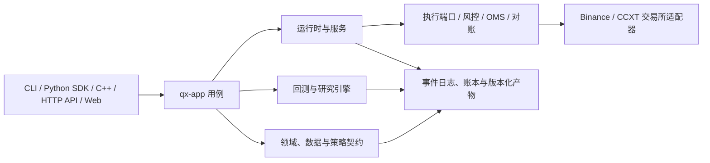
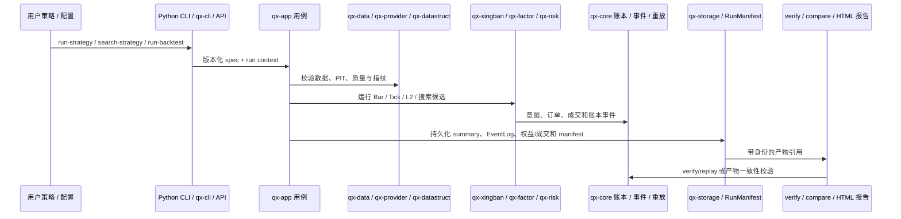
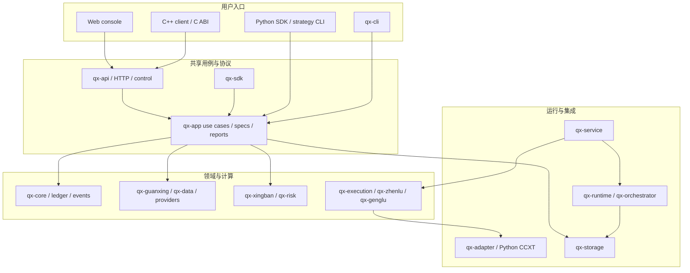

# 牵星 Qianxing：GitHub 竞品对比、架构复核与优化重构方案

> **方案日期：** 2026-10-24
> **分析对象：** 当前工作区代码、模块地图、能力声明与近期数字货币执行审计
> **方案性质：** 架构与产品收敛建议；本文不代表方案中的开发工作已完成
> **对标口径：** 依据竞品官方 GitHub 仓库、官方文档和本项目当前仓库材料；外部资料于 2026-10-24 核对，链接指向可变分支，后续版本可能变化。没有在本地逐行克隆竞品仓库，因此不对其内部实现作未经证实的判断。

## 1. 结论摘要

牵星已形成 Rust 确定性内核、分层 crate、统一应用用例、执行端口和多语言策略协议；能力目录查询、共享账户多市场 Bar 研究、有限自适应搜索、策略未来数据/预热诊断和离线研究报告也已有代码路径。当前最明显的产品优势是可审计与可复算的内核设计、A 股规则和 Rust/Python/C++ 扩展面；最大的短板是用户工作流和研究报告仍不够一体化，部分契约还未进入共同预检，部分实盘链路尚无外部验收。当前结论针对工作树源码，不等于发布版或交易所验收结论。

最需要解决的不是继续增加能力名称，而是关闭已有工作流的契约断点，并把模块收敛为少数可直接使用、证据完整的垂直场景：

1. **研究场景**：安装 Python 包后，从策略文件和数据/回测配置完成运行、参数搜索、训练/样本外对比、交互式报告和结果复算。
2. **单交易所执行场景**：按交易所、现货/合约、账户模式和委托类型逐项明确支持状态，完成沙盒验收后再提升能力证据。
3. **多交易所组合场景**：先交付“各账户独立风控、订单组可恢复补偿”的 saga 语义；不得把多账户展示净值说成共享购买力或跨所原子交易。
4. **架构与维护场景**：保持 crate 分层，优先拆解职责过大的源文件，减少跨语言契约重复和对单体架构脚本的维护依赖。

能力矩阵、跨层查询目录和首发 profile 已建立；Python 文件策略 CLI 的 Rust 共享预检、Bar/深度核心报告读模型和首版 ArtifactReader 已落地。共享账户多市场 Bar 与 L1/L2 报告的路径授权和有界文件读取由 API adapter 与 qx-app reader 协作完成；多市场 Bar 的输入质量、规格/策略身份指纹、逐标的权益守恒、运行/读取共用的数据指纹和 RunManifest 输入组件聚合、权益指标与成交 sidecar 复核，以及多类报告的事件重放复核现已进一步迁入 qx-app，但完整报告投影仍在 qx-api。接下来应将 outcome 中的路径字符串迁为逻辑 artifact identity，继续迁移 multi-leg、多账户和其他报告入口，并从所有真实运行配置解析能力证据；精度/单位迁移仍先走 ADR。之后再推进供应商验收、多账户 saga 与容量画像。不建议只为名称新增 ExchangeGateway crate 或空泛的 BaseStrategy 基类：项目已有执行端口、OMS/路由和策略 API，应先对齐既有边界的语义与各入口能力。

## 2. 证据范围与当前项目画像

### 2.1 本次核对的本地材料

- [模块地图](module-map.md)：crate 职责、运行角色和前后端边界。
- [竞品全景与架构对标（2026-10-10）](competitive-analysis/竞品全景图与架构对标-牵星Qianxing-2026-10-10.md)：此前的竞品和仓库基线。
- [架构不合理清单与优化重构方案（2026-10-10）](competitive-analysis/牵星Qianxing-架构不合理清单与优化重构方案-2026-10-10.md)：已有问题清单与路线图。
- [数字货币实盘核心链路审计（2026-10-23）](crypto-live-core-audit-2026-10-23.md)：现货/合约、多交易所、精度、账户模式和外部验收边界。
- [领域能力矩阵](../maturity/capability-matrix.yaml) 与 [内部成熟度清单](../maturity/capabilities.yaml)：这是两条正交的口径，分别描述产品/venue 覆盖和内部证据成熟度，不应合并成一个状态字段。
- [Python README](../python/README.md)、[部署与 API 文档](../deploy/README.md)、[能力矩阵](../maturity/capabilities.yaml)、[根 README](../README.md)。
- 源码目录：crates/qx-core、qx-app、qx-runtime、qx-service、qx-adapter、qx-execution、qx-strategy、qx-xingban、qx-zhenlu、qx-api、qx-cli、qx-python、python/qianxing、python/qianxing_ccxt、web/console。

本地源码事实以本次检查时的工作树为准。工作区有尚未提交的改动，本文不把它们描述为已发布版本。外部交易所 sandbox 或生产账户结果以能力矩阵中的证据档位为准。

### 2.2 已有架构与产品能力

| 层次 | 主要模块 | 当前职责 |
|---|---|---|
| 领域与确定性 | qx-core、qx-guanxing、qx-spec、qx-protocol | 标的/市场身份、定点数、事件与账本、因果排序、PIT 可见性、数据质量和跨边界线格式 |
| 数据与存储 | qx-data、qx-provider、qx-datastruct、qx-storage | 数据集摄取与选择、列式边界、事件日志/快照及文件、SQLite、PostgreSQL 等后端 |
| 研究与仿真 | qx-app、qx-xingban、qx-factor、qx-risk | Bar、Tick、订单簿回测，组合/多市场用例，实验搜索和风险规则 |
| 策略与执行 | qx-strategy、qx-execution、qx-zhenlu、qx-genglu | 策略契约，稳定执行端口，订单管理/风控/路由和订单对账 |
| 运行与服务 | qx-runtime、qx-orchestrator、qx-service、qx-scheduler、qx-control | 拓扑校验，worker 编排和监督，执行/行情/调度服务，控制面与审计 |
| 适配器 | qx-adapter、python/qianxing_ccxt | HTTP/WebSocket、Binance Spot 基线、公共 CCXT 多交易所路径及供应商字段映射 |
| 用户入口 | qx-cli、qx-api、qx-sdk、qx-python、cpp、web/console | 命令行、本地/HTTP API、第三方 SDK、Python/C++ 策略接口和 Web 控制台 |

简化职责关系如下。它表示模块职责，不代替 Rust 实际依赖图；具体依赖以 Cargo workspace 和模块地图为准。



### 2.3 关键现状和已知限制

- 回测具有 Bar、L1 Tick、L2 订单簿等不同撮合内核。Paper 与回测共享部分风险、费用、延迟、保证金和事件规则，但不是同一撮合机。产物与输入指纹/重放校验是优势；不同执行模式之间仍须显式记录模型差异。
- Python 文件策略入口现已覆盖单市场与同账户多市场 Bar 回测。多市场目标槽可搜索 Rust 内置策略参数、最多 6 维的任意命名回调参数，也支持 random/TPE/KDE-TPE/Pareto-TPE 的离散或步进整数自适应搜索。自适应搜索强制配置时间切分，候选提案和排名只读取训练指标，可逐折重启搜索并对选中参数执行独立 OOS；跨市场共享 Python callback 状态仍未开放。Python 文件策略现提供 v1 manifest 检视和完整的 CLI Bar 运行前检验；其他调用入口尚未复用该预检。
- 数字货币 Binance、OKX、Bitget 路径已有代码和离线请求形状检查；这不能代替 sandbox 真实下单、成交、撤单和重启恢复验收。能力矩阵应区分 implementation、code_tested、sandbox_tested、production_approved。
- 当前 Price、Quantity、Money 统一使用 SCALE=1e9。超过 9 位的小数不能无损表示；改变 scale 会影响存储、协议和哈希，必须版本迁移。
- 账户组合读面可按原币种汇总，但多个账户之间没有共享抵押品、购买力净额或跨所原子性。
- 近期审计记录仍列出衍生品完整过滤器覆盖、统一数量单位、保护性委托、Bitget Spot 市价买、部分账户模式和供应商沙盒验收等边界。发布说明不能用“CCXT 能加载市场”代替能力证明。
- python/README.md 与 CLI 预检已说明多市场网格的边界和样本内警示。Rust 应用层、Rust SDK、Python native 扩展和策略文件 CLI 路由有定向用例；Windows 隔离 wheel 已验证策略文件到逐折 OOS CLI 摘要的链路。搜索报告已接入单市场 RunRecord 产物和共享账户多市场 Bar 产物：Rust `qx-app::VerifyRun` 统一校验单市场 manifest、summary、equity、fills、账本重放与 RunRecord/SHA-256；CLI HTML 在调用前检查候选路径边界和文件大小，再展示核验结果与报表行数。Python 直连报告辅助器在没有 Rust verifier 时保留本地 SHA-256 退路。共享账户多市场 Bar 报告重新校验 Rust BarFrame、候选/结果/RunManifest 身份、精确 input_components、权益/成交 sidecar、事件成交一致性及逐标的贡献守恒。多市场 HTML 尚不独立重放 EventLog；API/Web 与 Python HTML 尚未消费同一版本化报告 DTO，多账户归因、Tick/L2、跨结算币种估值仍未实现。OOS 样例只证明链路可运行，不证明策略有效。

### 2.4 真实调用链与边界

以下调用链以仓库当前入口和模块职责为准。CLI、Python、HTTP 和 Web 是不同的传输入口，业务执行应逐步收敛到 `qx-app` 用例；Web 写操作仍通过控制命令进入后端，不直接下单。

**研究 / 回测链：**



**执行 / 运维链：** `web/console`、CLI、SDK 或 API → `qx-api` / `qx-control` 控制面 → `qx-service` / `qx-orchestrator` → `qx-runtime` worker 与生命周期 → `qx-execution` 稳定端口 → `qx-zhenlu` 风控、OMS 和路由 → `qx-adapter` / Python CCXT 供应商映射 → venue。外部行情、订单回报、成交和余额属于外部事实，必须先标准化、按账户与交易所身份归属，再进入运行时事件/账本和 API 投影。超时后的提交结果为 `unknown` 时先对账，不得直接重发。

| 代码边界 | 主要实现位置 | 应保持的责任 |
|---|---|---|
| 领域事实与账本 | `crates/qx-core/src/event.rs`、`ledger/`、`order.rs`、`numeric.rs` | 身份、精确数值、事件与账户事实；不依赖 HTTP、Python 包或 venue SDK |
| 数据与研究编排 | `crates/qx-app/src/cases/`、`crates/qx-data/`、`crates/qx-provider/` | 输入校验、用例级编排、数据质量与可复现运行身份 |
| 回测撮合 | `crates/qx-xingban/src/backtest/`、`tick_backtest.rs`、`orderbook_backtest/` | 按数据粒度模拟撮合；明确 Bar/Tick/L2 假设和规则差异 |
| 策略接口 | `crates/qx-strategy/`、`crates/qx-python/`、`python/qianxing_strategy/`、`cpp/` | 将各语言回调转换为同一版本化策略事件/订单意图契约 |
| 风险与执行 | `crates/qx-risk/`、`crates/qx-zhenlu/`、`crates/qx-execution/`、`crates/qx-genglu/` | 风险拒绝、OMS 状态推进、外部副作用边界、订单对账；不得重复记账 |
| 供应商 | `crates/qx-adapter/`、`python/qianxing_ccxt/` | 市场规则快照、请求/响应映射、限频/断线与原始事实归属 |
| 运行、存储与查询 | `crates/qx-runtime/`、`crates/qx-service/`、`crates/qx-storage/`、`crates/qx-api/` | worker 生命周期、事件持久化、只读投影和受控命令入口 |
| 产品入口 | `crates/qx-cli/`、`python/qianxing/cli.py`、`web/console/` | 参数/身份/错误/产物链接的一致呈现；入口不得复制核心业务规则 |

当前重要的数据分界是：原始供应商记录 → 标准化数据集与 PIT/质量门 → 策略可见事件 → 领域订单意图 → 风控/OMS → 模拟撮合或真实 venue → 账本事实 → 可复算报告/只读投影。开发时应将每个转换保存为版本化、可审计边界，防止将不同单位、时间轴或账户身份混在一起。

## 3. GitHub 竞品对比

对标项目按各自强项领域选择，不把产品定位不同直接判成优劣。下表中的竞品信息来自官方仓库和官方文档，链接于 2026-10-24 复核；对许可与支持范围以仓库当日文件为准。

| 项目 | 主要定位与可借鉴点 | 公开材料可见的适用边界 / 取舍 | 牵星的相对优势 | 牵星目前的相对短板与适用边界 |
|---|---|---|---|---|
| [Freqtrade](https://github.com/freqtrade/freqtrade) | 以数字货币 bot 工作流为中心；官方回测文档将策略文件、历史数据、回测、导出和可视化串起来，Hyperopt 有成熟的参数空间/损失函数/随机种子工作流，也提供 lookahead-analysis。策略文件对 Python 用户的门槛低。 | 官方 lookahead 文档指出回测会一次载入完整 candle dataframe 并计算指标，因此需要专门的偏差诊断；这是其向量化研究方式的风险提示，不代表所有策略都有偏差。公开定位聚焦 crypto bot，不据此推断它覆盖牵星的 A 股规则或多账户组合语义。 | 牵星以 Rust 事件内核、固定点数、输入指纹、事件回放和 PIT 数据语义为差异化；同时覆盖 A 股规则、Bar/Tick/L2 与多语言策略边界。 | Freqtrade 更早提供从策略文件、历史数据到 hyperopt、结果分析和运行的清晰旅程。牵星虽然已有对应研究能力，但配置和策略元数据需要用户理解的概念更多；应把一次性 quickstart、报告对比和偏差诊断作为默认流程。 |
| [RQAlpha](https://github.com/ricequant/rqalpha) | 官方描述为可扩展、可替换、支持多证券的 Python 回测与交易框架；可参考策略 API 和组件替换的产品表达。 | Python-first 的策略与组件扩展降低 Python 研究者的接入门槛；公开定位本身不能证明某个数字货币 venue 或账户模式已真实验收。仓库许可证将非商业与商业用途分开，商业用途需先取得授权；选型时必须单独核对当前许可证。 | 牵星把热路径放在 Rust，共用领域账本、事件日志和回放，并提供 Rust/Python/C++ 策略边界。 | 牵星需要把“策略、数据、执行端口、回测器”的扩展契约写得更直观；多个 crate 不自动形成易替换组件。RQAlpha 主要作为研究 API 和组件边界参考。 |
| [NautilusTrader](https://github.com/nautechsystems/nautilus_trader) | Rust-native、事件驱动、多资产/venue；官方架构资料描述 backtest、sandbox、live 共用 kernel，并提供高层 BacktestNode 与低层 BacktestEngine 两种入口。它还明确记录回测与实盘在 venue、传输、时序、持久化和对账上的差异，是最贴近牵星技术路线的对标。 | 公开架构资料同时提醒 node 进程状态与并发实例边界；它的优势来自运行时内核与组件生态，不代表每种 venue 都自动验收。 | 牵星已有 PIT/数据质量门、A 股规则、跨语言入口及审计产物。 | 牵星尚未把研究与执行统一成对用户清晰的两层 API；报告/数据能力位于不同路径，多账户补偿和供应商 sandbox 证据仍有缺口。可借鉴两级 API 和共享 lifecycle，不能把模拟和真实成交等同。 |
| [VeighNa / vn.py](https://github.com/vnpy/vnpy) | Python gateway/app 生态和国内渠道广；官方仓库展示 CTP、XTP、TORA、IB 等接口，以及 CTA/组合/价差、数据管理、paper account、GUI 回测和 4.0 的 alpha 数据/模型/策略/lab 工作流。适合作为本地化和研究体验对标。 | Python 优先及多扩展仓库提供广泛接入与桌面工作流，组件质量和渠道仍需按具体项目及供应商验收；此处不作技术栈优劣排序。 | 牵星的 Rust 领域内核、版本化数据契约、重放与跨语言 intent 有助于避免语言之间各自记账。 | 牵星尚缺同等直观的本地数据管理、策略可视化迭代和扩展模板；国内市场建模不等于国内券商/期货网关已打通或可发布。 |
| [Microsoft Qlib](https://github.com/microsoft/qlib) | AI/量化研究平台，官方 `qrun` 工作流把数据集构建、模型训练、回测和评估串起来，并提供图形化研究分析及可编程自定义工作流。适合作为实验管理、信号分析和投研流程对标。 | 项目定位偏研究、机器学习和投资组合实验；不应把它的研究工具链当作交易所订单生命周期或 sandbox 验收证据。 | 牵星已有事件账本、OMS/风险、venue 适配和 live-code 边界，可将研究产物接入实际执行模型。 | 牵星的实验记录、模型/因子工作流和图表报告尚未形成 Qlib 式的一体化研究旅程；应优先统一实验、运行身份和结果分析。 |
| [QuantConnect LEAN](https://github.com/QuantConnect/Lean) | 事件驱动、多市场算法引擎；公开 CLI 工作流覆盖建项目、研究、回测、优化和 live，架构将数据源、交易处理、实时事件、结果处理等配置为可插拔组件。适合作为高层/底层运行入口、环境组合和产品旅程对标。 | README 展示的是开源引擎和配套 CLI 能力；具体数据、券商与市场可用性仍须按其适配器及部署范围核对，不能从支持列表推断某账户已验收。 | 牵星在 PIT 数据身份、A 股规则、Rust/Python/C++ 协议和本地可审计产物方面有明确差异化。 | 牵星尚未形成同样清晰的 project-create → research/backtest/optimize → live 入口路线，也缺少将部署配置映射到可发布能力证据的单一预检。 |
| [Backtrader](https://github.com/mementum/backtrader) | Python 回测库以 `Cerebro` 组合数据 feed、策略、broker、analyzer、observer、writer，并可访问绘图结果；适合作为低门槛 API 和性能/指标分析器组合方式对标。 | 公开仓库定位是 Python backtesting library；不以此推断其跨交易所多账户订单恢复能力，也不把单一回测器与完整运行平台等量比较。 | 牵星具有更显式的账户/订单领域模型、多粒度撮合、跨层版本化契约和 event replay。 | 牵星公开 API 学习成本较高；需要一个类似“创建引擎→绑定数据/策略→运行→分析”的高层门面，保留高级用例和自定义装配两层入口。 |

### 3.1 牵星自身的优势与架构成本

| 维度 | 已有优势 | 需要付出的工程成本 / 目前风险 |
|---|---|---|
| 确定性与审计 | Rust 领域内核、固定精度、事件日志、重放校验、输入指纹和 PIT/质量门适合构建可复算流程。 | 固定 `1e9` 精度和字段单位成为长期协议约束；事件、manifest、sidecar、报告间需要保持身份与版本一致。 |
| 市场和策略覆盖 | A 股规则、crypto venue、Bar/Tick/L2、多账户与多语言入口形成广的扩展空间。 | 覆盖组合数增长很快；代码存在不代表每个市场×产品×账户模式×订单类型已联通或外部验收。需用能力矩阵控制发布承诺。 |
| 模块边界 | workspace 按领域、应用、运行、适配、入口分层，`qx-app` 负责用例，稳定端口有独立 crate，架构门禁守依赖方向。 | crate 和命名很多，新用户难找“应调用哪个入口”；部分关键文件仍然过大。应先让依赖图和公开扩展点易懂，再拆大文件。 |
| 多语言 | Rust/Python/C++ 接入可以覆盖高性能策略与研究脚本，统一内核有机会减少语义分叉。 | Schema、serde、Python 类型、C ABI 与文档可能重复维护；如果只统一数据格式而没有共同生命周期/错误/能力语义，仍会发生行为漂移。 |
| 产品可用性 | CLI、Python 包、SDK、HTTP API 和 Web 控制台提供多种接入方式。 | 入门旅程分散，用户必须拼装配置、数据、运行、搜索、报告与复算；要建立一个被所有入口复用的研究和执行用例流程。 |

本表将“已有代码能力”与“已可发布能力”分开：供应商 sandbox、生产运行、跨账户原子性和容量指标仅能由对应验收记录证明。

### 3.2 从竞品抽取的设计结论

1. **先做完整用户旅程，再扩展支持列表。** Freqtrade 的命令面围绕策略和 bot 生命周期组织；牵星应把 init、validate、data、run/search、compare/report、verify 收敛成一个有向流程，并根据配置给出下一步命令。
2. **让替换点成为稳定契约。** RQAlpha 的“可替换组件”理念值得参考；牵星需清晰表达 DataProvider、Strategy、Broker/ExchangePort、ReportExporter 的输入/输出和版本，而不是只依赖 crate 名称或多份配置。
3. **用统一决策语义，保留执行差异。** NautilusTrader 指出 backtest/live 仍存在差异；牵星应共享策略事件、风险裁决和订单状态模型，但为 Bar/盘口模拟、Paper、真实 venue 分别保存执行模型和外部事实，不能宣传为完全同一撮合。
4. **把“能运行”与“已验收”分开。** 示例和适配入口不能替代供应商验收；牵星发布需展示每个交易所/产品/账户模式的证据档位。
5. **不以 star 数代替工程判断。** 本方案不使用 GitHub star/fork 数作质量论据；它们无法证明特定产品语义、稳定性或 sandbox 实测。
6. **研究平台与交易平台分别对标。** Qlib 的数据/模型/实验/评估闭环适合作为研究工作台参考；LEAN 的环境装配与端到端 CLI 适合作为运行产品参考；Backtrader 的 `Cerebro`/analyzer 组合适合作为轻量用户 API 参考。牵星应分别吸收这些工作流，不强行把 ML 平台、回测库、交易运行时合并成一种抽象。

### 3.3 对标后的明确取舍

| 维度 | 竞品展示出的做法 | 牵星应吸收 | 牵星不应照搬 |
|---|---|---|---|
| 快速开始与策略研究 | Freqtrade 将获取数据、回测、导出、结果分析、参数优化和 forward/dry-run 组织成面向策略作者的工作流；RQAlpha 将策略 API 与可替换组件作为主要扩展概念 | 一个策略文件配一份配置即可完成预检、回测、搜索、OOS、报告和复算；错误能指向缺失字段、数据或限制 | 不把产品收缩为单一 crypto bot，也不把业务组件变成未经版本管理的 Python monkey patch |
| 仿真与真实执行 | NautilusTrader 明确共用核心生命周期，并单列回测、sandbox、live 节点及其 transport/timing/reconciliation 差异 | 用一致的策略事件、订单状态和风险语义贯通三个运行模式；每个执行模型/venue 差异都进入报告和证据矩阵 | 不宣称 Bar 撮合、Paper 与真实 venue 成交完全一致 |
| 国内渠道与桌面体验 | VeighNa 的官方材料以 Python 框架、gateway/app 生态和 GUI 使用场景表达产品 | 先提供易复现的 A 股/期货模板、可视化研究与数据供应商验收路径 | 不为了对齐 UI 形态而引入第二套账本或重复的策略执行后端 |
| 核心技术路线 | NautilusTrader Rust-native，RQAlpha / Freqtrade / VeighNa 以 Python 开发体验为主 | 保持 Rust 热路径，将 Python 留给策略、研究和编排，并用有版本的协议绑定 | 不为“多语言”维持语义不等价的多份引擎 |
| 研究分析 | Qlib 自动/可编程工作流、模型与组合分析；Backtrader analyzer 组合 | 一次运行产物既能核验，也能被交互报告、策略比较和导出消费；保持指标计算口径单源 | 不引入 ML/model registry 作为回测 MVP 的强制依赖，也不让 Web 重新计算账本事实 |
| 运行入口 | LEAN 用 CLI 串起项目、研究、回测、优化和 live | 明确研究、Paper、sandbox acceptance、live-code 等 profile，按同一 qx-app 用例执行并给出下一步 | 不因追求命令数量而为 CLI、Python、Web 各复制一份业务流程 |

## 4. 主要架构问题与改进方向

以下问题按当前代码结构和文档边界归纳。P0/P1 表示优先级，不代表已确认的线上事故。

| 优先级 | 发现 | 当前证据 / 风险 | 建议目标 |
|---|---|---|---|
| P0 | 能力宽度大于已验收的主场景 | 能力矩阵、稳定 ID/crosswalk、生成目录和 venue/product/account-mode/account-model/margin-mode 查询现已贯通 CLI、API、Python、C++、Web 与文档；Binance/CCXT 订单路径已在连接器前 fail closed 并持久化决策。账户读取另有版本化 preflight 和独立 `account_query_scopes`：Binance Spot、CCXT 的 Binance/OKX/Bitget Spot/Perpetual 按账户模式登记余额、订单、持仓、流水、资金费与合约账户设置读取；两个 Reconciler 和 Python 只读 sandbox 探针在连接前门控，未声明的可选读取会跳过。范围仍是 implemented-unverified，不能抬升 sandbox/production 证据。 | 保持每个 profile 单独成熟度状态；用户自己的 sandbox/demo 账户按 venue/product/account-model/order-shape 验收并保存 endpoint 类型、去敏请求/回报、规则快照和生命周期证据。当前私有读取仍未通过真实供应商验收；调用方不能自传 capability ID 绕过配置推导。 |
| P0 | 多个入口各有自己的工作流 | CLI、Python SDK、REST API 和 Web 控制台仍有不同的配置/产物/提示路径；Python 文件策略 preflight、Binance/CCXT 下单和恢复决策、账户私有查询 profile 已复用 Rust 能力 evaluator，CLI/API 可按账户读取 operation 查询生成目录；研究完整报告 DTO 仍未覆盖所有产物类型。 | 继续以 qx-app 用例作为业务入口，为 CLI/Python/API/Web 提供一致的用例名、错误分类、进度与产物链接；重点补齐研究报告身份与非 Bar 策略入口，再按真实消费者完善其余执行 profile。 |
| P1 | 大型文件的职责仍然过密 | 当前物理行数检查：qx-api/src/app_surface/research_artifacts.rs 约 6.6k 行，qx-api/src/lib.rs 约 3.5k，python/qianxing/app.py 约 3.7k，python/qianxing_ccxt/__init__.py 约 3.5k，web/console/app.js 约 3.4k，qx-runtime/src/pipeline.rs 约 2.4k。行数不直接等于缺陷，但会提高修改冲突、测试定位和边界漂移成本。 | 按业务职责拆模块：报告 API 按请求/序列化/校验分层；Python 应用 SDK 与 CCXT 分 venue、查询/市场/订单/精度模块；Web 按页面和 API 客户端拆分；运行时 pipeline 按阶段分解。每次只移动一个职责组，保留公共接口与回归基线。 |
| P1 | 跨语言契约存在“共享 schema、分头实现”的漂移面 | Rust 类型、serde 规则、JSON schema、Python 数据类/验证、C ABI、JSONL/QXSF/C++ 绑定需要一致。已有 schema 和门禁是优势，但新字段仍可能出现缺省、单位、枚举和错误语义差异。 | 建立唯一契约目录：每字段包含语义、单位、精度、null/默认、兼容策略、所有消费者；由契约生成 schema、语言 fixture 和文档表。对风险类型做跨语言 golden/property 契约，不要求第一步全面 codegen Rust 类型。 |
| P1 | Price、Quantity、Money 的精度和数量单位跨路径不一致 | 核心 ledger、策略、Paper、C ABI、快照和历史事件仍有 1e9 fixed-point raw 字段；`ExactDecimal` 与 CCXT 精确字符串已覆盖部分路径，不能据此推断全链路都支持 18 位精度。base 数量、合约张数和 quote budget 也仍需显式区分。 | 设计版本化 Decimal { coefficient, scale } 或分字段 scale，并引入 BaseQty、ContractQty、QuoteBudget 等有单位类型；建立旧数据读取/新数据写入迁移、哈希版本和交易所 tick/lot 交集规则。迁移期间不得截断或静默舍入。 |
| P1 | 回测、Paper、Live 共享规则但成交语义不统一 | 项目已明确回测与 Paper 使用不同撮合机；真实 venue 又包含延迟、部分成交、未知提交结果、断线和外部人工操作。若统一称“同一链路”，会夸大策略结果可迁移性。 | 将 Decision → Risk → Intent → Order lifecycle → Fill/Reject → Ledger 作为统一领域流程；模拟器和 venue adapter 只提供执行事实。每份报告标明撮合模型、数据档位、订单假设、延迟/滑点、拒绝/部分成交和费用模型。 |
| P1 | 多 venue/多账户联合交易容易被误认为原子化或共享购买力 | 多腿执行可按 worker 处理并恢复部分成功，但 venue 之间无分布式事务；账户余额/组合估值也不能推导共享保证金。 | 定义 OrderGroup saga 状态机：预检、逐腿提交、确认、部分成交、补偿/对冲、挂起待人工、最终对账；每腿记录 account/venue/product/qty unit/idempotency key。分账户限额，禁止把组合展示值作为可下单资金。 |
| P1 | Python 研究入口还不是通用研究工作台 | 现有 run-strategy/search-strategy 已能运行文件并复用 Rust Bar 引擎；多市场文件策略已支持共享账户、多种有界搜索和 walk-forward/OOS，manifest 完整声明已由 qx-app 预检。但完整交互式研究报告、多入口统一和非 Bar 用户策略入口仍缺。 | 继续使用版本化策略清单/参数 schema/数据需求/预热要求/版本标识；统一单/多市场研究用例；产出可筛选、可比较、可导出的 HTML 研究包，并明确 Bar/Tick/L2 以及账户组合边界。 |
| P1 | 优化结果存在过拟合与误读风险 | 参数搜索若只返回排序结果，用户可能把样本内最优参数当成有效策略。当前已有 split-plan/OOS 概念，需使其成为默认解释的一部分。 | 报告显示训练/验证/样本外分段、交易数、换手、回撤、成本敏感性、参数邻域稳定性、基准、数据指纹及失败候选；未做样本外时标记“仅样本内，不构成有效性判断”。不以最高收益作为唯一默认排名。 |
| P1 | Venue 能力与规则不能从“适配器存在”推断 | CCXT/Binance 的请求形状与字段不同，规则随产品、地区、账户类型变化；本地离线构造正确不等于供应商受理。 | 每个适配器提供版本化能力声明和规则快照，预检逐项报告支持/拒绝/缺少证据；以 request-shape fixtures 固定依赖版本，再分别记录 sandbox 真实结果。 |
| P2 | 架构检查集中于大型脚本，维护成本会持续上升 | tools/check_architecture.py 守护了许多宝贵不变量；若不断增加源码文本匹配和单体规则表，容易出现误报、规则重复和维护者绕门禁。 | 保留现有约束；按职责分为依赖层、契约、命令/API、发布产物和用户旅程检查；把可表达为 Rust/跨语言行为的规则迁入对应契约测试或结构化清单，输出规则 ID、证据和责任人。不要为“门禁数量”降低覆盖。 |
| P2 | Capacity/运维基线与功能矩阵尚未成为单一可执行口径 | 多市场/多候选任务、行情流、事件日志和 report artifact 的资源使用受数据量、频率、并发和后端影响。单点跑通不能推导机器要求。 | 提供单机研究、Paper 执行、小规模多账户、分布式部署四种 profile；按市场数、bar/tick 数、候选数、订单速率、账户数给出 CPU/RAM/磁盘/延迟画像和负载边界。 |
| P2 | 安装、样例、依赖与版本迁移仍有认知成本 | Rust/CLI、Python wheel、C++ SDK、配置模板及运行时依赖多，Python 策略 helper 文件的版本身份也需由用户管理。 | 发布可复制 quickstart 项目，包含依赖锁定、数据来源说明、策略/参数 schema、回测产物和解释报告；示例按 wheel 版本运行，发布资产与源码/tag/构建身份对应。 |

### 4.1 对 ExchangeGateway 与 BaseStrategy 的决定

- **ExchangeGateway：保留现有 execution gateway/ports，不新建重复的大门面。** `qx-execution::VenuePort` 已定义 venue identity、能力、执行 readiness、提交和撤单，`VenueRouterPort` 负责按 venue 路由，执行服务统一归约 venue 事件。它当前是订单执行边界，不是覆盖行情订阅、账户读取、市场规则快照、密钥、限频和对账的万能 ExchangeGateway。若这些能力需要统一，按最小职责定义 `MarketDataPort`、`AccountReadPort`、`MarketRulesPort`、`OrderExecutionPort`、`ReconciliationPort`，由 adapter 组合，不让一个 trait 强迫所有 venue 提供相同功能。保证金模式、持仓方向、合约张数、quote budget 和保护单必须受能力声明约束。
- **BaseStrategy：保留多语言各自 API，统一可验证的生命周期协议。** Rust `Strategy` 已有 init/event/order-update/stop 生命周期；跨语言使用版本化 `StrategyContractInput/Output` 和 Python/C++ worker 边界。无需增加只含空钩子的语言继承基类。需要核对各语言的启动、行情、订单/成交更新、计时器、停止、错误、超时、策略/参数版本和确定性上下文映射到同一协议；缺少的事件类型应加在版本化契约，而不是每种语言私自补齐。
- **策略不得直接依赖 venue 私有 SDK 发单。** 策略生成领域订单意图，核心负责风险与 OMS 决策，adapter 负责映射和返回外部事实；研究代码需要外部数据或副作用时，须经显式 provider/工具声明并进入产物身份。

### 4.2 开发细节级问题与改造位置

| 优先级 | 当前代码/边界 | 风险表现 | 改造任务与兼容要求 |
|---|---|---|---|
| 基线已完成 / P0 后续 | `maturity/capability-matrix.yaml`、`maturity/capabilities.yaml`、`maturity/capability-crosswalk.yaml`、能力目录与 `doctor` | 16 个领域矩阵项通过 stable ID 关联成熟度登记；统一生成目录、venue/product/account-mode/account-model/margin-mode AND 查询和 CLI/API/Python/C++/Web 投影已接通。Binance/CCXT 提交路径已将执行配置解析到能力行并持久记录订单级准入事实；其他真实交易 profile 和外部验收仍按证据分级。 | 不再重复开发查询面。补齐账户/持仓/订单只读查询和其他已存在执行 spec 的 profile 解析；运行时状态不可高于登记证据，任何状态提升必须有对应验收记录 |
| P0 | `python/qianxing/cli.py`、`crates/qx-cli/src/cli.rs`、`crates/qx-api/src/app_surface/` | 相同研究/回测任务由多个入口分别组装校验、错误与产物，可能产生结果契约漂移 | 先将所有入口映射到 qx-app 的命名用例与统一错误分类，再把产物引用做成版本化 DTO；CLI、Python、HTTP 只负责解析/呈现，不另算指标 |
| P1 | `crates/qx-api/src/app_surface/research_artifacts.rs`、`crates/qx-api/src/lib.rs` | API 路由、文件验证、研究序列化和响应拼装混在大文件，回归修改难定位 | 拆分 route handler、artifact resolver、schema/identity validator、serializer；保留现有 URL/JSON 行为，通过 golden fixtures 比较旧新响应 |
| P1 | `python/qianxing/app.py`、`python/qianxing_ccxt/__init__.py` | 通用用例 façade、策略加载、账户查询、venue 细节和精度逻辑耦合 | 按策略/研究、账户查询、market rules、orders、venue connector 拆包；兼容层继续 re-export 旧公开名称，内部业务只保留一份实现 |
| P1 | `crates/qx-runtime/src/pipeline.rs` 与 `pipeline/` 子模块 | 阶段顺序、读写事实、worker 监督和指标等逻辑集中，修改时容易跨越事务边界 | 以阶段纯函数/输入输出类型拆分 validate → reserve → execute → commit → publish；仅在原有 commit 边界持久化，失败注入证明无重复应用 |
| P1 | `crates/qx-core/src/numeric.rs`、JSON schema、C ABI、Python/Rust/CCXT 数量转换 | 固定 scale 限制和 BaseQty/ContractQty/QuoteBudget 混用会在低价币和合约产生截断或数量级错误 | 先定义版本化精确十进制与单位类型，再制定协议/文件/哈希迁移；建立跨语言 round-trip、tick/lot/min-notional 舍入和超界 fail-closed 验收 |
| P1 | `qx-xingban`、`qx-zhenlu`、`qx-execution`、`qx-adapter` | 策略意图、模拟成交事实、真实成交回报之间的相似数据结构可能被误当成相同语义 | 统一 intent/order/fill/account event 身份与生命周期；Simulator 和 Venue Adapter 实现不同执行端口，报告必须保留来源、时间、费用和状态映射 |
| P1 | `crates/qx-app/src/report_read.rs`、`crates/qx-api/src/app_surface/research_artifacts.rs`、`python/qianxing/reports/experiment_html.py`、Rust `qx-cli` report | qx-app `ResearchRunReportV1` 已统一输出 Bar/深度身份、核验结果、摘要和有界权益/成交样本，核心读/验已通过 ArtifactReader；API 单市场和多市场 Bar/L1/L2 报告的产物、输入帧、质量清单、manifest 及 sidecar 读取已通过根目录授权 adapter 与 qx-app 有界读函数。Outcome 仍携带路径字符串并保留本地文件兼容 reader；多市场复核/投影及多腿、多账户、Tick/L2/EventLog 读回仍由 API 编排，Python HTML/CLI 其他路径不同，Web/Python 尚未消费完整统一报告 DTO；多币种/多账户报告未覆盖 | 将 outcome 路径迁为 RunId/ArtifactId；在 qx-app 保留验证与 DTO，由外围 adapter 解析授权和存储位置；统一多市场、多账户、Tick/L2 报告读回和 EventLog replay；报告按 account/instrument/currency 展示来源与汇率 as-of；HTML/API/Web 只渲染验证后的事实 |
| P1 | `crates/qx-app/src/strategy_preflight.rs`、`schemas/strategy-execution-preflight-v1.json`、`python/qianxing/strategy_manifest.py` | Rust preflight 是当前唯一执行规则实现，但 manifest 与 execution spec 部分仍以 `serde_json::Value` 和手写字段匹配解析；schema、Python 规范化器和 Rust validator 将有多个契约维护点。当前已通过定向 schema/行为用例，后续字段扩展仍可能导致三方漂移 | 固化字段级契约来源和兼容策略；优先生成/验证跨语言 fixtures 与 schema，减少手写字段白名单；完整/partial manifest 语义、错误分类、时间范围有效行数和 warmup 事件语义分别形成契约用例 |
| P2 | `tools/check_architecture.py` | 单脚本持续累加文本规则会难维护；大量行规则也可能掩盖真正架构依赖 | 规则按 rule-id/owner/evidence 分文件或结构化清单；模块依赖用 Cargo metadata 解析；行为规则落到对应 crate contract tests；先保证现有不变量覆盖，再迁移规则 |
| P2 | Rust / Python wheels / C++ / Web 构建链 | 当前单平台和工作树证据不能替代发布资产在各平台可安装、可运行 | CI 按 OS × 架构 × Python ABI 构建/安装；发布包附 build identity、锁定依赖与 schema 版本；用最终 wheel/tarball 执行 quickstart |

这些拆分按风险而非文件大小执行。每一批应先固定公开接口与产物身份，之后只移动一个职责块，运行对应契约/用户路径验证并比较产物；不采用大规模机械拆包，也不因新抽象改变账本和订单状态语义。

## 5. 优化与重构路线图

### 阶段 0：冻结产品口径，生成可发布能力矩阵（P0，基线已完成）

**当前状态：** 稳定 capability ID/crosswalk、生成目录、多维能力查询和三个首发 profile 已落地；此阶段的剩余工作是维护唯一来源、按实际配置预检能力行，不再重复开发目录或查询 API。

**目标：** 让项目对用户诚实、可读、可验收。

1. 继续分别维护领域能力矩阵与内部成熟度/证据清单：maturity/capability-matrix.yaml 记录市场、产品、venue、账户模式、运行模式、委托类型、精度范围与限制；maturity/capabilities.yaml 记录实现和验收证据档位。已在 `maturity/capability-crosswalk.yaml` 通过稳定 capability ID 关联现有登记，不合并两类状态语义；后续新增条目必须同时更新关联。
2. 以领域能力矩阵作为产品支持口径，以内部成熟度清单作为证据口径。稳定 ID 目录和 venue/product/account-mode/account-model/margin-mode AND 查询已接通 API、Python/C++、Web、CLI doctor 和生成文档；相关实现/验收证据见本节第 9 节。此阶段的剩余工作是从实际 backtest/live spec 解析需要的能力行并做 fail-closed preflight，不再把能力目录查询列为待实现项。缺证据时保持 implemented-unverified 或需 sandbox，不自动提升状态。
3. 将用户流程切成 research-local、crypto-paper、crypto-sandbox-acceptance 三个首发 profile。生产 profile 只有各项外部验收及运维审查后才允许开放。
4. 每个 profile 给出前置条件、最小配置、确定的输出目录和失败后的可执行下一步。

**完成条件**

- 同一多维能力查询在 CLI/API/SDK/Web/文档里返回相同支持范围；成熟度查询仍能指出对应的证据档位，且两条登记可通过 capability ID 无歧义关联。此项当前已达成，后续只维护来源和兼容性。
- 每个宣称支持的示例配置都能由对应 profile 预检器解析；缺数据、缺字段、精度超限、权限不足时给出具体原因。
- capability 状态变更必须附带 code test、sandbox 记录或审批证据，不得仅由静态配置修改提升。

### 阶段 1：打通 Python 策略研究最短闭环（P0/P1）

**目标：** 用户安装 Python 包后能直接运行策略，并判断结果是否值得继续研究。

1. **已完成 Python 侧 v1 manifest 与运行前预检。** `inspect-strategy` 输出策略 ID/版本、参数类型与范围、标的需求、bar/tick/orderbook 级别、预热长度、声明依赖、源文件与依赖 bundle SHA-256；无完整声明时显式标记 partial。`run-strategy`、`search-strategy` 和 `diagnose-strategy` 对完整声明校验参数、所选策略槽的 asset class/product/venue、显式 market spec、Rust DatasetVerdict 可用性与行数；当前 Bar 命令拒绝 tick/orderbook 声明，run/diagnose 至少需要 warmup+1 根有效 Bar，search 训练窗也至少需要 warmup+1 根。partial manifest 保持旧行为。回测输入通过可选的 `asset_class` 明确标识，不从代码或币种猜测。后续剩余的是把同一契约扩展到其他入口/数据粒度及运行器 warmup 事件语义，不是 CLI 文件策略入口的静态市场/Bar 预检。
2. 将 run-strategy 和 search-strategy 收敛为统一入口：预检、数据读取、回测、样本拆分、候选搜索、报告和复算均由 qx-app 用例承载。
3. 支持任意声明参数而非硬编码参数名列表；单/多市场支持有界网格与随机/TPE/KDE-TPE/Pareto-TPE 搜索，固定 seed、候选预算、训练期提案和可复算身份。多市场搜索预算最多 256；自适应搜索必须配置 `split_plan`，总训练/OOS 执行不超过 4096。
4. 首个版本支持文件策略多标的 Bar 回测，并明确“多标的共用账户”与“每标的独立账户”的区别；多市场 Tick/L2 作为后续切片。当前已有共享账户多市场 Bar 与逐折 OOS；跨市场共享 Python callback 状态、Tick/L2 研究仍待实现。
5. 对策略文件及辅助模块生成依赖指纹；运行器记录 Python、包、Rust 核心、策略、数据集和参数版本。对可能卡住或执行外部副作用的策略探索 worker 隔离和超时边界。

**完成条件**

- 从 wheel 安装后，无源码仓库也能运行策略文件示例；命令输出产物目录、结果摘要及报告入口。
- 相同代码、依赖、数据、参数和 seed 能复算相同结果 hash。
- 同一参数 manifest 可被 Python、Rust 核心和 API 校验；类型/边界错误一致拒绝。
- 未设置 OOS/split 时报告显著标记样本内结果；设置 split 时按时间顺序防止数据泄漏。
- 自适应多市场搜索每个 walk-forward 折都能记录提案、训练指标、seed 与 OOS 选参；任何 OOS 字段不得回流到搜索提案。
- 单市场和同账户多市场 Bar 报告字段、图表和逐标的权益贡献口径一致；候选产物身份、BarFrame、RunManifest、成交/权益 sidecar 和贡献守恒均经校验。HTML 不独立重放 EventLog；独立 replay 仍使用 Rust `qx-cli report`。多账户、Tick/L2 与跨结算币种归因不属于此完成条件。

### 阶段 2：多维研究报告与策略有效性诊断（P1）

**目标：** 将当前 JSON/CSV/HTML 产物升级为可交互且可复核的研究包。

1. 报告导航包含概览、净值/回撤、成交与费用、标的/账户贡献、参数比较、成本敏感性、样本外折叠、数据质量/预热诊断。
2. 增加策略与参数比较：基准买入持有、现金基线、候选排名、参数邻域稳定性、收益/回撤/换手/交易数等多指标排序。
3. 增加未来数据和预热偏差诊断：可控未来扰动/逐步可见性测试、指标 warmup 变化比较、递归/滚动窗口稳定性检查；诊断结果注明覆盖范围，不能把未检出当成不存在。
4. 多市场报告展示各币种/结算币种原始账面、估值来源、汇率时间戳和缺项原因；不把跨账户估值展示转换成购买力。
5. 自包含 HTML 作为离线可分享产物；报告中内嵌运行身份与数据指纹，提供机器可读 JSON 供后续比较。

**完成条件**

- 一个研究包可离线查看，不依赖正在运行的本地服务。
- 任一图表可追溯到同一次 run 的版本化 JSON 数据，不在前端另算交易利润。
- 样本内/外、成本模型、预热/数据质量和基准信息缺项时，报告明确说明。
- 比较不同策略时校验 market spec、币种、费用和时间范围；不匹配则拒绝或显式降级。

### 阶段 3：数字货币单账户真实链路逐项验收（P1）

**目标：** 先做好 Binance/OKX/Bitget 的单账户受控路径，再扩展联合交易。

1. 每家 venue 按产品和账户模式建立 capability adapter：Spot、线性/反向合约、One-way/Hedge、Classic/UTA、保证金模式及委托类型分开展示。
2. 补齐版本化 instrument metadata snapshot，包括 tick/lot/min-notional、contractSize、settlement currency、杠杆阶梯、市场状态和生效时间；快照过期或规格漂移则阻止下单并要求刷新。
3. 明确订单生命周期 prepared、submitted、acknowledged、partially_filled、filled、cancel_pending、canceled、rejected、unknown、reconciled 等状态，以及幂等键、重试预算和人工介入出口。未知提交结果必须先对账，不能盲目重发。
4. 使用独立 sandbox API key 做小额/最小量订单验收：读账户、设置前置状态、开仓、查询、部分/完整成交、撤单、成交查询与费用、重启恢复、对账。结果附供应商、账户模式、产品、市场规格快照和运行版本。
5. 不将只读连通、请求序列化测试或本地 fake venue 标记为 sandbox order acceptance。生产批准还要求额外运行、安全、风控检查。

**完成条件**

- 三家 venue 每个宣称支持的 venue × product × account mode × order type 均有通过或明确不支持的矩阵行。
- 离线请求 shape 锁定 CCXT 版本；升级依赖要求相关 fixture 重新通过。
- Sandbox 报告能从本地受控运行复现，包含失败案例和订单终态。
- 无 sandbox 证据的能力在 README/CLI/Web/API 中保持低证据状态。

### 阶段 4：多交易所、多账户、多腿交易改为可恢复 saga（P1/P2）

**目标：** 明确联合执行的可实现语义，避免伪装成跨交易所原子成交。

1. 实现订单组账本：订单组身份、策略/参数版本、目标权重、账户映射、腿间依赖、每腿最大暴露、完成/补偿条件。
2. 提交前执行分账户额度、市场规格和 stale quote 校验；不以组合权益估值推算可用保证金。
3. 每腿独立执行和对账；部分成功走明确策略（减仓、对冲、等待、转人工），并保存补偿意图和风险暴露。
4. 引入断点恢复与幂等恢复工具；模拟永久断线、限频、超时未知、拒单、部分成交、余额变化与交易所人工下单。
5. UI 和报告同时展示“逻辑组合收益”与各账户真实原币种现金、保证金、费用、未实现损益和未解决订单组。

**完成条件**

- 任一多腿执行失败后，不会静默标记成功或无限重试；重启后从持久状态恢复并收敛为完成、已补偿或人工处理。
- 测试和文档明确跨 venue 不提供原子事务，不暗示全局共用保证金。
- 每种补偿策略定义最大时长、最大风险暴露和停机行为。

### 阶段 5：拆解大文件、精简边界、性能与发布画像（P2）

1. 按模块目标拆分大型 API、Python connector、SDK、运行时 pipeline 和 Web 文件；先记录接口/行为基线，再移动；每个变更只拆一个职责块。
2. 对 crate 依赖加结构化层规则；qx-core 保持领域纯净，qx-app 编排用例，transport 不复制业务规则，adapter 不越权维护账本。
3. 用统一 benchmark fixture 测 Bar/Tick/L2、市场数、候选数、事件写入后端和 report 大小；报告吞吐、峰值内存、磁盘增量和 P95，而不是只给单一“支持多少标的”。
4. 建立资源档位：本地研究、Paper、单机小规模多账户、分布式 worker。每档注明机器配置、输入边界和已测版本。
5. 发布前自动核对 wheel/CLI/C++ 示例与源码版本身份；输出 SBOM/依赖锁和升级说明；桌面/Web 用户流程用打包后成品检查，而不只在工作树运行。

**完成条件**

- 拆分后公开 API/CLI JSON 契约与旧版兼容，业务逻辑没有在 CLI/API/Python 重复。
- 架构规则报告定位责任模块和规则 ID；修复一个规则不需修改无关的大型脚本。
- 每个发布 profile 有可重放 benchmark 输入和结果，版本升级可比较容量变化。
- 每种发布资产都有 build identity，支持从产物回到 commit、schema 和依赖锁。

## 6. 首轮实施顺序与发布门槛

建议按以下顺序推进，不并行扩大交易所/产品面：

1. **阶段 0 查询口径已完成**：保留矩阵/crosswalk 到目录的单源投影；将下一步设为具体回测/执行配置到能力行的运行时预检。
2. **阶段 1 的 Python 研究入口继续收口**：单/多市场文件策略、网格及训练集自适应搜索、Python v1 manifest、参数预检、多市场策略偏差诊断和 CLI Bar 运行前预检已有实现；Rust `ResearchRunReportV1` 与 ArtifactReader 已统一单市场 Bar/深度报告核心读面。当前继续收口执行能力的非下单 profile、逻辑 artifact identity、其他报告类型的 reader 和跨产物 replay，再补齐多账户/Tick/L2 报告范围。
3. **并行设计精度版本迁移与订单单位契约**：在出现新的小币种错误或新增 venue 前锁定格式和迁移方案。
4. **选择一个交易所、一个产品、一个账户模式**完成阶段 3 全链路 sandbox；验证订单、成交、费用、恢复、对账后再扩充矩阵。
5. **分批完成阶段 2 的剩余报告面和阶段 4 saga**：实验候选、单市场和共享账户多市场 Bar 的 HTML 报告已存在；优先补多账户、Tick/L2、跨币种估值和共享 Rust verifier，再实现多腿 saga。两个工作面分别消费版本化报告产物模型与持久订单组状态机。
6. **阶段 5 的容量、发布和模块拆分随每个切片逐步完成**，避免一次性大重构令回归面不可控。

### 发布验收门槛

- **研究版**：Python wheel 安装成功；示例策略、用户策略文件、参数搜索、OOS 报告、复算身份和离线 HTML 报告形成完整闭环。
- **Paper 版**：无交易所密钥可跑通数据/策略/风险/订单/成交/账本，报告明确 Paper 撮合假设。
- **venue sandbox 版**：只对有对应 sandbox 记录的能力开放验收标记；凭据使用环境变量或密钥管理器，报告不得写明文密钥。
- **多账户版**：展示每账户原币种账本与风险限额；跨所部分失败恢复路径有可观测状态和人工退出方式。
- **生产版**：每个实际生产能力单独通过安全、限额、异常恢复、运行监控、回滚和人工停机审查；缺少证据时不称“生产已验收”。

## 7. 决策建议

近期路线优先级：

1. **用户先能跑通并理解结果**：Python 策略文件 → 多标的回测 → 有边界的参数研究 → 交互式报告。
2. **交易能力按证据逐格打开**：三家交易所逐产品、账户模式和订单类型验收；保留 fail-closed。
3. **数量与金额契约版本化**：先解决精度和单位，再扩大低价币/合约市场范围。
4. **跨账户按 saga 交付**：提供可恢复、可对账的订单组，不承诺跨交易所原子套利。
5. **用例稳定后拆大文件并优化容量**：先维持模块行为和契约，再做不改变语义的结构重构。

牵星的竞争路线不需要复制某个项目的技术栈。更适合保留“Rust 确定性内核 + 可审计数据与执行事实”的优势，吸收 Freqtrade 的易上手工作流、RQAlpha 的组件边界、NautilusTrader 的研究/仿真/执行语义对齐、VeighNa 的本地化 GUI、Qlib 的研究实验与分析闭环、LEAN 的运行入口收敛，以及 Backtrader 的低门槛组合式 API；每项能力都以可复算的代码和验收证据发布。

## 8. 官方对标资料

- [Freqtrade README / 命令列表](https://github.com/freqtrade/freqtrade/blob/develop/README.md)；[回测、结果导出与可视化](https://github.com/freqtrade/freqtrade/blob/develop/docs/backtesting.md)；[策略定制](https://github.com/freqtrade/freqtrade/blob/develop/docs/strategy-customization.md)；[Hyperopt 参数搜索](https://github.com/freqtrade/freqtrade/blob/develop/docs/hyperopt.md)；[lookahead 偏差分析](https://github.com/freqtrade/freqtrade/blob/develop/docs/lookahead-analysis.md)。
- [RQAlpha README](https://github.com/ricequant/rqalpha/blob/master/README.rst)：官方仓库描述数据、回测、模拟/实盘交易、分析与 Mod Hook；[LICENSE](https://github.com/ricequant/rqalpha/blob/master/LICENSE) 区分非商业许可与商业授权。本方案只将其作为组件边界和研究 API 的对标，不据此推断供应商执行能力。
- [NautilusTrader GitHub 仓库](https://github.com/nautechsystems/nautilus_trader)；[官方 README](https://github.com/nautechsystems/nautilus_trader/blob/develop/README.md)；[架构概览](https://github.com/nautechsystems/nautilus_trader/blob/develop/docs/concepts/architecture.md)；[Rust/Python 能力边界](https://github.com/nautechsystems/nautilus_trader/blob/develop/docs/concepts/rust.md)；[高层 BacktestNode 与低层 BacktestEngine](https://github.com/nautechsystems/nautilus_trader/blob/develop/docs/concepts/backtesting/index.md)；[回测与实盘差异](https://github.com/nautechsystems/nautilus_trader/blob/develop/docs/concepts/live.md)。
- [VeighNa / vn.py GitHub 仓库](https://github.com/vnpy/vnpy)；[官方英文 README](https://github.com/vnpy/vnpy/blob/master/README_ENG.md)：列出 CTA GUI 回测、组合策略、数据管理、paper account 及 4.0 alpha dataset/model/strategy/lab 研究模块。具体网关与版本支持仍须按独立模块和实测核对。
- [Microsoft Qlib 官方 GitHub README](https://github.com/microsoft/qlib)：说明 qrun 自动研究工作流涵盖数据集、模型训练、回测、评估和图形报告，并提供可编程工作流接口。
- [QuantConnect LEAN GitHub README](https://github.com/QuantConnect/Lean/blob/master/readme.md)；[系统组件概览](https://github.com/QuantConnect/Lean/blob/master/Documentation/readme.md)：公开描述本地研究、回测、优化、live CLI 以及数据、交易、结果、实时事件等可插拔组件。
- [Backtrader GitHub 仓库](https://github.com/mementum/backtrader)；[Cerebro 文档](https://github.com/backtrader/backtrader-docs/blob/master/docs/cerebro.rst)；[Analyzers 文档](https://www.backtrader.com/docu/analyzers/analyzers/)：参考其数据 feed、策略、broker、分析器和结果输出的组合式用户 API。

## 9. 当前实施状态（2026-10-24）

本节记录方案进入开发后的实际状态，替代上文中已经过时的“多市场文件策略不支持自适应搜索”判断；原方案的优先级与验收要求继续有效。

### 已完成并有代码证据

- `maturity/capability-matrix.yaml` 的 8 个领域、3 个 Venue 和 5 个 Provider 共 16 项已配置稳定 `capability_id`；新增 `maturity/capability-crosswalk.yaml` 将每项映射到 `maturity/capabilities.yaml` 的成熟度键，并覆盖当前全部 33 条内部登记。`tools/generate_capability_catalog.py` 把三份来源投影为嵌入 qx-api 的静态 JSON 和 `docs/capability-catalog.md`：API 提供轻索引、稳定 ID 详情与交易所/产品/账户模式/账户体系/保证金模式组合查询；Python 同步/异步接口、C++ 原始 JSON 查询、Web 控制台与 `qx-cli doctor --capabilities` 共用同一查询合同。README/deploy 使用该投影，`tools/check_architecture.py` 检查来源摘要、执行范围字段/证据、索引与 facets、生成文档、CLI/API/Web 入口一致性。
- `qx-cli init --profile` 新增 `research-local`、`crypto-paper`、`crypto-sandbox-acceptance` 三个面向用户的场景别名，共用现有模板校验链；新项目经 `doctor` 与无网络/不下单的 `runtime-check` 验收。新增[发布场景与验收入口](发布场景与验收入口-V1.md)说明前置条件、凭据变量、输出位置和 Sandbox 边界。该轮还修复旧 `multi-venue` profile 未复制 Binance/永续规格/两份本地 BarFrame 的 13 个 doctor 引用错误，并把资产完整性纳入初始化回归。
- 本轮 profile 定向验证：三个新场景模板均通过 `doctor` 与 `runtime-check`，paper/research 初始化 README 命令可逐条执行，旧 `multi-venue` 模板复制的配置、规格和行情引用齐全；相关 3 条进程用例通过。`python tools/check_architecture.py` 全部通过 1,351 项；能力目录 JSON/Markdown 生成一致性、Rust 格式和 diff whitespace 检查通过。真实 sandbox 下单/恢复没有执行。
- 首次能力目录 ID 查询链路验收：Rust API 定向用例 4 项、Python 远端客户端 9 项、C++ 构建与冒烟用例 2 项通过；Web 控制台脚本语法及生成目录来源校验通过；`python tools/check_architecture.py` 全部通过 1,348 项。真实供应商 sandbox、跨平台安装包和本地用户流程仍按后续发布门槛单独验收。
- 本轮交易范围聚合查询：能力矩阵声明 BINANCE/OKX/BITGET 可由代码、部署配置和离线请求测试支持的现货/永续账户范围；生成器校验范围维度、状态、重复项和证据文件，并生成 facets；API 支持大小写不敏感的 AND 筛选，CLI、Python 同步/异步、C++ JSON body 与 Web 控制台共用该路由。API 全部 107 项通过，扩展后的范围查询用例通过；CLI JSON 表面 6 项通过、范围筛选进程用例覆盖五种条件；Python 远端客户端 10 项、Windows C++ CTest 2 项、Web 脚本语法、生成目录一致性和架构门禁 1,353 项通过。当前所有真实交易所范围仍标记 `implemented-unverified`，sandbox 下单、成交、撤单、对账和恢复未由此查询证明。
- 多市场 Python 文件策略支持同账户多个 Bar 标的，每个策略槽拥有独立回调对象；通过目标 `strategy_id` 可只替换一个槽，其他策略槽保持原配置。
- 多市场文件策略搜索支持 Rust 内置参数网格、用户回调参数网格和基于离散/步进整数范围的 random、TPE、KDE-TPE、Pareto-TPE 自适应提案；候选上限为 256、参数维度上限为 6，每个候选重新创建策略。候选结果绑定策略 bundle 摘要与策略版本身份。
- 多市场实验新增按联合时间轴的 holdout/walk-forward 训练与样本外验证；同一时间戳的不同市场事件保持在同一折，purge/embargo 沿用统一 SplitPlan。训练窗先截止 Bar 数据并只在训练区间允许下单；OOS 使用全新的账户/策略实例，先接收历史事件预热，再从测试边界起允许下单。每个策略多市场实验的训练加 OOS 执行总数受 4096 次上限约束。
- 本轮新增 Python 策略 manifest v1：`inspect-strategy` 给出稳定 JSON Schema、策略身份、参数约束、标的/数据/预热声明、依赖列表、源码和 bundle 摘要；缺少声明保持 `partial`。完整 manifest 在运行、搜索和诊断入口执行参数预检，搜索参数须已声明且符合类型/范围；required 参数可由实验 base 固定或由搜索维度提供，多市场仅按目标策略槽验证。重复依赖、非法搜索 step、输出覆盖输入等情况拒绝执行。Python 策略 manifest 与既有无声明文件保持兼容。
- 本轮验证：Python 全量用例 320 项通过、3 项按依赖条件跳过；策略 manifest/CLI 19 项定向测试通过；`inspect-strategy python/examples/strategy_file_sma.py` 成功且输出通过 `python-strategy-manifest-v1` Draft 2020-12 Schema 校验；Python 源码编译检查通过。重建本地 abi3 native 扩展，并修复测试辅助加载器在全量导入顺序中误复用旧 wheel 扩展的问题；连续参数名保持开放字符串，以兼容任意 Python callback 参数，内置策略名称由 Rust/Schema 按使用场景校验。架构不变量自检 1,351 项通过。Rust/API 尚未消费该 manifest；标的需求和预热声明当前只被记录，不作为引擎拒绝条件。
- 多市场回调参数进入候选回测的 `spec_fingerprint`、RunManifest 配置身份和回测产物，不同任意参数组合不会共享一个运行规格指纹。多市场实验结果输出逐折选中参数、训练/测试收益、回撤稳定性摘要和折内候选失败；Python CLI 的策略文件快速摘要可直接展示这些 OOS 结果与失败项。未配置 split_plan 时仍清楚标注结果只代表样本内排序。
- Rust 与 Python 对应规格、结果报告、JSON Schema、SDK 类型和 CLI 路由已同步；旧式一参数 Python 工厂保持兼容，新式参数工厂接收 `(candidate, parameters)`。多市场自适应搜索只接受 walk-forward/holdout 切分，不接受策略种类混搜；早停、稳健性子窗口和参数邻域诊断仍被明确拒绝。
- Rust `qx-app` 多市场实验与 walk-forward、外部 `qx-sdk` 消费者、Python CLI/Schema 分层、Python native Bar/L1/L2 实验均通过定向验证；本地 native 扩展端到端测试通过。
- 此前 Windows x64 CPython 3.10+ abi3 wheel `0.2.2` 的隔离样例跑通 4/4 网格候选，并修复 typed 元组结果没有进入多市场摘要分支的问题。
- 本轮新构建的 Windows x64 CPython 3.10+ abi3 wheel `0.2.2` 只用于本地离线验收、未发布；隔离安装后运行多市场 TPE-KDE 策略文件样例，8/8 个训练候选成功，两个 walk-forward 折分别生成 8 条训练提案和 OOS 结果。样例为 0 bps 平均 OOS、其中一折 +1 bps，证明研究链路运行成功，不构成策略有效或可交易结论。Rust 多市场实验 7 项、多市场 Bar 回测 5 项、独立 Rust SDK 消费者 26 项、Python CLI/Schema 测试 50 项通过；格式检查通过，architecture gate 在新增实现和更新上下文校验规则后全部通过 1342 项。
- 新增 Python `search-strategy --html [PATH]` 离线报告入口：支持候选排名/参数/收益/回撤/成交数、排序筛选、收益与回撤对比图、CSV 导出、walk-forward 折、搜索提案轨迹、已有基准/成本/邻域/数据质量字段，并显式展示样本内警告和未提供的诊断字段。新增候选 run 附件读取：只接受匹配 summary、RunManifest、RunRecord 与 experiment outcome 身份且 RunRecord 摘要校验通过的权益/成交文件；报告最多嵌入 12 个排名靠前候选，提供可选权益曲线、精确原始值 hover、账户/标的信息、费用和成交列表/CSV 导出。缺失或摘要不一致会拒绝生成，报告输出拒绝覆盖输入和运行产物。`python.tests.test_experiment_html` 7 项通过；用真实 SMA 文件策略搜索生成 6 候选报告，每条曲线 70 点，离线 HTML 53,146 字节，浏览器脚本语法通过；架构门禁 1,342 条通过。
- 研究报告扩展为共享账户多市场 Bar 候选详情：通过 Rust `validate_dataset` 对每个 BarFrame 重新验证 instrument、row_count 与 content fingerprint；核对候选/RunManifest 数据身份相等、精确 input_components、权益 sidecar、成交 sidecar 与 EventLog 中的 Filled 事件，并逐标的核对等间距采样轴和 `initial_cash + Σ instrument PnL contribution = shared equity`。Python 侧不重算组合数据指纹，也不独立重放 EventLog；完整 Rust 指纹/重放验证仍通过 `qx-cli report` 完成。输出文件不能覆盖被引用的运行/sidecar。`python.tests.test_experiment_html` 9 项通过；使用现有真实多市场搜索产物生成离线报告，4 个候选各含 2 个市场、64 个权益点和 64 个守恒检查点，HTML 为 70,337 字节。多账户/Tick/L2/跨币种估值仍不在支持范围内。
- 新增 `qianxing diagnose-strategy` 对接 Python `create_strategy(spec)` 文件策略：Rust DatasetVerdict 校验输入 BarFrame，隔离 worker 对每个采样点重新创建策略并按时序重放可见 Bar；未来 OHLCV 扰动同时写入临时 `bars_path`，预热窗口检查输出和可选 `diagnostic_state()`。本轮扩展到 MultiMarketBacktestSpec/RunMultiMarketExperimentSpec：可按 strategy_id 选择策略槽，Rust 验证所有 BarFrame，合计最多 65,536 Bars；目标标的与所有 peer-market Bar 文件同步未来扰动，预热窗口按目标历史窗口裁切同一时间段，并将运行时的 `market`、`strategy`、`strategy_slot` 工厂上下文保留。多市场诊断 sidecar 可随策略 bundle、原始 BacktestSpec、目标策略槽和每个市场的 Rust 内容指纹/行数绑定到多市场 Python HTML 报告。可选 PIT ledger 当前只按目标市场决策时间检查；仍使用固定账户上下文，不模拟成交、订单更新、其他策略槽事件或账户状态转换；外部文件/网络访问和未采样盲区明确保留，诊断结果不把未发现变化写成无偏证明。
- 单市场真实安装路径端到端复核：对示例 SMA 策略执行 8 个未来扰动点与 20/40/60 根预热窗口，结果为 `no_change_detected` / `stable_across_requested_windows`；随后对 6 个候选运行搜索并把身份匹配的诊断附加到独立 HTML，CLI→Rust 数据校验→Python callback→诊断 JSON→搜索报告链路贯通。该样例只证明流程与输出可运行，不证明策略收益或所有未来数据路径不存在。新增 callback 诊断与附件测试 4 项；相关 Python 回归合计 40 项通过，架构门禁 1342 项通过。
- 多市场文件策略诊断新增合成反例：策略工厂从目标槽读取另一标的 `bars_path` 的最后收盘价，未来 Bar 扰动成功触发 `potential_lookahead_detected`；测试同时确认所选槽的 `market` / `strategy` / `strategy_slot` 上下文正确；搜索报告附件复核每个市场的 Rust 指纹与行数，并在篡改 peer 指纹时拒绝报告。六项 callback 诊断回归通过。该证据只覆盖声明的本地 Bar 文件和被抽样的时点，不覆盖外部文件、网络、跨槽事件流或账户变化。
- **续轮落地（2026-10-24）：** 完整 manifest 的 `run-strategy`、`search-strategy`、`diagnose-strategy` 现在拒绝不支持的 tick/orderbook 数据级别，校验选中槽的显式 asset class、market spec、product/venue 白名单，并调用 Rust DatasetVerdict 校验 Bar 可用性、标的与行数。run/diagnose 要求至少 `warmup_bars + 1` 根；search 训练窗也要求至少该数量。多市场 run 指定 `--strategy-id` 时仅预检该槽所在市场，未指定时校验所有将绑定 Python callback 的槽。新增可选 `asset_class` 到单市场/多市场 Rust app spec、Python SDK 和对应 JSON Schema；四份 Python 样例补上适用的 market spec/fee/asset class，walk-forward 训练窗调整为满足 manifest 预热声明。策略 manifest 定向测试 14 项通过；qx-app spec contract 14 项、多市场 backtest 5 项、多市场 experiment 7 项通过；85 份 JSON Schema 校验、4 份策略示例 Schema 验证和 `cargo test -p qx-sdk --no-run` 均通过。架构不变量自检现为 1353 项通过。跨入口运行前检验和按有效时间区间计数仍待实现。
- **续轮落地（2026-10-24，研究产物验证）：** 单市场 Python CLI HTML 生成前，对实际嵌入的排名靠前候选调用 Rust `qx-app VerifyRun`，验证 run manifest、summary、equity、fills 和账本重放一致性；Python 报告层负责受限路径、RunRecord 引用归属和展示数据检查，Rust 收到的路径先解析为已约束的绝对文件路径。多市场继续使用专有 BarFrame、sidecar 和贡献守恒校验；API、Web、CLI 尚未切换到统一报告 DTO。HTML/callback 定向测试 16 项通过。
- **续轮落地（2026-10-24，统一核心工件复核）：** qx-app Bar 与深度 `VerifyRun` 现在在基础运行一致性之外核验摘要声明的 RunManifest 与 RunRecord，重新计算 summary、manifest、equity、fills 四份核心工件的 SHA-256；缺失或篡改作为明确的 `verified=false` 复核结论。qx-api 在调用前检查 manifest/record 路径位于配置产物根目录并执行大小限制，随后复用 qx-app verifier，移除了 API 中重复的 manifest/record 内容校验；Python CLI HTML 也复用此 Rust 结论，避免重复计算哈希，同时先约束候选与 RunRecord 引用路径。`cargo test -p qx-app`、`cargo test -p qx-api` 和 Python 应用/HTML/callback 55 项均通过；另用 6 个实际搜索候选核验 Rust 结果并生成 33,519 字节候选详情。**截至该轮结束时**，跨入口版本化 report/read DTO、多市场独立 EventLog 重放和更广的报告粒度仍未完成。
- **续轮落地（2026-10-24，版本化研究报告读模型）：** 新增 qx-app `ResearchRunReportV1`（schema v1），提供 Bar/深度单次运行的身份、摘要、复核结论和有界权益/成交样本；qx-api 单市场报告先执行产物根目录与大小约束，再使用该 DTO，并保留完整 EventLog 重放及 CSV 成交对账；Python HTML 候选读取也校验同一 DTO 的身份、摘要、验证状态和样本。新增 JSON Schema 并登记到 schema registry，Python 扩展、SDK 与 CLI 均接通。`cargo test -p qx-app`、`cargo test -p qx-api` 全量通过，Python 应用/HTML/打包/分层用例 95 项通过，`cargo fmt --all -- --check`、`git diff --check` 通过；全量架构门禁 1,353 项通过，6 个实际实验候选可由新读模型读取。**在该轮记录时**，存储端口、多市场/多账户/Tick/L2 统一报告读面及对应独立 EventLog 重放仍待完成；存储端口的 Bar/深度首切片见下一条。
- **续轮落地（2026-10-24，Bar/深度 ArtifactReader 首切片）：** qx-app 增加 bounded `ArtifactReader` stream，并将 Bar/深度报告读取和 VerifyRun 改为可注入存储 adapter；API 核心报告改用配置产物根目录约束的 `RootedArtifactReader`，本地 `FileArtifactReader` 仅保留兼容入口。权益与成交 CSV 按行流式核验，限制总字节数、单行字节数和行数；内存 reader 与文件 reader 的完整报告逐字段相同，额外覆盖 adapter 实际流大小超过声明元数据时 fail closed。reader 验证函数收为 qx-app crate 内部接口，不增加公开用例登记。定向 qx-app/qx-api 报告用例、`cargo check -p qx-api --no-default-features`、格式检查和 1,353 项全量架构门禁通过。Outcome 当前仍以路径字符串作为引用；多市场/多账户/多腿/Tick/L2 和 API 复杂 sidecar 仍待迁移。
- **续轮落地（2026-10-24，文件策略共享预检）：** 新增 qx-app `StrategyExecutionPreflightSpecV1`（schema v1），统一校验规范化策略 manifest 的参数定义与运行值、搜索维度、数据级别、市场产品/venue/资产类别、显式市场规格、选中多市场策略槽、warmup 与训练窗，并通过 Rust `ValidateDataset` 获取目标 Bar 的身份、行数和内容指纹。Python `run-strategy`、`search-strategy`、`diagnose-strategy` 现在在真正调用回测/诊断前走此单一原生入口；未选中的多市场槽不会强制读取其数据。partial manifest 明确返回 partial 且 checked_markets 为空，维持历史兼容；删除了 `strategy_manifest.py` 中原先重复执行的 Python 参数/搜索/市场规则校验器。新增 schema 与 Python SDK 导出；qx-app 集成用例 5 项、Python 策略预检/manifest/CLI 31 项以及诊断/app/SDK/打包合同 89 项通过，Windows editable PyO3 扩展构建成功；全量架构不变量门禁 1,353 项通过。当前项目没有由 Rust CLI 或远程 API 直接执行用户 Python 文件代码的入口；若以后增加该能力，必须在执行点接入此应用用例。时间区间裁切后的有效样本计数和非 Bar 策略运行入口仍待实现。

**续轮落地（2026-10-24，多市场报告有界读取接入）：** 共享账户多市场 Bar 与 L1/L2 报告的 API 读取改为经配置根目录授权的 `RootedArtifactReader`；产物、行情帧、质量清单、RunManifest、权益/成交及逐标的 sidecar 通过 qx-app 有界文本读函数读取。原有 hash、身份、数据质量、EventLog 重放、权益和 PnL 守恒校验及 API 响应形状保持不变；复核和 DTO 投影仍在 qx-api，Outcome 路径仍是文件系统路径。`cargo test -p qx-api --no-default-features` 全量通过（109 项主测试及全部集成目标），多市场深度定向 3 项、qx-app ArtifactReader 定向 3 项通过；rustfmt/diff 检查及全仓架构门禁 1,356 项通过。没有执行交易所请求或提升 sandbox 证据等级。

### 仍是发布阻断项

- Linux/macOS 以及其他 CPU 架构的 wheel 矩阵尚未验收；Windows wheel 的样例通过不等于全平台支持矩阵已经建立。
- 研究报告的实验候选视图与单市场 run artifact 曲线/成交/费用详情已实现；共享账户多市场 Bar 的市场清单、权益曲线、成交费用和逐标的权益贡献现已验证并展示。`qx-api::research_artifacts` 当前也包含 multi-market、multi-market-depth、multi-leg、multi-account、multi-account-depth 的 report builder 和对应回放/一致性用例；这不等于所有报告已经由同一 `qx-app` DTO 提供给 API、CLI、Python、C++ 和 Web。统一核心读模型目前覆盖单次 Bar/深度运行，Python HTML 已覆盖实验候选与共享账户多市场 Bar；跨入口统一多账户/多腿/Tick/L2 报告 DTO、跨币种归因仍未完成。Python 未来数据/预热诊断已能对多市场文件策略按槽运行、同步扰动声明的 peer Bar 文件，并按逐市场 Rust 指纹和行数绑定到 Python 多市场 HTML；尚未覆盖真实账户状态/订单回报或其他槽回调重放；外部文件/网络数据依赖仍无法由 BarFrame 扰动完整证明。
- Binance、OKX、Bitget 的真实 sandbox 下单、成交、撤单、对账和重启恢复没有在本轮验证；代码实现与真实交易验收仍须分档发布。
- 多账户独立回测与部分 spread recovery/report 路径已有代码；跨账户联合风险、订单组在 unknown/部分成交/重启边界的完整 durable saga 证据、完整容量画像以及 Linux/macOS wheel 构建矩阵仍须按第 5、6 节继续完成。


## 10. 第二轮复核：当前架构问题与重构实施拆解（2026-10-24）

> 本节补充此前方案中的代码事实和执行顺序。架构与竞品结论基于工作区检查；后续续轮已按第 9 节记录落地策略 manifest CLI Bar 预检并运行定向离线用例。没有连接交易所或改变交易能力证据档位。

### 10.1 当前架构事实

项目已不只是一个回测引擎：Rust workspace 有 29 个 crate，覆盖领域账本、市场数据语义、数据接入、研究/撮合、执行与风险、服务/存储、API/SDK、CLI 和跨语言边界。qx-app 是 CLI、API 与 Python 原生门面的研究用例边界；qx-execution 已有 VenuePort、VenueRouterPort、RiskPort 和执行事实归约；qx-strategy 的 Rust Strategy 有 init/event/order-update/stop 生命周期，Python/C++ 经版本化策略输入输出协议接入。能力目录把声明与成熟度证据关联，并可跨 CLI、API、Python、C++ 和 Web 查询。

以下体量是当前工作树的静态读取结果，只用于定位职责聚集，不是代码质量评分：

| 位置 | 当前规模 | 架构风险 |
|---|---:|---|
| tools/check_architecture.py | 26,335 行，1,414,905 字节 | 规则数量、扫描逻辑、输出格式和历史兼容规则集中在一个脚本，维护者难以定位单条规则的责任和证据 |
| crates/qx-api/src/app_surface/research_artifacts.rs | 6,846 行，283,818 字节 | 路由之外还承载研究产物验证、读取和响应组织，API 层职责膨胀 |
| python/qianxing/app.py | 4,570 行，181,413 字节 | 多类应用用例、结果处理和公共 Python 门面放在一个文件，用户 API 与内部实现边界不易看清 |
| crates/qx-api/src/lib.rs | 3,689 行，155,439 字节 | 领域投影、接口实现和兼容逻辑过度聚集 |
| python/qianxing_ccxt/__init__.py | 3,736 行，172,667 字节 | 多交易所市场规则、订单、余额/持仓、精度和请求映射集中在连接器入口 |
| web/console/app.js | 3,578 行，177,099 字节 | API 客户端、页面状态、交互和展示逻辑集中；前端类型/契约漂移较难定位 |
| crates/qx-runtime/src/pipeline.rs | 2,516 行，100,343 字节 | pipeline 装配、提交边界和运行期流程的改动容易互相影响；虽已有子模块，根文件仍然承担过多协调工作 |
| crates/qx-app/src/strategy_preflight.rs | 824 行，31,961 字节 | 参数、搜索、市场和数据检查集中；后续扩展前应拆分纯参数规则、市场约束和数据集验证 |
| crates/qx-app/src/report_read.rs | 414 行，13,547 字节 | Bar/深度核心报告已通过 `ArtifactReader` 端口读取；Outcome 引用仍为路径字符串，兼容 `FileArtifactReader` 仍在应用 crate，API 其他报告类型仍直接读本地文件 |

crate 数量本身不是需要消除的坏味道。建议冻结核心领域边界，按依赖和发布责任评估拆分；不要为了减少清单行数合并 qx-data/qx-guanxing、qx-execution/qx-zhenlu、qx-runtime/qx-orchestrator 等不同职责。真正要减少的是重复业务规则、公共 API 寻址成本和单文件/单脚本职责聚集。

### 10.2 重点架构问题

| 级别 | 问题 | 代码事实与用户影响 | 目标边界 |
|---|---|---|---|
| P0 | 交易能力预检尚未覆盖全部执行 profile | Python 完整 manifest 运行预检已迁到 `qx-app::strategy_preflight`；Binance/CCXT 下单、常驻队列和恢复路径已从真实订单/规则/账户模式解析 stable capability ID，并在连接器前按成熟度 fail closed、持久化决策事实。账户/持仓/订单私有查询等非下单 profile 仍未统一解析；多数真实 venue 行仍为 implemented-unverified。 | 为已存在的只读查询/交易执行 spec 建立独立 profile，在入口处解析 venue、product、account mode、position mode、order type、margin mode、quantity unit、market rule snapshot；返回匹配 capability ID、证据等级和缺项。Python 文件策略 preflight 保持单独契约，不虚构 Rust CLI 的 Python 文件执行入口。 |
| P1 | 报告读端口已打通核心路径，artifact identity 与跨类型复核仍待统一 | qx-app `ResearchRunReportV1` 的 Bar/深度读取和 verifier 已通过 `ArtifactReader`；API 单市场及共享账户多市场 Bar/L1/L2 报告读取也经根目录授权 adapter 和 qx-app 有界读取函数。Outcome 仍携带路径字符串并有本地文件兼容 adapter；多市场复核/投影、multi-leg/multi-account 与 Python HTML/CLI report replay 范围不同。 | 保留 V1 DTO 兼容；将路径引用迁成逻辑 ArtifactId，由外围解析权限和存储位置，应用层完成 identity、hash、跨工件和 replay 校验。之后逐项统一 RunManifest、RunRecord、EventLog、equity/fills sidecar 与多市场/多账户/Tick/L2，不一次改旧报告 URL/JSON。 |
| P1 | 报告覆盖面落后于回测面 | 当前研究报告已支持候选视图、单市场和共享账户多市场 Bar 曲线/成交/费用/标的贡献；多账户逐账户产物、Tick/L2 深度、跨结算币种估值归因仍缺。 | 按 artifact schema 的环境、数据粒度、账户维度和币种维度显式声明支持范围；跨币种只用带来源和 as-of 时间的价格，不把估值等同购买力。 |
| P1 | 订单单位与数值精度尚未成为所有入口的领域类型 | 当前核心固定 1e9 网格；部分 CCXT 路径增加 exact decimal 字符串，但策略、Paper、内置策略、C ABI、快照和历史事件还有 legacy raw 字段。base amount、contract count 与 quote budget 仍需边界解释。 | 新字段引入 Amount { coefficient, scale, unit } 或等价的强类型方案，明确 BaseQty/ContractQty/QuoteBudget/Price/Money；使用并行字段与 schema 版本渐进读取/写入，旧值不得静默重解释或舍入。 |
| P1 | 真实执行、Paper、回测共用领域意图，但缺少统一的“执行差异说明”产品面 | 下单意图、风控、OMS 与事件模型复用；Bar/Tick/L2 撮合和 venue 受理/部分成交/超时/对账的事实来源不同。若报告只给统一收益数，用户难判断可迁移性。 | 统一生命周期和身份，保留 Simulator 与 Venue 的差异；RunManifest/研究报告固定 execution model、市场数据粒度、滑点/延迟/费用/成交模型与供应商规则快照摘要。 |
| P1 | 多账户联合显示和多账户联合下单容易被混淆 | 多账户的读面可以汇总原币种资产，但账户没有共享购买力/保证金；跨 venue 不存在原子事务。订单组遇到部分成功必须有持久补偿和人工退出语义。 | 把账户级额度、预留、组内订单依赖、补偿动作和 unknown submit 恢复放进订单组状态机；组合估值只作报表，不作为下单资金源。 |
| P2 | 架构门禁自身已成为单体工具 | 静态检查维护了大量有价值的不变量，但 1.4 MB 单文件使规则 owner、证据、误报、改规则的回归范围难以管理。 | 保留所有现有规则 ID 与覆盖，拆成 Python 包/小型检查器；Rust 依赖用 cargo metadata，行为事实用对应 crate 集成测试，schema/文档一致性用生成器检查。门禁迁移期间新旧结果逐项对照，不降低已有覆盖。 |
| P2 | 公共入口多，最短路径仍不明显 | 用户可从 Rust CLI、Python CLI/SDK、HTTP、C++ 和 Web 进入；研究命令、账户运行、报告和复算的默认顺序仍需阅读多份文档。 | 官方只推荐一条研究 quickstart 和一条 Paper quickstart；高级入口作为同一用例的替代调用方式。每步给固定输入、产物目录和下一步命令，不复制研究算法。 |
| P2 | 容量和发布证据未覆盖完整用户矩阵 | 单次本地回测、某平台 wheel 或 benchmark 数字不能推导多市场/多候选/多账户容量。Linux/macOS wheel 与按工作负载分档的 CPU/RAM/磁盘画像仍是发布缺口。 | 以版本化 benchmark fixture 和最终发布包做验收；按市场数、bar/tick 数、候选数、并发、订单速率和存储后端报告 P50/P95、RSS、磁盘增长和吞吐。 |

### 10.3 对标后要吸收的具体做法

| 公开项目的强项 | 牵星当前差距 | 适合落地的改进 |
|---|---|---|
| Freqtrade 把策略文件、历史数据、回测、结果导出/图表、Hyperopt 和 lookahead-analysis 串成策略作者流程；参数搜索有明确 loss、预算与可复现 seed。 | 牵星已有 run/search/diagnose/HTML，但要了解 manifest、market spec、bars 文件和不同命令；诊断结果目前覆盖声明的文件/采样点，不证明外部依赖无未来数据。 | 一份策略 manifest + 一份运行配置走统一 preflight；研究报告默认显著区分训练/OOS；lookahead 和 warmup 检查随用户策略运行入口可调用，并明确盲区。 |
| RQAlpha 的官方项目定位明确强调 extensible/replaceable、多证券和 Python 策略研究。 | 牵星有很多 crate，但“存在 crate”不等于外部用户可替换；扩展点的最小 trait、兼容版本和可运行模板需要更容易发现。 | 为 DataProvider、Strategy 和报告 exporter 提供版本化最小扩展模板，附可独立编译的 consumer 示例和 contract fixtures；避免先造大插件生态。 |
| NautilusTrader 用共同 kernel 服务 backtest/sandbox/live，并同时提供高层节点和低层引擎 API；公开文档分开解释匹配、时序、账户和实盘差异。 | 牵星有 qx-app 和执行端口，但用户研究 API、适配器/账户信息接口和 replay/report API 还没有同样清楚的分层入口。 | 提供“高层一步跑”与“低层自定义装配”两级公共接口；同一订单生命周期、执行模式元数据和 replay verifier 通过共同 schema/behavior contract 对齐。 |
| VeighNa 有 gateway/app/data manager/paper/GUI 等可选模块与国内接口生态；4.0 README 还展示 alpha 的 dataset/model/strategy/lab/notebook 研究路径。 | 牵星研究面完整度增加较快，但本地化数据准备、GUI 策略迭代、国内供应商验收门槛和用户教程不够集中。 | 优先把数据校验、研究报告与策略工厂接入可视化 quickstart；接口数量按有验收证据的 profile 展示，不追着扩展列表跑。 |
| Qlib 通过 `qrun` 与模块化 API 串联 dataset/model/backtest/evaluation，并提供预测信号和组合分析。 | 牵星已有策略搜索/实验和结果文件，仍缺统一研究 project、跨 run 的实验追踪与完整报告工作流。 | 将 Run/Experiment/Report 统一关联成研究空间；先做可复算的实验 provenance/比较，ML model registry 保持可选。 |
| LEAN 以 CLI 串起项目初始化、Research、Backtest、Optimize 和 Live，并将数据/交易/实时/结果处理设计为可插拔组件。 | 牵星入口多但主旅程不明显，用户需手工拼接配置、数据、运行、验证与报告。 | 给 Research 和 Paper 两条默认 profile 提供从 init 到 report 的向导；所有入口只调用同一 qx-app 用例并输出下一步。 |
| Backtrader 以 `Cerebro` 聚合 data feed、strategy、broker、analyzer 和 observer，提供组合式用户 API。 | 牵星高级 API 学习成本偏高，首次运行需要理解较多领域 schema。 | 增加易学的高层 Python `Backtest`/`ResearchRun` facade，最终编译为现有版本化 spec；不能在 facade 内另写撮合/账本。 |

以上对比来自各项目官方仓库/文档的公开范围，不对其未公开的运行性能、供应商验收质量或故障率作推断，也不以 star 数作为质量排名。

### 10.4 分阶段开发和重构工作包

| 顺序 / 优先级 | 工作包 | 涉及模块 | 交付物与完成条件 |
|---|---|---|---|
| 0 / P0（Python 文件策略 CLI 与 qx-app 共享预检已落地，确有入口时再接入其他执行面） | 策略 manifest 执行预检 | python/qianxing/strategy_manifest.py、python/qianxing/cli.py、qx-app `strategy_preflight`、qx-app BacktestSpec/MultiMarketBacktestMarket、相关 JSON Schema | 完整 manifest 的 run/search/diagnose CLI 路径调用 qx-app 版本化 preflight；Rust 单点校验参数定义/运行值/搜索空间、data_level、venues、products、明确 asset class/market spec 和 warmup，并用 Rust DatasetVerdict 校验 Bar 身份和行数；多市场按选中 strategy_id 只检查对应市场，未指定时检查所有含策略槽的市场；search train_bars 至少 warmup+1；partial 明确跳过完整约束并返回未校验结果。后续只接入实际存在的 Python 文件策略入口；Rust CLI/远程 API 目前没有执行 Python 文件策略入口。支持时间区间后按有效范围计数。 |
| 0b / P0（订单级准入事实已持久化；外部 sandbox 验收未执行） | 交易配置到能力证据预检 | `maturity/capability-matrix.yaml`、crosswalk/catalog generator、`qx-app::execution_capability_preflight`、`qx-service::execution_capability_gate`、EventLog、下单/执行队列/订单组恢复入口 | 从实际订单、冻结市场规则、CCXT `account_model`/sandbox 配置和运行环境解析 stable capability ID；一次性提交、Binance/CCXT 常驻队列及多腿恢复路径在读取密钥/创建连接器前调用门控。允许决策写入账户 EventLog，绑定 command/订单组、订单指纹、规则和预检证据快照；恢复时重新决策并核对绑定，旧活动单以 `RecoveryAdoption` 明确记录。production 未达到 `production_approved` 时拒绝。剩余：私有查询等非下单 profile 与逐范围 sandbox 生命周期证据。 |
| 1 / P0-P1（Bar/深度核心 reader port 和多市场 Bar/L1/L2 有界读取已落地，多类型统一与重放待做） | 研究用例和 artifact 验证统一 | qx-app `ArtifactReader`、qx-api rooted reader、research_artifacts.rs、qx-cli report、python/qianxing/reports | qx-app `ResearchRunReportV1`（schema v1）通过 `ArtifactReader` 读取并复核 Bar/深度身份、摘要及有界权益/成交样本；API 单市场和多市场 Bar/L1/L2 文件读面使用根目录授权 adapter；多市场 Bar 输入/质量、身份指纹、PnL 守恒、权益/成交 sidecar 和多类报告事件重放已部分迁入 qx-app。仍需将 Outcome 路径字符串迁为逻辑 ArtifactId、迁移持久化 adapter、完整多市场复核/投影、多账户/多腿/Tick/L2 报告及独立版本化 EventLog 报告读模型。 |
| 2 / P1 | 研究报告扩展 | qx-app 报告用例、report schemas、Python HTML/Web | 在现有单市场和共享账户多市场 Bar 能力上增量支持多账户、逐腿账户、Tick/L2 和报告币估值；先提供原币种账面，汇率必须有 source/timestamp/staleness，缺项返回显式 incomplete。图表、表格、CSV 均只消费验证后的产物，不以最高收益单指标排名。 |
| 3 / P1 | 精确金额/单位契约设计与迁移 | qx-core numeric、qx-protocol、qx-spec、qx-strategy、qx-adapter、CCXT worker、Python/C++ schema | 先用 ADR 固定 decimal coefficient/scale、舍入和溢出、BaseQty/ContractQty/QuoteBudget、scale/tick/lot 交集、哈希版本和 v1→v2 读写策略；随后分阶段增加精确字段，旧版本可读且新数据不降精度，超界输入拒绝。禁止一步提高全局 SCALE。 |
| 4 / P1 | 单账户单 venue 的执行一致性收口 | qx-execution、qx-zhenlu、qx-adapter、python/qianxing_ccxt、capability catalog | 把 capability snapshot、市场规则新鲜度、订单单位、幂等键和 unknown 状态绑定运行；模拟器与 venue 的订单/成交状态映射共享契约。开发阶段只跑离线请求/错误/恢复模型，不触发真实账户订单；真实 sandbox 结果独立记录，只有用户/操作者提供 sandbox 权限后才推进。 |
| 5 / P1-P2 | 多账户订单组 saga | qx-execution spread group、qx-runtime、qx-storage、qx-api、web/console | 持久订单组记录账户/venue/腿依赖、预算、每腿风险、提交/成交/取消/补偿/人工终态；重启从日志恢复，不重发 unknown 请求；以独立账户风险限额计算，明确无跨所原子性和购买力合并。异常表覆盖部分成交、拒单、余额改变、网络超时、交易所人工单。 |
| 6 / P2 | 大文件按责任拆分与架构门禁模块化 | qx-api research artifacts/lib、Python app/CCXT、web console、qx-runtime pipeline、tools/check_architecture.py | 每次仅迁移一个 handler/connector/pipeline stage/check family；先固定公共 JSON、URL、C ABI 和订单状态行为，再拆文件。将静态检查拆成 rule modules，规则登记 ID/owner/evidence；旧新 checker 结果一致后删除旧 runner，入口保持稳定。 |
| 7 / P2 | 容量、平台和发布包验证 | benchmarks、.github/workflows、wheel/C++/CLI 发布流水线、docs/capacity | 发布 Linux/Windows/macOS 的 wheel 与 C++ 资产矩阵；使用 wheel/tarball 独立运行 quickstart。对 Bar/Tick/L2、多市场、多候选、事件存储后端和报告生成建立固定 fixture，记录硬件/版本/负载、P50/P95、RSS、磁盘增量和吞吐，形成研究/ Paper/多账户档位的机器画像。 |

### 10.5 推荐落地顺序与发布门

1. 工作包 0 的 Python 文件策略 CLI 预检已完成；工作包 0b 已实现 Binance/CCXT 提交、执行队列和多腿恢复门控，并将成功准入决策以不可变 `ExecutionCapabilityDecision` 事实写入账户 EventLog，绑定 command ID、可选订单组 ID、client order ID、订单指纹、市场规则指纹、能力目录指纹和完整预检证据。恢复重新计算并比对决策快照；历史活动订单首次恢复记录为 `RecoveryAdoption`。下一步覆盖私有查询等非下单 profile，并逐项补 sandbox 外部生命周期证据；在 production 审批证据登记前，生产订单保持关闭。文件策略只在确有 Python 文件执行入口处复用 manifest preflight。
2. 工作包 1 的 Bar/深度 reader port 初始切片及多市场 Bar/L1/L2 bounded reads 已完成；多市场 Bar 输入、质量、策略身份、PnL 守恒和多类报告的 EventLog/ledger replay 也已复用 qx-app 核验函数。API 仍使用根目录授权 adapter，应用层核心读/验不直接操作文件；继续将 Outcome 路径字符串迁为逻辑 ArtifactId，将完整多市场复核/投影、multi-account/multi-leg 报告和 Tick/L2 读面迁入应用层，并统一 CLI/Python reader 与版本化 EventLog 报告读模型。
3. 工作包 3 独立制定精度与单位迁移 ADR，确认旧产物、schema、hash 和 C ABI 的兼容策略后再改代码；这个门未通过前，超过现有精度可表示范围的输入继续拒绝。
4. 工作包 4 的离线代码路径完成后，以能力矩阵选择一个 sandbox 范围单独验收。开发阶段不把只读连接或模拟请求记成 sandbox order evidence。
5. 工作包 5 依赖稳定的单位、订单状态和单账户恢复语义；不要在这些语义未定时扩展联合账户策略。
6. 工作包 6/7 随每次垂直切片渐进落地，不做全仓一次性拆包；每个工作包在最终用户入口和发布构件上验证，不能只以源码编译作为完成条件。

发布分档：Research 版必须从独立安装包完成策略 preflight → run/search → OOS/诊断 → HTML → Rust replay verify；Paper 版验证无密钥的账本闭环和仿真假设；Live-code 版证明本地离线契约和安全门禁，不宣称供应商已通过；Sandbox 版仅按有证据的 venue/product/account-mode/order-type 逐项开放；多账户版必须有持久 saga 恢复与每账户风险边界。

### 10.6 此轮复核后的结论

牵星的架构方向合理：Rust 确定性领域内核、qx-app 用例层、端口/适配器、多语言协议和生成式能力目录都值得保留。当前不合理点集中在“责任未完全落到正确层”和“入口/报告/契约横向复制”：Python 文件策略 CLI 的完整 manifest 已由应用层预检，Binance/CCXT 提交、执行队列和恢复也已统一映射能力证据并持久记录订单级决策，但账户私有查询等 profile 尚未覆盖；Bar/深度核心报告已改走 ArtifactReader，但 outcome 仍携带路径字符串，本地文件兼容 reader 和多类型报告读回尚未完全外移，复杂 sidecar/多市场验证仍留在 API 投影层；数值精度和单位跨层不对称、订单组恢复与容量/跨平台证据不足，若干超大文件和门禁工具增加维护成本。

不建议新建一个覆盖全部供应商能力的 ExchangeGateway，不建议强制 Rust/Python/C++ 共用继承式 BaseStrategy，不建议仅因 crate 数量多而合并模块，也不建议全局改 SCALE 或一次性机械拆包。实施目标是让用户对一个策略/回测只描述一次，Rust 校验一次，所有入口复用同一结果和验收证据。

## 11. 开发落地细节与契约草案

本节把前述路线进一步约束到数据对象、模块责任和验收结果。ArtifactReader 已有 Bar/深度首版；其他接口名仍是方案级建议，不代表当前已经存在。实施时先检查现有类型并做兼容扩展，不为名称重复造 crate。

### 11.1 报告读取与存储边界

当前 `qx-app::read_run_report_v1`/`read_depth_run_report_v1` 已可通过 `ArtifactReader` 读取；兼容入口仍从 outcome 的路径字符串调用 `FileArtifactReader`，API 单市场与共享账户多市场 Bar/L1/L2 报告的文件读取使用 rooted file adapter 并调用 qx-app 有界读函数。端口降低了核心读/验对文件 API 的直接依赖，但路径形状仍进入应用契约，多市场复核/投影以及多账户、多腿和其他 sidecar 读面尚未统一。下一步按以下边界改造：

1. 将 `qx-app` 的路径字符串逐步迁为逻辑 `RunId`/`ExperimentId`/`ArtifactId` 和报告需求；外围 reader 负责授权解析，应用层通过 `ArtifactReader` 读取已经授权的逻辑工件。
2. 工件至少有 `artifact_id`、`run_id`、`kind`、`schema_version`、`size_bytes`、`sha256`、`content_type`、`created_at`、`source_version`；大文件支持有界流式读取，不把完整 EventLog 一次载入内存。
3. 文件系统、SQLite/PostgreSQL、对象存储分别实现端口；目录根限制、租户/账户授权、大小/行数预算、路径正规化和存储凭据留在 adapter/service 边界，不能由 HTML 或 API handler 自行拼路径。
4. `qx-app` 在一个读用例里完成 RunManifest/RunRecord/数据指纹/sidecar/EventLog 的身份关联、哈希和账本/权益守恒校验，返回带 `verified`、`incomplete_reasons` 和来源引用的 DTO。API、CLI、Python 和 Web 只呈现这个 DTO；历史 V1 JSON/HTML 维持兼容，新增字段通过新 schema 版本推进。

**验收结果：** 给定 RunId 能从文件和持久化后端读取同一逻辑报告；缺失、篡改、错误 schema、超限工件和跨 Run 引用得到稳定错误或明确未核验结果；权益曲线、成交、事件和账本无法对应时不能生成“已验证”报告；大事件日志可流式核验且内存上限可测量。

### 11.2 配置解析到能力门控

能力目录目前解决“查询有哪些能力”，尚未解决“这个即将运行的配置需要哪些能力”。在 `qx-cli`、API command 或实际启动执行 runtime 前增加纯函数解析步骤：

```text
ExecutionSpec
  -> NormalizedExecutionRequirements
  -> stable capability IDs + requested evidence floor
  -> CapabilityDecision { allowed, missing, evidence, limitations }
  -> credentials/network/venue side effects
```

规范化维度至少包括 venue、product、账户体系和 account mode、one-way/hedge position mode、订单类型/TIF/reduce-only、margin mode、数量单位、规则快照版本和运行环境。一个配置需要多条能力时，对每条分别返回稳定 ID、成熟度档位、证据文件和限制，不压成单个“支持”布尔值。Paper、代码实现、sandbox 与 production profile 设置不同最低证据门槛；判断不通过时在读取私钥、建立供应商连接或提交订单之前停止。

**验收结果：** 以真实部署/请求 spec 驱动门控，而不是手写 capability ID；对每个维度做缺失/错误/不兼容变异时都能定位到字段和能力行；catalog 更新不会改变历史 Run/订单记录里保存的 capability ID、规则快照和证据档位。

### 11.3 数值、单位与多语言协议

精度迁移先形成单独 ADR，且先确定 API/持久化兼容再改撮合热路径。建议新协议明确 `coefficient`、`scale` 和 `unit`，单位区分价格、原生数量、合约张数、报价预算、手续费和各币种金额。交易所规则的 tick size、lot step、最小名义金额和 contractSize 作为版本化 instrument metadata 输入；量化/舍入函数返回明确的调整量或拒绝原因，不能静默截断。

迁移分为：

1. 冻结 v1 旧字段含义、scale、历史哈希算法和 C ABI 字段宽度；新增跨语言 golden fixtures，覆盖最大/最小值、负值、溢出、极小数、非 10 次幂 tick、合约张数与 quote-budget 互斥。
2. 增加 v2 明确十进制/单位字段，并支持旧数据只读解码；新产物记录 schema 与 hash algorithm version。旧值缺乏单位时由产品规格推导或拒绝，不按数值大小猜单位。
3. Rust/Python/C++/Web 使用同一份行为 fixture；完成写新读旧、旧 run 可 report/replay、跨版本 C ABI/JSON 兼容后，才把 v2 提升为默认写入格式。

**验收结果：** 小数位较多的币种不会超精度、错误舍入或把 base quantity 当成合约张数；旧 Run/快照能回读并保留原哈希语义；不同语言传入相同十进制值后产生相同校验、订单量和结果身份。

### 11.4 多账户订单组恢复

多账户多 venue 联合下单以持久 `OrderGroup` saga 表示，不创建“原子交易”假象。建议状态最少覆盖 `created → preflighted → submitting → partially_submitted/partially_filled → compensating/manual_intervention → reconciled/completed/failed`；每条腿绑定 account ID、venue、instrument、product、quantity unit、风险额度、client order id、幂等键、规则快照、提交结果和补偿目标。

- 先持久化组与腿意图，再做外部提交；结果为 `unknown` 时先按 client order id 查询/对账，不能生成新幂等键直接重发。
- 每个账户独立做可用余额、保证金、仓位和预留校验；跨账户净资产只服务报表，不视为共享购买力。
- 某条腿成交、另一条被拒或网络中断时，根据明确策略撤销未成腿、对冲已成腿或进入人工终态；补偿失败也要持久化并显示，不用重启时自动反复补偿形成死循环。
- saga 事件、策略订单、供应商订单回报和账本记账共享 correlation/group/leg identity，保证重放幂等和报表可归因。

**验收结果：** 对部分成交、拒单、余额变化、请求超时但交易所已接受、取消结果 unknown、进程在每个状态点崩溃后重启、人工外部下单等场景注入故障；每条路径要么收敛到终态，要么进入有时限/责任人的人工处理状态，不能悬空或重复记账。

### 11.5 大文件拆分和发布验收的实施次序

对 `research_artifacts.rs`、`qx-api/src/lib.rs`、`python/qianxing/app.py`、`python/qianxing_ccxt/__init__.py`、`web/console/app.js`、`qx-runtime/src/pipeline.rs` 和 `tools/check_architecture.py` 采用“行为基线 → 单责任迁移 → 新旧结果对照 → 删除旧实现”的小批次方式。先拆 API report resolver/validator/serializer，再拆 Python facade 与 venue modules，再拆前端 API client/page state，最后迁移 architecture gate rule families。拆分期间固定公开 Rust/Python/C++ 类型、HTTP URL/JSON、CLI 输出和订单状态机，不让结构整理带来新交易语义。

每批只迁移一个职责族，交付原有输出 golden 对照、跨 crate/语言契约、异常路径/大小上限/身份验证和依赖方向证据；架构 gate 由真实调用点/依赖图维护，规则登记 stable ID、owner 和失败证据。取消或合并规则前先证明新规则等价或覆盖更强。

Research 发布候选使用最终 wheel/CLI 包在干净环境完成示例策略的安装、预检、回测、搜索/OOS、HTML/CSV、Rust verify/replay；Paper 候选无需 venue 凭据；Sandbox 候选只在明确授权后验证指定交易所、产品、账户模式和订单类型。容量报告将每个 workload fixture 的 CPU、内存峰值、磁盘增长、耗时和并发边界与构件 hash、Rust/Python 版本、OS/架构一同保存，禁止以桌面单次耗时泛化成“机器最低配置”。

## 12. 第三轮复核：最新架构事实与落地顺序（2026-10-24）

> 本节按当前工作区源码复核，补正第 9–11 节之后继续变化的实现状态。工作树包含大量未提交修改，因此这些结论描述当前源码，不表示它们已进入已发布版本。文件规模只是职责聚集信号，不等同质量评分。本轮只检查牵星本地源码和竞品官方公开资料，没有运行外部交易所链路，也没有把离线请求测试写成供应商验收。

### 12.1 项目架构现状与真实职责边界

当前 workspace 包含 29 个 Rust crate。建议保留已有的领域、应用、服务和入口分层；重点要处理的是跨层职责混杂，而不是继续增加 crate 或机械减少 crate 数量。



| 边界 | 当前应承担的职责 | 复核发现的收口点 |
|---|---|---|
| `qx-core`、`qx-guanxing`、`qx-data` | 身份、事件/账本、时间与 PIT 数据语义、数据集/提供方事实 | 保持 UI、HTTP、Python 和 venue 细节不进入领域内核；数值单位继续用版本化类型逐步统一 |
| `qx-xingban`、`qx-risk`、`qx-zhenlu`、`qx-execution`、`qx-genglu` | 回测撮合、风险规则、订单治理/路由、执行端口、对账 | 各自职责是合理的；需要通过统一的订单生命周期和可恢复订单组协议衔接 Paper、回测与 venue，不再由不同入口解释状态 |
| `qx-app` | 稳定用例、输入输出、错误分类和研究/交易能力决策 | 策略 preflight 已由该层提供；Bar/深度核心 report 通过 `ArtifactReader` 端口，多市场 Bar/L1/L2 API 读取复用 qx-app bounded text reader。Outcome 仍含路径字符串且本地文件 reader 作为兼容 adapter 留在 crate；完整多市场复核/投影、多账户和多腿报告用例待迁移 |
| `qx-api`、`qx-service`、`qx-runtime` | HTTP/控制面、组合装配、worker 生命周期、存储和外部副作用 | `research_artifacts.rs` 仍承担路径边界、复杂产物复核和多种报告投影；Bar/深度核心报告已使用 rooted reader adapter。Binance/CCXT 下单、执行队列和多腿恢复已有连接器前能力门，订单级决策事实已落账户 EventLog 并绑定命令、订单、组、规则与证据快照；私有只读查询等非下单 profile 还未纳入 |
| `qx-adapter`、`python/qianxing_ccxt` | 交易所协议、精度/规则映射、请求/回报标准化 | 交易所特定行为要留在适配器；公共 Python CCXT 顶层文件过大，且 capability evidence 需要绑定具体配置/规则快照 |
| CLI、Python、C++、Web | 对同一用例提供不同交互方式 | 用户可走多条入口，但配置解析、报告字段、错误解释和“下一步”提示需持续对齐；入口不得另实现风险/撮合/结果核算 |

### 12.2 与 GitHub 竞品对比后的判断

竞品并非同一类产品。当前方案第 3 节的逐项目比较保持有效；本轮对官方 README/架构/工作流文档再次核对后，优先级判断如下。

| 对标项目 | 牵星应吸收的具体做法 | 不应照搬的边界 | 牵星的现有优势及短板 |
|---|---|---|---|
| Freqtrade | 从策略文件、历史数据、回测、结果分析、参数搜索到偏差诊断的一条命令旅程；比较多个策略、导出交易和图表的默认产物 | 它公开说明全量 candle dataframe 会一次载入并计算指标，专门提供 lookahead-analysis。牵星不能把采样扰动诊断宣传成“数学证明无未来数据”，也不应把 crypto bot 的交易语义强加给 A 股 | 牵星的 Rust 事件/账本、PIT、A 股规则、多粒度撮合和跨语言策略契约更适合作为可审计计算底座；研究入口和默认报告的连贯程度仍弱于 Freqtrade |
| Hummingbot | 以统一连接器承载多种 crypto venue；把单文件脚本、可复用 Controller 和处理订单生命周期的 Executor 分层，并提供 paper trading 与多 Controller 运行模型 | 更侧重持续运行的数字资产机器人和执行编排；paper trading 不证明 sandbox/生产交易链路，不能代替 A 股规则、PIT 回测和完整研究报告 | 牵星应吸收渐进式策略开发体验和可组合执行模块，但保留 Rust 风控、OMS、账本和能力证据为唯一交易事实链；参考 [README](https://github.com/hummingbot/hummingbot/blob/master/README.md)、[Strategy V2](https://github.com/hummingbot/hummingbot-site/blob/main/docs/strategies/v2-strategies/index.md) 与 [Paper Trade](https://github.com/hummingbot/hummingbot-site/blob/main/docs/client/global-configs/paper-trade.md) |
| NautilusTrader | 以同一个 Rust kernel 组织 backtest/sandbox/live，同时提供高层节点 API 与低层引擎 API；清楚解释模拟和实盘在时序、传输、持久化、外部操作及对账上的差异 | 不能以“共享内核”推导相同成交结果，也不能只按公开 venue 列表推断该 venue 的每类账户模式已通过验收 | 技术路线最相近；牵星已有 PIT/A 股与审计产物差异化，但能力证据门控、运行配置解析和适配器 conformance 不够集中 |
| LEAN | 项目初始化、research、backtest、optimize、live 由一套 CLI 旅程承接；数据、实时、交易与结果组件可替换 | 不应把云、Docker 或券商清单当成牵星首发功能要求 | 牵星本地研究/执行模块具备深度，入口和安装后体验需从“很多功能”收敛为 Research/Paper 两条可复制旅程 |
| Qlib | `qrun` 统一数据、模型、评估与回测配置；实验记录与分析图表直接相连 | 牵星无须把机器学习、模型仓库作为普通回测的硬依赖 | 牵星更靠近交易事实、订单和账本；跨 Run 实验追踪与多策略结果比较体验不足 |
| RQAlpha、VeighNa | Python 策略接口、组件替换、国内市场/GUI/数据管理的易理解表达；给扩展点提供可运行样例 | 不能用“可扩展”名义新增与现有端口重复的大接口；RQAlpha 的当前许可和商业使用条款要单独核对 | Rust 热路径和共享领域类型是优势；外部用户能否低成本替换数据、报告或策略执行组件还需要独立消费者样例证明 |
| Backtrader | `Cerebro` 将数据源、策略、broker、analyzer 和结果组织成容易上手的高层组合 API | 不为简化 API 另建一套 Python 撮合或绩效计算引擎 | 牵星领域模型更丰富、可审计边界更多；但首次使用所需 schema/概念高于一个普通策略作者预期 |

结论：牵星的核心竞争力应表述为“可复算的 Rust 交易与研究内核 + 明确市场规则 + 可验证的能力证据”，而不是“已经覆盖所有交易所、语言和账户组合”。对标提升的首要对象是用户工作流、配置预检、结果研究体验和发布证据。

### 12.3 详细开发复核：需要改进的具体问题

| 优先级 | 具体问题 | 代码位置和影响 | 建议改造 |
|---|---|---|---|
| P0 | 非下单 profile 与真实供应商证据仍未闭环 | `qx-app::execution_capability_preflight`、`qx-service::execution_capability_gate` 与账户 EventLog 已将 Binance/CCXT 订单配置解析为 stable capability ID；一次性提交、常驻队列和多腿恢复在创建连接器前核对 scope、市场规则、账户模式和成熟度，且持久记录不可变 `ExecutionCapabilityDecision`，关联命令、订单组、client order、订单指纹、规则/目录指纹和预检证据。恢复会重新决策；旧活动订单被记作 `RecoveryAdoption` | 将私有查询、账户/持仓/订单只读查询等操作拆为独立 profile 和能力行；真实 sandbox 按 profile 保存 endpoint 类型、去敏请求/回报、规则快照和生命周期证据；连接器参数与声明不吻合时拒绝，不能由 UI 或调用方传入 capability ID |
| P0 | 沙盒与生产成熟度仍需真实结果继续推进 | sandbox acceptance 可在 `code_tested` 加显式 sandbox 配置时启动；CCXT 未提供 `set_sandbox_mode` 或调用失败时会在连网前拒绝。这解决了启动测试的循环，但不证明用户账户模式、有效 sandbox endpoint、订单/成交/撤单/恢复结果已真实通过 | 先在用户自己的 testnet/demo 账户按单一 venue/product/account-model/order-shape 运行验收；mock 和只读连通不得升级 `sandbox_tested`。每次验收保存 endpoint 类型、去敏请求/回报、规则快照和生命周期证据；`production` 必须达到 `production_approved`，否则 fail closed |
| P1 | 报告共享程度不等于报告逻辑已经统一 | `qx-app::ResearchRunReportV1` 当前给 Bar/深度单次运行提供共用身份、验证结果、summary 和有界 equity/fills；`qx-api::research_artifacts` 已有 multi-market、multi-account、multi-leg、depth 报告与对应回放/一致性检查，但仍以一个 6.8k 行文件承担路径限制、不同产物类型解析、复核和 API 投影 | 先保留 API 当前多类型功能与兼容 JSON；把 `research_artifacts.rs` 拆成路径/授权解析、各类 artifact verifier、bar/depth/multi-market/account projector、HTTP response 四组。再由 `qx-app` 定义 `ResearchArtifactReader` 端口和 RunId/ArtifactId 输入，逐类迁移核验逻辑，让 CLI/API/Python/Web 消费统一版本 DTO |
| P1 | 应用核心 reader 与逻辑 artifact identity 尚未完全分离 | Bar/深度 `report_read.rs` 已通过 `ArtifactReader` trait 做有界流式读取，API 有 rooted file adapter，内存 adapter 行为与文件结果一致；但 `BacktestOutcome` 仍向 app 传路径字符串，兼容 `FileArtifactReader` 仍在 qx-app，其他报告类型与 CLI/Python 也未全部迁移 | 逐步将 path-shaped reference 改为 RunId/ArtifactId/kind/version；文件/SQLite/PostgreSQL/对象存储 adapter 留在外围组合层。应用层做 schema、哈希、跨工件身份、ledger replay 和报告归一化，不接收任意宿主路径 |
| P1 | 精确小数有进展，但维度单位还未完全成为领域类型 | `qx-core::ExactDecimal` 支持到 18 位小数；CCXT exact amount/fill path 已有扩展。历史 `Price/Quantity/Money` 和多个 `*_raw` 字段仍按 1e9 表示，路径间精度能力不同；Base 数量、合约张数、quote budget、手续费/结算币种仍不能只凭小数格式识别 | 不要再把问题写成“完全没有高精度”。先冻结 v1 raw 含义和 hash；定义 `BaseQty`、`ContractQty`、`QuoteBudget`、`Price`、`Money<Currency>` 等带单位 Decimal，新旧类型只在显式边界转换；规则版本含 tick/lot/min notional/contract size，转换带 rounding mode 和拒绝原因；保留 v1 读取和重放 |
| P1 | 订单组恢复已有代码，但完整状态语义和跨账户闭环证据不足 | `qx-service/spread_recovery_host.rs`、`ccxt_execution_host.rs` 已有 spread recovery/polling；`qx-execution` 已有稳定端口/订单生命周期。应进一步核对 order group 状态、持久化事务、跨账户限额和恢复责任是否由一个状态机统一，而非将其描述为“尚无任何恢复” | 以持久 `OrderGroup`/`LegState` 单点定义 preflight、提交、部分成交、unknown、补偿、manual intervention、reconciled 状态；提交前存意图，unknown 先按原 client ID 对账，补偿有最大尝试/截止时间与人工终态。每个账户独立风险和余额，不汇总购买力；用故障注入覆盖每个崩溃边界 |
| P1 | Python 高层 API 同时承载大量规格/DTO、远端客户端与本地用例 | `python/qianxing/app.py` 约 4.6k 行；仅按文件拆分会破坏公开导入兼容，但继续增长也增加类型漂移和维护成本 | 将稳定导入面留在 `qianxing.app`/`qianxing.__init__`，内部拆为 `specs/backtest.py`、`specs/experiments.py`、`reports.py`、`clients/local.py`、`clients/remote.py`、`trade.py`；以 `__all__` 对照及安装后的外部消费者示例守住 API |
| P1 | CCXT Python 包的连接器职责过度集中 | `python/qianxing_ccxt/__init__.py` 约 3.7k 行，市场规则、余额/仓位/订单、不同交易所请求形状和公共 API 聚在一个模块；会让新 venue 的修改增加共享行为回归风险 | 保持 `from qianxing_ccxt import ...` 兼容；内部拆 `exchange/registry.py`、`market_rules.py`、`orders/`、`account/` 和 `binance.py`/`okx.py`/`bitget.py` 覆写。通用 CCXT 能力只作为实现路径，不自动等价于每家 venue 的请求/账户模式已验收 |
| P2 | 单文件和门禁脚本持续增长 | `web/console/app.js` 约 3.6k 行，`qx-runtime/src/pipeline.rs` 约 2.5k 行，`tools/check_architecture.py` 约 26.3k 行；大文件会放大冲突范围，单体 gate 难查规则所有者和证据 | 小步按模块拆；门禁保留稳定 rule ID/输出格式，拆为 dependency/schema/API-language/release/workflow 检查器。用新旧门禁结果对照后才删旧执行入口，禁止以减少脚本长度为理由删除历史验收规则 |
| P2 | 安装和容量结论不足以支撑公开机器要求 | 已有 Windows x64 abi3 wheel 本地验收和多个 benchmark；Linux/macOS wheel 矩阵、最终安装包运行和按数据规模/候选数/并发的 RSS/磁盘/P95 画像仍不完整 | 使用发布构件与固定数据 fixture，分 Research/Paper/small-live/multi-account profile，报告 OS/CPU/Rust/Python/构件 hash、bars/ticks/markets/candidates、运行耗时/P95/RSS/存储增长；数据外来源和网络连接耗时分列，不从单次本地回测外推 |

### 12.4 优化与重构的推荐工作包

按依赖关系推进，先统一语义和副作用边界，再扩市场/账户组合；大文件拆分穿插到每个工作包，避免把行为改造和全仓搬文件混在一个发布周期。

| 阶段 | 级别 | 交付范围 | 完成门槛 |
|---|---|---|---|
| A. 交易和账户读取能力预检（代码闭环，外部验收待做） | P0 | `qx-app::execution_capability_preflight` 与 `account_query_preflight` 分别复用生成目录与成熟度证据；订单决策已接 Binance/CCXT 单次下单、常驻执行队列、多腿恢复并绑定账户 EventLog。账户读取使用独立 `account_query_scopes` 和版本化 decision：两个 Reconciler 在创建 connector/worker 前门控；CCXT 可选流水、资金费、持仓只按声明的 operation 调用；Python sandbox 探针经 PyO3 调用同一 Rust evaluator，在读取环境变量密钥和建连前预检；CLI/API 可发现账户读取范围 | Rust 定向用例覆盖缺失范围、账户模式/产品、sandbox endpoint 和成熟度不足；Python 探针用例覆盖 Spot/Perpetual 操作集合和拒绝早停；生成器/架构门禁核对目录、schema 与入口顺序。离线验收不触发真实交易。剩余：逐 venue/profile sandbox 私有查询与订单生命周期证据、`production_approved` 仍为 false |
| B. 报告读端口及统一复核（Bar/深度核心、多市场 Bar/L1/L2 有界读取、单市场 EventLog 重放已实现） | P0/P1 | `qx-app` 已定义 `ArtifactReader` 与 bounded stream，并将 Bar/深度核心报告和 verifier 改为读端口；API `RootedArtifactReader` 限制在配置产物根目录，文件 reader 作为兼容 adapter。共享账户多市场 Bar/L1/L2 报告的文件打开及有界文本读取已经过根目录授权 reader 和 qx-app；单市场 EventLog 的有界读取、完整重放、summary/manifest digest 校验及 Filled 身份统计也已移入 qx-app，并登记版本化分页 DTO。身份、质量、账本重放和多市场投影逻辑仍部分在 qx-api；EventLog 当前在 128 MiB/500 万行硬上限内把事件载入内存，尚未提供增量重放和严格 RSS 上限。下一步迁移多市场复核/投影、多账户与多腿读面，统一成交跨产物核对，再把 Outcome 路径字符串改为 RunId/ArtifactId，并逐步迁移 Tick/L2 sidecar | 对每一种产物有相同 DTO 身份/verification/source refs；旧响应 golden 不变；file 与持久化 adapter 返回相同内容；跨 run 引用、篡改、缺文件、超限、错误 schema 明确报错/标 incomplete；对 EventLog 增量重放或测得并限制峰值 RSS，分页输出与成交核对保持旧响应 golden |
| C. 数值/单位 V2 ADR 与兼容实施 | P1 | 对照 `ExactDecimal` 与 legacy raw，先写 ADR、迁移表和 schema examples，再为精确订单金额引入有单位领域包装；打通 Rust order/fill/ledger、CCXT request/response、Python/C++/Web JSON 和 report | 交易所规则校验使用精确 Decimal；非法精度拒绝，合法小币种数量不经浮点或静默舍入；quote budget 与 base/contract 数量互斥；旧 snapshot/run 可读、原 hash/replay 保持一致；跨语言 golden 值相同 |
| D. 单账户单 venue 交易 conformance | P1 | 选定一个具体 venue/product/account-mode/order-type 的 sandbox acceptance profile；补市场规则快照、权限/账户模式、开仓/平仓/撤单/部分成交/查询/对账/断线重启证据。再逐个扩展 Binance、OKX、Bitget 的组合 | 每次验收落地时间、endpoint 类型、规则快照摘要、请求/响应去敏摘要、订单生命周期和恢复结果；不能用公共账号共享 API key，也不能以只读 ticker 或离线 fixture 升级下单成熟度 |
| E. 多账户、多 venue saga | P1 | 在阶段 D 的单账户订单生命周期稳定后，把已有 spread recovery 整理成 durable group aggregate；补 per-account risk reservation、unknown reconciliation、取消/补偿/人工介入、超时/重试限额和组级查询 | 对所有状态迁移和进程中断点做故障注入；任何已接受订单只按同一 client ID 对账；重复提交/重复入账为 0；跨账户资金永不合并；不可自动补偿的状态能到有责任人和期限的人工终态 |
| F. 研究体验和可复现报告 | P1 | 在现有策略 manifest、共享 Rust preflight、搜索/OOS、诊断及 HTML 上增加高层 Python facade 和一条默认 quickstart；研究 Run、Experiment、Report 用统一 identity/provenance 关联，完善多 Run 比较、成本压力、稳健性与数据质量图表 | 新建项目仅需策略文件、行情和 profile；一条安装后命令能预检→运行/搜索→OOS/诊断→报告→验证；报告明确区分样本内、OOS、数据质量和执行假设；同一 Run 在 Python/CLI/API 可被同身份验证 |
| G. 按职责拆文件与发布容量画像 | P2 | 按 12.3 中列出的顺序渐进拆 API 报告、Python facade、CCXT、Web、runtime pipeline 和 architecture gate；完善 wheel/C++ consumer CI 和容量 fixtures | 外部 consumer 不改导入路径/JSON/CLI/C ABI 即可升级；架构 gate 新旧规则 ID 与结果对照；Linux/Windows/macOS 已声明的平台按最终产物安装并运行 quickstart；容量报告有可重复负载和阈值 |

推荐顺序：A 的下单和非下单能力门控代码已闭环，优先补逐 scope sandbox 外部证据；B 的 Bar/深度核心读端口首切片已完成，继续迁移逻辑 ArtifactId 和其他报告类型。C 的 ADR 与 A/B 并行，但数值迁移不能先于协议决策；D 只在 sandbox 授权条件具备时产生外部证据，离线代码可先完成；E 依赖 C 和 D 的状态/单位语义；F 与 B 并行；G 每阶段只拆一个职责组。

### 12.5 ExchangeGateway 与 BaseStrategy 的架构决策

**ExchangeGateway：复用现有 `qx-execution` 端口，不再建一个全能网关。** 如果名为 `ExchangeGateway` 的 trait 同时包含行情、账户、规则、下单、订阅和恢复，它会把不同故障语义和发布能力重新混成一个“支持交易所”布尔值。保留/补足语义分开的端口：

- `VenuePort`：下单、撤单、订单查询/回报和账户侧 execution facts；
- 行情与历史数据继续由 data/provider client/port 承担；
- 账户余额/仓位与市场规则按需要拆成 `AccountQueryPort`、`VenueRulesPort`，其快照绑定账户和有效期；
- `qx-adapter` 为 Binance/CCXT 及未来具体交易所实现端口；`qx-service` 负责 credentials 注入、worker 生命周期、重试和 transport；`qx-execution`/`qx-zhenlu` 管领域订单与风险规则。

每个端口方法明确超时后的结果（拒绝、已知接受、未知）、幂等键、限频和重连责任，不能只返回通用 `Result<T, Error>` 后丢失副作用是否已发生的信息。

**BaseStrategy：不要在跨语言协议层引入必须继承的基类。** 继续以 Rust `Strategy` 生命周期和版本化策略输入/输出、manifest、账户/市场 context、order intent 为规范；Python/C++ 分别提供可选 helper/base class 降低样板。语言 adapter 负责把回调编译成统一 intent 和生命周期事件；行情可见性、资金、数量单位、策略身份和错误类别由同一 Rust 用例/协议校验。这样既让 Python 用户有简洁模板，也不要求 C++/Rust 被 Python 式继承模型约束。

### 12.6 发布前需要证明的用户旅程

| 发布 profile | 必须由最终安装件完成的旅程 | 明确限制 |
|---|---|---|
| Research | 创建项目 → 导入/验证数据 → 检查策略 manifest → run/search → walk-forward/OOS 与未来数据/预热诊断 → 交互报告/CSV → verify/replay | 报告必须显示数据指纹、撮合/费用/滑点假设和验证状态；样例收益不等同策略有效性 |
| Paper | 从配置建立账户/worker → 策略产生意图 → 风控/OMS → Paper fill → Ledger/EventLog → 账户查询、恢复与报告 | 不依赖交易所凭据；标识模拟撮合假设，不能表示真实 venue 已验收 |
| Sandbox acceptance | 只使用用户创建的官方测试账户和 sandbox key；按单一市场组合执行权限检查、开仓/平仓、撤单、成交/部分成交查询、重启恢复 | 凭据仅从用户本机环境变量/受保护文件读取；禁止共享公共账号和生产 endpoint；结果按精确 capability scope 记录 |
| Production candidate | sandbox evidence 完整、权限/限额/规则快照明确、恢复与告警路径通过、发布构件与源码版本绑定 | 任何缺少 `production_approved` evidence 的组合保持关闭；公开能力页必须区分 implemented、code tested、sandbox tested、production approved |

### 12.7 本轮复核结论

牵星整体分层方向合理，核心架构无需推倒重来。主要不合理项是：Bar/深度核心报告、多市场 Bar/L1/L2 有界文件读取以及多市场 Bar 输入和报告事件重放等部分复核已有应用层读端口，但逻辑 ArtifactId 与本地路径兼容层尚未分离，多市场完整投影和其它报告类型仍与 API 适配代码耦合；API 报告模块同时承担路径安全、复杂复核和投影；订单路径和账户私有读取现在都有连接器前能力 preflight，查询范围能从统一目录查询，Python sandbox 探针也复用同一 Rust evaluator，但这些范围仍是 `implemented-unverified`，逐 scope 供应商沙盒验收尚未覆盖；EventLog replay 仍暂存完整事件集合，需要以增量重放或 RSS 实测/硬限制证明容量边界；精确十进制能力与 legacy fixed-point、订单单位分散在多个协议；已有的 spread recovery 需要进一步收口为经证明的 durable order-group 状态机；开发者旅程和发布画像弱于核心计算能力；多个边界文件持续膨胀。

因此，优化方案不以增加 `ExchangeGateway` 或继承式 `BaseStrategy` 为目标，也不进行一次性全仓重构。执行顺序为：**为已完成的订单及私有查询能力门补齐逐 scope sandbox 证据 → 完成逻辑 ArtifactId 和全类型报告独立复核 → 数值/单位协议 → 单 venue sandbox lifecycle conformance → 多账户 saga → 高层研究旅程 → 渐进拆分与多平台发布容量验收**。订单级决策事实、账户查询 preflight 和 Bar/深度报告 reader 首切片已实现，但本地代码和离线验收不能代替供应商沙盒或生产验收；每个阶段都要同时更新成熟度证据和用户可见能力边界。

### 12.8 持续落地记录（2026-10-25）

本轮完成 B 工作包中单市场 EventLog 读路径的第一段应用层迁移：`qx-app::report_read` 通过 `ArtifactReader` 有界读取 EventLog 与 RunManifest、先校验分页上限和 JSON，再完整 replay、核对 summary/manifest digest 及账簿计数，返回最多 300 行的 `EventReportPageV1` 和 Filled 身份多重集；API 保留授权 rooted reader、旧响应 JSON 投影和成交 CSV 对账。新增 `research-event-report-page-v1` JSON Schema 与 schema-registry 条目；应用层 crate 文档明确列出剩余内存边界。另修复成交报告样本兼容：成交 CSV 保留前 N 条供 API 与 replay projection 逐行一致，权益曲线继续均匀抽样；回归用例覆盖超过页面样本数的成交表。随后将多市场报告的 Bar 因果可见性判定从 API 移入 qx-app 单点函数，并用行为测试确认策略决策不读取触发该决策的同戳 Bar，而撮合后事件可见该 Bar。

**本轮验证：** `cargo test -p qx-app --no-default-features --quiet`（100 项主测试及所有集成目标）通过；`cargo test -p qx-app --no-default-features report_read --quiet` 6 项通过；`cargo test -p qx-api --no-default-features --quiet`（109 项主测试及所有集成目标）通过，`cargo test -p qx-api --no-default-features multi_market --quiet` 6 项通过；触及 Rust 文件的 rustfmt check、`git diff --check`、schema JSON 解析通过；三次 `python tools/check_architecture.py` 均全部 1356 项通过。

**仍未完成：** EventLog replay 已由 qx-app 提供共享核验入口，但仍在 128 MiB/500 万行硬上限内暂存事件并聚合完整成交身份，未证明固定 RSS，也未实现增量重放；多市场 Bar 的规格/策略身份指纹、BarFrame/数据质量复核、逐标的 PnL 复核和事件摘要/账本重放均已迁入 qx-app，完整报告投影仍在 API。multi-leg、多账户、独立 Tick/L2 报告读模型及逻辑 ArtifactId 均待迁移。本轮离线 Rust 验收不包含任何真实供应商网络或 sandbox 订单验证，也不改变能力成熟度状态。

**追加落地（2026-10-25）：** 多市场报告中逐标的 PnL sidecar 的结构校验、采样轴/时间戳一致性、共享权益守恒与期末 replay Ledger 复算已迁入 `qx-app::multi_market_report`；API 仅将已核验的应用层结果投影回既有响应 DTO，避免改变 HTTP wire contract。曲线点数上限现在复用 `qx-xingban` 生产端的 `MAX_INSTRUMENT_EQUITY_SAMPLES`，避免生产和读取两侧各自维护 1000 点常量。新应用层单测覆盖通过路径、非守恒样本及伪造期末值拒绝路径。市场集合/质量和完整回放协调仍由 API 完成，故该迁移是报告复核切片而不是多市场报告整体迁移。

随后将多市场运行规格指纹的路径归一与策略身份排序/哈希迁入 qx-app：报告读取只解析持久化的身份 DTO，再调用应用层同一指纹函数；回测产出端也复用同一个策略身份哈希函数，避免报告端和产出端算法分叉。新增回归用例确认本地输出/Bar/质量清单路径变化不改变身份指纹，策略身份列表排序变化也不改变结果。BarFrame 内容、质量清单文件和完整账本复核仍按后续 B 工作包拆分。

**本续轮验证：** `cargo test -p qx-app --no-default-features --quiet` 全部通过（103 项主测试及所有集成目标）；`cargo test -p qx-api --no-default-features --quiet` 全部通过（109 项主测试及所有集成目标）；`cargo fmt --all -- --check` 通过；`git diff --check` 通过（仅提示工作区已有文件的 LF/CRLF 转换提醒）；`python tools/check_architecture.py` 全部 1356 项通过。未运行外部交易所联网或 sandbox 验收。

**策略指纹收敛后的复验：** qx-app 多市场报告/回测相关用例与 qx-api 多市场报告用例全部通过（分别执行 `cargo test -p qx-app --no-default-features multi_market --quiet` 与 `cargo test -p qx-api --no-default-features multi_market --quiet`）；`cargo fmt --all -- --check` 和 `git diff --check` 通过；架构门禁复跑全部 1356 项通过。

**追加落地（多市场输入质量复核）：** BarFrame 内容指纹、标的/行数一致性、末根时间/收盘提取、DatasetManifestV2 的原文 SHA-256/指纹/质量统计/缺口复算及 spec 路径绑定已迁入 qx-app。API 只负责将数据根目录授权路径解析到位并做有界读取，再交给 qx-app 复核；质量记录集合必须与 spec 声明逐项相等，缺项、非对象和孤儿记录都会拒绝。缺口复算使用 checked timestamp 差值，时间戳倒退明确失败。新增测试覆盖无质量清单路径、完整清单核验、摘要篡改拒绝及缺失/孤儿记录拒绝。

**本续轮验证：** qx-app 全量 106 项主测试及全部集成目标通过；qx-api 全量 109 项主测试及全部集成目标通过；多市场定向回归通过；`cargo fmt --all -- --check`、`git diff --check` 通过；全仓架构门禁 1356 项通过。未运行交易所外部网络或 sandbox 验收。

**追加落地（报告重放共用用例）：** 新增 `qx-app::event_replay::verify_event_replay_v1`，把事件 JSON 解析、EventLog 校验、重算摘要、ReplayVerifier 账本重放和期望账本核对集中到应用层。多腿 Bar、多市场 Bar、多市场深度报告现共用该核验入口；qx-api 继续负责根目录授权、有界文件读取、成交/页面投影和既有 HTTP DTO。另为多市场 BarFrame 与数据质量清单补上应用层核验：精确对齐运行规格声明的质量清单集合，校验 BarFrame 身份/指纹/行数/末根价格，复算 manifest 的原文摘要、数据指纹、质量统计和缺口；缺失、孤儿或伪造证据均拒绝。API 负责授权路径与有界读取后调用 qx-app，避免把文件系统权限职责下沉到应用逻辑。

**本续轮验证：** `cargo test -p qx-app --no-default-features --quiet` 全部通过（107 项主测试及全部集成目标）；`cargo test -p qx-api --no-default-features --quiet` 全部通过（109 项主测试及全部集成目标）；`cargo fmt --all -- --check` 与 `git diff --check` 通过；全仓架构门禁全部 1356 项通过。未运行交易所外部网络或 sandbox 验收。

**剩余边界：** 共用事件核验函数仍接收完整事件集合，尚无增量 replay 或固定 RSS 容量证明；完整多市场报告投影、multi-leg/多账户/Tick/L2 独立读模型和逻辑 ArtifactId 仍待迁移。本续轮没有改变真实交易能力成熟度，也没有宣称供应商验收完成。

**追加落地（多市场数据身份单源）：** 新增 qx-app `multi_market_input_set_identity_v1`，统一按 spec 市场顺序生成多市场 `data_fingerprint` 与 RunManifest `input_components`。回测产出和报告复核现共用同一实现；该契约检查标的集合、重复/缺失项、BarFrame 指纹及 spec 声明的质量指纹，保证文件顺序变化不会改变结果身份，同时阻止产出端与读取端演化出不同哈希口径。

**追加落地（权益与成交 sidecar 复核）：** 多市场 Bar 报告的权益点数、初始/期末权益、收益率、最大回撤复算，以及成交 sidecar 与 Filled 事件逐行一致性已迁入 `qx-app::verify_multi_market_bar_sidecars_v1`；API 仅在应用层核验成功后组织既有响应 DTO，保留原 HTTP 字段和样本形状。新增单测覆盖正确曲线/成交、错误成交 sidecar 与伪造回撤拒绝。

**本续轮验证：** `cargo test -p qx-app --no-default-features --quiet` 全部通过（109 项主测试及全部集成目标）；`cargo test -p qx-api --no-default-features --quiet` 全部通过（109 项主测试及全部集成目标）；`cargo fmt --all -- --check` 与 `git diff --check` 通过；全仓架构门禁全部 1356 项通过。未运行真实供应商网络或 sandbox 验收。
