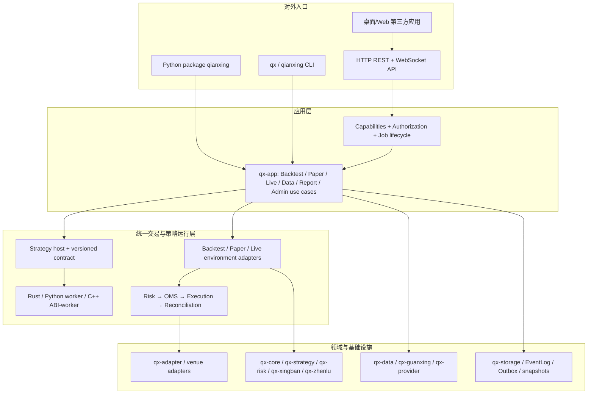
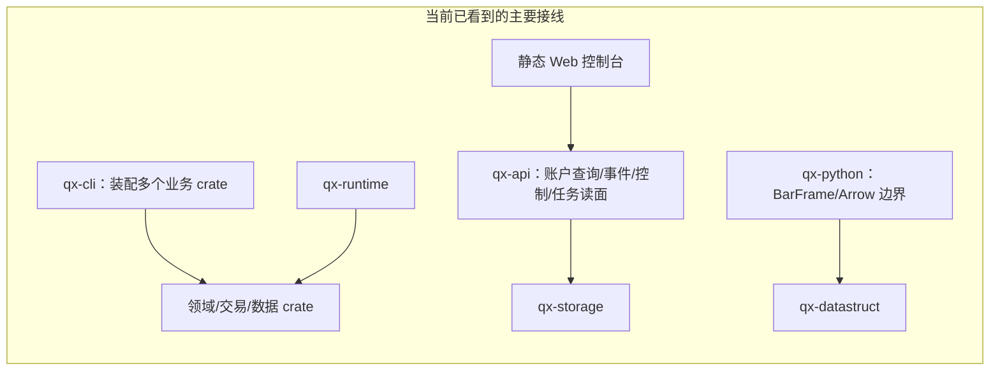
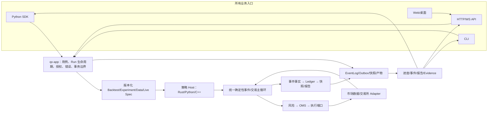

# 牵星 Qianxing — Python 全能力产品化与多语言实盘回测重构开发计划

> 版本：V1.2（主链路、可观测性与端到端闭环审计补充）  
> 日期：2026-10-10  
> 目标：把牵星交付为可直接安装的 Python 产品包，通过统一内核完成回测、Paper 与实盘，并提供 Rust / Python / C++ 策略接入、报告、第三方 SDK/API 与受控扩展。  
> 输入：Python 全能力包与可扩展性方案、gpui-kit 桌面可行性方案、自研框架审计 V13、架构复核与工业级优化执行方案、竞品全景与架构差距文档。  
> 事实边界：当前代码和能力成熟度来自工作树；本地回测/Paper 验收不等于交易所沙盒或真实生产审批。PyPI 名称可用性为 2026-10-10 页面查询快照；最终以创建项目/Trusted Publisher 或第一次上传成功为准。V1.2 增补的架构链路判断基于 2026-10-10 工作树静态检查，不等价于全仓正确性证明；循环终止性、死代码和端到端联通必须按 §15 的门禁逐条验证。外部依赖版本、许可证、交易所规则和竞品实现需在相应阶段重新核对。

---

## 0. 开发目标与核心决策

### 0.1 产品目标

用户安装 `qianxing` 后，可通过 Python API 或命令行完成数据校验、策略加载、Bar/Tick/OrderBook 回测、Paper 运行、实盘交易控制、产物验证和报告导出。策略可以用 Rust、Python、C++ 编写，按相同版本化策略协议进入同一风险、订单、账簿与结果语义。第三方可以通过公开 Python SDK、HTTP/WS API 和明确的插件契约构建工具、服务或桌面界面。

“全能力”最终包括研究、Paper、运维和实盘；但能力按运行模式和权限逐步开放。核心包提供统一入口，不意味着任何用户或第三方默认获得真实账户下单权限。

### 0.2 核心决策

1. **Python 是主要产品入口，Rust 是数值与交易内核。** Python 提供类型化 SDK、配置、策略体验和报告；不在 Python 重写撮合、风控或账簿。
2. **回测、Paper、实盘复用同一领域模型和策略生命周期。** 环境实现和订单撮合不同，必须在报告中说明模拟假设；“同一核心”不代表回测成交等于真实成交。
3. **策略统一通过公开协议交互。** 信号/订单意图由宿主校验并进入统一风险与 OMS 路径；策略不得直接写账簿或绕过风险门。
4. **进程内扩展只用于受信任组件。** Python 策略默认独立 worker；Rust/C++ 原生插件按受信任代码处理。第三方发现、插件兼容和不受信任代码隔离分别设计。
5. **第三方 API 以应用用例为单位，而非映射 CLI 命令。** Python SDK 进程内调用应用服务；远程/桌面客户端走版本化 HTTP/WS API。
6. **实盘成熟度由外部证据逐级提升。** 当前有交易/对账代码路径，但 `maturity` 记录的 `sandbox_tested` 与 `production_approved` 尚未通过。发布计划必须保留这道真实门槛。

### 0.3 目标用户路径

```text
pip install qianxing
    ├─ 初始化项目/检查运行环境
    ├─ 获取或导入数据 → 校验质量、时间与数据档位
    ├─ 选择 Rust / Python / C++ 策略与版本
    ├─ 回测 → 检查成交假设与数据质量 → 生成可复算报告
    ├─ Paper 运行 → 检查风险、命令审计与重启恢复
    └─ 显式启用实盘 → 连接器检查 → testnet → 审批后生产运行
```

### 0.4 Python 分发名核验结论

2026-10-10 检查 PyPI 项目页时，`qianxing`、`qianxing-quant`、`qianxing-sdk`、`qianxing-engine`、`qianxing-trader` 和当前工作树使用的 `qianxing-bridge` 均返回 404；`qx-py` 已有一个 Python CQRS/服务框架；`qianxing-openapi` 已有一个自动驾驶仿真 SDK。

| 候选 distribution name | 当前核验 | 建议 |
|---|---|---|
| `qianxing` | [PyPI 项目页返回 404](https://pypi.org/project/qianxing/) | **首选**：简洁，发行名和 `import qianxing` 一致；注册/上传可用时采用 |
| `qianxing-quant` | [PyPI 项目页返回 404](https://pypi.org/project/qianxing-quant/) | **首选不可用时的第一备用**：比通用缩写更清楚地说明领域 |
| `qianxing-sdk` | [PyPI 项目页返回 404](https://pypi.org/project/qianxing-sdk/) | 后备名；未来如拆出仅远程 API 的轻客户端，也可保留为该用途 |
| `qianxing-engine` / `qianxing-trader` | [项目页当前返回 404](https://pypi.org/project/qianxing-trader/) | 可用备选，但产品范围表述不如前两者准确 |
| `qx-py` | [PyPI 项目已存在](https://pypi.org/project/qx-py/) | **不采用**：名称占用，短缩写泛化且会与现有 Qx 服务框架混淆 |
| `qianxing-openapi` | [PyPI 项目已存在](https://pypi.org/project/qianxing-openapi/) | **不采用**：已被无关的自动驾驶仿真 SDK 使用 |

**命名决定建议**：正式发行名先用 `qianxing`，导入名也用 `qianxing`；如果在发布日无法注册，则用 `qianxing-quant`。不采用 `qx-py`。PyPI 将 `-`、`_`、`.` 和大小写归一化，`qx-py`、`qx_py`、`QX.PY` 是同一个分发名，换分隔符不能绕过占用。distribution name 与 Python import name 可以不同，但本项目无需首版制造这种不一致。404 是页面现状，不是名称保留保证；首次创建项目或上传前还应验证名称能注册，并检查商标/品牌冲突。

当前仓库里的 `qianxing-bridge` 是源码发行配置，不代表它已发布到 PyPI。迁移时以新正式 namespace 为主；`qianxing_bridge` 暂留薄兼容 re-export 和迁移提示。不同发行不得各自安装一份冲突的 `qianxing` import package。[PyPI 名称规则](https://packaging.python.org/en/latest/specifications/name-normalization/)与[分发名和导入名的区别](https://packaging.python.org/en/latest/discussions/distribution-package-vs-import-package/)详见 Python Packaging User Guide。

---

## 1. 当前能力与目标差距

### 1.1 当前交付现状

| 能力 | 当前代码/交付事实 | 产品化差距 |
|---|---|---|
| Python 包 | 当前发行配置名称为 `qianxing-bridge`；包含 `qianxing_bridge`、`qianxing_strategy`、`qianxing_ccxt`、`qianxing_ashare`；强制 Python 依赖为空，连接器在 extras | 没有正式 `qianxing` 高阶产品 facade；包的主要能力是数据/契约/worker/连接器，不能独立从 Python SDK 编排完整回测和 Paper/Live 生命周期 |
| Rust 原生扩展 | `qx-python` 依赖 `qx-datastruct` 与 PyO3；目前承担 Arrow/DataStruct 边界，不包含回测、runtime、storage 和完整应用装配 | 需要为 Python 提供稳定应用入口，但保持 PyO3 符号面有限，业务编排放 Rust 应用层 |
| 策略语言 | 仓库具备 Rust Strategy API、Python 子进程 worker、C ABI 策略宿主；JSONL、分帧和共享内存等传输已有实现；README 描述三种语言策略可进入统一 Bar 回测 | 需要统一公开文档、参数/依赖/版本 manifest、Live/Paper 能力矩阵和各语言的一致验收套件；确认每种语言在 Tick/L2/Live 的实际覆盖后再宣称对等 |
| 回测 | Bar/Tick/OrderBook 核心与 CLI 装配已存在；回测验收记录本地、无网络、可重复通过 | Python SDK 尚未直接复用 CLI 背后的业务装配；撮合假设、PIT 数据与产物版本需要变成用户看得懂、可机器检查的报告字段 |
| Paper | 仓库有 Paper 闭环和本地验收记录；无真实交易所凭据也可验收 | Python 使用面、长运行管理、事件订阅、停止/恢复和第三方控制契约尚待产品化 |
| Live | Binance 直连及 CCXT 相关提交/行情/对账代码路径、配置模板与验收脚本存在 | 不能据此宣称已实盘就绪。当前 maturity 外部测试/生产审批未通过；还需逐 venue testnet、订单幂等、断连恢复、余额/持仓/账单 reconciliation 与运维演练 |
| 报告 | CLI 产出 summary、equity、fills、run manifest 等；HTML/SVG 报告工具已有 | Python 需要类型化读取 API、离线 HTML 报告、可重算校验、指标定义/适用性与数据模型说明 |
| 第三方接入 | 有 HTTP/WS、协议 schema、插件静态注册基础 | 需稳定版本化 public API、Python client、权限 scopes、外部应用兼容政策、API conformance 与弃用策略 |
| 发布流水线 | CI 已含 Rust、Python wheel 多平台/多 Python 版本构建和安装后 smoke 路径 | 要从当前 bridge wheel 迁移到完整应用 wheel，并额外验证 ABI tag、引擎符号、依赖、体积、SBOM、签名、离线安装和不在源码目录导入 |

### 1.2 事实与设计分开

`maturity/capabilities.yaml` 用 implementation / code_tested / sandbox_tested / production_approved 分层；回测与 Paper 又有独立验收记录。因此项目计划和用户界面使用统一状态词：

- **已实现**：代码或配置存在。
- **本地已验证**：本机契约/回归/Paper 验收通过。
- **沙盒已验证**：真实供应商沙盒或 testnet 的凭证验收通过。
- **生产已批准**：生产演练、审批、恢复与运维程序通过。

README、Python `qianxing.doctor()`、API capabilities endpoint 与生成报告需读同一能力注册表，不各自维护状态。

### 1.3 系统功能完善优先级

| 优先级 | 功能完善项 | 借鉴与依据 | 完成标准 |
|---|---|---|---|
| S0 | Python 从数据准备、运行、报告到复算的闭环 | NautilusTrader 将 Python facade 接到 Rust 核心，并提供高低阶 backtest API | 干净环境安装 wheel 后 Python 直接调用应用服务完成样例回测，不需要调用 CLI 子进程 |
| S0 | Backtest / Paper / Live 统一策略生命周期，环境能力分别声明 | NautilusTrader 共用系统核心；牵星已有共享策略契约与分档 | 同一策略 manifest 明确支持矩阵、风险路径与限制；不能把 Bar 覆盖自动算作 L2/Live 支持 |
| S0 | 数据/撮合可信度随报告输出 | hftbacktest 明确市场回放不能建模订单市场冲击，并披露队列和部分成交假设 | 每个结果携带数据来源、PIT/日历检查、fill/latency/cost 模型和未建模项 |
| S1 | Paper 与 Live 长运行任务的进度、取消、恢复、reconciliation | LEAN 展示 feed/transaction/result handler 生命周期；Hummingbot API 提供 bot orchestration 与状态接口 | RunId、运行事件、启动/停止状态机、断连恢复、幂等订单、审计和故障报告通过端到端验收 |
| S1 | Experiment/多轮运行比较与样本外防泄漏 | Qlib Experiment/Recorder 和 Freqtrade hyperopt→backtest 复验流程 | 参数、试验次数、IS/OOS 边界、每个 run hash、最优方案复跑指引可在报告中追溯 |
| S1 | 多源数据与 venue 能力矩阵、标准 conformance | vn.py gateway/app 生态、Hummingbot connector 模式 | adapter 按能力声明；未实现订单类型/精度/撤单/对账能力时启动前拒绝 |
| S2 | 多策略/多账户资源隔离、worker 资源预算、运维可观测 | NautilusTrader 暴露节点进程/并发边界，LEAN 有执行线程与结果 handler 生命周期 | 多 run 隔离、账户级风险限额、worker CPU/内存/超时、日志/指标/诊断导出有明确边界和验证 |
| S2 | 桌面策略研究工作台 | gpui-kit 评估文档的双壳 spike 结论 | SDK/API 稳定后比较 GPUI 与 Tauri/Web；中文 IME、升级恢复、可访问性与大数据图表均实测通过 |

研究型“全能力”发布优先完成 S0 与 S1 的回测/报告/Paper 范围；S2 和真实账户生产批准依独立成熟度门推进，不以 Python 包存在就视为完成。

---

## 2. 目标架构与目录建议



### 2.1 新增/调整组件职责

| 组件 | 职责 | 禁止职责 |
|---|---|---|
| `qx-app`（新增 library crate） | 统一应用用例：输入校验、装配、权限、取消/进度、持久化和错误映射；供 CLI、PyO3 facade、API 调用 | 不复制撮合/风控/指标，不成为新的巨型 crate；不含 UI 和参数解析 |
| `qx-python` | Python C-extension 聚合入口；将受控请求转交 Rust 应用 facade；Arrow 所有权边界 | 不以数百个内部细节 PyO3 方法形成公开 API；不读取或修改 UI 私有状态 |
| `python/qianxing`（新增正式包） | 高阶类型、用户友好 API、配置、错误、worker 生命周期、第三方 client、report 和文档 | 不在纯 Python 维护第二套撮合、账簿和收益指标 |
| `qx-api` / Agent | 版本化 HTTP/WS contract、认证授权、后台任务生命周期和事件通知 | 不用 shell 启动 CLI 执行业务；不直接绕过应用服务读写领域存储 |
| `qx-cli` | 兼容现有入口、面向运维的命令和交互提示，调用 `qx-app` | 不继续承载新的核心用例装配 |
| `qx-strategy` / worker | 语言无关策略 contract、语言 runtime host、输入传输和输出校验 | 策略不得获得任意存储写权限、账户 secret 或绕过 Risk 的下单能力 |

### 2.2 应用用例分层

`qx-app` 初始 API 以用例为中心：

```rust
run_backtest(BacktestSpec, RunContext) -> RunHandle
validate_dataset(DatasetRef, QualityPolicy) -> DatasetValidationReport
start_paper(PaperSpec, OperatorContext) -> RunHandle
start_live(LiveSpec, OperatorContext) -> RunHandle
stop_run(RunId, StopPolicy) -> StopResult
read_run_report(RunId) -> RunReport
verify_run(RunId | EvidenceBundle) -> VerificationResult
```

长任务统一提供 `RunId`、状态、结构化事件、进度、取消、恢复/终止原因和产物引用。同步 Python API 可封装等待结果；不把运行很久的任务限制为单次阻塞调用。

---

## 3. 统一策略模型：Rust / Python / C++

### 3.1 公共策略契约

所有策略版本共用一个 schema source，定义：

- `schema_version`、策略 id/version、源代码与依赖摘要、策略 runtime/build identity。
- 输入订阅：instrument、数据档位、bar/tick/book 类型、频率、需要字段、暖机长度与时间边界。
- 调用生命周期：初始化、启动、行情/定时事件、账户状态、订单状态、停止与 checkpoint。
- 输出 union：Signal、OrderIntent、CancelIntent、StrategyState；允许字段和定点单位明确。
- 执行能力：可回测、可 Paper、可 Live；支持的订单类型、行情档、单策略并发与状态恢复能力。
- 资源与信任：CPU/墙钟预算、内存上限、网络/文件访问、可信等级、签名/来源与审计身份。
- 输出校验：过期、request id、strategy id、instrument、sequence、schema 和数量/价格边界不匹配时 fail closed。

schema 生成 Rust 类型、Python 类型、C/C++ header 和 API 文档；生成步骤可重跑，差异可审查。跨语言测试读取同一组 JSON/二进制 fixtures，比较解码、定点数、失效分支与输出语义。

### 3.2 语言及运行边界

| 语言 | 默认运行模式 | 适合场景 | 生产规则 |
|---|---|---|---|
| Rust | 内置策略直接调用 Rust trait；第三方 Rust 可选择签名/版本化动态接口或独立进程 | 热路径、强类型、低延迟或产品内置策略 | 原生库视为受信任本机代码；插件 ABI 与 engine version 必须兼容，启动前检查签名/来源/manifest |
| Python | 独立 worker，父进程负责策略生命周期、超时、输入长度、输出 schema 和关闭 | 研究、快速迭代、生态库 | 默认不在交易内核主线程执行任意回调；限制阻塞、资源、依赖与外部 IO；策略输出仍经 Risk/OMS |
| C++ | 受信任 C ABI 动态库用于低开销运行；不受信任策略走外部 worker/窄 IPC | 现有 C++ SDK、低延迟策略 | C ABI 边界必须版本校验、handle 生命周期管理、错误码映射；动态库不是沙箱 |

### 3.3 Backtest/Paper/Live 统一的部分与不统一的部分

三种模式复用 strategy contract、领域类型、风险规则、订单状态、账户账簿和事件分类；用环境端口接入不同的数据与执行：

- **Backtest**：历史数据源、确定性时钟、可选撮合模型、运行内无网络订单副作用。
- **Paper**：实时或回放行情、虚拟 venue、持久事件与恢复；本地 acceptance 不等于外部 testnet。
- **Live**：真实行情/交易 API、secret provider、限速、reconciliation、断线/重连、幂等下单、停机恢复与 operator 授权。

同一策略在三种模式可加载，不表示成交语义/回报时序相同。策略 manifest 声明支持面；应用启动前依据 venue capability、数据档、风险配置和策略能力联合校验。

### 3.4 策略隔离和资源安全

第一阶段所有用户代码在独立 worker 运行，worker 消息长度、协议帧、stdin/stdout、超时和父进程退出已有基础继续复用。分阶段加：OS 级 CPU/内存/进程/文件/网络限制、临时目录隔离、依赖锁定与哈希、运行日志脱敏和 crash diagnostics。WASM 可作为后续 runtime 选项，不将它作为唯一沙箱。进程内 Rust/C++ native extension 只能用于已审核/可信插件。

---

## 4. Python 产品包设计

### 4.1 包名、兼容和安装

目标公开分发名首选为 `qianxing`，导入名也为 `qianxing`；命名状态见 §0.4。当前 `qianxing-bridge` / `qianxing_bridge` 用于仓库内发行配置，但其 PyPI 项目页在本次查询时返回 404。迁移按以下规则执行：

1. 正式包提供 `qianxing` namespace；将 `qianxing_bridge` 保留为一段兼容薄层，重导出正式 API 并提供 `DeprecationWarning` 和迁移文档。
2. 不在同一个导入名下并存不同内核或不兼容实现；Rust engine、Python facade、schema 和分发版本同源标识。
3. 官方提供预编译 wheel。用户安装和使用核心回测、Paper 与连接器不需要 Rust/C++ 编译工具链；源码构建作为开发者路径单独说明。
4. CI wheel 矩阵以确认的 OS/CPU/Python 支持表为准，覆盖 Windows x64、Linux manylinux 与 macOS 架构，以及项目决定支持的 Python 版本。
5. 当前 PyO3 开启 `abi3-py310`，但实际 wheel tag/构建链需逐平台核实后再承诺 stable ABI。检查二进制链接依赖、原生扩展来源、产物 hash、包体积、离线安装与源码树外导入。
6. 若以后将纯远程 API client 独立发行为 `qianxing-sdk`，先明确它与核心 SDK 的发行边界；v1 不拆成多个必须锁步升级的包。

### 4.2 建议 Python 命名空间

```text
python/qianxing/
  __init__.py             # 稳定公开符号、版本与能力查询
  config/                 # 类型化配置、项目初始化、环境检查
  data/                   # DatasetBundle、Provider、质量验证、market specs
  strategies/             # Base API、manifest、Rust/Python/C++ 策略注册与 worker
  backtest/               # BacktestSpec、run、取消/进度、RunHandle
  paper/                  # Paper runtime、事件订阅、停止与恢复
  live/                   # venue session、授权订单操作、reconciliation
  reports/                # summary/equity/fills/run manifest/evidence 读取与导出
  experiments/            # 参数批次、run 比较、walk-forward/OOS
  clients/                # versioned HTTP/WS client 与认证
  plugins/                # manifest 校验、可信扩展发现、兼容报告
  _native/                # 私有 PyO3 包装层
  _generated/             # schema codegen 输出
  py.typed
```

### 4.3 安装 profile 与依赖

建议提供轻量基础安装与清楚的 extras，不要求所有用户装交易所/数据依赖：

| 安装 | 内容 |
|---|---|
| `pip install qianxing` | Rust 引擎 wheel、离线回测/Paper 核心、配置、报告 JSON/CSV/HTML、CLI/doctor、策略协议和本地 SQLite/文件存储 |
| `qianxing[ccxt]` / `[ccxt-pro]` | 公共 CCXT 或实时流所需适配器依赖；能力表标注具体适用 venue |
| `qianxing[a-share-akshare]` / `[a-share-baostock]` / `[a-share-easy-tdx]` | 对应可选数据 provider 及 Windows 时区数据 |
| `qianxing[report-pandas]` / `[notebook]` | 可选 DataFrame/Jupyter 辅助。核心报告文件读取与验证不依赖 pandas |
| `qianxing[api-client]` | 可选远程 API/async client 依赖；本机直接 SDK 调用不强制网络 client |

对“离线可装”的承诺限定为：**已构建并提供的官方 wheel 在无网络环境可安装**。数据下载和 Python extras 需要供应商/镜像或预先缓存；不把所有第三方包都称为零依赖离线支持。

### 4.4 Python API 草图

```python
import qianxing as qx

project = qx.open_project("./qianxing.toml")
dataset = project.data.load("./data/btcusdt-1m.qxdataset")
check = project.data.validate(dataset, profile="research")
check.require_usable(tier="bar")

spec = qx.BacktestSpec(
    dataset=dataset,
    strategy=qx.strategy.python_module("strategies.momentum:Strategy"),
    venue="paper-btc-spot",
    time_range=qx.TimeRange("2025-01-01", "2025-03-01"),
    fidelity="bar",
    risk_profile="default-research",
)
run = project.backtests.submit(spec)
report = run.wait().report()
report.verify()
report.export("./reports/run-001", formats={"json", "csv", "html"})
```

实盘必须经 `project.live.open_session(...)` 或显式命令进入，连接账户和下单需要 operator scope、venue capabilities、风险限额、账户预检以及审计身份；API key 由 secrets provider 注入，不能进入 Python 配置、manifest、wheel、报告或日志。

---

## 5. 第三方 SDK/API 与权限

### 5.1 API 资源设计

第三方 API 以稳定资源与 job lifecycle 组织：

| 区域 | 资源示例 | 权限示例 |
|---|---|---|
| 数据 | `/v1/datasets`、`/validate`、`/providers` | `dataset:read`, `dataset:write`, `provider:connect` |
| 策略 | `/v1/strategies`、manifest、兼容性与能力 | `strategy:read`, `strategy:register` |
| 回测/实验 | `/v1/backtests`、`/v1/experiments`、run status/cancel | `backtest:run`, `run:read`, `run:cancel` |
| 产物/报告 | `/v1/runs/{id}/artifacts`、`report`、`verify`、`evidence` | `artifact:read`, `report:export` |
| Paper | `/v1/paper/runs`、pause/resume/stop、events | `paper:operate` |
| Live | `/v1/live/sessions`、orders、positions、reconcile、kill switch | `live:connect`, `order:submit`, `order:cancel`, `account:read`, `operator:admin` |
| 系统 | `/health`、`/ready`、capabilities、version、metrics (受限) | `system:read`, `system:admin` |

回测创建采用 `POST` 返回 `RunId`，后续查询进度/事件/结果；支持取消、超时、请求幂等键和最大并发。行情与任务状态用 WebSocket/SSE 或轮询，注明游标语义和断线重放边界。OpenAPI/JSON Schema 由仓库单一 schema 源生成客户端，版本兼容性在 CI 检查。

### 5.2 安全契约

- 本机 agent 只绑定 loopback，并使用随机短期 token、CSRF/Origin 检查、端口交付保护、请求体与速率限制；localhost 不是身份认证替代品。
- 远程部署使用受支持认证机制和 TLS；scope 默认拒绝，token 可撤销，操作审计记录主体、请求、结果和关联 run/order id。
- Live 写面要求幂等 client order id、限速预算、超时/重试分类、订单回报 reconciliation 和明确 kill switch。非确定性超时后先查交易所状态，再决定是否重发。
- 第三方策略插件不能读取连接器密钥；策略只能提交受 schema 限定的意图，由宿主验证并执行权限与 Risk。
- 报告与错误输出需脱敏账户、凭证和供应商私有数据。

### 5.3 第三方支持承诺

定义 API 版本策略、弃用窗口、Python 最低/最高测试版本、engine/API 兼容矩阵、稳定/实验特性标识、错误码稳定性、速率限制、数据格式兼容和支持渠道。API schema 变更需要升版、迁移工具、旧 fixture 和 consumer contract 用例；“官方包能调用”不等于第三方接口可稳定依赖。

---

## 6. 回测报告、证据与结果复算

### 6.1 每次 Run 的规范产物

```text
run-<id>/
  run.json                 # RunManifest: schema/build/strategy/config/data/model identity
  summary.json             # 指标值、单位、窗口、计算口径及适用性
  equity.csv               # 权益序列，固定编码/排序/定点精度
  fills.csv                # 逐笔成交、费用、流动性/撮合模型来源
  orders.csv               # 下单/撤单/拒单/部分成交生命周期
  validation.json          # 数据质量与输入覆盖范围
  fidelity.json            # Bar/Tick/Book 档及模型假设/局限
  evidence.json            # 证据等级、输入摘要、复算指引和未验证项
  report.html              # 离线可查看的自包含报告
```

`Parquet` 可作为大数据附加导出格式；其依赖与兼容性作为 optional feature。报告的 JSON/CSV/HTML 标准路径不要求用户安装 notebook 或连接网络。

### 6.2 指标准确性与“未知不等于零”

- 金额、价格、数量和费用以内核定点整数计算，report 明确单位/scale/币种；浮点格式只用于展示。
- 指标无法计算、样本不足、基准缺失或来源不可信时表达为 `null`/not-applicable 并附原因，不能回填零。
- 报告提供指标公式版本、交易日历、收益时间基准、手续费/滑点/融资成本、复权规则和 benchmark 身份。
- `result_hash`、`log_digest`、input fingerprint、binary/package identity 一并保存；报告显示摘要并允许离线验证。
- HTML 图表只呈现产物数据；指标和归因由 Rust/Python application service 的单一实现产出，不由前端重算。

### 6.3 数据与统计可信度

Dataset manifest 需覆盖 provider、交易所、symbol mapping、原始/规范化文件 digest、时间区间、时区与交易日历、版本/修订、PIT as-of、公司行为、质量检验和数据授权来源。验证需覆盖缺失/重复/排序/异常值、复权、退市与幸存者偏差、停牌/涨跌停、衍生品合约规则和未来数据泄漏。

实验/优化必须把 IS/OOS/WFA 窗口写入 manifest，保存所有试验过的参数及筛选目标；OOS 不能参与选参。PBO/Deflated Sharpe 等统计警示只在已明确算法与前提时提供，不声称可以消除过拟合或保证收益。

---

## 7. 可扩展性治理

### 7.1 扩展层次

| 层级 | 扩展类型 | 分发/装载 | 信任级别 |
|---|---|---|---|
| L0 | 内置 Rust strategy、venue、fill/risk model | 随 core 发布，trait/static registry | 官方审查 |
| L1 | 第三方 adapter、数据源与分析扩展 | Python wheel entry points + manifest；能力声明/版本约束 | 已安装的受信任代码；发现时不做业务初始化 |
| L2 | 用户策略 | Rust/Python/C++ SDK + manifest；以 worker 或受控 ABI host 运行 | 默认隔离，限定策略能做的事 |
| L3 | 不受信任策略 | 后续 worker sandbox/WASM 等受限 runtime | deny-by-default；CPU/内存/文件/网络/IPC 有配额 |

Entry point 能发现插件只是加载机制，不是安全机制；原生动态库不受进程内 Rust 类型系统之外的策略约束。每个 manifest 包含 id/version/API schema、engine compatibility、语言/ABI、能力、依赖摘要、入口、信任级、权限和签名/来源状态。

### 7.2 Adapter capability 与 conformance

每个 venue/provider 显式声明：市场类型、instrument、数据档、订单类型、数量/价格精度、最小下单量、post-only/reduce-only、部分成交、撤单语义、限速、流/REST 支持、reconciliation 来源和已验收环境。配置若请求未声明能力，启动时拒绝，不静默降级。

统一 conformance suite 覆盖：精度/舍入、时区与时间戳、重复消息、断线与重连、rate limit、请求超时、订单状态机、幂等、部分成交、撤单竞态、历史订单/成交拉取、余额/持仓对账和故障关闭。Capabilities 只能由真实测试证据更新。

---

## 8. 分阶段开发与验收门

阶段按依赖关系排序。人日只在完成当前基线、接口和外部验收范围估算后再排，不以规划稿里的静态人日数作为交付承诺。

### P0 — 产品边界、基线和公共 contract

**交付**：能力目录、CLI→Python/API 面映射、strategy manifest v1、RunManifest/artifact schema 目录、版本兼容策略、当前 wheel 和 Live maturity 基线，以及 `qianxing` / `qianxing-quant` 发行名的注册核验结果。

**验收**：

- 代码能力、CI 能力、本机 acceptance、外部 testnet 和生产审批分开列出。
- PyPI distribution name 与 Python import namespace 固定；`pyproject.toml`、Trusted Publisher、发布 workflow 和 README 安装命令使用同一正式分发名。
- 每项目标能力有 owner、语言/venue 覆盖、权限等级、证据等级和当前 limitation。
- 统一 strategy contract 的 JSON/分帧/共享内存映射以及 Rust/Python/C++ field/unit 行为。
- 产品版本和 binary/extension/schema version 可相互查询。

### P1 — 拆应用服务层，CLI 与包共享业务用例

**交付**：`qx-app` 的 dataset validation、backtest、artifact/report、verify 初版；`qx-cli` 改为兼容 facade；可编译为 Python 扩展依赖的库 crate。

**验收**：

- 依赖图保持单向：CLI/API/Python 可依赖应用服务，领域层不反向依赖 facade。
- 用固定数据和配置比较改造前后报告产物与 `result_hash`；只有计划明确允许的元数据字段变化可不同。
- Python 独立调用同一个 Rust 应用服务，执行回测不需要 spawn `qx-cli`；worker 仍按配置独立启动 Python 策略代码。
- 结构化错误、取消、进度和产物身份通过跨语言 contract fixtures。

### P2 — `qianxing` 正式 wheel 与核心研究工作流

**交付**：PyO3 facade、Python 高阶 API、预编译 wheel、离线 backtest/report/verify 和向导示例。

**验收**：

- 新机器安装官方 wheel 无 Rust 工具链；干净环境运行 `import qianxing`、doctor、样例回测、report、verify 成功。
- 源码目录外 import 实际 site-packages；wheel 内 extension ABI/依赖/平台标签与构建记录一致。
- 快速安装核心包不拉取交易所或 A 股可选库；extras 缺失时在调用点提示精确安装项。
- 同一 RunManifest 从 Python 与 CLI 运行同一应用用例，关键事实、产物摘要和 `result_hash` 一致。
- CI 覆盖声明支持的 OS/Python/架构，针对不可提供的 runner 明确列为待验能力。

### P3 — Rust/Python/C++ 策略完整生命周期

**交付**：各语言模板/SDK、manifest 与 schema codegen、统一测试夹具、编译/运行诊断和 worker/ABI 配置工具。

**验收**：

- 三种语言在 Backtest 至少覆盖同一 Bar 示例与标准策略 contract 拒绝集；Tick/L2/Live 依真实能力逐项标记，不能自动继承 Bar 覆盖声明。
- 策略输出经过宿主 identity/sequence/expiry、数值范围、allowed intent 和 risk policy 校验。
- Python 长计算、超时、崩溃、坏 stdout、超长帧和父进程死亡均不会挂死宿主或绕过停机流程。
- C ABI 插件版本、符号、handle 生命周期、panic/错误映射和不兼容二进制拒绝有自动化验收。
- 每种语言清楚说明依赖锁定、源码摘要、构建身份和是否受信任。

### P4 — Paper 产品化

**交付**：Python Paper start/stop/pause/resume/status/events，命令审计，运行恢复与报告查看；与 CLI/API 共享同一服务。

**验收**：

- 本地 acceptance 无凭据、无网络、零订单外部副作用；重复启动与重放无重复事实。
- kill/restart/存储故障后的事件、OMS、Ledger 和命令状态可恢复或明确报失败。
- Python、CLI 与 API 的 Paper event projection、`RunId` 和 audit facts 同源。
- Paper 运行不会被误标成 testnet 或生产验收。

### P5 — Live/venue SDK 与真实 testnet

**交付**：版本化 Python Live API、secret provider 接口、venue capability registry、订单幂等、reconciliation、kill switch、external acceptance 记录。

**验收**：

- 按 Binance Spot、CCXT exchange family 等具体 venue 分项验收，不以“通用 CCXT”一次通过宣称所有 venue 通过。
- testnet 使用脱敏凭据、真实网络证据、订单幂等重跑、断线/重启/部分成交/取消/余额与持仓对账；`outcome=skipped` 不得翻转 maturity。
- 账号、venue、instrument、order type、市场状态、限额与 secrets 全部在下单前检查。
- 请求超时后先进行订单状态查询与 reconciliation；不能盲目重发；明确网络重复、远端状态不确定和停机恢复流程。
- 通过本地与 testnet 门后只把对应 venue 能力标为 sandbox-tested。生产审批还需生产密钥管控、审计、告警、灾备/回滚、风险审批与运维演练。

**停止条件**：venue 提供方无法确定幂等/查单语义、无法安全核对成交状态或关键状态不可恢复时，相关 Live 能力保持关闭；回测/Paper 与其他已验证能力继续交付。

### P6 — Reports、EvidenceBundle 与实验 API

**交付**：JSON/CSV/自包含 HTML 报告、run comparison、experiment runs、walk-forward/OOS、离线 EvidenceBundle。

**验收**：

- summary 每个字段包含单位、指标版本、适用性/空值原因与输入范围。
- report 只读取内核产物；导出后可从包内数据校验摘要，并按复算指引重跑。
- EvidenceBundle 生成内容含代码/二进制身份、配置/数据/策略/撮合身份、验证限制和离线校验指令。
- 实验每个结果链接单独 run；参数搜索结果标注 trials 和 IS/OOS，不只保存最佳参数。

### P7 — 第三方 API 与扩展生态

**交付**：OpenAPI/SDK、认证 scope、Python entry points、manifest、adapter conformance、compatibility policy 和开发者文档。

**验收**：

- 独立第三方 consumer 不依赖仓库私有模块完成回测提交、进度订阅、报告下载和验证。
- API contract tests 覆盖认证/未授权、幂等、版本不兼容、错误映射、断线游标、速率与请求体限额。
- 一个外部 Python strategy/provider 示例和一个 venue adapter 示例通过文档规定的 conformance suite。
- 单插件失败可隔离，不会阻止其他插件列表和已运行任务；高权限插件必须明确安装并授权。

### P8 — UI/桌面与持续运营

后端 SDK/API 稳定后再接 gpui-kit/Tauri/Web 桌面壳。用同一 Python/HTTP contract，不把桌面专有功能变成另一条引擎实现。通过安装升级、Windows 中文 IME、无障碍、进程恢复、离线运行、签名/回滚与图表工作集的实测决策框架。

---

## 9. 横切质量、发布和运维要求

### 9.1 正确性测试矩阵

- **单位/属性测试**：定点算术、数量/价格精度、排序/序号、风险边界、时间转换和 hash 稳定性。
- **跨语言 contract**：同一 fixtures 由 Rust/Python/C++ 读写，覆盖正常/拒绝/未知字段/极端值/版本升级。
- **环境语义测试**：相同策略跨 backtest/Paper/live sandbox 的 lifecycle、订单状态和风险触发；成交差异解释为 environment/model 差异。
- **数据正确性**：no-lookahead、PIT、幸存者偏差、复权/公司行为、停牌/涨跌停、交易日历和 provider revision。
- **故障注入**：worker crash/hang、IPC 损坏、存储短写、DB 断连、API 断线、重复提交、venue 超时与恢复。
- **发布件测试**：构建安装包、干净虚拟环境、断开网络安装基础 wheel、可选依赖缺失、外部目录导入、升级与回滚。

### 9.2 性能基准

建立固定基准而不是笼统许诺“高性能”：Bar/Tick/Book 每秒事件数、策略 IPC 延迟/吞吐、内存峰值、worker 冷启动、EventLog append/恢复、API/job latency、不同数据规模的 report 生成。记录硬件、OS、编译 profile、输入摘要、并发与 warm-up；CI 使用趋势告警，只有稳定的核心 benchmark 才作为阻断门。测出热点后再定量化优化目标。

### 9.3 可观测与运行恢复

使用结构化日志与 `request_id` / `run_id` / `strategy_id` / `order_id` 关联；提供健康与 readiness、队列/数据延迟、worker 生死、venue session、拒单/重连、存储错误、snapshot/replay 和资源使用指标。用户可导出脱敏诊断包。配置备份、schema migration、升级回滚和断电/进程强杀恢复纳入 release checklist。

### 9.4 安全与供应链

- secrets 仅由环境或 OS secrets provider 注入，最小权限，脱敏日志与报表。
- `pip install` 官方 wheel 发布 provenance、SBOM、签名/校验和，构建产物不从未审阅下载脚本注入。
- 固定依赖 lock 与支持窗口；安全更新和插件兼容性有责任人。
- live profile 默认关闭；developer/testnet/production 拓扑配置不可误用；生产订单需要策略、账户、instrument、风险限额和人工授权共同通过。
- 按策略和 venue 分别记录 maturity；生产批准不会从代码测试自动推导。

---

## 10. 竞品研究：设计借鉴点

| 项目 | 公开实现/文档中值得借鉴 | 应用到牵星 |
|---|---|---|
| [NautilusTrader](https://github.com/nautechsystems/nautilus_trader) | Python facade 通过 PyO3 使用 Rust core；backtest 与 live 用共享系统内核；提供低阶 engine 和高阶 node API；仓库公开提示节点并发/进程状态边界 | Python SDK 不只包命令行；高阶 API 易上手，底层配置能力仍保留。复用前先把多 run 的进程隔离边界设计清楚 |
| [hftbacktest](https://github.com/nkaz001/hftbacktest) | 显式描述 partial-fill、queue position 与 replay 无 market impact 的边界 | L2 结果报告展示队列模型与流动性假设，不能把“深度数据”直接等同真实可成交 |
| [QuantConnect LEAN](https://github.com/QuantConnect/Lean) | Engine 将 feed、brokerage/transactions、real-time、result handler 等环节组合，并明确生命周期收尾 | `qx-app` 采用端口/适配器与有序启动、取消、收尾；报告与运行控制是应用核心组件 |
| [Hummingbot](https://github.com/hummingbot/hummingbot) | Connector、strategy/controller/executor 分层；API client 以路由管理 bot/config/controller | 明确连接器能力、交易策略与第三方控制面的契约，不让 API 绕过交易主机 |
| [Qlib](https://github.com/microsoft/qlib) | Experiment/Recorder 管理多轮研究运行和产物 | 为牵星增加 Experiment/Run grouping，保留每轮参数、指标和文件身份 |
| [Freqtrade](https://github.com/freqtrade/freqtrade) | 回测与 hyperopt 有可执行命令和验证优化结果的操作说明 | quickstart 以可跑策略样例为中心；优化结果必须可单独重跑确认 |
| [Barter](https://github.com/barter-rs/barter-rs) / [vn.py](https://github.com/vnpy/vnpy) | 领域 crate/连接器与主引擎适配边界、国内中文使用者生态 | 借鉴模块所有权、adapter 文档与 conformance，不根据项目流行度推导市场/生产准确性 |

竞品事实以仓库/官方文档为准、访问日期 2026-10-10。stars、贡献者数等瞬时指标不作为架构判断。NautilusTrader 的文档同时说明其共享 backtest/live core 并披露单进程状态约束；hftbacktest 说明 replay 无法改变历史订单簿且可能高估流动性；这些限制也应成为牵星产品报告的一部分。

---

## 11. 关键风险与缓解

| 风险 | 影响 | 缓解 |
|---|---|---|
| 统一应用 crate 再次膨胀 | 复用目标变成新单体 | 以用例接口拆模块；设依赖规则、owner 与消费者；性能/构建基线监控 |
| 一次性承诺 Python“全功能” | SDK 可用性与功能成熟度不匹配 | 依 P0–P8 发布能力声明；backtest/Paper/Live 分别给状态；Live 按 venue 认证 |
| 语言策略语义分叉 | 策略换语言、换运行模式得出不一致意图 | schema 单源、fixtures、strategy manifest、统一宿主校验和跨环境契约 |
| Python 进程污染交易循环 | 阻塞/崩溃拖垮实盘 | 独立 worker、超时/资源限制、进程监护、生命周期与 IPC 测试 |
| 回测结果被误读为实际收益 | 用户决策错误 | fidelity、成本、成交、PIT、OOS、未验证限制随报告显示 |
| 真实下单重试造成重复订单 | 资金损失 | client order id 幂等、超时先查后决策、对账、限额、kill switch 和人工审批 |
| 可选依赖/原生 ABI 过大 | 包难装、跨平台不稳定 | 官方预构建矩阵、extras、可重现 build、wheel smoke、明确支持表 |
| 插件入口被当成沙箱 | 任意代码访问账户/主机 | 区分 trusted/untrusted；默认 worker 隔离，native 插件视为受信任 |
| UI 过早投入 | 后端契约变化导致返工 | API/SDK 先行，桌面 spike 用固定 contract 和同一 fixture |

---

## 12. 第一版发布范围建议

为尽快形成完整用户价值，首个 `qianxing` 公共发布包含：

1. 预构建 Rust engine wheel、稳定版本查询、doctor 与兼容能力表。
2. Python 直接完成数据校验、Bar 回测、CLI 同源报告、RunManifest verify；按实际 code-tested 覆盖支持策略语言。
3. 本地 Paper 完整生命周期、事件查看与恢复。
4. Binance/CCXT Live SDK 可用接口、venue 能力/账户检查和 testnet acceptance；在真实 testnet 记录形成前 API 明确返回“尚未沙盒认证”，生产下单默认关闭。
5. 报告 JSON/CSV/自包含 HTML；Python 对象可读写和导出。
6. 稳定 HTTP/WS v1 client 起步能力，包括运行提交、状态/事件、报告读取和权限错误；第三方 Live 写 API 后续按认证门开放。
7. 三语言策略 API、manifest 与示例；各语言在各数据档/运行模式的能力有准确声明。

**v1 不宣称**：所有交易所生产级认证、全市场零滑点精度、插件沙箱安全认证、L3 queue reconstruction、云多租户高可用，或 Python 数值计算无需 Rust 内核仍结果等价。

---

## 13. 与历史文档的关系

- 本文件是**Python 全能力产品化与多语言 Backtest/Paper/Live 的整合开发路线**。
- [Python 全能力包与桌面客户端及可扩展性改造方案](牵星Qianxing-Python全能力包与桌面客户端及可扩展性改造方案-2026-10-10.md) 继续作为 Python facade、wheel、schema 和扩展实现细则。
- [gpui-kit 桌面端策略研究平台评估方案](gpui-kit桌面端策略研究平台-可行性评估与调研方案-2026-10-10.md) 继续作为 UI spike 与选型专项；桌面计划后置于 SDK/API。
- [架构复核与工业级优化重构执行方案](牵星Qianxing-架构复核与工业级优化重构执行方案-2026-10-10.md) 承担通用架构问题、基准、质量与执行次序，本方案将其落实到 Python 产品目标。
- [V13 审计与重构台账](自研量化框架审计与重构方案-V13.md) 是逐轮代码/门禁事实记录和未结事项来源，实施每一阶段前必须查看最新收口记录。
- `docs/competitive-analysis/` 保留竞品事实与差距清单。本计划中的目标与当前状态冲突时，以实际代码和近期 V13 记录重新核对，不把旧文档快照直接当现状。

本计划只创建产品目标和阶段验收，不代表回测/实盘/桌面/第三方 API 已在代码中交付。实施每一阶段后，更新能力矩阵、外部证据、Python 文档、报告 schema 和发布身份，再进入下一阶段。

---

## 14. 参考资料

### 仓库内

- `python/pyproject.toml`、`python/setup.py`、`python/qianxing_bridge/`、`python/qianxing_strategy/`、`python/qianxing_ccxt/`、`python/qianxing_ashare/`
- `crates/qx-python/`、`crates/qx-strategy/`、`crates/qx-cli/src/strategy_host.rs`、`crates/qx-runtime/src/pipeline.rs`
- `README.md`、`docs/工业化易用性收口指南-V1.md`、`docs/外部链路验收执行方案-V1.md`
- `maturity/capabilities.yaml`、`maturity/backtest_acceptance.yaml`、`maturity/paper_acceptance.yaml`、`maturity/evidence/README.md`
- 本文件 §13 所列 2026-10-10 架构、Python、桌面与竞品调研文档

### GitHub 官方项目

- [NautilusTrader — Rust/Python 共用核心](https://github.com/nautechsystems/nautilus_trader/blob/develop/docs/concepts/rust.md)
- [NautilusTrader — 总体架构、生命周期与边界](https://github.com/nautechsystems/nautilus_trader/blob/develop/docs/concepts/architecture.md)
- [NautilusTrader — Backtest API 与模型概览](https://github.com/nautechsystems/nautilus_trader/blob/develop/docs/concepts/backtesting/index.md)
- [hftbacktest — order fill、partial fill、queue model 和回放限制](https://github.com/nkaz001/hftbacktest/blob/master/docs/order_fill.rst)
- [QuantConnect LEAN — Engine 装配与运行生命周期](https://github.com/QuantConnect/Lean/blob/master/Engine/Engine.cs)
- [Hummingbot — API client 路由和 bot orchestration](https://github.com/hummingbot/hummingbot-api-client)
- [Qlib — Experiment Recorder](https://github.com/microsoft/qlib/blob/main/docs/component/recorder.rst)
- [Freqtrade — Hyperopt 与结果复验](https://github.com/freqtrade/freqtrade/blob/develop/docs/hyperopt.md)
- [Barter](https://github.com/barter-rs/barter-rs)、[vn.py](https://github.com/vnpy/vnpy)、[vectorbt](https://github.com/polakowo/vectorbt)

> 公开资料访问日期：2026-10-10。依赖版本、平台支持、许可证、API 行为与供应商交易规则可能变化；引入前按目标版本核验源码、CI、release、LICENSE 和安全公告。

---

## 15. V1.2 主链路与端到端闭环复核

### 15.1 复核结论：设计覆盖不等于实现贯通

以下结论来自本次对 workspace、Rust crate 依赖、Python 扩展、HTTP 路由与 `web/console` 接线表的只读检查。表中的“代码存在”不代表每个入口都调用它，也不代表达到外部认证或生产批准。

| 用户提出的能力 | 当前代码证据 | 本次判断 | 计划补齐的闭环 |
|---|---|---|---|
| 日志统一接入 | 有错误分类、API metrics/诊断及 CLI 输出；对 Rust 的标准日志 facade、全局初始化、Python `logging` 汇聚和统一 sink 未发现完整公共入口 | **未统一**：运行日志、审计、EventLog 是不同用途，不能混为同一条日志管线 | `qx-app` 创建 RunContext/TelemetryContext；Rust、Python worker、API、connector 通过统一结构化 schema 汇聚；日志只作诊断，不作业务事实；脱敏、轮转、flush、背压和丢弃计数有契约 |
| 报错统一封装 | `qx-core::QxError` 已有稳定错误码、重试分类、安全重试和对账契约；Provider、Storage、API、Python 边界仍有各自错误枚举、`String`/`ValueError` 等表示 | **领域基础较好，跨入口映射未收敛** | 在应用层统一 `AppError`/Problem Details：code、category、retryability、reconcile、safe_to_retry、user_action、correlation/run id、source chain；CLI、Python、HTTP、Web 映射一致且保留内部 source error |
| 多组参数联合比较 | `qx-spec::ExperimentSpec` 有参数空间、seed、train/test/WFA、基线；`qx-factor` 有候选/参数相关对象 | **有规格与局部研究基础，未见一个由 Python/CLI/API 调用的批量执行器和比较报告闭环** | 每个参数组合生成独立且可复跑 BacktestSpec/RunId；确定性组合展开、资源预算、并发取消、失败隔离、比较表、Pareto/基线、样本外与试验次数披露 |
| 扩展多种数据源 | `qx-provider::ProviderRegistry` 支持 capability、确定性候选顺序、failover、血缘/hash；`qx-data` 有规范化与质量链路 | **扩展骨架存在，能力契约需扩宽并接入统一应用入口** | 覆盖 asset/instrument/field/frequency/depth、时区/日历、adjustment/PIT、质量档、历史/实时、限速/成本、许可、撤修订和流式/cancel/deadline；每个 provider 经 conformance 后才能进入稳定能力表 |
| 资金流向与账簿 | `qx-core` 具有定点数、Ledger、Fill/费用/资金费/结算/公司行为等事实和账户现金流事件 | **领域层覆盖较完整，仍需检查所有 adapter、Paper、Live、恢复、查询与报告是否同源** | 余额快照只做观察/对账；流水用外部 id 幂等入账；账簿只由 Fill/Settlement/Cashflow 等事实驱动；报告逐币种调节现金、冻结、负债、手续费、融资/资金费、公司行为及已实现/未实现损益 |
| 订单流转/实盘 | `qx-zhenlu` OMS、`qx-risk`、`qx-execution`、`qx-adapter` 和对账路径均存在；CLI 装配多处连接这些 crate | **内核链路存在，尚不能说明 SDK/API/Web 都进入同一个用例路径** | 策略意图→schema/身份验证→账户/组合风险→OMS 状态迁移→持久化提交/Outbox→venue adapter→ack/fill/reject/cancel→Ledger→snapshot/projection→reconcile→审计/告警；未知结果进入待对账，不盲目重试 |
| 事件机制/回测 | `qx-core::Event` 有序号、因果优先级、来源、时间与 digest；Storage 有 EventLog/Outbox；Runtime 和 API 有事件流/快照投影 | **存在多种事件设施，但必须明确边界和互通契约** | 领域事实事件、进程内通知、任务进度事件、审计记录、诊断日志各有不同保留/投递语义；必须规定唯一 source of truth、事务边界、幂等、游标、重放、快照版本和消费失败处理 |
| Python 全能力包 | `qx-python` 当前依赖仅 `qx-datastruct`，导出 BarFrame/Arrow 等边界；没有调用完整回测/Paper/Live 应用用例的接口证据 | **不是当前全能力 SDK** | P1–P5 依赖链完成后，Python API 直接调用应用 facade；不得启动 CLI 子进程充当长期默认业务 API |
| 前后端贯通 | `web/console/app.js` 的字段/路由名册与账户、事件、控制面端点有双向门禁；控制台文档明确是监控/控制面静态件 | **监控控制读写有窄闭环，研究产品主流程未贯通**：API 路由无 `/backtests`、`/experiments`、run report/artifact 等研究工作流，Web 控制台没有数据导入→回测→比较→报告的 UI | 通过公开版本化 API 实现数据集、策略、实验、Run、报告/Evidence 资源；Web/桌面只调用 API；生成 OpenAPI/客户端并做页面字段和操作的双向 contract 检查 |

### 15.2 当前依赖与目标依赖图

当前 workspace 有约二十多个生产 crate，但没有 `qx-app`；`qx-cli` 对多数业务 crate 直接依赖并承载多处回测/运行时装配；`qx-api` 依赖 control/protocol/storage/scheduler，不依赖 `qx-runtime` 或应用用例 crate；`qx-python` 只依赖 `qx-datastruct`。这些现状意味着业务核心主要可经 CLI 运行，但并不存在已验证的 CLI/Python/API/前端同用例架构。





**依赖规则**：facade → application → domain/ports；domain 不依赖 CLI、API、UI、Python facade；adapter 实现 ports；所有业务入口调用同一 `qx-app` use case。`qx-app` 是应用服务和契约边界，不得重复指标/撮合/账簿，也不能直接膨胀成全仓的依赖汇聚层。其内部按 data、research/backtest、experiment、paper/live control、report/evidence、run lifecycle 拆成私有模块；公共接口以版本化命令、查询、错误和事件契约形成窄面。

### 15.3 端到端主流程及不可断链条件

#### A. 数据到研究结果

```text
Provider capability selection
→ fetch/import (request id, deadline, cancel)
→ RawRecord provenance + source hash
→ schema/quality/PIT/calendar/corporate-action validation
→ normalize and freeze DatasetManifest/fingerprint
→ BacktestSpec validation (strategy, instrument, range, fidelity, fees, capital, risk)
→ create Experiment/Run with immutable identities
→ execute deterministic event loop and strategy lifecycle
→ StrategyIntent validation
→ Risk → OMS → simulator/matching → Fill/Order events
→ Ledger projection and metric calculation (single implementation)
→ Run artifacts + report + EvidenceBundle
→ verify/replay/compare/export through Python, CLI, API, Web
```

任何一步缺少 `dataset_id/fingerprint`、策略/参数摘要、配置、模型版本、schema version、seed 或运行身份，必须失败或降级成明确不可复现；禁止生成看似完整但来源未知的结果。

#### B. 资金和订单事实

```text
Strategy Intent / Operator Command
→ identity + permission + capability preflight
→ risk reservation (account/portfolio/instrument/strategy limits)
→ durable command/idempotency record
→ OMS transition: Created → Submitted → Accepted/PartFilled → Filled/Cancelled/Rejected
→ venue report (or timeout/unknown)
→ unknown → ReconcileRequired; query remote state before any retry
→ Fill/cashflow/fee/settlement fact, deduped by stable external identity
→ Ledger append + replay verification
→ balance/position/orders projection + reconciliation difference
→ event cursor, UI, report, alerts and audit
```

每个外部副作用必须有 durable intent/outbox 与 idempotency key 的边界定义，说明“本地持久化成功、网络发送成功、交易所确认成功”的先后关系；部分成交、撤单与成交竞态、交易所外部手工单、重复/乱序回报、借贷负债、多币种转换、现金转账和公司行为必须进入相同的事实归集规则。禁止从账户余额快照直接推导虚构 LedgerEntry。

#### C. 多组参数联合比较

Experiment runner 将每个参数组合、每个 WFA 窗口、每个 baseline 映射为独立的 `RunSpec`，默认创建新鲜的 engine/account/strategy runtime；不能因复用 BacktestEngine 的 `reset()` 而遗留策略缓存、venue、订单或资本状态。实现前定义：

1. 参数以 schema 类型表示，不以字符串排序/比较；规范化后按稳定字典序产生组合 id 与 hash。
2. 组合笛卡尔积大小在执行前计算；设置硬上限、并发/内存/CPU/时间预算、取消和排队策略。采样/剪枝必须写入 spec 和报告。
3. 单个组合失败保留错误码、输入身份和日志引用；批次是否 fail-fast 由策略显式指定，绝不丢掉已完成结果。
4. 同一数据版本/相同组合可缓存，但缓存 key 必须含 engine、strategy binary/source、参数、数据、风险/费率/撮合/时钟、随机种子及关键依赖身份。
5. 比较先做语义兼容检查：币种、周期、样本、基准、fidelity、成本和数据有效区间不匹配时标记不可直接比较，不做强行排名。
6. 输出全体 trials 与缺失/失败项、IS/OOS/WFA 分窗、成本与风险指标、基线差值和多重试验/选择偏差提示；严禁只留冠军参数或让 OOS 参与挑选。

### 15.4 模块职责、接口唯一性与孤儿逻辑治理

新增 `qx-app` 前先生成 crate/module 的静态依赖图和职责清单。对每个 production crate/module 记录 owner、公开入口、上游调用者、下游依赖、状态所有者、数据/错误契约、测试/acceptance 与 maturity 能力；没有消费者、没有注册入口、没有测试或只被另一条实现重复覆盖的节点列入人工审查队列。静态不可达不自动删除：反射、插件 entry point、FFI、配置驱动和发行构建入口必须纳入分析。

重点检查：

- `qx-cli` 根模块、runtime wiring 与 backtests 逐用例迁移到 `qx-app`，建立对照表；迁移期旧入口仅委托，不保留第二份装配/业务逻辑。
- `qx-api` 当前读面/控制面继续可复用，但研究任务需要增加 application port 注入；避免 API 直接操作存储或用另一个后台执行器绕开 `qx-app`。
- `qx-runtime` 是交易运行时/worker orchestration，不是 SDK/API application facade；`qx-orchestrator` 与 `qx-scheduler` 分别持有进程和任务调度职责，需说明谁持久化 Run 状态、谁恢复任务，不能形成互相等待的启动依赖。
- `qx-provider`、`qx-data`、`qx-guanxing` 对 Raw/Normalized/Dataset 的所有权唯一化；禁止 provider failover 将不同来源/修订数据拼接后仍宣称同一 fingerprint。
- `qx-core EventLog` 是交易事实来源；Storage Outbox 用于可靠投递；API EventBus 是通知/投影传递设施；控制审计和 application run events 有各自 schema/保留期。要求一张映射表说明事件从 append 到投影/订阅/重放的每个转换、事务边界和缺失检测。
- 清除重复业务口径：错误映射、估值/现金归一、参数 schema、指标实现、能力状态与报告字段分别指定唯一权威实现；其他层只能生成/投影/展示。

### 15.5 日志、错误和前后端 contract

#### 统一日志契约

- 运行前创建不可变 `RunContext`：`request_id`, `run_id`, `experiment_id`, `tenant_id`, `account_id`, `portfolio_id`, `strategy_id`, `provider_id/venue_id`, `order_id/client_order_id`, `correlation_id`；无关维度缺省为 null/不适用，不伪造空字符串身份。
- Rust 结构化日志、Python 标准 `logging`、worker IPC、API transport、connector 统一为 JSON 字段 schema 和 UTC/epoch 单位；用户文本是字段，不能被解析成逻辑条件。
- 日志 level、target、sampling、文件大小/轮转、stdout/stderr 归属、async queue capacity、满队列策略、强制 flush、shutdown/drain timeout、崩溃损失边界和多进程写入方式必须配置并验收。
- secret、签名 payload、私有 key、个人信息和完整账户标识禁止输出；提供稳定 hash/掩码。策略 stdout 与协议 stdout 分离；诊断包导出前重做脱敏。
- 交易事实使用 EventLog，安全操作使用 AuditLog，诊断使用 TelemetryLog。三者可以共同带 trace/correlation id，但不可以互相替代或共享不清楚的保留/删改语义。
- Live `error` 的动作由分类策略驱动，不能简单规定“任何 ERROR 都立刻停机”；`Ambiguous`/`Invariant`/数据陈旧/风控/venue 状态各有告警、冻结、停策略、kill switch 或继续运行策略，并经 operator policy 审批。

#### 错误契约唯一转换链

```text
typed domain/adapter/storage/worker error
→ qx-app AppError { code, class, retry, reconciliation, safe_to_retry, user_action, source }
→ CLI diagnostic / Python exception subclass / HTTP Problem Details / Web error view
```

在 `qx-app` 增加 crate-specific → `AppError` 映射的完整性清单。所有 `String` 错误仅可用于内部上下文或临时兼容，进入公开边界前转换为稳定 code；未知 code 返回 `INTERNAL/UNKNOWN` 且保留 trace id，不按 message 猜。错误 payload 不得包含密钥、签名 URL 或完整请求头。可重试决定分成“安全重试”“先对账再重试”“退避后重试”“不可重试”，不只返回布尔值。Python API 抛出可 catch 的稳定 exception hierarchy；REST 遵守统一 HTTP status + `type/title/code/instance/trace_id/retry_after/user_action`。

#### Web/SDK/API 主路径贯通

前端用户任务应至少有以下完整页面级闭环：项目创建 → provider 检查/数据导入 → Dataset 质量与血缘 → 策略/参数校验 → Experiment 提交 → 并发 Run 状态/取消/错误 → 结果比较 → 报告/Evidence 下载与验证。另有 Paper 运维页与 Live 只读/审批操作页；Live 写操作默认关闭并使用单独 scopes/二次确认。页面不得自行重算财务指标或伪造运行终态。

API 为版本化资源提供一致的 create/list/get/cancel/events/artifacts/action 生命周期；HTTP 响应提供 RunId 与 cursor，WS 断线按 cursor 补偿，cursor 过期明确返回 snapshot-required；每个变更操作有幂等键、权限、审计和状态查询。OpenAPI/JSON Schema 为生成客户端的单一来源；contract 门禁双向核对路由、method、query/body、response/error 字段、权限和前端使用，不能只检查路径字符串。

### 15.6 事件循环、重试、资源上限与“无死循环”证明

静态搜索只能列出 loop，无法证明没有死循环。每个生产循环必须登记退出原因、阻塞点/唤醒源、deadline、cancel/shutdown 检查频率、重试预算、backoff/jitter、最大队列/内存、超时处置和指标。按下列类别逐一审查 `qx-api` accept/WS、adapter reconnect/poll、worker IPC、event pipeline、orchestrator reap/supervise、scheduler 和 backtest dispatcher：

1. 服务循环由 shutdown token/close 事件结束；监听 accept 返回错误、信号和停机竞态都有有限收敛路径；WebSocket 对端断开/慢消费者/发送失败/关闭帧/取消均可退出。
2. 网络重试有最大时间/次数/请求 deadline；手动干预和永久错误不循环；retry-after 合法性受上限约束；订单 Ambiguous 分支进入 reconcile 而不是 submit retry。
3. worker 有心跳/失活超时、消息帧长度上限、父子退出协作、强制 kill 后 wait/reap；stdout/stderr 与 IPC 分流；管道关闭不会永久阻塞。
4. Event loop 每条事件处理后验证时间/优先级/sequence 单调与预算；策略不得无限产生同一 timestamp 的零延迟 timer/command；设置每个虚拟时刻最大事件数/重入深度，超限失败为显式 runaway error 并保存最后游标。
5. 等待队列有容量和背压；无进度的等待有截止时间/诊断；无有效事件的 backtest 可以有界正常完成，不自旋；有未来 timer 时只能推进到下一个有限时刻。
6. 参数批次、数据分页、对账翻页与归档都依赖游标单调前进；重复页/序号倒退/空页带 next cursor 需报协议错误，避免无穷分页。
7. 不使用无界 `while` 轮询同步状态；优先条件变量/channel/select + deadline，周期轮询必须有退出预算和可观测延迟。

逐循环的证明证据包括边界条件评审、可控时钟与 fake transport 故障注入、取消/断链/永久失败/超时场景、长跑资源斜率和 watchdog 检查。不能给出有限退出条件的循环不得用于交易/服务路径。最终表述应是“已通过列举场景与预算验证”，不作无法证明的绝对数学保证。

### 15.7 Provider 能力匹配的具体缺口

本次看到 `DataQuery` 有 `instrument_set`、`field_set`、`adjustment`、`quality_policy`、`as_of`，而当前 `ProviderCapability::matches()` 的候选判断主要依据 `kind`、`asset_class`、`frequency`、历史起止范围。能力结构当前未声明具体字段/标的覆盖、复权/质量保证、深度级别、交易日历或数据修订能力；`DataKind` 也未覆盖所有目标类型。因此一个源可能作为候选被选中，但无法满足请求的字段/复权/质量要求。

改进顺序：

1. 先版本化 capability schema，区分可硬匹配约束与排序偏好；数据档、字段、标的/venue、时间精度/深度、时区/日历、PIT/as-of、复权/公司行为、实时/历史、延迟/成本/许可均表达为强类型。
2. `matches()` 只对硬约束给出 yes/no 和不匹配原因；quality score/cost/priority 仅在合格候选里排序，不可以优先级覆盖合规要求。
3. Provider 返回空、部分覆盖或晚到时明示覆盖范围；不得把“源返回成功”当作数据完整。多源拼接需记录按字段/区间的来源映射与去重冲突规则。
4. fetch 接口纳入 deadline/cancel/分页游标/速率限制/观测；同步本地 provider 可适配相同语义。
5. failover 数据集 fingerprint 必须包含每一段实际来源、源版本、revision、规范化规则和缺口；两源不一致时返回冲突报告，不静默挑选。
6. 每 provider 有单元 contract、跨版本 schema、合成坏数据、超时/限速和真实 source sample conformance；发布 manifest 显示已验证市场与限制。

### 15.8 阶段重排与端到端验收门

现有 P0–P8 仍有效，但增加下列串行退出门；前一门未过，不将后续 facade/UI 标为完成：

| 门 | 交付/验收 | 关闭的风险 |
|---|---|---|
| G0 接线清册 | 以代码生成/静态检查产物列出 crate/module、CLI 命令、API route、Python public symbol、Web 字段/操作、schema、owner、上游/下游；每个产品能力有唯一入口及实现/测试/证据关联 | 孤儿逻辑、同功能多实现、声明能力无入口 |
| G1 应用层垂直切片 | 一个数据验证→Bar 回测→artifact/report→verify 的 use case 从 CLI、Python、HTTP API 三入口调用同一 `qx-app` service，结果 hash/错误 code/context 相同 | 入口分叉、前后端断链 |
| G2 数据 Provider 贯通 | 新 provider 插件经 capability hard-match、fetch、质量校验、Dataset freeze、回测与 report provenance，全路径保留 source lineage | 插件仅能注册、却不能用于交易/研究 |
| G3 Run/Event 生命周期 | Run 状态机及业务事件、进度通知、审计、日志分开建模；提交→开始→进度→取消/完成/失败→产物可查询、cursor 可恢复 | 事件总线孤立、进程重启后 job 永久悬挂 |
| G4 批量实验 | N 组联合参数 + 至少一个 WFA 切片创建 N×windows 独立 run，单项故障不污染其他项，比较可筛选/导出/验证 | ExperimentSpec 只存在于 schema |
| G5 交易/Paper 恢复 | 从策略意图到订单、成交、账簿、snapshot/API/Web，再到重启 replay、reconcile；重复消息/未知状态/撤单竞态有唯一最终事实 | OMS、adapter、ledger、UI 各段断链 |
| G6 可观测与错误一致 | 一次故障在 Rust、Python worker、API、Web 均有同一 correlation id；稳定 AppError code 与安全重试提示一致；日志脱敏且按策略正确 flush | 用户只能看到空白/不同层误报/密钥泄漏 |
| G7 循环和容量安全 | 按 §15.6 循环清单逐一有界验证；长跑队列、历史重放、WS 慢消费者、参数组合数、日志高水位和数据体量不无界增长 | 卡死、死循环、内存/磁盘耗尽 |
| G8 交付与权限 | 清洁安装 wheel 与独立第三方 consumer 能完成研究主流程；前端所有功能对照 contract；Paper/Live 独立权限、Live 仍按 venue 外部证据分级 | 仅源码目录能运行、展示/API 不一致、误下单 |

### 15.9 本轮之后仍属待验证，不得提前标完成

- 本轮做的是结构与契约静态复核，没有运行全仓测试、循环故障注入、端到端 UI、第三方 consumer、长时间稳定性或 testnet 实盘验收。
- 暂未对每个生产循环逐个审查全部 return/break/error/shutdown 分支，不能宣称“无死循环”已证明；计划以 G7 将它转为有边界和证据的验收项。
- 交易内核和账户投影有较多成熟基础；当前最大的集成缺口是统一应用层与研究 API/SDK/前端主路径，而不是再增加领域 crate。
- Provider 能力筛选的字段/标的/复权/质量约束需落代码并加 contract；“可扩展注册”不等于“能正确选源”。
- ExperimentSpec 是规格对象而不是完成的多参数实验产品；必须有调度、独立 run、比较、报告、取消/恢复及 OOS 防泄漏的完整能力。

---

## 16. V1.2 竞品补充核验与适配

以下均使用上游 GitHub 文档/实现作为一手资料，核验日期 2026-10-10：

| 竞品资料 | 对牵星的新启示 | 计划调整 |
|---|---|---|
| [NautilusTrader Logging](https://github.com/nautechsystems/nautilus_trader/blob/develop/docs/concepts/logging.md) | 多源日志统一 facade、专用线程/队列、guard 生命周期、进程级初始化约束；跨 Python/Rust 需特别写清 logging 的边界 | 加入日志生命周期、背压、flush、跨语言关联和多实例约束；不能照搬“共享全局 logger”而不设计多 Run 隔离 |
| [NautilusTrader Live Lifecycle](https://github.com/nautechsystems/nautilus_trader/blob/develop/docs/concepts/live.md) | Live 先恢复缓存/连接数据与交易客户端/对账，再启动策略；shutdown-on-error 依日志类型，Python logger 与 Rust error 处理不同 | Run lifecycle 明确分 phase；错误级别不能直接等价 kill；启动失败走补偿清理 |
| [NautilusTrader Backtest API 与重复运行](https://github.com/nautechsystems/nautilus_trader/blob/develop/docs/concepts/backtesting/apis-and-runs.md) | 区分低阶直接控制与高阶目录/批量 API；独立配置创建新 node，共用数据的重复运行才 reset；reset 保留/清理项必须明确 | 多参数 runner 默认新鲜 run 上下文；若复用引擎需列出清理状态白名单并与全新实例结果等价 |
| [vectorbt Portfolio Broadcasting](https://github.com/polakowo/vectorbt/blob/master/vectorbt/portfolio/base.py) | 广播/矩阵参数为研究用户提供极短路径与高吞吐；但向量化组合方法不自动等于有事件副作用的订单生命周期 | 引入高层参数空间/结果矩阵体验；事件驱动引擎仍每组走独立订单/账簿语义。可做纯信号/指标层批量优化，不可暗示等价成交模型 |
| [Qlib Recorder](https://github.com/microsoft/qlib/blob/main/docs/component/recorder.rst) 与 [Workflow](https://github.com/microsoft/qlib/blob/main/docs/component/workflow.rst) | Experiment → 多 Recorder/Run，跟踪参数、指标和工件；工作流可由配置或 qrun 启动 | Experiment/Run 两级模型和 RunArtifactRef；一键 workflow 要与低阶 SDK 同一服务、输入 hash 不漂移 |
| [LEAN Engine lifecycle](https://github.com/QuantConnect/Lean/blob/master/Engine/Engine.cs) | Feed、交易处理、实时服务、结果服务各有职责；关停时先停输入/发结果，再等组件终止并释放 broker | `qx-app` orchestration 明确依赖启动、停机、剩余事件处理和 join 顺序；不能只测策略主函数返回 |

vectorbt 的矩阵广播定位为研究加速工具；牵星的事件撮合/资金账簿是可交易性/准确性来源，两者不可不加说明地混合。NautilusTrader 的每进程 node 与日志 guard 限制也提示 Python SDK 的多任务产品形态须明确：并发 backtest 适合隔离 worker/process；Live 默认受控独立 Run 容器，不能依赖全局单例状态。
