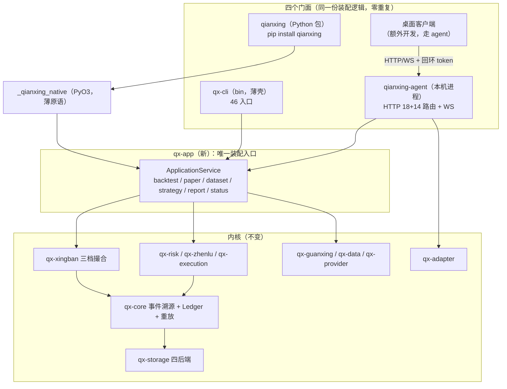

# 牵星 Qianxing — Python 全能力包 · 桌面客户端 · 可扩展性 改造方案

> 报告日期：2026-10-10 ｜ 目标仓库：`D:/aex_work/qianxing`（HEAD = `166eca1`，V13 R30）
> 报告类型：架构改造方案（含现状底账 + 竞品对比 + 路线图 + 门禁验收 + 文档治理）
> 事实口径：仓库内事实为**代码级确认**（附 文件:行，且经独立核验）；GitHub 项目事实为**文档级确认**（附来源 URL 与访问日期，沙箱内未做本地克隆）
> 配套报告：`docs/gpui-kit桌面端策略研究平台-可行性评估与调研方案-2026-10-10.md`（桌面 UI 壳选型）、`docs/competitive-analysis/`（2 份，竞品全景与架构不合理清单）

---

## 0. 结论摘要

### 0.1 一句话结论

**「通过 Python 包使用全部能力」与「桌面客户端体验全部能力」是同一个工程的两面：它们共同卡在同一处——`qx-cli` 是纯 bin crate，装配逻辑不可复用。** 因此前置改造只有一件：**把 `qx-cli` 的编排层下沉为库 crate，形成「一个内核，四个门面（CLI / Python / HTTP-Agent / 桌面客户端）」。**

### 0.2 五条硬结论

| # | 结论 | 依据 |
|---|---|---|
| 1 | **当前 Python 包跑不了一次回测** | `qianxing_bridge`/`qianxing_strategy`/`qianxing_ccxt`/`qianxing_ashare` 四包合计约 4,700 行，全部职责止步于「JSON 契约复刻 + 子进程 worker + 两个适配器」；`python/examples/backtest_momentum.py` 只是策略回调（`on_event` 返回 dict），被 Rust 侧 spawn 使用 |
| 2 | **46 个 CLI 入口中，Python 现在能独立完成的只有取数（CCXT / A 股）** | 其余全部要绕道 `subprocess` 调 `qx-cli`；回测编排在 `crates/qx-cli/src/backtests/`，**全为 `pub(crate)`，目录内 `pub fn` 计数 = 0** |
| 3 | **原生扩展薄到只导出 5 个符号** | `crates/qx-python/src/lib.rs` 仅 `frame_digest` / `frame_to_json` / `owned_arrow_capsules` / `owned_arrow_array` / `OwnedArrowArray`；直接依赖只有 `qx-datastruct` + `pyo3` |
| 4 | **薄客户端路线不成立** | `qx-api` 18 条路由 = 17 只读 GET + 1 控制面 POST，**全目录 `backtest` 关键字 0 命中** → 提交策略、跑回测、取净值都不存在 |
| 5 | **既有归档方案已给出正确骨架，但零实现** | `docs/archive/qianxing与tauron一体化桌面客户端终版方案-2026-10-03.md` §12 已提出抽 `qx-backtest` + `qx-experiment` 共享库、`qx-cli` 改薄壳；归档说明称全仓 `tauron`/`tauri` 关键字 0 命中 |

### 0.3 交付路线（一句话）

**P0 抽库（公摊前置，与门面选型无关）→ P1 Python 全能力包 → P2 可扩展性 → P3 桌面客户端 → P4 不受信策略沙箱。**

---

## 1. 需求拆解：把三个诉求翻译成可验收的定义

| 用户原话 | 可验收定义 | 反面（明确不算达成） |
|---|---|---|
| 「支持独立 Python 包安装」 | `pip install qianxing` 在**干净环境离线**装成；`dependencies` 为空；预编译 wheel（abi3，一平台一 wheel）；用户**不需要装 Rust** | 需要用户自行 `cargo build`；需要 `--no-deps`；强依赖 ccxt/tzdata |
| 「通过包使用牵星全部能力」 | Python 侧可完成 `qx-cli` 46 个入口中**所有"业务能力"入口**的等价操作：回测（Bar/L1/L2）、Paper、数据摄取与校验、策略校验与运行、产物读取与报告、运行状态诊断、调度、账户/账本投影读取；且与 CLI **产出逐字节相同的 `result_hash`** | 只包一层 `subprocess.run(["qx-cli", ...])` 当长期方案；Python 里重写一份引擎 |
| 「通过额外开发的桌面客户端体验全部能力」 | 桌面客户端经**本机 agent**（回环 + 一次性 token）获得与 Python/CLI 同源的能力；UI 只做展示、不自行计算数值 | UI 内嵌引擎副本；UI 直接读写内核存储 |
| 「支持可扩展性」 | 三层扩展点齐备且有判据：**编译期 trait**（Rust）、**运行时声明式注册**（Python `entry_points` + manifest）、**沙箱**（不受信策略）；新增一个 adapter/strategy 不改内核 | 只能改内核源码加分支；无 manifest/签名/版本校验 |

---

## 2. 现状底账（代码级）

### 2.1 workspace 与依赖方向

- 25 个 workspace 成员（24 个 `qx-*` + `contract-tests`），全仓 Rust 约 132,538 行；最大 crate `qx-cli` **50,231 行（37.9%）**。
- 依赖为 DAG 无环；仅有的 dev 边 `qx-adapter →(dev) qx-runtime`、`qx-execution →(dev) qx-adapter` 由 `contract-tests` 隔离。
- **`qx-cli` 是纯 bin crate**：`crates/qx-cli/Cargo.toml` 无 `[lib]`/`[[bin]]`，`src/lib.rs` 不存在；`src/main.rs:105-137` 所有编排模块以私有 `mod` 挂根；`src/backtests/mod.rs:12` 为 `pub(crate) struct BarBacktestAssembly`，该目录 **`pub fn` = 0**。

### 2.2 Python 包现状（四包 + 原生扩展）

| 包 | 行数 | 公开面 | 职责 | 能否跑回测 |
|---|---|---|---|---|
| `qianxing_bridge` | 367（+`native.py`/`strategy.py`） | `BarFrame`、`TransformManifest`、`load_account_snapshot`、`read_bar_frame_schema_version`；`strategy.py` 五符号 | 纯 Python 复刻 BarFrame/AccountSnapshot JSON 契约与 FNV 指纹；**纯 Python 可降级**（native 只是加速，仅 `to_pyarrow_native()` 硬依赖） | ❌ |
| `qianxing_strategy` | 17 + 4 文件 | re-export bridge.strategy 五符号；`worker.py`/`columnar.py`/`frame.py`/`ring.py` | 子进程 worker 与四种传输（JSONL / QXSF / QXCB / QXRB 共享内存环） | ❌（只能当 worker 被拉起） |
| `qianxing_ccxt` | 1,296 + 329 | `__all__` 17 项（`CcxtExchangeClient`、`watch_stream`、`watch_ohlcv`…） | CCXT 连接层（REST + Pro 流） | ❌ |
| `qianxing_ashare` | 1,920 + 164 | `__all__` 31 项（三种 Provider、公司行为对账、交易日历、PIT 记录…） | A 股数据源适配 + `python -m qianxing_ashare` CLI | ❌ |

**原生扩展**（`crates/qx-python/src/lib.rs`，165 行）：只导出 `frame_digest` / `frame_to_json` / `owned_arrow_capsules` / `owned_arrow_array` / `OwnedArrowArray`。直接依赖 `qx-datastruct` + `pyo3`（transitively 带 `qx-core`、`qx-guanxing`），**不含 `qx-xingban` / `qx-runtime` / `qx-storage`**。

**结论**：Python 侧今天是一套**跨语言交换边界**，不是一套产品 SDK。`docs/自研量化框架审计与重构方案-V13.md` §1.5 自己也点名：`qianxing_ccxt`/`qianxing_strategy` 被 Rust spawn，`qianxing_bridge`/`qianxing_ashare`「只躺在仓库里」。

### 2.3 能力缺口表（46 入口 × Python 可达性）

46 = `cli_args.rs` 顶层 `enum Command` 变体（`:51-315`），其中二级入口 18 条。归类如下：

| 类别 | 代表入口 | Python 现状 | 缺口 |
|---|---|---|---|
| 回测 | `backtest`、`backtest builtin/multi-builtin/book/ccxt-builtin`、`strategy backtest`、`fast-backtest`、`builtin-strategies` | ❌ 只能 subprocess | **需 lib crate** |
| Paper | `paper-e2e`、`paper-check`、`paper-submit-order`、`paper-worker`、`paper`、`run paper` | ❌ 只能 subprocess | 同左 |
| 数据 | `dataset-ingest`、`dataset-bundle`、`data-validate`、`ccxt-fetch-ohlcv`、`ccxt-market-spec` | ⚠️ **部分能**（CCXT/A 股取数已在 Python 内） | 数据集落库/校验缺 |
| 策略 | `strategy list/init/backtest`、`strategy-worker`、`plan` | ⚠️ worker 侧能（`worker.py`），编排不能 | 编排缺 |
| 运维/服务 | `serve`、`console`、`supervise`、`scheduler-worker`、`binance-worker`、`ccxt-worker`、`outbox-relay*`、`event-consumer-worker`、`consumer-dlq-replay`、`recovery-child` | ❌ | 装配层缺 |
| 配置/诊断 | `init`、`quickstart`、`doctor`、`config explain/fingerprint`、`status`、`report`、`runtime-check`、`live-check`、`run` | ❌ | 装配层缺 |
| 实盘/订单 | `binance-public/private-probe`、`binance-submit-order`、`ccxt-submit-order`、`reconcile` | ❌ | 装配层缺 |
| 自检 | `all`、`verify`、`ecosystem`、`paper`、`version`、`help` | ❌ | 装配层缺 |

**唯一例外**：数据取数（`qianxing_ccxt` / `qianxing_ashare` 已在 Python 进程内可直接完成）。

### 2.4 集成面现状（桌面与远程共用）

| 项 | 事实 |
|---|---|
| HTTP 路由 | **18 = 17 只读 GET + 1 写面 `POST /control/commands`**（`crates/qx-api/src/lib.rs:1533-1716`） |
| 写面能力 | 仅交易控制面命令（SubmitOrder/PauseStrategy/ResumeStrategy 等，`qx-control/src/lib.rs:19-27`） |
| 回测能力 | **0**（`qx-api` 全目录 `backtest` 关键字 0 命中） |
| WebSocket | 1 条事件流；消息类型 `connected`/`snapshot`/`events`/`event`/`resync_required`/`idle_timeout`/`server_shutdown` |
| 既有 UI | `web/console/`（`index.html` 144 + `app.js` 937 + `styles.css` 204 = **1,285 行**，纯原生 fetch/WS，**无第三方 JS 库**）；`qx-cli report --html` 自绘 SVG（`report_svg.rs`） |
| 鉴权 | `ApiPolicy::grant`；无权限 403 `authenticated_operator_required`；限流 429/503；游标 `after` 严格大于，越界 409；BFF 仅绑回环 + 会话 HttpOnly + CSRF 双提交 + 身份服务端注入 |

### 2.5 扩展点现状

| 层 | 扩展点 | 证据 | Python 可触达？ |
|---|---|---|---|
| 策略 | `BarStrategy`(`backtest.rs:24`)、`TickStrategy`(`tick_backtest.rs:20`)、`OrderBookStrategy`(`orderbook_backtest.rs:24`)；`qx-strategy` 的 `Strategy` trait(`lib.rs:309`)、C ABI vtable(`c_api.rs`)、Python worker | 三种形态 | ⚠️ 仅 worker 形态 |
| 数据源 | `DataProvider` trait + `ProviderRegistry`(`qx-provider/src/lib.rs:308,390`)；`qx-guanxing` `DataView`/`QualityGate`(`lib.rs:272,411`) | — | ❌ 需编译期 |
| Venue | `qx-adapter`：`HttpTransport`/`WebSocketPoll`(`lib.rs:46,59`)、`CcxtRpc`/`CcxtProcessVenue`(`ccxt.rs:24,253`)、`BinanceSpotVenue`(`binance.rs:782`) | — | ❌ 需编译期 |
| 模型 | `FeeModel`(`qx-core/src/fee.rs:25`)、FillModel / LatencyModel / MarginRule | — | ❌ |
| 插件 | `qx-plugin`：`Manifest`/`Registry`/`Provides`/`Cardinality`，静态装配 `register`/`resolve_order`（`lib.rs:43,242,308`），**无运行时热加载** | 仅 Matcher/FeeModel 两个真分派点 | ❌ |

**关键缺口**：Python 侧目前用 dataclass **手抄** `bridge/strategy.py` 的同一契约，靠测试守两边一致——**没有单一 schema 源**（`schemas/strategy_api_v1.schema.json` 已存在，但未用于生成两侧）。

### 2.6 wheel 构建与门禁约束

| 项 | 事实 |
|---|---|
| 构建脚本 | `tools/build_python_wheel.sh`/`.ps1`：探测 pip → `cargo build -p qx-python` → 复制 `_qianxing_native.(pyd/so/dll)` 到 `python/qianxing_bridge/` → `pip wheel --no-deps python/` |
| 当前产物 | `dist/qianxing_bridge-0.1.0-**cp312-cp312**-win_amd64.whl`（虽然 `qx-python` 开了 `abi3-py310`，**tag 未对齐 abi3**，属观察项） |
| 打包工具 | **setuptools**（非 maturin），`dependencies = []`，七个 extras 承载 ccxt/ccxtpro/tz/akshare/baostock/easy-tdx |
| wheel 内容 | 四个纯 Python 包 + `_qianxing_native.pyd`；**web console 资产不在 wheel 内**（独立的 `qianxing-web-console-*.tar.gz`） |
| 相关门禁 | `wheel_optional_dependency_check`(`check_architecture.py:10855`)：顶层 `dependencies` 不许含 ccxt/tzdata、七档 extras 齐备、报错点名 extras 必须已定义、四个包每个 `.py` 语法合法；`wheel_builder_check`(`:774`)：探测须早于 `pip wheel`、ps1 ASCII 行尾；`:12711` 要求 wheel 版本 ≡ workspace Cargo 版本；`crates/qx-cli/src/tests/artifact_identity_doc.rs:96-135` 钉住「构建→删旧→stage→打包」四步顺序，且交付文档不得出现 64 位整档 sha |
| **门禁的盲区** | `wheel_optional_dependency_check` **只管 Python 依赖，不管原生扩展链接面与体积** → 「Python 跑回测」会让约 3.7 万行内核代码进 wheel，而**现有门禁不会说话**（需新增判据，见 §9） |

---

## 3. GitHub 优秀项目对比

### 3.1 最值得借鉴的 10 条（每条：做法 → 为什么适合牵星）

| # | 来源项目（许可证） | 做法 | 适配牵星 |
|---|---|---|---|
| 1 | **nautilus_trader**（LGPL-3.0-only） | 「Python = 控制面，Rust = 引擎」；`BacktestEngine` 提升到包顶层，Python 可调起全部能力（回测/实盘/数据目录） | **正是本次目标形态**：`qx-cli` 逻辑下沉 lib crate 后，Python 才能「通过包用全部能力」而非复制 CLI |
| 2 | **ruff**（MIT） | 「逻辑 crate + bin crate」骨架：`ruff_linter` 装全部逻辑，`ruff` 只是 bin，`python -m ruff` 转发到打包进 wheel 的二进制 | `qx-cli`（5 万行纯 bin）最该复刻的结构：**补 `lib.rs`，bin 只做 argv→facade** |
| 3 | **polars**（MIT） | PyO3 绑定独立成 crate（`crates/polars-python`），Python 源码与 Rust 源码同 monorepo；`[tool.maturin] python-source` + `module-name` | `qx-python` + `python/` 已是此布局，只需把 `module-name` 显式设为 `qianxing._native`（私有），公开面留纯 Python |
| 4 | **pydantic-core**（MIT） | 「内核薄、门面厚」：Rust 只暴露极少原语（`SchemaValidator`），README 明说「不应直接使用 pydantic-core」 | **直接指导 `qx-python` 的边界**：扩展现有 5 个薄原语，**不要把 46 个入口做成 46 个 PyO3 函数** |
| 5 | **nautilus `BacktestEngine` Python 动词面** | `add_venue/add_instrument/add_data/add_strategy/run/generate_*_report` | Python 包应对齐这套「构建—运行—出报告」动词，**而不是暴露内部 JSON** |
| 6 | **vnpy**（MIT） | ABC（`BaseGateway/BaseApp/BaseDatabase/BaseDatafeed`）+ 每个 gateway/app 是独立 pip 包 + `main_engine.add_gateway(...)` 静态注册 | 牵星的 `qx-adapter`/`qx-provider` 定义 trait/ABC；Python 侧用 `importlib.metadata.entry_points(group="qianxing.adapters")` 发现第三方扩展 |
| 7 | **QuantConnect LEAN**（Apache-2.0） | 配置驱动可替换模型：`Composer` 按 `config.json` 字符串实例化 `IDataFeed/IBrokerage/IResultHandler` 与四模型 | 把 adapter/strategy/risk 做成「声明式配置 + 注册表」，消除 monolith bin 里的硬编码分派 |
| 8 | **extism（BSD-3-Clause）+ wasmtime**（Apache-2.0 w/ LLVM exception） | deny-by-default Manifest：`allowed_hosts` 默认空=禁网、`allowed_paths` 默认无、`memory.max_pages`、epoch `timeout_ms` + fuel | **不受信策略**的首选沙箱；比进程内 Python 插件更合 fail-closed 哲学。⚠️ 必须锁修复版本（见 §3.3 CVE） |
| 9 | **hummingbot**（Apache-2.0） | 一个引擎 + 多门面：`hummingbot-api`(FastAPI) + 官方 `hummingbot-api-client`(PyPI 42KB 纯 Python) + Telegram + MCP；`AllConnectorSettings` 运行时扫描代码库做注册表 | **「一个内核 + CLI/HTTP/Python SDK」最接近的样板**，验证了「内核不内建 UI，UI 走独立客户端」的形态 |
| 10 | **openai-python**（Apache-2.0） | OpenAPI → 多语言 client codegen，`.stats.yml` 记录 `openapi_spec_hash`+`config_hash` 实现可复现 | 18 条 HTTP 路由可由 `schemas/` 生成 Python client。⚠️ **不要用 Stainless**（2026-05 被 Anthropic 收购并关停托管产品），改用仓库内 openapi-generator 流水线 |

### 3.2 Rust + Python 打包对比表

| 项目 | 许可证 | 构建工具 | 原生扩展规模 | wheel 体积 | 需装 Rust | 版本对齐方式 |
|---|---|---|---|---|---|---|
| polars | MIT | maturin | 大（引擎全在原生） | 数十 MB（多 runtime 变体） | 否 | Rust 常量 `PYPOLARS_VERSION` ≡ Python `PKG_VERSION` 逐字比对，不一致告警降级 |
| ruff | MIT | maturin (`bindings="bin"`) | 无扩展，**打二进制进 wheel** | 中 | 否 | Rust crate 与 wheel 同 tag |
| nautilus_trader | LGPL-3.0-only | maturin + PyO3 | 大（v2 全面 PyO3） | 大 | 否 | `__version__` 取自安装分发元数据 |
| pydantic-core | MIT | maturin | 小（薄原语） | ~2 MB | 否 | maturin 统一 |
| tokenizers | Apache-2.0 | maturin | 中 | 中 | 否 | 同一 Rust 核心供 Python/Node 两端 |
| ArcticDB | BSL-1.1（按期转 Apache-2.0） | setuptools + C++ | 大 | ~13 MB | 否 | 包元数据 |
| **牵星（现状）** | Apache-2.0 | **setuptools** | **极小（5 函数）** | 小 | 否 | wheel 版本 ≡ workspace Cargo 版本（门禁 `:12711`） |

**借鉴结论**：牵星应向 maturin + abi3 收敛（`abi3-py310` 已开，但当前 tag 仍是 `cp312-cp312`），并**保持内核薄、门面厚**。

### 3.3 反面教训（「不要做什么」）

| 教训 | 来源 | 对牵星的约束 |
|---|---|---|
| 同导入名不同实现不可共存（v1/v2 都叫 `nautilus_trader`，必须各自 venv） | nautilus_trader | 新包名与 `qianxing-bridge` 必须避免同名不同实现；建议 `qianxing` 为正式门面、`qianxing-bridge` 降为内部依赖 |
| 内核团队主动放弃 UI 与插件生态是主流选择 | ruff（明确不支持第三方插件）、nautilus（「UI dashboards、distributed orchestration、built-in AI/ML tooling are out of scope」） | **内核不内建 UI**；桌面客户端走独立客户端 + HTTP/WS；插件面先做窄（策略/数据源/venue 三类） |
| 依赖外部商业 SDK 生成器是单点风险 | Stainless 被收购关停 | 自持 codegen 流水线 |
| 沙箱不是银弹（cap-std 路径尾斜杠 + 符号链接可逃逸；wasmtime 多处 CVE） | GHSA-vqjp-4c8c-hfgg（High, 2026-08-20）、CVE-2026-34987、CVE-2026-104855 | WASM 沙箱必须锁修复版本 + 白名单；**不要把 WASM 作为唯一防线** |
| Python 回调同步跑在事件线程，禁止阻塞 I/O 与长计算 | nautilus | Python 策略接口需明确「不得阻塞」契约，并提供 async/worker 形态 |

---

## 4. 目标架构：一个内核，四个门面

### 4.1 分层图



### 4.2 关键决策

| # | 决策 | 理由 | 反方案与为何否决 |
|---|---|---|---|
| **D1** | **抽 `qx-app` 库 crate，`qx-cli` 改薄壳** | 唯一装配路径，四门面零重复；`result_hash` 天然同源 | 在 Python 里重写引擎 → 两份事实链，违反「可复算」；在 bin 里继续加分支 → 熵增 |
| **D2** | **Python 公开面放在纯 Python，PyO3 只做薄原语** | pydantic-core 教训：把 API 稳定性绑在扩展上代价高；纯 Python 可读可调试可降级 | 46 个入口 → 46 个 PyO3 函数 → API 漂移 + 编译成本 |
| **D3** | **`subprocess` 调 CLI 只作为过渡/降级路径，不作为长期方案** | 已归档 Web 平台方案 §4.1 明确否定：「Web API 不应通过 shell 启动 `qx-cli backtest` 作为长期方案」（进程回收/日志截断/取消/状态同步问题） | 长期 subprocess → 状态同步与取消语义不可靠 |
| **D4** | **内核保持无 UI** | nautilus/ruff 主流选择；本仓亦已两次声明「不做 GUI」 | 内核内建 UI → 耦合 + 维护承诺（正是本仓 §7 拒绝的理由） |
| **D5** | **构建从 setuptools 迁到 maturin** | 与 polars/nautilus/pydantic-core 一致；abi3 单 wheel；`module-name` 显式化 | 保留 setuptools 也能用（现状即是），但 abi3 tag 对齐与多平台构建更费事 |
| **D6** | **单一 schema 源 + 双侧 codegen** | 现在 Python 手抄 Rust 契约靠测试守；`schemas/strategy_api_v1.schema.json` 已存在却未做生成源 | 继续手抄 → 每加一个字段要改两处 + 一处测试 |
| **D7** | **扩展点分三层，静态优先** | 本仓 fail-closed/确定性哲学 → 默认静态注册；不受信策略才用 WASM 沙箱 | 默认动态热加载 → 破坏可复算与可审计 |
| **D8** | **新包名 `qianxing`，`qianxing-bridge` 降为内部依赖** | 避免 nautilus 式同名不同实现；`qianxing` 是用户面门面 | 直接改名扩展现有包 → 破坏既有用户与门禁（wheel 版本 ≡ workspace 版本） |

### 4.3 新增 / 改造清单

| 对象 | 动作 | 说明 |
|---|---|---|
| `crates/qx-app` | **新增** | 应用服务层：`BacktestService` / `PaperService` / `DatasetService` / `StrategyService` / `ReportService` / `StatusService`；从 `qx-cli/src/backtests/` 等下沉，公开签名稳定 |
| `crates/qx-experiment` | **新增（P2）** | `ExperimentSpec` / 参数计划 / walk-forward / OOS / 实验比较（与竞品报告 §4.2 P2-3 同一件事） |
| `crates/qx-cli` | **收窄** | 只留 argv 解析 + 派发 + 输出格式化；目标 ≤ 15,000 行 |
| `crates/qx-python` | **扩写但保持薄** | 从 5 个符号扩到「薄原语集」（见 §7.2），**不承载业务编排** |
| `crates/qx-agent` | **新增（P3）** | 本机 agent：回环绑定 + 随机端口 + 一次性 token + 仅内嵌 `/research` 命名空间 |
| `crates/qx-api` | **扩面** | 新增 `/research/*`（复用已归档方案 §8.1 的 14 条路由设计） |
| `python/qianxing/` | **新增** | 正式门面包（`data/strategy/backtest/artifacts/api/adapters` 子模块 + `py.typed` + `__all__`） |

---

## 5. 可扩展性设计

### 5.1 三层扩展点

| 层 | 机制 | 适用 | 交付物 | 安全边界 |
|---|---|---|---|---|
| **L1 编译期 trait** | Rust trait 实现（`BarStrategy`/`DataProvider`/`Venue`/`FeeModel`）+ `qx-plugin` 静态 manifest（Ed25519 签名、`replaces` 独占冲突、`requires` 拓扑） | 核心组件、官方适配器、性能敏感路径 | 官方 crate | 编译期决定，最可信 |
| **L2 运行时声明式** | Python `entry_points(group="qianxing.adapters")` + strategy manifest（参数 schema/输入档位/输出 schema/资源预算/签名状态） | 第三方策略、数据源、分析扩展 | 第三方 pip 包 | 进程隔离 + 只读数据 + 无网络 |
| **L3 沙箱** | WASM（wasmtime + deny-by-default Manifest + fuel/epoch 计量） | 不受信策略 | `.wasm` 包 | 版本锁 + 白名单 + 资源上限 |

### 5.2 Python 侧扩展点（具体形态）

```python
# 第三方扩展包的 pyproject.toml
[project.entry-points."qianxing.adapters"]
my_venue = "my_pkg.venue:MyVenueAdapter"

[project.entry-points."qianxing.strategies"]
my_strategy = "my_pkg.strategy:MyStrategy"
```

```python
# 发现侧（qianxing/adapters/_discovery.py）——社区铁律：发现阶段只 load，不执行业务初始化
from importlib.metadata import entry_points

def discover(group: str) -> dict[str, type]:
    found: dict[str, type] = {}
    for ep in entry_points(group=group):
        try:
            found[ep.name] = ep.load()          # 只返回类/工厂
        except Exception as exc:                # 单插件异常必须隔离，不拖垮主流程
            _log_discovery_failure(ep, exc)
    return found
```

**四项纪律（来自社区一致实践）**：①发现阶段只 `ep.load()`，不执行业务初始化；②单插件异常 try/except 隔离；③扩展点必须有 manifest（版本、依赖、能力声明）；④未声明能力时**拒绝而非降级**。

### 5.3 策略 manifest（沿用已归档方案 §7.3，补充可机读形式）

```json
{
  "schema_version": 1,
  "strategy_id": "com.example.momentum",
  "version": "1.2.0",
  "code_hash": "fnv1a:...",
  "params": { "lookback": { "type": "int", "default": 20, "min": 2, "max": 500 } },
  "inputs": { "data_tier": ["bar"], "period": "1d", "required_fields": ["close_raw"] },
  "outputs": { "allowed": ["signal", "order_intent"] },
  "resources": { "cpu_ms_budget": 50, "memory_mb": 256, "network": false, "fs_readonly": true },
  "runtime": { "python": ">=3.10", "deps_locked": true },
  "signature": { "alg": "ed25519", "key_id": "qx-official-1", "value": "..." },
  "trust": "official"
}
```

### 5.4 单一 schema 源（消除手抄漂移）

现状：`schemas/strategy_api_v1.schema.json` 存在，但 Python 侧 `qianxing_bridge/strategy.py` 是**手抄**的 dataclass，靠测试守一致。

改造：**以 schema 为唯一源，生成两侧**。

```
schemas/strategy_api_v1.schema.json          ← 唯一源（已有）
        │
        ├─ codegen → crates/qx-strategy/src/generated.rs   （Rust 结构）
        └─ codegen → python/qianxing/strategy/_generated.py （Python dataclass）
```

门禁 `schema_single_source_check`：两侧生成物必须 ≡ 由 schema 现场生成的结果；手改任一侧即红。

---

## 6. 分阶段路线图

### P0（公摊前置）｜≈20 人日｜**与门面选型无关，必做**

| 任务 | 交付 | 验收 |
|---|---|---|
| 抽 `crates/qx-app` 应用服务层（从 `qx-cli/src/backtests/`、`runtime_wiring`、`report_readout` 等下沉） | 新 lib crate | `qx-cli` ≤ 15,000 行；`qx-cli` 不再是 37.9% |
| `qx-cli` 改薄壳，只做 argv→facade | bin 瘦身 | **46 入口 `result_hash` 逐字符不变**（门禁 `cli_behavior_parity_check`） |
| 产物版本治理（16 份 `summary.json` 迁移 + 用例守护 + 多腿 RunManifest） | 迁移脚本 + 用例 | `git grep '"schema_version": 1'` 对 blessed 产物 = 0 行；多腿产物有 `*.run.json` |

> **P0 是本次改造的真正瓶颈**，也是竞品报告（架构不合理清单 A3/A8）与 gpui-kit 报告（S0）共同指向的同一件事。

### P1｜≈22 人日｜Python 全能力包 MVP

| 任务 | 交付 | 验收 |
|---|---|---|
| `python/qianxing/` 正式包骨架（`data/strategy/backtest/artifacts/api/adapters` + `py.typed` + `__all__`） | 新包 | `pip install` 后 `import qianxing` 可用；`__version__` 取自 `importlib.metadata` |
| `qx-python` 扩为薄原语集（回测入口、产物读取、ABI 版本查询） | 扩展 | 扩展函数数 ≤ 15；无业务编排逻辑 |
| `qianxing.backtest.BacktestEngine`（nautilus 式动词面） | API | 同输入下 Python 与 CLI 的 `result_hash` **逐字符相同** |
| `qianxing.artifacts`：`RunManifest`/`summary`/`equity`/`fills` 类型化读取 + schema 版本显式校验 | 模块 | 读旧版本产物必须显式走迁移，不静默兜底 |
| 构建迁到 maturin + abi3，修正 wheel tag | `pyproject.toml` | wheel tag = `cp310-abi3-<plat>`；`dependencies` 仍为空；离线可装 |
| 过渡降级路径：`qianxing.cli` 子进程封装 | 模块 | 原生扩展不可用时能力子集仍可用（并明确提示） |

**Python API 形态（对齐 nautilus 动词面）**：

```python
import qianxing as qx

engine = qx.BacktestEngine(config=qx.BacktestConfig(
    instrument="BTCUSDT", account_id="acc-1", currency="USDT",
    initial_cash=1_000_000_000_000, data_tier="bar",
))
engine.add_data(qx.load_bars("data/bars.json"))
engine.add_strategy(qx.strategy.Builtin("macd", fast=12, slow=26))
engine.run()

report = engine.report()                    # 不自行计算，读内核产物
report.result_hash                          # 与 CLI 同源
report.equity.reindex(...).plot()           # pandas 友好
report.fidelity                              # 数据档位与「因此不可信」的指标清单
report.artifacts.save("./out/evidence")      # 产物落盘
```

### P2｜≈18 人日｜可扩展性

| 任务 | 交付 | 验收 |
|---|---|---|
| schema 单源 + 双侧 codegen | codegen 脚本 + 生成物 | 门禁 `schema_single_source_check` 绿 |
| `entry_points` 发现 + manifest 校验 | `qianxing.adapters`/`qianxing.strategies` | 一个 pip 安装的第三方策略可被 `list` 到并跑通 |
| `qx-plugin` 静态 manifest 与 Python manifest 对齐（同一字段语义） | 统一 manifest schema | 两侧字段名与语义一致，有对拍用例 |
| `ExperimentSpec` + 参数网格 + OOS（`qx-experiment`） | 新 crate + API | `qx.optimize(spec)` 产出 IS/OOS 分离报告；每参数点可复算 |

### P3｜≈20 人日｜桌面客户端

沿用 `docs/gpui-kit桌面端策略研究平台-可行性评估与调研方案-2026-10-10.md` 的 **S1–S4**：`qx-agent` + `/research` 路由 + UI 壳双 spike（gpui-kit vs Tauri）+ 决策门。**后端前置已在 P0 完成**，P3 不重复做。

### P4｜≈25 人日｜不受信策略沙箱

WASM（wasmtime，锁修复版本）+ 资源计量 + 白名单；**在沙箱验收完成前，自定义策略只开放 L1/L2**。

**总计 ≈ 105 人日**（不含桌面 UI 实现细节）。

---

## 7. Python 包设计细则

### 7.1 包结构

```
python/qianxing/                       # 正式门面包（pip install qianxing）
├── __init__.py                        # __all__ + __version__（importlib.metadata）
├── py.typed
├── _native/                           # 私有：包装 _qianxing_native，含可用性探测与降级
├── data/                              # BarFrame / DatasetBundle / Provider / 质量门状态
├── strategy/                          # Strategy 基类、manifest、builtin、worker 客户端
├── backtest/                          # BacktestEngine / BacktestConfig / BacktestReport（Bar/L1/L2）
├── paper/                             # Paper 闭环
├── artifacts/                         # RunManifest/summary/equity/fills 类型化读取 + 版本迁移
├── experiment/                        # ExperimentSpec / optimize / OOS（P2）
├── api/                               # HTTP/WS 客户端（由 schemas 生成，桌面与远程共用）
├── adapters/                          # ccxt / ashare（吸收现有两包）
└── _generated/                        # codegen 产物（勿手改，门禁守护）
```

### 7.2 PyO3 薄原语集（目标 ≤ 15 个符号）

| 类别 | 符号 | 说明 |
|---|---|---|
| 现有 | `frame_digest` / `frame_to_json` / `owned_arrow_capsules` / `owned_arrow_array` / `OwnedArrowArray` | 保留 |
| 回测 | `backtest_run(request_json) -> report_json` | **单入口**，参数与产物都是 JSON；不在扩展里做编排 |
| 产物 | `artifact_read(path) -> json` / `artifact_schema_version(path) -> int` | 版本显式 |
| ABI | `engine_version() -> str` / `abi_version() -> int` | 与 CLI 同源 |
| 降级 | `available() -> bool` | 已有模式 |

**纪律**：扩展只做「不可变 JSON 进出」或「Arrow capsule 借用」；所有人体工学（类型、默认值、报告对象、绘图）放纯 Python。

### 7.3 版本与 ABI 对齐

| 项 | 做法 |
|---|---|
| Python 版本 | `__version__` 取自 `importlib.metadata.version("qianxing")`（nautilus 做法），**不硬编码** |
| Rust ↔ Python | wheel 版本 ≡ workspace Cargo 版本（门禁 `:12711` 已有）；扩展内 `engine_version()` 必须与 CLI `version` 输出一致 |
| abi3 | `abi3-py310` 已开 → 目标 tag `cp310-abi3-<plat>`；**修正当前 `cp312-cp312` 的不对齐** |
| ABI 版本 | 扩展暴露 `abi_version()`；Python 层启动时校验，不匹配即 fail-closed 报错（不给降级幻觉） |

### 7.4 离线与零依赖

保持 `dependencies = []`；ccxt/akshare/baostock/easy-tdx/tzdata 继续留在 extras；新增任何强制依赖都会踩 `wheel_optional_dependency_check`。

---

## 8. 桌面客户端设计要点（与 gpui-kit 报告衔接）

1. **不重复做后端**：P3 依赖 P0 的 `qx-app` + `qx-agent`；UI 壳选型（gpui-kit vs Tauri）只影响展示层。
2. **UI 不计算数值**：所有指标读内核产物，并显示 `result_hash` / `input.fingerprint` / 数据档位 / 未验证清单。
3. **本机 agent 形态**（参考 ollama / Jupyter 共性）：回环绑定 + 随机端口 + 一次性 token（只从环境变量或内存读，不落盘、不进 URL 历史）+ 子进程退出清理。
4. **能力对等**：桌面客户端能做的，Python 包也必须能做（共用 `/research` 与 `qx-app`）——这是「体验全部能力」的唯一诚实实现。

---

## 9. 门禁与验收（本仓纪律：能力上线即有判据）

| 新增判据 | 断言内容 | 为什么必须有 |
|---|---|---|
| `cli_behavior_parity_check` | 抽库前后 46 入口的 `(exit_code, stdout 规范化, 产物 result_hash 多重集)` 完全相同 | P0 拆 crate 不得改变对外行为 |
| `python_capability_parity_check` | 每个「业务能力」CLI 入口必须在 Python 可达，或在显式白名单中注明「CLI-only + 理由」 | 防止「全能力」变成口号 |
| `result_hash_parity_check` | CLI / Python / agent 对同一输入产出逐字节相同的 `result_hash` | 四门面同源的核心断言 |
| `schema_single_source_check` | Rust 与 Python 生成物 ≡ 由 `schemas/*.json` 现场生成的结果 | 消除手抄漂移 |
| `wheel_native_boundary_check` | wheel 顶层 `dependencies` 为空；扩展符号数 ≤ 15；扩展不含业务编排（无 `backtest_service`/`assembly` 类符号）；**新增原生扩展体积预算** | 现有 `wheel_optional_dependency_check` 只管 Python 依赖，**管不住 3.7 万行进 wheel** |
| `artifact_version_guard` | blessed 产物版本 ≡ 当前常量；读旧版本必须显式迁移 | 修 A8 漏洞的守护 |
| `doc_citation_floor_check` | 见 §10.3（`LIVE_DOC_CITATION_FLOOR` 随文档治理同步） | 文档治理的门禁联动 |

**绝对验收（沿用本仓惯例）**：同一份输入下，CLI、Python、桌面客户端三条路走出的 `log_digest` 与 `result_hash` 必须相等；任一不等即视为架构未收敛。

---

## 10. 旧版本文档治理方案

### 10.1 门禁约束（先读这一节，决定能不能删）

本仓是「文档即门禁」文化，删文档**会动门禁**。已核实的两条硬约束：

| 约束 | 位置 | 含义 |
|---|---|---|
| `ACCEPTANCE_DOC = "docs/外部链路验收执行方案-V1.md"` | `tools/check_architecture.py:8989` | 该文档被门禁**直接读取**，**绝对不能删** |
| `LIVE_DOC_CITATION_FLOOR = 272` | `tools/check_architecture.py:10946` | 「活文档」中形如 `crates/<crate>/<file>.rs` 后接 `:行号` 的引用条数地板。**删/移走含引用的活文档会使条数跌破地板 → 门禁变红** |
| `DOC_ARCHIVE_PREFIX = "docs/archive/"` | 同上 `:10942` | 存档文档的引用**单独计数**（`ARCHIVE_DEAD_CITATION_CEILING = 9`，只降不升），活文档零容忍 |
| 门禁注释中引用的文档 | `:11440` 引 `docs/qianxing-架构设计与工业级优化改进方案-2026-10-06.md §7 M0`；`:11681` 引 `docs/qianxing-项目结构与GitHub竞品对比及优化方案-2026-10-06.md §6.2` | 这两份被门禁注释点名，删除会断掉判据的可读依据 |

**本机粗测**：当前活文档 `path:NN` 引用合计约 **324** 条（门禁口径 272 为下限）。

### 10.2 候选清单（分级）

| 文档 | 引用数 | 分级 | 理由 |
|---|---|---|---|
| `docs/外部链路验收执行方案-V1.md` | 18 | 🔴 **绝不能删** | 门禁 `ACCEPTANCE_DOC` 直接读取 |
| `docs/qianxing-架构设计与工业级优化改进方案-2026-10-06.md` | 47 | 🔴 **绝不能删** | 门禁注释引用（`:11440`）；且是工业级方案唯一权威 |
| `docs/qianxing-项目结构与GitHub竞品对比及优化方案-2026-10-06.md` | 38 | 🔴 **绝不能删** | 门禁注释引用（`:11681`） |
| `docs/自研量化框架审计与重构方案-V13.md` | 55 | 🔴 **绝不能删** | 主审计台账（542KB），当前进行中的执行记录 |
| `docs/外部链路验收-凭据与测试信息清单.md` | 1 | 🟠 保留 | 活跃的凭据/验收清单 |
| `docs/工业化易用性收口指南-V1.md` | 26 | 🟠 保留 | 操作性权威（最短可用路径/入口职责/故障约定） |
| `docs/竞品对比与易用性改进优化计划-V1.md` | **19** | 🟠 **建议归档** | 部分结论已被 2026-10-10 两份新竞品报告取代；但含「不做 Web GUI」关键决策（**归档而非删除**，保留结论原文）。⚠️ 归档会降低活文档引用条数 |
| `docs/牵星qianxing_架构梳理与缺点分析.md` | 5 | 🟢 **可归档** | 缺陷分级多数已收口；引用数低，归档代价小 |
| `docs/CCXT多交易所接入与策略运行方案-V1.md` | 0 | 🟢 **可归档** | 方案已落地（`ccxt-submit-order` 入口已存在） |
| `docs/A股数据源接入与快速选股回测方案-V1.md` | 0 | 🟢 **可归档** | 主要能力已落地（`qianxing_ashare` 1,920 行 + 三种 Provider） |
| `docs/工业级多语言策略与高性能交易方案-V1.md` | 0 | 🟢 **可归档** | 三语言策略已落地（Rust/Python/C++ + 四种传输） |
| `docs/虚拟交易与衍生品统一模型-V1.md` | 0 | 🟢 **可归档** | 全仓最老（2026-09-20）；模型已进 `qx-core`/`qx-protocol` |

### 10.3 执行程序（沿用仓库既有归档惯例，**不硬删**）

仓库已有明确惯例（见 `docs/archive/qianxing与tauron一体化桌面客户端终版方案-2026-10-03.md` 文末「归档状态」段）：**归档只改三处，正文一字不改**。

```
1. git mv docs/<file>.md docs/archive/<file>.md
2. 在文末追加「归档状态」段：归档日期、归档原因（一句话）、
   「文中行号/门禁条数/用例数均为那一轮快照，现状以 README 交付面一览为准」
3. 把同批归档文档之间的相互引用路径补上 archive/ 段
4. 重新测量活文档引用条数，同步下调 LIVE_DOC_CITATION_FLOOR
   （门禁注释里已有先例：195 → 272，正是七份 2026-10 规划稿移入 archive 时量的）
5. 跑 `python tools/check_architecture.py` 至全绿；若红，按报错逐条修
```

**为什么归档优于删除**：
1. 本项目**已两次声明「不做 GUI」并以文档为依据**——若把承载决策的文档删掉，未来有人重启该议题时「为什么不做」的依据就消失了（这正是 A5「门禁只证明已登记的没坏」的反面）。
2. 门禁的 `LIVE_DOC_CITATION_FLOOR` 是**跌破即红**，硬删含引用的文档需要同时改门禁常量，而改动理由必须可审计——归档天然给出理由。
3. 仓库已有 12 份归档文档和标准程序，成本为零。

**若用户坚持硬删**：只能删 §10.2 中标 🟢 且引用数为 0 的 4 份（CCXT / A股 / 多语言策略 / 虚拟交易模型），且**仍需**重新测量并下调 `LIVE_DOC_CITATION_FLOOR`（这 4 份虽无 `path:NN` 引用，但它们本身被其他文档提及，需逐一确认）。

### 10.4 本方案的文档产出（新增）

| 文件 | 定位 |
|---|---|
| `docs/牵星Qianxing-Python全能力包与桌面客户端及可扩展性改造方案-2026-10-10.md` | 本文（活文档） |
| `docs/gpui-kit桌面端策略研究平台-可行性评估与调研方案-2026-10-10.md` | 桌面 UI 壳选型（活文档） |
| `docs/competitive-analysis/竞品全景图与架构对标-牵星Qianxing-2026-10-10.md` | 竞品全景（活文档） |
| `docs/competitive-analysis/牵星Qianxing-架构不合理清单与优化重构方案-2026-10-10.md` | 架构不合理清单与 ROI 排序（活文档） |

> 治理原则：**同类新报告已覆盖旧文档结论时，旧文档归档而非删除**；活文档只保留「唯一权威」的少数几份（V13 台账、工业级方案、项目结构竞品、外部链路验收执行方案）。

### 10.5 执行记录（2026-10-10 已执行）

用户裁定：**归档 6 份候选**（对应 §10.2 的 🟠 与 🟢 项）。已按 §10.3 五步程序完成：

| 步骤 | 结果 |
|---|---|
| ① `git mv` 到 `docs/archive/` | 6 份全部完成；`docs/` 顶层由 14 份降至 8 份；`docs/archive/` 由 11 份增至 **17 份** |
| ② 文末追加「归档状态」段 | 6 份全部追加（正文一字未改）；逐份写明归档原因与「快照不代表今天」声明 |
| ③ 补 `archive/` 路径段 | 已更新 5 个活文件中的引用：`README.md`（4 条链接）、`deploy/README.md`（2 处）、`docs/自研量化框架审计与重构方案-V13.md`（6 处）、`crates/qx-cli/src/report_html.rs:1`、`crates/qx-cli/src/report_svg.rs:1`；另同步了本批次新增的 4 份报告中的引用 |
| ④ 复测引用条数 | **实测 `live_total = 297`，仍在 `LIVE_DOC_CITATION_FLOOR = 272` 之上 → 地板无需下调**（原估计会跌破，实测因本批 4 份新报告贡献了 36 条引用而未跌） |
| ⑤ 跑门禁 | `python tools/check_architecture.py` → **全部通过 ✓（950 项）**；期间每抳出 1 处：本方案自身用一条带通配符的假路径（`crates` 下的省略号写法）作**示例**，被门禁字面匹配，已改写为不带行号的表述 |

**刻意未改的三处（属历史记录，按惯例「正文一字不改」）**：`CHANGELOG.md`（119 条引用仍在，历史台账）、`.workbuddy-ai/memory/*`（记忆日志）、`maturity/` 下产物（本次未触发）。

**保留的活文档权威（8 份）**：`自研量化框架审计与重构方案-V13.md`（主台账）、`qianxing-架构设计与工业级优化改进方案-2026-10-06.md`、`qianxing-项目结构与GitHub竞品对比及优化方案-2026-10-06.md`、`外部链路验收执行方案-V1.md`（**门禁 `ACCEPTANCE_DOC` 直接读取**）、`外部链路验收-凭据与测试信息清单.md`、`工业化易用性收口指南-V1.md`，以及本批新增的 2 份 2026-10-10 报告。

---

## 11. 风险与非目标

### 11.1 风险

| 风险 | 等级 | 缓解 |
|---|---|---|
| P0 抽库触及 46 入口行为，可能引入隐性回归 | 🔴 高 | `cli_behavior_parity_check` 先建后改；`result_hash` 零变化为硬门槛 |
| 原生扩展体积暴涨（约 3.7 万行内核进 wheel） | 🟠 中 | 扩展保持薄（只包单入口 + JSON）；必要时拆 `qianxing-core`/`qianxing-full` 两个 wheel 变体；新增体积预算门禁 |
| abi3 tag 与多平台 wheel 构建复杂度 | 🟠 中 | 迁 maturin 后一次性对齐；CI 加多平台构建腿 |
| Python 与 Rust 契约手抄漂移 | 🟠 中 | P2 单源 codegen；过渡期维持现有对拍测试 |
| 第三方扩展的供应链风险（恶意 pip 包） | 🟠 中 | manifest + 签名 + L2 进程隔离 + 无网络；不受信才上 L3 WASM |
| 「全能力」范围蔓延（把本不该给的也给了） | 🟡 低 | `python_capability_parity_check` 用显式白名单管理 CLI-only 条目 |
| 文档归档触发门禁连锁反应 | 🟠 中 | 按 §10.3 五步程序执行；先测量后下调地板 |

### 11.2 非目标（明确不做）

1. **不在 Python 里重写引擎**——Python 是门面不是第二个内核；事实链只有一条。
2. **不把 46 个入口做成 46 个 PyO3 函数**。
3. **不默认动态热加载插件**（静态注册优先；不受信走沙箱）。
4. **不在内核里内建 UI**（沿用本仓「不做 GUI」决策；桌面走独立客户端 + agent）。
5. **不因 feature 开关存在就宣称能力完成**（沿用 `maturity/capabilities.yaml` 四档证据纪律）。
6. **不为了「能力多」放弃 fail-closed、可复算与 `null ≠ 0` 的钱字段契约**。

---

## 12. 总结

**未来 6 个月最核心的 3 件事：**

1. **抽 `qx-app`（P0，20 人日）** —— 这一件事同时解锁「Python 全能力」「桌面客户端全能力」「可扩展性」三个诉求；不做它，后面三件都是空谈。验收只需一条：**46 入口的 `result_hash` 逐字符不变**。
2. **Python 包从「交换边界」变成「产品 SDK」（P1，22 人日）** —— 内核薄、门面厚（pydantic-core 教训），动词面对齐 nautilus（`add_data/add_strategy/run/report`），版本对齐用 `importlib.metadata`，构建迁 maturin + abi3，且 `dependencies` 保持为空。
3. **把「可扩展」落成三层且有判据（P2，18 人日）** —— L1 编译期 trait、L2 `entry_points` + manifest、L3 WASM 沙箱；同时用**单一 schema 源 + 双侧 codegen** 终结「Python 手抄 Rust 契约」的漂移。

> 一句话：**先抽一层库，再开四扇门；门后面是同一个内核，同一条事实链，同一个 `result_hash`。**
