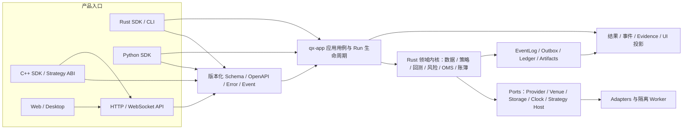

# 牵星 Qianxing 多语言 SDK 全能力升级与重构实施方案

> 版本：V1.0  
> 日期：2026-10-11  
> 基线：仓库 `main` 当前提交 `f383482`（方案制定时）  
> 范围：Rust 共享内核与 Rust SDK、Python SDK、C++ SDK、HTTP/Web 调用链、跨语言策略运行时、构建与发布  
> 状态：实施计划；本文中的目标能力不代表当前已经实现或通过实盘认证。

> 实施跟踪（2026-10-14）：本方案仍在实施中，尚未达到全能力发布门槛。Rust 共享多市场 Bar session 现支持常量 funding 与调用方提供的逐标的历史费率事件，按 UTC 8 小时结算边界将衍生品 funding 作为 Ledger 现金流写入 EventLog/Replay，并在后续策略回调前更新共享账户现金；多腿腿级归因消费同一结算事实。单腿快速选择覆盖 13 个内置策略，Rust 内核当前有 17 个内置策略类型。venue 专用 funding provider/conformance、实盘 testnet 认证、跨账户组合风险、C++ 默认 transport 及 Web/桌面端到端验收仍未完成。逐轮复核、测试证据与限制见[实施复核与量化场景验收记录](牵星Qianxing-多语言SDK实施复核与量化场景验收记录-2026-10-12.md)和 `maturity/quant_scenarios.yaml`。
> 本轮增量（2026-10-14）：新增 3..=32 市场同账户 Bar 组合应用用例，沿用唯一 PortfolioBarEngine、Risk/OMS/Ledger/EventLog/Replay；Rust SDK 与 Python 本地同步/RunHandle 接口可将 Rust/Python 自定义策略绑定到具体市场槽，未绑定槽继续使用内置策略；回调身份 ID/version/source SHA-256 进入运行指纹与产物。HTTP 同步/RunHandle 路由及 Rust/Python/C++ 远端客户端已接入同一共享 Rust 用例，远端执行使用请求中的内置策略配置；Rust/Python 自定义 callback 仍只在进程内 SDK，不能把任意代码经 HTTP 上传。新增路由与自定义槽测试通过。
> 本轮增量（2026-10-14）：新增共享 Rust 多市场参数/策略种类实验用例，复用同一 PortfolioBarEngine 与账簿，候选上限 256、候选结果/失败隔离、稳定排序、同步/RunHandle 执行；Rust/Python 本地 SDK 可注入策略工厂，Python/Rust/C++ 远端门面与 CLI 通过同一 HTTP/应用用例执行 Rust 内置策略候选，HTTP RunHandle 生命周期纳入注册、取消、状态、结果和事件流。跨入口结果一致、Python 自定义策略工厂、Rust SDK 独立消费者及远端路由用例已验证。独立仓外 Git consumer 现也从固定提交构建并调用 3 市场、4 候选实验，确认公开安装面可达。该能力目前限于 Bar 市场网格，不能据此推断 Tick/OrderBook、多腿、多账户实验已支持同等网格。
> 方案仍未全部落地：跨市场 Tick/OrderBook、交易日历/跨时区/货币换算、多账户跨账户组合风险、venue/provider 全矩阵与实盘 testnet 未完成认证；Web/桌面端到端验收、C++ 默认 transport 与全平台发布门仍未完成。逐轮复核、量化场景状态与证据见[实施复核与量化场景验收记录](牵星Qianxing-多语言SDK实施复核与量化场景验收记录-2026-10-12.md)和 `maturity/quant_scenarios.yaml`。

## 1. 目标与完成定义

将 Rust 作为唯一交易、回测、风险、撮合、账簿和事件事实实现；Rust、Python、C++、CLI、HTTP API 与 Web/桌面入口调用同一组版本化应用用例。各语言可以提供符合语言习惯的类型、异步接口和策略宿主，但不得各自复制金融逻辑。

升级完成后，使用者应能通过受支持的 SDK 完成适用场景下的数据检查、策略准备、确定性回测、参数实验、运行管理、结果复核，以及受权限控制的 Paper/Live 工作流。能力必须有真实实现、端到端验收证据和清晰限制；仅有类型、路由、接口或示例不能算功能完成。

### 1.1 验收目标

1. **单一权威内核**：Rust 负责领域规则、数值计算、撮合、账簿、风险、事件排序、回放和结果验证。
2. **同一用例入口**：Rust SDK、Python、C++、CLI、API 和 Web 对应同一版本化应用服务；不同入口对相同输入产生相同语义结果。
3. **完整能力链路**：多市场、多数据源、多交易所、多账户、多策略、策略语言、事件/订单/资金流、参数实验、回测和实盘控制均沿着已声明的链路可运行，失败和不支持行为明确。
4. **可验证确定性**：数据、策略、参数、费用、撮合模型、风险配置、引擎版本、时钟和随机种子均进入不可变 Run 身份；相同输入可复算并比较。
5. **安全运行**：Paper/Live 必须有权限、限额、幂等、持久化命令、对账、审计、熔断与可控关闭；任何未知交易结果先对账再决定是否重试。
6. **可交付 SDK**：各语言有稳定安装方式、支持平台矩阵、安装后 smoke/e2e 验证、SBOM/哈希/构建身份与兼容策略。

### 1.2 非目标与产品边界

- 不承诺所有交易所、数据源、市场和策略类型在首个版本都可用；按 capability registry 公布逐项认证矩阵。
- 不把策略代码执行等同于策略安全。非可信 Python/C++/Rust 策略使用独立 worker/沙箱；权限和资源限制由宿主实施。
- SDK 不得绕过 Rust 风控、OMS、账簿和授权，也不得自行“补算”权威交易结果。
- 实盘认证按交易所、账户类型、订单类型、市场和部署环境分别进行；Paper 或 mock 成功不等于实盘就绪。
- 本方案不要求移除已有 CLI、控制台、策略 worker 或 Provider 能力；先收敛契约与入口，再按证据决定迁移和清理。

## 2. 当前基线与关键缺口

本节是基于基线提交及现有 README、代码目录和路由面的初始工程判断。每项在阶段 0 重新以代码、测试和运行证据核对；文档中的愿景不能替代核验。

| 领域 | 当前可确认的基础 | 尚未达到的目标/待核验项 |
|---|---|---|
| Rust 内核 | workspace 有 `qx-core`、`qx-xingban`、`qx-zhenlu`、`qx-risk`、`qx-execution`、`qx-adapter`、`qx-runtime`、`qx-app` 等 crate；Python bridge 和 API 已调用部分 Rust 用例 | 需建立全部公开用例、状态所有者、能力状态和语言绑定的一一映射；避免 CLI/API/SDK 各自装配或重复实现 |
| Python | `qianxing` wheel 包含 Rust 扩展；公开 Bar、Tick、OrderBook、多腿回测、有限参数实验、运行句柄、API 客户端及 Paper/Live 控制客户端 | 应用回测入口仍有单账户和策略类型边界；统一 Provider 导入、账户组合、多交易所费率/撮合、用户策略选择与完整 Paper/Live 执行验收仍有缺口 |
| C++ | 有 C ABI 策略契约、进程隔离 Worker、QXRB ring、C++17 头文件 SDK 和共享 Rust API 的 HTTP 客户端 | C++ 客户端依赖集成方实现 HTTP transport；尚不是独立交易运行时；需强化契约自动生成/布局验证、异步生命周期和安装后全链路测试 |
| Rust SDK | Rust workspace 与 `qx-app` 应用层存在，CLI 可调用核心能力 | 当前交付有 qx-cli 运行程序，但没有清晰、稳定、面向第三方的 Rust SDK crate/门面与独立发布契约 |
| 多数据源/交易所 | Provider、adapter、ccxt 等模块和能力注册基础存在 | 尚未证明统一接入流程从能力探测、下载/订阅、质量校验、数据冻结、交易下单、回报、账簿到复核全闭环；数据源与 venue 不能简单视为同一能力 |
| 多账户/多策略 | 领域和运行时有账户、策略、组合等对象 | `qx-app` 高层回测的固定账户等限制需要改为显式账户/组合规格；多账户隔离、资金归属、策略竞争、风险聚合及退出语义必须端到端验证 |
| Web/API | 有 HTTP/WS 控制、状态、事件和 SDK API 路由 | 研究工作流与 Paper/Live 操作页是否完整消费同一资源契约需要逐屏/逐操作验收；路由存在不等于 UI 链路可用 |
| 发布 | CI/release 有 Rust 二进制、Python wheel、C++ SDK 等构建路径 | 当前 Windows 本地包不能代表全平台；Rust SDK 发布、跨平台消费者安装验证、实盘认证矩阵和产品能力清单需要补足 |

基线复核产物必须是 `capability-matrix.yaml`、语言/API 契约映射表、依赖图和问题清单。每个缺口标记为 `implemented-and-verified`、`implemented-unverified`、`partial`、`unsupported` 或 `blocked`，不得用布尔值 `supported=true` 掩盖限制。

## 3. 目标架构与依赖规则



### 3.1 所有权规则

- `qx-core` 与领域 crate 持有交易事实、金融精度、状态转移和确定性规则；不得依赖 UI、HTTP、CLI、Python 或 C++。
- `qx-app` 持有版本化命令/查询的校验、授权边界、用例编排、错误转换、Run 生命周期、事务边界和结果产物组装；不复制撮合/指标/账簿算法。
- `qx-provider` / `qx-adapter` 实现明确的 Ports；Provider 提供数据能力，Venue 执行订单能力，二者分别认证。数据 failover 不得无记录地混拼数据源。
- Python/Rust/C++ API 是 SDK 门面。绑定层只处理类型转换、资源所有权、异步/取消、异常映射和 transport，不实现业务决策。
- Web/桌面仅通过版本化 API 执行操作和展示服务端结果；浏览器不持有交易凭据、不重算权威指标、不决定订单状态。
- EventLog 是可回放业务事实来源；Outbox 是可靠投递机制；事件通知、审计和诊断日志各有独立语义与保留规则。

### 3.2 语言能力边界

| 语言 | 必须支持 | 实现方式 | 明确禁止 |
|---|---|---|---|
| Rust | 全部共享用例、强类型规格、同步与异步 Run 生命周期、Provider/Venue/策略 Host Ports | `qx-app` 核心 facade + 稳定 crate；可选 REST transport client | 第三方直接拼内部 crate 绕过应用校验作为推荐路径 |
| Python | 数据集、回测、Tick/OrderBook、多腿、实验、报告/Evidence、Run 管理、Paper/Live 服务端工作流 | PyO3/abi3 调用 Rust；HTTP client 调用远端同一用例；async API 与 sync API 共用契约 | Python 再写撮合、账簿、风险或权威指标；把 live 凭据交给策略进程 |
| C++ | 应用服务 client、策略插件 ABI、隔离 Worker、数据帧/协议、Run 生命周期和错误 | 自动生成/验证契约的 C ABI 与 C++17/20 client；HTTP transport 可插拔但接口完整 | 将 header-only client 描述成完整本地交易引擎；在策略 DLL 内保存交易所密钥 |
| CLI/Web | 与 SDK 相同的核心业务用例和生命周期 | CLI 调 `qx-app`；Web 使用 API/OpenAPI 生成或校验的 client | 复制金融逻辑或建立第二套状态机 |

## 4. 统一能力规格与核心数据契约

### 4.1 版本化请求、响应和身份

优先定义并稳定以下 Schema（Serde/JSON Schema 为规范源，OpenAPI、Rust/Python/C++ 类型由生成或严格一致性检查得到）：

- `ApiVersion`、`CapabilityDescriptor`、`AppError` / Problem Details。
- `ProviderSpec`、`DatasetSpec`、`DatasetManifest`、`DataQualityReport`、`MarketDataSubscriptionSpec`。
- `MarketSpec` / `TradingInstrumentSpec`：市场、venue、品种、币种、tick/lot、日历、费用与交易规则版本。
- `AccountSpec`、`PortfolioSpec`、`RiskProfile`、`StrategySpec`、`StrategyArtifactRef`。
- `BacktestSpec`、`PaperRunSpec`、`LiveDeploymentSpec`、`ExperimentSpec`、`RunIdentity`、`RunState`。
- `OrderIntent`、`OrderCommand`、`OrderUpdate`、`Fill`、`Cashflow`、`LedgerEntry`、`ReconciliationReport`。
- `RunEvent`、`EventCursor`、`ArtifactManifest`、`EvidenceBundle`、`VerificationResult`。

所有金额/数量规定定点精度与 raw 单位；所有时间携带明确单位、时区或 UTC 语义；所有外部 id 有作用域。未知字段按版本策略处理，breaking change 增主版本/新 endpoint；错误稳定 code 与 retry/reconcile 分类不可依赖错误文本。

Run 身份摘要至少绑定：数据快照及来源/hash、市场与费用模型、策略 artifact/source digest、参数、初始账户/组合、风险配置、撮合/fidelity 模型、事件时钟、引擎/契约版本和随机种子。结果不可复现时必须返回明确原因，不生成“verified”标记。

### 4.2 能力发现与限制表达

每个 Provider/Venue/策略宿主用 `CapabilityDescriptor` 声明支持的市场、历史/实时、频率/深度、订单类型、账户模型、费用/资金费、取消、查询、幂等、限流、sandbox/testnet、精度及已验证版本。能力是 `supported/unsupported/partial/experimental/verified` 等级，并包含限制/版本/证据链接。

启动前对规格做能力匹配。缺少费用表、tick/lot、时间范围、身份、风险规则或订阅权限等关键条件时 fail closed；不得静默降级成更弱模型而仍返回成功。

## 5. 端到端主流程

### 5.1 数据到研究/回测

```text
Capability discovery
→ provider selection (explicit preference + deterministic policy)
→ fetch/import with deadline, cancellation, pagination and rate limits
→ raw provenance + source revision/hash
→ validate schema, quality, calendar, timezone, PIT/corporate actions
→ normalize + immutable DatasetManifest/fingerprint
→ validate strategy/market/account/risk/fee/fidelity spec
→ persist Run/Experiment identity
→ Rust deterministic event engine + strategy host
→ StrategyIntent → risk → OMS → matching → Fill/order facts
→ Ledger and shared metric/report projection
→ artifacts + EvidenceBundle + replay verification
→ identical result access through Rust/Python/C++ client/API/CLI/Web
```

每一步需有 deadline、取消、错误码、correlation id 和资源限额。数据合并/修订/缺口策略写入 Manifest。实验每个组合获得独立 Run 身份与隔离账户/引擎，组合数、并发数、CPU、内存和时长有硬上限。

### 5.2 Paper/Live 订单闭环

```text
Strategy/Operator intent
→ authn/authz + capability preflight + risk reservation
→ idempotent durable command/outbox
→ OMS legal state transition
→ adapter submit/query/cancel
→ ack/fill/reject/partial/cancel race/timeout-unknown
→ unknown outcome → ReconcileRequired (never blind retry)
→ deduplicated trade/cashflow/fee facts → Ledger
→ portfolio/account projection + external reconciliation
→ audit, metrics, alert, event cursor and run evidence
```

Paper 与 Live 共用命令、策略意图、Risk/OMS 状态契约，但模拟器和实盘 Venue 不可伪装为同一执行模型。Live 使用独立授权 scope、最小权限凭据存储、限额、开关、人工审批策略、kill switch 和只读默认界面。任何写操作均可幂等重试并可查询最终状态；网络超时不等同于订单失败。

### 5.3 多账户、多策略、多市场

- 明确账户、组合、策略、Run 的所有权关系；一笔订单必须能追溯到唯一策略、账户、组合、市场和决策事件。
- 账户隔离账户余额、仓位、冻结资金和风控；组合级限额聚合相关账户风险。组合实验默认各 trial 资金/状态隔离。
- 多策略竞争同一资金时采用声明的调度/额度策略；禁止依赖线程到达顺序产生隐式优先级。
- 多市场支持交易日历、停牌/熔断、跨时区、货币换算和市场时序；跨市场执行须声明时钟与同步假设。
- 每个交易所/数据源以单独 capability 和合规矩阵验收；“支持 CCXT”不能自动等同所有交易所功能可用。

### 5.4 多语言策略

所有策略实现统一生命周期与数据语义：metadata/参数 schema → init → market/event callback → order intent → timer/stop/shutdown → checkpoint/recovery。Python/Rust/C++ 的策略输入输出、时钟、warmup、异常、日志、限额和幂等完全一致。

- 默认非可信策略采用独立进程，协议含版本、长度上限、序号、CRC/digest、请求 deadline、最大输出、背压、取消与退出码。
- 策略 stdout 保留给协议，诊断走 stderr；单个策略崩溃要被隔离并产生可查 Run 错误，不能阻塞 scheduler/event loop。
- 每个策略 artifact 带语言/runtime/compiler 版本、依赖锁文件、来源摘要、ABI/协议版本、权限和 resource profile。
- C ABI 动态库仅对经过信任链验证的代码开放；digest/签名不是沙箱。策略层不能连接交易所、读取凭据、改写账簿或提交未经 Risk/OMS 的订单。

## 6. 各 SDK 的产品接口方案

### 6.1 Rust

新增明确的公共 facade crate/API（首选 `qx-sdk`，先检查 crate 命名与发布冲突），依赖 `qx-app` 的公开类型而非拼接所有领域 crate。包括 `Client/Engine`、capabilities、spec 构造校验、sync/async run、`RunHandle`、events/cursors、cancel/wait/result、report/verify、Provider/Venue extension ports 与统一错误。

内部 crate API 继续服务实现和高级扩展，但给第三方的稳定边界有 semver、迁移指南、examples 和独立消费者构建。定义 crate 是否可发布到 crates.io；路径依赖在发布前必须转换为版本依赖并通过 `cargo package`/临时本地 registry 消费验收。CLI 仍是产品命令行，不替代 SDK crate。

### 6.2 Python

保留 `qianxing` 作为唯一推荐命名空间，abi3 wheel 携带 Rust 核心扩展。统一 Python dataclass/TypedDict/Pydantic 边界的选型（建议轻量 immutable dataclass + JSON Schema validation），同步 API 与 `asyncio` API 共享相同 contract；RunHandle 提供 `wait(timeout)`, `cancel`, `result`, `events` 且 timeout/取消语义一致。

接口分层：`qianxing.core` 本地 Rust 用例；`qianxing.client` 远端 API；`qianxing.data` provider/dataset；`qianxing.strategy` 策略 contract/worker；`qianxing.paper` 与 `qianxing.live` 明确依赖服务端执行；`qianxing.experiments` 参数对比；`qianxing.reports` 报告与 Evidence。顶层命名空间稳定导出常用接口，optional dependencies 不改变核心语义。

新增版本支持矩阵：CPython 3.10+、Windows/macOS/Linux x86_64/aarch64 按构建 CI 逐项公布；安装 smoke 必须在无 Rust toolchain、仓库源码和额外开发依赖的干净环境完成。`pip install qianxing` 安装跨版本通用包；平台 wheel 按 OS/架构构建是原生扩展的必要分发方式，不承诺一个 wheel 跨操作系统通用。

### 6.3 C++

分为两个互补产品：

1. **远端应用 SDK**：C++17/20 typed client 调用 Rust API，HTTP transport 接口明确 TLS、鉴权、连接复用、deadline、重试、错误、SSE/WS events 与取消；用户可注入 transport，但必须提供默认可用实现或标准可选实现。
2. **策略 SDK**：稳定 C ABI/worker JSONL 或 framed protocol/ring ABI；编译期/CI 自动验证 C/Rust 布局、枚举、对齐、版本和 ABI hash。C++ 策略仍由 Rust host 装载并经 Risk/OMS。

提供 CMake package、导出 targets、Windows/macOS/Linux 工具链矩阵、最小消费者工程、ABI 版本检查、API 迁移文档。文档须标注 SDK client 不含交易所运行时、实盘授权和 secret vault。

### 6.4 统一错误、运行和事件契约

稳定 `AppError { code, class, retry, reconcile, safe_to_retry, user_action, correlation_id, source }`。语言分别映射 Rust enum、Python exception subclasses、C++ `expected/result`/error object、HTTP Problem Details；只转换一次并保留根因。未知错误返回安全 Internal code，不丢 trace。

`RunState` 有唯一状态机和终态；Run 事件采用版本、序号、run_id、occurred_at、causation/correlation、cursor。客户端断连后按 cursor 续接；cursor 过期获得 snapshot-required。长任务恢复策略显式：可恢复/重启失败/需人工对账，不得让运行线程状态被错误宣传为持久任务。

## 7. 重构阶段、交付物和退出门

各阶段按顺序进入。每阶段必须先修复本阶段阻断缺陷、重新运行验收，再开始下一阶段；范围变更记录至此文的实施附录或独立执行记录。未达到退出门不得宣称该阶段完成。

### 阶段 0：基线盘点、能力冻结和可观测基准

**工作**：枚举公开入口、use case、feature flag、状态机、feature capability、Provider/Venue、SDK 导出、web endpoint、构建产物。绘制 crate/package/线程/进程/事件依赖图。执行无死循环审计：列循环、阻塞等待、重试、超时、取消、shutdown、资源上限和退出条件。

**交付**：能力矩阵、API 路由与语言导出映射、三条主链路调用图、孤儿/重复逻辑清单、已知限制、构建与测试基线。标注每条能力的测试和运行证据。

**退出门**：所有对外宣称能力有唯一 owner、入口、测试和状态；阻断风险有 owner/阶段；无未登记的无限重试或无界队列。

### 阶段 1：公共 schema、错误、能力和 Run contract

**工作**：定义 schema/version、兼容规则、金额/时间单位、AppError、CapabilityDescriptor、RunState、event cursor、RunIdentity、DatasetManifest 和 ArtifactManifest；生成 OpenAPI/JSON Schema 和契约快照。

**交付**：稳定 schema crate、语义版本策略、兼容性校验器、跨语言 golden fixtures。

**退出门**：Rust/Python/C++/API 对相同 fixtures 解析和序列化字段、默认值、错误码、精度、时间和未知字段策略一致；向后兼容与 breaking change 均有自动检测。

### 阶段 2：Rust `qx-app` 单一核心用例与运行生命周期

**工作**：把数据、单/多腿/深度回测、验证、比较、实验、Paper/Live command、报告/Evidence 收敛到 app use cases；规格补齐市场/账户/组合/策略/费用/撮合/数据 provenance；RunRegistry 持有状态、取消、事件、持久化/重启恢复边界。

**交付**：稳定 Rust facade、统一错误、可重放 Run、状态转移文档、可从测试 adapter 注入的 Provider/Venue/Clock/Storage Ports。

**退出门**：CLI 和 API 调用相同 application use case；相同输入产生语义一致结果；多账户隔离与组合风险用集成测试证明；订单未知状态不会盲重试；没有被 SDK 隐藏的单账户或单市场硬编码。

### 阶段 3：多 Provider/Venue/Market 与真实工作流闭环

**工作**：Provider conformance suite：历史/流式、断点、分页、时间、修订、限流、质量、血缘、取消和 failover。Venue conformance suite：订单类型、精度、部分成交、撤单竞态、重复/乱序事件、查询/对账、费用、testnet。按交易所和市场分级认证。

**交付**：能力注册表、每个接入器的 verified feature report、统一数据导入和实时订阅用例、回测市场规格与 venue fee/fill model。

**退出门**：用 mock contract suite + 可用 testnet 实证至少一个选定交易所的全链路；每个能力矩阵项都可由代码和运行证据支撑。无 testnet 的项目标为 unsupported/unverified。

### 阶段 4：Rust SDK 与 Python SDK

**工作**：发布/消费稳定 Rust facade；Python sync/async API、RunHandle、远端 client、策略 Worker、Paper/Live control、实验、报告和错误类型全部映射同一 schema。删除或弃用重复/旧 API 有明确迁移周期。

**退出门**：干净环境安装、examples 完成数据→回测→报告→复核；远端 Run 断线续接/取消/超时；Paper 控制和策略订单路径；Live 至少通过 testnet 场景。API 覆盖率使用 capability matrix 而非仅检查符号存在。

### 阶段 5：C++ SDK 与策略 ABI

**工作**：构建 typed remote client 和 transport 参考实现；ABI schema 自动检查；跨语言策略 contract fixture；多平台 CMake package；外部进程超时、崩溃、背压、父进程退出和资源回收验收。

**退出门**：下游独立工程从安装包执行同一服务端回测/experiment/Run 管理，并运行 C++ 策略经过 Rust 风控/OMS；ABI 在所有支持平台一致；编译和运行 matrix 全绿。

### 阶段 6：Web/桌面贯通与多语言策略生态

**工作**：数据源连接/导入 → 数据质量 → 策略/账户配置 → 回测/实验 → 运行进度/取消 → 结果比较/Evidence → Paper → Live approval 操作；OpenAPI 客户端与 UI contract 绑定。统一语言策略包元数据、参数表单、依赖锁定、worker 生命周期。

**退出门**：每个 UI 操作能追溯到 API contract 和 application use case；浏览器不计算权威数值；用户完成端到端任务不需手工绕过状态；权限、错误、断线和空数据行为均验证。

### 阶段 7：发布工程与持续认证

**工作**：Rust crate、Python wheel、C++ CMake SDK、CLI 和文档的版本联动；三 OS 与声明架构构建；SBOM、签名/attestation、hash、provenance、release notes、兼容/弃用政策。发布矩阵由实际 Runner/测试结果生成。

**退出门**：所有产物来自同一 tag/commit；每类产物安装后跑 smoke/E2E；ABI/API/schema 兼容性门禁；回滚、旧版本兼容和安全修复策略演练；未经 testnet/人工批准的 Live capability 不标 GA。

## 8. 正确性、连通性与安全验收矩阵

| 维度 | 必测场景 | 验收证据 |
|---|---|---|
| 确定性 | 相同数据/规格多次运行；跨语言同一 Run；重启后 verify/replay | canonical RunIdentity、事件 digest、报表差异为零或声明容差 |
| 数据 | 空/损坏/重复/乱序/时区、缺口、停牌、复权/PIT、源切换/修订 | Dataset manifest、质量 verdict、拒绝原因和 lineage |
| 策略 | 多语言相同输入输出、warmup/timer、崩溃/超时/恶意输出、资源耗尽 | Golden contract fixtures、worker kill/reap 证据、Risk/OMS 仍有效 |
| 订单/账簿 | ack/fill/reject/partial/cancel race/重复乱序、未知结果、重启对账 | OMS 状态图、幂等键、账簿复算、对账差异和人工处理路径 |
| 多账户/组合 | 余额隔离、组合限额、跨策略资金竞争、trial 隔离 | 交叉账户不可见/不可花费断言、风险限额压力测试 |
| 参数实验 | 笛卡尔积上限、稳定组合顺序、单项失败、取消/超时、OOS/WFA | 每个 trial 可复算；失败留痕；比较兼容性和多重试验报告 |
| 生命周期 | wait timeout、cancel race、服务重启、事件 cursor 续接/过期、满容量 | 没有无限等待；状态最终收敛；资源/线程/进程回收断言 |
| API/UI | 所有路由、字段、权限、错误、状态投影及操作映射 | OpenAPI contract、前端交互 E2E、请求/Run/correlation trace |
| SDK 安装 | 干净 Windows/macOS/Linux，Python 3.10+、Rust consumer、C++ CMake consumer | 安装日志、package manifest、版本/hash、最小程序结果 |
| 实盘安全 | secrets、最小权限、限额、审批、kill switch、testnet、对账 | 不含真实私钥的审计证据、testnet 订单全生命周期和复核报告 |

测试层级：静态依赖/契约 → unit/property → crate/SDK integration → 跨语言 contract → 本机 E2E → API/Web E2E → mock venue chaos → testnet conformance → 受控生产观察。金融账簿、状态机、权限、幂等、事件顺序和取消边界为阻断项。测试次数本身不是发布标准；每轮检查需在修复后重跑受影响矩阵并保留结果。

## 9. 无死循环、孤儿逻辑和资源治理

每个生产循环、重试和等待均登记：owner、阻塞源、退出条件、deadline、取消令牌、shutdown 响应、重试分类、最大尝试/退避、队列/缓存上限和可观测指标。

- 采用单调时钟测超时；避免依赖墙上时间推进有限等待。
- 所有 channel/queue/ring 有容量和满载策略；阻塞等待都有可唤醒 shutdown/cancel 路径。
- `wait()` 默认有限时；无限等待仅由调用方显式请求并可取消。
- 对外交易超时分“可安全重试”“先对账”“禁止重试”；订单状态不确定必须进入 reconcile。
- Scheduler、Run worker、策略 worker、stream subscriber、event cursor poller 有最大并发、重启预算和 shutdown join 上限。
- 通过调用图、符号/路由引用、依赖注入注册、插件元数据、构建产物、文档 API 和测试使用共同找孤儿；静态不可达结果需人工复核反射/插件/FFI 入口后再删除。
- 每个 Run 上下游操作携带 `run_id/correlation_id`，提供 queue depth、retry count、timeout/cancel/reconcile 状态指标；不记录敏感数据。

## 10. 迁移、兼容与版本策略

1. 先新增 schema 和 facade，旧入口内部委托新用例，不双写业务逻辑。
2. 旧 JSON/CLI/Python API 标记 deprecated，给转换工具、迁移示例和至少一个小版本迁移窗；安全问题允许缩短但需发布说明。
3. Run artifact、事件、策略 ABI、worker protocol、OpenAPI 与语言 SDK 分别有版本号；只对可兼容变化共享版本。
4. 持久化格式先支持旧数据读取与迁移验证，再切写入版本；迁移失败 fail closed，禁止静默丢事件/资金事实。
5. 生成 API/SDK 支持矩阵，按操作系统、架构、Python/Rust/C++ 工具链和功能等级标明 `GA/Preview/Unsupported`。
6. 任何新增市场、venue、provider、order type 或策略 host 都通过 capability contract suite 后才能在 SDK 中显示可用。

## 11. 风险与防控

| 风险 | 影响 | 防控 |
|---|---|---|
| 多语言契约漂移 | 不同语言产生不同订单/状态/数值 | 单一 schema、golden fixtures、代码生成或字段级自动对照、跨语言 E2E |
| 业务逻辑下沉不足/重复 | SDK 和 CLI 报告不同结果 | 只允许 qx-app/领域 crate 持有决策逻辑；CI 检查依赖方向和重复用例 |
| “支持多交易所”过度承诺 | 某些订单类型/市场实际不工作 | 每个 venue capability 细到市场和操作，有 testnet evidence 与 unsupported 清单 |
| Rust SDK 发布依赖不闭合 | crate 无法在 workspace 外消费 | 包前检查、版本化内部依赖、临时 registry consumer build |
| Python wheel 平台/ABI 错配 | 安装失败或运行时加载错误 | abi3 + OS/架构独立 wheel；干净环境矩阵安装与加载测试 |
| C ABI 结构布局漂移 | 策略插件内存错读 | schema/source 生成或双向编译断言、ABI version/hash、动态装载测试 |
| Live 超时导致重复下单 | 资金损失/重复仓位 | durable idempotency、unknown→reconcile、风险限额、kill switch、testnet/审批 |
| 事件循环卡死/无限重试 | 资源耗尽、Run 不结束 | 有界等待/重试/队列、协作取消、shutdown 测试、运行时指标 |
| 过大范围导致迟迟无法发布 | 全面升级不可交付 | 阶段门、最小认证能力表、预览与 GA 分层，不以文档覆盖代码缺口 |

## 12. 发布条件与声明规范

发布前必须全部满足：

- Rust/Python/C++/API 的 schema、错误、Run 与事件契约一致，兼容门禁通过。
- 能力矩阵每个 GA 项有 owner、公共入口、跨边界测试和可复核 evidence。
- 研究回测、参数实验、Paper、Live 按各自风险等级完成 E2E；Live 至少完成所声明交易所/市场的 testnet conformance 和人工审核。
- 多账户、多策略、多市场、费用/撮合模型有明确执行语义和端到端用例；若未覆盖则不列入 GA 说明。
- 所有循环/重试/队列/资源有界；shutdown、取消、断线恢复与不确定订单对账有测试。
- 干净环境安装所有承诺的语言/OS 包；Rust crate 可脱离 workspace 消费；Python wheel 和 C++ consumer 正常运行。
- 单一提交版本构建所有 artifacts，带 hash、SBOM、provenance、支持矩阵、变更/迁移说明；发布演练成功。
- 无未解决的 P0/P1 安全、账簿、确定性、数据泄漏、权限、状态机和发布阻断问题。

发布文案只允许声明能力矩阵中 `GA` 且已验收的组合。例如“支持交易所 A 的现货限价单”不能缩写成“支持交易所 A 全功能”。未做真实环境验证的能力注明 `Preview`/`Unverified`，不使用“全功能”“所有场景均可执行”等无法证实表述。

## 13. 立即执行顺序

1. 为本方案建 issue/任务树，按阶段拆分 owner、依赖、验收命令和产物；保持当前 `main` 不混入未验证的大范围改造。
2. 完成阶段 0，并将能力矩阵和接口调用图纳入仓库版本控制。
3. 选定第一个 GA 切片：Rust `qx-app` → Python 本地/远端 Bar 回测 → RunHandle → Evidence verify；在同一切片中证明共享契约与安装包。
4. 再扩 Tick/OrderBook/多腿和实验，然后补账户/组合/费用/市场与 Provider/Venue conformance。
5. Rust SDK 与 C++ SDK 完成 workspace 外消费者；多语言策略通过相同 golden fixture 和隔离 worker。
6. Paper 端到端后再做 testnet Live；Web/桌面消费稳定 API；最后完成全平台发布与 GA 能力矩阵。

## 14. 方案维护

本方案是实现路线，不是完成报告。每次实施更新独立执行记录：提交号、范围、发现、修复、验证命令与结果、遗留限制、能力矩阵变化和发布影响。阶段退出由证据决定；仅文档更新、静态符号存在或 CI 编译成功均不足以把交易功能标为已贯通。

