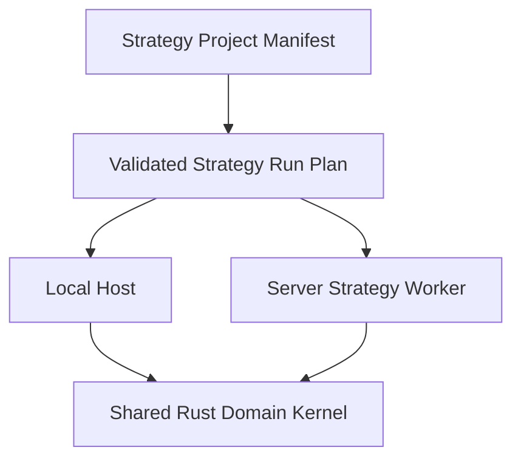
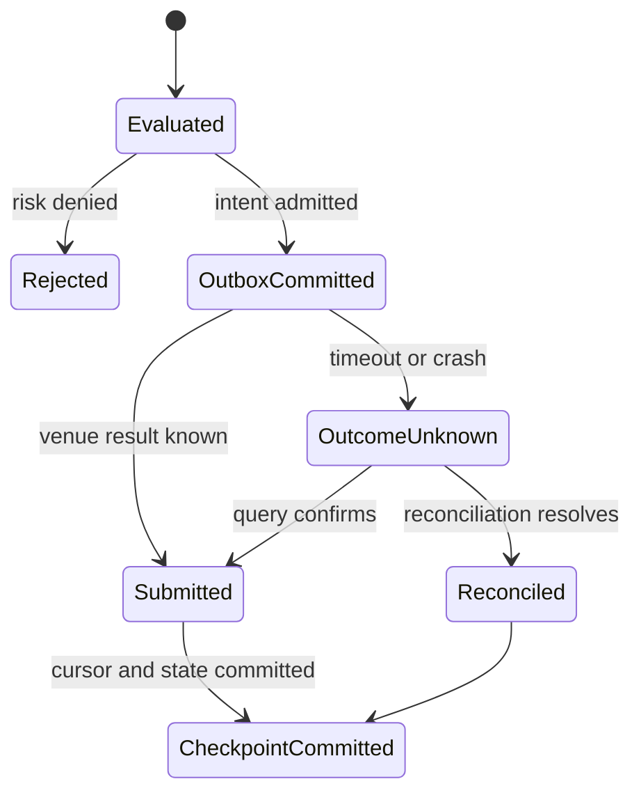

# 牵星 Qianxing：本地与服务端策略运行架构对标及重构实施方案

> 日期：2026-10-28  
> 复核范围：当前工作树中的 Rust workspace、Python SDK/策略适配器、CLI、运行时 worker、策略协议和 `docs/` 现行方案。  
> 目标：降低策略开发和部署的使用成本，收敛本地研究与服务端长驻运行的公共合同，同时保留两种宿主真实存在的环境差异。  
> 本文是针对策略运行的专项实施文档；总体边界、其它领域和竞品综合评估见[架构梳理、竞品对标与易用性重构方案（2026-10-27）](牵星Qianxing-架构梳理竞品对标与易用性重构方案-2026-10-27.md)及[项目架构与 GitHub 竞品深度复核总方案（2026-10-26）](牵星Qianxing-项目架构与GitHub竞品深度复核及优化重构总方案-2026-10-26.md)。

## 1. 结论

保留“Rust 交易/回测事实内核 + 多语言策略适配 + 按信任边界部署”的架构，不重写核心、不把本地和服务端拆成两套交易语义，也不为了策略运行增加微服务。重构目标是建立**一个策略项目描述、一份版本化策略运行计划、一套跨宿主事件合同、两种明确的运行 Profile 和一条可恢复的服务端提交边界**。

| Profile | 默认用途 | 用户代码在哪里运行 | 状态与结果 | 重要边界 |
|---|---|---|---|---|
| `local` | 新手回测、策略调试、研究和参数诊断 | 本机 Python/Rust 等宿主；本地可信代码可直连 Rust 回测引擎 | 单次 Run、可复算输入身份和本地产物 | 本地直跑不是安全沙箱；回测撮合不等于 Paper/Live |
| `server` | Paper/Live 长驻策略、团队运行和服务运维 | 经服务端策略 worker 与已配置语言宿主运行 | 持久 Job/Run、租约、游标/checkpoint、订单和审计事实 | 启动必须经能力/权限预检；不可信策略必须落到明确隔离策略 |

两种 Profile 共享 `StrategySpec`、策略包身份、事件/更新 DTO、决策与订单意图合同、错误分类、能力声明和 Run 身份。它们不共享系统时钟、数据来源、撮合模型、外部副作用、容错策略和验收级别。合同相同表示表达方式可对拍，不表示行为和风险完全相同。

## 2. 当前实现基线

### 2.1 本地策略运行

1. `python/qianxing/cli.py` 提供 `run-strategy`、`search-strategy`、`research` 和策略 manifest 检查等入口；策略文件加载、参数默认值、身份计算、依赖摘要、配置校验和 `validate_strategy_execution_preflight_v1` 在调用前执行。
2. Bar 策略通过 `python/qianxing/app.py` 的 `run_backtest_with_strategy` / `run_backtest_with_strategy_slots` 桥接到 `qianxing_bridge.app`；Rust 持有事件循环、Risk/OMS、撮合、账本、EventLog、Run 产物和 replay verification，Python 回调产出决策。
3. L1/L2 路径走 depth backtest 绑定；多市场路径按市场槽位装配策略回调；`qianxing_strategy.BaseStrategy` 通过类适配器把 Bar、Tick、OrderBook、Timer、订单、成交、账户和持仓更新映射到 Python hook。
4. 本地研究支持 baseline、参数搜索、未来数据/预热诊断和报告；用户仍需理解多个命令、多个 Spec、策略文件及配置文件之间的关系。
5. `BaseStrategyProcessAdapter` 管理 Python 类策略的生命周期、预热计数、事件时间上下文、用户状态快照、update cursor 和 bounded checkpoint。它是策略回调适配器；回测成交事实仍由 Rust 内核拥有。

### 2.2 服务端策略运行

1. `crates/qx-cli/src/workers/strategy_worker.rs` 是 Strategy worker 的装配及作业循环：读取运行配置、解析 worker、检查策略工件、创建 Python/外部进程/C ABI 客户端，消费控制命令和策略 Job，申请租约，组装市场/订单/账户输入，调用策略合同、过 Risk/OMS/订单队列并推进恢复游标。
2. `crates/qx-cli/src/strategy_binding.rs`、`strategy_contract.rs` 和 `strategy_host.rs` 负责输入装配、市场及账户更新、策略宿主请求、C ABI 动态库准入和结果归约；`qx-service::worker_host` 与 `qx-runtime` 提供 worker 注册、监督、停止和健康上报。
3. Python module/class、external executable 和带 C ABI 状态导出的插件具备不同状态能力。Python 类策略 checkpoint 包含用户快照、适配器 warmup 和更新游标；C ABI 和外部进程须按各自合同提供状态恢复。Rust builtin 及未实现配对 checkpoint 的原生策略不具有同一持久状态保证。
4. 执行更新已通过 EventLog 范围、策略 Job、租约 fencing 和 cursor/checkpoint 形成恢复机制；订单提交、checkpoint/cursor、Job 完成和队列确认跨多个持久边界，仍须继续完善副作用与恢复标记之间的一致性协议。
5. 本机 Python 策略进程和外部进程不是自动安全沙箱；sandbox provider 是显式部署路径。服务端必须把信任策略、工件身份、资源限额、凭证隔离和 provider 失败行为纳入预检，而不是从“进程隔离”推断安全。

### 2.3 已确认的具体修复

2026-10-28 已修正 Python 多标的 Bar 回调和 warmup 完成回调上下文：`context.instrument` 现在对应当前事件/预热标的，而不是请求主标的。变更记录在 `docs/multi-language-strategies.md` 和 10-27 总方案中。本专项后续须把该行为纳入跨宿主 golden fixture，避免回归。

### 2.4 当前优点

- Rust 是订单、风险、撮合、账本、EventLog、Run 身份与报告事实的主要 owner；Python 回调不绕过交易内核。
- 本地 Python 回测经共享 Rust 引擎执行，策略文件与 source digest 绑定运行身份；服务端使用租约和 fencing，而非依赖单纯进程内存状态。
- Python `BaseStrategy` 已有 typed lifecycle、warmup、Point-in-time 数据门面、订单/成交/账户更新、错误通知和 checkpoint 基础。
- 服务端能组合 Python module/class、外部进程和 C ABI 插件；本地研究能做候选搜索和偏差诊断。
- 仓库已有 Runtime worker supervision、结构化输入/产物、能力目录和跨语言策略夹具基础，可在现有 crate 内渐进收敛。

## 3. 竞品对照与可采用的设计

资料复核日期：2026-10-28。只比较公开的一手文档/源码描述；下列“吸收建议”是根据各自公开行为对 Qianxing 的工程推论，不构成性能或交易能力排名。

| 框架 | 公开设计特征 | 对 Qianxing 有用的经验 | 不直接照搬的部分 |
|---|---|---|---|
| [NautilusTrader](https://nautilustrader.io/docs/latest/concepts/architecture/) | Backtest、Sandbox、Live 共用 Rust `NautilusKernel`；Strategy、Cache、Portfolio、Risk、Execution 通过事件/组件接口协作；Live startup 可在 Strategy 启动前执行状态恢复和 reconciliation。 | 明确公共内核与环境专属宿主；把 startup reconciliation 做成启动屏障；清楚公开回测/实盘差异。 | 不照搬其完整组件体系和多 venue/高频术语；共享核心也不代表外部传输和成交等价。 |
| [Freqtrade](https://www.freqtrade.io/en/stable/bot-usage/) | `user_data` 下集中管理策略、数据、配置及结果；`trade`、`backtesting`、`hyperopt`、策略模板和 lookahead/recursive analysis 形成可发现的工作流。回测批量数据与实盘回调频率有明确差异说明。 | 采用 project-first 目录、模板、命令链和“回测前先做偏差检查”的新手路径；解释回测/运行语义差异。 | Freqtrade 的 crypto/Bar 模型及向量化信号不替代 Qianxing 的多资产 EventLog、精确订单单位、多账户账务与外部订单恢复。 |
| [vn.py CTA](https://github.com/vnpy/vnpy/blob/master/docs/community/app/cta_strategy.md) | 用熟悉的 `on_init/on_start/on_stop/on_bar/on_order/on_trade` 生命周期表达策略；初始化期间可加载历史数据，启动后才允许交易，订单和成交作为回调反馈。 | 保持一眼能懂的常用回调模板；状态生命周期和交易许可边界应显式、可解释。 | 不把无参 Python 回调强行设为跨语言底层 ABI，也不把各 Gateway 的接口同名当成规则与质量相同。 |
| [LEAN CLI](https://www.quantconnect.com/docs/v2/lean-cli/key-concepts/getting-started) | 以 workspace/project 为中心组织本地数据、配置和算法；CLI 支持本地 backtest、research、optimization、live deploy；本地 engine 容器化并将输出写回项目结果目录。 | 从“仓库内若干 JSON+策略文件命令”提升为可复制的策略项目；每次运行给出结果目录、进度和统一 Run 身份。 | 不要求所有本地策略都 Docker 化，也不引入必须依赖云账户/数据服务的基础路径。 |
| [Qlib Workflow](https://github.com/microsoft/qlib/blob/main/docs/component/workflow.rst) | 面向实验组织参数、数据处理、模型、分析与记录。 | 将实验配置、候选、切分和报告身份关联起来；让参数研究可复算。 | 研究工作流不能取代订单撮合、风控、OMS、账户事件及实盘恢复。 |

**综合判断：** Qianxing 的问题不是缺一套交易核心，而是产品入口、策略协议和运行期状态管理没有收敛为一个用户可理解的“策略项目”。优先吸收 project-first、显式生命周期、共享事件事实和启动恢复屏障；不采纳把环境差异隐藏掉或用容器/微服务替代清晰合同的做法。

## 4. 架构与开发细节中的主要不合理点

| 优先级 | 当前问题 | 具体影响 | 设计决定 |
|---|---|---|---|
| P0 | 策略生命周期/更新能力在 Rust trait、Python class/module、C ABI、external process 中逐步扩展，hook 覆盖与拒绝能力不是同一套机器可读矩阵。 | 策略作者难以知道 hook、data level、checkpoint、account update 在目标宿主是否生效；无支持能力容易退化成沉默 no-op。 | 建立版本化 `StrategyCapabilityManifest` 和 host capability catalog；预检明确 `supported / unsupported / degraded / required`，不得静默吞掉声明为必需的 hook。 |
| P0 | 本地命令和服务端 runtime 配置分别描述策略身份、参数、文件/模块、数据级别、依赖、sandbox 和恢复策略。 | 配置默认值漂移；同一策略切换到 server 时需要重复翻译；本地成功不说明 server preflight 已通过。 | 增加单一策略项目 manifest，由其编译生成 local `RunSpec` 和 server `DeploymentSpec`；环境专属字段在生成计划时显式列出，不允许配置复制。 |
| P0 | Server 的策略副作用、执行游标/checkpoint、scheduler Job 和 queue ack 不是一个全局事务。 | 在“订单命令已持久、checkpoint 尚未持久”或反向故障窗口里可能重放或漏掉策略状态。 | 采用有界 intent outbox + idempotency key + commit marker 恢复协议；优先在一个存储事务内提交，跨存储时使用 outbox/recovery journal；未知提交结果只查证/对账，不盲目重发。 |
| P0 | Live 策略启动边界缺少对用户统一呈现的阶段模型。 | 用户无法区分工件验证、状态加载、venue 对账、strategy `on_start`、ready 和 trading-enabled；仅看到 worker ready 容易误判可交易。 | 引入可查询 `starting → artifact_verified → state_restored → reconciled → strategy_started → ready → trading_enabled` 状态；任何未完成项都阻止下单并显示原因。 |
| P1 | 本地策略入口以文件/命令/JSON Spec 为中心，部署者需先了解参数 schema、数据路径、策略 manifest 和产物文件。 | 首次成功路径短板；Windows 相对路径、依赖文件、输出位置和错误定位增加试错。 | project-first 的 `qianxing project/strategy` 工作流：模板、依赖清单、统一配置、检查、回测、诊断和 Run 查看；既有命令保留作兼容入口。 |
| P1 | `strategy_worker.rs` 承载作业领取、生命周期、数据更新、宿主调用、订单副作用、checkpoint、状态恢复和日志。 | worker 高耦合；新增协议或恢复路径容易改到同一循环并扩大回归面。 | 在 `qx-cli`/`qx-service` 现有 crate 内按 owner 拆为 `strategy_plan`、`strategy_job_loop`、`strategy_input`、`strategy_host`、`strategy_commit`、`strategy_health`，worker 外壳只负责组合。 |
| P1 | callback 错误在本地、worker、子进程和服务 API 间有多层字符串转换。 | 用户看到异常文本，却难定位到配置字段、事件阶段、Run、工件版本、恢复状态和可操作步骤。 | 定义稳定 `StrategyErrorV1` 分类：`phase`, `strategy_id/version`, `run_id`, `event_seq`, `instrument`, `retryable`, `recovery_action`, `cause`; 本地文本/JSON、服务端日志/API 共用映射。 |
| P1 | checkpoint 主要是语言/适配器可选能力，Rust builtin/原生实现的普适恢复契约仍不完整；状态大小和版本演进约束较隐蔽。 | worker 重启后不同语言策略的可恢复程度不一致，容易把“进程重启成功”误认为“策略状态已恢复”。 | 定义 opt-in 状态 schema、状态版本、最大字节数、checksum、工件/配置/data identity binding、迁移策略和恢复失败关闭规则；未实现则 UI 明示 volatile/stateless。 |
| P1 | Local 和 server 的事件时间、数据可见性、回调频率、重复投递、订单回报和停止原因可能不同。 | 开发者会假设回测和实盘相同，或错误理解幂等性/恢复语义。 | 对公共领域事件做 golden matrix；用 `ExecutionProfile` 描述时钟、数据源、feed 粒度、撮合/网络、更新投递、持久化和取消行为，报告里展示差异。 |
| P2 | 能力、示例、CLI help、Python 导出、C ABI 字段和文档维护多份手工目录。 | 文档/可执行行为容易漂移；用户尝试不支持的配置后才失败。 | 从协议/manifest/CLI 构造策略 Hook Catalog 和 examples index，或以静态门禁双向校验；错误指出缺失登记的 hook/schema/入口。 |
| P2 | 远程沙箱、子进程、C ABI native trust 和 local direct run 容易被用户归为一个“运行方式”。 | 信任边界模糊，可能把进程分离当成对不可信代码的隔离。 | 命名为 `trusted_local`、`isolated_local`（显式 provider）、`server_worker` 和 `server_sandbox`；宿主策略决定隔离要求，失败不得回退到本机直跑。 |

## 5. 目标架构



这里的“Shared Rust Domain Kernel”是策略意图、Risk/OMS、EventLog、Run 身份和账本合同的 owner；local backtest 与 server execution 使用不同的时钟、数据和 execution adapter。

### 5.1 策略项目描述

新增版本化 `qianxing.strategy.json`（名称可在实现阶段与现有配置命名统一），作为用户可版本控制的策略项目入口，至少包含：

| 部分 | 内容 | 约束 |
|---|---|---|
| `strategy` | 稳定 id、版本、语言、入口、参数及参数 schema 版本、源码/包 hash | 代码变化会改变 identity；secret 不得写入 manifest。 |
| `dependencies` | Python lock/requirements、Rust/C++ 工件引用与校验摘要 | 依赖锁文件与制品 digest 绑定 Run/Deployment。 |
| `data` | 数据集路径/身份、市场、instrument、bar/tick/book 级别、时区及质量策略 | 明确本地文件路径和 PIT 可见性，不在 server 侧重新猜路径。 |
| `execution` | local/server profile、dry-run/paper/live、费用/撮合模型或 venue/account scope | local research 不读交易密钥；server live 明确账户、产品和 operation scope。 |
| `risk` | 采用的已版本化风险 profile 引用 | 配置只引用，不在 Python 或 manifest 中复制 RiskGate 计算。 |
| `research` | warmup、切分、OOS、搜索预算、诊断阈值 | 每次搜索/诊断记录输入、预算、seed 和遗漏覆盖。 |
| `artifacts` | 本地根目录或 server artifact backend/profile | Run 输出包含 manifest、摘要、报告和受限分页索引。 |

兼容策略：当前 JSON Spec、CLI 参数和 runtime 配置继续接受；统一预检将它们编译成 `StrategyProjectSpecV1`/`StrategyRunPlanV1`。先增加只读 `explain/plan` 输出与冲突字段检查，再逐步把生成的规范计划作为唯一执行输入。schema 不兼容升级显式变更版本，不在同版本悄悄改默认值。

### 5.2 公共策略运行合同

冻结并发布一张可机器检查的 lifecycle matrix：

| 阶段/事件 | 输入身份 | 可返回订单意图 | 幂等/游标要求 | 不支持时 |
|---|---|---:|---|---|
| `validate_config` | strategy id/version、project spec | 否 | 纯校验、不得发送副作用 | 启动前失败并指出字段路径 |
| `on_init` / `on_restore` | Run、环境、checkpoint identity | 否 | 仅一次；恢复路径与新建路径区分 | 拒绝进入 started |
| history/warmup | instrument、as_of、PIT history | 否 | 每 instrument 独立计数和时间边界 | 未声明所需数据层则拒绝 |
| `on_start` / `on_warmup_complete` | lifecycle state、instrument | 否 | 状态机可查询；warmup per instrument | 未就绪时禁止交易 |
| Bar/Tick/Book/Timer | event id/seq、event time、instrument、profile | 是 | replay-safe；同一事件/intent 有稳定身份 | host preflight 拒绝 required hook/data level |
| order status/fill/account/position | EventLog seq、scope、snapshot completeness | 是（排队至下一决策边界） | cursor per account/venue/kind，去重可恢复 | 未声明 capability 时不投递并报告范围 |
| `on_error` | 版本化错误 DTO | 否 | observer 异常不能覆盖主故障 | 保留主错误 |
| `on_stop` | 停止原因、最终 cursor/run 状态 | 否 | orderly/failed/shutdown/pause 分开；最多一次 | 记录 hook failure，不伪造干净终态 |
| snapshot/restore | schema version、artifact/config/run identity | 否 | 有界、完整校验、恢复与 cursor fence 绑定 | fail closed，不静默从空状态继续 |

目标 DTO 可继续兼容现有 `StrategyInput/StrategyOutput`、Rust `StrategyUpdate`、C ABI JSON 以及 Python hooks；规范化边界只在 Rust/host adapters 中执行。每种 host 对上述事件给出 capability，而不是在代码里通过 `if language == ...` 形成隐含矩阵。

### 5.3 Host 分层

| 层 | owner | 责任 |
|---|---|---|
| Project/config compiler | `qx-spec`/应用入口 | manifest 解析、参数默认、身份 hash、路径解析、schema version、host capability preflight。 |
| Strategy API/adapters | `qx-strategy`、`python/qianxing_strategy`、C ABI | 语言本地便利 hooks、DTO 编解码、能力报告、状态快照/错误桥接；不做风险与订单提交。 |
| Domain/application core | `qx-app`、`qx-core`、`qx-zhenlu`、`qx-execution`、`qx-xingban` | 事件时序、数据可见性、意图校验、Risk/OMS/账本、回测撮合、事实 EventLog、Run 结果。 |
| Local host | `qx-cli`、Python facade | 同步/可取消的研究执行、详细错误、workspace 产物；默认只运行可信用户代码。 |
| Server host | `qx-service`、`qx-runtime`、`qx-orchestrator`、`qx-storage` | 授权、隔离、租约/并发、checkpoint、执行副作用、恢复屏障、健康与审计。 |
| Presentation | CLI/API/Web/Python typed facade | 显示同一规范 Run/Deployment/Capability/Error DTO；不再另算交易或账户事实。 |

## 6. 两种运行主旅程

### 6.1 本地策略：开发者路径

目标体验：

```text
初始化策略项目 → 选择/验证数据 → 检查策略与依赖 → 本地回测
→ 偏差/预热诊断 → 搜索/OOS → 查看与复算 Run
```

拟收敛的兼容命令（名称仅作设计建议，实现时优先复用现有 CLI command tree）：

```text
qianxing strategy init
qianxing strategy doctor
qianxing strategy run --profile local
qianxing strategy research --profile local
qianxing run show <run-id>
qianxing run compare <run-id-a> <run-id-b>
```

落地细节：

1. `init` 生成项目 manifest、最小可运行策略、schema 注释、数据样例和 ignore 文件；支持 Python 起步，Rust/C++ 文档示例保持独立。
2. `doctor` 在执行前检查入口可导入、manifest/schema、Python 依赖、instrument/data level、数据可见时间、warmup、执行权限边界和输出目录；一次列出全部可修项并给修复建议。
3. `run` 接受项目目录即可解析单一 manifest；保留 `run-strategy <file> <spec>` 为兼容别名。以 plan 显示本次 profile、数据摘要、参数和策略 hash，`--dry-run` 只允许构造/校验意图，不接触 server credentials。
4. 每个 Run 使用确定性 identity 写入项目 `.qianxing/runs/<run-id>/` 或配置的外部路径。输出 `manifest.json`、摘要 JSON、报告、诊断/搜索产物、日志和 artifact index；报告可由当前 Rust reader 复核。
5. Python 的简易 API 仅承担加载/运行/读取的 facade；参数验证、OOS split、identity 和交易事实继续使用当前共享 Rust use case。支持 sync 和 cancellable handle，结果 DTO 保持一致。
6. 路径以 project root 为锚点；Windows/Linux/macOS 的路径解析、依赖导入、输出目录覆盖、信号中断和失败清理要给同一错误分类。
7. 默认 local 运行只适用于受信代码，明确显示 `trusted_local`。进程模式用于依赖隔离/可重启，不被宣传成不可信代码沙箱；需要隔离时用户必须选配置好的 provider。

### 6.2 服务端策略：运维者路径

目标体验：

```text
从项目生成 deployment plan → server preflight → Paper 演练
→ 带审批/权限部署 → 查看运行状态 → 暂停/恢复/停止
→ 崩溃后恢复并对账 → 导出审计与 Run 结果
```

建议提供统一的管理对象/命令，而不让操作者手改多份配置：

```text
qianxing strategy plan --profile server <project>
qianxing strategy deploy --mode paper <plan>
qianxing strategy status <strategy-id>
qianxing strategy pause|resume|stop <strategy-id>
qianxing strategy logs <strategy-id> --follow
```

落地细节：

1. `plan` 生成不可变 `DeploymentSpec`：策略/依赖 hash、账户和 venue scope、产品/订单能力、数据订阅、风控 profile、worker 数、运行身份、隔离方式、恢复模式和资源限额。
2. `preflight` 显示逐项状态：工件、schema、凭证引用、scope、Venue 能力证据、数据/私有流、账户/保证金模式、risk、存储事务能力、checkpoint、sandbox provider、worker 健康。未观测与未配置不能显示为 healthy。
3. 从 Paper 到 Live 只提升环境 profile 和凭证引用，不复制策略或改写状态机；每一步有审阅记录和差异说明。Live 写权限按 account × venue × product × operation fail closed。
4. 每个 Strategy instance 使用稳定 `strategy_instance_id`，关联配置 hash、artifact hash、账户/venue scope、worker generation、lease fencing token、EventLog cursor 和 checkpoint id。
5. Worker 启动严格执行：校验工件 → 绑定凭证/授权 scope → 恢复策略和 adapter 状态 → venue/account/order/position reconciliation → 发布 `ready` → 打开 `trading_enabled`。reconciliation 有不确定项时不调用允许下单的策略 hook。
6. Pause 需定义：停止接受新市场决策、是否继续处理回报、未决订单处理策略、checkpoint 和最终状态；Resume 要先检查 cursor/lease/run hash。Stop 需支持 drain、超时和明确的 `forced` 终态。
7. Scale-out 以策略分区键/账户/venue 分区为边界；同一状态分区只允许一个有效 fencing lease。多 worker 不得复制相同策略状态并各自提交意图。
8. 策略重启与 worker 重启分别记录；状态缺失、artifact/schema 不匹配、checkpoint 超限、账户状态不一致、cursor gap 或不确定订单结果都进入可诊断阻塞状态，不自动清空策略状态继续交易。

### 6.3 Local/server 共同的开发者体验

- 同一 manifest、参数 schema、代码模板和验证错误；profile-specific 字段由计划 diff 明确展示。
- 统一 `RunHandle`/运行状态：queued、starting、running、completed、failed、cancelled、recovery_required；server 额外暴露 lease/worker/ready/trading 状态，local 暴露进程和输出路径。
- 每次运行都有摘要页/JSON，包含数据、参数、策略版本、源码 hash、Runtime/engine build、时区、时间窗、warmup、能力缺口和结果证据等级。
- Python 错误展示源码文件/行号和 callback stage；Rust/ABI/process 错误展示 strategy/run/event identity、输入字段路径、是否可重试以及恢复操作。Server API 只返回脱敏内容。
- `qianxing doctor` 支持 `--profile local|server`；同一项检查采用同一规则 ID，但说明需要本地数据、worker 或外部凭证的差别。

## 7. 关键一致性与恢复协议

### 7.1 Intent commit protocol

策略结果不得直接等同于已执行订单。每个策略决策产生 `DecisionId`，每条 intent 产生稳定 `IntentId`（绑定 strategy instance、input cursor、序号和策略 identity）；Risk/OMS 返回 admission 和 command identity。Server 提交步骤应能恢复到以下单一状态机：



必要不变量：

1. 重复处理同一 `DecisionId/IntentId` 不产生第二条外部 submit；OMS/outbox 有唯一键和幂等保护。
2. cursor/checkpoint 不得越过还没有持久提交或进入可恢复 outbox 的副作用。
3. crash recovery 先读取提交 marker/outbox，再决定重放策略请求、继续查询 submit 结果或完成 checkpoint；不得依据“HTTP/函数返回错误”盲目判断副作用未发生。
4. 同一 store 可用事务时把 intent outbox、cursor/checkpoint 和 run commit marker 放入一个事务；跨 store 时以 durable journal/outbox 做可重入 Saga，不宣称全局 ACID。
5. 策略状态恢复绑定 strategy artifact hash、config hash、checkpoint schema 和 Run/partition identity；不兼容迁移必须显式声明迁移函数和审计记录。

### 7.2 本地和服务端生命周期

Local 的 `on_init → warmup → on_start → market/update callbacks → on_stop` 由回测时钟推进；取消后要保留中断 Run 身份并区分用户取消和策略失败。Server 的 `validate → restore → reconcile → on_restore/on_start → ready → trading_enabled → pause/stop/recovery` 受真实异步事件和外部系统影响。公共事件/更新 DTO 相同，profile 的因果顺序和可执行操作通过 capability/host matrix 标出。

### 7.3 能力矩阵要求

每个 strategy host 在启动前返回并记录：

| 类别 | 示例能力 |
|---|---|
| 行情 | Bar、L1 Tick、L2 snapshot/delta、Timer、PIT history、multi-instrument、depth batching。 |
| 生命周期 | `on_init`、restore、warmup、order status、fill、account snapshot、position snapshot、reasoned stop/error。 |
| 状态 | stateless、volatile、durable snapshot/restore、schema migration、max snapshot bytes。 |
| 执行 | intent types、exact decimal fields、reduce-only/position mode 等策略面字段；真正执行范围由 Rust/Venue capability 再校验。 |
| 环境 | trusted local、process isolation、sandbox provider、network/filesystem policy、resource limits、restart behavior。 |

对 manifest 标记 `required` 的 capability 不可静默降级；`optional` capability 需向策略与报告提供确定的缺省行为。

## 8. 分阶段重构计划

| 阶段 | 优先级/依赖 | 主要工作包 | 主要代码边界 | 交付与退出标准 |
|---|---|---|---|---|
| S0：现状矩阵与安全底线 | P0；先行 | 从 schema、Rust trait、Python hooks、C ABI、worker 配置生成生命周期/数据层/状态恢复/capability 矩阵；列出当前可用入口和外部副作用 | `qx-strategy`、`python/qianxing_strategy`、`strategy_binding.rs`、`strategy_host.rs`、`strategy_worker.rs` | 每个 hook 能回答“谁提供、哪个 profile 可用、版本/顺序是什么”；unsupported required 项在任何副作用前拒绝。 |
| S1：本地最短策略旅程 | P1；依赖 S0 identity | project manifest、`strategy init/doctor/run/show` 场景命令、路径规则、Run artifact index、模板和错误文案；现有 `run-strategy/research` 作为兼容包装 | `python/qianxing/cli.py`、`app.py`、`experiments/`、`qx-cli cli_args`、现有 qx-app reader | 仓库外新目录按模板可完成数据校验、local run、诊断和结果读取；不需 server、密钥或云 provider；同输入稳定 identity。 |
| S2：公共策略合同与宿主 conformance | P0；依赖 S0，可与 S1 并行 | `StrategyCapabilityManifest`、lifecycle matrix、golden JSON fixtures、错误 DTO 和 host adapter mappings；明确事件顺序与时间边界 | `qx-strategy` contract、Python adapter、C ABI/C++、external process、Rust host | 所有已声明 host 对支持事件输出同一规范 intent/update；旧 schema 通过兼容层；required unsupported 有明确失败。 |
| S3：服务端生命周期/预检可视化 | P0/P1；依赖 S0/S2 | 生成 deployment plan；preflight 聚合 artifact、scope、data/account、sandbox、storage、worker/health；实现启动状态屏障及 pause/resume/stop 语义 | `qx-cli`、`qx-service`、`qx-runtime`、`qx-control`、`qx-api` | `ready` 与 `trading_enabled` 可区分；没有完成 restore/reconciliation/capability 的实例不能下单；操作者能查询 block reason 和下一步。 |
| S4：策略副作用与恢复一致性 | P0；需存储 owner 评审 | idempotent Decision/Intent ID、intent outbox、commit marker/journal、cursor/checkpoint fence、unknown submit query/reconcile 状态 | `qx-execution`、`qx-storage`、`strategy_worker.rs`、`execution_updates.rs`、Scheduler/JobQueue | 对任一提交点崩溃后，重复恢复不重复下单、不越游标、不漏决策；事务能力明确，不宣称跨后端 ACID。 |
| S5：worker 内部解耦及规模边界 | P1/P2；依赖 S3/S4 | 拆 worker 作业循环/输入组装/宿主运行/副作用提交/health；明确每 partition 单 owner、租约 fencing、超时/取消/资源配置 | 现有 crate 内 `qx-cli`/`qx-service`，必要时只拆模块 | 策略 host 可独立复用；worker orchestrator 不持有领域规则；新增语言 host 不需改主 job loop 分支。 |
| S6：统一可观测性和用户文档 | P1；依赖 S1/S3 | Run/Deployment detail、结构化错误、脱敏日志、状态订阅、清晰中断恢复指南；Python typed facade 与 CLI 文档对齐 | `qx-api`、Web Console、CLI、Python SDK、docs | CLI/Python/API 核心状态字段一致；服务端日志可关联 strategy/run/intent/event；local/server 与 sandbox 的信任边界清楚。 |
| S7：发行与性能证据 | P2；S1–S6 之后 | 干净环境安装、Windows 路径、Python wheel/ABI/依赖、Rust/C++ 示例；本地回调吞吐与服务端延时/内存 profile | Release/CI、`benchmarks/`、安装文档 | 发布包可生成、运行并读取样例；报告包含硬件、engine hash、数据、p50/p95、吞吐和峰值 RSS，不从微基准外推产品性能。 |

### 推荐依赖顺序

```text
S0 → S2 → S3/S4 → S5
       ↘ S1  → S6 → S7
```

可立即开展 S1 的用户项目体验，同时不得让新 API 绕过 S0/S2 的策略能力校验或 S4 的 server 提交约束。S4 是服务端真实策略副作用的发布阻断项；S7 的性能优化必须建立在有同机 workload 基线之后。

## 9. 开发级拆解与变更控制

### 9.1 配置迁移

1. 定义字段 owner 表：策略作者参数归 `strategy`；数据身份归 dataset/input contract；部署 scope/凭证引用归 deployment profile；运行策略不能覆盖的 risk policy 归宿主；sandbox 与 resource limit 归 trust policy。
2. 所有 manifest 默认值只定义一次，并由 CLI/Python/runtime preflight 使用同一 Rust/schema 实现；不在 Python 入口另写默认值。
3. 把当前 `runtime.json` 内策略配置解析成规范计划，再保留旧配置读入能力；冲突时输出 JSON pointer 和两个字段来源，不做“后者覆盖前者”的隐式规则。
4. Hash 按 canonical serialization 计算，区分代码 bundle hash、resolved config hash、data fingerprint、runtime build identity 和 deployment hash；secret value 不进入 hash 文本和报告，只绑定 credential reference/version。

### 9.2 host adapter 开发约束

- Rust `Strategy` trait 是领域事件入口，不直接绑定 Python 参数或 C ABI 内存布局。
- Python `BaseStrategy` 继续做可用性抽象；`class_adapter.py` 负责 lifecycle、typed hooks、状态快照、上下文身份，不生成账户账本事实。
- C ABI 对 symbol/ABI/schema/字段容量做启动期验证；option hook 未实现是 no-op 还是 unsupported 必须由能力声明区分。
- external process 使用有界 IPC/超时/消息大小和 artifact identity；worker restart 与 strategy checkpoint restore 是两个不同状态。
- 所有语言输出先规范化为一套 Rust intent DTO；禁止各宿主各自做 quantity rounding、RiskGate 或命令持久化。

### 9.3 服务端 worker 内部模块建议

不按文件行数拆 crate。按责任把现有 loop 内逻辑逐步提取为：

1. `StrategyDeploymentPlanner`: 解析配置、静态工件验证、capability/scope preflight。
2. `StrategyLifecycleHost`: python/native/external 统一 start/restore/callback/stop 与状态查询接口。
3. `StrategyInputAssembler`: 从 EventLog/行情/账户/position snapshot 生成有界、版本化输入和 cursor ranges。
4. `StrategyJobProcessor`: lease/fencing、cancel/pause、job idempotency 和 retry 分类。
5. `StrategyCommitCoordinator`: risk admission、intent outbox、submit/query、checkpoint/cursor marker。
6. `StrategyHealthProjection`: readiness、trading-enabled、staleness、last callback/error 和 reconciliation 状态。

先在 `crates/qx-cli/src/workers/` 与 `crates/qx-service/src/` 内部模块做纵向抽取；确认有独立发布、依赖或拥有者后才考虑新 crate。

## 10. 验收矩阵

实现阶段应补齐并持续运行下列验收；此处是目标门，不代表当前已通过：

| 场景 | 必须证明的行为 |
|---|---|
| 单 Bar local Python / Rust / C ABI | 同一冻结输入规范化为同一 intent、Run identity 与核心账务事实；C ABI buffer/ABI 差异有版本适配。 |
| 多标的 warmup 与回调 | `context.instrument`、history as-of、每 instrument warmup 数和 intent instrument 始终一致；包括 2026-10-28 修复路径。 |
| L1/L2/Timer | manifest data level 与输入 tier 匹配；缺少 required hook/capability 在回调前被拒绝；Timer 时钟身份显式。 |
| update 去重 | order/fill/account/position 重复、乱序、同 cursor 多 kind 和进程重启后只回调一次或按合同重放；cursor per account/venue 正确。 |
| local cancellation/error | 在策略回调、报告写入、用户 Ctrl+C 三个位置取消；得到明确 Run terminal state，Rust 资源释放，产物可识别是否完整。 |
| server submit 故障窗口 | 提交前、outbox commit 后、网络发送中、Venue 已受理但响应丢失、响应后 checkpoint 前、checkpoint 后 worker crash；恢复不重复副作用且可继续。 |
| server lifecycle | 工件无效、scope 缺失、凭证无效、数据源/私有流断开、reconciliation mismatch、sandbox unavailable、checkpoint 版本不兼容分别阻止策略进入可下单态。 |
| 双 worker/租约 | 同一 partition 竞态 claim、lease 过期、旧 owner 响应晚到、pause/resume 与 worker replacement 时 fencing 拒绝旧写入。 |
| 多语言 checkpoint | Python class/module、C ABI、external process 和 Rust opt-in 状态的 schema 升级、超限、NaN/非法 JSON、restore failure 和 artifact mismatch。 |
| 用户旅程 | 干净仓库外目录、无密钥 local、Windows 带空格路径、server plan/preflight、paper deploy、status/logs/stop；错误含单一下一步。 |

验收夹具需标注 `contract-only / local-engine / process-recovery / external-venue` 等证据级别；fake venue、mock provider 和本地回测不能提升外部交易所验收等级。

## 11. 非目标与风险边界

- 不重写 Rust EventLog/风险/OMS/账本，不创建独立 Python 交易内核。
- 不要求 Local backtest、Paper、Live 使用同一撮合模型或同一 callback 频率。
- 不默认把可信个人脚本放进外部 sandbox；也不把普通 subprocess/C ABI 当成不可信策略隔离。
- 不让策略 callback 直接保存 cursor、写交易所或读取 secrets；服务端所有外部副作用由受授权的 Rust host 执行。
- 不通过“增加更多命令/配置文件/服务”解决体验问题；新命令应是现有用例的易用编排层，兼容旧入口。
- 不把“有 checkpoint hook”当作“整条策略运行原子恢复”；需要连同订单副作用、游标、队列和 reconciliation 验收。

## 12. 决策事项与默认建议

| 决策 | 建议默认值 | 原因 |
|---|---|---|
| 本地 Python 是否默认进程隔离 | 默认 trusted-local 直接运行，显式可选择隔离模式 | 本地研究最少依赖；清晰告知信任边界。 |
| Server 不可信策略是否自动本机 fallback | 禁止 fallback，缺 provider 就拒绝启动 | 进程分离不构成沙箱，失败关闭。 |
| local/server 使用几套策略 manifest | 一份项目 manifest，两种 profile 编译出不同计划 | 避免配置分叉并保留环境差异。 |
| Rust/语言策略恢复 | 能力 opt-in，持久化声明必须有版本化 snapshot/restore；无能力则 server preflight 阻止声明“可恢复” | 不制造虚假保证。 |
| schema/CLI 迁移 | 先生成规范计划并兼容现有命令，再逐版本收敛 | 降低对已有用户、脚本和部署的破坏。 |
| worker 拆分 | 先同 crate 内模块化，事务边界稳定后再判断是否拆 crate/service | 避免服务数量增长但事实 owner 仍分散。 |

## 13. 一手资料

- NautilusTrader 架构与 shared kernel：<https://nautilustrader.io/docs/latest/concepts/architecture/>；live lifecycle：<https://nautilustrader.io/docs/latest/concepts/live/>；reconciliation：<https://nautilustrader.io/docs/latest/concepts/execution/reconciliation/>。
- Freqtrade 命令与项目目录：<https://www.freqtrade.io/en/stable/bot-usage/>；策略 callback：<https://docs.freqtrade.io/en/stable/strategy-callbacks/>；lookahead analysis：<https://www.freqtrade.io/en/stable/lookahead-analysis/>。
- vn.py CTA lifecycle 文档：<https://github.com/vnpy/vnpy/blob/master/docs/community/app/cta_strategy.md>。
- LEAN CLI workspace：<https://www.quantconnect.com/docs/v2/lean-cli/key-concepts/getting-started>；本地与云 backtest：<https://www.quantconnect.com/docs/v2/lean-cli/backtesting/deployment>；local live deploy：<https://www.quantconnect.com/docs/v2/lean-cli/api-reference/lean-live-deploy>。
- Qlib workflow：<https://github.com/microsoft/qlib/blob/main/docs/component/workflow.rst>。


## 14. 2026-10-28 落地记录

本节记录本轮已经进入代码库的实现以及仍未达到生产验收的边界。它是实施状态快照，不代表 S0–S7 全部完成。

### 已落地

- Python SDK CLI 新增 `qianxing project init/show/doctor/plan/run`：可创建策略项目清单和安全空策略模板；`doctor`/`plan --profile local` 复用策略 manifest、输入规格检查与 Rust 策略执行预检；`run` 复用已有 `run-strategy` 和共享 Rust 回测引擎，并在项目根目录解析相对数据路径。
- 新增 `schemas/strategy-project-v1.json`，项目清单只记录项目、策略、输入规格及可选 runtime/worker 关联，不接收凭证值。已有策略源文件不会被 `init --force` 覆盖。
- `qianxing project plan --profile server` now delegates runtime schema validation and per-worker strategy selection to Rust `RuntimeConfig::strategy_for_worker`. Planning hashes the Python source without importing it. A non-source digest is explicitly marked `bundle_verification_required`; artifact verification, credentials, provider health, and reconciliation remain blocking runtime checks.
- Rust Strategy worker 的暂停/恢复命令现在先校验当前生命周期，再持久化命令结果，最后改变进程内状态；worker 重启时从控制审计中读取最近一条针对本 worker 的已执行暂停/恢复命令，恢复 paused/running 状态，并在 worker 状态详情中显示 `lifecycle` 与 `strategy_accepting_jobs`；这仅表示进程内是否处理策略作业，不作为 server live readiness。

### 尚未完成、不可据此宣称生产可用

- Strategy `PauseStrategy`/`ResumeStrategy` commands now reject `target="*"` at control-plane validation. These commands require one explicit worker ID; multi-worker broadcast remains a separate fan-out feature and cannot be represented by one shared audit result.
- `server plan` 是静态检查，不等于运行时 `runtime-check`/`live-check`，也不执行启动预检、状态查询、暂停/停止 API、真实订单或外部 venue 对账。
- S2 的跨 Python/Rust/C ABI/external process 一致性 conformance、S3 的完整 deployment/readiness 投影、S4 的原子 intent outbox/提交恢复协议、S5 模块拆分、S6 UI/API 与结构化可观测性、S7 安装矩阵和性能基线仍需各自实施并按第 10 节验收。
- 本轮本地 profile 继续使用 trusted-local Python。对任意不可信策略代码的进程隔离、网络/文件系统策略和资源限额不由项目 CLI 自动提供。

### 本轮验证记录

实现后执行 Python 编译语法检查、JSON schema 解析和 `cargo check -p qx-cli`；这些检查用于发现语法/API/编译问题，不替代第 10 节的本地回测、崩溃恢复、双 worker、沙箱和外部 venue 场景验收。

### 14.1 Lifecycle command target semantics

A Strategy pause/resume command must name one worker. The control plane rejects wildcard targets before accepting or queuing the command, and the worker only consumes commands addressed to its own ID. This keeps the durable audit result and restart recovery unambiguous. A future broadcast operation must create per-worker command receipts and report partial completion explicitly.


### 14.2 Shared project manifest contract

`StrategyProjectManifestV1` now lives in `qx-spec` and is exposed through the Python native bridge. The Python project loader invokes this Rust validator before resolving any project files. Rust rejects unknown fields, unsupported kind/schema versions, invalid project IDs, and empty optional path/identity values; `schemas/strategy-project-v1.json` remains the interoperable JSON Schema. This closes the manifest parsing split for project metadata, while strategy execution preflight remains its separate run-level contract.

Lifecycle control now also rejects wildcard pause/resume targets at acceptance. A broadcast feature must fan out into one auditable command per worker and expose partial completion; it is intentionally not represented by a single accepted command.


### 14.3 Static server plan readiness boundary

The server project plan now emits `readiness.state = not_evaluated`, `trading_enabled = false`, and explicit blocking gates for runtime/live checks, credentials/sandbox, venue reconciliation, worker health, and checkpoint restoration. This is a planning projection only; a future deployment status API must replace it with observed, timestamped evidence before it can report readiness.


### 14.4 Phase completion ledger

| Phase | Current state | Remaining work before marking complete |
|---|---|---|
| S0 Contract and safety baseline | Project manifest is Rust-validated; ambiguous lifecycle wildcard targets fail closed. | Publish the complete host capability catalog and verify every required hook/data/update capability before dispatch across Python, Rust, C ABI, and external process hosts. |
| S1 Local project workflow | `init/show/doctor/plan/run` is available in the Python SDK CLI and delegates local execution to the existing Rust-backed runner. | Complete project-scoped run artifact indexing, cancellation, path/platform coverage, and parity with Rust CLI project commands. |
| S2 Cross-host conformance | Versioned DTOs and host adapters already exist; project metadata uses a shared Rust type. | Add shared lifecycle/capability fixtures and exercise semantic parity for every host and unsupported-required capability. |
| S3 Server deployment/readiness | Static plan reports explicit unevaluated readiness gates; lifecycle control has exact worker targeting and restart recovery. | Implement observed runtime/live preflight, reconciliation-backed `ready` and `trading_enabled` gates, and deployment/status/pause/resume/stop/log APIs. |
| S4 Commit and crash recovery | Deterministic command IDs and durable prepared-evaluation outbox now bind the exact decision, commands, per-command results, and checkpoint; v3 journal has a SHA-256 payload seal and v1/v2 records are re-sealed after lease reclaim before any recovery side effect. Cursor/checkpoint/run commit marker remains recoverable. | Execute the crash-point/fault-injection matrix and close the remaining cross-store reconciliation/operational acceptance; no cross-backend ACID claim. |
| S5 Worker modularization | Shared service host exists, while Strategy worker still owns a large polling/job flow. | Extract planner, lifecycle host, input assembler, job processor, commit coordinator, and health projection with explicit ownership and fencing. |
| S6 Observability and usability | Project CLI and Python docs expose static plans and local diagnostics. | Add consistent structured Run/Deployment status, error/block reasons, logs and API/UI/Python projections. |
| S7 Release verification | Rust CLI/Python extension compile checks pass in this workspace. | Validate wheel/ABI/platform install matrix and run reproducible local/server recovery and performance workloads with evidence. |

The ledger is intentionally conservative: compilation proves integration, not runtime behavior, venue safety, or release readiness.


### 14.5 Durable lifecycle recovery and side-effect-free planning

The control plane now stores the latest successful pause/resume result per worker in the same state transaction as the command audit. This projection survives audit/command retirement. Failed and dry-run commands never overwrite it. Existing snapshots migrate from retained execution records; if old audit has already been retired and no lifecycle projection exists, unrecorded workers start paused and require an explicit `ResumeStrategy`. Legacy wildcard records remain readable, while new wildcard lifecycle commands are rejected at acceptance.

The worker reads this durable projection rather than guessing state from bounded audit history. Server plans now use Rust runtime validation and the actual selected strategy instance, including multi-strategy configurations and the legacy target-position mode. Static planning never imports project Python code; source digest matches and full bundle verification have distinct evidence states.

Validation in this increment: qx-control unit suite (15 passed), Python server-plan tests (5 scenarios, including code that would write a marker and raise on import), the existing Rust multi-strategy worker binding test, control-state storage tests, and CLI/Python extension compilation. The phase ledger remains open for capability conformance, full observed deployment/readiness, intent commit recovery, remaining worker decomposition, API/UI projections, and release evidence.


Worker integration verification: `strategy_worker_executes_pause_command_through_persistent_queue` now covers Pause -> worker recreation -> Resume -> worker recreation -> duplicate Resume. The accepted resume executes, the duplicate is audited as Failed, and neither worker exits with a lifecycle error. The first run was blocked by the host system temp-directory ACL; the same test passed with TEMP/TMP scoped to a workspace test directory. SQLite-enabled control storage tests also passed (5 tests); Python server-plan tests passed (5 tests), control-plane unit tests passed (15 tests), and the runtime multi-strategy binding test passed (1 test). These are focused local/process checks; external venue, complete deployment readiness, full host conformance and release workloads remain open in the phase ledger.


### 14.6 Local host capability contract

Added typed `StrategyCapability` and `StrategyHostCapabilitiesV1` in `qx-strategy`, a versioned host schema, and optional `required_capabilities` in the Python strategy manifest. Rust preflight validates requirements before complete/partial branching and dataset access, using the actual execution input to select the host. Local project doctor/plan returns this Rust catalog. Unsupported, unknown and duplicate requirements fail before execution. Runtime Python process hosts receive profile-specific catalogs before handler/factory construction, including supported isolated providers; local support is never reused as server evidence. External process requirements use a bounded pre-input acknowledgment when nonempty.

See [host capability support](strategy-host-capabilities.md) for the exact matrix and remaining cross-host acceptance work. The server capability handshake, local Python module-function catalog forwarding, Rust-owned built-in requirements, optional C ABI `StrategyRequiredCapabilitiesV1`, and static server plan capability projection are implemented. Local Python hosts declare `multi_instrument` only for their per-instrument event dispatch paths; the local two-leg built-in host has its own catalog, while persistent server workers remain single-instrument and fail closed on that requirement. Focused validation recorded during earlier increments: 2 Rust capability contract tests, 12 Rust application preflight tests, 6 Python normalization/process-boundary tests, plus CLI/Python extension compilation. Full cross-host conformance remains open.


The local capability increment additionally passed 28 existing Python manifest regressions, 5 project-plan regressions, and 3 tests loading the newly built `_qianxing_native` DLL directly. The bridge verifies catalog delivery, the actual Tick host selection, and structured `QxAppError` fields (`INVALID_INPUT`, non-retryable, correlation ID). Legacy v1 preflight result JSON without a catalog deserializes as `local_python_unresolved` with no claimed support. Native build command: `cargo build -p qx-python --features extension-module`; bridge tests use `QX_TEST_NATIVE_LIBRARY` to select that artifact without replacing the installed SDK.


### 14.7 Project execution receipts and native bridge repair

Project execution now records one atomic local receipt per invocation, isolates output paths, persists effective input and plan digests, engine lifecycle events, result JSON, and artifact byte digests. Added `project runs/status/logs/artifacts/cancel`; Bar, L1/L2, and multi-market Bar routes use existing Rust RunHandles only inside managed project runs. Cancellation and Ctrl+C request cooperative Rust cancellation and return 130 after a native cancelled state; completion races preserve the engine outcome. Preflight dataset resolution now runs under the same project root as execution, and cwd/context is restored on failure. See [project run lifecycle](strategy-project-runs.md).

Actual native integration exposed missing Python bridge forwarders for `app_validate_strategy_project_v1` and `app_plan_strategy_runtime_v1`. These are now wired and included in the doctor capability catalog. The real native project tests validate repeated Bar runs and Rust replay, output isolation, artifact mutation detection, cooperative cancellation, paths with spaces, and server static planning without executing source. Focused receipt tests and existing CLI/manifest/plan regressions also pass.

S1 artifact indexing and cooperative cancellation are now implemented for these managed local routes. Rust CLI project parity, persistent process capability negotiation, full cross-host conformance, observed deployment/readiness and APIs, atomic intent recovery, remaining worker decomposition, deployment UI, and release/platform/performance/external-venue acceptance remain incomplete. No phase is declared globally complete by this increment.


### 14.8 Runtime class capability admission and startup acknowledgment

Trusted local-process Runtime Python class workers now receive the Rust-owned, data-level-specific server capability catalog through the clean child environment. Required capabilities are checked before strategy construction. Account/position support requires configured account and venue; non-Bar paths do not claim optional Bar history. Module-function, standalone and remote provider hosts retain fail-closed behavior when no catalog is available.

The launcher waits for a uniquely reserved startup marker after capability validation and factory completion, with timeout/exit diagnostics and marker/child cleanup. Consequently a failed or hung class factory cannot return a startup-ready client. This acknowledges construction only: later on_init/checkpoint restoration, feed health, reconciliation, and live trading authorization remain separate gates. Python subprocesses use UTF-8 interpreter mode for consistent Windows protocol diagnostics.

Manifest normalization moved into dependency-light qianxing_strategy.manifest with a compatibility facade at qianxing.strategy_manifest. Actual Rust process tests exposed the previous unnecessary application-SDK/SSL dependency during class startup. The new dependency boundary is tested in a fresh interpreter that explicitly rejects application/SSL imports.

Validation covers capability selection/scope, malformed/unsupported requirements, class state checkpoints, actual Rust/Python startup across JSONL/framed/shared-memory transports, rejection before factory side effects, startup timeout cleanup, and existing Python manifest/process/wire-contract regressions. This increment does not complete S0/S2/S3 across every host or claim external-venue deployment acceptance.


### 14.9 Configuration-bound deployment observations

Added actual Strategy worker operational observations, written atomically per worker/process owner and bound to the parsed RuntimeConfig digest. The worker reports initialization, running/paused state, durable checkpoint roundtrips, graceful stop and failed scope exits. API reads detect stale/future timestamps, changed configuration and multiple active owners. Old-owner terminal reports cannot overwrite a fresh active owner. Observations are separate from job fencing and trading authorization.

The configured API service exposes authenticated GET /strategies/deployments with exact worker filtering, explicit unavailable/invalid observation errors, and the existing query/rate-limit policy. Python AppClient sync/async readers and the browser console consume the same projection. Schemas and operational boundaries are documented in [deployment observations](strategy-deployment-observations.md). trading_enabled is null (unknown) because actual trading authorization has not been evaluated. This observation does not disable existing execution paths; it cannot claim either live authorization or confirmed trading disablement.

A call-chain review also corrected capability admission: an audit worker ID is shared by Runtime and process backtests, so it cannot identify server delivery support. Runtime now calls an explicit start_for_runtime_worker launcher; the audited backtest launcher never receives the server catalog. A real Rust/Python regression verifies that backtests reject those Runtime-only requirements.

S3/S6 now have durable operational status, revision/operation management and API/console projections, while full trading readiness aggregation and packaged-console authorization acceptance remain open. S4 submission recovery, remaining cross-host negotiation/conformance, worker decomposition, platform/release/performance evidence and external acceptance remain open. This does not mark the complete plan delivered.

The observed-state increment also adds `qianxing project deployments PROJECT --api-url ORIGIN` with project worker selection and optional mTLS certificate paths. Validation passed API admission/filter checks, four durable observation scenarios, actual worker Pause/Resume/restart status emission, the real Rust/Python Runtime-versus-backtest capability boundary, Python SDK/project CLI/scoped-read regressions, and 13 console architecture checks. An attempted broader Cargo run encountered missing build outputs and Windows DLL initialization failures; targeted Rust checks were rebuilt successfully with two build jobs in an isolated target directory. Full release/external acceptance is not claimed.

Submission recovery review: the durable `PreparedEvaluation` outbox now records the complete evaluation before submission and resumes exact deterministic command IDs without invoking the strategy callback again. Schema v3 binds decision inputs/outputs, commands, command outcomes, and checkpoint to SHA-256; legacy v1/v2 records receive a new sealed v3 record after lease reclaim and before replay. The cursor's committed-run/fencing marker still closes the checkpoint-to-scheduler-ack interval. The journal is a recoverable protocol across stores, not a distributed ACID transaction; crash-point fault injection and venue reconciliation acceptance remain open S4 work.

Prepared-evaluation journal integrity increment: registered `strategy-prepared-evaluation-v3` in schema registry v25. A valid-JSON change to any sealed field is rejected before recovery; recovery persists a legacy upgrade/current fencing token before command replay or checkpoint commit. Static architecture coverage requires the checksum, legacy upgrade path and schema registration. Production compilation and static gates were checked without running behavior tests, so crash-window acceptance remains pending.


### 14.10 Reproducible local A-share and crypto backtest reports

Added tools/local_backtest_validation.py, which creates fresh example projects, runs repeated A-share/crypto backtests in two independent directories per market, reuses Rust input/replay verification and existing artifact identity checks, generates HTML/JSON/Markdown reports, and bundles source inputs and engine artifacts in a ZIP. Altered input and fill artifacts must be rejected; original bytes are restored before final verification. The runner never deletes a previous workspace.

The validation evidence is published in [local backtest validation](local-backtest-validation.md). Both example markets produced fills and passed repeatability, replay and tamper checks, including an actual full run in paths containing spaces. The evidence parser now preserves space-containing paths and both LF/CRLF line endings, with regression checks for stale workspace preservation and missing artifacts. This advances S7 local acceptance; short repository fixtures do not establish real-market data quality, complete framework correctness, or live deployment readiness.


### 14.11 Detailed report layout repair and project report entry

Single-market report styling is now isolated in report_html/report.css; source-detail presentation is in report_html/details.rs. Wide fill/execution tables scroll locally, long identities wrap, grids can shrink on mobile, and canvas panels observe container resizing. Cards now use recorded currencies and exact values, including multiple fee currencies, rather than a universal CNY symbol. Added recorded strategy parameters, execution range, exact account details, bounded equity/position rows, monthly rows, source JSON download and navigation. Report source and JSON payload escaping remain tested.

Added qianxing project report to verify indexed artifact bytes before delegating to the Rust report verifier/renderer, with separate report status/logs. A real Rust report was generated through this project-report helper. Validation: 21 report tests, one A-share export integration, 13 project workflow tests, six report architecture checks, JavaScript syntax and offline source checks, plus repeated native backtests/report generation for both markets. See [report layout and detail changes](backtest-report-layout.md).

Browser visual review remains blocked by the Chrome request-header policy failure and unavailable IAB provider; no screenshot/viewport acceptance is claimed. Full deployment/recovery/cross-host/release phases remain open.


### 14.12 沪深300长区间回测接入与真实数据阻断

新增 long_only_sma 策略模块（只做多、金叉买入、死叉平仓、敞口和整单位校验）以及历史 CSV / 独立交易日历校验器。长区间执行器在完整逐日覆盖与60根预热通过后调用 Rust 回测、重复性和重放验证，生成报告、XLSX 与证据 ZIP；缺日、重复日期、坏 OHLC、精度超限、日历覆盖不足时阻断。

合成数据端到端引擎测试已通过，但不作为市场证据。2010-01-01 至 2026-10-28 的真实报告仍被数据阻断：工作区无完整历史行情/日历，外部网络被执行环境拒绝。报告：[状态和口径](hs300-sma-2010-present/README.md)。完整重构方案仍有跨宿主一致性、部署/对账与交易就绪、prepared evaluation/outbox、worker拆分及真实 venue/release 验收等未完成项。

### 14.13 Live rollback 对账屏障

`ReconcileReportSnapshot` 与新鲜/干净判定已下沉到 `qx-runtime`；API 保留原类型导出，service 和 Supervisor 复用同一报告读取与校验逻辑。Live rollback 会先暂停当前 Live worker 并确认新的 Paused observation，再校验当前 account/venue 的最新对账；差异、缺失、过期或未来时间戳阻止切换并尝试恢复旧 worker，恢复失败则停止 Supervisor。成功替换以 Paused 启动并等待显式 Resume；Resume 同样在命令提交前要求 fresh clean 报告。

该屏障只解决切换前账户/venue 状态不明的问题；身份变化 checkpoint 仍需授权 converter，多存储 rollback/pause/resume 故障矩阵与 packaged-console 验收未完成。

### 14.14 PreparedEvaluation outbox 字节上限

PreparedEvaluation 现在对读入与序列化写入统一实施 8 MiB 上限。读取先核对 regular-file 元数据，再以 `take(limit + 1)` 限制实际读取，避免文件长度竞态造成无界分配；JSON 编码和摘要计算通过限长 writer 流式完成，不先构造超限完整副本。写入超限会在创建临时文件/提交命令前失败。旧 v1/v2 迁移和 v3 摘要语义不变。新增真实子进程文件后端崩溃矩阵，覆盖临时文件创建、payload 写入与同步、旧恢复副本清理、旧版本改名、新版本发布、恢复副本清理及 Unix 目录同步；每个边界重启后均恢复到摘要有效的旧版或新版。SQLite/PostgreSQL 崩溃注入、固定负载性能和恢复时间仍未验收。
