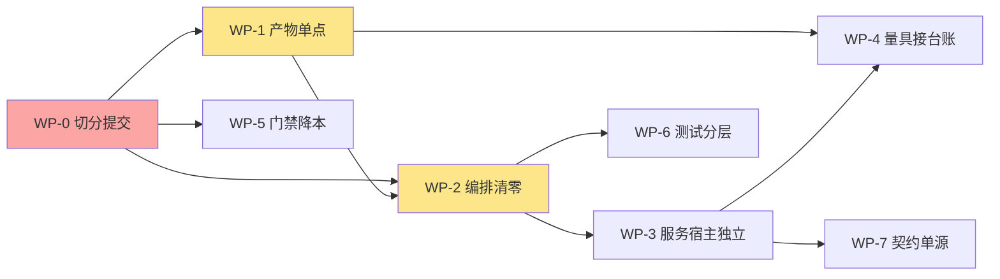

# 牵星 Qianxing · 架构与开发细节复核及优化重构方案（2026-10-19）

> **口径声明**
> 1. 本文以**当前工作树**为准，不是 `HEAD`。`HEAD` 停在 `30d8bf82`（2026-10-14 20:07），而工作树上有 795 个未提交变更（116 删除 / 347 修改 / 332 新增，459 个文件 +21,772/−51,633）。这本身就是本文的第一条结论（§3 N1）。
> 2. 所有 `文件:行` 引用均在本文落盘前用门禁同款正则逐条验证「文件在盘 + 行号不越界」。
> 3. 门禁实测：`python tools/check_architecture.py` → **1,203 项全绿，0 项失败，退出码 0**，本机耗时约 7 分钟。
> 4. 上一份方案是 `docs/牵星Qianxing-架构梳理遗留不合理项与优化重构方案-2026-10-14.md`。本文**不重抄**它：先核验它的 12 项结论，再写新增问题（§2 与 §3）。

---

## 0. 摘要：这一轮真正该做的八件事

| # | 结论 | 严重度 | 一句话 |
|---|---|---|---|
| 1 | **五天未提交的巨型重构** | 🔴 | 795 个变更堆在工作树，无法评审、无法 bisect、门禁读数不可复现；先切分提交，再谈任何重构 |
| 2 | **产物持久化仍在 CLI 与 qx-app 各一半** | 🔴 | `qx-app` 算完返回 outcome、由 `qx-cli` 落盘，而 `qx-app` 自己又有 2,481 行 `artifact_store`；两套原子发布实现并存 |
| 3 | **深度回测仍有两套编排** | 🔴 | `qx-cli/backtests/depth.rs`（533 行）与 `qx-app/cases/run_depth_backtest/`（1,112 行）各自 new 同一批引擎、各自落盘 |
| 4 | **服务生命周期与消息循环住在二进制 crate** | 🟠 | `api_service` / `console_serve` / `event_pipeline` / `worker_entry` / `strategy_host` / `venue_runtime` 合计约 8,975 行，占 `qx-cli` 的 41% |
| 5 | **量具建好了，台账没翻** | 🟠 | criterion 2,117 行 + CI `performance-trend` 腿都在，但该腿名为 "Non-blocking"，`targets.yaml` 仍 9/9 `unmeasured` |
| 6 | **门禁成本与地板同时失准** | 🟠 | 判据 1,203 / 脚本 23,416 行 / 单跑约 7 分钟；地板余量 143 条（13.5%），用例地板余量 530 条（29%） |
| 7 | **测试体量反超生产代码** | 🟠 | `qx-cli` 生产 22,061 行、测试 35,831 行；`target/debug/deps` 已 121 GB |
| 8 | **Python 侧仍是契约的第三份手写定义** | 🟡 | `app.py` 3,422 行 / 128 个方法逐字段 `to_dict()`；ashare 仍组 bundle manifest、ccxt 仍自带错误分类 |

**一句话判断**：10-14 提出的「把核心链收进应用层」已经完成了**大约七成**，但完成方式是「搬家搬到一半」——计算搬走了、落盘没搬，装配搬走了、服务宿主没搬。本轮的重点不是再画一张新蓝图，而是**把这次未提交的重构收尾并提交**，然后只做三件结构性的事：产物单点、编排清零、服务宿主独立。

---

## 1. 实测基线

### 1.1 代码体量

| 指标 | 读数 | 说明 |
|---|---|---|
| workspace 成员 | 28 | `Cargo.toml` 的 `members` |
| `crates/*/src` 合计 | 159,055 行 / 635 个 `.rs` | 不含 `tests/`、`benches/` |
| 最大三 crate | `qx-app` 22,892（116 文件）、`qx-xingban` 20,594（77）、`qx-cli` 22,061（89） | 应用层已与内核层同量级 |
| `qx-cli` 测试 | 35,831 行 / 155 文件 | `crates/qx-cli/tests/`，其中 `tests/unit/` 87 文件 21,726 行 |
| `qx-api` / `qx-storage` / `qx-runtime` | 9,546 / 11,118 / 9,571 | 三个「胖」基础设施 crate |
| 单文件最大 | `qx-api/src/lib.rs` 2,936；`qx-storage/src/sqlite.rs` 2,823；`qx-storage/src/lib.rs` 2,260 | 全部顶在 `maturity/line_budgets.yaml` 的棘轮上 |

`qx-cli` 生产面 89 个顶层模块**平铺**在一个目录下，另有 16 个子目录（`backtests/`、`venue_runtime/`、`report_html/` 等），`main.rs` 里 43 条 `pub(crate) use` 把模块再导出成 crate 级命名空间。

### 1.2 门禁与测试

| 指标 | 读数 | 对照 |
|---|---|---|
| 门禁判据 | **1,203**（`maturity/gate_snapshot.json:3`） | 10-14 为 1,096，5 天 +107（+9.8%） |
| 门禁脚本 | 23,416 行（`tools/check_architecture.py:1`） | 10-14 为 19,829 行，+3,587（+18%） |
| 门禁地板 | 1,060（`tools/check_architecture.py:531`） | 余量 143 条 = 13.5% 可整族消失而仍绿 |
| 全仓用例 | **1,834** 条（`#[test]` 计数，同门禁配方） | 地板 1,304（`tools/check_architecture.py:498`），余量 530 条 = 29% |
| 门禁耗时 | 约 7 分钟（本机，单跑） | 技能文档记载 30–95 秒，已背离一个数量级 |
| 性能量具 | `crates/qx-cli/benches/criterion_performance.rs` 2,117 行，29 个 benchmark group | 10-14 为「零 criterion」 |
| 产物棘轮 | `maturity/line_budgets.yaml` 60 条，**60 条全部顶格** | 棘轮冻结了债务，没有偿还债务 |

### 1.3 登记面

| 登记面 | 读数 | 含义 |
|---|---|---|
| `maturity/capabilities.yaml` | 29 个能力块，`sandbox_tested: true` **0** 个、`production_approved: true` **0** 个，`updated_at: "2026-10-19"` | 登记面在维护，但外部证据仍为零 |
| `maturity/levels.yaml` | L0 1 个、L1 10 个、L2 11 个 | 最高 L2，与 `sandbox_tested=0` 的自限口径一致 |
| `maturity/targets.yaml` | 9 个 profile **全部 `unmeasured`**（`maturity/targets.yaml:85` 起） | 量具已有，台账未接 |
| `maturity/http_surface.yaml` | 20 格 `covered` + 1 格 `by_design`，0 gap / 0 partial（`maturity/http_surface.yaml:130`） | 10-14 的「3 gap + 4 partial」已全部收口 |
| 文档 | `docs/*.md` 19 篇 + `docs/archive/` 17 篇 | `CHANGELOG.md` 已分片到 `docs/changelog/`（改进项） |

---

## 2. 10-14 方案核验：哪些真的关掉了

### 2.1 已收口（有代码与判据为证）

| 10-14 结论 | 现状 | 证据 |
|---|---|---|
| N2「生产与 83 个测试文件同 crate 混居」 | ✅ **测试整体迁出** | `crates/qx-cli/src/tests/` 已不存在；155 个测试文件 35,831 行在 `crates/qx-cli/tests/` |
| 「研究层空白，无 OOS / 走查 / 基准对照」 | ✅ **成真算数** | `qx_spec::SplitPlan` 与 `EXPERIMENT_BASELINES` 是单源（`crates/qx-spec/src/experiment.rs:14`、`:27`），`qx-app` 直接复用（`crates/qx-app/src/cases/experiment_split.rs:24`） |
| 「实验 spec 三处同源」 | ✅ **收敛到 qx-spec** | 同上；`qx-app` 只剩 `pub use ... as ExperimentSplitPlan` 别名 |
| 「HTTP 3 gap + 4 partial」 | ✅ **21/21 全覆盖** | `maturity/http_surface.yaml:130` |
| 「panic 边界未闭环（worker/serve 顶层零 catch_unwind）」 | ✅ **已闭环** | `crates/qx-cli/src/main.rs:330` 统一 `catch_unwind`；生产代码 `panic!` 计数为 0，`unwrap` 40 处、`expect` 26 处且集中在测试夹具与迁移脚本 |
| 「validate_core.py 是 CI 里的语义双生」 | ✅ **摘出 CI 并定性** | 判据把它钉成「设计参考且不进 CI」（`tools/check_architecture.py:17481`） |
| 「ashare 手抄 FNV 指纹」 | ✅ **改调 native** | `python/qianxing_ashare/__init__.py:553` 已改为 `native.fingerprint_bars(...)`；`SCALE=1e9` 的第三份拷贝已消失 |
| 「N1 双装配链」 | 🟢 **七成收口** | `qx-cli` 现在构造 `qx_app::BacktestSpec` 并调用例（`crates/qx-cli/src/backtests/single_strategy.rs:105`、`:164`、`:202`），不再自己撮合 |

### 2.2 部分收口

| 10-14 结论 | 现状 | 残留 |
|---|---|---|
| N3「撮合两条路径未收敛，L2 无队列位置模型」 | 🟡 **队列位置已落地** | `crates/qx-xingban/src/orderbook/matching.rs:6` 已按档位与队列位置撮合，bench 有 `l2_queue_position_depth_lookup` 与 `l2_queue_price_lookup_algorithm` 两组；但 `FillModel` trait 仍只覆盖 Bar 路径（`crates/qx-xingban/src/fill.rs:70`），OrderBook 路径不走它 |
| N4「性能证据链空白」 | 🟡 **量具有了，链路没通** | criterion 2,117 行；CI 有 `performance-trend` 腿（`.github/workflows/ci.yml:66`），但腿名就叫 "Non-blocking"，比较只 warn；`targets.yaml` 9/9 仍 `unmeasured` |
| N12「非 Rust 语言里的逻辑泄漏」 | 🟡 **指纹与定点已收，契约组装仍在** | ashare 仍自己拼 `DatasetBundleManifest`（`python/qianxing_ashare/__init__.py:530`）、仍自己合并公司行为（`:618`）；ccxt 仍自带错误分类（`python/qianxing_ccxt/__init__.py:52`）与定点解析（`:57`） |
| 「产物版本漂移」 | 🟡 **更远了** | 代码写 `BACKTEST_SUMMARY_SCHEMA_VERSION: u32 = 7`（`crates/qx-app/src/artifact_store/backtest_summary.rs:8`），`deploy/` 下 16 份 blessed 摘要**仍全部是 `schema_version: 1`** |

### 2.3 原样在册（甚至恶化）

| 10-14 结论 | 现状 |
|---|---|
| N5「门禁 4 天膨胀 16%，成新风险源」 | ❌ 5 天再 +107 条 / +3,587 行，单跑从秒级到分钟级 |
| 「16 份 blessed 产物停 v1、无守护」 | ❌ 版本差从 4 代拉到 6 代，仍无判据守护 |
| 「qx-cli 单 crate 熵增」 | 🟡 测试搬走了，但生产面仍是 89 个平铺模块 + 41% 的服务宿主逻辑 |

---

## 3. 当前架构不合理项（N1–N9）

### N1 🔴 五天未提交的巨型重构：正确性无法被评审，也无法被回退

**现象**：`HEAD` 是 2026-10-14 20:07 的 `30d8bf82`，今天是 10-19。工作树有 **795 个变更**：116 个删除、347 个修改、332 个新增；`git diff --stat` 为 459 个文件 +21,772/−51,633。其中 `crates/qx-cli/src` 删了 88 个文件又新增 57 个，`qx-app/src` 删 26 新增 34。

**为什么这是架构问题而不是流程问题**：
1. **门禁读数不可复现**。今天门禁 1,203 项全绿，但它绿的是「一堆没人评审过的中间态」。任何一条判据的锚点都可能被这堆变更顺手改过——判据与实现同轮变更时，判据会对着新形状自证。
2. **无法 bisect**。如果明天发现 `run_depth_backtest` 的 `result_hash` 变了，回退单位是「五天」，不是「一次提交」。
3. **评审不可能**。459 个文件的 diff 没有人类可读的边界；`crates/qx-cli/tests/` 的 155 个新文件与 `src` 的 88 个删除混在一起，看不出「哪一步是搬家、哪一步是改语义」。

**处置**：这是 WP-0，优先于一切重构。切分原则见 §5.2。

### N2 🔴 产物持久化仍在 CLI 与 qx-app 各一半

**现象**：`qx-app` 的用例**只算不落**。`run_backtest` 用例里没有任何 `persist_*` 调用；落盘发生在 CLI：

- `crates/qx-cli/src/backtests/single_strategy.rs:216`（manifest）、`:247`（摘要/权益/成交三件套）
- `crates/qx-cli/src/backtests/multi_builtin.rs:243`（逐腿产物）、`:303`（组合产物）
- 持久化助手住在 CLI：`crates/qx-cli/src/backtests/artifacts.rs:1`（165 行）、`crates/qx-cli/src/backtests/multi_artifacts.rs:1`（242 行）

同时 `qx-app` 又有自己的 `artifact_store`（11 文件 2,481 行，含 `backtest_summary`、`run_record`、`portable_run_evidence`、`multi_leg_attribution`）。

**后果**：同一次运行有两套「什么算产物、写到哪、怎么原子发布」的答案，而且**原子发布语义不一致**：

| 实现 | 发布方式 | 位置 |
|---|---|---|
| `artifact_store::backtest_summary` | 临时文件 + `rename`（覆盖） | `crates/qx-app/src/artifact_store/backtest_summary.rs:180` |
| `artifact_store::run_record` | 临时文件 + `rename`（覆盖） | `crates/qx-app/src/artifact_store/run_record.rs:172` |
| `cases::artifacts` | 临时文件 + `hard_link`（**不覆盖**并发写者） | `crates/qx-app/src/cases/artifacts.rs:194` |
| `portable_run_evidence` | 暂存目录 + `rename`（整目录） | `crates/qx-app/src/artifact_store/portable_run_evidence.rs:501` |
| CLI 报告面 | **直接 `std::fs::write`，无原子性** | `crates/qx-cli/src/report_html.rs:103`、`:107`；`crates/qx-cli/src/report_xlsx/openxml.rs:10`；`crates/qx-cli/src/report_multi_market_depth.rs:152` |
| `qx-app` 两个 validate 用例 | **直接 `std::fs::write`，无原子性** | `crates/qx-app/src/cases/validate_dataset_manifest.rs:334`；`crates/qx-app/src/cases/validate_depth_dataset_manifest.rs:124` |

`hard_link` 与 `rename` 的区别不是风格问题：前者在目标已存在时失败（保护并发写者），后者静默覆盖。同一个仓库里两种都有，意味着「并发跑两次同一 run_id」在不同产物上行为不同。

### N3 🔴 深度回测仍有两套编排

**现象**：`qx-cli` 的 `depth.rs` 直接 new 内核并自己落盘：

- `crates/qx-cli/src/backtests/depth.rs:218`（`TickBacktestEngine::new`）、`:231`（`OrderBookBacktestEngine::new`），文件 401 行 + `depth/quality.rs` 132 行
- `crates/qx-app/src/cases/run_depth_backtest/workflow.rs:234`（`TickBacktestEngine::new`）、`:286`（`OrderBookBacktestEngine::new`），目录合计 1,112 行

CLI 那份还挂着 `#[allow(dead_code)] // Kept as the no-quality adapter for unit-level legacy call sites.`（`crates/qx-cli/src/backtests/depth.rs:55`）——**一条为「单元级遗留调用点」保留的死路径**，正是 10-14 说过的「删面等于把缺口藏起来」的反面：这里是「留面等于让两套编排各自演化」。

**同类残留**（程度递减）：
- `multi_builtin.rs` 逐腿调 `app_adapter` 再自拼组合产物（`crates/qx-cli/src/backtests/multi_builtin.rs:243`），而 `qx-app` 有 `PortfolioBarEngine` 路径；
- `single_strategy.rs` 的持久化段（`:216`、`:247`）在 `qx-app` 没有对应实现，无法搬——因为 N2。

### N4 🟠 服务生命周期与消息循环住在二进制 crate

`qx-cli` 22,061 行里，**约 8,975 行（41%）是进程/服务宿主**，不是 CLI 适配：

| 模块 | 行数 | 职责 |
|---|---|---|
| `venue_runtime/`（18 文件） | 4,803 | Binance/CCXT/Paper 的订单生命周期与 worker |
| `strategy_contract.rs` | 688 | target→intent→order + **API 服务运行循环** |
| `event_pipeline.rs` | 619 | Outbox 中继、消费者、死信重放（21 处 `nats` cfg） |
| `spread.rs` | 502 | 价差组持久化与恢复 |
| `worker_entry.rs` | 486 | worker 分派与进程监督 |
| `runtime_wiring.rs` | 410 | 配置→组件图 |
| `strategy_host.rs` | 353 | 子进程策略宿主 |
| `api_service.rs` | 337 | HTTP 服务装配 |
| `scheduler.rs` | 331 | 调度 tick |
| `console_serve.rs` | 295 | 控制台服务 |
| `worker_runtime.rs` | 151 | worker 运行时壳 |

**问题不是「CLI 里有 main」，而是**：这些模块的正确性依赖 `qx-runtime` 的监督、`qx-storage` 的租约与幂等语义，却住在**不能被 `qx-app`、`qx-sdk`、`qx-python` 依赖**的叶子 crate 里。结果是任何非 CLI 入口（Python SDK、HTTP-only 部署）都拿不到同一套服务语义，只能各写一份薄版。

### N5 🟠 量具与台账脱钩：性能结论进不了成熟度

- 量具：`crates/qx-cli/benches/criterion_performance.rs:1`（2,117 行），29 组，含 `full_vs_incremental_replay`（`:883`）、`l2_queue_position_depth_lookup`（`:677`）、`scheduler_active_run_selection`（`:519`）。
- CI：`.github/workflows/ci.yml:66` 的 job 名是 `Non-blocking performance trend`；比较脚本 `benchmarks/compare_baseline.py` 只打印告警。
- 台账：`maturity/targets.yaml` 9 个 profile 全 `unmeasured`，`evidence: unavailable`（`:85`–`:142`）。

**后果**：10-14 说的「稳态 tick 严格线性」这类结论，今天**有量具可以复现**，但既不会阻断 CI，也不会翻动 `targets.yaml` 的任何一格。量具成了摆设：它只在有人手动跑时产生信息。

另有一处结构性错位：bench 挂在**二进制 crate**（`crates/qx-cli/benches/`）而不是被测内核 crate。`qx-core` 的 EventLog、`qx-xingban` 的撮合、`qx-storage` 的段式归档都没有自己的 bench target，想跑内核基准必须连 CLI 一起编。

### N6 🟠 门禁成本与地板同时失准

**成本**：1,203 条判据 / 23,416 行脚本 / 单跑约 7 分钟。判据在 5 天里涨了 9.8%，脚本涨了 18%——**脚本涨得比判据快**，说明每条判据的实现复杂度在上升（更多文件读取、更多正则、更多跨文件比对）。

**地板**：
- 判据地板 1,060 vs 实测 1,203：余量 143 条（13.5%）。整族判据消失仍可全绿。
- 用例地板 1,304 vs 实测 1,834：余量 530 条（29%）。**三成用例可以整族消失而门禁照绿**——这颗地板已经失去了它被立起来的意义。

**棘轮**：`maturity/line_budgets.yaml` 60 条全部顶格。棘轮只保证「不更差」，而 60 个 >500 行文件一个也没变小。冻结债务不是偿还债务。

### N7 🟠 测试体量反超生产代码，且没有分层

| 项 | 读数 |
|---|---|
| `qx-cli` 生产 | 22,061 行 |
| `qx-cli` 测试 | 35,831 行（1.62 倍） |
| 集成 target | 37 个顶层 `.rs` + 4 个模块目录（`tests/unit/` 用 `#[path]` 注入） |
| `tests/unit/` | 87 文件 21,726 行，并入 bin 测试二进制 |
| 构建缓存 | `target/debug/deps` **121 GB**，2,074 个 `.exe` |

**问题不是测试多，而是测试没有分层**：单元测试、契约测试、端到端测试、产物金样测试全在 `crates/qx-cli/tests/` 下，按「主题」分文件而不是按「测试类型」分层。后果：
1. 任何一次 `cargo test -p qx-cli` 都要链接 37 个 target；
2. 契约测试（本可放进 `contract-tests`）依赖 CLI 二进制；
3. 121 GB 缓存使「换机/换分支重跑」的成本高到没人愿意做。

### N8 🟡 平铺模块与空壳转发

- `qx-cli/src` 89 个顶层模块平铺，其中 `report_*.rs` **17 个**（3,906 行）、`run_evidence*.rs` **11 个**（3,474 行）。命名靠前缀分类，而不是目录。
- 4 个 <20 行的空壳/转发：`crates/qx-cli/src/multi_leg.rs`（6 行）、`crates/qx-cli/src/workers.rs`（15 行）、`crates/qx-cli/src/storage_adopt_args.rs`（10 行）、`crates/qx-cli/src/guide_args.rs`（15 行）。
- 名实不符：`strategy_contract.rs`（688 行）同时管「策略契约」与「API 服务生命周期」；`report_multi_market_depth.rs`（444 行）实为写手。
- `qx-app/src/lib.rs` 175 行里 18 组 `pub use`，导出面约百个符号——门面成了「把内部结构全倒出来」。

### N9 🟡 非 Rust 侧仍是契约的第三份手写定义

按「核心逻辑只住 Rust」的原则复查，**结论比 10-14 好，但没有清零**：

| 落点 | 性质 | 证据 |
|---|---|---|
| `python/qianxing/app.py` 3,422 行 / 128 个方法 | 20+ 个 spec dataclass 逐字段手写 `to_dict()`，是输入契约在 Rust struct 与 `schemas/*.json` 之外的**第三份定义** | `python/qianxing/app.py:181`（`DatasetSpec`）、`:244`（`BuiltinStrategySpec`） |
| ashare `build_dataset_bundle_manifest` | 在 Python 里组装 `DatasetBundleManifest`，Rust 侧只做校验 | `python/qianxing_ashare/__init__.py:530`；校验方 `crates/qx-app/src/dataset_bundle.rs:24` |
| ashare `reconcile_corporate_actions` | 多源公司行为合并 + 冲突检测只在 Python | `python/qianxing_ashare/__init__.py:618` |
| ccxt `classify_ccxt_error` / `_raw_decimal` | 第三套错误分类与定点解析 | `python/qianxing_ccxt/__init__.py:52`、`:57` |
| `tools/validate_core.py` 449 行 | 已摘出 CI、判据定性为「设计参考」，但**仍可执行、无人对拍**，自带 FNV（`tools/validate_core.py:92`） | `tools/check_architecture.py:17481` |

**判断**：前四项属于「门面里夹带语义」，可以下沉；第五项属于「已登记但会静默腐烂」——一份没人跑的第二语义，比删掉更危险，因为 `docs/archive/` 还在教人跑它。

---

## 4. 开发细节改进项（D1–D22）

| # | 项 | 现状 | 建议 |
|---|---|---|---|
| D1 | `HEAD` 五天不动 | 795 个未提交变更 | 见 WP-0：按「搬家 / 语义变更 / 判据」三类切分提交 |
| D2 | `deploy/` blessed 摘要版本 | 16 份全 `schema_version: 1`，代码 v7 | 重生一份 v7 金样 + 一条判据钉「金样版本 ≡ 代码常量」 |
| D3 | 原子写实现 | 5 处（4 套语义） | 收成 `qx_core::atomic_write`（或 `artifact_store::publish`）一处 |
| D4 | CLI 报告面直接 `fs::write` | 4 处无原子性 | 走 D3 的单点；`report --html` 半写失败会留半份文件 |
| D5 | `#[allow(dead_code)]` | 1 处（`depth.rs:55`） | 随 WP-2 删除；仓库口径是「保留 + 登记 + 钉住」，这条既没登记也没钉住 |
| D6 | `main.rs` 43 条 `pub(crate) use` | 全 crate 共享命名空间 | 按目录分 `mod` 边界，只导出 `Command` 入口需要的符号 |
| D7 | 4 个 <20 行空壳 | `multi_leg` / `workers` / `storage_adopt_args` / `guide_args` | 合并回父模块；`workers.rs` 15 行只做 re-export，直接删 |
| D8 | `event_pipeline.rs` 21 处 `nats` cfg | 一个文件里三种后端分支 | 按后端拆 `event_pipeline/{file,sqlite,postgres,nats}.rs`，与 `qx-storage` 的 trait 对齐 |
| D9 | `strategy_contract.rs` 名实不符 | 688 行含 API 服务生命周期 | 拆 `strategy_contract`（契约）+ `api_runtime`（循环），后者随 WP-3 迁出 |
| D10 | `report_*.rs` 17 个平铺 | 3,906 行 | 收成 `report/{html,svg,xlsx,comparison,benchmark,ashare}.rs` |
| D11 | `run_evidence*.rs` 11 个平铺 | 3,474 行 | 收成 `run_evidence/{verify,recompute,export,multi_market}.rs` |
| D12 | `qx-app` 导出面 | 18 组 `pub use`，约百符号 | 分层导出：`qx_app::{cases, spec, artifact_store, error}` 四个入口 |
| D13 | `qx-app` 用例目录 | 7 组「同名 `.rs` + 目录」 | 这是正常 Rust 布局，**不用改**；要改的是 `workflow.rs`（627 行）把引擎、风控、落盘混在一起 |
| D14 | `crates/qx-storage` 后端镜像 | `sqlite.rs` 2,823 + `postgres.rs` 1,936 + `lib.rs` 2,260，25 处 `impl` 块 | 把「事务包装 / outbox relay / schema 迁移」提到共享层，后端只留 SQL 差异 |
| D15 | `qx-api/src/lib.rs` 2,936 行 | 路由 + 装配 + 读模型 | `ws/` 已拆出；继续拆 `routes/`、`state/`、`projection/` |
| D16 | Python `to_dict()` 手写 | `app.py` 20+ 个 dataclass | 由 `schemas/*.json` 生成，或至少加一条「字段集 ≡ schema」的判据 |
| D17 | `validate_core.py` | 449 行可执行、无人跑 | 二选一：改成对拍夹具（跑 Rust 同输入比输出），或改成 `docs/` 下的伪代码并删掉可执行入口 |
| D18 | `docs/archive/` 指路 | 仍写「跑 `python tools/validate_core.py`」 | archive 加「已失效」横幅，或改指向现行入口 |
| D19 | `python/build/` 陈旧副本 | 1,920 行 vs 源 1,814 行 | 已 gitignore、未跟踪；建议清理，避免全仓 grep 命中旧语义 |
| D20 | 生产 `unwrap`/`expect` | 40 / 26，集中在 `backtest/test_cases` 与 `postgres/schema_migrations` | 可接受；给 `schema_migrations` 的 14 处 `expect` 加一条「启动期 fail-closed」说明 |
| D21 | `line_budgets` 60 条全顶格 | 棘轮冻结 | 每轮选 2 个顶格文件做净负拆分，棘轮才会真正下降 |
| D22 | `docs/` 19 篇活文档 | 多份方案并存（10-06 / 10-10 / 10-14 / 本文） | 保留「最新一份 + 索引」，其余进 `archive/`；避免读者按旧方案施工 |

---

## 5. 重构方案（WP-0–WP-7）

> 排序原则：**先让工作树可评审 → 再让产物单点 → 再清编排 → 再搬服务宿主 → 最后才是量具与门禁降本**。每个 WP 给退出门，不给工时承诺（本仓纪律：交付顺序与验收门，不是工时表）。

### 5.1 依赖与排序

### 5.2 WP-0 · 把五天的工作切分提交（最高优先）

**目标**：让「当前代码」成为一个可评审、可 bisect、门禁可复现的提交序列。

**动作**：
1. 先跑一次 `cargo fmt --all -- --check`，把格式漂移单独成一个提交（否则后续每个提交都夹带 fmt 噪声）。
2. 按**性质**切三组，每组一个提交：
   - **纯搬家**：`qx-cli/src/tests/` → `qx-cli/tests/`、`qx-adapter/src/{binance,ccxt}/`、`qx-api/src/ws/`、`qx-app/src/artifact_store/`。判定标准：`git diff -M` 能识别为 rename、且门禁条数不变。
   - **语义变更**：队列位置模型、多市场深度、风控预留、run handle 原子状态。每组一个提交，提交信息写清「哪条判据随之改口」。
   - **判据变更**：`tools/check_architecture.py` 的 +107 条与 `maturity/*.yaml` 的登记。**必须单独提交**——判据与实现同轮提交，是「判据对着新形状自证」的温床。
3. 每个提交后跑：`python tools/check_architecture.py`（全绿）、`cargo fmt --all -- --check`、`cargo test -p qx-cli --offline --no-fail-fast`。
4. 清理未跟踪垃圾：`.codex-tmp-build/`、`crates/qx-app/.task-tmp/`（`.audit/` 已在 `.gitignore`）。

**退出门**：`git log --oneline` 从 10-14 到 10-19 有 8–15 个语义清晰的提交；`git diff HEAD` 为空；门禁仍 1,203 项全绿且**条数与切分前逐值相等**。

**风险**：切分时容易把「搬家 + 改语义」混在一处（例如 `depth.rs` 既缩行又改调用）。做法是先 `git stash` 出全量，再按文件粒度 `git checkout -p` 重建；不要试图在脏树上直接 `git add -p` 猜边界。

### 5.3 WP-1 · 产物单点（ArtifactSink）

**目标**：全仓只有一个「产物怎么落盘」的答案。

**动作**：
1. 在 `qx-app` 定义 `ArtifactSink`：`publish(path, bytes)`、`publish_dir(path, entries)`，内部实现「临时文件 + `sync_all` + 发布」；发布语义**二选一**并写进文档：
   - 覆盖式（`rename`）：适合报告类、可重生成产物；
   - 独占式（`hard_link`）：适合 run 产物，冲突即报错。
2. 把 5 处实现收编：`artifact_store/backtest_summary.rs:180`、`artifact_store/run_record.rs:172`、`cases/artifacts.rs:194`、`artifact_store/portable_run_evidence.rs:501`、`run_evidence_experiment_recompute/portable_bundle.rs`。
3. 把 6 处裸 `fs::write`（CLI 4 处：`report_html.rs:103`、`:107`、`report_xlsx/openxml.rs:10`、`report_multi_market_depth.rs:152`；qx-app 2 处：`cases/validate_dataset_manifest.rs:334`、`cases/validate_depth_dataset_manifest.rs:124`）改为走 sink。
4. 把 `backtests/artifacts.rs`（165 行）与 `multi_artifacts.rs`（242 行）**整体迁入** `qx-app/src/artifact_store/`，让用例自己落盘、CLI 只打印路径。
5. blessed 金样：重生 16 份为 v7，加判据「`deploy/**/*.summary.json` 的 `schema_version` ≡ `BACKTEST_SUMMARY_SCHEMA_VERSION`」。

**退出门**：全仓 `std::fs::write` / `File::create` 在产物路径上**只剩 sink 一处**（判据钉住）；`deploy/` 金样版本与代码常量相等；`single_strategy.rs` 降到 <150 行。

**门禁注意**：`maturity/line_budgets.yaml` 已把 `portable_run_evidence.rs` 等 60 个文件钉在顶格（`crates/qx-app/src/artifact_store/portable_run_evidence.rs:1`），新增 sink 请开新文件，不要往顶格文件加行。

### 5.4 WP-2 · 编排清零：CLI 只剩参数映射

**目标**：`crates/qx-cli/src/backtests/`（26 文件 3,875 行）降到 <1,200 行，且不再 new 任何撮合引擎。

**动作**：
1. 删 `depth.rs` 的 `#[allow(dead_code)]` 路径（`crates/qx-cli/src/backtests/depth.rs:55`），把 `backtest book` 的入口改为调用 `qx_app::cases::run_depth_backtest`；`depth/quality.rs` 的质量档参数作为 case 入参传入。
2. `multi_builtin.rs` 的组合产物拼装（`:243`、`:303`）迁进 `qx-app` 的 multi-leg case，CLI 只传 `MultiCompositionSpec`。
3. `single_strategy.rs` 在 WP-1 之后只剩「构造 spec + 调用 + 打印路径」，目标 <150 行。
4. 给 `backtests/` 加一条结构判据：**该目录下不得出现 `::new(` 形式的引擎构造**（`qx_xingban::*Engine::new`）。

**退出门**：`crates/qx-cli/src/backtests/` 无引擎构造；`qx-app` 的 27 个 `run_*` 用例（`cases/` 下 43 个条目）全部「自己算、自己落、自己返回路径」；三入口（CLI / HTTP / Python）跑同一用例得到同一 `result_hash`。

**风险**：`depth.rs` 的 quality 档与 `qx-app` 的 workflow 参数不完全同构（CLI 侧有 `reject_ashare_rules_config` 这类前置拒绝）。迁移时把这些拒绝**下移到 case 入参校验**，不要留在 CLI——否则三入口的拒绝面又分叉。

### 5.5 WP-3 · 服务宿主独立（qx-service）

**目标**：让「进程怎么活」与「命令怎么解析」分开。

**动作**：
1. 新建 `crates/qx-service`（或 `qx-runtime::host`），收编：`api_service`、`console_serve`、`event_pipeline`、`worker_entry`、`worker_runtime`、`strategy_host`、`strategy_contract` 的循环部分、`venue_runtime`。
2. 依赖方向：`qx-cli → qx-service → qx-app → domain`。`qx-service` 不得依赖 `qx-cli`（`layer_dependency_check` 加禁止边）。
3. 服务入口以「角色」暴露：`host::serve_api(config)`、`host::run_worker(role, config)`、`host::run_relay(config)`，CLI 只做 `clap` → 角色映射。
4. `qx-python` 与未来的 `qx-daemon` 复用同一 `host`，不再各写薄版。

**退出门**：`qx-cli/src` 降到 <10,000 行；`api_service` / `console_serve` / `event_pipeline` / `worker_entry` 在 `qx-cli` 中只剩 `use`；`qx-service` 有独立用例覆盖「角色 → 组件图」的每种组合。

**风险**：`event_pipeline.rs` 的 21 处 `nats` cfg 会在搬家时变成「特性矩阵爆炸」。做法是先按 D8 拆文件，再搬目录；`ci_feature_matrix_check` 会盯着每颗特性是否仍被点亮。

### 5.6 WP-4 · 量具接台账

**目标**：让性能结论能翻动 `targets.yaml`。

**动作**：
1. bench 归位：把 `criterion_performance.rs` 按被测 crate 拆到 `qx-core/benches/`、`qx-xingban/benches/`、`qx-storage/benches/`、`qx-scheduler/benches/`；CLI 只保留端到端 bench。
2. CI：`performance-trend` 从 "Non-blocking" 改成**阻断式**，但只对**已登记基线**的组阻断（首次采样仍只记录）。阈值写进 `maturity/targets.yaml`，不写在 YAML 之外。
3. 台账：把已有实测的 3 个 profile（`ashare-research`、`crypto-paper`、`multi-venue-arb`）先翻 `measured`，`evidence` 指向 CI artifact 路径；其余保持 `unmeasured`。
4. 加一条判据：`measurement_status: measured` 的条目，其 `evidence` 必须出现在最近一次 CI artifact 清单里（离线时降级为「路径存在」）。

**退出门**：至少 3 个 profile 的 `measurement_status` 为 `measured` 且 `evidence` 真实可点；CI 对回归 >10% 的已登记组**红**；`targets.yaml` 的 `updated_at` 与最近一次 bench 运行同日。

### 5.7 WP-5 · 门禁降本（不降强度）

**目标**：单跑从 7 分钟回到 1 分钟量级，同时地板重新咬合。

**动作**：
1. **分片**：`check_architecture.py --shard <k>/<n>`，CI 并行 4 片；本地默认全量。
2. **增量**：`--changed-only` 按 `git diff --name-only` 只跑受影响的判据族（判据注册时声明它读哪些路径前缀）。
3. **地板重测**：`GATE_CHECK_FLOOR` 1,060 → 1,203、`WORKSPACE_TEST_FLOOR` 1,304 → 1,834（同轮改注释里的旧→新说明）。
4. **判据分层**：把 1,203 条按「契约/正确性」与「卫生/命名」分两级，后者允许在 `--fast` 模式跳过；`--fast` 用于提交前，全量用于 CI。
5. **反自证**：新增判据必须附一次变异验证记录（哪条变异让它红），写进 `maturity/capabilities.yaml` 对应条目。

**退出门**：本地 `--fast` < 60 秒；CI 全量 4 片并行 < 3 分钟；两颗地板与实测差 < 5%；`gate_snapshot.json` 与实测条数逐值相等。

**风险**：分片最容易出的错是「某条判据依赖另一条判据的副作用」。本仓判据基本是纯读，但要先扫一遍有无写盘/写全局状态的判据（例如 `--snapshot` 路径），把它们钉在 0 号片。

### 5.8 WP-6 · 测试分层

**目标**：让 1,834 条用例各归其位，`cargo test -p qx-cli` 不再是唯一入口。

**动作**：
1. 三层：
   - **单元**：留在各 crate 的 `src/**/tests` 或 `#[cfg(test)]`；
   - **契约**：进 `crates/contract-tests/`（它已经是纯测试 crate）；
   - **端到端**：留在 `crates/qx-cli/tests/`，但按「命令族」合并 target（`backtest_*` 合成一个、`api_*` 合成一个），从 37 个降到 10 个以内。
2. `tests/unit/` 的 87 文件 21,726 行按被测模块拆回各 crate（它们大多是 crate 级单元测试，只因历史原因住在 CLI）。
3. 清理构建缓存：`target/debug/deps` 121 GB → 建议 CI 与本地都用 `CARGO_TARGET_DIR` 隔离 + 定期 `cargo clean -p`。

**退出门**：集成 target ≤10；`cargo test -p qx-cli` 的链接时间下降一个量级；用例总数不低于 1,834（地板同步上调）。

### 5.9 WP-7 · 契约单源

**目标**：把 N9 的五处「门面夹带语义」清掉。

**动作**：
1. `python/qianxing/app.py` 的 `to_dict()` 改为由 `schemas/*.json` 生成（或加判据：字段集 ≡ schema 的 `required` + `properties`）。
2. ashare 的 `build_dataset_bundle_manifest`（`:530`）下沉：Python 只传组件与已校验 manifest，Rust 侧 `qx_app::dataset_bundle` 负责组装与校验。
3. ashare 的 `reconcile_corporate_actions`（`:618`）下沉到 `qx-data`（或 `qx-xingban::ashare`），Python 只做 IO。
4. ccxt 的 `classify_ccxt_error`（`:52`）与 `_raw_decimal`（`:57`）改为调用 `qx-python` 暴露的分类/定点函数。
5. `validate_core.py` 二选一（D17）：改对拍夹具，或删可执行入口并在 `docs/archive/` 加失效横幅。

**退出门**：Python 侧不再出现「同一语义的第二份实现」（判据按函数名钉住）；`validate_core.py` 要么进 CI 做对拍，要么不可执行。

---

## 6. 门禁与验收纪律（本轮必须遵守）

1. **行数棘轮只降不升**。60 个顶格文件里，`crates/qx-cli/src/cli.rs`（674）、`cli_args.rs`（507）、`crates/qx-api/src/lib.rs`（2,936）加任何一行都会红。拆文件时先 `cargo fmt` 再看行数——CJK 按显示宽度 2 计，fmt 会把长中文注释折行。
2. **判据与实现不同轮提交**。新增/改口判据必须单独一个提交，并在 `maturity/capabilities.yaml` 对应条目末尾写 `**修正（日期）：…**`。
3. **变异验证**。新增牙齿必须做「新增违规 → 红」「改回违规前形态 → 红」「登记表过期 → 红」「合法形态 → 绿」四向验证；只调那一颗 `check()`，不要跑全量（7 分钟会撞前台超时，SIGTERM 不触发 `finally`，变异态会留在盘上）。
4. **文档引用**。本文进 `docs/` 后会被 `doc_citation_reachability_check` 逐条核对；后续若被引文件行号变动，需同步更新本文。
5. **不为了降条数删判据**。门禁的问题是成本与耦合，不是强度。
6. **不让核心语义在非 Rust 语言里长住**。差分对拍只能是「同输入同输出」的夹具，不能是无人比对的平行实现。
7. **不用「门禁全绿」替代「产物可复算」**。每个 WP 的退出门都必须包含一次真实的端到端运行（CLI / HTTP / Python 三入口同 `result_hash`）。

---

## 7. 非目标（本轮明确不做）

1. **不新增业务能力**（不做期权链、不做做市、不做实盘）。
2. **不改对外契约**（`schemas/*` 只做版本内字段对齐，不做不兼容变更）。
3. **不追求「零 `unwrap`」**。生产面 40 处 `unwrap` / 26 处 `expect` 集中在测试夹具与迁移脚本，清零的收益低于改错的风险。
4. **不把 `qx-cli` 拆成多个二进制**。当前唯一 binary 是刻意的（单 exe + 运行期零依赖），WP-3 只搬库层，不动打包形态。
5. **不为了跑分优化内核**。先让量具可信（WP-4），再谈优化；现在优化等于对着不可信的数做决策。

---

## 8. 附录：实测读数与复算命令

| 读数 | 值 | 复算 |
|---|---|---|
| workspace 成员 | 28 | `sed -n '/^members/,/^\]/p' Cargo.toml` |
| `src` 合计行数 | 159,055 | `find crates -path '*/src/*' -name '*.rs' -exec cat {} + \| wc -l` |
| `qx-cli` 生产 / 测试 | 22,061 / 35,831 | `find crates/qx-cli/src -name '*.rs' -exec cat {} + \| wc -l`；`find crates/qx-cli/tests -name '*.rs' -exec cat {} + \| wc -l` |
| 门禁判据 | 1,203 | `python tools/check_architecture.py \| tail -1` |
| 门禁地板 | 1,060 | `grep -n GATE_CHECK_FLOOR tools/check_architecture.py` |
| 用例数 / 地板 | 1,834 / 1,304 | 同门禁配方 `^[ \t]*#\[test\]$` |
| criterion bench | 2,117 行 / 29 组 | `wc -l crates/qx-cli/benches/criterion_performance.rs` |
| blessed 摘要 | 16 份，全 v1 | `find deploy -name '*.summary.json' -exec grep -h schema_version {} \; \| sort \| uniq -c` |
| 未提交变更 | 795（116 D / 347 M / 332 ??） | `git status --porcelain \| cut -c1-2 \| sort \| uniq -c` |
| 构建缓存 | 121 GB | `du -sh target/debug/deps` |
| 生产 panic 面 | unwrap 40 / expect 26 / `panic!` 0 | 剥 `#[cfg(test)]` 后按 `.unwrap()` 计数 |

**与 10-14 方案的关系**：那份方案的 WP-0…WP-7 里，WP-0（量具）、WP-1（堵漏）、WP-2（核心链搬家）、WP-6（语言边界）、WP-7（契约单源）已部分落地；本文的 WP-0…WP-7 是**在其落地形态上继续**，不是重排。两文的 WP 编号**不通用**，引用时请带日期。
