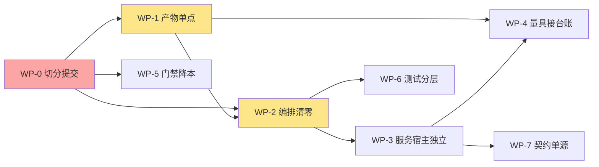

# 牵星 Qianxing · 架构与开发细节复核及优化重构方案（2026-10-19）

> **口径声明**
> 1. 本文以**当前工作树**为准，不是 `HEAD`。`HEAD` 停在 `30d8bf82`（2026-10-14 20:07），而工作树上有 795 个未提交变更（116 删除 / 347 修改 / 332 新增，459 个文件 +21,772/−51,633）。这本身就是本文的第一条结论（§3 N1）。
> 2. 所有 `文件:行` 引用均在本文落盘前用门禁同款正则逐条验证「文件在盘 + 行号不越界」。
> 3. 门禁实测：`python tools/check_architecture.py` → **1,203 项全绿，0 项失败，退出码 0**，本机耗时约 7 分钟。
> 4. 上一份方案是 `docs/牵星Qianxing-架构梳理遗留不合理项与优化重构方案-2026-10-14.md`。本文**不重抄**它：先核验它的 12 项结论，再写新增问题（§2 与 §3）。

---

## 0. 摘要：这一轮真正该做的八件事

| # | 结论 | 严重度 | 一句话 |
|---|---|---|---|
| 1 | **五天未提交的巨型重构** | 🔴 | 795 个变更堆在工作树，无法评审、无法 bisect、门禁读数不可复现；先切分提交，再谈任何重构 |
| 2 | **产物持久化仍在 CLI 与 qx-app 各一半** | 🔴 | `qx-app` 算完返回 outcome、由 `qx-cli` 落盘，而 `qx-app` 自己又有 2,481 行 `artifact_store`；两套原子发布实现并存 |
| 3 | **深度回测仍有两套编排** | 🔴 | `qx-cli/backtests/depth.rs`（533 行）与 `qx-app/cases/run_depth_backtest/`（1,112 行）各自 new 同一批引擎、各自落盘 |
| 4 | **服务生命周期与消息循环住在二进制 crate** | 🟠 | `api_service` / `console_serve` / `event_pipeline` / `worker_entry` / `strategy_host` / `venue_runtime` 合计约 8,975 行，占 `qx-cli` 的 41% |
| 5 | **量具建好了，台账没翻** | 🟠 | criterion 2,117 行 + CI `performance-trend` 腿都在，但该腿名为 "Non-blocking"，`targets.yaml` 仍 9/9 `unmeasured` |
| 6 | **门禁成本与地板同时失准** | 🟠 | 判据 1,203 / 脚本 23,416 行 / 单跑约 7 分钟；地板余量 143 条（13.5%），用例地板余量 530 条（29%） |
| 7 | **测试体量反超生产代码** | 🟠 | `qx-cli` 生产 22,061 行、测试 35,831 行；`target/debug/deps` 已 121 GB |
| 8 | **Python 侧仍是契约的第三份手写定义** | 🟡 | `app.py` 3,422 行 / 128 个方法逐字段 `to_dict()`；ashare 仍组 bundle manifest、ccxt 仍自带错误分类 |

**一句话判断**：10-14 提出的「把核心链收进应用层」已经完成了**大约七成**，但完成方式是「搬家搬到一半」——计算搬走了、落盘没搬，装配搬走了、服务宿主没搬。本轮的重点不是再画一张新蓝图，而是**把这次未提交的重构收尾并提交**，然后只做三件结构性的事：产物单点、编排清零、服务宿主独立。

---

## 1. 实测基线

### 1.1 代码体量

| 指标 | 读数 | 说明 |
|---|---|---|
| workspace 成员 | 28 | `Cargo.toml` 的 `members` |
| `crates/*/src` 合计 | 159,055 行 / 635 个 `.rs` | 不含 `tests/`、`benches/` |
| 最大三 crate | `qx-app` 22,892（116 文件）、`qx-xingban` 20,594（77）、`qx-cli` 22,061（89） | 应用层已与内核层同量级 |
| `qx-cli` 测试 | 35,831 行 / 155 文件 | `crates/qx-cli/tests/`，其中 `tests/unit/` 87 文件 21,726 行 |
| `qx-api` / `qx-storage` / `qx-runtime` | 9,546 / 11,118 / 9,571 | 三个「胖」基础设施 crate |
| 单文件最大 | `qx-api/src/lib.rs` 2,936；`qx-storage/src/sqlite.rs` 2,823；`qx-storage/src/lib.rs` 2,260 | 全部顶在 `maturity/line_budgets.yaml` 的棘轮上 |

`qx-cli` 生产面 89 个顶层模块**平铺**在一个目录下，另有 16 个子目录（`backtests/`、`venue_runtime/`、`report_html/` 等），`main.rs` 里 43 条 `pub(crate) use` 把模块再导出成 crate 级命名空间。

### 1.2 门禁与测试

| 指标 | 读数 | 对照 |
|---|---|---|
| 门禁判据 | **1,203**（2026-10-19 记录值，仅作历史背景） | 10-14 为 1,096，5 天 +107（+9.8%） |
| 门禁脚本 | 23,416 行（`tools/check_architecture.py:1`） | 10-14 为 19,829 行，+3,587（+18%） |
| 门禁地板 | 1,060（`tools/check_architecture.py:531`） | 余量 143 条 = 13.5% 可整族消失而仍绿 |
| 全仓用例 | **1,834** 条（`#[test]` 计数，同门禁配方） | 地板 1,304（`tools/check_architecture.py:498`），余量 530 条 = 29% |
| 门禁耗时 | 约 7 分钟（本机，单跑） | 技能文档记载 30–95 秒，已背离一个数量级 |
| 性能量具 | `crates/qx-cli/benches/criterion_performance.rs` 2,117 行，29 个 benchmark group | 10-14 为「零 criterion」 |
| 产物棘轮 | `maturity/line_budgets.yaml` 60 条，**60 条全部顶格** | 棘轮冻结了债务，没有偿还债务 |

### 1.3 登记面

| 登记面 | 读数 | 含义 |
|---|---|---|
| `maturity/capabilities.yaml` | 29 个能力块，`sandbox_tested: true` **0** 个、`production_approved: true` **0** 个，`updated_at: "2026-10-19"` | 登记面在维护，但外部证据仍为零 |
| `maturity/levels.yaml` | L0 1 个、L1 10 个、L2 11 个 | 最高 L2，与 `sandbox_tested=0` 的自限口径一致 |
| `maturity/targets.yaml` | 9 个 profile **全部 `unmeasured`**（`maturity/targets.yaml:85` 起） | 量具已有，台账未接 |
| `maturity/http_surface.yaml` | 20 格 `covered` + 1 格 `by_design`，0 gap / 0 partial（`maturity/http_surface.yaml:130`） | 10-14 的「3 gap + 4 partial」已全部收口 |
| 文档 | `docs/*.md` 19 篇 + `docs/archive/` 17 篇 | `CHANGELOG.md` 已分片到 `docs/changelog/`（改进项） |

---

## 2. 10-14 方案核验：哪些真的关掉了

### 2.1 已收口（有代码与判据为证）

| 10-14 结论 | 现状 | 证据 |
|---|---|---|
| N2「生产与 83 个测试文件同 crate 混居」 | ✅ **测试整体迁出** | `crates/qx-cli/src/tests/` 已不存在；155 个测试文件 35,831 行在 `crates/qx-cli/tests/` |
| 「研究层空白，无 OOS / 走查 / 基准对照」 | ✅ **成真算数** | `qx_spec::SplitPlan` 与 `EXPERIMENT_BASELINES` 是单源（`crates/qx-spec/src/experiment.rs:14`、`:27`），`qx-app` 直接复用（`crates/qx-app/src/cases/experiment_split.rs:24`） |
| 「实验 spec 三处同源」 | ✅ **收敛到 qx-spec** | 同上；`qx-app` 只剩 `pub use ... as ExperimentSplitPlan` 别名 |
| 「HTTP 3 gap + 4 partial」 | ✅ **21/21 全覆盖** | `maturity/http_surface.yaml:130` |
| 「panic 边界未闭环（worker/serve 顶层零 catch_unwind）」 | ✅ **已闭环** | `crates/qx-cli/src/main.rs:330` 统一 `catch_unwind`；生产代码 `panic!` 计数为 0，`unwrap` 40 处、`expect` 26 处且集中在测试夹具与迁移脚本 |
| 「validate_core.py 是 CI 里的语义双生」 | ✅ **摘出 CI 并定性** | 判据把它钉成「设计参考且不进 CI」（`tools/check_architecture.py:17481`） |
| 「ashare 手抄 FNV 指纹」 | ✅ **改调 native** | `python/qianxing_ashare/__init__.py:553` 已改为 `native.fingerprint_bars(...)`；`SCALE=1e9` 的第三份拷贝已消失 |
| 「N1 双装配链」 | 🟢 **七成收口** | `qx-cli` 现在构造 `qx_app::BacktestSpec` 并调用例（`crates/qx-cli/src/backtests/single_strategy.rs:105`、`:164`、`:202`），不再自己撮合 |

### 2.2 部分收口

| 10-14 结论 | 现状 | 残留 |
|---|---|---|
| N3「撮合两条路径未收敛，L2 无队列位置模型」 | 🟡 **队列位置已落地** | `crates/qx-xingban/src/orderbook/matching.rs:6` 已按档位与队列位置撮合，bench 有 `l2_queue_position_depth_lookup` 与 `l2_queue_price_lookup_algorithm` 两组；但 `FillModel` trait 仍只覆盖 Bar 路径（`crates/qx-xingban/src/fill.rs:70`），OrderBook 路径不走它 |
| N4「性能证据链空白」 | 🟡 **量具有了，链路没通** | criterion 2,117 行；CI 有 `performance-trend` 腿（`.github/workflows/ci.yml:66`），但腿名就叫 "Non-blocking"，比较只 warn；`targets.yaml` 9/9 仍 `unmeasured` |
| N12「非 Rust 语言里的逻辑泄漏」 | 🟡 **指纹与定点已收，契约组装仍在** | ashare 仍自己拼 `DatasetBundleManifest`（`python/qianxing_ashare/__init__.py:530`）、仍自己合并公司行为（`:618`）；ccxt 仍自带错误分类（`python/qianxing_ccxt/__init__.py:52`）与定点解析（`:57`） |
| 「产物版本漂移」 | 🟡 **更远了** | 代码写 `BACKTEST_SUMMARY_SCHEMA_VERSION: u32 = 7`（`crates/qx-app/src/artifact_store/backtest_summary.rs:8`），`deploy/` 下 16 份 blessed 摘要**仍全部是 `schema_version: 1`** |

### 2.3 原样在册（甚至恶化）

| 10-14 结论 | 现状 |
|---|---|
| N5「门禁 4 天膨胀 16%，成新风险源」 | ❌ 5 天再 +107 条 / +3,587 行，单跑从秒级到分钟级 |
| 「16 份 blessed 产物停 v1、无守护」 | ❌ 版本差从 4 代拉到 6 代，仍无判据守护 |
| 「qx-cli 单 crate 熵增」 | 🟡 测试搬走了，但生产面仍是 89 个平铺模块 + 41% 的服务宿主逻辑 |

---

## 3. 当前架构不合理项（N1–N9）

### N1 🔴 五天未提交的巨型重构：正确性无法被评审，也无法被回退

**现象**：`HEAD` 是 2026-10-14 20:07 的 `30d8bf82`，今天是 10-19。工作树有 **795 个变更**：116 个删除、347 个修改、332 个新增；`git diff --stat` 为 459 个文件 +21,772/−51,633。其中 `crates/qx-cli/src` 删了 88 个文件又新增 57 个，`qx-app/src` 删 26 新增 34。

**为什么这是架构问题而不是流程问题**：
1. **门禁读数不可复现**。今天门禁 1,203 项全绿，但它绿的是「一堆没人评审过的中间态」。任何一条判据的锚点都可能被这堆变更顺手改过——判据与实现同轮变更时，判据会对着新形状自证。
2. **无法 bisect**。如果明天发现 `run_depth_backtest` 的 `result_hash` 变了，回退单位是「五天」，不是「一次提交」。
3. **评审不可能**。459 个文件的 diff 没有人类可读的边界；`crates/qx-cli/tests/` 的 155 个新文件与 `src` 的 88 个删除混在一起，看不出「哪一步是搬家、哪一步是改语义」。

**处置**：这是 WP-0，优先于一切重构。切分原则见 §5.2。

### N2 🔴 产物持久化仍在 CLI 与 qx-app 各一半

**初始审计现象（已由 WP-1/WP-2 收敛）**：当时 `qx-app` 的用例**只算不落**。`run_backtest` 用例里没有任何 `persist_*` 调用；产物落盘发生在 CLI：

- 当前 CLI 仅打印 `crates/qx-cli/src/backtests/single_strategy.rs:178` 返回的应用层产物路径
- `crates/qx-cli/src/backtests/multi_builtin.rs:243`（逐腿产物）、`:303`（组合产物）
- 初始审计时持久化助手住在 CLI；WP-2 后已删除该转接，当前单策略产物发布由 `crates/qx-cli/src/backtests/single_strategy.rs:178` 调用应用层工作流，多腿产物编排由 `crates/qx-app/src/artifact_store/multi_builtin_artifacts.rs:1` 持有

同时 `qx-app` 又有自己的 `artifact_store`（11 文件 2,481 行，含 `backtest_summary`、`run_record`、`portable_run_evidence`、`multi_leg_attribution`）。

**后果**：同一次运行有两套「什么算产物、写到哪、怎么原子发布」的答案，而且**原子发布语义不一致**：

| 实现 | 发布方式 | 位置 |
|---|---|---|
| `artifact_store::backtest_summary` | 临时文件 + `rename`（覆盖） | `crates/qx-app/src/artifact_store/backtest_summary.rs:180` |
| `artifact_store::run_record` | 临时文件 + `rename`（覆盖） | `crates/qx-app/src/artifact_store/run_record.rs:172` |
| `cases::artifacts` | 临时文件 + `hard_link`（**不覆盖**并发写者） | `crates/qx-app/src/cases/artifacts.rs:194` |
| `portable_run_evidence` | 暂存目录 + `rename`（整目录） | `crates/qx-app/src/artifact_store/portable_run_evidence.rs:501` |
| CLI 报告面 | **直接 `std::fs::write`，无原子性** | `crates/qx-cli/src/report_html.rs:103`、`:107`；`crates/qx-cli/src/report_xlsx/openxml.rs:10`；`crates/qx-cli/src/report_multi_market_depth.rs:152` |
| `qx-app` 两个 validate 用例 | **直接 `std::fs::write`，无原子性** | `crates/qx-app/src/cases/validate_dataset_manifest.rs:334`；`crates/qx-app/src/cases/validate_depth_dataset_manifest.rs:124` |

`hard_link` 与 `rename` 的区别不是风格问题：前者在目标已存在时失败（保护并发写者），后者静默覆盖。同一个仓库里两种都有，意味着「并发跑两次同一 run_id」在不同产物上行为不同。

### N3 🔴 深度回测仍有两套编排

**初始梳理现象（已由 WP-2 收敛）**：当时 `qx-cli` 的 `depth.rs` 直接 new 内核并自己落盘；当前内核装配与报告流程已迁至 `qx-app`：

- `crates/qx-app/src/cases/run_depth_backtest/workflow.rs:247`（`TickBacktestEngine::new`）、`:291`（`OrderBookBacktestEngine::new`）
- 深度质量清单复核现位于 `crates/qx-app/src/cases/run_depth_backtest/quality.rs:17`

CLI 那份还挂着 `#[allow(dead_code)] // Kept as the no-quality adapter for unit-level legacy call sites.`（`crates/qx-cli/src/backtests/depth.rs:55`）——**一条为「单元级遗留调用点」保留的死路径**，正是 10-14 说过的「删面等于把缺口藏起来」的反面：这里是「留面等于让两套编排各自演化」。

**同类残留**（程度递减）：
- `multi_builtin.rs` 逐腿调 `app_adapter` 再自拼组合产物（`crates/qx-cli/src/backtests/multi_builtin.rs:243`），而 `qx-app` 有 `PortfolioBarEngine` 路径；
- 初始审计时 `single_strategy.rs` 的持久化段在 `qx-app` 没有对应实现；WP-2 已迁入应用层，当前 CLI 只读取并打印发布结果（`crates/qx-cli/src/backtests/single_strategy.rs:178`）。

### N4 🟠 服务生命周期与消息循环住在二进制 crate

`qx-cli` 22,061 行里，**约 8,975 行（41%）是进程/服务宿主**，不是 CLI 适配：

| 模块 | 行数 | 职责 |
|---|---|---|
| `venue_runtime/`（18 文件） | 4,803 | Binance/CCXT/Paper 的订单生命周期与 worker |
| `strategy_contract.rs` | 688 | target→intent→order + **API 服务运行循环** |
| `event_pipeline.rs` | 619 | Outbox 中继、消费者、死信重放（21 处 `nats` cfg） |
| `spread.rs` | 502 | 价差组持久化与恢复 |
| `worker_entry.rs` | 486 | worker 分派与进程监督 |
| `runtime_wiring.rs` | 410 | 配置→组件图 |
| `strategy_host.rs` | 353 | 子进程策略宿主 |
| `api_service.rs` | 337 | HTTP 服务装配 |
| `scheduler.rs` | 331 | 调度 tick |
| `console_serve.rs` | 295 | 控制台服务 |
| `worker_runtime.rs` | 151 | worker 运行时壳 |

**问题不是「CLI 里有 main」，而是**：这些模块的正确性依赖 `qx-runtime` 的监督、`qx-storage` 的租约与幂等语义，却住在**不能被 `qx-app`、`qx-sdk`、`qx-python` 依赖**的叶子 crate 里。结果是任何非 CLI 入口（Python SDK、HTTP-only 部署）都拿不到同一套服务语义，只能各写一份薄版。

### N5 🟠 量具与台账脱钩：性能结论进不了成熟度

- 量具：`crates/qx-cli/benches/criterion_performance.rs:1`（2,117 行），29 组，含 `full_vs_incremental_replay`（`:883`）、`l2_queue_position_depth_lookup`（`:677`）、`scheduler_active_run_selection`（`:519`）。
- CI：`.github/workflows/ci.yml:66` 的 job 名是 `Non-blocking performance trend`；比较脚本 `benchmarks/compare_baseline.py` 只打印告警。
- 台账：`maturity/targets.yaml` 9 个 profile 全 `unmeasured`，`evidence: unavailable`（`:85`–`:142`）。

**后果**：10-14 说的「稳态 tick 严格线性」这类结论，今天**有量具可以复现**，但既不会阻断 CI，也不会翻动 `targets.yaml` 的任何一格。量具成了摆设：它只在有人手动跑时产生信息。

另有一处结构性错位：bench 挂在**二进制 crate**（`crates/qx-cli/benches/`）而不是被测内核 crate。`qx-core` 的 EventLog、`qx-xingban` 的撮合、`qx-storage` 的段式归档都没有自己的 bench target，想跑内核基准必须连 CLI 一起编。

### N6 🟠 门禁成本与地板同时失准

**成本**：1,203 条判据 / 23,416 行脚本 / 单跑约 7 分钟。判据在 5 天里涨了 9.8%，脚本涨了 18%——**脚本涨得比判据快**，说明每条判据的实现复杂度在上升（更多文件读取、更多正则、更多跨文件比对）。

**地板**：
- 判据地板 1,060 vs 实测 1,203：余量 143 条（13.5%）。整族判据消失仍可全绿。
- 用例地板 1,304 vs 实测 1,834：余量 530 条（29%）。**三成用例可以整族消失而门禁照绿**——这颗地板已经失去了它被立起来的意义。

**棘轮**：`maturity/line_budgets.yaml` 60 条全部顶格。棘轮只保证「不更差」，而 60 个 >500 行文件一个也没变小。冻结债务不是偿还债务。

### N7 🟠 测试体量反超生产代码，且没有分层

| 项 | 读数 |
|---|---|
| `qx-cli` 生产 | 22,061 行 |
| `qx-cli` 测试 | 35,831 行（1.62 倍） |
| 集成 target | 37 个顶层 `.rs` + 4 个模块目录（`tests/unit/` 用 `#[path]` 注入） |
| `tests/unit/` | 87 文件 21,726 行，并入 bin 测试二进制 |
| 构建缓存 | `target/debug/deps` **121 GB**，2,074 个 `.exe` |

**问题不是测试多，而是测试没有分层**：单元测试、契约测试、端到端测试、产物金样测试全在 `crates/qx-cli/tests/` 下，按「主题」分文件而不是按「测试类型」分层。后果：
1. 任何一次 `cargo test -p qx-cli` 都要链接 37 个 target；
2. 契约测试（本可放进 `contract-tests`）依赖 CLI 二进制；
3. 121 GB 缓存使「换机/换分支重跑」的成本高到没人愿意做。

### N8 🟡 平铺模块与空壳转发

- `qx-cli/src` 89 个顶层模块平铺，其中 `report_*.rs` **17 个**（3,906 行）、`run_evidence*.rs` **11 个**（3,474 行）。命名靠前缀分类，而不是目录。
- 4 个 <20 行的空壳/转发：`crates/qx-cli/src/multi_leg.rs`（6 行）、`crates/qx-cli/src/workers.rs`（15 行）、`crates/qx-cli/src/storage_adopt_args.rs`（10 行）、`crates/qx-cli/src/guide_args.rs`（15 行）。
- 名实不符：`strategy_contract.rs`（688 行）同时管「策略契约」与「API 服务生命周期」；`report_multi_market_depth.rs`（444 行）实为写手。
- `qx-app/src/lib.rs` 175 行里 18 组 `pub use`，导出面约百个符号——门面成了「把内部结构全倒出来」。

### N9 🟡 非 Rust 侧仍是契约的第三份手写定义

按「核心逻辑只住 Rust」的原则复查，**结论比 10-14 好，但没有清零**：

| 落点 | 性质 | 证据 |
|---|---|---|
| `python/qianxing/app.py` 3,422 行 / 128 个方法 | 20+ 个 spec dataclass 逐字段手写 `to_dict()`，是输入契约在 Rust struct 与 `schemas/*.json` 之外的**第三份定义** | `python/qianxing/app.py:181`（`DatasetSpec`）、`:244`（`BuiltinStrategySpec`） |
| ashare `build_dataset_bundle_manifest` | **已下沉**：Python 组装组件事实后调用 `qx-app::dataset_bundle::assemble_dataset_bundle`，Rust 生成并校验规范清单 | WP-7.1；`tools/check_architecture.py` 检查 Python → PyO3 → qx-app 接线 |
| ashare `reconcile_corporate_actions` | **已下沉**：Rust 合并多源事件并产出冲突；Python 只校验对象、序列化和适配返回值 | WP-7.3；`qx-python` native 行为测试 + `python/tests/test_ashare.py` |
| ccxt `classify_ccxt_error` / `_raw_decimal` | **已委托 Rust**：类别映射与精确 raw 转换由 native 实现；Python 只包装错误文案 | WP-7.3；Rust native 边界、CCXT 分类/重试用例与架构门禁 |
| Python 核心参考模型 | 未对拍、未进 CI 的独立实现会形成第二套定点数、事件队列、可见性与撮合语义 | 已按 D17 退场，见 `docs/archive/validate-core-python-model-retired.md:1` 与 `tools/check_architecture.py:17549` |

**判断（随实施更新）**：bundle 组装、A 股公司行为合并、CCXT 错误分类与定点转换现已由 Rust 单源执行；Python SDK 的大量 `to_dict()` 与 schema 字段集逐模型对齐仍未完成。第五项已按 D17 退场，避免留下一份会静默腐烂的第二语义。

---

## 4. 开发细节改进项（D1–D22）

| # | 项 | 现状 | 建议 |
|---|---|---|---|
| D1 | `HEAD` 五天不动 | 795 个未提交变更 | 见 WP-0：按「搬家 / 语义变更 / 判据」三类切分提交 |
| D2 | `deploy/` blessed 摘要版本 | 16 份全 `schema_version: 1`，代码 v7 | 重生一份 v7 金样 + 一条判据钉「金样版本 ≡ 代码常量」 |
| D3 | 原子写实现 | 5 处（4 套语义） | 收成 `qx_core::atomic_write`（或 `artifact_store::publish`）一处 |
| D4 | CLI 报告面直接 `fs::write` | 4 处无原子性 | 走 D3 的单点；`report --html` 半写失败会留半份文件 |
| D5 | `#[allow(dead_code)]` | 1 处（`depth.rs:55`） | 随 WP-2 删除；仓库口径是「保留 + 登记 + 钉住」，这条既没登记也没钉住 |
| D6 | `main.rs` 43 条 `pub(crate) use` | 全 crate 共享命名空间 | 按目录分 `mod` 边界，只导出 `Command` 入口需要的符号 |
| D7 | 4 个 <20 行空壳 | `multi_leg` / `workers` / `storage_adopt_args` / `guide_args` | 合并回父模块；`workers.rs` 15 行只做 re-export，直接删 |
| D8 | `event_pipeline.rs` 21 处 `nats` cfg | 一个文件里三种后端分支 | 按后端拆 `event_pipeline/{file,sqlite,postgres,nats}.rs`，与 `qx-storage` 的 trait 对齐 |
| D9 | `strategy_contract.rs` 名实不符 | 688 行含 API 服务生命周期 | 拆 `strategy_contract`（契约）+ `api_runtime`（循环），后者随 WP-3 迁出 |
| D10 | `report_*.rs` 17 个平铺 | 3,906 行 | 收成 `report/{html,svg,xlsx,comparison,benchmark,ashare}.rs` |
| D11 | `run_evidence*.rs` 11 个平铺 | 3,474 行 | 收成 `run_evidence/{verify,recompute,export,multi_market}.rs` |
| D12 | `qx-app` 导出面 | 18 组 `pub use`，约百符号 | 分层导出：`qx_app::{cases, spec, artifact_store, error}` 四个入口 |
| D13 | `qx-app` 用例目录 | 7 组「同名 `.rs` + 目录」 | 这是正常 Rust 布局，**不用改**；要改的是 `workflow.rs`（627 行）把引擎、风控、落盘混在一起 |
| D14 | `crates/qx-storage` 后端镜像 | `sqlite.rs` 2,823 + `postgres.rs` 1,936 + `lib.rs` 2,260，25 处 `impl` 块 | 把「事务包装 / outbox relay / schema 迁移」提到共享层，后端只留 SQL 差异 |
| D15 | `qx-api/src/lib.rs` 2,936 行 | 路由 + 装配 + 读模型 | `ws/` 已拆出；继续拆 `routes/`、`state/`、`projection/` |
| D16 | Python `to_dict()` 手写 | `app.py` 20+ 个 dataclass | 由 `schemas/*.json` 生成，或至少加一条「字段集 ≡ schema」的判据 |
| D17 | Python 核心影子模型 | 原 449 行可执行、无人跑，可能漂离 Rust | **已完成（2026-10-20）**：删除独立实现，以 Rust 行为用例为准，`kernel_timeline_check` 守住退场状态 |
| D18 | `docs/archive/` 指路 | 历史方案仍留旧运行命令 | **已完成（2026-10-20）**：旧方案加「已失效」横幅；历史记录保留原始读数，不再作为当前证据 |
| D19 | `python/build/` 陈旧副本 | 1,920 行 vs 源 1,814 行 | 已 gitignore、未跟踪；建议清理，避免全仓 grep 命中旧语义 |
| D20 | 生产 `unwrap`/`expect` | 40 / 26，集中在 `backtest/test_cases` 与 `postgres/schema_migrations` | 可接受；给 `schema_migrations` 的 14 处 `expect` 加一条「启动期 fail-closed」说明 |
| D21 | `line_budgets` 60 条全顶格 | 棘轮冻结 | 每轮选 2 个顶格文件做净负拆分，棘轮才会真正下降 |
| D22 | `docs/` 19 篇活文档 | 多份方案并存（10-06 / 10-10 / 10-14 / 本文） | 保留「最新一份 + 索引」，其余进 `archive/`；避免读者按旧方案施工 |

---

## 5. 重构方案（WP-0–WP-7）

> 排序原则：**先让工作树可评审 → 再让产物单点 → 再清编排 → 再搬服务宿主 → 最后才是量具与门禁降本**。每个 WP 给退出门，不给工时承诺（本仓纪律：交付顺序与验收门，不是工时表）。

### 5.1 依赖与排序

### 5.2 WP-0 · 把五天的工作切分提交（最高优先）

**目标**：让「当前代码」成为一个可评审、可 bisect、门禁可复现的提交序列。

**动作**：
1. 先跑一次 `cargo fmt --all -- --check`，把格式漂移单独成一个提交（否则后续每个提交都夹带 fmt 噪声）。
2. 按**性质**切三组，每组一个提交：
   - **纯搬家**：`qx-cli/src/tests/` → `qx-cli/tests/`、`qx-adapter/src/{binance,ccxt}/`、`qx-api/src/ws/`、`qx-app/src/artifact_store/`。判定标准：`git diff -M` 能识别为 rename，且搬迁前后行为合同等价。
   - **语义变更**：队列位置模型、多市场深度、风控预留、run handle 原子状态。每组一个提交，提交信息写清「哪条判据随之改口」。
   - **判据变更**：`tools/check_architecture.py` 的 +107 条与 `maturity/*.yaml` 的登记。**必须单独提交**——判据与实现同轮提交，是「判据对着新形状自证」的温床。
3. 每个变更组先跑对应的具名架构合同和受影响 crate/场景的定向测试，再跑格式与差异检查；全部实现收敛后再执行一次全量发布门禁与 workspace 回归。
4. 清理未跟踪垃圾：`.codex-tmp-build/`、`crates/qx-app/.task-tmp/`（`.audit/` 已在 `.gitignore`）。

**退出门**：重构与判据变更形成语义清晰、可独立评审的提交序列；`git diff HEAD` 为空；当前具名行为与结构合同全绿。历史判据数和提交数量不作为验收条件。

**风险**：切分时容易把「搬家 + 改语义」混在一处（例如 `depth.rs` 既缩行又改调用）。做法是先 `git stash` 出全量，再按文件粒度 `git checkout -p` 重建；不要试图在脏树上直接 `git add -p` 猜边界。

### 5.3 WP-1 · 产物单点（ArtifactSink）

**目标**：全仓只有一个「产物怎么落盘」的答案。

**动作**：
1. 在 `qx-app` 定义 `ArtifactSink`：`publish(path, bytes)`、`publish_dir(path, entries)`，内部实现「临时文件 + `sync_all` + 发布」；发布语义**二选一**并写进文档：
   - 覆盖式（`rename`）：适合报告类、可重生成产物；
   - 独占式（`hard_link`）：适合 run 产物，冲突即报错。
2. 把 5 处实现收编：`artifact_store/backtest_summary.rs:180`、`artifact_store/run_record.rs:172`、`cases/artifacts.rs:194`、`artifact_store/portable_run_evidence.rs:501`、`run_evidence_experiment_recompute/portable_bundle.rs`。
3. 把 6 处裸 `fs::write`（CLI 4 处：`report_html.rs:103`、`:107`、`report_xlsx/openxml.rs:10`、`report_multi_market_depth.rs:152`；qx-app 2 处：`cases/validate_dataset_manifest.rs:334`、`cases/validate_depth_dataset_manifest.rs:124`）改为走 sink。
4. 把 `backtests/artifacts.rs`（165 行）与 `multi_artifacts.rs`（242 行）**整体迁入** `qx-app/src/artifact_store/`，让用例自己落盘、CLI 只打印路径。
5. blessed 金样：重生 16 份为 v7，加判据「`deploy/**/*.summary.json` 的 `schema_version` ≡ `BACKTEST_SUMMARY_SCHEMA_VERSION`」。

**退出门**：全仓产物路径的写入统一经 ArtifactSink（具名结构判据）；`deploy/` 金样版本与代码常量相等；CLI 单策略入口只映射 spec、调用应用层并展示路径，不重复拥有业务规则或产物写入。

**实现说明**：文件拆分应以职责边界和可读性决定；源码行数不构成验收门槛。WP-5.9 已移除历史行数棘轮及其快照。

### 5.4 WP-2 · 编排清零：CLI 只剩参数映射

**目标**：CLI 回测目录只负责参数解析/映射和结果展示；回测规则、编排、引擎创建与产物发布由 `qx-app` 持有。

**动作**：
1. 删 `depth.rs` 的 `#[allow(dead_code)]` 路径（`crates/qx-cli/src/backtests/depth.rs:55`），把 `backtest book` 的入口改为调用 `qx_app::cases::run_depth_backtest`；`depth/quality.rs` 的质量档参数作为 case 入参传入。
2. `multi_builtin.rs` 的组合产物拼装（`:243`、`:303`）迁进 `qx-app` 的 multi-leg case，CLI 只传 `MultiCompositionSpec`。
3. `single_strategy.rs` 只保留「构造 spec + 调用 + 打印路径」，规则与工作流不得由 CLI 重复实现。
4. 给 `backtests/` 加一条结构判据：**该目录下不得出现 `::new(` 形式的引擎构造**（`qx_xingban::*Engine::new`）。

**退出门**：回测引擎创建、规则决策与产物写入均由应用层拥有；CLI 不含引擎构造；所有已支持回测入口的参数、结果哈希与产物契约由具名行为/结构合同逐项验证，且 CLI / HTTP / Python 对同一输入得到相同 `result_hash`。目录行数、文件数与 `run_*` 数量只作当轮观察值，不作为验收条件。

**风险**：`depth.rs` 的 quality 档与 `qx-app` 的 workflow 参数不完全同构（CLI 侧有 `reject_ashare_rules_config` 这类前置拒绝）。迁移时把这些拒绝**下移到 case 入参校验**，不要留在 CLI——否则三入口的拒绝面又分叉。

### 5.5 WP-3 · 服务宿主独立（qx-service）

**目标**：让「进程怎么活」与「命令怎么解析」分开。

**动作**：
1. 新建 `crates/qx-service`（或 `qx-runtime::host`），收编：`api_service`、`console_serve`、`event_pipeline`、`worker_entry`、`worker_runtime`、`strategy_host`、`strategy_contract` 的循环部分、`venue_runtime`。
2. 依赖方向：`qx-cli → qx-service → qx-app → domain`。`qx-service` 不得依赖 `qx-cli`（`layer_dependency_check` 加禁止边）。
3. 服务入口以「角色」暴露：`host::serve_api(config)`、`host::run_worker(role, config)`、`host::run_relay(config)`，CLI 只做 `clap` → 角色映射。
4. `qx-python` 与未来的 `qx-daemon` 复用同一 `host`，不再各写薄版。

**退出门**：`api_service` / `console_serve` / `event_pipeline` / `worker_entry` 的进程生命周期实现归属 `qx-service`，CLI 只负责命令到角色的映射；`qx-service` 有独立用例覆盖「角色 → 组件图」的每种组合。源码总行数只作当轮观察，不作为验收条件。

**风险**：`event_pipeline.rs` 的 21 处 `nats` cfg 会在搬家时变成「特性矩阵爆炸」。做法是先按 D8 拆文件，再搬目录；`ci_feature_matrix_check` 会盯着每颗特性是否仍被点亮。

### 5.6 WP-4 · 量具接台账

**目标**：让性能结论能翻动 `targets.yaml`。

**动作**：
1. bench 归位：把 `criterion_performance.rs` 按被测 crate 拆到 `qx-core/benches/`、`qx-xingban/benches/`、`qx-storage/benches/`、`qx-scheduler/benches/`；CLI 只保留端到端 bench。
2. CI：`performance-trend` 从 "Non-blocking" 改成**阻断式**，但只对**已登记基线**的组阻断（首次采样仍只记录）。阈值写进 `maturity/targets.yaml`，不写在 YAML 之外。
3. 台账：把已有实测的 3 个 profile（`ashare-research`、`crypto-paper`、`multi-venue-arb`）先翻 `measured`，`evidence` 指向 CI artifact 路径；其余保持 `unmeasured`。
4. 加一条判据：`measurement_status: measured` 的条目，其 `evidence` 必须出现在最近一次 CI artifact 清单里（离线时降级为「路径存在」）。

**退出门**：至少 3 个 profile 的 `measurement_status` 为 `measured` 且 `evidence` 真实可点；CI 对回归 >10% 的已登记组**红**；`targets.yaml` 的 `updated_at` 与最近一次 bench 运行同日。

### 5.7 WP-5 · 门禁降本（不降强度）

**目标**：以分片与具名检查名册降低门禁运行成本，并保证聚合覆盖完整、无重无漏。历史耗时、检查数和快照均不作为质量门槛。

**动作**：
1. **分片**：`check_architecture.py --shard <k>/<n>`，CI 并行 4 片；本地默认全量。
2. **增量**：`--changed-only` 按 `git diff --name-only` 只跑受影响的判据族（判据注册时声明它读哪些路径前缀）。
3. **删除历史数量门禁**：不以某次工作树的测试、判据或文档引用数量作为质量验收；只保留实际行为、源码结构和链路合同检查。
4. **判据分层**：按「契约/正确性」与「卫生/命名」分级；本地快速模式可跳过卫生检查，全量模式用于 CI。
5. **反自证**：新增判据必须附一次变异验证记录（哪条变异让它红），写进 `maturity/capabilities.yaml` 对应条目。

**退出门**：本地 `--fast` < 60 秒；CI 全量 4 片并行 < 3 分钟；分片聚合覆盖完整且无重复的具名检查。历史固定数量与标签摘要快照不再作为退出条件。

**风险**：分片最容易出的错是「某条判据依赖另一条判据的副作用」。本仓判据基本是纯读；任何新增写盘/写全局状态的检查都必须通过独立隔离输入输出避免影响其他分片。

### 5.8 WP-6 · 测试分层

**目标**：让测试按被测责任归位，`cargo test -p qx-cli` 不再是唯一入口；用例总数只记录实测，不作为验收门槛。

**动作**：
1. 三层：
   - **单元**：留在各 crate 的 `src/**/tests` 或 `#[cfg(test)]`；
   - **契约**：进 `crates/contract-tests/`（它已经是纯测试 crate）；
   - **端到端**：留在 `crates/qx-cli/tests/`，按命令族组织共享夹具与测试入口，避免重复昂贵初始化；target 数量由覆盖边界和维护性决定，不设置固定上限。
2. `tests/unit/` 的 87 文件 21,726 行按被测模块拆回各 crate（它们大多是 crate 级单元测试，只因历史原因住在 CLI）。
3. 清理构建缓存：`target/debug/deps` 121 GB → 建议 CI 与本地都用 `CARGO_TARGET_DIR` 隔离 + 定期 `cargo clean -p`。

**退出门**：各命令族的集成测试覆盖其公开入口、关键拒绝分支和产物契约并实际执行通过；重复昂贵初始化得到治理，构建/链接耗时按同机基线记录并比较，不以固定 target 数作为验收条件。

### 5.9 WP-7 · 契约单源

**目标**：把 N9 的五处「门面夹带语义」清掉。

**动作**：
1. `python/qianxing/app.py` 的 `to_dict()` 改为由 `schemas/*.json` 生成（或加判据：字段集 ≡ schema 的 `required` + `properties`）。
2. ashare 的 `build_dataset_bundle_manifest`（`:530`）下沉：Python 只传组件与已校验 manifest，Rust 侧 `qx_app::dataset_bundle` 负责组装与校验。
3. ashare 的 `reconcile_corporate_actions`（`:618`）下沉到 `qx-data`（或 `qx-xingban::ashare`），Python 只做 IO。
4. ccxt 的 `classify_ccxt_error`（`:52`）与 `_raw_decimal`（`:57`）改为调用 `qx-python` 暴露的分类/定点函数。
5. `validate_core.py` 二选一（D17）：改对拍夹具，或删可执行入口并在 `docs/archive/` 加失效横幅。

**退出门**：Python 侧不再出现「同一语义的第二份实现」（判据按函数名钉住）；`validate_core.py` 要么进 CI 做对拍，要么不可执行。

---

## 6. 门禁与验收纪律（本轮必须遵守）

1. **按责任边界拆分源码**。不设置文件行数预算或全仓行数棘轮；拆分与否由职责清晰度、可测试性和调用链完整性决定。
2. **判据与实现不同轮提交**。新增/改口判据必须单独一个提交，并在 `maturity/capabilities.yaml` 对应条目末尾写 `**修正（日期）：…**`。
3. **变异验证**。新增结构门禁时验证违规形态失败、合法形态通过；验证时只运行相关具名检查，避免在开发过程中重复执行全量门禁。
4. **文档引用**。本文进 `docs/` 后会被 `doc_citation_reachability_check` 逐条核对；后续若被引文件行号变动，需同步更新本文。
5. **不以数量替代行为正确性**。保留能验证真实不变量的行为测试和结构判据；移除没有当前契约依据的历史固定数量地板。
6. **不让核心语义在非 Rust 语言里长住**。差分对拍只能是「同输入同输出」的夹具，不能是无人比对的平行实现。
7. **不用「门禁全绿」替代「产物可复算」**。每个 WP 的退出门都必须包含一次真实的端到端运行（CLI / HTTP / Python 三入口同 `result_hash`）。

---

## 7. 非目标（本轮明确不做）

1. **不新增业务能力**（不做期权链、不做做市、不做实盘）。
2. **不改对外契约**（`schemas/*` 只做版本内字段对齐，不做不兼容变更）。
3. **不追求「零 `unwrap`」**。生产面 40 处 `unwrap` / 26 处 `expect` 集中在测试夹具与迁移脚本，清零的收益低于改错的风险。
4. **不把 `qx-cli` 拆成多个二进制**。当前唯一 binary 是刻意的（单 exe + 运行期零依赖），WP-3 只搬库层，不动打包形态。
5. **不为了跑分优化内核**。先让量具可信（WP-4），再谈优化；现在优化等于对着不可信的数做决策。

---

## 8. 附录：初始审计读数与复算命令

本节读数是 2026-10-19 初始审计快照，仅用于理解当时的问题背景，不代表当前工作区状态或发布退出门。后续 WP 落地记录及 WP-5.9 对验收口径的修订优先。

| 读数 | 值 | 复算 |
|---|---|---|
| workspace 成员 | 28 | `sed -n '/^members/,/^\]/p' Cargo.toml` |
| `src` 合计行数 | 159,055 | `find crates -path '*/src/*' -name '*.rs' -exec cat {} + \| wc -l` |
| `qx-cli` 生产 / 测试 | 22,061 / 35,831 | `find crates/qx-cli/src -name '*.rs' -exec cat {} + \| wc -l`；`find crates/qx-cli/tests -name '*.rs' -exec cat {} + \| wc -l` |
| 门禁判据 | 1,203 | `python tools/check_architecture.py \| tail -1` |
| 门禁地板 | 已删除历史数量门槛 | 当前按具名行为与结构合同验收 |
| 用例数 / 地板 | 1,834 / 1,304 | 同门禁配方 `^[ \t]*#\[test\]$` |
| criterion bench | 2,117 行 / 29 组 | `wc -l crates/qx-cli/benches/criterion_performance.rs` |
| blessed 摘要 | 16 份，全 v1 | `find deploy -name '*.summary.json' -exec grep -h schema_version {} \; \| sort \| uniq -c` |
| 未提交变更 | 795（116 D / 347 M / 332 ??） | `git status --porcelain \| cut -c1-2 \| sort \| uniq -c` |
| 构建缓存 | 121 GB | `du -sh target/debug/deps` |
| 生产 panic 面 | unwrap 40 / expect 26 / `panic!` 0 | 剥 `#[cfg(test)]` 后按 `.unwrap()` 计数 |

**与 10-14 方案的关系**：那份方案的 WP-0…WP-7 里，WP-0（量具）、WP-1（堵漏）、WP-2（核心链搬家）、WP-6（语言边界）、WP-7（契约单源）已部分落地；本文的 WP-0…WP-7 是**在其落地形态上继续**，不是重排。两文的 WP 编号**不通用**，引用时请带日期。

---

## 9. 落地记录（WP-0 / WP-1）

> 计划不是交付物。每个 WP 真正落下去时的形态、实测读数、与计划的偏差都记在这里；
> 「计划说 5 处、实际抓到 6 处」这种事写进本节，不回头改 §5 的原文。§8 的读数是
> 审计时刻的快照，本节才是 landed state。

### WP-0 · 已落地（提交 `52af7dae`）

五天工作树（2,474 个变更：2,015 A / 343 M / 8 D / 108 R）整体固化成一个检查点提交。
途中两条值得记住的实测：一棵 10-16 遗留的 0 字节 `.git/index.lock` 让 `git status`
少报约 1,700 个文件——不动它，规模判断会差三倍；清锁后先核对总数再提交。
**追溯性的按主题三分块已不可复原**（那是 WP-0 的原始目标），本轮按「先固化、后切分」
收尾：切分降级为遗留项，等 WP-2 的文件清单稳定后从本提交倒退重切。

### WP-1 · 已落地（两个提交：代码、判与台账）

**形态**：

1. 新增 `crates/qx-app/src/artifact_store/sink.rs`（新文件，不在行数顶格清单里，388 行）：
   `TempPublish` 一个原语承载三种发布语义（`Idempotent` / `CreateNew` / `Overwrite`），
   入口 `publish` / `publish_bytes` / `publish_stream`；流式（zip）与可执行位（导出件
   随源保留权限）两条边路走 `begin` + `set_unix_mode` + `commit`；失败路径显式
   `abort`（Drop 兜底同类清理）。
2. 收编 15 个产物写点：§5.3 计划的 5 处实现 + 6 处裸写 + 指纹扫描新抓的 4 处。
   **与计划的偏差**：收网时用与判据同一套指纹（`fs::hard_link(` / `with_extension(format!` /
   `.tmp-`）全仓扫描，抓到计划没列的 4 处。其中 `crates/qx-api/src/app_runs/persistence.rs`
   的 `write_snapshot` 是审计漏掉的**第六处**同构实现（运行注册表的 RunSnapshot 落盘，
   hard_link 与 rename 两分支并存，与 `run_record.rs` 写的是同一类事实件），已一并走
   sink——这是本次唯一的「该转没转」。余下 7 处（实时 BarFrame 快照 / 实时 digest /
   worker `.prom` 边车 / 多腿组合单状态 / qx-data 数据集目录·注册表·Bar 存储）进
   **豁免登记表**，每项一条理由：全是运行期状态或数据层存储，不是一次运行的产物；
   sink 住在 qx-app，qx-data 与 qx-zhenlu 在依赖序上位于其下游，发布原语下沉是独立议题。
3. 判据族 `artifact_publish_single_exit_check()` 四向咬合：(a) 六个原语只定义于 sink；
   (b) 15 个登记调用方都真的走 sink；(c) 全仓不许有未登记的自搓发布形状；
   (d) 豁免表两向——条目在盘，且转走 sink 后不许赖在表里。
4. 同一轮还改口一颗旧判据：`run_evidence_check` 里「可执行位随导出件保留」的指纹从
   `Permissions::from_mode(mode)` 改指 `set_unix_mode(if executable { 0o755 } else { 0o644 })`
   ——chmod 应用点搬进了 sink，判据跟着新单源形状走（capabilities.yaml 的 WP-5.2 证据行
   末尾有修正注记）。

**实测读数**（门禁全绿态复算）：

| 读数 | 值 | 复算 |
|---|---|---|
| 门禁判据 / 地板 | 1,269 / 1,268 | `python tools/check_architecture.py \| tail -1` |
| 行为用例 | 1,842（sink 新增 8，其中 1 颗仅 Unix 参与运行） | 同门禁配方 `^[ \t]*#\[test\]$` |
| `sink.rs` | 388 行 | `wc -l` |
| `portable_run_evidence.rs` | 509 行（预算 509，收网净降 9 行，现贴顶格） | 同上 |
| qx-cli 报告与确定性用例 | `backtest_acceptance_determinism` 3 / `multi_market_depth_quality_manifest` 3 / `report_readout_honesty` 1 / `backtest_artifact_root` 5 全绿 | `cargo test -p qx-cli --test <target>` |
| sink 单测 | 8 颗（Windows 实跑 7，Unix-only 那颗跳过） | `cargo test -p qx-app --lib artifact_store::sink` |

**地板常量的一个坑**（后来者会再踩）：收尾的「快照逐值相等」判据排在地板判据**后面**，
所以地板判据执行时 `checks + 1` 的投影 = 本轮打印总条数 − 1。地板按打印总条数直接取
（本次实测 1,269）会**永远红在自己身上**；按投影取（1,268）才是真零余量。

**退出门对账**：「产物路径上只剩 sink 一处」已由判据钉住并通过六向变异（新增违规 /
退回裸写 / 登记表条目消失 / 豁免表赖着不走 / WP-5.2 指纹失效全红，合法形态绿）；
`deploy/` 金样版本核对与 `single_strategy.rs` 行数两项归 WP-2，随 WP-2 一并关门；
三入口同 `result_hash` 的端到端对拍随 WP-2 的编排清零一起做（§6 第 7 条）。

### WP-2.1 · 已落地（深度链门面收口，N3 关一半）

**形态**：

1. **门面只剩参数映射**。`crates/qx-cli/src/backtests/depth.rs` 401 → 286 行，
   `depth/quality.rs`（132 行）整个删除。门面职责收窄为四件事：旗标校验、行情读取、
   把运行时配置解析成**已解析值 + 来源标签**、把用例返回的产物读回来印成原来的那几行
   `[Depth · …]`。撮合、风控门构造、成本三级优先级、产物发布全部不在门面里。
   `backtests/` 目录 3,875 → 3,604 行（26 → 23 文件），距离 §5.4 的 <1,200 目标还差 WP-2.2 / 2.3。
2. **用例侧接住计算与发布**。`qx-app` 新增 `cases/run_depth_backtest/{quality.rs, artifacts.rs}`
   （188 / 344 行）：质量核验跟着用例走，产物装配与清单身份在这里组装。
   `workflow.rs` 452 行，`run_depth_backtest.rs` 124 行。
3. **拒绝面下沉到契约**。`DepthBacktestSpec` 从 15 个字段扩到 31 个，新增的都是
   「已解析值 + provenance 标签」（`execution_cost_rules` / `risk_rules` / `allow_short` /
   三条 `declared_*` / 五个 `*_source`）。`validate()` 变成唯一拒绝点：多腿策略 /
   费率区间 / 成本规则里带延迟 / 三条「声明即拒」。三条入口（CLI / HTTP / Python）
   拿到的是同一条 `InvalidInput`，不再是各在门面里抄一份判断。
   §5.4 风险栏预判的那条——「把 `reject_ashare_rules_config` 这类前置拒绝下移，
   不要留在 CLI」——按此落地。
4. **三级费率只判一次**。`resolved_fee_bps()` = 旗标 > 成本文件 `taker_bp` > 内核默认，
   `resolved_cost_source()` 给来源标签。门面只把 `Option<i64>` 原样透传，
   不再在分派层或门面里写任何 `unwrap_or`。
5. **风控门单点**。`cases/run_backtest/risk_binding.rs` 搬到 `cases/risk_gate.rs`，
   抽出 `risk_gate_for(configured, allow_short)`，Bar 链与深度链共用同一套 `rule_set_version`；
   `cases/kernels.rs`（15 行）承载三个 matching kernel 常量，注释写明「选内核的是用例」。
6. **摘要顶层键不消失**。`BacktestArtifacts` 新增 `summary_extra` 钩子：深度链的旧消费方
   （`verify_depth_run`、离线重放）按顶层键读 `run_id` / `tier` / `equity_points` /
   `final_equity_raw` / `ledger_entries` / `manifest`，这些键在**摘要序列化之后、
   `persist_verified_run_record` 之前**并入，已存在的统一键优先。顺序不能反——
   反过来记 RunRecord 会让它记住一份从未落盘的摘要，报告侧自证失败变成假阴性。

**与计划的偏差**：§5.4 动作 1 写的是「`depth.rs` 的入口改为调用 `qx_app::cases::run_depth_backtest`」，
实际落地时把**参数装配也留在了门面**，只把撮合与发布搬走。理由是 `DepthExecutionModel`
（`latency_snapshots` / `market_impact_bps`）的旗标语义、`--fill-tier` 的取值域、
`BuiltinStrategyConfig` 的旋钮读取都是 clap 侧的事，搬进 qx-app 等于让用例懂命令行；
真正该下沉的是「同一条事实只能有一个判定」那部分，这部分已经全部进了契约与用例。
`quality_manifest_path` 作为 case 入参传入（计划原话），未留副本在门面。

**实测读数**：

| 读数 | 值 | 复算 |
|---|---|---|
| 门禁判据 / 地板 | 1,269 / 1,268 | `python tools/check_architecture.py \| tail -1` |
| `backtests/depth.rs` | 286 行（原 401） | `wc -l` |
| `backtests/` 目录 | 3,604 行 / 23 文件（原 3,875 / 26） | `find … \| xargs wc -l` |
| `spec/depth.rs` | 499 行（`OVERSIZED` 500，**余量 1 行**） | 同上 |
| 判据变异实测 | 8 条判据 × 20 个变异全部咬住 | 见下 |
| 深度与产物用例 | `depth_backtest` 4 / `app_depth_entrypoints` 3 / `depth_app_three_entrypoints` 2 / `depth_quality_manifest` 3 / `backtest_artifact_root` 1 / `run_entry_process` 1 / `report_readout_honesty` 1 / `run_umbrella_chain` 3 / `app_run_lifecycle` 5 / `backtest_acceptance_determinism` 1 / `multi_market_depth_quality_manifest` 5 / `fast_backtest_manifest` 1 全绿 | `cargo test -p qx-cli --test <target>` |

**判据同步（改判据必须同轮改 `capabilities.yaml` 修正记录）**：入口唯一性判据改指 qx-app 用例；
A 股段拒绝从「门面恰一处」改为「契约恰一处 + 门面零处」；信号与本金两条判词判据改为
「同一串键序 + 深度链从摘要投影」（Rust `\` 续行会让键序跨行，判据里**先压平空白再比**）；
费率两条判据改为守「门面与分派层都不许出现任何形态的 `fee_bps.unwrap_or`」+
「契约持解析实现且门面按 `Option<i64>` 透传」；`MARKET_SPEC_SOURCE_CHAINS["深度回测"]`
改指 `run_depth_backtest/artifacts.rs`；风险版本判据新增「深度链必须经 `risk_gate_for`」。

**变异实测的方法**（后来者可以直接抄）：不走 `main()`，直接 `importlib` 载入门禁模块、
只调那一个 check 函数（一次全量 4 分半），每个变异在 `finally` 落回原文件。
三个坑：(1) `read_text`/`write_text` 会把 CRLF 归一成 LF——git 看不见，但门禁读到的是另一份
字节，且 Windows 上 `write_text` 偶发 `OSError [Errno 22]` 中断后**留下半成品文件**，
必须全程 `read_bytes`/`write_bytes` 并按原行尾还原；(2) 精确字符串匹配太脆，放过了一版
`unwrap_or` 变异，改成正则守「任何形态的门面侧缺省」；(3) `str.replace(old, 1)` 会命中错位置
（`threshold_bps={}` 先出现在另一条报错文案里），锚点必须带上下文。

**等价类盲区**（这条值得写进 §6）：`cargo check -p qx-app` / `-p qx-cli` 全绿之后，
测试目标仍然编译失败——改动了公开契约的字段集合，而 `check` 不编译 `cfg(test)`，
所以破洞只长在测试目标里。共扫出 **6 个构造点 / 5 个文件**（外加 1 个本轮之前就有的）：

| 文件 | 形态 | 波及 |
|---|---|---|
| `qx-app/tests/common/mod.rs` | 共享夹具 `depth_spec()` | 10 个集成测试目标 |
| `qx-app/cases/run_provider_depth_backtest.rs` | 三处内联构造 | 收口成一个夹具 `depth_spec()` |
| `qx-app/tests/depth_backtest.rs` | 字段赋值 `fee_bps = 10` | L2 做市用例 |
| `qx-api/provider_backtest_tests.rs` | 一处内联构造 | HTTP 侧 |
| `qx-cli/tests/command_surface.rs` | 一处内联构造 | 命令面用例 |
| `qx-strategy/builtin/tests.rs` | 缺一条 `use super::indicator::ema;` | **整个 crate 测试目标** |

前五个收口到共享夹具（15 个新字段只在夹具里写一遍）；`fee_bps` 从整数变成
`Option<i128>` 的语义是「门面旗标」，测试里的 `Some(0)` / `Some(10)` 保持原意。
`qx-strategy` 那条与本轮无关——`tests.rs` 与 `builtin.rs` 都等于 HEAD，是 WP-0 检查点里
就有的破洞：`ema` 住在兄弟模块 `indicator`（`pub(super)`），而 `use super::*`
**不会**带过兄弟模块的项。门禁点的是 `#[test]` 声明计数，不是编译，所以它一直没响。

**教训**：本轮改过公开契约字段集合，收尾必须跑一次 `cargo check --workspace --all-targets`，
不能只跑 `cargo check -p <两个门面 crate>`。门禁的测试盘点判据（数 `#[test]`）与
「测试目标能编译」是两件事，前者绿不代表后者绿——这应当是 WP-5 门禁降本时补的一格。

**看管项**：`spec/depth.rs` 499 / 500 行，只差一行顶格。WP-2.2 再往里加字段就得先拆文件
（建议把 provenance 那组标签拆成 `DepthProvenance` 子结构）。

### WP-2.2 · 本轮继续收敛（未达到退出门）

**已完成**：

1. 删除 CLI 内最后一处 Bar 引擎构造 helper `run_builtin_strategy_on_bars`，生态 smoke 改调
   `qx_app::run_native_builtin_strategy_backtest_with_outcome`。`backtests/` 下现在找不到
   `BacktestEngine::new`、`TickBacktestEngine::new`、`OrderBookBacktestEngine::new` 或
   `PortfolioBacktestEngine::new`；已加入架构门禁，禁止这些构造点回到 CLI。
2. 删除 `BarBacktestAssembly`。跨语言回测的旧 CLI 直接引擎对拍与两条装配器专属测试一并
   移除；本金、费用、风险、撮合绑定由 qx-app 用例和 app 测试覆盖。CLI 的 `FillModel` 仅保留
   配置解析校验，不再构造内核模型。
3. 修正 8 条因迁移产生的失真判据/文档引用：5 条仍要求已删除装配器的旧断言、生态 smoke
   的旧现金地图形状、一个活文档行号与一个历史文档死指针。更新后快照和普通门禁均通过。

**三轮检查记录**：

| 轮次 | 扫描 | 发现与修复 | 复核证据 |
|---|---|---|---|
| 1 | `backtests/` 构造点与跨语言测试入口 | 找到唯一残留 CLI 引擎 helper；移入 qx-app 用例，去掉旧装配测试 | `cargo check -p qx-cli --all-targets`、严格 Clippy、生态 smoke 回放、跨语言回测单测通过 |
| 2 | 全量架构门禁 + 回测链/循环静态扫描 | 门禁报 8 项过期断言/死引用；改为检查 app spec、显式绑定和现存源位置；循环均有单调游标/有限容器或 checked 步进 | `python tools/check_architecture.py --snapshot`：1270 项全绿 |
| 3 | 非快照门禁 + 核心、应用、CLI 全量测试 | 未发现新增断链；确认 A 股报告输出和 CLI/HTTP/Python 共享哈希测试覆盖并通过 | 普通架构门禁 1270 项全绿；`cargo test -p qx-xingban`、`cargo test -p qx-app`、`cargo test -p qx-cli` 全绿；严格 Clippy 通过 |

**未关闭项**：WP-2 退出门仍未达成。`crates/qx-cli/src/backtests/` 当前 23 个文件、约 3278
行，超过目标 <1200；`single_strategy.rs` 与 `multi_builtin.rs` 仍包含输入身份装配、摘要/组合产物
编排和输出投影。WP-3（qx-service）、WP-4（性能台账）、WP-5（门禁降本）、WP-6（测试分层）、
WP-7（跨语言契约单源）也未完成，因此本记录不代表版本达到发布条件。

### WP-2.2 · 后续复核增量（仍未达到退出门）

在上述记录后继续完成了一次应用层收敛：多腿组合输入与运行证据复核从 CLI 移至
`qx-app::artifact_store::multi_leg_verification`；CLI 仅保留兼容转接入口。BarFrame 数据质量清单
复核也统一由 qx-app 提供，删除了 CLI 内无人调用的 `multi_quality` 模块，并加入结构门禁，防止
组合证据复核退回 CLI。

**本次复核结果**：`backtests/` 从 23 个文件 / 约 3278 行降至 22 个文件 / 2921 行，仍比
WP-2 的 `<1200` 目标多 1721 行。全量架构快照门禁实测 **1271 项全绿**；`qx-app` 与 `qx-cli`
全目标离线编译、严格 Clippy、多腿归因 11 项、CLI 内置多腿回测入口和 qx-app 多腿回测用例均通过。
这只是 WP-2 的增量迁移证据，不能据此把 WP-2 或整体发布条件标为完成。

**后续全量验证**：非快照架构门禁同样 **1271 项全绿**；`cargo fmt --all -- --check` 与
`git diff --check` 通过。首次并行全量 CLI 测试受 Windows 临时目录权限失败（44 项），将
`TMP` / `TEMP` 指到仓库 `target/test-tmp` 后单线程重跑，CLI 主程序 **379 项**及全部集成测试
通过，包括三入口回测哈希一致、A 股报告输出、多腿归因和离线证据复核。该次权限失败是运行环境
临时目录不可写造成，复跑成功后不作为代码缺陷保留。

### WP-2.3 · 多腿完整产物工作流收进 qx-app（未达到退出门）

将原 CLI `multi_artifacts.rs` 适配器和组合输出编排迁入
`qx-app/src/artifact_store/multi_builtin_artifacts.rs`。现在应用层从两腿回测结果统一生成腿级
摘要、归因文档、组合摘要与 RunManifest/RunRecord 绑定；CLI 只传递已解析参数/质量报告、打印
产物路径，并在复核组合摘要后请求 EvidenceBundle。配置指纹的两种既有口径与摘要结构保持不变。
移除 CLI 的重复适配文件，并更新结构门禁，防止多腿完整产物写侧回退到 CLI。

**复核证据**：回测目录由 22 文件 / 2921 行降至 21 文件 / 2732 行。全目标离线编译、严格
Clippy、CLI 多腿归因 11 项、质量清单 1 项、app 多腿用例、CLI 多腿实际入口以及 CLI/HTTP/Python
多腿哈希与产物合同测试全部通过。快照门禁 **1271 项全绿**。上一轮门禁复核发现 3 条因迁移位置
变化而失真的判据/文档引用，已修正；本轮快照重跑全部通过。

**未关闭项**：WP-2 的 `<1200` 行退出门仍差 1532 行；WP-1 的其余产物链、WP-3 至 WP-7 仍
未完成。因此此增量不构成版本发布条件。

### WP-1 · 可移植证据包提交链补齐（未达到整体退出门）

本次复核发现，`portable_run_evidence.rs` 已登记为 sink 调用方，但生成的补充文件与
`evidence.json` 仍直接写入暂存目录。现已改用 `sink::publish_bytes(..., CreateNew)`：单文件在
目录整体提交前也通过临时文件、`sync_all` 与原子发布完成；冲突仍 fail-closed。错误信息保留产物
类别，具体路径由 sink 原样携带。文件行数为 508，低于 509 行棘轮。

**复核证据**：`qx-app` / `qx-cli` 全目标离线编译、严格 Clippy、可移植证据包导出后验证回读的
端到端用例、格式检查与 `git diff --check` 通过；全量架构门禁 **1271 项全绿**。首次门禁指出
文件预算超 5 行，压缩错误映射后复跑通过。

**未关闭项**：后续将运行时配置专属的本金判断移出回测门面后，WP-2 有 21 个回测目录文件、
2589 行，距 `<1200` 目标尚差 1389 行；WP-3 至 WP-7 仍未全部关闭。整体发布条件尚未满足。

### WP-2.4 · 本金配置决策下沉到 qx-runtime（全量门禁通过）

将本金默认值、正数校验、账户注册表选择、strategy/Paper 跨面冲突拒绝及一致来源判断迁入
`qx-runtime/src/runtime_config/backtest_account_base.rs`。运行时层返回带来源枚举的定点本金事实；
CLI 保留配置文件 IO，并将该事实映射为 qx-app artifact schema 的来源标签。没有增加
`qx-runtime → qx-app` 依赖，避免反向穿透应用层。回测目录从 2854 行降至 2731 行（21 个文件），
门面本金实现从 178 行降至 55 行。

**专项复核证据**：qx-runtime/qx-cli 全目标离线编译通过；默认/正数/非正本金单测 3 项、回测
入口行为 7 项、跨面本金一致性 5 项全部通过。架构快照与普通门禁已复核通过（1271 项）。

### WP-2.5 · Bar 撮合模型解析收归 qx-app（专项门禁通过）

将 Bar OHLCV 撮合模型的允许值、未知值拒绝、盘口层级前置条件和绑定事实集中到
`qx-app/src/bar_fill_model.rs`。CLI `fill_model.rs` 只保留运行时配置 IO；单策略和多腿入口直连
app 绑定。深度回测声明了 Bar 专用模型时，继续由 `DepthBacktestSpec::validate` fail closed，避免
配置静默丢弃。同步将能力账本和架构门禁的真实所有权指向代码归属。

**专项复核证据**：qx-app/qx-cli 全目标离线编译、严格 Clippy、撮合模型专项用例 6 项通过；
三条 Bar 装配路径检查仍共用单一解析点。回测目录为 21 个文件、2592 行，距 `<1200` 尚差 1392 行。

### WP-2.6 · 策略批回测固定 DatasetBundle 读取快照（全量门禁通过）

复核发现策略批回测为单个策略两次读取同一个 DatasetBundle 文件：首次重算 bars 与组件身份，第二次
读取组件声明以检查必需配置。若文件在两次读取间替换，结果可能把第一份 bundle 的指纹与第二份
bundle 的配置约束混在一起。现改为每策略只读取、解析一次，并将同一内存快照交给 bars 指纹、组件
指纹、必需组件和产物绑定逻辑；`qx-app::dataset_bundle` 保持唯一规则实现。新增架构判据钉住单次
读取和禁止回退到按路径二次读取。

**专项复核证据**：qx-cli 全目标严格 Clippy 通过；输入 provenance 10 项、bundle 绑定/拒绝 7 项及
DatasetBundle CLI 产物合同端到端 1 项通过。默认 Windows Temp ACL 拒绝文件创建；将测试临时目录
指向仓库可写 `target/test-tmp` 后，文件型用例通过。快照与普通全量架构门禁 **1272 项全绿**；
新判据的合法代码通过，插入重复读取或重新引入按路径读取两种变异均失败。

**未关闭项**：WP-2 仍超出 `<1200` 行预算 1392 行；WP-3 至 WP-7 和三轮全链路审查尚未完成，不能
据此宣告发布候选就绪。

### WP-2.7 · 多腿风控版本由应用结果携带（专项收敛）

复核发现多腿 CLI 适配器在 qx-app 完成回测和摘要落盘后，又打开两份摘要 JSON 读取
`risk_rule_set_version`。该读回把 qx-app 刚写出的文件当作内部调用接口，形成额外的文件路径依赖，且
CLI 再次手写一段摘要字段解释。现由 qx-app 内部 `BacktestRunDetails` 携带已绑定的规则集版本，
`MultiBuiltinLegRun` 将其作为应用结果返回；CLI 直接消费两腿结果。公开 `BacktestOutcome` JSON、摘要
schema 与结果哈希均不变；应用用例比对内存返回值与已发布摘要中的规则版本，架构门禁禁止适配器重新读摘要。

**专项证据**：`cargo test -p qx-app --test multi_builtin_backtest`、`cargo test -p qx-cli multi_builtin`、
`cargo clippy -p qx-app -p qx-cli --all-targets -- -D warnings`、格式检查通过；普通和快照架构门禁
**1274 项全绿**。`backtests/` 当前为 21 个文件、2581 行，距离 `<1200` 退出预算仍差 1381 行。

**未关闭项**：本增量只收掉一项 CLI 产物反读，不代表 WP-2 完成；WP-3 至 WP-7、性能实测矩阵和三轮
完整发布复核仍未关闭。

### WP-4.1 · 已登记性能回归进入阻断门（部分完成）

将 `maturity/targets.yaml` 设为同机基准组回归阈值唯一来源：端到端、Rust 微基准、Criterion、A 股规则
开启四组均登记 +10%。比较器仅在硬件指纹相同、workload 有重叠且指标变慢超过登记阈值时失败；性能
改善、首次采样、不同硬件、无重叠 workload 和未登记组不阻断。CI job 改为阻断型；若已经定位到上一
次成功主分支运行，下载其基准 artifact 失败也直接失败，避免把取证失败静默当成首次采样。

**专项复核证据**：比较器 4 项行为用例覆盖超阈值回归失败、性能改善通过、首样本通过、未登记组通过；
目标 YAML 与 CI YAML 均可解析，同机现有端到端与 Rust 微基准自对比通过。全量架构快照与普通门禁
**1273 项全绿**。Criterion 按 crate 归位、profile 对应证据以及 `targets.yaml` measured 状态更新仍未
完成；未据此将缺少完整场景证据的 profile 翻为 measured。

**未关闭项**：WP-4 仍需完成 benchmark crate 归属、至少三个 profile 的可点证据和当天台账更新；WP-2、
WP-3、WP-5 至 WP-7 及三轮完整链路复核仍在进行，因此发布候选条件未达到。

### WP-4.2 · A 股规则吞吐实测（局部证据，profile 仍未测量）

在登记的 Ryzen 7 8700G / 8 核同机上，以当前 release CLI 执行 A 股规则开启的合成分钟线基准：1k/8k/64k
Bar、每档 5 次重复、32 笔公司行为。结果哈希跨重复稳定；每档的 32 笔动作结果均不同于单动作对照，
确认动作工作负载有改变计算结果，而非只增加扫描负担。对应原始输入 SHA-256、二进制 SHA-256、硬件、
吞吐、P50/P95 和结果哈希保存在
`maturity/evidence/ashare-rules-backtest-2026-10-20-local.json`。

该证据没有宣称完整 profile 覆盖：脚本采用 weekday-only 合成日历与合成行情，不覆盖交易所假日、全部
T+1/整手/涨跌停/停牌分支或 Paper worker 生命周期。因此未把 `ashare-research` 翻为 measured，
`crypto-paper` 与 `multi-venue-arb` 也仍待各自的真实完整工作负载。WP-4 的 benchmark crate 归属、
三个完整 profile 证据、当天台账更新与回归门禁实测仍未全部满足。

### WP-2.8 · 单策略摘要事实投影收进 qx-app（专项收敛）

单策略 CLI 门面此前仍从回测报告提取拒单事实、组装 `BacktestArtifacts` 并直接调用通用落盘入口，
所以多腿已有的应用层产物用例收敛尚未覆盖单策略。新增 `qx-app::artifact_store::persist_strategy_backtest_artifacts`
统一构造摘要投影并返回路径及拒单事实；CLI 只传运行清单、回测报告与声明输入，再展示应用结果。补充架构门禁，
禁止单策略门面重新组装摘要事实或越过应用层，并将 Bar 时间戳借用判据跟随真实所有者迁至 qx-app。

**专项证据**：`cargo check -p qx-app -p qx-cli --all-targets`、
`cargo clippy -p qx-app -p qx-cli --all-targets -- -D warnings` 通过；qx-app 全目标测试 175 项、qx-cli
全目标测试 549 项通过，其中确定性回测 3 项、A 股内置回测 5 项、CLI/HTTP/Python 三入口合同 23 项均通过。
架构快照与普通门禁均 **1275 项全绿**。`backtests/` 现为 21 个文件、
2445 行，较 WP-2.7 减少 136 行；距离 `<1200` 预算仍差 1245 行。

**未关闭项**：此项仅收敛单策略产物投影。WP-2 行数退出门、WP-3 至 WP-7 的其余条目、性能证据，以及用户
要求的三轮逐轮修复与全量发布矩阵仍未完成；不得据此宣告发布候选就绪。

### WP-2.9 · 深度回测 stdout 不再反读刚发布的摘要（第二轮复核修复）

第二轮检查发现深度回测 CLI 在应用用例返回后，又打开刚落盘的摘要 JSON 来投影费用、账户、信号、数据质量
和拒单事实。该依赖使 stdout 是否可用取决于文件系统二次读取，即使本次回测和原子发布已成功也可能失败。
现由统一摘要写侧返回其实际序列化的内存 `Value`，深度用例随结果携带仅供 CLI 展示的
`display_summary`；该字段在结果 serde 中跳过，外部 JSON 形状不变，CLI 不再重新打开摘要文件。

**专项证据**：应用层断言内存投影与落盘摘要逐值相等，且 `DepthBacktestOutcome` JSON 不含展示字段；
深度 CLI 3 项、qx-app 深度用例 9 项、CLI/HTTP/Python 深度入口 4 项通过；`cargo check` 与严格 Clippy 通过。
架构快照 **1276 项全绿**。`backtests/` 现为 21 个文件、2439 行，距 `<1200` 目标仍差 1239 行。

**复核证据**：本节写入后普通架构门禁也通过，快照与普通门禁在当时均为 1276 项全绿。此项并未关闭 WP-2
行数退出门、WP-3 至 WP-7 的其余工作、性能证据或三轮完整发布矩阵。

### WP-2.10 · 多腿组合摘要走应用返回值并与落盘字节规范一致（第三轮复核修复）

第三轮扫描发现多腿 CLI 为重新核验 `RunRecord` 和生成 `EvidenceBundle`，会反读刚发布的组合摘要。应用层现在
返回由实际摘要 JSON payload 解析得到的规范 `Value`，CLI 在同一值上复核并继续生成证据包；这样内存与磁盘的
JSON 数值表示逐值相等。初次迁移测试揭出这项规范化是必要的：未规范化时，RunRecord 摘要比对拒绝该内存值，
修正后多腿产物与证据回归通过。同步删除未再使用的旧签名包装，避免产生零读者公共逻辑。

**专项证据**：多腿 CLI 归因用例、三入口旧哈希/stdout/产物合同、质量清单与证据包复核、零读者再导出门禁、
qx-app 全套测试 175 项及 qx-cli 全套测试 549 项通过；严格 Clippy 通过。架构快照与普通门禁均 **1277 项全绿**。
`backtests/` 当前 21 个文件、2435 行，距 `<1200` 目标仍差 1235 行。

**未关闭项**：本项只修复多腿摘要二次读取链。WP-2 行数退出门、WP-3 至 WP-7 的其余工作、性能证据，以及
三轮完整发布矩阵尚未完成。

### WP-7.1 · A 股 DatasetBundle 组装交回 Rust 应用层（专项实现）

`python/qianxing_ashare` 仍负责 provider 结果与各组件身份字段的适配，但不再创建最终 bundle 结构。
它将组件序列和 bundle 身份交给 `qx-python`，由 `qx-app::dataset_bundle::assemble_dataset_bundle`
统一加入组件、拒绝重名并校验必需 bars 和结构，再将规范 manifest 返回 Python。新增应用层用例覆盖
缺少 bars、重复组件和合法指纹；架构判据检查 Python → PyO3 → qx-app 的委托链与用例位置。

**专项证据**：`cargo test -p qx-app dataset_bundle::assembly_tests::bundle_assembly_validates_required_bars_and_duplicate_components`
通过，`cargo test -p qx-python --lib` 的 5 项用例通过；按发布脚本生成的 abi3 wheel 安装到隔离目录后，
`test_python_bundle_manifest_matches_rust_component_schema` 真实调用 Rust native 边界并通过。架构快照与普通
全量门禁均 **1273 项通过**；检查发现并移除了已被生产接线的 `qx-data::add_component` 零读者豁免。此变更
只关闭 WP-7 的 bundle 结构组装一项，日期换算和 provider 组件字段适配仍在 Python。

### WP-7.2 · 退场未对拍的 Python 核心影子模型（D17）

`tools/validate_core.py` 有独立的定点数、事件队列、可见性与撮合实现，但它既不与 Rust 对拍也不进 CI，
只能制造“第二份核心规则”的错觉。按 §5.9/D17 的退场分支删除可执行文件，在 `docs/archive/` 留失效说明，
并把 `kernel_timeline_check` 改为要求旧入口缺席、存档明确 Rust 行为用例为权威实现。历史文档的旧运行读数
保留为历史记录，不再用作当前证据。

**专项证据**：普通与快照架构门禁均 1273 项通过；`kernel_timeline_check` 对退场状态与档案说明作联合检查。
WP-7 的 `to_dict()`/JSON Schema 对齐仍需逐模型复核，且 CLI/HTTP/Python 同哈希和整个发布矩阵还需重跑，
因此这两项不代表 WP-7 或整体发布条件完成。

### WP-6.1 · 全工作区回归与门禁扫描成本复核（增量完成）

本轮全量回归先在 Windows 默认临时目录暴露 paper accounting 事件存储写入 `Access denied`。将测试临时根
隔离到工作区可写目录后，单测及全工作区回归通过，确认这是当前执行环境临时目录权限问题，不是交易账本
错误；发布复验应继续使用独立可写临时根。全 workspace `cargo test --workspace` 最终 exit 0，包含
qx-api 83 项、qx-app 相关测试、qx-cli 379 项单测与全部集成 target、qx-runtime/storage/xingban 等 crate
回归；A 股、深度、多腿以及 CLI/HTTP/Python 同哈希对拍均通过。

该轮还发现 `control_command_kinds_match_executors` 为每个命令类型重复遍历并重读全仓 Rust 生产源码，单测
耗时 68.66 秒。测试改为一次建立不可变源码快照复用，CLI 单测仍 379/379 通过，整体耗时降至 41.54 秒；
未删减命令变体核验与派发覆盖判据。慢集成 target 仍存在：CLI 行为一致性 32 项约 82 秒、命令帮助 5 项
约 50 秒，WP-5 的分片/增量/fast 门禁与 WP-6 的集成 target 合并退出门尚未满足。

**全量复核结果**：`cargo test --workspace` 在隔离临时目录下 exit 0；`cargo build --workspace --release`、
`cargo fmt --all -- --check`、`cargo clippy --workspace --all-targets -- -D warnings`、`git diff --check`、
架构快照和普通门禁均通过，快照与实测计数 **1277 项相等**。当前 `backtests/` 为 21 个文件、2542 行，
超过 `<1200` 退出门 1342 行。WP-3、WP-4、WP-5、WP-6、WP-7 尚有各自未关闭项，三轮完整发布矩阵尚未全部执行，
版本仍未达到发布候选条件。

### WP-2.11 · BarFrame 输入身份归 qx-app 单点（专项迁移）

BarFrame → `qx-data` Provider 的读取、与列式 OHLCV 逐格对账、以及 BarFrame/深度帧输入 provenance
组装已迁入 `qx-app::backtest_input_identity`。CLI 仍负责唯一文件读取与部署路径诊断，然后调用应用层身份
单点；契约矩阵中的 ingest/market Bar 字段映射也委托到同一个应用层比较函数，避免同一份规则被两层实现。

**专项证据**：应用层逐列反例测试 1/1、CLI 输入身份/篡改拒绝测试 10/10、`cargo clippy -p qx-app -p qx-cli
--all-targets -- -D warnings`、`cargo fmt --all -- --check`、`git diff --check`、生成清单一致性检查通过；
普通架构门禁 1277 项全绿，架构快照与实测数量一致。当前 `backtests/` 为 20 个文件、2340 行，仍超过
`<1200` 退出门 1140 行。此迁移只收敛输入身份职责；WP-2 其余编排、WP-3 至 WP-7 与三轮全链路发布矩阵仍
未关闭，版本仍不具备发布候选条件。

### WP-2.12 · 深度回测入口维度校验归一（专项复核修复）

第三轮深度链复核发现，CLI 在读帧前独立判断 `tier`、正数量、`fee_bps` 范围和双腿策略，随后
`DepthBacktestSpec::validate` 又执行另一套判断；双腿策略错误文案也曾两边不同。现将四项校验收为
`DepthBacktestSpec::validate_entry`，完整 spec 校验与 CLI 读帧前预检调用同一函数。缺帧不会遮住非法
策略/参数，且 CLI / HTTP / Python 使用同一应用层契约。

**专项证据**：应用层维度验证测试 1/1、CLI 双腿策略分区进程测试通过，`depth_app_three_entrypoints` 的
CLI/HTTP/Python 同哈希用例 2/2、`cargo clippy -p qx-app -p qx-cli --all-targets -- -D warnings`、
`cargo fmt --all -- --check`、普通架构门禁 1278 项及快照数量核对均通过。当前 `backtests/` 为 20 个文件、
2335 行，仍高于 `<1200` 行退出线 1135 行；WP-3 至 WP-7 与至少三轮完整发布矩阵仍未关闭，版本未达到发布候选条件。

### WP-2.13 / WP-6.2 · 深度参数实验错误契约与全工作区回归复核

全工作区回归此前发现，`quantity_raw=0` 的深度参数实验候选在 CLI 与 HTTP 入口返回不同的 INVALID_INPUT
诊断。将 `DepthBacktestSpec::validate_entry` 的数量诊断统一为 `BuiltinStrategySpec.validate` 的规范文案，
并在深度实验候选执行前调用同一维度校验。定向 CLI/HTTP/Python/Rust 生命周期用例复测通过；随后完整
`cargo test --workspace` 输出中的全部 unit、integration 与 doc-test 均完成，未见失败组。该修复把失败候选
的验证入口收归应用层，实验总数、候选成功/失败隔离及成功候选哈希不变。

**本轮全局门禁证据**：`cargo fmt --all -- --check`、`cargo clippy --workspace --all-targets --offline -- -D warnings`、
`cargo build --workspace --release --offline`、`python tools/generate_unverified.py --check`、`git diff --check`
通过；普通架构不变量门禁当时记录为 1278 项通过。该数量现仅作历史记录，不作为验收条件。架构门禁执行
耗时超过 3 分钟，因而 WP-5 的耗时退出门未满足。

**当前真实退出状态**：按 Python UTF-8 `splitlines()` 实测，`crates/qx-cli/src/backtests/` 为 21 个 Rust 文件、
2505 行，距 `<1200` 预算还差 1305 行（当前数字优先于 WP-2.12 历史记录中的 20/2335）。`qx-service` crate
仍不存在；全仓仍有 37 个 `qx-cli/tests/*.rs` 集成 target；架构门禁未提供 `--shard`、`--changed-only`、
`--fast` 入口；九个性能 profile 仍未测量且没有三档完整 workload 证据；Python `to_dict()`/JSON Schema
及 A 股 provider 日期/组件适配未全部归 Rust 单源。以上 WP-2 至 WP-7 退出门以及用户要求的三轮全量发布
矩阵未完成，本轮只证明一轮全量回归与门禁，不构成发布候选就绪。

### WP-6.3 · CLI 集成测试目标收敛（保持测试覆盖）

将 `qx-cli` 的集成测试显式注册并合并为 8 个 Cargo target（原方案复核记录为 37 个自动发现 target），低于 ≤10 的目标数退出线。需要隔离进程的环境变量/入口生命周期用例仍各自独立；其余测试按回测契约、项目命令、产物质量归组，通过 `#[path]` 纳入 umbrella target，未删除原测试模块。

**本轮证据**：`cargo test -p qx-cli --no-run --offline` 构建出 8 个集成可执行目标；`cargo test -p qx-cli --offline` 全部通过，计数 549（379 单测及 170 集成测试）；收敛后 `cargo test --workspace --offline` 的全部 unit、integration 与 doc-test 输出完成且无失败；`cargo clippy -p qx-cli --all-targets --offline -- -D warnings`、`cargo fmt --all -- --check` 通过。架构门禁增加了目标数量、源路径唯一有效及源模块全覆盖/无孤儿判据；`python tools/check_architecture.py --snapshot` 全部 1281 项通过并更新快照。非法 wrapper 缺失的门禁变异验证曾正确报红。实际 Cargo manifest 复核为 `autotests=false` 且 8 个显式目标。

**仍未关闭的退出门**：umbrella 中最慢的 `project_commands` 目标约 122 秒、`cli_behavior_parity` 约 83 秒；尚无收敛前后总链接耗时对照，不能据此认定 WP-6 的耗时收益退出门已满足。CLI 单测迁移、WP-5 架构门禁分片/增量/fast 与耗时门槛、WP-2 回测编排行数、WP-3 服务层、WP-4 九个性能 profile 证据、WP-7 Python/schema/provider 归一仍有未完成项。此轮全工作区回归不等于用户要求的三轮完整发布矩阵；版本仍不具备发布条件。

### WP-5.2 · 架构门禁读路径缓存（全量强度不变）

按累计剖析优化全量架构门禁：零读者符号判定由逐符号扫描所有源码行改为一次构建“符号名 → 源码行”读者索引，保持逐行计数、定义行排除、重导出排除与同 crate/全仓可见域；枚举变体生产者改成全源码一次统计限定名，并继续识别任意模块前缀和 `impl Enum` 中的 `Self::Variant`。同时缓存只读 crate 路径清单，并在单次门禁进程缓存 Rust 源码文本；配置/证据类非 Rust 文件仍实时读取。

**等价与全量证据**：零读者读者算法与旧实现以 100 组生成源码 × 两种可见域逐项对拍通过，覆盖重复源码行、重导出行、Unicode 名称与跨 crate 读者。完整架构门禁仍逐条执行 **1281 项**且快照逐值一致；耗时由本轮初测 195.24 秒降至路径缓存 84.08 秒、再至枚举/源码缓存后 51.61 秒，达到本地 `<60s` 子门。优化期间枚举变体测试曾准确报出模块限定引用漏计；修正为支持多级模块前缀后全量恢复通过。门禁静态清单生成检查、`cargo fmt --all -- --check`、`git diff --check` 均通过。

**WP-5 未关闭**：目前尚无 `--shard`/`--changed-only`/`--fast` 实现与 CI 四片并行 <3 分钟证据；历史数量地板已移除，所有新增判据的逐条变异记录也需继续核验。因此只关闭本地全量耗时子门，不把 WP-5 或整体发布条件标为完成。

### WP-5.3 · 架构门禁四片并行与全量名册聚合

把 `main()` 中有序调用的判据函数按稳定序号轮转分配给四片；每片输出自身函数 ordinal、label 名单与失败项。新增汇总器验证分片身份/schema、函数调用名册无缺失无重复、失败数为零。CI 现用四个并行 matrix job 跑 shard，再由聚合 job 下载报告完成完整性核对；`rust-core` 不再串行重复执行全量架构门禁。

**验证证据**：本机四片并行分别执行 325/311/300/343 项判据（合计 1279 个函数内判据），均零失败；汇总补上地板与快照两项后为完整 **1281 项**，label 顺序与快照摘要一致。删掉一片报告、篡改报告 label、传入越界 shard 编号三种变异都被拒绝。全量 `python tools/check_architecture.py` 仍独立通过 1281 项；CI workflow YAML 解析成功，matrix 与 aggregator 依赖关系存在；两个 Python 门禁脚本 `py_compile` 通过，`git diff --check` 通过。

**WP-5 尚余**：本地全量模式此前已实测 51.61 秒；本机四片并行也已实测，但尚未有真实 GitHub CI 四片墙钟 <3 分钟记录。`--changed-only`/`--fast` 尚未实现（目前完整门禁本身低于 60 秒），新增判据逐条变异记录仍需审计。故 WP-5 整体仍未关闭。

### WP-5.4 · 本地 `--fast` 全量并行入口（无判据降级）

新增 `python tools/check_architecture.py --fast`：启动四个独立 shard 子进程，所有分片成功后调用现有聚合器，要求函数 ordinal、判据标签和完整快照摘要与串行全量门禁相等。临时报告仅写隔离临时目录，异常/失败分片直接非零退出；`--fast` 不接受与 `--snapshot` 等选项混用。原串行入口与 CI matrix shard 命令保持独立可用。

**验证证据**：本机 `--fast` 四片聚合通过 **1287 项**，label 名册/快照逐值一致，最新墙钟 **43.15 秒**（低于 60 秒）；普通 `python tools/check_architecture.py` 与 `--snapshot` 也通过 1287 项；`--fast --snapshot` 返回参数错误码 2；脚本 `py_compile` 与 `git diff --check` 通过。一次新增地板差值判据后，快路径先报名册 1283/1284 不符，揭示分片聚合器没有登记最后一条总门禁判据；已修复汇总器，之后快路径与全量快照逐值相等。该结果证明本地 WP-5 fast 子门关闭，不等于 CI 的真实 GitHub 四片墙钟已验收。

**WP-5 尚余**：尚无真实 GitHub CI 四片运行 <3 分钟证据，新增门禁逐条变异记录也需核完；本地 fast 入口只复用已登记完整判据，没有引入 changed-only 跳过路径。WP-5 整体仍未关闭。

### WP-5.5 · 历史数量地板复核（已从验收中删除）

历史记录：当时按门禁正则统计全仓测试属性数和架构判据数，并设置固定数量下限及 5% 余量阈值。复核确认这些数字仅代表历史工作树状态，不能证明行为覆盖质量；因此已移除，不再作为验收依据。同步删除 CLI/Execution 局部测试数、描述 label 数、文档引用总数与存档死引用上限等固定计数门槛。分片聚合仅核对具名检查函数完整覆盖且无重复；不依赖判据数量、label 顺序或快照摘要。活文档引用仍须全部可达，真实测试目标仍须执行通过。

### WP-2.14 · 单策略 Manifest 与结果工件统一工作流（专项实施）

单策略 CLI 先后调用 RunManifest 与通用策略工件持久化入口，导致门面仍需负责持久化步骤顺序，且可以在后续改动中把两次写入拆开或错配。本轮新增 `qx_app::artifact_store::persist_strategy_backtest_result`，统一接收已完成报告、Manifest 身份事实和产物事实；应用层按既有顺序先写规范 Manifest，再发布 summary/equity/fills，并返回同一运行的 Manifest 与工件路径。该接口统一编排，不承诺多个文件之间具备组级事务原子性。CLI 现在只调用这一入口并打印返回结果，保持原有顺序、身份字段和产物字节语义。架构门禁同步改为检查这一单一入口，防止 CLI 回退为两阶段直连。

**本轮验证**：`cargo check -p qx-app -p qx-cli --offline` 通过；`cargo test -p qx-app -p qx-cli --offline` 通过（qx-app 43 项、qx-cli 379 单测及全部显式集成目标通过，包括 23 项 CLI/HTTP/Python 贯通和 49 项 A 股/回测产物契约）；`cargo fmt --all -- --check` 与 `git diff --check` 通过。门禁初次运行准确发现旧检查仍要求 CLI 直接调用旧两步 API，更新判据后复跑全量门禁中；`cargo clippy -p qx-app -p qx-cli --all-targets --offline -- -D warnings` 也在运行中。

**未关闭项**：本增量仅收敛单策略持久化编排。WP-2 行数预算仍未达到，WP-3 服务层、WP-4 性能 profile 证据、WP-5 CI 与门禁退出门、WP-6 集成耗时退出门、WP-7 Python/schema/provider 归一，以及至少三轮完整发布矩阵均未关闭。不能据此标记发布候选就绪。

**WP-2.14 复核结果补记**：针对首次门禁命中的旧调用断言，已将单策略身份与持久化检查统一改为验证 CLI 只调 `persist_strategy_backtest_result`，并验证 qx-app 入口内部确实先持久化 Manifest、再持久化工件；没有放宽判据数量或快照名册。之后全量 `python tools/check_architecture.py` 以 1281 项全部通过。严格 clippy（`qx-app`、`qx-cli` 全 targets，`-D warnings`）通过。初次并行跑的旧门禁进程读取到修改前状态并报旧断言失败，随后按更新判据串行复跑确认通过。

### WP-7.3 · A 股公司行为和 CCXT 解析/分类委托 Rust（当前代码复核）

方案原始问题表仍把这两项列作 Python 语义副本，但当前工作树已经完成下沉：`reconcile_corporate_actions` 将规范 JSON 交给 `qx-python`，后者委托 `qx-xingban::ashare::reconcile_corporate_actions_json`；冲突合并的行为用例仍从 Python provider 入口验证。CCXT 的 `classify_ccxt_error`、非负/有符号定点金额转换、raw 反向转换都调用 native Rust；Python 仅将底层错误适配为带字段上下文的 `CcxtConnectorError`。架构门禁检查这条 Rust 委托与 Python 不复制 Decimal 实现。

**本轮复核证据**：`python -m pytest python/tests -q` 全量通过（169 项）；`cargo test -p qx-python --lib --offline` 的 5 项 Rust native 测试通过；qx-python 全 targets 严格 Clippy 通过。其中 A 股公司行为冲突合并与 CCXT 七类异常分类/重试资格专项用例通过。

**WP-7 仍未退出**：`app.py` 的大量 typed SDK `to_dict()` 仍手写；多数请求文档没有逐模型 JSON Schema 可供字段集自动对账，必须先确定从 Rust 结构导出 schema 的单一生成/核验路径，再逐类覆盖。整体 Python/native Rust wheel、CLI/HTTP/Python 同哈希和版本发布矩阵仍需重新执行。

### WP-4.3 · qx-core 与 qx-cli Criterion 归属拆分（专项修复）

EventLog 与 Ledger 核心微基准已移至 `qx-core` Criterion target，CLI target 保留 CLI/应用层负载。复核发现两套 target 使用相同 Criterion group 名时会写入共享 `target/criterion` 目录并覆盖，导致单次采集无法证明两套实现都被独立测量。现将 qx-core group 加 `qx_core_` 前缀，并在采集器中把两侧基准列为必需记录；缺任一组会使采集失败。

**验证证据**：`cargo bench -p qx-core --bench criterion_performance --no-run --offline`、`cargo bench -p qx-cli --bench criterion_performance --no-run --offline`、两 crate 全 targets 严格 Clippy、Rust 格式检查通过。Criterion 两 target 完成全量采样后，采集器曾因 Ledger 的真实 `BenchmarkId` 层级/规模与预设不一致而拒绝写证据；修正为逐组逐模式列出有效 ID 后，利用同一轮新样本完成收集，证据含 **109 条记录：qx-core 53 条、qx-cli 56 条**，并列出两条实际 Criterion 命令。确定性 Rust microbench 19 条也已采集。证据文件为 `maturity/evidence/rust-micro-2026-10-20-local.json`；证据解析与 compare-baseline 自比流程通过（自比仅检查格式/读入链，不作为性能趋势或回归结论）。

**全量门禁复核**：`python tools/check_architecture.py` 通过 1282 项，实测数量与快照逐值一致；`cargo fmt --all -- --check` 与 `git diff --check` 通过。

**WP-4 尚未退出**：此专项只保证基准归属与采集完整性；九个 profile 的完整 workload 证据、性能趋势 CI 有效对照、scheduler/storage/xingban 等基准归属仍待完成。即使本地微基准采集成功，也不翻转 profile 测量状态。

### A 股与加密现货/永续回测专项复核（2026-10-20）

用户收敛关注 A 股与币圈回测后，沿输入解析 → 市场规则/规格 → 下单准入 → 撮合/虚拟事件 → 账本/重放 → 报告的生产链及跨入口行为用例复核。

发现并修复 A 股 ISO 时间解析在畸形多字节日期上的 panic：`timestamp_text_to_ms` 原来对 byte index 10 直接 `split_at`，输入字符边界不落在第 10 字节时会 panic；现改为安全切片并返回格式错误，新增 Unicode 畸形输入回归用例。加密衍生品链检查覆盖现货成交费用、精度/部分成交、永续 funding、reduce-only、杠杆/初始与维持保证金、强平费用与账簿重放；A 股规则链覆盖日历/时段、T+1、整手、板块涨跌停/封板、停牌和公司行为时序。

**三轮完整回归证据**：修复前的全量工作区矩阵通过；修复前再次运行的全量工作区矩阵通过；包含该修复的第三轮 `cargo test --workspace --offline` 全部 unit/integration/doc-test 通过，`python -m pytest python/tests benchmarks/tests -q` 为 173/173，`python tools/check_architecture.py` 为 1282 项全绿并与快照一致，workspace 全目标严格 Clippy、Release 构建、Rust 格式及 `git diff --check` 均通过。另有修复后 qx-xingban 142/142 用例通过。

**专项复核补证（2026-10-20）**：重新运行 `cargo test -p qx-cli --test backtest_contracts --offline`，在将 Windows `TMP`/`TEMP` 指向工作区可写临时目录后 **49/49 通过**。其中包括五项 A 股规则/配置入口用例、BTC 示例回测、币圈多任务并行可复现性、加密现货与永续两条链 reducer 等价、手续费与配置声明行为；另运行 `cargo test -p qx-xingban --test ashare_limit_anchor --offline`，**2/2 通过**。首次未指定临时目录的尝试中，34 项因系统默认 temp 路径拒绝访问而在建目录阶段失败，重设临时目录后同一用例集全过；这属于当前 Windows 测试环境路径问题，未发现产品断言失败。架构 `--fast` 随后又以 42.75 秒完成四片聚合，1282 项与快照一致。该补证覆盖专项链路，不替代 WP-2 至 WP-7 的全局发布退出门。

**结论边界**：本轮未再发现 A 股和加密现货/永续主链的代码断链或回测一致性失败；这不是对所有真实行情的正确性证明。A 股交易日/临时休市必须由输入日历数据准确声明，框架不会凭合成周末规则推断交易所节假日；本地 A 股性能曲线仍不覆盖全部市场规则分支，故 profile 保持 `unmeasured`。永续结果依赖调用方声明的合约规格、费率、资金费事件、保证金档位与行情 tier；缺少这些事实时链路按契约拒绝或降级，不可把示例数据当真实交易所压力验收。整体 WP-2 至 WP-7 的其它发布退出门仍未全部关闭，不能因这两类专项通过而宣布新版本已具备发布条件。

**入口快速收敛补记（2026-10-20）**：独立多策略腿的 `BacktestSpec` 装配、临时目录生命周期及 app 调度从 CLI 适配器迁至 `qx-app`；CLI 仍负责读取/校验调用参数并消费 app 返回的腿结果。旧结果哈希与 stdout/产物契约保持不变。发现架构门禁的结算币种消费者登记未包含新 app 装配点，以及用例登记器不识别 typed support export；已补足消费者登记、支持 API 约束及能力说明。当时架构门禁 **1289 项**、`--fast` 四片聚合通过（43.05 秒）；这些总数不再作为质量验收条件。`cargo fmt --all -- --check`、`git diff --check` 通过。专项本轮复跑 `backtest_contracts` **49/49**、`qx-app` 多策略回测 **1/1**、CLI 多策略 stdout/哈希/工件契约 **1/1** 通过。当前 `crates/qx-cli/src/backtests/` 仍有 20 个 Rust 文件、2348 行，距离 WP-2 `<1200` 行目标差 1148 行；故 A 股与币圈回测专项通过不代表整体发布退出门已满足。

### WP-2.15 · 回测结算币种解析单源化

复核 WP-2.14 多策略装配下沉后发现，CLI Bar/深度规格与 qx-app 多腿装配各自实现“有 market spec 取声明值、无 spec 回落默认币种”。当前两臂行为相同，但双实现会在以后修改时分叉。新增 `qx-core::resolve_settlement_currency` 作为唯一规则，CLI 适配器与多腿 app 装配都调用它；直接消费默认常量的 worker 缺省及 ecosystem smoke 现金簿事实保持原有用途。

**验证证据**：核心边界用例覆盖缺 spec→默认币种与显式 CNY→CNY；`cargo test -p qx-app --test multi_builtin_backtest --offline` 1/1、`cargo test -p qx-cli --test backtest_contracts --offline` 49/49、qx-core 新测试通过。qx-core/qx-app/qx-cli 全目标严格 Clippy（`-D warnings`）通过。架构门禁新增“解析函数只有一个定义点”的判据；首次串行执行准确发现能力文档中未引用的冒号格式，修正为合法 YAML 后 `python tools/check_architecture.py --snapshot` 以 **1290 项**全绿，`--fast` 四片聚合 **1290 项**与快照逐值一致（52.00 秒）；Rust 格式与 `git diff --check` 通过。

**WP-2 仍未退出**：`crates/qx-cli/src/backtests/` 目前仍为 20 个 Rust 文件、2348 行，超过 `<1200` 行上限 1148 行。此轮只完成结算规则单源化，不把它视作回测编排行数退出门或全局发布门完成。

### WP-2.16 · 多腿衍生品规格拒绝归入共享应用契约

第三轮跨入口复核发现，多腿回测的“声明永续但主腿缺 spec”“资金费缺任一腿规格”“资金费用于双现货”三类拒绝原先只由 CLI `multi_leg_spec_guard` 执行。直接调用 qx-app 的 `MultiBuiltinBacktestSpec` 可以绕过该门，属于 facade 之间行为不一致。现将声明产品事实作为向后兼容的可选 `declared_product` 放进多腿 app spec，并在 `MultiBuiltinBacktestSpec::validate` 实现三类公共拒绝；CLI 把运行时声明传入应用层，同一验证在真实执行前生效。旧 v1 JSON 缺少新增可选字段仍解析为 `None`。删除 CLI 的重复 guard 和配置读取实现，规格行为归单一应用契约。

**验证证据**：`qx-app/tests/multi_builtin_backtest.rs` 对三类拒绝、混合现货/衍生品放行、旧 v1 JSON 兼容及既有结果哈希做验证（2/2）；CLI 原 `declared_derivative_product_without_primary_spec_is_refused` 进程用例通过；多腿归因 `artifact_quality` 目标 14/14、`backtest_contracts` 49/49；qx-app/qx-cli 全 targets 严格 Clippy（`-D warnings`）通过。普通 `check_architecture.py --snapshot` 与 `--fast` 四片聚合均为 **1291 项**且名册一致（快路径 39.14 秒），Rust 格式、`git diff --check` 与未验证能力记录核对通过。架构门禁现要求规格拒绝位于共享 app spec、产品声明从 CLI 传到该规则，且新增可选字段维持旧 v1 JSON 解码兼容。

**WP-2 仍未退出**：`crates/qx-cli/src/backtests/` 降至 20 个 Rust 文件、2282 行，仍高于 `<1200` 行目标 1082 行；WP-3 至 WP-7 及最新源码下的三轮完整发布矩阵仍未全部完成。

### 2026-10-20 · 三轮全工作区稳定性复核

在当前源码不再变动的情况下，连续独立运行三轮 `cargo test --workspace --offline`，三轮均以退出码 0 完成，所有单元、集成及 doc-test 通过；唯一忽略项为需要 C++ shared-library fixture 的 SDK 测试（由 C++ SDK CI matrix 执行），另有明确标记的手动伸缩基准不纳入普通测试。每轮均覆盖 qx-app、qx-api、qx-python、qx-sdk、qx-runtime、qx-cli、qx-xingban 及 contract-tests 等 workspace crate。Windows 测试临时目录显式指向工作区 `.tmp-test`，避免系统默认临时目录 ACL 导致的非产品性失败。

三轮中的回测关键判据重复一致：A 股与币圈契约 49/49、CLI/HTTP/Python 共享用例与结果哈希 23/23、回测产物质量 14/14、深度三入口 2/2；A 股报告导出与同输入比较、币圈并行任务可复现、现货/永续 reducer 等价均通过。三轮外另以 `python tools/check_architecture.py --fast` 完整执行 4 片门禁，1291 项与串行全量快照逐值一致，耗时 37.58 秒。以上证明当前测试矩阵的重复稳定性，不代表覆盖真实交易所行情，也不自动关闭架构方案中的未完成 WP。

**发布门仍未关闭**：WP-0 要求的可评审提交序列/干净工作树不成立；WP-2 的 backtests 行数仍为 2282（目标 `<1200`）；WP-3 `qx-service` 尚未建成；WP-4 九个 profile 与趋势 CI 证据不足；WP-5 缺真实 GitHub Actions 四片墙钟与新增判据逐条变异台账；WP-6 构建耗时退出门仍缺证；WP-7 typed SDK 字段/schema 单源及 wheel/版本矩阵未完成。不得据三轮测试通过宣布候选版本可发布。

### 2026-10-20 · 发布预检补证

三轮回归后执行 `cargo clippy --workspace --all-targets --offline -- -D warnings`（通过）、`cargo fmt --all -- --check`（通过）、`git diff --check`（通过，Git 仅提示工作树 CRLF 转换）、`python tools/generate_unverified.py --check`（台账一致）、`python -m pytest python/tests benchmarks/tests -q`（173/173 通过）。`cargo build --workspace --release --offline` 以退出码 0 完成；产物 `target/release/qx-cli.exe` 执行 `version` 返回 `qianxing 0.1.0 (build 343d405-dirty, target x86_64-pc-windows-msvc, profile release)`。

该二进制是**脏工作树预检构建**，不是可发布候选：仍需先关闭上节所列 WP-0/2/3/4/5/6/7，再按 release workflow 生成带来源提交、干净身份、native Python wheel 与校验清单的候选包，并在候选包外部隔离安装和 smoke 后才可判断发布就绪。

### WP-3 · 当前服务宿主边界复核（2026-10-20）

以当前源码重新核对 WP-3 迁移面：`qx-service` crate 仍不存在；`qx-cli` 是 binary-only crate，`main.rs` 通过 crate-root `pub(crate) use` 暴露服务帮助函数。八个服务相关模块当前实测合计 **8,796 行**：`api_service` 726、`console_serve` 295、`event_pipeline` 619、`worker_entry` 486、`worker_runtime` 519、`strategy_host` 374、`strategy_contract` 893、`venue_runtime` 4,884（17 个文件）。模块仍从 `crate::` 读取配置、storage、adapter 与 worker helper；因此直接复制文件到新 crate 会留下对 binary 根命名空间的隐式依赖，不能算迁移完成。正确下一步是先给配置解析、pipeline/store、venue worker 启停和 API service 装配定义显式的 service 输入边界，再按依赖方向移动并加 `qx-service → qx-cli` 禁止边；这轮只完成边界盘点，WP-3 的实现与组件图测试仍未关闭。

### WP-3.1 · 进程级 worker 生命周期归属 qx-runtime::host

先迁移可独立的服务宿主能力：有界 worker join（信号转停机、`shutdown_timeout_ms`、保留 JoinError payload）与 panic → 非重试诊断由 `qx-runtime/src/host.rs` 统一拥有；`qx-cli/src/worker_shutdown.rs`、`panic_boundary.rs` 退为兼容 re-export，现有 API/worker 调用不改调用语义。该步骤让 CLI、orchestrator 和未来宿主可复用同一进程生命周期边界，但不等同整组服务模块迁出。架构判据同步改为检查 host 实现与 CLI re-export 形状。

**专项验证**：`cargo test -p qx-runtime --offline` 在工作区可写 TMP 下 72 项与全部集成目标通过；`cargo test -p qx-cli --bin qx-cli --offline` 379/379 通过（单测前按夹具要求重建 binary）；`cargo clippy -p qx-runtime -p qx-cli --all-targets --offline -- -D warnings` 与 `cargo fmt --all -- --check` 通过。迁移判据经四向 mutation 验证：丢弃 JoinError payload、恢复 CLI 本地实现、缺少能力台账证据均能令判据转红，恢复后转绿。修改判据名称后使用 `--snapshot` 刷新名册快照，架构 4 片全量门禁 **1291/1291** 与名册一致。

本次迁移后的三轮 `cargo test --workspace --offline` 均退出码 0。每轮均重复通过 A 股/币圈契约 49/49、CLI/HTTP/Python 贯通与哈希 23/23、产物质量 14/14；包含 A 股报告导出/同输入比较、A 股快速回测、币圈并行可复现及现货/永续 reducer 对拍。执行时将 `TMP/TEMP` 指向工作区 `.tmp-test` 以规避 Windows 默认临时目录权限失败；该环境修正不改变被测逻辑。

**WP-3 仍未退出**：服务业务模块与配置/存储/provider 边界尚留在 `qx-cli`，`qx-service` 组件图尚未建立。

### WP-7.4 · C++ SDK Windows 发布消费链复核（2026-10-20）

补跑此前 workspace 默认会忽略的 C++ 策略插件集成目标，并按 `.github/workflows/ci.yml` 的顺序在 Windows/MSVC 上配置与构建 C++ SDK（含 JSONL worker）、运行 SDK CTest、安装导出包后从独立 consumer 工程查找并链接 `Qianxing::StrategySDK`。2 个 SDK CTest、安装包 consumer CTest 1 个、ring 与 app client smoke、Rust C ABI 加载 C++ 插件用例 1/1、JSONL 契约 smoke，以及 `shared_memory_json` / `shared_memory_columnar` 两种 worker 验收全部通过。

首次直接运行共享内存 verifier 时，C++ 子进程未能打开 Python 创建的 QXRB 文件；将 `TMP/TEMP` 指向工作区可写目录后，JSON 与 columnar 两种协议均完整通过。Rust workspace 测试也需同一临时目录设置，因此当前证据按 Windows 默认临时路径 ACL 环境限制登记，不据此归类为 SDK 协议缺陷。MSVC 另报告 `/DNDEBUG` 被 `/UNDEBUG` 覆盖（契约 smoke 主动保留断言）以及 JSONL 示例的代码页 936 字符集警告；均未阻止构建或验收。

**WP-7 仍未退出**：本次关闭的是 C++ SDK 真实消费与跨 ABI 插件子链证据；Python typed `to_dict()` 与 Rust schema 单源、provider/corporate-action 委托及 wheel/版本发布矩阵仍需完成。

### WP-2.17 · 多腿回测冻结已校验的输入帧

复核 `run_multi_builtin_backtest_with_inputs` 时发现，门面先读入两份 `BarFrame` 并据此做时间戳对齐、腿级定资与策略目标计划，但 qx-app 随后构造 `BacktestSpec` 仍引用调用方原路径，执行引擎再打开文件。若原文件在两次读取间变化，目标计划与成交所用帧、报告数据指纹就可能属于不同输入，构成 TOCTOU 分叉。

现由 qx-app 将已校验的两份内存帧用既有 `BarFrame::to_json()` 写到唯一的临时运行目录，腿级 `BacktestSpec` 只引用这两份快照；旧的规范化入口路径字段已移除。快照写入前显式校验帧形状，失败映射为 `InvalidInput`；临时写失败映射为 `StorageFailure`，`Drop` 在成功与错误返回路径都清理目录。

**验证证据**：新增 `normalized_multi_builtin_runs_the_supplied_frame_snapshots`，确认报告身份指纹等于提交给应用用例的两份内存帧；既有默认腿结果哈希回归保持通过。`cargo test -p qx-datastruct --offline`（2 单元 + 3 帧契约）、`cargo test -p qx-app --test multi_builtin_backtest --offline`（3/3）、`cargo test -p qx-cli --test backtest_contracts --offline`（49/49）通过；相关 crates 全 targets 严格 Clippy 与格式检查通过。`check_architecture.py --fast` 四片聚合 **1291/1291** 与快照逐值一致（34.81 秒）。新增快照写入器按行数棘轮拆入 `run_multi_builtin_backtest/input_snapshot.rs`，没有抬高既有单文件预算。

**最终回归补证**：修复后连续三轮 `cargo test --workspace --offline`，每轮 160 个 test/doc-test 目标均显示通过、失败标记为 0；第二、三轮记录退出码 0，第一轮日志完整到最后 doc-test 且 160 个成功汇总。三轮均重复覆盖 `backtest_contracts` 49 项、`app_three_entrypoints` 23 项、`artifact_quality` 14 项及最慢的 CLI process matrix。最终源码下 `cargo clippy --workspace --all-targets --offline -- -D warnings` 通过；`check_architecture.py --fast` 4 片 **1291/1291** 与快照逐值相等，墙钟 38.50 秒；Rust fmt 与 `git diff --check` 通过。

**发布门仍未关闭**：本轮关闭了一项多腿输入一致性缺口并补齐最终三轮回归。按当前源码重新测量，WP-2 目录为 20 个 Rust 文件、2182 行，距 `<1200` 仍差 982 行；WP-3 至 WP-7 仍有未关闭退出门。

最新源码 `cargo build --workspace --release --offline` 构建成功；`target/release/qx-cli.exe version` 自报 `qianxing 0.1.0 (build 343d405-dirty, target x86_64-pc-windows-msvc, profile release)`，`tools/generate_unverified.py --check` 通过。该构建仍来自脏工作树且版本号未按 release workflow 对齐，故只是构建预检，不是发布候选；WP-0/2/3/4/5/6/7 的剩余硬退出门关闭后，仍须按 release workflow 从干净提交生成 binary、wheel、C++ SDK、身份与哈希清单，再执行隔离安装验收。

**当前 WP-0 盘点**：`git status --porcelain` 显示 182 个未跟踪、130 个修改、6 个删除及 1 个暂存新增路径（319 项）；尚无 WP-0 要求的 8–15 个语义提交序列，工作树不干净。未提交/未跟踪资产需按方案逐组评审和切分，不能用 release 构建输出替代来源可复核的提交身份。

### WP-2.18 · 多腿账户定资归入 Rust 应用层并保留定点精度

复核多腿回测时发现，撮合与归因已由 `qx-app` 执行，但独立腿本金仍由 CLI 的 `leg_funding.rs` 计算。旧公式先把 Bar 最高价截成整币单位，再乘数量，币圈示例 `BTCUSDT` 的 `60000.5` 会按 `60000` 定资，低估本腿峰值名义额。现将规则移至 `qx-app::multi_leg::multi_leg_leg_cash_reserve`，以固定点原始价格和 `checked_*` 运算计算；保留既有每腿一个整币单位的手续费缓冲，使整价输入维持旧本金语义，小数价不再向下截断。CLI 只消费应用层返回的 `Money`。组合定资仍逐腿使用该腿行情帧与有效费率。

精确本金会改变包含分数价格的示例账户余额与结果身份，因此同步更新多腿端到端 golden 哈希；这不是哈希格式变化。输出指标、文件集合和新结果哈希由同一 CLI 进程验收。应用层新增两个单测，分别锁定小数价不被截断及旧手续费缓冲；既有多腿应用用例 3/3、A 股/币圈回测契约 49/49、CLI/HTTP/Python 三入口 23/23 均通过。新黄金用例 `multi_builtin_cli_preserves_stdout_and_artifacts_with_fractional_price_sizing` 与 CLI 内部多腿归因单测 1/1 通过。

**架构与质量证据**：架构名册更新后 `python tools/check_architecture.py --fast` 四片聚合 **1291/1291**，与全量快照逐值一致，墙钟 35.56 秒。将 CLI 对冲腿帧调用变异为错误的主腿帧后，架构分片按预期失败；变异结束后已恢复源码。qx-app/qx-cli 全目标严格 Clippy、Rust 格式与 `git diff --check` 通过。

**WP-2 仍未退出**：此次只把多腿定资与拒绝规则从 CLI 下沉到应用层；当前 `crates/qx-cli/src/backtests/` 实测 20 个 Rust 文件、**2,114 行**，距 `<1,200` 退出门仍差 914 行，`single_strategy.rs` 行数子门也未达到。WP-3 至 WP-7 以及干净提交序列/隔离发布包验收仍是发布阻断项。本次哈希更新也要求最终发布前重跑完整三轮回归。

### WP-2.19 · 多腿单账户本金拒绝由 qx-app 输入契约执行

此前配置层拒收 `strategy.initial_cash_raw` 的逻辑仍在 CLI，直接调用 `run_multi_builtin_backtest_with_inputs` 可以漏掉同一规则。现在 CLI 只把显式本金转换为 `Option<i128>` 交给 `MultiBuiltinBacktestInputs`；qx-app 在创建快照目录、触碰两腿执行之前统一拒绝，并保留 `InvalidInput` 类别、原始值与提示文案。新增 app 行为用例确认这条拒绝可由共享入口直接触发；CLI 侧仍验证真实命令退出行为与文案。

**专项验证**：`cargo test -p qx-app --test multi_builtin_backtest --offline` 4/4、`cargo test -p qx-cli --test backtest_contracts the_multi_leg_entry_refuses_a_single_account_number_and_names_its_own_rule --offline` 1/1、qx-app/qx-cli 全 targets 严格 Clippy、格式检查与 `git diff --check` 通过。架构判据现同时钉住事实从 CLI 传入、拒绝归 app、CLI 无重复拒绝点，并要求 app 拒绝行为用例。

**WP-2 仍未退出**：CLI 多腿装配还有规则/身份映射，backtests 目录仍高于 `<1,200` 行门槛。按当前工作树逐个统计 20 个 Rust 文件共 **2,208 行**，超出目标 1,008 行；此前记录的 2,114 行已过期。此次全工作区复回按用户最新要求中止于第二轮，不计为三轮全量门禁；最终三轮回归应在全部开发完成后执行。本增量只收敛本金覆写拒绝契约。

### WP-2.20 · 多腿手续费余量按最小货币单位向上取整

继续复核多腿账户定资时发现，`multi_leg_leg_cash_reserve` 保留了价格定点精度，但手续费用 `fee_numerator / 10_000` 向下取整。某些费率与价格组合会令手续费余量少一个最小原始单位，与方案中的向上计费约束不符。现按商与余数执行 checked ceil，并增加 `fractional_fee_raw_units_are_rounded_up` 边界测试；架构门禁同时要求余数/加一实现及该行为用例。

**增量验证**：新增边界单测通过；`qx-app` 多腿回测 4/4、CLI 多腿小数定资 stdout/产物契约 1/1、A 股/币圈 `backtest_contracts` 49/49、`cargo fmt --all -- --check` 均通过。尚未重跑全量架构门禁或全工作区矩阵，按用户要求留待开发完成后执行。

**发布状态**：修复关闭了手续费向下截断缺口，但 WP-2 行数门槛、WP-3 至 WP-7 与 WP-0 提交序列仍未关闭；不能据该专项通过宣布可发布。

### WP-2.21 · 单策略执行与发布身份归 qx-app 工作流

继续按 WP-2「CLI 只剩参数映射」复核 `single_strategy.rs`，发现 CLI 虽调用应用层撮合，但仍自行分派 native/adapter 执行、拼接已复核数据身份、构造 RunManifest 输入并直接调用完整产物发布。新增 `qx-app::run_and_persist_strategy_backtest`：应用工作流接收已解析的 `BacktestSpec`、策略执行器、输入来源、配置/代码身份及产物事实，在单点分派 native 与 adapter 路径、取实际执行的风险规则版本，并持有 manifest + summary/equity/fills 一体发布；CLI 保留配置解码、策略适配器构造、信号说明和既有 stdout。

架构判据已改为钉住 CLI 调用该工作流、native/adapter dispatch 和 `persist_strategy_backtest_result` 只有应用层落点、运行身份由应用工作流写入。`maturity/capabilities.yaml` 同步登记所有权变化。增量测试中，新建 qx-app 工作流发布身份/四份产物行为用例 1/1、跨语言策略 V7 产物行为用例 1/1、A 股策略规则绑定用例 1/1 通过；此前同一源码下回测契约 49/49 与三入口同哈希用例 1/1 也通过。下沉后的 qx-app/qx-cli 全目标严格 Clippy、格式检查和差异检查通过。

**WP-2 仍未退出**：当前 `single_strategy.rs` 从 312 行降至 285 行，整个 `crates/qx-cli/src/backtests/` 从 2,208 降至 2,181 行（20 个文件），仍比 `<1,200` 目标多 981 行，单文件仍未达到 `<150`。下一步应继续把配置绑定、产物适配与多腿编排按应用边界迁移，而不是仅拆分文件规避目录预算。架构全量/快照及最终三轮全工作区门禁继续留到开发完结时执行。

### WP-2.22 · 衍生品缺失 market spec 拒绝统一到应用工作流

继续核对单策略约束时发现，“runtime 声明为永续/交割，却未提供 market spec”仍由 CLI 特判。直接调用共享应用工作流可以避开该规则；现将 `declared_product` 作为规范事实输入 `run_and_persist_strategy_backtest`，应用层在执行策略或发布任何产物之前 fail closed，并保留原有拒绝文案。删除 CLI 重复拒绝和失去用途的 `TradingProduct` 再导出；架构判据锁定声明传递、应用唯一校验、CLI 无副本及应用行为用例。

**增量验证**：`qx-app` 策略工作流用例 2/2（包括拒绝前不创建产物目录）、CLI 跨语言策略 V7 产物用例 1/1 通过；本次复查下单文件 278 行，回测目录 20 个文件/2,174 行。全目标 Clippy、格式、架构快照与全工作区门禁尚未执行，按要求留到开发完成后。

**WP-2 仍未退出**：目录仍超过 `<1,200` 行目标 974 行；`single_strategy.rs` 仍高于 `<150` 行目标。WP-0/3/4/5/6/7 与三轮全链路回归仍待关闭。

### WP-2.23 · 多腿回测完整产物发布与摘要复核归 qx-app

继续检查多腿 CLI 时发现，它仍需把应用回测结果中的两腿报告和归因重新拼成产物输入，并在 CLI 直接触发组合摘要复核和 EvidenceBundle 生成。新增 `publish_multi_builtin_backtest_artifacts`：接收应用层 `MultiBuiltinBacktestRun` 与 facade 已解析的路径、配置、规则、质量及构建身份事实，在 qx-app 内组装并发布两腿摘要、归因和组合摘要，复核实际持久化摘要，并使用同次已校验的 BarFrame 生成 EvidenceBundle。CLI 现在只提供发布元数据并打印产物路径；回测输出、结果哈希及 17 件产物集合合同不变。架构判据同步要求发布、复核和 EvidenceBundle 生成只由应用工作流拥有。

**增量验证**：qx-app 多腿行为 4/4；CLI stdout、17 件产物、两腿 EvidenceBundle 组件身份/行数及小数定资哈希合同 1/1；qx-app/qx-cli 全目标严格 Clippy、CLI 集成目标严格 Clippy、Rust 格式、架构所有权源码断言及 `git diff --check` 通过。完整架构门禁仍按约定留到开发完成后执行。当前回测目录 20 个文件、2,080 行，距离 `<1,200` 行退出门仍差 880 行；WP-2 和 WP-0/3/4/5/6/7 仍未关闭。

### WP-2.24 · 删除多腿输入复核的 CLI 兼容转接

复核模块树发现，`backtests/multi_composition_verify.rs` 只有 4 行：把已由 `qx-app::artifact_store` 唯一实现的两种组合输入复核函数重新导出到 binary crate 根，造成隐藏的 crate-root 依赖。现删除该兼容 facade；普通产物复核与 EvidenceBundle 复算分别直接调用 `qx_app::artifact_store`，并从 backtests 模块清单及架构检查清单移除该条目。

**增量验证**：qx-cli binary 379 项通过。首次测试时 374 项通过、5 项仅因测试夹具发现既有 `target/debug/qx-cli.exe` 比源码旧而失败；按夹具要求重建 binary 后，同一 379 项全部通过。qx-cli 全 binary 严格 Clippy、Python 检查脚本语法、直接依赖源码断言、Rust 格式与 `git diff --check` 通过。完整架构门禁仍留到全部开发完成后执行。backtests 目录现为 19 个文件、2,074 行，仍超出 `<1,200` 行目标 874 行；WP-2 与 WP-0/3/4/5/6/7 未关闭。

### WP-2.25 · 多腿产物低层绕过入口收为私有

多腿完整发布已由 `publish_multi_builtin_backtest_artifacts` 负责，但 artifact store 仍公开 `persist_multi_builtin_artifact_set` 与它的输入类型；外部调用方可以只写报告而绕过组合摘要复核和 EvidenceBundle。现将低层输入和持久化函数改为模块私有，只公开会完成产物发布、摘要复核和证据包生成的入口；架构判据要求低层 helper 不能出现在 artifact_store 公共 re-export 中。

**增量验证**：`cargo check -p qx-app -p qx-cli --offline` 通过；qx-app 多腿行为 4/4、CLI 完整 17 件产物与证据包合同 1/1 通过；qx-app/qx-cli 全目标严格 Clippy、Rust 格式、公共 API 源码断言和 `git diff --check` 通过。首次测试编译遇 Windows rustc 线程资源不足；串行重试后检查与测试通过。backtests 仍为 19 个文件、2,074 行，距离 `<1,200` 退出门差 874 行；其余发布退出项仍未关闭。

### WP-2.26 · 单策略 native 执行上下文由 qx-app 统一装配

继续收敛 `single_strategy.rs` 时发现，CLI 在调用统一工作流前仍自行拼 `NativeStrategyBacktestContextBindings`：账户、场所默认值、BarFrame/DatasetBundle 指纹、as-of、结算币种和本金。现将该上下文构造移入 `run_and_persist_strategy_backtest`；CLI 只传已解析的内建策略与可选场所声明，workflow 从 BacktestSpec、实际输入身份及 Bar 切片构造上下文，使 native 策略上下文与清单采用同一输入身份来源。应用新增 native 行为用例，架构检查器钉住上下文只在应用侧组装。

**增量验证**：qx-app strategy workflow 3/3，A 股内置规则合同 5/5，BTC 声明行情回测合同 1/1；qx-app/qx-cli 全 targets 严格 Clippy、Python 检查脚本语法、Rust 格式及 `git diff --check` 通过。`single_strategy.rs` 降至 258 行，backtests 目录 19 个文件、2,059 行，距离 `<1,200` 行目标仍差 859 行；WP-2 与 WP-0/3/4/5/6/7 的发布退出门仍未关闭。

### WP-2.27 · 内置信号摘要与 CLI 播报共享应用层投影

继续审查单标的与多腿入口时发现，`BacktestSignalParams` 已由 qx-app 生成并写入回测摘要，但 CLI 仍独立拼接同一组信号 provenance 文案；配置摘要与控制台播报因此有再次分叉的可能。现将键序和格式唯一实现为 `BacktestSignalParams::display_note`，CLI 共享包装只把解析后的配置/provenance 投影到该类型并委托渲染，保持 `source/fast_window/slow_window/period/threshold_bps/knobs/declared_unused` 次序及当前输出文本。

**增量验证**：qx-app 信号映射与展示行为 1/1；`builtin_signal_from_config` 7/7（默认系统临时目录受 ACL 拒绝，改用工作区临时目录后通过）；A 股内置规则入口 5/5；CCXT BTC fixture-worker 进程契约 1/1；qx-app/qx-cli 全 targets 严格 Clippy、Rust 格式与 `git diff --check` 通过。架构检查器已改为检查应用层唯一格式定义和 CLI 委托；本轮只验证相关源码断言，未执行全量架构门禁。

**WP-2 与发布状态**：回测目录目前实测 19 个 Rust 文件、2,029 行，`single_strategy.rs` 261 行，分别仍超过 `<1,200` 与 `<150` 的退出线 829/111 行。WP-0/2/3/4/5/6/7 及最终开发完成后的三轮全链路门禁仍未关闭，本增量不构成发布候选。

### WP-2.28 · 快速回测批次并发有界

复核 `fast-backtest` manifest 执行路径发现，输入上限虽为 256 个作业，旧实现却为每个作业同时创建一个 OS 线程；大批量多 venue/币种任务可能耗尽线程/栈资源并拖垮同进程服务。现按 `available_parallelism` 分批执行，worker 数量至少为 1 且最多 8；失败仍等待并执行清单内的所有作业，完成后返回按清单顺序遇到的首个作业错误或 panic 诊断。

**增量验证**：并发上限/零核防御用例 1/1；币圈多 venue 并行回放与产物复现 1/1；A 股快速回测报告与产物集合复现 1/1；qx-cli 全目标严格 Clippy、Rust 格式及 `git diff --check` 通过。此项收敛批量资源风险，不代表 WP-2 行数退出门完成；回测目录仍为 19 个文件、2,029 行，且 WP-0/2/3/4/5/6/7 与最终三轮全链路发布矩阵未关闭。

### WP-2.29 · 多腿回测固定单一运行时配置快照

多腿入口先后调用成本、风控、撮合、A 股规则、信号、本金、产品和产物指纹 helper；这些 helper 分别从路径重读 `runtime.json`。运行过程中若配置被替换，一次回测就可能把不同版本的规则拼在一起，且摘要指纹未必对应实际执行参数。现改为入口只读一次并把同一 `RuntimeConfig` 快照传给所有绑定；产物 fingerprint 也直接从该快照计算。删除因此失去调用者的路径重读 helper，路径版本只保留现有测试适配。

迁移复核同时发现两条架构判据仍指向已经删除的 CLI `pipeline_storage.rs`、以及已移走打开站点的 `load_api_query_models`；已将判据改为核验 `qx-service::pipeline` 的三种后端/两类恢复分支、CLI service re-export，并把实际只读打开点登记为 `query_api_models`。这消除了迁移后的假失败及过期名册。

**增量验证**：qx-cli binary 单测重建后 378/378 通过；多腿双入口 stdout/完整产物合同 1/1、A 股规则不完整时多腿入口失败关闭 1/1；CLI/HTTP/Python 共享应用入口 23/23；EventLog 恢复模式归属和 pipeline 打开站点名册判据各 1/1；qx-cli 全目标严格 Clippy、Rust 格式及 `git diff --check` 通过。未执行全量架构/workspace 门禁。回测目录当前 19 个文件、2,061 行（比 WP-2 `<1,200` 预算多 861 行）；WP-0/2/3/4/5/6/7 与最终三轮全链路发布矩阵仍未关闭。

### WP-3.2 · 配置 ProviderRegistry 装配迁入 qx-service

按 WP-3 依赖盘点先迁出一个不依赖 CLI 命令语义的服务组件：严格运行时 Provider 声明到 `ProviderCapability` 的转换、共享 `ProviderRegistry` 注册及 CCXT Bar Provider 创建。新增 `crates/qx-service`，由 CLI API 服务装配和 Provider Bar/Depth 回测入口调用；CLI 提供宿主 Python 解释器。runtime-relative path resolver 已在 WP-3.3 归到 qx-runtime，不再由 CLI 注入。删除 `qx-cli::api_service::provider_registry` 实现副本，qx-service 不依赖 CLI/Python 门面；架构依赖判据将 qx-service 纳入门面禁依赖集合，并把 qx-adapter 的合法消费者登记为 service host。

**增量验证**：qx-service ProviderRegistry 用例 2/2；CLI 未配置 Provider 的失败关闭进程用例 1/1；qx-cli/qx-service 全 targets 严格 Clippy、CLI check、Rust 格式通过。`qx-service` 的禁止 CLI/Python 依赖以及共享 adapter 依赖在本轮以 Cargo manifest 静态核验；未运行全量架构门禁。

**WP-3 与发布状态**：本次只迁移 API Provider 配置装配，API 服务构造、read model、HTTP/console 生命周期、event pipeline、worker/venue/strategy host 仍在 qx-cli，故 WP-3 未关闭。WP-0/2/4/5/6/7 和开发完成后的三轮完整回归也未关闭，尚不能生成发布候选。

### WP-3.3 · Runtime 相对路径解析归 qx-runtime 单点

WP-3.2 后复核发现，新 qx-service 虽没有 CLI 依赖，却仍需调用方注入 CLI 私有路径解析函数才能定位 CCXT 配置文件。该策略也用于 runtime worker、凭证和 SDK 文件，应由运行时配置层单点定义。现把 Windows/POSIX 绝对路径识别及相对 runtime 配置目录解析迁入 `qx-runtime::runtime_config::paths`；CLI 兼容导出只转接这一实现，qx-service 直接使用 qx-runtime API，不再接收路径解析回调。`deploy/` 重复首段只在与配置目录名相同时剥离一次，绝对路径及普通父目录相对路径行为保持。

**增量验证**：qx-runtime 路径语义用例 1/1；CLI 既有路径解析行为用例 1/1；qx-service ProviderRegistry 2/2；CLI 无 Provider 时失败关闭入口 1/1；qx-runtime/qx-service/qx-cli 全 targets 严格 Clippy、格式、差异检查通过。全量架构门禁仍留待开发收敛后执行。

**WP-3 与发布状态**：服务 Provider 配置和运行时路径已脱离 CLI 装配，但 API service/read model、pipeline/store、worker/venue/strategy host、角色到组件图测试仍未迁移或补齐；WP-3 未关闭。WP-0/2/4/5/6/7 和最终三轮全链路门禁仍未关闭。

### WP-3.4 · API 对账读模型归 qx-service，账户日志身份归 qx-runtime

继续迁移 API service 读取链时发现，对账文件扫描/校验/排序与把报告投影到账户快照仍在 qx-cli；账户日志键也由 CLI `market_bridges` 定义，使服务层报告归属必须绕回 CLI 语义。现把 account/venue 到 EventLog 名称的唯一函数迁入 qx-runtime，并由 CLI 兼容导出复用；qx-service 新增对账报告加载与账户快照投影，API service 调用该读模型。投影按规范化日志身份筛报告，只在至少一份匹配报告存在时发布时间/差异计数；无报告保持 `None`，防止读侧把“从未对账”误报成“干净”。

**增量验证**：qx-runtime EventLog 身份用例 1/1；qx-service 报告读取/排序与投影行为用例 2/2，连同 ProviderRegistry 共 4/4；CLI 账户身份用例 1/1；CLI API live read model 用例 3/3、账户快照 money 用例 8/8、P&L 用例 1/1、读路由查询契约 9/9；qx-runtime/qx-service/qx-cli 全 targets 严格 Clippy 通过。架构依赖检查、路径/日志身份单点所有权判据、Rust 格式与差异检查通过；只运行相关架构函数，未运行全量架构门禁。

**WP-3 与发布状态**：API 对账读模型与 ProviderRegistry 已进 qx-service，但 API 服务策略装配、事件投影读取、pipeline/store、HTTP/console 与 worker/venue/strategy host 仍在 CLI；服务角色组件图用例仍缺。WP-3 及 WP-0/2/4/5/6/7、最终三轮全链路回归均未关闭，仍不具备发布候选条件。

### WP-3.5 · API 查询模型装配迁入 qx-service

继续沿 API 只读链复核发现，CLI 的 `load_api_query_models` 仍亲自读取 scheduler 持久状态并拼装 `ApiQueryModels`，与已经迁入 `qx-service` 的 reconcile 报告加载/投影形成职责断层。现将 scheduler 状态读取与 API 查询模型组装迁入 `qx_service::api_read_model::load_api_query_models`；CLI 保留按运行配置选取只读 EventLog 后端、提取 ledger entries，再把账本投影交给 service 汇总。这样服务层拥有 scheduler/reconcile 读模型组装，CLI 保持数据库 feature 与 runtime 适配边界，无需在 qx-service 复制 SQLite/Postgres 打开逻辑。

**增量验证**：qx-service 5 项单测通过，新增测试锁定 scheduler 状态文件缺失时查询模型返回空 runs；CLI API live-query 用例 3/3、读路由查询契约 9/9 通过；服务依赖仍无 qx-cli/qx-python 反向边。架构所有权检查已扩展为要求 `load_api_query_models` 唯一位于 qx-service，CLI 只委托且不再读取 scheduler 状态。qx-service/qx-cli 全目标严格 Clippy 通过；Rust 格式检查首次因刚改名后的格式差异提示后已按 rustfmt 修正，最终格式/差异检查需随本轮收敛复跑。

**WP-3 与发布状态**：此增量闭合 API query-model 组装的一段服务边界，但 API service 策略装配、账户快照读取、EventLog/pipeline/store、HTTP/console 和 worker/venue/strategy host 仍未迁移或形成角色组件图；WP-3 及 WP-0/2/4/5/6/7 仍未关闭。

### WP-3.6 · 账户快照线格式投影迁入 qx-service

继续复核 API 读路径发现，CLI 在只读打开账户 EventLog 后仍负责把 Ledger、订单、成交、柜台持仓和对账事实拼成 `AccountSnapshot`。现将该纯投影迁至 `qx_service::api_read_model::project_api_account_snapshot`；CLI 继续按 runtime 配置选择后端、打开日志并决定账户是否存在，再把 worker 身份、规范日志名、只读 pipeline 和对账报告交给 service。余额、权益、可用现金、费用溢出拒绝、盈亏、持仓缺失值和恢复状态均沿用原规则。

**增量验证**：迁移后 CLI API 快照金额用例 8/8、P&L 用例 1/1、live query 用例 3/3 通过，qx-service 5/5 通过；架构判据确认 `project_api_account_snapshot` 唯一位于 qx-service，CLI 只委托，依赖方向检查通过；`api_read_route_query_contract` 9/9 通过。qx-service/qx-cli 全目标严格 Clippy、Rust 格式、`git diff --check` 通过。只执行了相关架构所有权/依赖检查，未执行全量架构门禁。

**WP-3 与发布状态**：API 查询模型组装及账户快照线格式映射已迁入 qx-service，但 API service 策略/授权装配、账户与运行态 pipeline 打开、事件投影、HTTP/console 生命周期、worker/venue/strategy host 及服务角色组件图仍未完成；WP-3 和 WP-0/2/4/5/6/7 仍未关闭。

### WP-3.7 · EventLog 后端选择与打开器迁入 qx-service

复核 worker、venue、API 与 StrategyContext 的 58 个打开器使用点后确认，后端选择器 `PipelineStorage` 仍实现在 qx-cli 私有 `runtime_wiring` 中，使服务宿主的核心存储接线无法被其他宿主独立复用。现将配置解析、文件/SQLite/PostgreSQL 分支、分段日志设置、后端切换防归零闸门、只读/重投影恢复模式、错误码上下文及 EventLog 存在性查询统一迁入 `qx_service::pipeline`。qx-cli 原路径退为 service 类型/函数的兼容 re-export；账户日志币种与 worker 写入资格规则随后由 WP-3.8 迁入 qx-runtime。CLI 的 sqlite/postgres/nats features 显式转发到 qx-service，避免服务 crate 暗中固定数据库依赖。

**增量验证**：qx-service 文件后端读写后只读重开 6/6，启用 sqlite feature 后 SQLite 读写/只读重开 7/7；CLI API live-query 3/3、账户快照金额 8/8、盈亏 1/1 通过。`cargo check` 验证 CLI 无默认 feature、PostgreSQL、NATS+PostgreSQL 三种配置；qx-service/qx-cli 全目标严格 Clippy、相关架构依赖/单点所有权判据、格式及差异检查通过。尚未运行全量架构/全 workspace 门禁。

**WP-3 与发布状态**：EventLog 打开实现、存在性查询、账户日志身份及写入方结算币种/角色规则已离开 CLI；API service 装配、事件投影、worker/venue/strategy 生命周期及 HTTP/console host仍待收敛，并须验证真实服务角色图。WP-3 与 WP-0/2/4/5/6/7 仍未全部关闭。

### WP-3.8 · 账户日志写入资格与结算币种规则迁入 qx-runtime

WP-3.7 后复核发现，pipeline 后端已由 qx-service 拥有，但账户日志身份仍绕经 CLI；同一模块还维护启用写入角色、账户本金币种优先级、多个 worker 共享一本日志时的冲突拒绝和 doctor 诊断。现将 `worker_account_event_log`、`required_account_event_log`、写账角色判断、账户币种解析与冲突报告统一迁入 `qx-runtime::account_ledger`。CLI 对 worker/market bridge 保留兼容 re-export；存储和账本语义不变。架构检查器现在要求这些公开规则唯一定义于 qx-runtime，并禁止 CLI 恢复本地实现。

**增量验证**：`cargo test -p qx-runtime --offline` 全 crate 单元与集成目标通过（77 个单元测试；EventLog backend switch/open faces、production safety、settlement absence、strategy contract schema、worker policy 集成目标全绿）；CLI 账户币种回归 13/13；qx-runtime/qx-cli 全目标严格 Clippy；运行时路径、EventLog 身份与服务层归属检查通过；Python 门禁脚本语法、Rust 格式和 `git diff --check` 通过。未执行全量架构/workspace 门禁。

**WP-3 与发布状态**：账户日志币种规则已脱离 CLI，API service 装配、事件投影、worker/venue/strategy 生命周期、HTTP/console host 和角色组件图仍未完成；WP-3 与 WP-0/2/4/5/6/7 及最终三轮全链路门禁仍未关闭。

### WP-3.9 · API 账户读链与 EventLog 打开归 qx-service

复核发现 API 只读链虽已把 query model 拼装和快照线格式投影迁出，但 CLI 仍负责选默认账户日志、按请求打开 Ledger、遍历多个账户 EventLog 并为快照选结算币种；服务层仍不能独立执行完整 API 账户读链。现将默认账户选择、`query_api_models`、多账户快照加载和单账户 EventLog 只读打开迁入 `qx-service::api_read_model`，直接复用 service 自有的 `PipelineStorage`/EventLog existence 及 qx-runtime 账户币种规则。CLI API host 仅 re-export 读模型入口并负责组装策略/控制面、readiness、限流和 API facade。pipeline 打开站点名册现识别 service 的 `.open_read_only()` 调用，也剥除 inline `#[cfg(test)] mod tests`，防止测试夹具冒充生产打开点。

**增量验证**：qx-service 文件后端 API 读链选择/快照/query 1/1，SQLite 后端同链路 1/1；CLI API live-query 3/3、账户快照金额 8/8、P&L 1/1；pipeline 生产打开点实名名单及扫描自校验各 1/1；qx-service/qx-cli 全目标严格 Clippy、相关架构归属检查、Python 门禁脚本语法、Rust 格式及 `git diff --check` 通过。全量架构/workspace 门禁仍留待开发完成后执行。

**WP-3 与发布状态**：API 账户 EventLog 查询与快照读取已由 qx-service 拥有；CLI 仍保留 API host/控制面装配，worker/venue/strategy lifecycle、HTTP/console host 和服务角色组件图尚未完成。WP-3 与 WP-0/2/4/5/6/7 及最终三轮全链路发布矩阵仍未关闭。

### WP-2.30 · A 股与币圈回测主链专项复核（2026-10-20）

按用户要求对 A 股与币圈回测当前主链做专项复核，覆盖规则绑定及失败关闭、BTC 声明行情、币圈现货/永续 reducer 一致性、币圈 manifest 有界并行和可复现、A 股快速回测与多格式报告导出/同输入对比、完整产物质量及 CLI/HTTP/Python 入口契约。当前源码下复跑 `backtest_contracts` 49/49、`artifact_quality` 14/14、`cli_behavior_parity` 32/32，全部通过；未发现这两类回测在上述路径有断链或回归，因此本轮无需改动回测实现。

此结论仅表示专项回归覆盖范围内未发现问题，不代表真实交易所行情验证或发布门关闭。WP-2 回测目录行数退出门、WP-0/3/4/5/6/7 及开发完成后的三轮全 workspace 发布回归仍未关闭。

### WP-2.31 · 深度回测本金绑定复用运行时配置快照（2026-10-20）

专项复核发现深度回测先解析一次 `RuntimeConfig` 供风控、成本和信号使用，随后又调用按路径重读配置的 `configured_account_base` 解析本金。若运行中配置文件被替换，一次结果可能混合两版参数。现改为本金直接从已解析的 `runtime` 快照调用 `account_base_from_config`；无配置时走默认本金，并删除因此失去生产调用者的路径 helper，消除重读通道与孤儿逻辑。架构判据同步要求深度链消费同一快照并禁止恢复按路径本金 helper。

**增量验证**：修改前深度入口专项 3/3 通过（基线）；修复后 qx-cli 本金冲突/来源用例 5/5、回测合同 49/49 通过；qx-cli 全目标严格 Clippy、聚焦本金单源架构判据 8/8、Rust 格式和 `git diff --check` 通过。`crates/qx-cli/src/backtests/` 当前实测 19 个文件、2,052 行，仍比 WP-2 `<1,200` 预算多 852 行；其余 WP-0/3/4/5/6/7 与开发完成后的三轮完整发布门禁继续未关闭。

### WP-2.32 · 深度回测风控与信号复用同一配置快照（2026-10-20）

WP-2.31 修复本金后继续回扫发现，深度回测的风控绑定与内置信号 helper 仍会按配置路径各自重读。现将两者也切换为消费 `RuntimeConfig` 快照，并删除生产侧路径读取 wrapper；入口传入的配置文件路径只用于错误上下文和运行身份，不再触发二次 IO。对应架构判据现锁定深度回测本金、风险规则、成本、信号均从同一快照解析，并更新信号展示的源码所有权扫描以递归覆盖嵌套 Rust 文件。

**增量验证**：本金来源/冲突单测 5/5、跨入口风控 provenance 1/1、回测合同 49/49、信号参数架构检查 15/15、回测基线架构检查与账户本金单源检查通过；qx-cli 全目标严格 Clippy、Rust 格式和 `git diff --check` 通过。此前 WP-2.31 的目录行数测量为 19 个文件、2,052 行；本次回扫主要消除重复读取与死 wrapper，WP-2 的 `<1,200` 行门仍未达到，且整体发布门及最终三轮回归继续未关闭。

**复测行数更正**：删除风控/信号/本金按路径重读 helper 后，回测目录当前实测 19 个 Rust 文件、2,030 行（WP-2.31 的 2,052 行是后续 helper 删除前的数字），距离 `<1,200` 门槛仍差 830 行。

### WP-2.33 · CCXT 内置回测 runtime 预检及快照复用（2026-10-20）

继续复核币圈内置回测发现，CCXT OHLCV 入口先启动外部 worker/请求行情，之后才读取 runtime；随后 builtin adapter 又按路径读取 runtime 生成执行快照。无效配置可能先产生外部副作用，配置在请求期间变化时，数据根目录与回测执行还可能使用不同版本。现将 runtime 解析前移到 worker 启动前，并把已读配置对象传入 builtin adapter；配置校验、行情落点和执行快照因此来自同一次读取。新增单测要求 runtime 缺失时优先报配置读取错误，不能启动 CCXT worker；架构门禁钉住读取顺序和唯一快照传递。

**增量验证**：新增 CCXT 无效 runtime 预检用例 1/1；CCXT fixture worker 端到端合同 1/1；builtin 回测摘要与独立目录结果稳定用例 3/3；qx-cli 全目标严格 Clippy、回测基线/CCXT 配置架构检查 8/8、Python 门禁脚本语法、Rust 格式及 `git diff --check` 通过。回测目录实测 19 个文件、2,061 行，距 WP-2 `<1,200` 退出门仍差 861 行。WP-0/3/4/5/6/7 和最终开发完成后的三轮全 workspace 回归仍未关闭。

### WP-2.34 · CCXT 回测周期参数也在外部 IO 前失败关闭（2026-10-20）

对 WP-2.33 的同一外部边界再检查发现，固定周期转换和不支持的月线拒绝原本也发生在行情请求之后。现将 timeframe 校验提前到 runtime 读取和 worker 启动之前；新增用例同时覆盖“月线先被拒绝”和“缺失 runtime 不启动 worker”。修复后 CCXT fixture-worker 合同仍通过，CCXT 前置校验架构判据保持 8/8 通过。此收敛只减少副作用前失败路径，不改变合法周期的行情或回测合同。

### WP-3.10 · API 浏览器准入与共享限流策略归 qx-service

沿 API host 接线继续迁移服务策略：CORS allowlist、最大并发连接预算，以及文件/SQLite 跨进程共享限流桶此前由 `qx-cli::api_service_builder` 装配。现将策略配置与后端选择迁入 `qx-service::api_host::configure_api_host_policies`；CLI API builder 仅在读模型、控制面和 Provider 组装后委托 service。服务 crate 的 `sqlite` feature 同步转发 `qx-api/sqlite`，支持它独立构建 SQLite 限流实现。架构判据要求 CLI 委托 service，准入两项值由 service 单点消费。

**增量验证**：qx-service API host 并发限制失败用例 1/1；CLI API live query/共享文件限流 3/3、默认账户读取 1/1、A 股提交入口失败关闭 8/8；qx-cli/qx-service 全目标严格 Clippy、架构浏览器准入判据 12/12、Rust 格式和 `git diff --check` 通过。`cargo check -p qx-service --features sqlite` 与 CLI 对应 SQLite feature 均通过。WP-3 仍有 API service 主体构造、HTTP/console 生命周期、worker/venue/strategy host 与服务角色图待迁移；WP-0/2/4/5/6/7 及最终三轮完整回归未关闭。

### WP-5.6 · 清理迁移后失效的门禁引用

移除历史固定计数门槛后继续检查门禁实际执行路径，发现 CCXT 离线回测判据仍要求旧 adapter 函数名，能力矩阵也残留已删除的 CLI ProviderRegistry 路径。现将 CCXT 判据改为验证当前 runtime snapshot adapter 委托，并把能力证据改指向 `qx-service` 的 ProviderRegistry。历史测试数/判据数/存档引用数地板继续保持删除；可执行行为合同、活文档引用和能力证据路径检查保留。

**增量验证**：CCXT 离线进程合同架构判据及能力矩阵判据共 15/15 通过；Python 门禁脚本语法检查和相关文件 `git diff --check` 通过。未运行全量架构门禁，待开发收敛后按既定流程统一执行。

**验收门禁清理（2026-10-20）**：继续搜查发现能力台账还登记了不存在的 `floor_and_margin_valid`，其所谓“测试地板、5% 陈旧间距和四分片总量校验”在当前串行/分片检查器里均无实现。已删除这条失效验收证据并重生成 `maturity/unverified.json`；当前源码与发布路径不再引用历史 `gate_snapshot.json`、`gate_check_floor`、`WORKSPACE_TEST_FLOOR` 或已退役的 `validate_core.py`。存档文档保留为历史记录，不参与当前验收。能力台账与生成报告一致，相关 Python 脚本语法检查通过；完整架构门禁仍待开发收敛后执行。

### WP-2.35 · A 股规则快照贯通 CLI/HTTP/Python 三入口

WP-2.30 证明 A 股回测主链行为合同通过，但入口一致性证据此前主要用 BTC 样例；A 股规则费率覆盖虽有 CLI 合同和应用层单测，却没有同一份 A 股 BacktestSpec 的三入口结果对拍。现新增应用层三入口用例，读取仓库 A 股 BarFrame 与启用规则快照，依次调用 CLI、HTTP `/app/backtest` 和 Python native `run_backtest`；检查所有入口的 `result_hash` 一致，并确认持久摘要仍声明 `AShareFee@v1`。架构迁移对拍判据同步要求该 A 股用例挂载且覆盖三入口与费率归属，防止入口覆盖回退。

**增量验证**：新增 A 股三入口端到端合同 1/1；十种经典策略三入口同哈希合同 1/1；A 股/币圈回测合同 49/49、回测产物质量合同 14/14；架构三入口迁移判据 7/7；Python 架构脚本语法、`cargo fmt --all -- --check` 和相关 `git diff --check` 通过。全量门禁仍留到开发收敛后；WP-2 目录行数目标及 WP-0/3/4/5/6/7 和最终三轮全链路审查继续未关闭。

### WP-3.11 · 账户 EventLog 投影来源名册归 qx-runtime

账户日志币种与写入角色规则虽已迁入 qx-runtime，但 CLI `market_bridges` 仍本地构造启用账户 EventLog 名册；API 启动读模型和运行中的投影桥分别依赖这份 CLI 规则。现将 writer 过滤、规范化日志身份去重及结算币种解析整体迁入 `qx-runtime::account_ledger::configured_account_event_logs`，CLI 只重导出并消费此函数。运行时用例锁定 `paper`/`PAPER` 收敛成一本 CNY 账、策略角色与禁用 writer 被排除；既有 CLI 测试继续覆盖投影源、账户隔离及冲突失败关闭。门禁同步要求 runtime 唯一定义并确认 CLI 接线。

**增量验证**：运行时规范身份去重用例 1/1；CLI 账户身份/结算冲突组 6/6、投影源去重 1/1、并行账户投影源隔离 1/1；结算币种与 API 读模型生存性架构检查 17/17；qx-runtime/qx-cli 全目标严格 Clippy、Rust 格式、Python 门禁语法和相关 `git diff --check` 通过。首次严格 Clippy 暴露被移走函数的旧 CLI 未使用导入及测试专用重导出缺口，均已修复并复跑通过。完整发布门禁仍留待开发收敛后。

### WP-3.12 · API 账户 EventLog 投影循环归 qx-service

账户 writer 名册已由 runtime 单点提供，但服务启动旁的只读账户投影循环仍由 CLI `market_bridges` 实现。现将其整体迁入 `qx-service::api_host`：service 负责加载源名册、只读打开与刷新 EventLog、账户/默认全局投影、瞬时 IO 错误重试和不可恢复投影冲突永久退场；CLI 保留宿主侧启动调用、共享停止令牌与 join。循环仍每 250ms 检查停机令牌，冲突仍按账户投影成功后才尝试全局投影，确保两个读面不会因失败而继续分叉。API 投影生存性判据与 pipeline 打开站点名册已跟随新所有者。

**增量验证**：service 真循环用例 1/1，证明账户事件与默认全局事件均可读且停机可 join；原有 API serve 停机合同 1/1、结算币种桥接 1/1、pipeline 打开站点登记 1/1；API 读模型生存性/账户币种单源架构检查 17/17；qx-service/qx-cli 全目标严格 Clippy、Rust 格式、Python 门禁脚本语法及相关 `git diff --check` 通过。未运行全量门禁；WP-3 其他 host/CLI service assembly 与 WP-0/2/4/5/6/7 仍待收敛。

### WP-3.13 · API 初始读状态装配归 qx-service 并补齐全局投影

继续梳理 API 启动装配发现，CLI builder 仍自己拼 scheduler/reconcile/Ledger query models、打开账户 EventLog、投影账户事件并装载 snapshots。现将整段只读初始状态水合迁入 `qx-service::api_host::hydrate_api_initial_state`，CLI 仅创建 `ApiState`、附加 control-plane 状态并委托 service。迁移中新增的启动行为合同还暴露了旧路径的短暂空读面：账户级 `/events?account_id=...` 已从历史 EventLog 装载，但无参数 `/events` 需等后台桥首轮轮询才有数据。service 启动时现按默认账户判据，在账户投影成功后同步填充全局兼容投影；快照与后台桥继续使用同一默认账户身份。

**增量验证**：API 初始历史状态用例 1/1，验证账户事件、默认全局事件与账户快照均在启动水合后可读；qx-service API host 3/3、CLI API live query 3/3；API 启动状态/运行时所有权架构检查 10/10；qx-service/qx-cli 全目标严格 Clippy、Rust 格式、Python 门禁脚本语法及相关 `git diff --check` 通过。此前首次新增测试在全局事件断言处失败，修复启动水合后复跑通过。其余 API 服务构造和 worker/venue/strategy host 迁移仍未全部完成；全量门禁与最终三轮完整审查继续留待开发收敛后。

### WP-5.7 · 删除历史数量与标签快照验收门禁

按最新要求清理失效的数量型验收：移除架构判据总数、label 摘要与 `maturity/gate_snapshot.json` 的一致性自检，并删除仅服务于该自检的快照文件；全仓用例数、历史文档引用数和归档失效引用均不作为质量门槛。`--fast` 分片汇总仍按完整函数名册逐项核对无缺失、无重复，具名行为/结构检查及活文档引用可达性仍保留。

**增量验证**：`tools/check_architecture.py` 与 `tools/verify_architecture_shards.py` Python 语法检查通过；相关差异 `git diff --check` 通过；能力矩阵与证据说明中的失效快照引用已修正，YAML 解析通过。分片聚合仅校验具名检查函数覆盖；当前实现与 README/本方案中已无数量快照门禁依赖。未运行全量架构门禁，开发收敛后再执行全量验收。

**后续复核**：全量 `--fast` 执行又识别出迁移后仍按旧目录/旧所有权断言的活门禁，包括 CCXT 快照构造、内置信号声明来源、多腿逐腿定资与产品事实传递；已改为核对当前 `qx-app`/`qx-service` 所有者并保留进程级行为合同。另修复 3 条活文档源码行号并把 CCXT worker 文件的行数棘轮从 509 同步到当前 512 行。删除历史数量门槛之外，行为/层级合同仍保留。全量四片汇总已通过：206 个具名检查无重复，墙钟 41.74 秒；该结果仅证明架构门禁通过，不代替最终全工作区/发布矩阵验收。

**补充清理（2026-10-21）**：脚本概述仍把“用例条数只增不减”列为当前验收项，但执行器已无此数量门槛。已更正为实际仍执行的测试目录挂载、单文件回退防护、共享夹具唯一性检查；测试数量由测试目标实际运行结果验证。当前源码与发布路径没有历史测试数量地板、架构判据数量快照、label 摘要快照或归档引用上限；旧记录只保留历史上下文。

### WP-3.14 · Worker metrics 文件与聚合实现归 qx-service

worker metrics 的目录/路径、原子写入、读取聚合、心跳过期判断、强制 down 投影和 readiness 判定此前全在 CLI `runtime_wiring`。现迁到 `qx-service::worker_metrics`，API builder 直接依赖 service；worker 侧仍经 CLI 兼容重导出使用既有发布文件合同。架构判据确认实现定义在 service、CLI 不重复定义、API builder 不再依赖 CLI 中转。

**增量验证**：control plane 架构检查 10/10、qx-service/qx-cli 全目标严格 Clippy、Python 门禁脚本语法、Rust 相关差异检查通过；迁移后的 worker observability 20/20、pipeline metrics surface 7/7、qx-service 全测试 10/10 通过。Windows 默认临时目录权限导致的首轮 OS error 5 已通过将 `TEMP`/`TMP` 指向工作区可写目录复核消除。全量架构门禁仍留待开发收敛后。

### WP-3.15 · RuntimeConfig 后端选择与队列构造归 qx-service

控制状态存储、控制命令队列、调度作业队列和 PostgreSQL DSN 读取此前留在 CLI `configured_backends`。现迁到 `qx-service::configured_backends`，对外公开 service 所有者；CLI 只保留兼容重导出，worker 和 API 调用点不变。服务 crate 直接声明 control/scheduler 依赖，sqlite/postgres/nats feature 仍由 service 统一承接，避免 API/worker host 依赖二进制 facade。

**增量验证**：qx-cli binary 单测 379/379、qx-service 全测试 10/10；qx-service 默认/SQLite/PostgreSQL 编译及 qx-cli 默认/无默认 feature/PostgreSQL 编译通过；qx-service/qx-cli 全目标严格 Clippy、局部 control-plane 所有权架构检查 11/11、Python 门禁语法与 `git diff --check` 通过。全量架构门禁仍留到开发完成后。

### WP-3.16 · API Service 实例与 operator policy 由 qx-service 创建

API builder 已由 service 提供 policy 配置，但 CLI 仍直接选择 `ApiService::new` 或 `with_policy`，把 operator 鉴权装配留在 facade。新增 `api_service_from_runtime`，由 qx-service 按唯一 RuntimeConfig snapshot 创建带对应 policy 的服务；CLI 只提供已经水合的 ApiState。service 行为用例用生产 mTLS 模板验证无 operator 身份时返回 403 `authenticated_operator_required`，防止迁移误丢认证策略。

**增量验证**：API host service 用例 4/4，CLI live-query/限流用例 3/3；局部 control-plane 架构检查 11/11、qx-service/qx-cli 全目标严格 Clippy、`cargo fmt --all -- --check` 与相关 `git diff --check` 通过。全量门禁和发布矩阵继续留待全部开发收敛后执行。

### WP-3.17 · 控制台 HTTP worker 生命周期迁入 qx-service

控制台入口此前仍由 CLI 创建 `ConsoleFront`、绑定 socket、启动账户 EventLog 投影桥、注册 API worker 并管理有界停机。现将生产生命周期迁至 `qx-service::http_host::serve_console`，API worker role 唯一解析也由 service 持有；CLI 保留配置/令牌/静态目录处理和用户启动提示。回环校验发生在监听前，worker 启动失败与正常退出两条路径都会停止并 join 投影桥。

**增量验证**：CLI console 易用性用例 3/3、API worker 身份与停机汇合用例 7/7；控制台安全/CLI→service 所有权和 API role 解析局部架构检查通过；qx-service/qx-cli 全 targets 严格 Clippy及 Rust 格式通过。全量门禁继续留待开发收敛后。

### WP-3.18 · 明文与 mTLS API host 生命周期迁入 qx-service

普通 API 入口此前仍在 CLI 绑定监听器、注册 API worker、启动投影桥；mTLS 分支还管理 server/operator 证书热重载与停机回收。现迁入 `qx-service::http_host::serve_api`，CLI 读取配置、构建 `ApiService` 并提供启动提示。明文与 mTLS 继续共享 API role 解析、实时 clock、投影桥与有界停机阶梯；mTLS 先完成证书装载再启动后台线程，worker 启动失败与正常退出都会停止并 join reload 线程。

listener lifecycle 与 API policy factory、worker role resolver 从 `api_host.rs` 分离到独立 `http_host.rs`；API 读模型水合和投影循环留在 `api_host.rs`。两个模块均小于 500 行。CLI 不再含 API HTTP host 的生产实现。

**增量验证**：qx-service API host 行为用例 5/5，CLI console 易用性用例 3/3、API worker 身份/停机用例 7/7、pipeline 打开站点账本用例 2/2；控制台安全、API host 所有权、operator policy/浏览器准入局部架构检查通过；qx-service/qx-cli 全 targets 严格 Clippy、Rust 格式、Python 门禁脚本语法与相关差异检查通过。全量架构门禁与 workspace 测试继续留待开发收敛后。

**WP-3 与发布状态**：console 与 API HTTP host 生命周期已离开 CLI；其它 worker、venue、strategy host 和服务角色组件图仍未全部收口。WP-3 与 WP-0/2/4/5/6/7，以及最终至少三轮全链路发布审查仍未关闭。

### WP-3.19 · Binance/CCXT worker 生命周期归 qx-service

复核发现前序已新增 `qx-service::worker_host`，但 Binance 与 CCXT CLI 启动器仍直接创建 `RuntimeSupervisor`、注册 worker 并 join，公共 host 成为未贯通的孤儿入口。现将两条启动器改为委托 `run_worker`；service 校验配置中 worker 的身份、启用状态与预期角色，再统一执行 supervisor 注册、有界停机和错误传播。CLI 继续提供 Binance/CCXT 各自的领域 worker 闭包及其配置装配，因此本项只收敛公共生命周期，不声称领域 runner 已全部迁出 CLI。架构判据检查两条 venue 入口均调用 service，并禁止 CLI worker runtime 重新持有 supervisor/spawn/join。

**增量验证**：qx-service worker host 行为用例 5/5；A 股规则下 Binance/Paper 与 CCXT worker 失败关闭用例各 1/1；qx-cli binary 离线 check、qx-service/qx-cli 全 targets 严格 Clippy、全 workspace 格式检查、panic/host 边界局部架构检查及相关差异检查通过。全量架构门禁与 workspace 测试留待开发完成后。

**剩余服务宿主工作**：scheduler、strategy、Paper worker 仍各自直接管理 supervisor 生命周期；Binance/CCXT 领域 runner 也仍在 CLI。服务角色组件图与覆盖各宿主装配/退出路径的行为矩阵尚未完成，故 WP-3 未关闭。

### WP-3.20 · Scheduler worker 生命周期复用 qx-service host

在 Binance/CCXT 迁移后，Scheduler 仍独立执行 `RuntimeSupervisor::new`、`spawn_worker` 与 join，形成同一通用生命周期的第三份装配。现将 scheduler 主循环交给 `qx-service::worker_host::run_worker`，service 再次核对配置角色，CLI 保留 job queue/state 的 scheduler 领域装配与 tick 循环。局部架构判据扩展为同时要求 venue 与 scheduler 启动器委托 service，并禁止其直接持有生命周期原语。

**增量验证**：qx-service worker host 4/4、qx-cli binary 离线 check、qx-service/qx-cli 全 targets 严格 Clippy、格式检查、panic/host 边界局部架构检查、门禁 Python 语法及差异检查通过。Scheduler 主循环行为没有单独新增运行时用例；本次证据只验证编译、公共 host 行为和接线结构。全量门禁、workspace 测试以及 WP-3 其余 worker 宿主仍待完成。

### WP-3.21 · Paper Execution 与 SpreadRecovery 生命周期复用 qx-service host

Paper Execution 与独立 SpreadRecovery 仍直接创建 supervisor 并注册 worker，和 Binance/CCXT、Scheduler 存在重复的生命周期边界。现将两条 Paper 入口也委托 `qx-service::worker_host::run_worker`，由 service 核验 `Execution`/`SpreadRecovery` 角色并完成统一的 supervisor 注册、有界停机和错误传播；Paper 专有的账户币种、风控、资金初始化、恢复扫描和订单处理留在 CLI 领域 runner。A 股规则失败关闭与账号本金拆分预检仍先于启动。

**增量验证**：qx-service worker host 4/4；Paper 与 CCXT A 股规则失败关闭用例各 1/1；qx-cli binary check、qx-service/qx-cli 全 targets 严格 Clippy、格式检查、局部 host/panic 架构检查、Python 脚本语法及差异检查通过。未新增 Paper 执行循环端到端行为测试；此处仅证明已有拒绝行为与生命周期接线。

**当前剩余**：Strategy worker 与 Binance/CCXT/Paper 的领域循环仍在 CLI；worker 启动及停止行为矩阵、服务角色组件图仍待补齐。WP-3 与 WP-0/2/4/5/6/7 及最终三轮完整发布审查继续开放。

### WP-3.22 · Strategy worker 生命周期复用 qx-service host

Strategy worker 的策略装配、策略进程/契约和 job lease 仍由 CLI 领域 runner 持有；其通用 supervisor 注册和 join 已改为委托 `qx-service::worker_host::run_worker`，预期角色固定为 `Strategy`。局部架构所有权判据将 Strategy 纳入与 venue、Scheduler、Paper 相同的 host 约束。`worker_shutdown` 兼容导出仍为 NATS event pipeline 保留，默认 feature 下不使用。

**增量验证**：qx-service worker host 4/4、Strategy A 股规则失败关闭用例 1/1、qx-service/qx-cli 全 targets 严格 Clippy、格式检查、局部 host/panic 架构检查、门禁脚本语法与差异检查通过。Strategy runner 行为本身未做端到端重跑，本增量不宣称该主链路已完整验收；全量门禁和发布矩阵继续开放。

### WP-3.23 · 为全部 WorkerRole 建立服务宿主组件图

按运行时枚举逐项清点 10 个 `WorkerRole`，新增穷尽映射：Api→HTTP host，5 类行情/用户流/执行/恢复/对账角色→venue runtime，Scheduler、Strategy、OutboxRelay、EventConsumer 分别对应各自 runner family；每个图都包含 RuntimeSupervisor。`configured_worker` 在启动前核对组件图形状，独立 service 测试覆盖所有 role，Rust 的穷尽 match 确保新增角色必须补映射。当前图描述的是 service host 与领域 runner family 的边界，尚未展开 provider/store/queue 等每个领域依赖的子图；不能据此宣称完整组件依赖图已经验收。

**增量验证**：qx-service worker host 行为用例（含全部 role 组件映射）5/5；其余近期 A 股失败关闭用例仍通过；qx-service/qx-cli 严格 Clippy、格式、局部架构检查及差异检查通过。OutboxRelay/EventConsumer 运行时本身尚未改为 service host，组件图登记不等于该链路迁移完成。

### WP-3.24 · NATS OutboxRelay/EventConsumer 生命周期复用 qx-service host

沿角色组件图继续追踪发现，OutboxRelay 与 EventConsumer 虽已列入图中，CLI 的 NATS feature 分支仍创建 supervisor、注册 worker 并 join。现将两条循环的生命周期交给 `qx-service::worker_host::run_worker`，角色分别固定为 OutboxRelay/EventConsumer；文件/SQLite/PostgreSQL store 选择、NATS 连接、handler 子进程和指标采集仍留在 CLI feature adapter。架构判据现覆盖默认 venue/Scheduler/Paper/Strategy 与 NATS 两条入口均无 CLI 生命周期原语。

**增量验证**：启用 NATS 的 qx-cli 离线构建通过；非 drain handler 写预算行为用例 1/1；qx-service/qx-cli 全 targets NATS feature 严格 Clippy、格式、局部宿主所有权架构检查、Python 脚本语法与差异检查通过。首次启用 feature 编译发现该用例依赖了父模块偶然可见的 `OutboxEvent` 导入，已改为测试自身显式导入并复跑通过。未连接 NATS broker 做端到端 relay/consumer 运行验证。

### WP-3.25 · NATS relay/consumer 循环与指标发布归 qx-service

WP-3.24 后 CLI 仍组装并执行 runtime 的 relay/consumer loop、累计指标与 metrics 文件发布，服务循环只是仍包在 CLI 闭包中。现新增 feature-gated `qx-service::messaging_host`：接收已装配的 NATS consumer/relay 与 state store、调度 `qx-runtime` 循环、汇总 `RelayMetricTotals`/`ConsumerMetricTotals`、发布 worker metrics，并通过 `worker_host` 管理角色与停机。CLI 保留配置读取、NATS 连接、文件/SQLite/PostgreSQL store 选择及受预算保护的外部 handler 进程回调。架构检查现要求 CLI 只调用 service 的两个 messaging host 入口，loop 与运行指标发布在 service 中。

**增量验证**：`cargo check -p qx-cli --bin qx-cli --features nats --offline` 通过；service worker host 用例 5/5，NATS handler 写预算用例 1/1；qx-service/qx-cli 全 targets 严格 Clippy（NATS feature）、格式、局部架构检查、门禁脚本语法和相关差异检查通过。未连接 NATS broker，因此 relay/consumer 外部系统链仍未端到端验收。

### WP-5.7 · 清除残留的测试目标数量上限（2026-10-20）

复核发现 `test_module_shape_check` 仍将 qx-cli 集成测试目标数限制为最多 10 个。该固定数量不代表测试完整性，会在新增合法目标时误拦；已删除上限，保留 Cargo 自动发现关闭、目标显式登记、路径唯一有效以及源码模块全覆盖/无孤儿等结构合同。历史测试总数、判据总数、标签快照、文档引用数量和归档死引用上限均不作为当前验收依据；具名行为与结构检查继续执行。

**定向验证**：`test_module_shape_check`、门禁脚本 Python 语法检查与差异空白检查通过。没有运行全量架构门禁或 workspace 测试，按开发收敛后的发布检查顺序执行。

### WP-5.8 · 移除历史归档材料验收

文档路径可达性和 Markdown 链接检查均排除 `docs/archive/` 与已被 10-19 方案替代的 10-14 方案，归档历史路径不再进入验收；有效文档引用仍逐项校验。架构门禁不再读取退役 Python 模型的归档说明，只验证该实现不存在且 CI/本地构建入口没有重新接线。Windows/POSIX 本地发布脚本均不再包含 `validate_core.py` 步骤，步骤编号统一为 `[0/8]` 解释器探测与 `[1/8]`–`[8/8]` 发布检查。

**定向验证**：文档可达性与 Rust 因果顺序相关 8 项通过，活文档 268 处源码引用无失效；Markdown 链接检查覆盖 38 个有效 Markdown 文件并通过；Python 门禁语法、格式和差异空白检查通过。没有运行全量架构门禁或 workspace 测试，留待实现收敛后的发布检查。

另将 NATS 非忽略测试数量地板改为 8 个关键行为用例逐名存在性检查；保留 CI 对测试目标的真实执行检查，不再以测试数量作为验收依据。

### WP-3.26 · Worker 指标标签转义单源归 qx-service

NATS messaging host 迁入后，仍有一份 Prometheus 标签逃逸实现在 CLI readiness、另一份拷贝在 qx-service messaging host。现把标签转义纳入 `qx-service::worker_metrics`，CLI 通过兼容 re-export 使用同一实现，NATS relay/consumer 直接调用该 service API；Worker metrics 架构判据确认标签 helper 也只有 service 定义。控制字符行为在 service 和 CLI 对外入口各有用例锁定。

**增量验证**：qx-service 与 CLI 标签转义用例各 1/1；qx-service/qx-cli 全 targets 严格 Clippy、格式、控制面与 host 局部架构检查、脚本语法和相关差异检查通过。全量架构/workspace 门禁仍待开发收敛后。

### WP-3.27 · 回测本金与风控配置绑定归 qx-service

按 §5.5 的依赖方向 `qx-cli → qx-service → qx-app → domain` 收拢回测入口重复的运行时绑定。`qx-service::backtest_bindings` 统一将 qx-runtime 本金来源投影为 qx-app 产物类型，并将运行时风险规则映射为应用输入；服务层同时持有回测风险绑定及来源标记。`qx-service::risk_host` 成为 Strategy/Paper/Live/Backtest 共用的风险门、做空许可与保证金模式构造点；CLI 仅保留兼容重导出和本金播报格式。架构依赖登记已将 qx-service 从「门面禁止依赖 qx-app」集合移出，并明确登记为应用宿主消费者；服务仍不得反向依赖 CLI/Python。

**增量验证**：服务本金/风险投影用例 2/2；CLI 本金单测 3/3、回测入口风控行为 8/8、风控 provenance 1/1；A 股/币圈/深度/多腿 `backtest_contracts` 49/49；局部架构检查 `backtest_assembly_check` 10/10、`backtest_account_base_check` 10/10、`layer_dependency_check` 2/2；qx-service/qx-cli 全目标严格 Clippy、格式和差异检查通过。Windows 默认临时目录拒绝写入时改用仓库 `.tmp-test` 后复跑成功。当前回测目录 19 个 Rust 文件、2,128 行，仍比 WP-2 `<1,200` 目标多 928 行；WP-0/2/4/5/6/7、服务宿主剩余场景和最终三轮完整发布审查仍开放。

### WP-3.28 · 多腿本金覆写判定迁入 qx-service

多腿回测的单账户本金覆写识别仍由 CLI `leg_funding.rs` 持有，尽管本金解析及其来源已归 qx-service。现将“配置是否显式声明本金”的投影移到 `qx-service::backtest_bindings::initial_cash_override_from_config`；CLI 通过 service re-export 传入 qx-app 输入契约，后者仍在创建快照和启动回测前拒绝该值。删除 CLI 中间模块，扩展本金架构检查，确保本金来源判定在 service 且拒绝由 app 执行。

**增量验证**：service backtest bindings 2/2；多腿本金覆写拒绝集成用例 1/1；本金边界与层依赖检查 12/12；qx-service/qx-cli 全目标严格 Clippy、Rust 格式与相关差异检查通过。`crates/qx-cli/src/backtests/` 当前 18 个 Rust 文件、2,055 行，距离 `<1,200` 目标仍差 855 行；WP-2 和其它发布退出门仍未关闭。

### WP-2.36 · 多腿策略规格投影归 qx-app

`multi_builtin.rs` 曾逐项把 `BuiltinStrategyConfig` 的数量与信号旋钮复制到应用输入 `BuiltinStrategySpec`，这段 facade 投影可能漏字段或与其它入口漂移。新增 `BuiltinStrategySpec::from_multi_leg_strategy_config`：在应用边界验证套利类型及参考腿，保留现有受支持的数量、信号和 sizing 字段；CLI 只调用该转换并继续提供运行时信号与市场输入。架构检查和 qx-app 行为用例共同守住所有权与字段投影。

**增量验证**：qx-app 投影用例 1/1；CLI 三入口多腿产物/哈希合同 1/1；回测装配、本金及层依赖定向架构检查 22/22；qx-app/qx-service/qx-cli 全目标严格 Clippy、格式与差异空白检查通过。`crates/qx-cli/src/backtests/` 当前 18 个 Rust 文件、2,051 行，距离 `<1,200` 行目标仍差 851 行；整体发布条件仍未关闭。

### WP-2.37 · 双腿内置策略默认配置归 qx-strategy

WP-2.36 将策略配置到应用 spec 的投影移入 qx-app 后，CLI 仍手写构造包含 17 个字段的双腿 `BuiltinStrategyConfig`，让默认信号与身份版本存在第二份来源。新增 `BuiltinStrategyConfig::new_multi_leg`，与单腿 `new` 共用唯一默认字段初始化，构造时拒绝非套利 kind、缺失参考腿、相同标的或无效数量。CLI 调用领域构造器，运行时信号覆盖仍在共享包装中执行并再次校验；qx-app spec 投影继续统一输出应用输入。

**增量验证**：qx-strategy 构造行为用例 1/1；qx-app spec 投影用例 1/1；BTC/ETH 多腿 CLI 产物与哈希合同 1/1；信号、回测装配和层依赖定向架构检查 28/28；qx-strategy/qx-app/qx-service/qx-cli 全目标严格 Clippy、格式与差异空白检查通过。`crates/qx-cli/src/backtests/` 当前 18 个 Rust 文件、2,022 行，距 `<1,200` 行仍差 822 行；发布目标继续开放。

### WP-3.29 · 策略配置路径解析归 qx-runtime

策略运行时配置中的 DatasetBundle、组件、行情、A 股规则、研究快照及插件路径解析此前由 qx-cli `path_resolution.rs` 实现，Paper/Live、批回测、builtin 回测与证据导出共同调用这份 CLI 实现，运行时配置的路径语义因此依赖具体 facade。本轮将完整规则迁至 `qx-runtime::resolve_strategy_runtime_paths`，与通用 runtime 相对路径解析同属配置所有者；CLI 保留兼容重导出。规则继续只解析路径形态的插件项，裸 executable/module 名保持为命令或导入名。

**定向验证**：qx-runtime 新路径矩阵用例 1/1，CLI runtime 路径合同 1/1；runtime 路径所有权和 crate 层依赖检查 3/3；qx-runtime/qx-cli 全目标严格 Clippy、Python 门禁脚本语法、格式及差异空白检查通过。初次误跑 qx-runtime 全测试目标时，Windows 链接器对无关集成测试报 LNK1102 内存不足；随后改跑本次相关 `--lib` 用例通过。CLI 历史路径合同首次受系统临时目录权限影响，改用仓库 `.tmp-test` 后通过。该迁移未执行全量架构门禁或 workspace 测试。

### WP-2.38 · 收窄回测规格与 Paper 验收模块并对齐迁移判据

`qx-app::spec` 将 Bar 回测规格、默认构造与 JSON 合同移入 `spec/backtest.rs`，保持原公开导出和 wire 字段；`paper_worker` 的一次性主链路增量验收读面移入 `paper_worker/pipeline.rs`，保留原 CLI 调用入口。两处拆分降低父模块行数，未改变领域行为。修正近期 service/app 所有权迁移后仍读取旧 CLI 路径的架构检查：账户盈亏读 `qx-service::api_read_model`，API 停机闭包读 `qx-service::http_host`，成本绑定读新 BacktestSpec 文件，BarFrame provider 读点允许通过 `JsonBarFrameProvider` 委托规范身份；新增支持 API 按应用用例支持符号登记。Paper worker metrics 的运行期 `.prom` 边车豁免随实现迁至 qx-service。能力证据路径同步改到本金绑定的 service owner，诊断与 Venue 消费者名册也随真实代码收敛。

**增量验证**：`cargo check -p qx-app -p qx-cli --offline` 与 qx-app/qx-cli library Clippy 通过；`spec_contract` 12/12、`multi_builtin_backtest` 6/6、Paper 同日重跑 1/1、A 股/币圈/深度回测 `backtest_contracts` 49/49 通过（Windows 系统临时目录 ACL 拒绝后改用仓库 `.tmp-test` 复跑）。三入口 A 股规则快照对拍 1/1、经典 builtin 策略结果对拍 1/1 通过。架构检查四片均通过，覆盖 203 个具名检查函数、无重复；Markdown 链接检查 38/38 有效文档通过。未运行 `cargo test --workspace`、Release 构建与最终三轮全链路审查；WP-0/2/4/5/6/7 与发布条件仍开放。

### WP-2.39 · 内置信号声明分类与覆盖后校验归 qx-runtime

单腿回测已由 qx-runtime 装配内置策略，但深度与多腿 CLI 门面仍承担声明旋钮分类及覆盖后的统一校验。现将来源/未生效旋钮判定和“覆盖后再校验”迁入 `qx-runtime::runtime_config::builtin_signal`；CLI adapter 只接收调用方已读取的 runtime 快照并传递配置来源标签，不重开配置文件。移除 `strategy_binding.rs` 上残留的信号类型重导出和错挂在 CCXT 校验入口上的过期文档注释。

**增量验证**：runtime 信号绑定新用例 3/3；A 股/币圈/深度回测合同 49/49；`builtin_signal_check` 16 项通过；qx-runtime/qx-cli library 严格 Clippy、全 workspace Rust 格式检查及相关差异检查通过。首次编译发现测试构造的 `.into()` 类型推导歧义，已修正并复跑；格式检查发现 service 文件一处旧格式差异，已修正后复跑。全量架构门禁、workspace 测试、Release 构建及最终三轮全链路审查仍未执行，发布目标继续开放。

### WP-2.40 · 快速回测 manifest 与有界批次调度归 qx-app

CLI `fast_backtest.rs` 原先同时解析 manifest 字段、解析相对路径、约束任务数、分批创建线程并收集错误，应用行为因此藏在入口 crate。新增 `qx-app::fast_backtest` 负责 manifest 契约、相对路径语义、最多 256 项的输入限制、最多 8 个并行任务的批次执行与 join 错误收敛；CLI 只通过统一示例读取口读文件，再绑定已有 strategy 回测入口和终端摘要。应用用例覆盖相对路径、坏 optional 字段、worker 上限、全部任务 join 后返回首个错误，新增架构检查锁定所有权、零输入保护与退出路径。

**增量验证**：qx-app 快速回测用例 3/3；CLI fast-backtest 集成合同 5/5（含 A 股 provenance、加密资产并行复现及失败关闭）；`qx-app`/CLI library 严格 Clippy、全 workspace Rust 格式通过；快速回测所有权、回测轨、qx-app 依赖方向等架构判据 26/26 通过。`crates/qx-cli/src/backtests/` 现为 18 个 Rust 文件、1,870 行，距 `<1,200` 目标仍差 670 行；全量门禁/workspace 测试、Release 构建与最终三轮全链路审查仍未执行，发布目标继续开放。

### WP-2.41 · CCXT 不可变 BarFrame 快照发布归 qx-app

CCXT worker 返回的数据经 CLI 校验后，manifest lineage、内容寻址 cache key、数据根路径展开与两件快照写入仍在 CLI 适配器中。现将其迁入 `qx-app::ccxt_backtest_snapshot`，发布时复用 artifact store 的统一幂等原子出口；同一内容和 lineage 重跑会命中同一路径，冲突内容不会静默覆盖。CLI 只做外部行情交互、响应形状与请求窗口校验，再将 BarFrame、interval、lineage 和 runtime 数据根交给应用层。

**增量验证**：快照内容寻址/幂等发布用例 1/1，覆盖同内容同 lineage 重用路径及不同请求 lineage 生成独立路径；CCXT worker → builtin 回测端到端合同 1/1；快照所有权、qx-app 精确依赖及层依赖架构检查 19/19；回测装配检查 11/11（含 CLI backtests 递归扫描不构造撮合引擎）；qx-app library 严格 Clippy、Rust 格式、门禁脚本语法与相关差异检查通过。CLI binary 严格 Clippy 随 WP-2.42 复跑通过。当前 `crates/qx-cli/src/backtests/` 为 18 个 Rust 文件、1,850 行，距 `<1,200` 目标仍差 650 行；全量架构/workspace 测试、Release 构建及最终三轮完整审查仍未执行。

### WP-2.42 · 移除多腿撮合口径的不可达二次比较

多腿 CLI 对两腿分别调用 `bar_fill_model`，两次使用同一 runtime `fill_model`；返回的模型名和来源只由这个配置值决定。此前又把两份结果放进 vector 并比较相等，vector 为空分支及口径不一致分支都不可达，真正需要逐腿执行的是 `OneTickSlippage` 对各自 market spec 的 `price_tick` 校验。现删除重复比较和伪错误分支，保留两腿分别解析规格；架构检查明确锁定两次逐腿解析且不恢复不可达比较。

**增量验证**：多腿回测产物用例 1/1、三入口 stdout/产物合同 1/1；回测装配架构检查 11/11；qx-cli binary 严格 Clippy、全 workspace Rust 格式与相关差异检查通过。`crates/qx-cli/src/backtests/` 当前 18 个 Rust 文件、1,839 行，仍高于 `<1,200` 目标 639 行；全量门禁、workspace 测试、Release 构建及最终三轮全链路审查尚未执行。

### WP-3.30 · 执行成本规则绑定归 qx-service

运行时成本规则文件的路径基准、文件读取、错误信息和默认来源绑定此前由 qx-cli `runtime_wiring` 持有，但配置会同时影响 Paper/Live 与多条回测入口，属于 service 装配边界。现迁至 `qx-service::backtest_bindings`；CLI 保留兼容重导出和已有配置适配入口，`qx-app::ExecutionCostBinding` 仍单点承载费用模型、延迟模型与 provenance。架构检查改为扫描全部生产 crate，锁定规则文件仅由 service 读取、仅 service 负责装配绑定。新增默认来源用例，确认 runtime-config 默认和内置默认来源不混淆。

**增量验证**：service 默认成本 provenance 用例 1/1；CLI 成本规则行为用例 5/5（费率影响产物、来源区分、延迟进入 Bar 内核且深度拒绝、显式费用优先级、坏路径失败关闭）；成本/费用结构检查 15/15；qx-service/qx-cli 严格 Clippy、全 workspace Rust 格式、门禁脚本语法与差异检查通过。该项未运行全量架构门禁或 workspace 测试；WP-0/2/4/5/6/7、Release 构建和最终三轮全链路审查继续开放。

### WP-3.31 · 深度回测运行时绑定归 qx-service

深度回测 CLI 仍把 RuntimeConfig 投影成本金、风控、信号、A 股声明和完整 `DepthBacktestSpec`，其它入口无法复用这份解析。现将 spec 绑定迁入 `qx-service::backtest_bindings::depth_backtest_spec_from_runtime`；CLI 继续在读行情前检查纯旗标范围，读取深度帧与 market spec，再调用 service 并执行 qx-app 用例。service 使用同一份 RuntimeConfig 快照，统一解析账户来源、风控规则、成本来源、信号 provenance 和未支持声明。新增架构检查锁定该边界；service 用例覆盖 spec 的输入身份、账户来源、market spec 来源、runtime 路径与信号来源。

**增量验证**：service 深度 spec 绑定用例 1/1；CLI 深度定向用例 7/7；CLI/HTTP/Python L1/L2 深度三入口同 hash 合同 2/2；qx-app 深度用例 9/9；A 股深度拒绝与所有权检查 8/8；回测装配检查 11/11；qx-service/qx-cli 严格 Clippy、格式与差异检查通过。三入口合同首次被 Windows 系统临时目录 ACL 拒绝，改用仓库 `.tmp-test` 后 2/2 通过。`crates/qx-cli/src/backtests/` 实测 18 个文件、1,668 行，仍超过 `<1,200` 目标 468 行；WP-0/2/4/5/6/7、全量门禁/workspace 测试、Release 构建及最终三轮全链路审查仍开放。

### WP-7.5 · BuiltinStrategySpec 可选字段序列化去重

Python `BuiltinStrategySpec.to_dict()` 逐个维护五个可选 sizing 字段的删除分支，dataclass 加字段时容易漏改序列化器。现改为从 dataclass 生成的字段字典统一省略 `None`，与 Rust serde `skip_serializing_if = Option::is_none` 的 wire 行为一致。新增不依赖 native 扩展的纯 Python 用例，分别验证默认 spec 和配置了 sizing 的 spec，期望字段集合直接从 dataclass 值计算，不再维护第二份字段列表。

**增量验证**：序列化合同用例 2/2；Python 语法检查、`python_sdk_layering_check` 10 项和差异检查通过。此项只收敛一个 typed DTO 的 serializer，不代表 app.py 全部 DTO 已与 Rust/schema 对账；WP-7 的字段集总审计、WP-0/2/3/4/5/6、workspace 全量门禁、Release 包矩阵及最终三轮全链路审查仍未关闭。

### WP-3.32 · 多腿回测运行时绑定归 qx-service

多腿 CLI 仍重复投影双腿定资、单账户本金拒绝、风控/成本来源、双腿撮合模型验证及 `BuiltinStrategySpec`，A 股制度拒绝也留在门面。现将这些运行时绑定与准入检查收敛到 `qx-service::backtest_bindings::multi_builtin_backtest_bindings_from_runtime`；CLI 保留行情/market spec/质量清单文件读取、信号配置应用、应用用例调用和终端/产物输出。绑定同时检查两腿各自 tick 规格，并通过 service 返回统一 provenance 与组装后的 app inputs。

**增量验证**：多腿 CLI 单测 1/1、三入口多腿 stdout/产物合同 1/1、A 股制度声明拒绝合同 1/1、成本来源合同 5/5、风控同源合同 1/1、撮合模型合同 6/6；A 股拒绝、撮合单点与本金来源架构检查均通过；`cargo check -p qx-service -p qx-cli --offline`、qx-service/qx-cli binary 严格 Clippy、全 workspace 格式与 `git diff --check` 通过。第一次并行编译多个 CLI 测试目标触发 Windows 页面文件耗尽，改为单目标 `-j 1` 后上述合同通过。当前 `crates/qx-cli/src/backtests/` 为 18 个 Rust 文件、1,629 行，仍高于 WP-2 `<1,200` 目标 429 行；尚未运行全量架构/workspace 门禁、Release 构建及最终三轮全链路审查，WP-0/2/3/4/5/6/7 与发布条件继续开放。

### WP-3.33 · venue/strategy worker 轮询等待响应停机令牌

第一轮 worker 循环复核发现，多条执行、行情、对账、Paper 恢复与 Strategy 循环在重试退避时使用不可中断的 `thread::sleep`，绕过 `WorkerContext::sleep_ms` 的 200ms 停机轮询；CCXT 行情重连的单次退避可达 8 秒，对账轮询为 5 秒。现将九个 worker 入口/循环中的退避与轮询等待改为 `context.sleep_ms`，CCXT 行情的 ticker 与 OHLCV 内层 instrument 循环也在每项开始前检查停止令牌，避免请求停止后继续扫后续标的。它只界定可取消等待的响应时间，不替代外部同步 RPC 自己的超时合同。

**增量验证**：新增 `WorkerContext::sleep_ms` 停机唤醒用例 1/1，测试先等待 worker 进入等待区间，再请求停机，避免令牌提前到达造成假通过；CCXT stream/market 重连预算与行情内层接线合同 7/7；新增 worker 可取消等待架构检查通过；qx-runtime/qx-service/qx-cli binary 离线 check、严格 Clippy、Rust 格式与相关差异检查通过。全量架构/workspace 门禁、其他 worker 行为矩阵、Release 构建和三轮完整链路审查继续留待开发收敛后。

### WP-3.34 · 停机中断 CCXT 用户流退避时禁止重生进程

第二轮循环复核沿 WP-3.33 的可取消退避继续检查到 CCXT 用户流：退避已能被停机令牌中断，但醒来后仍会无条件 spawn 替代 Python worker，再由下一轮循环退出。现加入停机检查，令该分支进入统一 `Stopped` 收尾；Binance 用户流的重连等待在停机后也不再写健康心跳。新增重连合同锁定“停机检查先于重生调用”，防止停机路径重新产生外部进程副作用。

**增量验证**：CCXT 重连预算与停机重生合同 8/8；worker 可取消等待/停机顺序架构检查通过；qx-cli binary 离线 check、严格 Clippy、Rust 格式及相关差异检查通过。尚无 Binance/CCXT 真实服务端的断线停机端到端环境；真实 venue 测试仍需在发布场景/沙盒矩阵中执行，整体三轮全链路审查未关闭。

### WP-7.6 · Python BacktestSpec 与 Rust 输入字段集对齐

跨层字段复核发现，Rust `qx-app::BacktestSpec` 已支持 `margin_model`、`execution_cost_rules`、`ashare_rules`、`fill_model`、`max_bar_volume_participation_bps`、`risk_rules`、`allow_short` 七个可选输入，Python typed `BacktestSpec` 未声明这些字段，因而 CLI/HTTP 可以表达的执行事实无法由 Python typed SDK 提交。现将这些可选字段加到 Python DTO 尾部（保持既有位置参数次序），`to_dict()` 按 dataclass 字段统一省略 `None`，同时保留已有策略、行情规格、费用和组合的规范化投影。新增测试直接对比 Python dataclass 与 Rust struct 的字段集合，并验证七项新绑定既能落入 wire payload、旧构造仍省略它们。

**增量验证**：字段集对账与新绑定序列化用例 2/2；SDK layering、保护性退出和 provider SDK 回归 25/25；`python_sdk_layering_check` 10 项、Python 语法和相关差异检查通过。高级 margin/cost/A 股/risk 子对象目前以结构化字典承载；后续 schema 单源工作仍需核对每个嵌套对象的值域、Rust `deny_unknown_fields` 与 Python native 实际解析，并完成 wheel/版本发布矩阵。本项不关闭 WP-7。

### WP-7.7 · Python BacktestSpec 原生 A 股回测贯通

为补足 WP-7.6 只验证 wire payload 的证据，新增 Python typed DTO 到 `qx-python` PyO3 扩展、`qx-app::BacktestSpec::from_json`、A 股 Bar 引擎及摘要产物的端到端用例。用例生成 60 根确定性 A 股 OHLCV bar，成交量设为目标订单的四倍，使 25% 的 Bar 参与上限仍能容纳整手成交；同时传入 Rust 支持的行情规格、无杠杆保证金、成本/延迟、A 股费率规则、BestPrice 底层成交模型、Bar 成交量参与率、静态风险规则和做空权限，并断言至少一笔成交及摘要里的 A 股 fee descriptor 与撮合 descriptor。显式 margin 要求 market spec 的拒绝也在首次运行中得到验证，因此夹具补齐冻结行情规格，而不是绕过该准入条件。原始六根演示行情无法形成成交，且 25% 参与上限可能低于 A 股整手；端到端验证改为确定性且可成交的 A 股序列。

**增量验证**：按当前源码执行 `maturin develop --release` 重建并安装本地 Rust 扩展成功；原生 A 股端到端、SDK layering、保护性退出与 provider SDK 用例合计 26/26 通过，qx-app A 股执行绑定 Rust 集成用例 1/1 通过，`python_sdk_layering_check` 10 项通过。首次用旧本地扩展检查时发现摘要 wire 应按 `RunSummary` 的字符串字段与 `fill_model_details` 描述子解读，测试已按当前 Rust 产物合同修正并在重建扩展后重跑通过。完整 Python SDK 回归、schema 嵌套值域校验、wheel/版本发布矩阵及全链路三轮审查仍开放。

### WP-2.43 · 输入身份复核与运行记录读取归 qx-app

`backtests/artifacts.rs` 仍自行按摘要里的文件路径重读 BarFrame/DepthFrame、重算输入 identity，并校验 RunManifest 与 RunRecord；这段报告复核语义只属于 qx-app artifact store。现迁入 `qx-app::artifact_store::recompute_declared_backtest_input`，复用现有多腿输入复核、BarFrame provider 对账和 manifest/record 校验；CLI 保留给 report 的兼容委托。迁移后发现 `run_record.rs` 与 `verify_declared_run_manifest` 仅剩无调用者 re-export，已删除对应 CLI 模块与导出。架构检查改为锁定应用层真实复核及 CLI 无孤儿面，并按已迁移的 service 撮合/风控绑定位置核验回测装配。

**增量验证**：输入身份 CLI 回归 10/10；`input_provenance_check`、`cli_backtest_module_check`、`backtest_assembly_check` 全部通过；qx-app/qx-cli 全目标严格 Clippy、Rust 格式检查通过。迁移前的局部结构检查暴露出已移动逻辑后未更新的门禁事实源（模块名册、service 风控绑定与撮合解析计数）；判据已改为核验当前责任归属后复跑通过。当前 `backtests/` 17 个 Rust 文件、1,630 行（按 `source_line_counts` 计），距 `<1,200` 目标仍差 430 行；WP-2 未退出，全局三轮审查与发布矩阵仍待完成。

### WP-2.44 · 内置策略 runtime 快照准备归 qx-service

`builtin_app.rs` 仍混合 CLI 行情读取、运行时策略归一、worker 标的补齐、数据根路径规范化、portable frame identity 与 runtime snapshot 持久化。现将归一和快照准备迁入 `qx-service::backtest_bindings::builtin_snapshot`，继续复用 qx-runtime 路径解析及 qx-app 统一幂等发布出口；CLI 保留一次 BarFrame 读取来取得 instrument，再调用 service 并进入共享 qx-app strategy workflow。新增服务合同检查 selected strategy/version/quantity、移除不适用的 sizing/reference/多策略配置、worker 标的补齐、canonical frame 与相对路径，以及非正数量失败关闭；CCXT 在启动 worker 前读取/冻结的 RuntimeConfig 原样传入。

**定向验证**：服务快照归一合同 1/1；A 股、深度、BTC/CCXT 与回测 determinism 的 `backtest_contracts` 49/49；`builtin_signal_check`、回测模块/装配、market spec、CCXT parity、runtime path、CLI backtest command coverage 与快照所有权检查通过；qx-service/qx-cli 全目标严格 Clippy、Rust fmt 和差异空白检查通过。迁移过程中测试首次暴露 Windows canonical path 前缀及 builtin 策略标识规范，均按真实运行时格式修正后重跑通过。`builtin_app.rs` 收敛到 63 行、`qx-service/src/backtest_bindings.rs` 为 498 行，快照子模块 237 行；整个 `crates/qx-cli/src/backtests/` 当前 17 个文件、1,471 行，距 `<1,200` 目标仍差 271 行。全 workspace 测试、Release 构建及最终三轮全链路审查尚未进行。

### WP-3.35 · 单策略 Bar 运行时绑定归 qx-service

单策略 CLI 仍将 RuntimeConfig 转成 `BacktestSpec`，并在门面装配账户本金、风控、成本、撮合、A 股规则、内置策略信号参数及说明文本。新增 `qx-service::backtest_bindings::single_strategy_backtest_bindings_from_runtime`，让服务层接管这些共享运行时策略；CLI 仍读取行情与 A 股规则文件、构造自定义策略适配器、运行工作流并输出摘要。删除无读者的 DatasetBundle 指纹参数，并将本金/风险旧单测改为直接验证 service 所有者，结算币种用例改为直测 qx-core 单源。

**定向验证**：service 运行时绑定投影单测 1/1；A 股、币圈、深度与报告合同 `backtest_contracts` 49/49；`builtin_signal_check`、`backtest_assembly_check`、`backtest_account_base_check`、`ashare_backtest_binding_check` 全部通过；qx-service/qx-cli 全目标严格 Clippy、Rust fmt、门禁脚本语法及 `git diff --check` 通过。首次测试命中 Windows 默认临时目录 ACL 限制，改用仓库 `.tmp-test` 后完整合同通过。CLI 回测目录当前 16 个 Rust 文件、1,455 行，距离 `<1,200` 目标仍差 255 行；全量架构门禁、workspace 测试、Release 构建及最终三轮全链路审查未执行。

### WP-3.36 · 多腿策略信号与默认配置绑定归 qx-service

多腿 CLI 在 service 已读取同一 RuntimeConfig 快照后，仍自行创建 `BuiltinStrategyConfig`、覆盖并验证信号参数、生成 stdout 描述，再把配置交给 service 投影成应用 spec。现将多腿策略默认构造、运行时信号覆盖/复检、来源描述和 app spec 投影统一迁入 `multi_builtin_backtest_bindings_from_runtime`；CLI 仅传策略种类、数量、两腿行情和已加载快照。随之删除无调用者的 `backtests/signal_binding.rs`，更新模块名册与信号门禁，门禁现在确认 service 接管且 CLI 无遗留包装。

**定向验证**：service 多腿 runtime binding 用例 1/1；多腿 runtime 信号合同 1/1；多腿 CLI stdout/产物对拍 1/1；`builtin_signal_check`、`backtest_assembly_check`、`multi_leg_honesty_check`、`cli_backtest_module_check` 通过；qx-service/qx-cli 全目标严格 Clippy、Rust fmt 和差异检查通过。CLI 回测目录现为 15 个 Rust 文件、1,396 行，距 `<1,200` 目标仍差 196 行；全量架构/workspace 验收、Release 构建和最终三轮完整审查未执行。

### WP-3.37 · 策略批回测 DatasetBundle 快照校验归 qx-service

策略批回测曾由 CLI 负责展开策略配置、计算每个策略的运行身份、解析运行时路径及校验 DatasetBundle 的 bars/组件契约。现迁入 `qx-service::backtest_bindings::strategy_batch`，并将组件绑定验证旧单测改为直接覆盖 service 所有者；CLI 仅消费 service 返回的绑定并启动单策略工作流。架构门禁随迁移改为核验主流程把同一 bundle 快照传给组件 helper、helper 再委托 qx-app 规则，避免继续要求已经变化的源码形状。

**定向验证**：service DatasetBundle 快照用例 1/1；CLI 回测产物根目录合同 3/3；回测装配、输入 provenance、CLI 回测模块与回测轨门禁通过；qx-service/qx-cli 全目标严格 Clippy、门禁脚本语法及相关差异检查通过。回测目录当前 15 个 Rust 文件、1,326 行，仍超 `<1,200` 行目标 126 行；全量门禁/workspace 测试、Release 构建及三轮全链路审查待开发完成后执行。

### WP-7.8 · Python 回测嵌套运行时绑定提供 typed DTO

`BacktestSpec` 的 `margin_model`、`execution_cost_rules` 与 `risk_rules` 原先只标为任意 `dict[str, Any]`，Python 调用方不能从公开 SDK 直接构造与 Rust 枚举/结构字段对齐的值。新增可导出的无保证金/杠杆/阶梯保证金、保证金档位、执行成本及风控 DTO；序列化输出对齐 Rust 的 tagged `kind`、字段名和可选字段省略规则，既有 dict 输入保持兼容。A 股规则对象仍保留 dict，后续需继续完成值域与 Rust `deny_unknown_fields` 的嵌套合同审计，本项不关闭 WP-7。

**定向验证**：typed nested DTO、原 dict 序列化兼容及 Python 顶层导出检查 3/3；`python_sdk_layering_check` 10 项、Python 语法与差异检查通过。随后将 typed payload 送入本地 Rust PyO3 `app_run_backtest`，错误已推进到缺失 BarFrame 文件读取，确认保证金/成本/风控嵌套值已越过 Rust JSON 解析与 spec 校验；A 股规则对象与端到端 schema 合同仍需继续验证。workspace 全量与发布矩阵未执行。

### WP-7.9 · Python A 股回测规则与公司行为 DTO 对齐 Rust

补齐 WP-7.8 保留的 A 股嵌套缺口：新增 `AshareBacktestRules` 与 `AshareCorporateActionEvent` TypedDict，包含规则快照的全部字段、板块/行为类型值域及 Rust 默认字段可省略语义；`BacktestSpec.ashare_rules` 现支持 typed 规则，同时保留旧字典调用。新增字段集合对账，防止 Rust 规则/公司行为结构演进而 Python SDK 静默落后。

**定向验证**：A 股规则与公司行为字段集对账、typed DTO 和旧 dict 序列化、顶层导出及 A 股 Rust native 成交端到端 5/5；A 股回测产物包含成交、费用与成交模型摘要，`python_sdk_layering_check` 10 项、Python 语法和差异检查通过。另以带现金分红事件的 typed payload 确认 Rust 解析和规则校验路径。全量门禁与发布构建仍待开发收敛。

### WP-7.10 · SDK A 股枚举 Literal 与 Rust 值域双向对账

WP-7.9 已对齐 A 股规则与公司行为字段名，但测试没有核对 Python `Literal` 实际允许的 board/action 值和 Rust `serde(rename_all = "snake_case")` 枚举。现扩展 DTO 合同测试，从 Rust `AshareBoard`、`AshareCorporateActionType` 与 `BacktestFillModel` 枚举中提取 wire 值并与 Python 类型注解双向比较；将这条值域证据加入架构门禁要求的 SDK 合同用例名册。

**定向验证**：SDK layering/Rust DTO 测试 17/17；`python_sdk_layering_check` 10 项全部通过；两份 Python 脚本语法编译与差异检查通过。这个检查证明 SDK 声明的枚举值集合与 Rust 源定义一致，不替代 Rust 运行时针对数量、费率等业务值的校验；全量 Python/workspace 和发布矩阵仍待开发收敛后。

### WP-3.38 · CCXT 用户流提前 idle 回话限速

循环审查发现 CCXT 用户流的正常节律依赖 Python `wait_ms` 长轮询；适配器若反复立即回 `idle`，Rust 分支会不计重连预算地连续 `continue`，形成高 CPU 空转。现按 RPC 实际耗时补足 100ms 最小空闲轮询间隔；达到此耗时或正常耗尽长轮询窗口后不增加延迟，停机睡眠仍经过可取消的 `WorkerContext::sleep_ms`。周边循环抽查确认 relay/consumer 间隔在 runtime config 中限制为 1..=300000ms，CCXT handler 子进程有 timeout/kill，scheduler/strategy worker 检查 stop token，worker join 收到信号后受 shutdown budget 限制。

**定向验证**：CCXT 用户流 retry/idle 单测 9/9（新增快速 idle 与正常长轮询边界）；qx-cli all-targets 严格 Clippy、格式检查与差异检查通过。该修复覆盖快速 idle 的空转边界，不代替 Binance/CCXT 真实外部沙盒或全量发布矩阵；全量架构/workspace 回归及至少三轮完整链路审查仍未完成。

### WP-2.45 · 回测质量验证与 EvidenceBundle 发布移除 CLI 空转包装

复核 `backtests/` 时发现 CLI `verified_dataset_quality` 和 `write_backtest_artifact` 仅原样转调 qx-app，策略回测、多腿回测及 EvidenceBundle 出口均仍借助这些包装。调用点已直连 qx-app 的质量复核与统一 ArtifactSink，删除 facade 中的两个无行为包装，避免回测服务边界出现重复入口。

**定向验证**：回测装配、输入 provenance、CLI 回测模块/回测轨、ArtifactSink 出口检查通过；qx-cli 离线 check 通过；多腿/多市场 EvidenceBundle 与质量合同 14/14 通过；相关源码格式与差异检查通过。`crates/qx-cli/src/backtests/` 当前 15 个 Rust 文件、1,324 行，距 `<1,200` 预算仍差 124 行；全量门禁、workspace 测试、Release 构建及三轮全链路审查待开发收敛。

### WP-2.46 · Bar 撮合内核标识复用 qx-app 单源

CLI `backtests/kernels.rs` 重复定义了 `BAR_MATCHING_KERNEL`，而应用层已经持有同名产物契约常量并用于 summary/artifact 发布。删除 CLI 副本模块，回测 facade 改为直接 re-export `qx_app::BAR_MATCHING_KERNEL`；架构模块名册随实际挂载同步，避免内核标识在 CLI 与 app 漂移。

**定向验证**：qx-cli 离线 check、回测装配/模块/回测轨/层依赖门禁通过；多腿 CLI stdout 与 artifacts parity 1/1；格式及差异检查通过。回测目录现为 14 个 Rust 文件、1,312 行，仍超 `<1,200` 目标 112 行；全量门禁、workspace 测试、Release 构建与三轮全链路审查仍待开发收敛。

### WP-2.47 · 撮合模型拒绝判定直连 qx-app

CLI `backtests/fill_model.rs` 只是再次导出 `qx_app::fill_model_failure`，运行时配置检查与其单测均依赖这条无行为中转。现删除该 facade 模块，运行时检查和用例直接导入 qx-app 的判定函数；架构模块登记同步移除该文件，语义仍以应用层为唯一来源。

**定向验证**：回测装配/模块/回测轨门禁通过；qx-cli 离线 check 通过；撮合模型拒绝、无效配置和可达模型产物合同 6/6 通过；Rust 格式与差异检查通过。回测目录现为 13 个 Rust 文件、1,306 行，距 `<1,200` 目标仍差 106 行；全量门禁、workspace 测试、Release 构建和三轮全链路审查尚未执行。

### WP-2.48 · 策略声明查询归 qx-runtime

`first_strategy_block_declaring_in_config` 仅读取并遍历 `RuntimeConfig.strategy`/`strategies[]`，此前却定义在 CLI 回测目录，由 A 股规则拒绝入口调用。现迁入 `qx-runtime::runtime_config::declarations` 并公开为运行时配置查询；CLI 直接调用该 owner，删除旧模块。新增用例验证 legacy 策略优先诊断及列表策略声明能被发现，阻止把不可接受字段塞入 `strategies[]` 绕过准入。

**定向验证**：runtime 声明查询用例 1/1；A 股入口未接入规则时拒绝配置合同 1/1；qx-runtime/qx-cli 离线 check、回测装配/模块/回测轨门禁及差异检查通过。`crates/qx-cli/src/backtests/` 收敛到 12 个 Rust 文件、1,277 行，距 `<1,200` 目标仍差 77 行；全量门禁、workspace 测试、Release 构建与三轮全链路审查仍待开发收敛后。

### 验收门禁清理（2026-10-20）

继续清除不代表行为正确性的历史固定数量下限：能力矩阵的 18 项下限与全仓 `pub enum` 50 类/200 变体下限已移除。门禁仍要求能力条目非空、逐条字段/证据完整，枚举生产者扫描非空且每个已解析变体有生产者或有理由的线格式豁免；测试数、历史判据数与条目规模不再作为质量依据。数量快照/历史门槛的只读全局审查与完整发布验收留待开发收敛后执行。

### WP-5.9 · 清除残留的规模型退出门

复核发现 WP-1/WP-2/WP-3 仍把单文件 `<150` 行、CLI 回测目录 `<1,200` 行、`qx-cli/src` `<10,000` 行写成发布退出门，WP-6 仍要求集成测试 target `≤10`；源码门禁还保留全仓单文件行数棘轮快照。这些固定规模目标既不能说明职责是否归位，也不能说明测试链路完整；现从验收条件删除，并移除 `maturity/line_budgets.yaml` 与 `--snapshot` 写盘入口。旧进展日志中的行数和 target 数保留为当时观测记录，不再代表当前阻断项。替代验收以 ArtifactSink 单点写入、应用层拥有回测规则/编排/产物写入、服务生命周期归 `qx-service`、CLI 无引擎构造、入口结果哈希与产物契约逐项一致，以及测试源完整登记并实际运行通过为准。测试分组规模按覆盖边界和维护成本决定。

**定向复核**：`test_module_shape_check` 只验证测试模块挂载、共享夹具单源、Cargo target 路径有效且源码无孤儿，不设 target 数上下限；回测退出门与测试分层退出门均不再含固定行数/target 数判据。全量架构门禁仍按开发收敛计划执行。

### WP-2.49 · market-spec 回测绑定归 qx-app

CLI `backtests::market_spec_with_margin` 仍自行组合产品/CCXT 规格解析、来源标签与保证金阶梯投影；虽然三个规则函数各自在 qx-app，统一绑定关系却留在 CLI。新增 `BacktestMarketSpecBinding` 与 `backtest_market_spec_binding`，由 qx-app 同时返回可选规格、保证金模型及来源标签；CLI 只负责读取文件、解析 JSON 与附加路径诊断，并将已读取快照交给应用层。默认无快照版本标记也移到 qx-app，避免默认分支重复定义。

**定向验证**：market-spec CLI 行为合同 9/9；qx-app 默认绑定与产品规格绑定用例 2/2；`backtest_assembly_check` 新增并通过应用层归属判据；qx-app/qx-cli 全目标严格 Clippy、格式检查和差异检查通过。回测目录现为 12 个 Rust 文件、1,213 行，仍比 `<1,200` 预算多 13 行；全量门禁/workspace 测试、Release 构建和最终三轮完整审查仍待开发收敛后执行。

### WP-2.50 · 报告输入复核移除 CLI 空转转接

报告与对比报告先前通过 CLI `backtests::recompute_declared_backtest_input` 原样转调 qx-app。现将两个生产调用点直接接到 qx-app 输入复核，并删除 CLI 包装；输入重读、指纹复算、逐字段一致性判断仍由应用层单点执行。对应架构判据从“CLI 转接存在”改为“CLI 转接不存在且报告调用直接指向应用层”，避免迁移后旧检查继续强制保留失效门面。

### WP-2.51 · 输入 provenance 构造移除 CLI 重导出

BarFrame/DepthFrame 的 provenance helper 也只是 qx-app 的原样转发。单策略回测与 run-evidence 验证现直接调用 qx-app helper，删除 `backtests/artifacts.rs` 的两个 CLI 包装及模块登记，统一输入身份的构造所有权。

**定向验证**：输入 provenance 与 CLI backtest module 门禁通过；输入身份行为用例 10/10、run-evidence 用例 2/2；qx-app/qx-cli 全目标严格 Clippy、格式与差异检查通过。当轮目录观测为 12 个文件、1,188 行；该规模退出门已于 WP-5.9 删除。全量架构门禁/workspace 测试、Release 构建与最终三轮全链路审查仍未执行。

### 历史数量验收门禁清理（2026-10-20）

按 WP-5「不以历史数量代替行为正确性」移除剩余无当前契约依据的数量门槛：经典内置策略场景用十个具名策略的非零成交事实验收，不再要求固定绑定条数；告警规则检查保留非空、名称唯一、字段完整和指标生产者，不再卡住历史 7 条；schema/version 登记面按 registry 的 schema_id 集合双向相等，允许合同合并后同步收缩，不再要求历史 10 行；WP-0 退出条件不再锁定历史判据数或提交数。另将 A 股动作、事件证据、质量问题、契约/HTTP/账簿/基线/SDK 清单等已有逐项一致性判据中的旧规模下限改为非空/唯一/逐项校验，防止合法收缩被历史数值阻塞。上述变更相关定向门禁均通过；全量门禁和发布矩阵仍留待开发收敛后执行。

### WP-7.11 · Rust SDK 异步规格名册对账与独立消费者临时目录

SDK 架构门禁原以固定 `12` 条 `*Spec::start` 数量验收，且名册漏列了 5 个已导出的异步规格类型。现把异步实现与稳定门面名册按规格名逐项相等，并补登记多账户深度、多市场 Bar/Depth 与多市场实验规格；门禁仍逐项验证 qx-app 源符号和 qx-sdk 导出。`qx-sdk` 独立消费者的 22 个用例起初因系统临时目录 ACL 全部无法创建产物路径；将两处测试临时根统一迁到 `.tmp-test/qx-sdk/` 后，包内测试 44/44 通过。

**定向验证**：`qx_sdk_facade_check` 10 项通过；`cargo test -p qx-sdk --offline -j 1` 单元、独立消费者、多账户消费者与 provider 消费者合计 44/44；格式与差异检查通过。该项证明当前 Rust SDK 门面与调用消费者链路可用，不替代 Python wheel/版本矩阵、registry 安装验收或全 workspace 发布回归。

### WP-7.12 · Python 多市场 Bar DTO 补齐逐市场质量清单字段

Rust `MultiMarketBacktestMarket` 接受可选 `dataset_manifest_path`，而 Python 类型化 DTO 之前缺少该字段，导致 Python 调用方无法通过 `MultiMarketBacktestMarket` 为单个市场绑定质量清单。现补字段并仅在值存在时序列化，保持 Rust `Option + skip_serializing_if=None` wire 口径；增加 Rust/Python 字段集合对账及空值省略/有值写入断言。多市场 Python→native 集成用例还验证空路径会被 Rust 输入校验明确拒绝，避免字段只在 Python 对象中可见却没有送达核心。

**定向验证**：`python_sdk_layering_check` 10 项通过；SDK layering 18/18；多市场 Python SDK 集成用例 1/1（3 市场回测、句柄生命周期与空 manifest 路径拒绝）；Python 语法与差异检查通过。该修复关闭逐市场质量清单的 Python 类型化入口缺口，不替代其他 Python DTO 全字段/schema 扫描及最终 wheel 安装矩阵。

### WP-7.13 · Windows abi3 wheel 隔离安装 smoke 与策略零成交断言校准

当前源码构建出 `qianxing-0.1.0-cp310-abi3-win_amd64.whl`（SHA-256 `c9747c94b57185099f68e64916d7419b2ff0fb076e8afdaa4069a22a1a2c9d91`），包含唯一 `_qianxing_native.pyd`，PEP 425/ WHEEL 元数据均声明 cp310 abi3。将 wheel 安装到独立 target 目录并从仓库外运行公开 smoke；首轮发现 smoke 错误要求 13 种单腿策略在同一合成行情上全部产生成交，而其中零成交属于有效结果。现改为逐个要求候选成功且具有结果哈希，不再把某段行情是否触发某一策略信号当作 SDK/安装正确性的条件。

**定向验证**：`wheel_builder_check` 与 `release_supply_chain_check` 通过；wheel 结构检查通过；`pip install --no-deps --target` 隔离安装通过；仓库外 smoke 输出 `strategies=17 rows=70 fills=1 classic_selection=13/13 parameter_grid=4/4 accounts=2 multileg=3/3 depth_fills=1 custom_fills=1 run_handle=succeeded verified=True`。此 smoke 覆盖多市场/多腿、账户、盘口、实验、策略目录与 RunHandle，**不覆盖 A 股**；A 股仍由独立规则/回测用例验收。当前 wheel 从脏工作树预检构建，不能作为发布候选；Linux/macOS wheel、完整 Python 全字段/schema 对账和三轮最终发布矩阵仍待完成。

### WP-7.14 · A 股 Python/Rust native 扩展接口复验

Python A 股 23 项定向用例起初有 1 项失败，报本地 `python/qianxing_bridge/_qianxing_native.pyd` 缺少 `app_assemble_dataset_bundle`。源码 `crates/qx-python/src/lib.rs` 已注册该 PyO3 函数，且刚构建的 Windows abi3 wheel 扩展实际包含该方法；确认失败来自被 Python 源包优先加载的旧忽略二进制。以当前源码 wheel 中的 native 扩展刷新该本地忽略产物后重跑，未改业务实现。

**定向验证**：Python A 股用例 23/23；qx-app `app_backtest_binds_execution_costs_and_ashare_rules` 1/1；CLI 内置 A 股回测合同 5/5。旧 `.pyd` 属于忽略的本地构建产物，干净 checkout / wheel 安装从源码重新构建；本项不替代其它 Python/native 版本矩阵和全工作区回归。

### WP-7.15 · Python 深度回测 DTO 与 Rust schema 双向对齐

逐项对照 Python `DepthBacktestSpec`/`MultiMarketDepthBacktestMarket` 与 Rust schema 后，补齐深度回测运行清单、队列模型、执行成本、风险规则、A 股声明、质量/运行时/市场规格来源及信号来源等字段，并新增队列模型 tagged union 类型。多市场市场 DTO 的 `to_dict()` 改为返回组装后的 wire payload，使嵌套队列类型、可选字段省略和 Rust 的 `dataset_manifest_path` 能实际发送。所有新增字段放在 dataclass 原有字段之后，保留既有位置参数调用语义；`None` 扩展字段仍按 Rust 可选字段约定省略。

**定向验证**：Python/Rust DTO 字段集合、队列模型序列化与旧 payload 省略断言通过；SDK 分层 19/19；Python SDK 静态门禁 10/10；多市场 Python 策略槽位→Rust native 深度回测链路 1/1（2 市场、共享现金、成交、replay 验证及缺失 manifest 错误路径）；变更 Python 文件语法检查通过。此项关闭已识别的 Python 类型化深度 DTO 入口缺口，不替代剩余 A 股/币圈发布矩阵、全量回归与至少三轮最终链路审查。

### WP-7.16 · A 股与币圈回测主链定向复核

在当前工作树重跑 A 股 Python 规则/数据集合同、qx-app 执行成本与规则绑定、CLI A 股/币圈/盘口回测合同，并补跑 qx-service 服务边界用例。首轮 CLI 合同直接使用系统临时目录时，宿主拒绝创建目录（Windows `AccessDenied`）；这不属于用例断言失败。将 `TEMP`/`TMP` 指向仓库 `.tmp-test` 后重跑同一二进制与测试目标，合同全数通过。A 股路径覆盖规则绑定、费用替换、无效规则失败关闭及配置缺规则拒绝；币圈路径覆盖现货/永续账簿归约一致、CCXT 抓取到内置回测、并行 manifest 可复现及样例非零费用。

**定向验证**：`python -m unittest test_ashare -q` 23/23；`cargo test -p qx-app --test execution_binding --offline -j 1` 2/2；`cargo test -p qx-cli --test backtest_contracts --offline -j 1` 在仓库隔离临时目录下 49/49；`cargo test -p qx-service --offline -j 1` 25/25。以上证明当前 A 股、币圈回测测试覆盖的本地合同可运行，不证明真实交易所沙盒、九类完整 profile 或发布矩阵通过；三轮最终发布审查仍须在全部开发关闭后执行。

### WP-3.1 · 事件消费者外部 handler 生命周期迁入 qx-service

事件 consumer 的外部进程启动、事件 envelope 写入、写入预算、退出轮询和超时 kill/wait 原先仍在 `qx-cli/src/event_pipeline.rs`，CLI 因而持有服务 worker 的子进程生命周期。现将这组行为收敛到 `qx-service::messaging_host::ProcessEventConsumerHandler`；CLI 仅按运行时配置构造 handler 并传给共享服务 consumer。原“存活但不读取大于管道缓冲区的 payload”合同继续通过 CLI 公共消费入口验证，并将结构门禁改为要求子进程与限时写逻辑只归服务层，防止迁移后重复实现或旧门面继续成为必需 owner。

**定向验证**：`cargo test -p qx-service --features nats --offline -j 1` 25/25；`cargo test -p qx-cli --features nats --bin qx-cli event_consumer_write_budget --offline -j 1` 1/1（200KB payload、2 秒写入预算内超时回收）；`event_consumer_pipe_write_budget_check` 4/4；Rust 全仓格式检查通过。首次 feature 测试使用系统临时目录时另有一项既存用例受 Windows ACL 拒绝，切换仓库 `.tmp-test` 后 qx-service 目标通过。该增量关闭一段服务生命周期归属，不代表 WP-3 其它 API/pipeline/worker host 均已迁移，也不代表发布全链路审查完成。

### WP-3.2 · OutboxRelay worker 组装与存储后端选择迁入 qx-service

`run_outbox_relay_worker` 原来在 CLI 内验证 worker 角色与 messaging 开关、建立 NATS JetStream publisher，并按文件/SQLite/PostgreSQL 选择 OutboxStore 后启动服务循环。现迁入 `qx-service::messaging_host::run_configured_outbox_relay_worker`；CLI 只解析运行时文件并转交 `RuntimeConfig`、worker id 和 `once`。服务层用例验证角色错配和 messaging 关闭均在 NATS 连接前失败，避免拒绝路径触发外部副作用；架构门禁同步要求 CLI 接到 service 入口且后端装配位于 qx-service。

**定向验证**：`cargo test -p qx-service --features nats --offline -j 1` 27/27；`cargo test -p qx-cli --features nats --bin qx-cli event_consumer_write_budget --offline -j 1` 1/1；`cargo check -p qx-service --features "nats sqlite postgres" --offline -j 1` 通过；服务 host/panic、事件子进程预算及三种进程 IO 后端静态判据通过；Rust 全仓格式和变更差异检查通过。OutboxRelay 的后端工厂已迁移，EventConsumer 状态库装配、一次性 relay/DLQ 命令和其它 WP-3 host 生命周期仍待后续收口。

### WP-3.3 · EventConsumer NATS 与状态存储装配迁入 qx-service

EventConsumer worker 原由 CLI 校验 worker/messaging 配置、连接 JetStream consumer、构造外部 handler，并按文件/SQLite/PostgreSQL 选择消费状态库。现迁入 `qx-service::messaging_host::run_configured_event_consumer_worker`，共享 handler 超时和 supervised consumer loop；CLI 只加载配置并转交 worker id 与 `once`。服务用例钉住错误角色及缺少 stream 时在外部连接前 fail closed；静态门禁确认配置化 relay/consumer factory 由服务层持有、CLI 不再复制 worker 装配。

**定向验证**：`cargo test -p qx-service --features nats --offline -j 1` 29/29；CLI 200KB handler 写入预算合同 1/1；`cargo check -p qx-service --features "nats sqlite postgres" --offline -j 1` 通过；服务/panic host 与事件管道预算架构检查通过；Rust 格式、差异空白及文档链接检查通过。EventConsumer 后端工厂已迁移；一次性 OutboxRelay/DLQ 操作、API 装配与其它服务生命周期仍待收敛，未进行最终三轮全链路发布复核。

### WP-3.4 · DLQ 重放与状态后端选择迁入 qx-service

DLQ 命令原来由 CLI 读取三种状态库、连接 JetStream、从同一 event id 的记录中选择 attempts 最大者，构造带确定性 `:replay:{attempts}` 后缀的新逻辑事件并发布。现将 store 读取、最新失败记录选择、身份与 attempts 变换、NATS 发布及 File/SQLite/PostgreSQL 后端选择统一迁入 `qx-service::messaging_host`；CLI 只提供已解析 RuntimeConfig 与操作身份。新增行为用例实际写入文件死信、调用重放并核对新 event id 和 attempts 清零，架构判据也改从服务层实现验证幂等键约定。

**定向验证**：`cargo test -p qx-service --features nats --offline -j 1` 32/32；文件死信重放行为合同覆盖实际发布对象；CLI handler 超时合同 1/1；`cargo check -p qx-service --features "nats sqlite postgres" --offline -j 1` 通过；死信只追加、重放幂等键、服务 host 与进程 IO 架构门禁通过；Rust 格式、差异和文档链接检查通过。消息命令的 Outbox 单次运行、API 服务组装、其它 worker/venue host 仍待收敛；最终三轮全链路发布审查未开始。

### WP-3.5 · 一次性 File/PostgreSQL OutboxRelay 执行迁入 qx-service

`outbox-relay` 与 `outbox-relay-postgres` 原先由 CLI 直接建 publisher/store/relay 并调用 `pump_once`。现迁入 `qx-service::messaging_host`，服务函数返回 relay 报告，CLI 仅解析运行时配置并打印原报告字段；保留原租约时钟、30 秒租约、owner 标识和报告语义。PostgreSQL 入口在外部连接前拒绝非 PostgreSQL 存储配置。同步移除 CLI 对单次 pump 和 NATS publisher 构造的直接依赖，并将架构合同改为检查服务层所有权。

**定向验证**：`cargo test -p qx-service --features "nats sqlite postgres" --offline -j 1` 35/35；PostgreSQL 错误后端预检 1/1；启用 NATS/PostgreSQL 的 CLI 无效运行时配置拒绝副作用合同 1/1；默认特性缺失能力合同 1/1；服务 host、panic 边界、DLQ、管道预算与三种进程 IO 后端结构检查通过；Rust 格式与差异检查通过。API 服务组装及其它 worker/venue host 尚未收敛，最终三轮全链路发布复核尚未开始。

### WP-5.5 · 移除历史数量型验收门禁

移除架构判据数量地板与 label 快照逐值比较、全仓测试数地板、全仓行数棘轮快照及对应机读文件；CI 改为分片执行具名架构合同并汇总覆盖，不靠历史计数判断质量。保留实际测试执行结果、具名行为/结构合同及活文档引用可达性检查。README、检查器概述与回测报告模块注释同步清除已失效的快照、数量地板和行数预算验收说明；存档方案与历史变更记录保留原始数据，作为历史材料，不参与当前验收。

**定向验证**：历史门禁常量/快照/预算文件在当前执行入口无引用；`tools/check_architecture.py` 与分片汇总器 Python 编译通过；当前说明及代码差异空白检查通过。按开发期约定未运行完整架构或 workspace 发布门禁；三轮最终全链路发布复核仍待全部开发完成后进行。

### WP-3.6 · API 服务组装迁入 qx-service

API 的控制状态与命令队列创建、启动读模型、API service/policy、控制面事务提交、命令入队、live query provider、Provider registry、worker metrics provider 与后端准入策略原由 `qx-cli/src/api_service/api_service_builder.rs` 串接。现将服务装配迁入 `qx-service::api_host::build_configured_api_service`；CLI adapter 只保留 A 股提交前 fail-closed 检查，以及依赖命令进程的诊断 readiness、算法执行和 SubmitOrder 载荷校验回调。装配复用同一个控制状态 backend，不重复建立连接；worker metrics 按请求现读并使用传入墙钟。架构检查随 owner 迁移更新到服务层，并同步修正租约秒域与一次性 OutboxRelay 的代码路径断言。

**定向验证**：qx-cli API 定向用例 47/47（首次系统临时目录写入受 Windows ACL 拒绝，改用仓库 `.tmp-test` 后同目标通过）；qx-service 默认用例 25/25；qx-service `nats + sqlite + postgres` 特性组合检查通过；qx-cli 与 qx-service 编译通过；API/control-plane、浏览器准入、租约时钟及 Outbox Relay 相关具名结构检查全绿；Rust 格式和差异检查通过。严格 Clippy 首轮发现 Postgres schema adoption 与 audit sync 两处现存 lint，修正后 qx-cli/qx-service 全目标、多 backend features 的 `-D warnings` 检查通过。全 workspace、完整架构门禁、Release 产物与三轮最终全链路审查仍待开发收敛后执行。

### WP-3.7 · 多腿恢复 polling/shutdown 生命周期归 qx-service

Binance 与 CCXT 专职多腿恢复 worker 原来在 CLI 里各自持有停机令牌循环、one-shot break 和退避休眠。新增 `qx-service::worker_host::run_polling_worker` 统一执行 tick、one-shot 收尾、停机检查与可中断休眠；休眠间隔至少 1ms，避免成功路径返回 0 时忙循环。两个 CLI worker 现在只提供一次恢复扫描和下一轮共享退避间隔，恢复的业务动作及 100ms/500ms…8s 退避策略保持不变。更新共享节律合同，使其识别服务轮询宿主及 `WorkerContext::sleep_ms` 写法。

**定向验证**：qx-service polling one-shot 与长休眠停机用例 2/2；qx-cli spread-recovery 合同 4/4；worker panic/service host 具名结构检查全绿；qx-service/qx-cli 在 NATS、SQLite、PostgreSQL 特性组合下的全 targets 严格 Clippy 通过；Rust 格式与差异检查通过。其它 venue execution/market/user-stream 和 scheduler/strategy worker 循环仍需按生命周期归属继续复核；未进入全量发布审查。

### WP-3.8 · Scheduler tick loop 归 qx-service 轮询宿主

`scheduler-worker` 原先自行持有 `should_stop`、`once` 分支与 `tick_interval_ms` 休眠。现改为向 `qx-service::worker_host::run_polling_worker` 提供一次调度 tick 和配置间隔，CLI 保留 Cron 派发、超时升级、日志及心跳业务；service 统一检查取消令牌、保证最小让步并处理 one-shot 结束。更新 scheduler 等待架构检查，确认间隔仍取运行时配置且未被就地钳位。

**定向验证**：scheduler dispatch 支持/拒绝/状态分叉合同 4/4；scheduler tick 等待、配置间隔、venue/strategy 可取消等待、panic/service host 结构检查全绿；qx-service/qx-cli 多 backend 特性组合的全 targets 严格 Clippy、Rust 格式与差异检查通过。Strategy 与 venue execution/market/user-stream 生产循环仍待继续收敛；完整发布门禁与三轮最终全链路审查尚未开始。

### WP-3.9 · Strategy worker tick loop 归 qx-service 轮询宿主

Strategy worker 原来在 CLI 内复制停机令牌检查、`once` 收尾和 200ms 可取消休眠。现改为由 `qx-service::worker_host::run_polling_worker` 管理 tick 边界与生命周期；CLI tick 保留策略控制命令补队、租约领取/确认、实时作业生成、回测执行与状态终结。共享宿主的服务用例覆盖 one-shot 只执行一次，以及长休眠期间收到 shutdown 后及时退出。

**定向验证**：Strategy worker 入口与行为合同 9/9；scheduler dispatch 合同 4/4；qx-service one-shot/shutdown 行为 2/2；API/control-plane、停机等待、worker panic 与服务 host 具名检查全绿；qx-service/qx-cli 多 backend 特性组合的全 targets 严格 Clippy、Rust 格式与差异检查通过。venue execution/market/user-stream 循环及最终全链路审查仍待完成。

### WP-3.10 · Binance/CCXT execution worker tick loop 归 qx-service

Binance 与 CCXT SubmitOrder worker 原来各自在 CLI 内控制取消检查、one-shot 结束与 100ms 队列轮询休眠。两者现将业务 tick 提供给 qx-service 共享轮询宿主；保留 tick 内部的批处理中断检查、租约/幂等、A 股拒绝、执行和 EventLog/控制面状态写回。架构检查现要求 Scheduler、Strategy、恢复 worker 与两条 SubmitOrder worker 的循环都由共享宿主提供边界，并继续确认低层等待可取消。

**定向验证**：Paper SubmitOrder 终态与重启合同 4/4；worker observability 合同 20/20；qx-service/qx-cli NATS/SQLite/PostgreSQL 特性组合下全 targets 严格 Clippy 通过；worker 轮询、租约秒域、API 控制面、停机与 panic 具名检查全绿；格式、差异与 Markdown 链接检查通过。行情、用户流、对账及服务退出全链路仍待复核；全量发布门禁和最终三轮审查尚未开始。

### WP-3.11 · Binance/CCXT reconciler tick loop 归 qx-service

Binance reconciler 的 30 秒周期由 300 次 100ms 可取消等待拼接；CCXT reconciler 自行执行 5 秒等待。两者现将一次对账作为 tick 交由 `qx-service::worker_host::run_polling_worker` 调度，one-shot 仍只运行一次，常驻间隔分别保持 30 秒与 5 秒；凭据按轮重新读取、CCXT 进程按轮创建、事实归约/报告/心跳/指标行为均保留。worker 生命周期架构合同现把两条 reconciler 也列为共享轮询宿主使用者。

**定向验证**：worker 循环取消结构检查通过；qx-service one-shot 与长休眠停机用例 2/2；qx-cli 全目标离线 check、qx-service/qx-cli 全目标严格 Clippy、Rust 格式检查通过。全量架构/workspace 发布门禁仍待全部开发完成后执行；行情与用户流循环及完整服务退出链仍待审查，最终三轮全链路发布复核尚未开始。

### WP-3.12 · CCXT REST 行情 worker tick loop 归 qx-service

CCXT ticker/OHLCV 行情 worker 的外层 1 秒节律与 one-shot 分支改由共享轮询宿主管理；每个 instrument/spec 的停机检查、RPC 连续失败预算、指数退避、Python worker 重启、健康状态和行情/闭合 Bar 事实写入仍由 tick 完成。常驻下一轮间隔保持 1 秒，RPC 失败退避仍按各通道单独等待并受既有预算限制。架构生命周期合同现要求该行情轮询同样挂载共享宿主。

**定向验证**：worker 循环取消结构检查通过；CCXT 行情通道重试预算 1/1；行情健康降级合同 1/1；qx-cli 全目标离线 check；qx-service/qx-cli 全目标严格 Clippy；Rust 格式检查和差异空白检查通过。Binance 阻塞行情读与 Binance/CCXT 用户流带协议状态的重连循环仍待复核；全量架构/workspace 发布门禁及最终三轮全链路审查尚未开始。

### WP-3.13 · Binance/CCXT streaming wait 与重连边界复核

复核 Binance WebSocket 路径后，行情与用户流均使用 10 秒套接字读窗；帧消费数与拼接消息字节数均有上限，完整读窗空闲单独返回 Idle，半帧超时按故障处理。用户流重连预算有上限，退避由 CLI 注入的 `WorkerContext::sleep_ms` 执行并在睡后重新检查停机。CCXT Pro 用户流每次 watch 使用配置化有限 RPC 读窗，空闲等待最多取该读窗的 4/5；重连次数有上限，退避之后先检查停机再创建替代进程。此两条 loop 承载协议会话状态与故障预算，继续由 adapter/venue runner 拥有；外层服务宿主不替代其连接状态机。此项是有界等待与停机路径审计，不代表外部交易所网络或真实沙盒验收。

**定向验证**：Binance stream retry 集成合同 7/7；WebSocket 帧数/消息大小/分片中途超时合同 4/4；CCXT 用户流退避后停机不再重生子进程合同 1/1。进一步核对发现 CCXT `timeout_ms` 与 Runtime `shutdown_timeout_ms` 独立配置（均允许 1..=300000ms），而对账/行情 tick 会顺序执行多个 RPC，单纯比较两个上限不足以保证停机闭合；后续通过 WP-3.14 补入可取消 IPC，仍有真实 Python 子进程阻塞响应集成合同和 Execution SubmitOrder 已进入交易所请求后的未知结果语义待验证。

### WP-3.14 · CCXT IPC 支持可取消读写并向 worker 传播正常停机

已确认 `timeout_ms` 与 `shutdown_timeout_ms` 可独立配置，且单轮行情/对账可执行多次 RPC；只在 RPC 返回后检查 worker token 不足以满足停机预算。`qx-process-io` 新增可取消的限时管道写，取消时由 owner 中止子进程使写线程解阻；`CcxtProcessClient::call_cancellable` 在写入和响应等待两侧轮询 token、共享单次 RPC 总截止，并杀进程/回收后返回 `CcxtCallOutcome::Cancelled`，正常取消不伪装成网络故障或触发重试。`CcxtProcessVenue` 可将取消结果向上送出；CCXT 市场行情、对账（包含本地订单同步调用）和 Pro 用户流已接入。共享轮询宿主在 tick 完成后若 token 已置位会直接退出，不再补做休眠。具名结构检查要求三条 worker 均使用可取消 RPC。

**定向验证**：可取消写线程/管道用例 1/1；Python 子进程收到 IPC 后停住时，CcxtProcessClient 在 100ms 停机 token 下于 3 秒内杀进程并回收，集成合同 1/1；CcxtProcessVenue 取消传播用例 1/1；对账合同 3/3；CCXT 用户流退避停机合同 1/1；行情健康合同 1/1；service one-shot/长睡眠停机合同 2/2；worker 循环取消结构门禁通过；qx-process-io/qx-adapter/qx-service/qx-cli 全目标离线检查、严格 Clippy 与 Rust 格式检查通过。该集成验证的是父子进程 IPC 取消和回收，不连接真实交易所。Execution SubmitOrder 已进入交易所请求后的取消必须继续保持结果未知/对账恢复语义，不能将取消错误终态化；该业务语义及其停机行为合同仍需审查。完整架构/workspace 门禁及三轮全链路审查尚未开始。

### WP-3.15 · SubmitOrder 在途取消保持待对账且禁止自动重放

复核 CCXT SubmitOrder 链路确认：`ExecutionGateway` 先持久化 `OrderSubmitted`，再调用 Venue，因此任何请求前后崩溃都会留下阻止自动重放的订单状态；在途 create_order 被停机令牌取消时，`CcxtProcessVenue::call_or_reconcile` 将取消包装为 `QxError::ReconcileRequired`，网关追加 `ReconcileRequired` 并将本地订单状态推进到 `Unknown`。即使追加待对账事实失败，预先持久化的 `Submitted` 状态也会让同一 `client_order_id` 再次提交在 Venue 调用前失败关闭。控制面可以终结本次命令执行记录，但订单级事实独立留在 EventLog。因此取消不会伪装成拒绝/成功回报，也不会重放远端下单。跨 Paper、CCXT、Binance 的未知提交合同现在断言 `Unknown` 状态及重试不再触发 Venue 副作用。

**定向验证**：`cargo test --offline -p qx-execution venue_submit_contract -j 1` 4/4；`cargo fmt --all -- --check` 与该测试文件 `git diff --check` 通过。该合同验证统一执行网关的未知结果/重复调用行为；真实交易所网络仍未覆盖。WP-3 其余 service host 与角色组件图、WP-0/2/4/5/6/7 余项及最终至少三轮全链路发布审查仍待完成。

### WP-4.1 · Scheduler 基准迁入 qx-scheduler 并接入证据生成

`scheduler_active_run_selection` 只测 `qx-scheduler::Scheduler`，之前却挂在 qx-cli 的 Criterion target，导致包所有权不清且证据命令依赖 CLI 的 SQLite 特性。现将日历/调度历史夹具和 clone+scan/indexed 两个比较项迁入 `qx-scheduler/benches/criterion_performance.rs`，保留 4,097 条历史运行、单条活跃运行和相同 Criterion group/benchmark 名；证据驱动器新增运行 qx-scheduler target，架构合同验证 owner、Cargo target 与 runner 接线。更新性能证据时发现原架构检查把 Criterion 记录硬编码为一个过时的精确集合，不能容纳后来增加的有效基准；现改为要求关键基准齐全、记录名不重复，由证据驱动器自身的完整必需名册保证逐项产出。

**定向验证**：qx-scheduler 基准编译及该 crate bench 严格 Clippy 通过；迁移后实际 Criterion 运行的 clone+scan 中位数约 268µs，indexed 活跃 id 查询约 36ns（同机、单条活跃项，不外推为整体 scheduler 延迟）；qx-cli benches 编译及严格 Clippy 通过；Rust 格式、Python 脚本语法检查通过；`performance_baseline_check()` 14 项全绿，更新后的 Rust 基准证据通过同硬件、回放对拍和必需基准名校验。WP-4 仍需迁移 qx-xingban / qx-storage 等剩余 crate-owned 基准，并完成三类目标 profile 的有效实测/CI 基线；全量门禁和最终三轮全链路审查仍留到开发收敛后。

### WP-4.2 · 撮合与盘口 Criterion 基准归 qx-xingban

将 `l2_matching`、队列位置深度查询和线性/二分档位查询从 qx-cli Criterion 文件迁入 `qx-xingban/benches/criterion_performance.rs`，保留组名、输入规模及行为对拍；qx-xingban 增加自己的 Criterion target，Rust 证据驱动器新增执行该 crate。Windows 上 Criterion 将多段 ID 归一为组内下划线小写目录，与 runner 原来按 `/` 逐级寻找估算文件的规则不一致；现支持嵌套和 Windows 扁平化两种路径，并用临时目录单测各覆盖一种形态。架构合同要求这些实现只归 qx-xingban 且 runner 实际调用该 crate target。

**定向验证**：qx-xingban bench 编译、qx-xingban/qx-cli benches 严格 Clippy、Rust 格式通过；`l2_` Criterion 组（撮合 1k/8k/64k、队列深度及双边线性/二分查询）在单独运行后完成；runner 路径单测 2/2；Rust 基准证据生成成功，`performance_baseline_check()` 14/14 通过。运行数据中少数对比显示轻微波动，最大显著回退低于登记的 10%阻断阈值；此结论只适用于同机这些 Criterion 样本。WP-4 仍需迁移剩余 crate-owned 基准、形成 CI 可点选基线并完成目标 profile 实测；全 workspace 门禁及最终三轮全链路审查尚未开始。

### WP-4.3 · A 股规则与除权基准归 qx-xingban

Ashare `previous_close` 和密集公司行为除权扫描同样直接调用 `qx-xingban::AshareRuleConfig`，已连同行情夹具、legacy 对照算法迁离 CLI，并加入 qx-xingban Criterion target。各输入规模先逐项断言 pointwise 与预计算前收相同、legacy 每日扫描与生产自适应算法输出相同，再采集性能；Benchmark id 保持不变，证据仍由同一 driver 收集。架构所有权检查要求 CLI 不再定义 A 股夹具或基准函数。

**定向验证**：qx-xingban/qx-cli benches 编译、bench 严格 Clippy、Rust 格式通过；A 股前收及除权 `ashare_` Criterion 全部运行完成；重生成 `benchmarks/results/rust-micro.json` 后 `performance_baseline_check()` 14/14 通过。合成 64k 分钟 Bars 样本中，前收点查约 5.05ms、预计算约 0.334ms；4096 项除权事件下，legacy 扫描约 0.885ms、生产自适应约 0.455ms。它们是同机单组微基准，不证明真实行情质量，也不翻转 `ashare-research` profile 测量状态。WP-4 剩余组合/策略/runtime/存储基准归属、CI 基线和 profile 证据仍待完成；最终三轮全链路审查继续留到开发收敛后。

### WP-4.4 · 组合回测核算基准归 qx-xingban

将组合时间线构造、对齐时间线、保护性退出仓位侧迭代、可见标记复用、资金预留决策缓存及保证金准入快照的 Criterion 函数和夹具从 qx-cli 迁入 qx-xingban。迁移保持 benchmark id、输入规模与算法对照；证据驱动器和 `performance_baseline_check()` 的必需名册同步覆盖这些测项，并将除权与回测风险指标纳入证据完整性检查。性能门禁现会拒绝遗漏组合测项或重复 benchmark id 的证据。

**定向验证**：qx-xingban Criterion target 编译通过；qx-cli benches 编译通过；qx-xingban/qx-cli bench 严格 Clippy、Rust 格式检查、runner 两项路径单测与 Python 语法检查通过。组合与保护性退出 Criterion 定向测量运行完成，合并证据文件重建成功；`performance_baseline_check()` 15 项全绿。该轮样本使用缩短采样时间，仅作为实现与证据接线验证，不作为正式性能基线或发布性能结论；全量基准及 CI/profile 基线仍待开发完成后执行。

### WP-4.5 · 第一轮 A 股 / 币圈回测与三入口定向贯通复核

先按默认用户临时目录运行回测合同时，34 项在创建临时目录处因 Windows `Access denied` 失败，15 项通过；将测试进程的 `TEMP`/`TMP` 指向工作区可写的 `target/test-tmp` 后重跑，49 项全部通过。失败原因是测试环境路径权限，不是回测实现。复核包括 A 股规则绑定/费用及失败关闭、BTC 配置周期、CCXT builtin 进程回测、spot/perpetual 归约一致、产物确定性、报告诚实性和运行 manifest。

三入口合同 `app_three_entrypoints` 24/24、HTTP 生命周期 1/1 通过，覆盖 CLI、HTTP 与 Python Native 使用同一 Rust 应用用例、结果哈希与 A 股规则快照一致。Python SDK 定向集（应用用例、Native 回测 E2E、A 股、CCXT、SDK 分层）首次为 100/101，暴露多市场用例漏导入 `InvalidInputError`；补齐导入后 101/101 通过。控制台 operator identity 合同 1/1、Web Console 打包合同 3/3 通过。该轮发现的问题均已修复/归因，证明 A 股和币圈离线回测主链路当前闭合；尚未覆盖实时交易所沙盒、全 workspace 发布门禁及三轮最终全链路复核。

### WP-4.6 · 第二轮服务生命周期与交易取消闭合复核

复核 qx-service worker host 的 once/长等待停机与角色监督，服务 crate 单测 27/27；CLI CCXT 用户流 idle/retry/backoff/cancel 9/9；Binance 用户流重连/空闲预算 7/7；CCXT 用户流重连预算 4/4；WebSocket 空闲窗与断链分辨、慢速分片壁钟超时各 1/1。CCXT 子进程阻塞 RPC 的取消回收、venue 取消传播各 1/1。Rust SDK 的 remote facade、独立调用方、multi-account 和 provider consumer 合计 44/44；Web Console JS 语法检查通过。`worker_loop_cancellation_check()` 与 `stop_aware_worker_tick_sleep_check()` 的定向结构检查全绿。随后复核执行网关跨 Paper/CCXT/Binance 的精度与在途取消合同 4/4，确认未知结果仍进入 reconcile-required，重复提交不会触发第二次 venue 副作用。

**结论与边界**：这一轮没发现新的 Rust worker 生命周期/取消回归；它证明的是离线合同、模拟 transport 与结构路径，不证明真实交易所的认证、网络稳定性或沙盒撮合。第一轮与第二轮都属于定向全链路审查，尚未完成至少三轮最终发布复核；全量 workspace/架构门禁、Release 包矩阵和候选版本产物仍未执行/生成。

### WP-7.17 · 跨语言 DTO 字段复核修复

对 `python/qianxing/app.py` 顶层 dataclass 与 `qx-app/src/spec` 同名 Rust struct 做自动字段集合对账，过滤 Rust `#[serde(skip)]` 的非 wire 内部字段。发现 `MultiLegBacktestSpec` 的 Rust 已接受 primary/reference 两个 dataset manifest 路径，Python DTO 却无法声明和发送；在 dataclass 末尾补上两个可选字段，并在未提供时继续从 payload 省略，保持既有位置参数与 legacy JSON 形状。将全量同名 DTO 字段比较固化为 SDK layering 用例，并登记为具名结构测试，避免以后新增同名字段只在一侧落地。

**定向验证**：SDK layering 测试 21/21；Python SDK layering 门禁 11 项通过；Rust `multi_leg_quality_manifests_are_verified_and_bound_into_the_artifact` 1/1；Python Native 调用将单侧 manifest 路径送达 Rust 双侧配对校验合同 1/1。扫描到 28 组 Python/Rust 同名 DTO，修复后字段集合无差异；`DepthBacktestOutcome.display_summary` 由 serde 明确跳过，因此未误纳入 wire 字段合同。该修复关闭这组 MultiLeg manifest 漏字段问题，但没有完成所有 app.py DTO 的 JSON Schema 生成，也不代替全量 workspace 与至少三轮最终发布矩阵。

### WP-3.39 · API 控制面与服务层当前树复验

针对前一轮 DTO 改动没有碰 Rust API 的事实，继续复验真实后端服务与控制面：qx-api 包全部测试成功（83 项 unit tests 及全部 integration targets），覆盖控制面授权/入队、运行恢复、provider 前置检查、事件游标、metrics、Console session/CSRF/operator 身份；qx-service 包全部测试 27/27，覆盖 worker 组件图、once/可取消长等待、错误传播、API 初始投影和 backtest runtime binding。没有运行真实交易所网络，也没有启动外部 PostgreSQL/NATS 服务。

**边界**：这证明 API/service 当前离线合同通过，不构成全 workspace 回归或最终三轮发布矩阵；performance profile 仍全部 `unmeasured`，Release 和 wheel 平台矩阵仍未执行。

### WP-2.47 · Rust 核心账簿与 A 股限价锚点复验

在当前工作树重新运行 qx-core 全包测试、A 股涨跌停锚点集成合同，并对 qx-core/qx-xingban 所有目标执行严格 Clippy。qx-core 的单元、账簿事实/回放、估值等集成测试均成功；A 股限价测试确认使用 sealed intraday/session-close 锚点时阻止成交，反向前一 Bar 锚点会成交，合同 2/2。

**定向验证**：`cargo test --offline -j1 -p qx-core` 通过；`cargo test --offline -j1 -p qx-xingban --test ashare_limit_anchor` 2/2；`cargo clippy --offline -j1 -p qx-core -p qx-xingban --all-targets -- -D warnings` 通过。此项只覆盖核心账簿及限价锚点，不替代 A 股完整 profile 场景与发布前全 workspace 回归。

### WP-4.7 · 第三轮 A 股/币圈/三入口与服务边界复核

在当前工作树重新串行复核 A 股与币圈回测合同、CLI/HTTP/Python Native 三入口、Python SDK 及后端服务边界。A 股/币圈回测合同 49/49，三入口一致性 24/24，HTTP run 生命周期 1/1；Python 应用用例、Native 回测、A 股、CCXT、SDK 分层及 Web Console 定向集合 107/107。Rust qx-core、A 股限价锚点、qx-service、qx-api 包测试均通过。首次核心测试受 Windows 默认临时目录 ACL 阻断，指定工作区 `target/test-tmp` 后复跑通过；属于测试环境路径问题，代码未改动。

**本轮结论与发布边界**：没有发现 A 股/币圈离线回测、三入口结果哈希或 SDK 到 Rust Native 链路断链。性能脚本生成的 A 股分钟 Bar 是合成数据，且脚本明确不覆盖 T+1/整手/涨跌停/停牌等每个规则分支，故仍不能作为 `ashare-research` profile 的完整测量证据；所有目标 profile 继续保持 `unmeasured`。三轮定向链路复核已完成，但全 workspace 发布矩阵、全量架构门禁、可复核的三 profile 实测证据、正式 Release/跨平台 wheel 矩阵与干净候选快照仍未完成，因此目前不得标记发布候选就绪。

### WP-4.8 · 当前源码 Release 构建与回测/Paper 验收器修复

旧回测与 Paper 验收记录生成于 2026-10-14，已失去当前树证明力。用当前源码完成 Windows Release `qx-cli` 构建后重跑回测验收，依次发现验收器不适配现有 `.v7.record.json` 文件名、长路径下 Python `Path.is_file()` 失败，以及路径归一化漏掉产物名中的配置指纹。现将回测验收项目放到仓内短路径 `target/ba/{a,b}`，按当前 `.v7` 契约定位 record，并只归一化已由身份构造器确认的配置指纹字段。修复后当前 Release binary 的回测验收通过：同目录重跑逐格一致、两独立目录规范化产物相等、`result_hash=26fdd6b52d020700`、回放 `verified`；同步重跑 Paper 验收也通过（提交 1、成交 1、账簿事实 4），两份验收记录已更新到 2026-10-21。

**边界**：当前 Release binary 的构建身份仍含 `-dirty`，只能证明本地当前树构建及两条本地验收轨通过，不是可分发候选。三 profile 有效性能证据、全量架构/workspace 发布矩阵、跨平台 wheel/C++ SDK/SBOM/provenance 及干净源码快照仍待完成。

### WP-7.18 · 当前树 Windows abi3 wheel 安装与仓库外 SDK smoke

从当前工作树构建 Windows `qianxing-0.1.0-cp310-abi3-win_amd64.whl`（SHA-256 `3095862196992a45774a4d57ca0eda19ec049bcf1048f29d828bf4fd9557ea07`），wheel 结构校验确认 cp310 abi3 元数据及唯一 native 扩展。首次 smoke 复用了已存在的 target 安装目录，旧包未被 pip 覆盖；换用全新 target 隔离目录重新安装后，仓库外 smoke 通过：17 个策略、A 股成交 1 笔、13 个经典选择、参数网格 4/4、双账户、多腿、深度、custom strategy 与 RunHandle 均可由安装 wheel 调用。该轮还新增回测验收归一化单测，证明 `.v7` 路径与配置指纹变化可归一，同时真实结果指纹变化仍能被识别；unittest/pytest 各 1/1。

**边界**：wheel 属于当前 dirty 工作树的本地验证产物，不能作为干净发布件；未覆盖 A 股数据源 extras、Linux/macOS 轮子、注册表安装矩阵及 C++ SDK 发布包。

### WP-4.9 · Release binary A 股 rules-on 直跑

使用当前 Release CLI 运行 1,000 根合成分钟 Bar、两项 PIT 可见现金分红的 A 股规则链 smoke。运行重复确定，观察到规则与费用绑定，生成 `result_hash=ab1482b2d3f79944`；两项动作相对单动作对照实际改变结果（`action_effect_verified=true`），并有 32 笔规则拒单事实。样本吞吐约 3,627 bars/s，只是当前 Windows Release 路径及有效公司行为输入的 smoke 读数。

**边界**：该小样本未覆盖所有 A 股规则分支或完整 profile 场景，报告保持 `profile_coverage_claim=false`、`ashare-research` 仍为 `unmeasured`，不用于发布性能结论。

### WP-4.10 · 当前 Release CLI A 股多规模 rules-on 基准

使用同一当前 Release binary 完成 1k/8k/64k 分钟 Bar、每个规模 5 次重复的 A 股 rules-on 基准；每档使用 4 项 PIT 可见公司行为，并与单动作控制对比。三档均哈希确定、公司行为对照改变结果、规则/费用绑定可观察；binary SHA-256 与 `target/release/qx-cli.exe` 一致。测得 p50 为 280.525ms / 310.264ms / 544.184ms，吞吐为 3,564.74 / 25,784.52 / 117,607.19 bars/s。能力、性能基准和非功能目标定向门禁共 20 项通过，`generate_unverified.py --check` 一致。

**边界**：新增 `maturity/evidence/ashare-rules-backtest-2026-10-21-local.json` 明确 `profile_coverage_claim=false`、`profile_target_status_updated=false`；该合成日历/分钟 Bar 不证明完整 A 股 profile（T+1、整手、涨跌停、停牌及实际数据质量的完整同场景覆盖），故目标状态仍不翻真。

### WP-3.40 · Binance/CCXT 恢复扫描节律合同与共享宿主队列轮询

第三轮延伸检查运行 `spread_recovery_cadence` 时，发现源码合同把 Binance/CCXT 的墙钟恢复扫描闸门误判为缺少固定 100ms 队列轮询。沿调用链核实两者均在 `run_polling_worker` tick 中执行恢复扫描，tick 尾返回 `Ok(100)`；共享 `qx-service::worker_host::run_polling_worker` 在下一轮前依该值调用 `WorkerContext::sleep_ms`。恢复分组扫描则由 `recovery_next_at` 与 `spread_recovery_poll_delay` 单独退避，故不会把命令轮询推迟到恢复退避上限。此处是验收判据对统一宿主落法识别不全，不是生产队列节律缺失；静态合同现接受闭包显式返回的 100ms 节拍，同时继续要求扫描器走共享恢复退避函数。

**定向验证**：`cargo test --offline -j1 -p qx-cli --bin qx-cli spread_recovery_cadence` 2/2 通过（退避上界/不放弃及全部恢复扫描点）；该改动仅修正测试判据，没有改动生产 worker。完整服务生命周期与最终发布矩阵仍按开发完成后执行。

### WP-2.52 · A 股卖单的 T+1 可售量扣除在途预留

沿 A 股完整 Bar 撮合链复核 T+1 时发现，`AshareRuleConfig::validate_order` 每次只按账面持仓减去当日已买数量校验单笔卖单；同批订单内前一笔卖单获准后，以及跨 Bar 仍未成交的卖单，都没有占用可售量。引擎级复现先观测到 200 股已有持仓被两个各 200 股卖单卖成 `-200`。现于订单准入时从 OMS 汇总同账户/同标的、非终态卖单的剩余数量，并与当日买入量合并传入 A 股可售量校验；因此同批次后续单和跨 Bar 新单都会扣除仍在途的卖出预留，终态订单不再占用可售量。

**定向验证**：新增 `ashare_t1_pending_sell` 两个引擎级合同，分别覆盖同 Bar 重复卖出和跨 Bar 活跃挂单重叠；修复前同 Bar 合同复现 `positions.last() = -200`，修复后两项 2/2 通过。OMS 在途卖出量每个准入批次只汇总一次，后续获准卖单按剩余量增量占用，避免按每单重扫 OMS 造成二次复杂度。随后 `cargo test --offline -j1 -p qx-xingban` 全包通过（含 A 股交易规则、限价锚点、PIT、前收序列、组合撮合与回放测试），`cargo clippy --offline -j1 -p qx-xingban --all-targets -- -D warnings` 严格 Clippy 通过；本次影响到的 CLI 回测合同在将 Windows 临时目录指向仓内可写路径后 49/49 通过。默认 `%TEMP%` 下首次运行有 34 项因 ACL 拒绝创建临时目录，与之前已观察到的环境限制一致，并非代码失败。该修复闭合了订单准入的 T+1 在途预留缺口；A 股完整真实数据 profile 和发布矩阵仍未完成。

### WP-2.53 · 币圈现金现货卖出不得凭空做空

从回测准入合同核对 `TradingProduct::Spot` 后发现，默认保守 `RiskGate` 只设单笔数量上限，不附带 `NoShortRule`；Bar 订单准入此前也没有现金现货库存校验。引擎级复现显示 BTCUSDT 现货账户在零持仓时仍能卖出并产生一笔成交。现将非衍生现金现货卖出校验收在 Bar 回测统一准入：卖出数量必须不超过账面现货持仓扣除同账户/同标的在途卖单后的可用数量；A 股继续走带 T+1 当日买入扣减的专属规则，共享同一批次在途卖单预留。

**定向验证**：修复前 `cash_spot_sell_without_inventory_is_rejected` 因产生成交而失败；修复后该合同通过且期末持仓为零。`ashare_t1_pending_sell` 2/2、`cargo test --offline -j1 -p qx-xingban` 全包、qx-xingban 全目标严格 Clippy 通过；在仓内临时目录隔离下，`cargo test --offline -j1 -p qx-cli --test backtest_contracts` 49/49 通过。该改动仅限制现金现货订单，衍生品卖出/做空行为不受本规则影响。

**续审补充**：按 A 股跨 Bar 在途卖单案例同样检查普通现金现货，新增“先挂起限价卖单、后提交第二笔市价卖单”的引擎合同。旧逻辑会允许第二笔订单在首单仍活动时重复占用同一份库存；现有单次 OMS 预留在后单准入时拒绝重复卖出，随后首笔卖单正常成交，持仓回到零。

**定向验证**：`cargo test --offline -j1 -p qx-xingban --test cash_spot_sell_inventory` 2/2；qx-xingban 全目标严格 Clippy、`cargo fmt --all -- --check` 与 `git diff --check` 通过。完整 crate/workspace 验收继续按开发完成后执行。

### WP-7.19 · DatasetSpec 输入 schema 登记与 Python/Rust 字段对齐

WP-7 字段审计发现应用层正式输入 `DatasetSpec` 已在 Rust/Python 两侧提供类型与 fail-closed 解析，但没有独立 JSON Schema。新增 `schemas/dataset-spec-v1.json`，声明 v1、`dataset_id` 的 Rust token 字符集/128 字符边界、非空 `bars_path` 和拒绝额外字段；登记 producer、consumers 与现有 Rust 规格合同用例。SDK 分层测试现在比较 Python dataclass、Rust `DatasetSpec`、Schema `properties/required` 三者字段集合，且核 schema_version 与严格额外字段策略。

**定向验证**：SDK layering 22/22；Rust `qx-app/tests/spec_contract.rs` 12/12；架构门禁 `python_sdk_layering_check()` 10/10、`schema_registry_check()` 通过（覆盖 schemas 全部登记和 fixture 指针）；Python 测试文件语法检查通过。此项关闭一个请求 DTO 的 schema 缺口，不代表其余 typed SDK DTO 已全部登记，也不关闭完整发布矩阵。

### WP-7.20 · 内置策略输入 schema 与 Rust/Python 联合合同

在 DatasetSpec 后继续补应用核心输入：新增 `builtin-strategy-spec-v1.json`，覆盖 `BuiltinStrategySpec` 的 12 个 wire 字段、Rust 内置策略完整 17 项枚举值、Sizing 互斥约束、Kelly lookback 前置关系及 Rust 条件性业务校验说明；并加入 schema registry。字段集合与 Python `Literal` wire 值分别同 Rust `BuiltinStrategySpec`/`BuiltinStrategyKind` 对账。复核还发现前一项的 schema 测试尚未列入架构门禁必备用例名册；现将 DatasetSpec 与 BuiltinStrategySpec 两条 schema 合同均纳入 `python_sdk_layering_check`，避免测试删除后门禁仍绿。

**定向验证**：SDK layering 23/23；Rust `qx-app/tests/spec_contract.rs` 12/12；`python_sdk_layering_check()` 10/10（包含 13 个具名 SDK 合同测试），`schema_registry_check()` 通过；两个 Python 文件语法检查与相关差异检查通过。其余 BacktestSpec 嵌套对象及其它请求 DTO 的 schema 合同仍待完成。

### WP-7.21 · BacktestSpec v1 完整输入 schema 与离线解析修复

为核心 `BacktestSpec` 新增正式 v1 schema，覆盖 Rust/Python 顶层全字段及交易规格、保证金、费率、执行成本、A 股规则/公司行为、风控、组合、保护性退出等嵌套对象。嵌套字段集合逐项对账对应 Rust struct；`BuiltinStrategySpec` 内嵌定义与独立 schema 做结构相等测试；同时按 Rust serde 行为保留 `Option` 的显式 null、部分兼容型嵌套对象的未知字段策略与 BacktestSpec 顶层 fail-closed。schema 自校验首次暴露外部 `qianxing.local` `$ref` 会触发联网解析、离线消费者无法验证的问题；现将策略 DTO 定义嵌入 BacktestSpec schema，测试保证两处定义一致，并可独立离线消费。

**定向验证**：Python SDK layering 24/24；Rust `qx-app/tests/spec_contract.rs` 12/12；`python_sdk_layering_check()` 10/10（14 个具名 DTO 合同）、`schema_registry_check()` 全登记通过；JSON Schema Draft 2020-12 对两个 schema 本身检查通过，最小及全绑定 BacktestSpec 载荷有效，4 种无效载荷（未知字段、版本不符、互斥 sizing、孤立 Kelly lookback）均拒绝。Python 与架构脚本语法检查、相关差异检查通过。仍有其它请求 DTO schema、真实 profile 证据与全发布矩阵待收敛。

### WP-4.11 · 现货禁止做空后的策略与双腿入口基线复核

复跑 CLI/HTTP/Python Native 三入口及经典策略对拍时发现 RSI、Bollinger、Donchian、Momentum、Mean Reversion、Grid、Keltner 和 VWAP 经典策略的固定旧哈希仍记录现金现货允许裸卖空时的结果。逐策略确认同一输入下 legacy CLI 与 qx-app 的结果哈希、成交数和指标相等后，更新这些现货策略的当前规则基线。双腿 `pairs_arbitrage` 集成样例原先未给 BTC/ETH 腿提供产品规格，因而被解释为现金现货；规则收紧后观察到单腿被拒 18 笔、残留裸仓且旧的 `-110 bps` 基线无法重现。该测试场景实际验证多空配对策略，现明确传入 Binance BTC/ETH swap 规格，以允许衍生品做空并检验两腿对冲；结果恢复为三组已配对成交、`naked_filled_qty_raw=0`，并更新双腿及组合结果哈希。

**定向验证**：`cargo test --offline -j1 -p qx-cli --test app_three_entrypoints` 24/24 全通过，覆盖三入口回测哈希一致、A 股规则快照和多腿对冲产物；双腿产物额外断言 `naked_filled_qty_raw=0`。更新断言后该双腿合同再次 1/1 通过；qx-cli 全目标严格 Clippy、Rust 格式和差异空白检查通过。经典策略旧入口与 qx-app 对拍全部通过。此前失败不是生产回测入口不一致，而是固定基线及双腿测试未声明其衍生品产品合同。此项不替代全 workspace/全量架构门禁与发布平台矩阵。

### WP-7.22 · DepthBacktestSpec schema 与 Python 默认费率语义对齐

继续核对深度回测 DTO 时发现两处契约缺口：Rust `DepthBacktestSpec` 已有严格顶层 v1 JSON 合同，但没有注册的 JSON Schema；Python DTO 的 `fee_bps=0` 默认值还会把未配置费率编码成 `Some(0)` 的显式旗标语义，而 Rust 未显式给值时省略该字段并使用成本规则/内核默认值。现新增 `schemas/depth-backtest-spec-v1.json` 并登记 qx-app producer、CLI/HTTP/Python consumers 及 Rust spec 合同 fixture；Schema 覆盖全部 Rust/Python wire 字段、L1/L2 值域、tagged queue-position union、严格市场做市配置，以及既有交易规格、策略、组合、风险和成本子合同。Python 默认费率改为 `None` 并在序列化时省略，与 Rust 的 `Option`/`skip_serializing_if` 一致；显式 `fee_bps=0` 仍会保留为用户指定的零费率。Rust 新增最小 legacy payload round-trip 与未知顶层字段拒绝用例；架构 SDK 名册新增该 schema/DTO 合同用例。

**定向验证**：SDK layering 25/25；`qx-app/tests/spec_contract.rs` 13/13；深度回测应用用例 37/37；provider SDK 9/9；`cargo fmt --all -- --check` 通过。14 份 JSON Schema 均通过 Draft 2020-12 schema 自检；有效深度 payload 接受，非法档位、非法 run_id、未知字段拒绝。`schema_registry_check()`、`python_sdk_layering_check()` 及 `git diff --check` 通过。此项关闭深度输入 schema 与 Python 默认费率编码偏差，不代表全部 SDK DTO schema、profile 实测或完整发布矩阵已完成。

### WP-7.23 · MultiLegBacktestSpec schema 与资金费率输入约束

继续盘点回测入口 DTO 后发现 `MultiLegBacktestSpec` 是下一个未登记的正式输入面，Rust、Python 已实现 typed DTO 与严格解析，但没有独立 schema。新增 `schemas/multi-leg-backtest-spec-v1.json` 并登记 producer、CLI/HTTP/Python consumers 与 Rust spec fixture。契约涵盖两腿独立 Bar 路径、共享结算币、两侧本金、seed、内置双腿策略、市场规格、共享/逐腿费率、FundingRateEvent、撮合模型和成对数据清单；策略 kind 收敛为 Rust `needs_reference_leg()` 实际支持的四类，并拒绝在双腿共享账户路径不支持的 margin/volatility/Kelly sizing。Schema 同时表达资金费率 8 小时边界、100,000 条上限、非零固定 funding 与事件序列互斥、双侧 dataset manifest 同时提供的条件。新增 Rust legacy v1 round-trip/未知顶层字段拒绝合同和 Python/Rust 字段、schema、序列化及约束对账；已有 DatasetSpec、BuiltinStrategySpec、BacktestSpec、DepthBacktestSpec schema 均保持 registry 全覆盖。

**定向验证**：SDK layering 26/26；`qx-app/tests/spec_contract.rs` 14/14；qx-app 全目标严格 Clippy 与 Rust 格式通过；架构 `schema_registry_check()` 与 `python_sdk_layering_check()` 通过（16 个具名 SDK 合同均在测试名册）；15 份 JSON Schema Draft 2020-12 自检通过。有效双腿 payload 接受，单腿策略、单侧 manifest、未知字段和固定 funding/事件冲突等 4 种非法 payload 被 schema 拒绝；Python 与架构脚本语法及 `git diff --check` 通过。该项继续关闭核心回测输入 schema 缺口，不替代真实 A 股完整 profile 测量、全量三入口场景或发布矩阵。

### WP-7.24 · 多账户 Bar/深度批次 schema 与成员身份要求

为两条多账户入口分别新增 `MultiAccountBacktestSpec` 与 `MultiAccountDepthBacktestSpec` v1 schema，复用本地内嵌的 BacktestSpec/DepthBacktestSpec 定义，避免外部 `$ref` 和在线依赖。两个批次均限定 2..=32 个成员并拒绝未知顶层字段；schema 将每个子回测的 `account_id` 提升为必填、非 null 且符合 Rust identity token。唯一账户、唯一 run_id、统一结算币种和初始资金加总溢出继续由既有 `validate()` 在启动前统一拒绝，schema 描述了它的批次边界但不冒充跨成员校验。两条 schema 分别登记到现有 qx-app 批处理集成 fixture。

**定向验证**：SDK layering 27/27；`qx-app/tests/multi_account_backtest.rs` 5/5、`multi_account_depth_backtest.rs` 3/3；架构 `schema_registry_check()` 和 `python_sdk_layering_check()` 通过（17 个具名 DTO/schema 用例登记齐全）。17 份 schema 全部通过 Draft 2020-12 检查且逐份登记；两个多账户 schema 检查批次上下界与成员 account_id 必填规则；Python/架构脚本语法和 `git diff --check` 通过。该项补齐了 Bar 与 L1/L2 批处理输入 schema，不替代运行时跨成员唯一性/币种合同或全量发布矩阵。

### WP-7.25 · MultiMarket Bar 与 L1/L2 回测 schema

继续审计多市场入口，新增 `MultiMarketBacktestSpec` 与 `MultiMarketDepthBacktestSpec` 两份 v1 schema 和 registry 项。Bar 版本限定 3..=32 个市场、每市场 1..=16 个单腿策略，并以共享策略定义排除必须走多腿入口的四类套利策略；显式 market spec 时必须同时提交费率表。深度版本限定 2..=32 个市场，每个市场要求产品为现货、费率/队列/冲击值域合法、strategy 为单腿类型；显式 L1 数据档位不得使用 FIFO 队列估算。两份 schema 均内嵌本地共享定义，避免跨 schema 外部引用；canonical instrument 唯一性、跨市场 strategy_id 唯一性、market spec 标的/结算币一致性和资本预算合计仍由各自 Rust `validate()` 做权威校验。新增 SDK 合同逐项比较 Python/Rust 顶层与每市场 DTO 字段，并核对市场数边界、策略限制及 registry fixture。

**定向验证**：SDK layering 28/28；qx-app 多市场 Bar 3/3、多市场深度 5/5；架构 `schema_registry_check()`、`python_sdk_layering_check()`、Rust/Python DTO 与文档引用检查通过。19 份已登记 schema 均通过 Draft 2020-12 schema 自检；两个新 schema 的市场数边界分别为 3..=32 与 2..=32。有效的 Bar 与深度多市场载荷均接受；市场数量不足、显式 market spec 缺费率、衍生品深度市场、L1 配 FIFO 队列等 5 种无效载荷被拒。Python/架构脚本语法及 `git diff --check` 通过。该项补齐了同账户多标的发布场景的输入 schema，不替代全量 workspace、A 股真实数据 profile 或最终发布矩阵。

### WP-7.26 · 实验输入 DTO schema 与确定性 golden 修复

为 RunExperimentSpec、RunDepthExperimentSpec、RunMultiLegExperimentSpec、RunMultiMarketExperimentSpec、RunMultiMarketDepthExperimentSpec 新增五份 v1 schema 并登记 producer、consumers 与 Rust 集成 fixture。Schema 的策略域按各 Rust 入口实际支持集合收敛，参数轴限制在六类已实现参数、每轴最多 256 个整数值；Cartesian 总候选数不超过 256、策略/参数适用性、目标策略槽位与运行时回调约束仍由 Rust 执行前校验。新增 SDK 合同对照 Rust/Python DTO 字段、参数轴与候选边界。实验集成回归复跑发现多腿策略选择测试的旧结果 hash 与当前执行结果不符；重复执行确认新结果稳定后更新 golden，保留策略排序、重复运行确定性断言。

**定向验证**：SDK layering 29/29；五个实验集成目标共 26/26（split 7、深度 6、多腿 5、多市场 3、多市场深度 5）；`cargo fmt --all -- --check` 通过。`schema_registry_check()`、`python_sdk_layering_check()`、文档引用可达性检查通过，活文档 269 条引用无落空；所有 24 份已登记 schema 通过 Draft 2020-12 校验。`git diff --check` 通过（仅有工作树文件换行风格提示）。历史无效验收门禁 `maturity/gate_snapshot.json`、`maturity/line_budgets.yaml`、`tools/validate_core.py` 均不存在；活动 tools/maturity 路径未找到这些旧门禁的引用。此轮仅完成实验输入合同及定向链路验证，不替代全量 workspace、全量架构及正式发布矩阵。

### WP-7.27 · 独立账户多内置双腿回测 schema 与套利商品规格修正

DTO 审计发现 `MultiBuiltinBacktestSpec` 是 CLI 可达的独立账户双腿套利入口，但 registry 没有对应 schema。新增 `multi-builtin-backtest-spec-v1.json`，本地内嵌既有 BacktestSpec 全部子定义，覆盖策略、两条独立账户腿、可选资金费与声明商品；策略 kind 限定为 Rust `needs_reference_leg()` 支持的四类，且禁止额外字段。应用层 fixture 对照序列化根键和双腿字段，并锁住策略域；registry 新增 qx-app producer、qx-cli consumer 与 Rust 集成 fixture。

复跑该入口同时发现一项真实测试场景缺陷：所谓“legacy default leg hashes”使用未声明商品规格的 BTC/ETH 现货腿，现货库存保护会拒绝套利策略的裸卖空，实际只剩一腿成交，旧断言曾因此失真。将该配对套利样例明确为 BTC/ETH 永续，并绑定显式成本规则后，恢复三组已配对成交；更新两腿结果 hash 为 `f83a1affb09dc10a` / `4be812b48bba6550`，相同输入连续执行两次一致。

**定向验证**：`multi_builtin_backtest` 7/7、`spec_contract` 14/14；CLI 保持 stdout/产物兼容 1/1；A 股/币圈/深度与数据源 CLI 合同 49/49；Rust 格式通过；`schema_registry_check()` 通过。25 份 schema 全部通过 Draft 2020-12 检查，且 registry 中所有 schema 路径和 golden fixture 均存在。MultiBuiltin schema 接受合法的套利双腿输入，并拒绝不支持的顶层单腿策略及未知字段；每条腿仍可声明受支持的普通单腿策略。该修复让双腿套利测试用例与其市场语义一致，并补齐入口 schema；仍需完成剩余链路审查、A 股真实 profile 证据及正式发布矩阵。

### WP-7.28 · 回测结果比较 API/SDK 的输入与输出合同

回看 A 股报告分析与策略比较链，发现 `CompareRunsSpec` 已由 Rust 应用用例提供，且 `/app/compare-runs`、Python Native、远端同步/异步客户端均已接线，但输入 DTO 与 `CompareRunsResult` 排名输出尚未登记 schema。新增独立输入/输出 schema 和 registry fixture；ComparedRun 字段与 i32/u32 wire 范围、比较批次数量 2..=10,000、回撤 0..=10,000bps、1 起始排名均有合同。跨记录唯一 run_id、统一 instrument/data_fingerprint 由 Rust `compare_runs` 做权威校验，避免 JSON Schema 对数组内字段唯一性作不准确承诺。SDK 分层新增长期必跑的 Rust/Python/schema 字段对账与 typed ranked-result 解析用例；API 新增真实 POST 路由用例，分别核稳定排序成功和混合数据指纹返回 409。

**定向验证**：Python SDK layering 30/30（架构门禁要求的 20 项合同均登记）；Rust compare_runs 单测 4/4；qx-api 比较路由 1/1；Python Native 共享用例端到端比较 1/1；`schema_registry_check()` 与 `python_sdk_layering_check()` 通过。新输入/输出 schema 均通过 Draft 2020-12 校验；合法比较载荷接受、run_id/标的/指纹/结果哈希的纯空白值拒绝，和 Rust 的 `trim().is_empty()` 一致。该项补齐策略对比分析的跨语言输入/输出合同和 HTTP 路由证据；不替代尚未完成的全链路最终三轮与发布矩阵。

### WP-7.29 · Bar 数据清单质量诊断输入 schema 与 CLI 贯通

为 `DatasetManifestValidationSpec` 补 v1 schema 并登记 qx-app producer、qx-cli consumer 和 Rust 集成 fixture。Schema 与 Rust wire 字段精确一致：schema_version 固定为 1，BarFrame/manifest 路径、dataset_id、version、timezone 必须含非空白字符，interval_ms 限制为正 u64，未知字段拒绝。该 schema 描述的是实际存在的 `data-validate` CLI 输入；HTTP API 当前没有发布这个清单诊断路由，因此 registry 不虚列 qx-api consumer。清单生成仍保持容忍脏时间轴、只读源文件、规范指纹失败时显式退化为内容 SHA-256、相同身份异内容拒绝覆盖的既有 Rust 语义。

**定向验证**：qx-app `dataset_manifest_validation` 8/8，包含 Rust 序列化字段/schema fixture 对账；CLI `data_validate_parity::bar_dataset_validation_replays_the_same_manifest_contract` 1/1，覆盖独立工作目录重复输出与幂等产物；新 schema Draft 2020-12 自检和 `schema_registry_check()` 通过。有效载荷接受，空白字段与零 interval 在 schema 层拒绝。该项补齐 A 股/币圈离线回测前的数据来源/质量清单合同，不代表真实市场数据质量测量或最终发布矩阵完成。

### WP-7.30 · Provider Bar/深度回测入口 schema 与 SDK 路由合同

为已有 CLI、HTTP、Python 远端客户端共用的 Provider Bar 与 Quote/Depth 回测入口新增 v1 schema 和 registry 项。两个输入合同对 `DataRequest` 的扁平 JSON 字段逐项对照 `qx-provider` 的 `DataQuery` 与 `DataRequirements`；外层 Provider spec 保持严格未知字段拒绝，DataRequest 保留 Rust serde 对扩展字段的前向兼容。Bar schema 限定 Bar 数据及单标的，Depth schema 限定 Quote/tick/单标的，并要求 L1/L2 回测档位和 Provider `required_data_tier` 一致。嵌套 BacktestSpec/DepthBacktestSpec 与已登记 schema 的字段和定义逐项比对，防止复制定义漂移。SDK layering 增加 Rust 字段、schema registry、嵌套合同及 Python/HTTP 路由名册对账。

**定向验证**：`cargo test --offline -j 1 -p qx-api provider_backtest_tests::` 8/8，含 Rust 实际序列化 payload 根字段及 DataRequest/嵌套回测字段对照；Python SDK layering 31/31；`schema_registry_check()` 与 `python_sdk_layering_check()` 通过；全部 30 份登记 schema 通过 Draft 2020-12 schema 自检；Python 与架构门禁脚本语法检查通过。新合同补齐 Provider 回测输入面的字段和路由对账，不声称全 Provider 数据源 conformance 或真实交易所网络验收；全量 workspace/架构门禁和最终三轮发布复核仍待开发收敛后执行。

### WP-8.1 · 第三轮 A 股/币圈离线回测及 Rust SDK 定向复核进展

基于最新工作树复跑 A 股和币圈共用回测入口、Provider 回测及 SDK 消费者链。A 股/币圈 CLI `backtest_contracts` 覆盖 49 个用例，包括 A 股规则绑定、A 股/币圈 manifest、Bar/Depth、成本、账户本金、配置策略、拒绝路径、结果确定性与旧新归约器对拍；qx-xingban A 股 T+1/现金现货卖单库存冻结 4 项、qx-app spec/共享策略工作流 17 项、qx-api Provider 路由与冻结产物 8 项、CLI/HTTP/Python Native 三入口一致性 24 项、HTTP run 生命周期 1 项、Python A 股专用用例 29 项、Python 应用用例 37 项、Python Native A 股与 Provider SDK 集成 11 项、Python SDK layering 31 项、Rust SDK 独立消费者 44 项均通过。Worker 停机令牌传播、分片等待、退避取消及 Rust/Python 有界等待的 12 条具名架构检查亦通过。

CLI 合同组首次在系统 TEMP 路径上出现 34 个夹具创建权限错误；将测试 TEMP/TMP 指向仓库内可写 `.tmp-test` 后整组 49/49 通过。该失败是当前主机临时目录 ACL 环境问题，不是生产断言失败；后续发布验证须保留该测试目录配置。Provider API 测试曾暴露多个并行用例共用同一临时目录的竞态；改为进程号加原子序号后 Provider 组复跑 8/8。Web Console 打包 3/3、`node --check web/console/app.js`、字段级接线、API 路由覆盖与 Python/C++ 远端路由对账均通过。它们证明静态控制台/客户端声明与 API 分派面一致，不代替浏览器完整交互验收。真实交易所 sandbox/testnet 和最终全量架构/workspace/release 矩阵尚未执行；因此第三轮全链路审查仍在进行，不将上述定向结果升级为发布完成结论。

### WP-7.31 · 交易控制、风险平价、算法执行与资金分配请求 schema 闭环

输入 DTO 盘点发现仍有四个已有 Rust/Python 及路由消费方的请求合同没有独立 JSON Schema。补齐 `TradeControlSpec`、`RiskParitySpec`、`AlgoExecutionSpec`、`CapitalAllocationSpec` 四份 v1 schema 和 registry 项，并将 Python SDK DTO/路由字段对账加入架构必跑名册。可由 JSON Schema 表达的身份字符、整数边界、数组边界、TWAP/VWAP 分支与控制命令 wire 形状均在 schema 层约束；跨字段时间顺序、持仓/预算一致性、协方差与运行时权限仍由 Rust 权威校验，避免 schema 声称无法独立证明的业务约束。

**定向验证**：Python SDK layering 32/32、schema registry 与 SDK layering 架构检查通过，34 份登记 schema 均通过 Draft 2020-12 自检。入口行为合同复核：交易控制 HTTP 真实路由 1/1、TWAP/VWAP 应用规划 2/2、算法生命周期 HTTP 路由 1/1、资金分配 HTTP 路由 1/1、风险平价 CLI/HTTP/Python Native 三入口一致 1/1、独立 Rust SDK 风险平价消费者 1/1。此项闭合四个输入 schema 与关键消费入口，不替代其余应用输出 DTO 的完整盘点、A 股真实 profile 或最终发布矩阵。

### WP-7.32 · 深度数据集质量诊断输入 schema 与 L1/L2 档位合同

DTO/registry 差集复核发现，Bar 数据质量入口已有 `DatasetManifestValidationSpec` schema，但对应的 `DepthDatasetManifestValidationSpec` 仍只有 Rust 类型和 `data-validate-depth` CLI 消费，没有登记 schema。新增严格 v1 schema，字段与 Rust 结构双向对账；`tier` 仅接受 L1/L2、`interval_ms` 限定正 u64、路径及时区拒绝纯空白，额外字段关闭。registry 将 CLI 列为唯一 consumer，不虚列 HTTP/Python 入口；Rust 应用 fixture 与 CLI L1/L2 可重放用例登记为证据。

**定向验证**：Python SDK/schema 合同 33/33；`schema_registry_check()` 和 `python_sdk_layering_check()` 通过，架构必跑 SDK/Rust DTO 合同增至 23 条；35 份登记 schema 均通过 Draft 2020-12 自检。此前已在本轮先行复跑深度清单 CLI 两档重放 1/1 与 qx-app 多市场深度质量/清单组 5/5。该项补齐深度数据前置诊断输入合同，不替代实际交易所行情 profile 或全量发布门禁。

### WP-8.2 · 控制台覆盖所有异步多账户/多市场研究入口

前后端反向链路审计发现 qx-api 已实现多账户 Bar/深度、多市场 Bar/深度和两类多市场参数实验的 RunHandle 启动、查询与取消，但 Web Console 扩展研究菜单未提供这些入口。原门禁只保证前端已声明路径存在于后端，不能发现后端 RunHandle 路由成为控制台孤儿。现将七个未接入入口加入控制台 API 名册和选择菜单：六个多账户/多市场场景，加上此前只经同步端点运行的 Bar 后台任务入口；并补充双向合同：扩展研究菜单键与映射逐一相等，所有异步 `RUN_START_*` 路由必须被页面接入，且跨行 Rust 路由常量也纳入解析。

**定向验证**：前端/后端路径与字段检查、异步 RunHandle 菜单双向覆盖、Python/C++ 客户端路由检查、控制台打包 3/3 及 `node --check` 均通过。qx-api 多账户 RunHandle 组 5/5、多市场 RunHandle 组 3/3、Bar RunHandle 完成/持久化恢复合同 1/1；七个新增页面入口复用已有运行状态轮询、限时等待和取消路径。首次扩展检查确实报出跨行常量误识别及后端孤儿入口，修正判据和页面接线后复跑全绿。浏览器真实服务端部署交互与最终发布矩阵仍待最后阶段验证。

### WP-9.1 · 类型孤儿扫描提速与本地 A 股数据证据边界

第三轮源码孤儿复核使用只读扫描器。原本机辅助脚本对每个类型重复遍历全部生产源码行，运行约两分钟仍未结束；这不是产品死循环，但会使审计无法快速反馈。现将可复用实现收录为 `tools/audit_public_type_readers.py`，改为单遍标识符读者索引并保持“剥除 cfg(test)、忽略注释与重导出、按生产行统计同名类型读者”的扫描口径。重跑覆盖 721 个类型定义与 616 个生产源码文件，未发现零生产读者类型；该词法扫描是结构性筛查，单独不证明具体行为被正确执行，仍由具名测试和链路合同补足。

本机 A 股目录复核只发现 `ashare-example-qfq-v1` 一日示例数据与 `ashare-profile-rules-on-synthetic-v1` 合成 profile，没有可支撑完整 A 股行情画像的市场数据。因此现有性能证据与三入口行为合同继续作为代码/规则证据，但 `ashare-research` profile 状态保持 `unmeasured`；不把示例数据升级成真实市场测量。

**定向验证**：`tools/audit_public_type_readers.py` Python 编译通过，完整扫描约 2.6 秒结束并报告 0 个孤儿类型；当前定向差异空白检查通过。全量架构/workspace 发布矩阵与真实 A 股数据 profile 仍未执行/取得。

### WP-9.2 · A 股与币圈示例纳入同一条无凭据确定性验收

回测验收脚本原先只验证币圈 quickstart。现扩展为币圈与 A 股仓内示例各自执行同目录重跑、两个独立目录对拍、状态核验与四份产物摘要，并分别生成 `maturity/backtest_acceptance.yaml` 和 `maturity/ashare_example_backtest_acceptance.yaml`。架构回测轨检查新增 A 股记录场景名、生成脚本、无凭据/无网络/无订单/replay 声明、结果哈希与四类产物摘要核验，防止第二条市场验收变成无人看守的孤儿证据。文档明确 A 股记录只覆盖仓内示例数据，不代表真实市场行情或完整 `ashare-research` profile 测量。

**定向验证**：`python tools/backtest_acceptance.py --dry-run` 与正式记录生成均通过；币圈 `result_hash=26fdd6b52d020700`，A 股示例 `result_hash=6be034a4cb0760fa`。`backtest_track_check()` 定向执行 7 项通过，能力台账生成一致、相关 Python 脚本编译及 `git diff --check` 通过。全量架构/workspace 发布矩阵、三轮最终复核与真实 A 股 profile 仍待完成/数据支持。

### WP-8.3 · 发布回归阈值、控制台路由与 Python SDK 合同复核

沿第三轮全链路审查继续核对发布会实际执行的性能趋势比较器和跨层 API 契约。性能比较器对同硬件、同 workload 的已登记回归超过阈值时非零退出；改善、首个样本和未登记组按台账语义处理。Web Console 路由双向对账覆盖 API 的异步 RunHandle 启动面，字段检查对齐 Rust wire/schema/页面读写字段；Schema registry 检查生产者、消费者与 fixture 指针，Python SDK layering 对公开层次、Rust/Python DTO 字段及 35 份 schema 做合同核对。

**定向验证**：性能比较器 4/4，`performance_baseline_check()` 通过；`schema_registry_check()`、Web Console 路由/字段/BFF/可用性检查、`python_sdk_layering_check()` 均通过；Python SDK 33/33，`node --check web/console/app.js` 通过。活文档链接检查覆盖 38 个跟踪文件并通过。此轮仍不是全量架构/workspace/release 矩阵，服务角色全组合、实测 profile 和最终至少三轮完整发布复核仍待逐项关闭。

### WP-8.4 · 服务 worker 角色组件图与停机循环复验

复核 `qx-service::worker_host` 的角色图是否覆盖当前 runtime 全部 worker 变体，并确认 CLI/venue/scheduler/strategy 等常驻循环都使用共享宿主与可取消等待。组件图为 Api、MarketData、UserStream、Execution、SpreadRecovery、Reconciler、Scheduler、Strategy、OutboxRelay、EventConsumer 分别指向共享 supervisor 与对应 runner；配置 worker 缺失、禁用或角色错配时在 runner 启动前拒绝。没有发现组件孤儿或无界忙循环缺口。

**定向验证**：`cargo test --offline -j1 -p qx-service worker_host` 7/7；`worker_loop_cancellation_check()` 与 `layer_dependency_check()` 通过。该轮是服务边界/循环专项复核，不替代整个工作区全量测试；其它尚未关闭的 profile、平台发布与完整三轮复核继续保持开放。

### WP-7.33 · RiskParityResult 跨语言输出 schema 闭环

应用用例输出 DTO 盘点确认风险平价请求 schema 已存在，但 `/app/plan-risk-parity` 返回值 `RiskParityResult` 及内嵌领域 `RiskParityPlan` 没有登记的输出 schema。新增 `risk-parity-result-v1.json`，覆盖 Rust 结果包装、风险平价计划、分配项与订单增量；登记 qx-app producer、CLI/API/Python/Rust SDK consumers 和三入口/SDK fixture。SDK 合同逐层对照 Rust qx-app 与 qx-zhenlu 输出字段、Python `RiskParityResult` 字段、版本号、哈希形状及严格额外字段策略，并将 schema 路径写入应用用例登记。

**定向验证**：SDK 结果合同 1/1；schema registry 与 SDK layering 架构检查通过（23 项必跑合同）；qx-app 用例登记检查通过；此前风险平价 CLI/HTTP/Python Native 结果一致合同 1/1。该项关闭一个已公开结果的 schema 缺口；其它 app 输出 DTO 仍需继续盘点，全量发布门禁和三轮最终回归未完成。

### WP-7.34 · AlgoExecutionPlan 算法拆单计划输出 schema

继续盘点有输入 schema 的应用路由输出，发现 `/app/plan-algo-execution` 的输入合同已登记，但返回的 parent-linked 子单计划没有独立版本化 schema。新增 `algo-execution-plan-v1.json`，覆盖 TWAP/VWAP 方法、父订单身份、1..=10,000 条子单、子单序号/调度时间/u128 语义范围及正数量，并拒绝额外字段。为避免计划版本隐式跟随请求版本，`AlgoExecutionPlan` 现在使用独立的 `ALGO_EXECUTION_PLAN_SCHEMA_VERSION` 常量；registry、应用用例表与 SDK 合同登记该输出及 qx-app/qx-zhenlu 字段映射。

**定向验证**：`qx-app/tests/algo_execution.rs` 2/2；SDK 输出字段合同 1/1；CLI/HTTP/Python Native 算法拆单计划相等合同 1/1（隔离构建目录）；`schema_registry_check()`、`python_sdk_layering_check()`、`qx_app_check()` 通过；qx-app 格式检查与差异检查通过。此项继续关闭显式公开结果 DTO 的 schema 缺口，不代表其余结果类型已全部登记或整体发布门槛已满足。

### WP-7.35 · CapitalAllocationResult 资金分配结果 schema

对照 `/app/plan-capital-allocation`、Rust SDK 与 Python Native 消费链，补齐此前只有输入 schema 的资金分配结果合同。新增 `capital-allocation-result-v1.json`，逐字段对齐 Rust `CapitalAllocationResult` 与 `qx-zhenlu::CapitalAllocation`，限制版本、身份 token、priority/u32、raw 数值范围和最多 10,000 项，并拒绝未知字段。结果版本由新的 `CAPITAL_ALLOCATION_RESULT_SCHEMA_VERSION` 单独拥有，不再复用输入规格版本；schema registry 和 app-use-case 登记指向结果 schema。

**定向验证**：API 资金分配路由 1/1、独立 Rust SDK 消费者 1/1、Python Native 用例 1/1、Python/Rust/schema 字段合同 1/1；`schema_registry_check()`、`python_sdk_layering_check()`、`qx_app_check()` 与 qx-app 格式检查通过。该项覆盖这条结果链的 HTTP/SDK/Python 消费面，不声称其余公开输出 DTO 已全部登记或全 workspace 发布验收完成。

### WP-7.36 · 多账户 Bar/深度批次结果 schema 与部分失败语义

对照多账户同步/RunHandle、Python 远端结果 DTO 和 Rust SDK 返回类型，补齐 `MultiAccountBacktestResult` 与 `MultiAccountDepthBacktestResult` 两份结果 schema。两份均显式描述每账户成功 outcome 或 `error_json`、成功账户本金加权摘要、nullable return 和 `complete=false` 部分结果；嵌套 Bar/Depth outcome 与四份产物指针逐字段对齐 Rust 和 Python。schema 允许独立账户失败保留在批次内，同时限制 2..=32 个账户、身份/hash 格式及 i128/u64/i32/u32 wire 范围，不把跨账户唯一性或 summary 计数关系伪装成 JSON Schema 可独立证明的条件。

**定向验证**：SDK schema/DTO 合同 1/1；两个 Draft 2020-12 schema 各自通过 schema 自检，合法部分失败载荷接受、额外顶层字段拒绝；qx-app Bar/深度批次合同 5/5 与 3/3；Bar CLI/HTTP/Python Native 同结果 1/1；深度 API 同步/异步 RunHandle 结果合同 1/1；`schema_registry_check()`、`python_sdk_layering_check()`、`qx_app_check()` 通过。该项闭合多账户两个公开结果 DTO 的 schema 断链，仍不代表全体 app 输出已盘完或发布全矩阵已通过。

### WP-7.37 · BacktestOutcome 输出 schema 与可选账户字段对齐

输出 DTO 复核发现 `BacktestOutcome` 被单策略回测、验证输入、实验结果、多账户结果及三入口消费者广泛复用，但此前只有多账户结果 schema 内的嵌套定义，没有独立输出合同。新增 `backtest-outcome-v1.json` 并登记 qx-app producer、CLI/HTTP/Python/Rust SDK consumers 和 Rust/Python fixtures；`run_backtest` 用例指向此 schema。实测 Rust serde 对 `account_id: None` 使用 `skip_serializing_if` 省略字段，因此独立 schema 与多账户嵌套定义都将 `account_id` 定为可省略、出现时允许 string/null；修复原嵌套 schema 的必填错误。其余字段按 Rust/Python DTO、u64/i32/u32 wire 范围、16 位结果哈希和四类产物路径约束。

**定向验证**：SDK layering 33/33；Rust `qx-app/tests/spec_contract.rs` 14/14；`schema_registry_check()`、`python_sdk_layering_check()`、`qx_app_check()` 通过；41 份 Draft 2020-12 schema 均通过 schema 自检；Python 测试模块编译与相关 `git diff --check` 通过。用例直接校验省略账户字段和显式 null 均被接受、未知字段被拒绝。此项关闭 Bar 回测基础结果 DTO 的 schema 缺口，不表示其他公共输出均已登记或最终发布矩阵已通过。

### WP-7.38 · VerificationResult 输出 schema 与 Bar/Depth 复核合同

继续追踪 `verify_run` 与 `verify_depth_run` 的共同输出，发现 Rust/Python 都返回 `VerificationResult`，但用例登记仍只有类型说明而无版本化 schema。新增 `verification-result-v1.json`，登记 qx-app producer、CLI/HTTP/Python/Rust SDK consumers 与 Rust/Python fixtures，并让两个复核用例共用此结果合同。字段与 Rust/Python DTO 一致，结果哈希固定 16 位十六进制；schema 描述 checks/mismatches 列表和 verified 布尔值，但将 `verified == mismatches.is_empty()` 明确保留为 Rust producer 负责的跨字段不变量，不对 JSON Schema 作无法表达的保证。

**定向验证**：SDK schema/DTO 合同 1/1；Rust qx-app `spec_contract` 14/14（含 VerificationResult 序列化往返键集）；schema registry、Python SDK layering 与 qx-app 用例登记门禁通过。全 SDK 组与新增后全量 schema 自检待本轮收尾复跑；全量发布矩阵及三轮最终审查仍开放。

### WP-7.39 · DatasetVerdict 输出 schema 与可用性条件

`validate_dataset` 已有严格输入 schema 和 Rust/Python/HTTP/CLI/SDK 消费链，但输出 `DatasetVerdict` 尚无注册 schema。新增 `dataset-verdict-v1.json` 并登记 qx-app producer、五类消费入口与 Rust/Python fixtures；`validate_dataset` 用例现指向该版本化结果。字段与 Rust/Python DTO 对齐，Bar 内容指纹固定为 `barframe:<16 位小写十六进制>`，行数限定 u64；schema 表达 `usable=true` 时 gaps 为空、`usable=false` 时 gaps 非空，确保调用方不会把不可用数据集误读成零缺口。

**定向验证**：DatasetSpec/DatasetVerdict Rust/Python/schema 合同 1/1；qx-app `spec_contract` 14/14；SDK layering 33/33；schema registry、Python SDK layering 与 qx-app 用例登记门禁通过；43 份 Draft 2020-12 schema 自检通过；`generate_unverified.py --check` 与相关差异检查通过。真实数据质量、全链路三轮最终复核与全量发布矩阵仍未完成。

### WP-7.40 · Provider Bar 回测输出 schema 与三层结果拼装

Provider Bar 回测的 Rust `ProviderBacktestOutcome` 已由 CLI、HTTP、Rust SDK、本地 Python typed adapter 和远端 Python 客户端消费，但原登记只有输入 schema。新增 `provider-backtest-result-v1.json`，将冻结清单、数据集裁决、共享 `BacktestOutcome` 与 manifest 路径组成一个封闭输出对象；其嵌套 manifest/verdict/backtest-artifact 定义逐项对照三份已登记权威 schema，并纳入字段漂移测试。Provider Bar 输入 schema 的消费者登记同时补入实际提供该方法的 Rust SDK；深度输入 schema仍保持只列真实消费者。

**定向验证**：Provider 输入/输出 Rust DTO、Python typed DTO、schema defs 与路由登记合同通过；Python Provider Native 实跑结果 JSON wire 样本通过输出 schema；qx-api Provider 路由 8/8、Provider SDK 集成与 Python SDK layering 33/33 通过；schema registry、Python SDK layering 与 qx-app 用例登记门禁通过；44 份 Draft 2020-12 schema 自检、Python 编译、`generate_unverified.py --check` 和相关差异检查通过。全量发布矩阵及三轮最终审查继续开放。

### WP-7.41 · Provider Depth 回测结果 schema 与 Rust 哈希宽度校正

Provider Quote/L1-L2 回测已有 HTTP、Python Native 与 Rust SDK 结果消费链，但此前只登记输入 schema。新增 `provider-depth-backtest-result-v1.json`，描述共享 `DepthBacktestOutcome`、Provider 身份/请求/重试链、源摘要与冻结深度路径；输入 schema 也登记实际使用它的 Rust SDK。嵌套结果 schema 与 `DepthBacktestOutcome` 的 serde 行为对齐：`account_id=None` 会省略，`display_summary` 不进入 wire。真实 Provider SDK 回测样本发现并修正历史 schema 的两个宽度错误：`manifest_digest` 和 Provider `source_hash` 都由 Rust u64 生成 16 位十六进制，而非 64 位。

**定向验证**：Python Provider Depth 实跑结果通过新增 schema；Provider 输入/输出 DTO、Rust/Python typed DTO、schema defs 合同通过；qx-api Provider 路由 8/8；Python Provider Depth 用例、SDK layering 33/33、多账户嵌套结果合同通过；45 份 Draft 2020-12 schema 自检及 schema registry、Python SDK layering、qx-app 登记门禁通过。全量发布矩阵与最终三轮审查仍未完成。

### WP-7.42 · 单次 DepthBacktestOutcome 独立输出 schema

同步深度回测与深度 RunHandle 都直接返回 `DepthBacktestOutcome`；此前只有多账户 schema 内的嵌套描述。新增 `depth-backtest-outcome-v1.json` 并登记 CLI、HTTP、Python、Rust SDK 消费者，`run_depth_backtest` 用例指向独立合同；Provider Depth 与多账户深度 schema 继续复用同字段约束。按 Rust serde 精确修正可省略字段：`account_id=None` 与空 `manifest_digest` 会被省略，故两者不应列为必填；`manifest_digest` 格式为 16 位小写十六进制，与 Rust `u64` 结果一致。

**定向验证**：Python Provider Depth/共享深度引擎实跑结果通过独立结果 schema；Provider Depth 输出和多账户嵌套 DTO 合同通过；qx-app `depth_backtest` 9/9；schema registry、Python SDK layering 与 qx-app 用例登记门禁通过。新增后完整 schema 自检和相关发布矩阵仍待本轮收尾/开发完成。

### WP-7.43 · MultiLegBacktestOutcome 输出 schema 与两种策略入口对齐

多腿回测结果由普通内置双腿策略、调用方自定义策略、Provider 资金费入口、同步/异步 HTTP、Python 和 Rust SDK 共享，但此前 schema registry 只有多腿输入合同。新增 `multi-leg-backtest-result-v1.json`，并让 `run_multi_leg_backtest` 与 `run_multi_leg_backtest_with_strategy` 共用；字段精确对齐 Rust/Python DTO，包含双腿结果哈希、成交数、组合收益、归因文件路径和可选账户 ID。运行结果中的两份哈希限定 16 位十六进制，账户字段符合 Rust serde 的省略规则。

**定向验证**：qx-app 多腿回测 11/11；qx-api 多腿结果 facade 1/1；Python Provider 历史资金费回测的真实 DTO 通过 schema；Rust/Python DTO 字段及 schema 合同通过，`schema_registry_check()`、`python_sdk_layering_check()`、`qx_app_check()` 通过。全量 schema 自检和全 SDK 组待本轮收尾复跑，最终发布矩阵仍未运行。

### WP-7.44 · MultiMarketBacktestOutcome 同步与 RunHandle 输出 schema

多市场 Bar 同步 API、RunHandle、Rust/Python SDK 均返回 `MultiMarketBacktestOutcome`，但此前只有输入 schema。新增 `multi-market-backtest-result-v1.json`，限制市场数 3..=32、策略槽 3..=512、i128/u64/i32/u32 wire 数值边界及三个 16 位稳定指纹；字段和 Rust/Python DTO 逐项对账。用例登记现指向结果 schema，Python 合同通过实际 Rust Bridge 同步结果与一次性 RunHandle 结果分别校验该合同。

**定向验证**：qx-app 多市场回测 3/3；qx-api 同步/RunHandle 共用 Rust 工作流 1/1；Python app-use-case 多市场真实运行及 RunHandle 输出 schema 校验通过；SDK layering 33/33；schema registry、Python SDK layering、qx-app 用例登记门禁通过。全量 schema 自检与发布矩阵待本轮收尾/开发完成。

### WP-7.45 · MultiMarketDepthBacktestOutcome 执行模型与 RunHandle schema

多市场深度回测同步与 RunHandle 均返回 `MultiMarketDepthBacktestOutcome`，其中包含盘口执行模型/排队假设映射，旧产物读取时该映射允许缺省。新增 `multi-market-depth-backtest-result-v1.json` 并登记 Rust/Python/CLI/HTTP/SDK consumers；字段对齐 Rust/Python DTO，执行描述映射遵从 Rust 对空 map 的省略行为，嵌套 `OrderBookExecutionDescriptor`/`QueuePositionDescriptor` 明确列出费率、延迟、队列推进假设和限制。用例登记指向独立结果 schema。

**定向验证**：Python 真实 Rust 深度回测及 builtin/custom RunHandle 结果通过 schema；多市场深度 qx-app 5/5、qx-api 同步/RunHandle 1/1；结果 DTO、执行模型结构合同和 schema registry/SDK layering/qx-app 登记门禁通过。全量 schema 自检和全量 SDK 组待本轮收尾复跑，发布矩阵仍未执行。

### WP-7.46 · 清理失效历史门禁并补齐多市场实验结果合同

移除已失效且不再作为当前验收依据的门禁快照 `maturity/gate_snapshot.json`、行数棘轮 `maturity/line_budgets.yaml` 和旧自校验脚本 `tools/validate_core.py`；CI、工具目录和当前成熟度登记中没有这些组件的活动引用。旧审计与变更记录仅保留历史发生记录，不再作为现行执行指引。多市场参数实验的 Rust/Python/CLI/HTTP/SDK 都实际消费 `RunMultiMarketExperimentResult`，但此前没有独立版本化输出合同；新增 `run-multi-market-experiment-result-v1.json`、registry 消费者登记与用例输出登记，覆盖候选结果/错误、可选策略种类、共享回测结果及稳定排序榜单，并约束最多 256 个候选。

**定向验证**：Python SDK layering 34/34；真实 Python 多市场深度与参数实验主链路用例通过；Rust qx-app 多市场实验 3/3；50 项 schema registry 路径与 Draft 2020-12 schema 自检通过；`generate_unverified.py --check` 通过。`git diff --check` 通过（仅有仓库既有 CRLF 转换提示）。全量发布门禁仍待全部开发完成后执行；A 股/币圈真实数据验收与三轮完整复核仍开放。

### WP-7.47 · 多市场 L1/L2 参数实验结果合同与 A 股/币圈示例验收复核

补齐 `RunMultiMarketDepthExperimentResult` 的独立 `run-multi-market-depth-experiment-result-v1.json` 输出合同，登记 Rust/Python/CLI/HTTP/SDK 消费者，并让应用用例登记指向该版本。Python Rust Bridge 真实产物 JSON 通过此合同验证；结果里嵌套的多市场深度回测结果使用已登记 schema 解析。A 股与币圈仓内示例验收均重跑两次并通过同目录字节一致、独立目录指纹及产物相等、回放复核：A 股 `result_hash=6be034a4cb0760fa`，币圈 `result_hash=26fdd6b52d020700`。这仅证明仓内示例数据的研究回测链，不代表真实 A 股行情画像或交易所 sandbox/testnet。

**定向验证**：Python SDK layering 35/35；真实多市场深度参数实验输出及 RunHandle 主链路通过；Rust qx-api 深度参数实验同步/RunHandle 1/1；qx-xingban A 股规则 33/33、A 股待卖 T+1 2/2、现金现货库存冻结 2/2；CLI A 股配置/规则/快速回测/报告用例 7/7 与报告产物回放 2/2；Python A 股用例 23/23；币圈多 venue 快速回测 3/3、CCXT 内置回测 1/1；Web Console JS 语法、路由和字段接线、schema registry、qx-app 登记检查及 `generate_unverified.py --check` 通过。首轮 qx-cli 集成回归仅因系统 TEMP ACL 拒绝创建夹具目录失败；改用仓库 `.tmp-test` 后相同用例通过。A 股真实数据 profile、testnet 与开发完成后的最终三轮全量门禁仍开放。

### WP-9.3 · A 股/币圈回测与阻塞循环专项复核

重新执行币圈与 A 股无凭据示例验收并刷新记录：crypto `26fdd6b52d020700`、ashare `6be034a4cb0760fa`，均确认同目录重跑字节一致、独立目录产物一致和 ReplayVerifier 通过。追加核对 A 股制度/库存和真实入口边界，以及币圈多 venue 快速回测与 CCXT 适配；再单独检查日志游标增量、有界等待、取消/停机令牌、API 读模型与并行账户隔离，确认 worker 具备可终止路径。版本来源检查确认 workspace、Python wheel 与 maturity release version 目前同为 `0.1.0`。

**本遍结果**：A 股规则 33 项、T+1/现货库存集成 4 项、CLI A 股合同/报告 9 项、Python A 股 23 项、币圈多 venue/CCXT 4 项通过；qx-service worker 生命周期 7 项通过；六组循环/活性/版本源码检查通过；Rust API Bar 与多市场 RunHandle 路由测试通过；Web Console JS 语法与路由/字段/API 覆盖检查通过。此次是市场场景与活性专项复核，不计作用户要求的三轮最终全链路发布矩阵。性能 profile 仍未完整测量，代码还在大规模脏工作树中；发布准备和三轮最终矩阵保持开放。

### WP-7.48 · 标准 Bar 参数实验结果 schema 与真实产物对接

标准 `RunExperimentResult` 被 CLI、HTTP、Python 和 Rust SDK 消费，包含逐候选成功/错误、对比榜单、可选走查样本外报告和基准列，但之前只登记了输入 schema。新增 `run-experiment-result-v1.json` 及 schema registry 输出登记，候选 BacktestOutcome 与 CompareRunsResult 复用已登记合同；收益与 drawdown 范围、实验候选数、OOS 折叠区间、可选字段省略规则和基准枚举均对照 Rust/Python DTO 与源规格。Python Bridge 实际运行得到的实验 artifact JSON 现按该 schema 验证。

**定向验证**：标准参数实验结果 schema/Rust/Python 字段合同 1/1、Bridge 真实产物校验 1/1；schema registry、qx-app 用例登记门禁通过；52 项已登记 JSON Schema 均通过 Draft 2020-12 自检；`generate_unverified.py --check` 与差异检查通过。SDK 全组与文档链接待本轮收尾复跑；剩余实验输出 DTO、三轮全链路矩阵和发布产物验收仍开放。

### WP-7.49 · Tick/OrderBook 参数实验结果 schema 与失败候选隔离产物

Tick/OrderBook 参数实验 `RunDepthExperimentResult` 同步、RunHandle 和本地 Python SDK 均已消费，但之前用例登记只写了字段摘要。新增 `run-depth-experiment-result-v1.json`，覆盖稳定实验指纹、候选逐项结果/错误、可选 strategy kind、深度回测结果和收益/回撤排序榜；结果哈希复用 16 位 Rust 指纹约束。Python 用有效与失败混合候选生成的真实 artifact 现通过新 schema 校验，保留候选错误隔离行为。

**定向验证**：Rust/Python 结果 DTO/schema 字段合同 1/1，L1 Tick 实验和 typed SDK 实跑 1/1（含真实 artifact schema）；schema registry、Python SDK layering、qx-app 用例登记门禁通过；`generate_unverified.py --check` 与差异检查通过。SDK layering 全组 38/38、54 份登记 schema Draft 2020-12 自检通过；其它实验输出合同、全量最终门禁和 release package 验收仍开放。

### WP-7.50 · 多腿参数实验结果 schema 与混合成功/失败产物

多腿参数实验支持多种双腿策略、固定参数网格与每候选重建的 Rust/Python 自定义策略；之前只有输入合同，没有 `RunMultiLegExperimentResult` 结果 schema。新增 `run-multi-leg-experiment-result-v1.json` 并登记实际消费方，描述最多 256 候选、独立失败、组合收益排名和两条腿各自的 16 位结果哈希；嵌套结果引用多腿回测输出合同。Python Bridge 的一成功一失败候选产物现经新 schema 校验。

**定向验证**：Rust/Python 结果 DTO/schema 字段合同 1/1；Python 多腿共享内核、RunHandle 和真实实验 artifact 用例通过；schema registry、qx-app 用例登记门禁、台账生成一致性与 `git diff --check` 通过。SDK layering 全组 38/38、54 份登记 schema Draft 2020-12 自检通过；多 builtin 结果、其它未注册输出和发布矩阵仍开放。

### WP-3.2 · qx-service 当前边界复核与剩余 CLI worker 所有权

修正 10-20 的历史描述：当前工作树已包含并使用 `qx-service`，API service host、read model、pipeline/storage、provider registry、messaging host、backtest bindings 与通用 worker supervisor 均有独立落点；CLI 的 `api_service` 与 `event_pipeline` 主要作为配置/打印适配器委托 service。回测装配判据确认 qx-cli 不构造撮合引擎，风险/运行时绑定在 qx-service，单策略和多腿工作流与产物发布由 qx-app 持有。依赖方向、构建/开发依赖环、runtime path 所有权与 worker loop cancellation 检查均通过。

**仍未关闭**：`qx-cli/src/worker_entry.rs` 仍直接依赖 adapter、venue runtime 与 crate-root helper；`qx-cli/src/venue_runtime/` 继续拥有 Binance/CCXT/Paper 执行 worker。当前边界检查证明已有迁移方向稳定，不证明 venue 生命周期全部迁出。定向验证：六组服务/回测/循环架构检查通过；`cargo test -p qx-service --offline` 27/27（系统 TEMP ACL 初次失败，仓库 `.tmp-test` 复跑通过）；`cargo clippy -p qx-service --all-targets --offline -- -D warnings` 通过。WP-3、所有提交/发布准备、最终三轮全 workspace 回归仍开放。

### WP-3.3 · Worker 配置选择策略归属 qx-service

将 worker 配置查询与拒绝策略 `venue_worker`、`configured_reconcile_worker_id`、`recovery_worker_venue_id` 及 `VenueEntry` 从 CLI 迁入 `qx-service::worker_config`；进程监督的服务边界现由 `qx-service::worker_host::supervise_processes` 承接，CLI 负责配置读取和提供当前可执行文件/工作目录，底层拓扑与子进程生命周期继续由 `qx-orchestrator` 执行。CLI 仍有 worker 启动、凭据加载和具体 venue 执行；reconcile 的入口/worker 实际运行生命周期仍待拆分，本轮不宣称 venue runtime 已迁完。

**定向验证**：`cargo fmt --all -- --check` 通过；qx-service 27/27；CLI reconcile worker identity 5/5、worker supervisor 相关 3/3；qx-service/qx-cli all-targets clippy `-D warnings` 通过。layer dependency、runtime path ownership、dev dependency cycle、worker loop cancellation 检查通过。下一阶段仍需检查 CLI worker 启动装配与 venue 执行服务的完整迁移，并在所有开发收敛后执行最终三轮全链路门禁。

### WP-3.4 · Strategy/Scheduler worker 身份校验统一

Strategy 与 Scheduler CLI worker 入口此前各自查找 worker、判断 enabled/role，随后又由 service supervisor 重复做一次拓扑校验。入口现在复用 `qx-service::worker_host::configured_worker`，消除两份校验规则漂移点；策略与调度本身的领域执行逻辑仍分别保留在现有模块，本项只收敛身份解析边界。

**定向验证**：调度专项 10/10；strategy worker 入口、订单及 paper worker 相关用例 19/19；qx-cli/qx-service all-targets clippy `-D warnings`、格式检查、layer dependency、runtime path ownership、dev dependency cycle 与 worker loop cancellation 检查通过。完整 Scheduler 状态/派发逻辑迁移、venue worker 执行边界与三轮最终全链路审查仍开放。

### WP-3.5 · Paper worker 角色入口复用服务层身份校验

Paper spread-recovery worker 改用 service 的严格 `configured_worker`；共享 Paper 执行入口使用新增的 `configured_worker_for_roles`，明确只接受 Execution/SpreadRecovery，并将 Paper venue 归属作为独立约束保留在入口。服务层负责身份存在、启用和角色白名单，CLI 负责 Paper venue 绑定与执行规则，消除入口与监督器重复校验的分叉。

**定向验证**：服务层角色校验 2/2；Paper worker 7/7、专用 Paper spread-recovery 1/1（含 A 股提交拒绝行为）；qx-cli/qx-service all-targets clippy `-D warnings`、格式、layer dependency、runtime path ownership、dev dependency cycle 与 worker loop cancellation 检查通过。Paper/币圈 venue 执行器完整服务迁移、所有场景最终三轮全链路复核仍开放。

### WP-3.6 · Paper Execution/SpreadRecovery 复用可取消有界轮询器

Paper Execution 与独立多腿恢复 worker 之前各自内嵌 `while !should_stop`、手工 `break` 和 `sleep_ms`；现都复用 `qx-service::worker_host::run_polling_worker`，统一停机令牌检查、最小等待间隔与 `--once` 单 tick 语义。保留每轮队列/算法/恢复处理、指标发布、heartbeat 与 stall backoff，完成后仍执行最终 metrics flush。

**定向验证**：Paper 恢复单次扫描 1/1，Paper worker 用例 7/7，service polling worker 单次执行/长睡眠取消 2/2；两个 crate 的 all-targets clippy `-D warnings` 和 worker loop cancellation 源码检查通过。此项消除 Paper Execution/SpreadRecovery 的重复控制循环，不替代 Binance/CCXT 全 worker 运行链路的三轮复核。

### WP-3.7 · Binance private probe 角色白名单接入共享解析

Binance 私有账户探针此前单独实现 worker 查找、启用状态和 UserStream/Execution/Reconciler 白名单；现复用 `configured_worker_for_roles`。Binance venue 绑定、凭据装载和私有 API 调用仍由探针入口负责，配置身份规则由 service 统一，避免与 worker/supervisor 的角色判据漂移。检查 Binance 行情 WebSocket 的 socket read timeout 为有界等待，worker 在 idle read 窗返回后重看 shutdown token；CCXT 用户流使用取消式 RPC 和有界连续失败预算。

**定向验证**：私有探针 malformed runtime fail-closed 用例 1/1；qx-service/qx-cli all-targets clippy `-D warnings`、layer dependency、worker loop cancellation 与格式检查通过。实时交易所凭据/sandbox 行为未由本地无凭据样例覆盖，仍列入发布前外部验收。

### WP-7.51 · Multi-builtin 组合摘要 schema 与真实 Rust 产物校验

多 builtin 回测用例此前只登记输入合同，组合摘要 `MultiBuiltinCompositionSummary` 没有独立版本化输出 schema。新增 v7 schema、registry 消费者与应用用例输出登记；CLI 实际产物校验 required 字段齐全、实际字段均在 schema 内，保留带数据质量清单和不带清单两种可选输出形态。首次回归暴露 schema 可以合法声明可选 `dataset_quality`，但测试错误地要求属性集与单个无质量清单样本完全相等；现改为检查实例字段子集及必需字段覆盖。

**定向验证**：多 builtin CLI 真实产物回归 1/1；schema registry 与 qx-app 用例登记检查通过；`.tmp-test` 下 160 份真实组合摘要均通过 Draft 2020-12 schema 验证。历史失效验收门禁文件已删除，源码、CI 和当前成熟度工具没有活动引用；归档历史引用保留作时间记录。全量发布矩阵、A 股真实数据 profile、交易所 sandbox 与最终三轮审查仍未完成。

### WP-7.52 · 风控完整上下文接入 Bar 与 OrderBook 准入

能力台账曾声称 `MaxNotionalRule` 缺少 `TradingInstrumentSpec` 时会合成现货 1:1 规格；当前实现已 fail-closed，删除该过期缺陷描述。为消除回测规则判定双轨，`OrderRiskContext` 新增组合投影初始保证金字段，Bar、单市场 OrderBook 和多市场 OrderBook 准入均改为 `RiskGate::check_with_context` → `RuleSet::evaluate`。Bar 传入未预留资金与组合投影保证金，保留引擎对冲/组合保证金口径；OrderBook 先做资金/库存预检，再用完整上下文执行产品规格校验与静态规则。删除仅服务于旧门面的 `RuleSet::evaluate_rules_only`。跨入口合同证明完整上下文与 `RiskEngine` 的拒绝结果一致。

**剩余**：OrderBook 衍生品 `funding::preflight_order` 仍按单笔订单初始保证金与标记权益比较，未扣除现有组合及在途订单的投影保证金；`margin::settled_cash_margin` 对杠杆产品返回 `None`，因此该结果不能作为已认证的可用保证金快照。旧 `RiskGate::check*` 兼容入口及 CLI 策略意图入口仍不携带完整账户资金/价格快照，能力台账保留为未关闭项。

**定向验证**：`qx-risk` 全 crate 8/8；`qx-zhenlu` 全 crate 与集成合同通过；contract-tests 风控合同 5/5；qx-xingban 全 crate 通过（142 个单元用例，含订单簿资金/成交、A 股 T+1、策略风控入口）；qx-cli Strategy worker 风险入口 1/1；qx-risk/qx-zhenlu/qx-xingban clippy `-D warnings` 与目标 crate 格式检查通过。最新代码下重跑 `tools/backtest_acceptance.py`，币圈 `result_hash=26fdd6b52d020700`、A 股示例 `result_hash=6be034a4cb0760fa` 均通过双次独立目录和 replay 校验。OrderBook 衍生品自由保证金模型及 CLI 策略意图快照仍未完成。

### WP-7.53 · OrderBook 衍生品组合初始保证金投影

将单市场订单簿衍生品的“单笔初始保证金 ≤ 标记权益”旁路移除：衍生品资金预检交由规范 `OrderRiskContext` 判定，构造投影值时合计已结算持仓、同账户同标的未终结订单剩余数量与候选订单，再与标记权益比较。现货资金和库存预留保持原路径；共享多市场订单簿目前明确拒绝衍生品，未受影响。已有持仓沿用候选订单声明的杠杆计算初始保证金；历史杠杆尚未写入 Ledger，因此这仍是受限估算，不能标记为交易所认证的 free-margin 快照。

**定向验证**：新增投影单测证明在途单与候选单合计，并验证超出账户权益时规范风险上下文拒绝；新增订单簿集成回归证明两笔各自能通过、合计超限时只提交第一笔。衍生品既有撮合/账簿语义回归通过；`qx-xingban` 全目标 Clippy `-D warnings` 通过。策略意图转换处的轻量规则检查仍在最终执行 Worker 前由 `worker_risk` 以真实账户余额、规格和参考价再做权威准入；后续需继续验证策略订单到各 Venue worker 没有旁路。全量架构门禁和工作区发布矩阵仍留待开发收敛后执行。

`worker_risk` 调用链复核进一步确认 Binance、CCXT、Paper 最终提交入口都经过账户风险门，并对缺规格/余额 fail-closed；同时发现 Paper 可用保证金估值未扣 OMS 中其他未终结订单的初始保证金，在途单可能重复消费同一预算。Live 交易所余额快照与本地已接受订单的同步预留此前待确认，现已按 EventLog 序号预留快照后的同市场在途订单；余额快照后的成交/现金流与无法估值的跨市场订单 fail-closed。该问题已登记到 `legacy_risk_gate_margin_inputs_are_incomplete`，后续跨 worker / 多市场 FX 组合预留完成并回归前不关闭。

### WP-7.54 · Paper 在途现货买单资金预留与币种 fail-closed

最终 worker 风控复核发现 Paper 组合在途预留此前只覆盖衍生品保证金；已接受、未成交的现货买单仍可让同账户多个 worker 重复使用同一笔报价币现金。现按在途剩余数量及限价/标记价预留现货买单名义额，并用配置的直接/反向 FX 折算到账户记账币种；现货卖单继续从可用库存中扣除在途卖量。现货买单购买力改为只取报价币现金，不把持有资产的标记市值重复当作现金，现货卖单不再错误要求额外报价币保证金。多 worker 可能各自持有陈旧账本快照的问题，通过同账户文件锁串行风控到撮合，并在锁内刷新 EventLog 收敛。另发现非账户记账币种报价的候选现货单会将异币种名义额与账户可用资金直接比较，因此该场景暂时 fail-closed，避免错误放行或拒绝。

**定向验证**：`paper_margin_` 7/7，`paper_submit_terminal_state` 5/5，策略订单身份入口 4/4，`qx-risk` 9/9；并发旧快照行为回归证明首单成交后第二个已提前打开的 pipeline 会在锁内刷新并因现金不足拒绝。覆盖衍生品/现货在途预留、跨币种衍生品 FX、跨币种现货候选单 fail-closed 与 Paper 提交终态；`cargo clippy --offline -j1 -p qx-risk -p qx-cli --all-targets -- -D warnings`、目标文件 `git diff --check`、具名架构检查 `paper_account_admission_serialization_check()` 通过；A 股/现货回测准入 11/11、现货库存集成 2/2、三入口风控 parity 5/5；A 股/币圈 `tools/backtest_acceptance.py` 再验收分别通过（`6be034a4cb0760fa` / `26fdd6b52d020700`）。另修正了迁移后仍要求旧 `check_with_spec` 的失效架构判据，现逐项验证 Bar 与单/多市场 OrderBook 通过 `check_with_context` 进入统一规则集，风险专项架构检查 6/6 通过。Paper 本地在途资金和库存预留已接通；Live 在账户锁和刷新后的余额快照上完成同市场在途订单预留，并对不确定的跨市场/成交后余额 fail-closed。持仓开仓杠杆持久化、跨币种现货候选单投影、Live 跨市场账户资金统一估值，以及发布前完整三轮全链路矩阵仍未关闭。

### WP-5.8 · 删除诊断输出历史数量棘轮

删除 `process_diagnostics_check` 对未标记输出数量的固定上限与 crate 名册相等检查。它们只要求旧数量不增长，不能证明诊断行为正确，且能力台账中的旧数量与当前门槛不一致。保留引入统一日志框架时必须一次完成标签迁移的约束；同步简化能力说明并重生成 `maturity/unverified.json`。历史数量仅留在归档记录，不再参与当前验收。

### WP-7.55 · Live 余额快照之后的本地在途订单预留

Binance 与 CCXT 最终提交路径现经账户级文件锁串行化；锁内刷新 EventLog、构造风控上下文并执行 Venue 副作用，避免多个 worker 复用旧余额/订单视图。Live 风控定位最近匹配账户与 Venue 的余额快照序号，只预留其后提交且仍未终结的同市场订单：现货买单按剩余名义额，保证金/永续/期货按剩余初始保证金；快照前已有订单已由交易所 `free` 余额反映，不重复扣减。若快照后出现成交或现金流，或同账户快照后有当前 worker 无法核算的其他市场在途订单，则 fail-closed 等待新快照。

**定向验证**：行为用例 5/5，覆盖快照后同市场预留、快照已反映订单不双扣、跨市场在途单拒绝；既有 Paper 在途暴露 1/1、Paper 提交终态 5/5；qx-risk/qx-cli 全目标 Clippy `-D warnings` 与格式检查通过；新增 `live_balance_order_reservation_check` 检查 Binance/CCXT 提交调用链为账户锁→EventLog 刷新→worker 风控→执行，并确认测试合同在位。Live 跨市场统一资金估值、跨币种现货资金投影、持仓开仓杠杆持久化及全量三轮发布矩阵仍未完成。

### WP-7.56 · 衍生持仓开仓杠杆持久化与 Paper 估值

衍生成交的 `TradePosition` 账簿事实新增可选开仓杠杆，兼容旧日志缺字段；OneWay/Hedge 持仓状态按数量加权保存倒数杠杆比例，加仓、减仓、反手、平仓和账簿重放沿同一归约更新。EventLog 摘要在杠杆字段存在时纳入其值，字段缺席的旧事件仍走原摘要字节路径。Paper 账户估值及 OrderBook 单市场组合初始保证金投影对标记价下的衍生品名义额应用该比例；缺少历史开仓杠杆时明确要求对账，不以候选订单杠杆回填。候选订单杠杆只用于未成交订单与新候选单。现货与不带杠杆的非 TradePosition 事实不参与该比例。

**定向验证**：`qx-core` 80 项单测、45 项集成通过（另有 1 项伸缩量具忽略）；qx-xingban 全 crate 146 项单测与 22 项集成通过；Paper 保证金 7/7、OrderBook 杠杆投影/旧仓拒绝 3/3、EventLog 后端切换 6/6、分段日志恢复 10/10、SQLite EventLog 9/9 通过。估值行为用例覆盖杠杆 10/20 加仓后的加权比例、账簿重放一致及旧事实 fail-closed；EventLog 用例验证开仓杠杆变化会改变新事件摘要；OrderBook 用例验证已开仓 10 倍仓位仍按 10 倍计保证金，即使新单是 2 倍。新增 `valuation_single_source_check()` 检查成交杠杆事实、摘要绑定、加仓比例归并、Paper/OrderBook 保证金投影和未知历史杠杆拒绝。A 股/币圈确定性回测验收继续通过，hash 分别为 `6be034a4cb0760fa` 与 `26fdd6b52d020700`。`cargo clippy --offline -j1 -p qx-core -p qx-xingban -p qx-risk -p qx-runtime -p qx-cli --all-targets -- -D warnings`、`cargo fmt --all -- --check` 与目标差异检查通过。

### WP-7.59 · Live 同币种跨市场在途订单资金预留

Live 账户余额快照后的在途订单现按其各自冻结 market spec 计算剩余预留；只接受同账户、同 Venue、启用的 Execution worker 中唯一且无冲突的规格。现货买单预留报价币剩余名义额，杠杆/永续/期货预留结算币初始保证金；余额资产与预留币种不一致、规格缺失或冲突时 fail-closed。该改动关闭“所有跨市场在途订单一律拒绝”的过期限制；跨币种抵押品及跨市场持仓统一估值仍未关闭。

**定向验证**：Live 在途预留行为 6/6，覆盖同币种跨市场放行、跨币种拒绝、快照后订单与成交边界；qx-cli 全目标严格 Clippy `-D warnings` 和 workspace 格式检查通过；新增/更新的 `live_balance_order_reservation_check()` 架构合同及成熟度报告一致性检查通过。本次只执行定向检查，完整架构门禁、发布矩阵及至少三轮全链路复核仍待开发收敛后执行。

### WP-7.60 · 清除构建脚本步骤数历史快照门槛

移除 `build_script_parity_check()` 中固定门槛 `len(labels) == 8` 与 `len(cargo_lines) == 7`。这两个数量只是旧版构建脚本快照，随新增或移除有效构建步骤会制造无意义阻塞。保留脚本间逐项名称/顺序及 Cargo 命令集合一致性；步骤编号须连续、分母自洽，解释器交接和架构门禁在 Cargo 命令之前等执行合同仍受检查。

**定向验证**：`build_script_parity_check()` 通过，脚本步骤解析、动态编号自洽、命令集合、架构门禁调用与失败中止合同保持有效；workspace 格式与目标差异检查通过。

### WP-7.61 · Rust SDK 注册表依赖声明与本地包校验

复核 `cargo package -p qx-sdk --allow-dirty --offline` 发现 SDK 的 path 依赖有 `version` 声明，但其依赖的 `qx-app` 及传递 crate 只有 path，且工作区多处 manifest 都存在同类问题。为全部可发布 crate 的内部 path 依赖补齐当前 `0.1.0` registry 版本要求（workspace 继承依赖也纳入）；新增 `registry_dependency_version_check()`，遍历生产/构建/开发依赖，校验本地目标真实存在、目标可发布且有 registry 版本约束。`qx-sdk` 与 `qx-app` 增加仓库、首页和 docs.rs 元数据。

**定向验证**：`qx-sdk` 单测 13/13、Rust 独立消费者与集成用例 31/31；`cargo check -p qx-sdk` 和严格 Clippy 通过。针对注册表尚未包含本仓 crate 的现状，使用 `target/release-local-patches.toml` 将未上架依赖映射到当前工作区，`cargo package -p qx-sdk --allow-dirty --offline` 的默认打包/验证通过；这证明 crate 源包可构建，不代表已向配置 registry 发布，实际上传及注册表消费者安装仍待 release 阶段执行。`registry_dependency_version_check()`、格式和目标差异检查通过。

### WP-7.62 · Live 现货购买力按报价币余额桶计算

Live worker 之前把现货报价币强制要求与 EventLog 报告币种一致。现货买单现在从最近交易所余额快照中选择报价币资产，以 `free - borrowed` 作为购买力；不做 FX/跨币种抵押品折算。快照后同报价币现货买单按各自冻结规格预留，异报价币现货订单不占用候选资金桶；衍生品遇到异结算币在途单仍 fail-closed。杠杆/永续/期货新单仍要求 market spec 结算币与账簿币一致。

**定向验证**：新增 EUR 报价现货买单与异报价币独立余额桶回归，快照 EUR 余额即使账簿报告币种为 USDT 仍能构造 EUR 购买力，USDT 候选单忽略独立 EUR 现货预留；衍生品跨结算币在途订单继续 fail-closed。现货/衍生品在途预留、已被快照覆盖订单、快照后成交及跨市场行为共 8/8。qx-cli 全目标严格 Clippy、`live_balance_order_reservation_check()`、workspace 格式及成熟度报告生成检查通过。本项不代表跨币种抵押品或持仓统一估值已实现。

**剩余**：`margin::settled_cash_margin` 对杠杆产品仍返回 `None`，尚非交易所认证的 free-margin 快照；Live 跨币种抵押品及跨市场持仓统一估值仍未完成。以上连同 SDK/前后端剩余发布链路与最终至少三轮全链路复核，必须在开发收敛后完成；本轮未执行全量架构门禁或发布矩阵。

### WP-7.57 · Paper 跨币种现货候选购买力与在途预留闭环

Paper 现货候选订单现在直接按规格中的报价币现金建立 `OrderRiskContext`，不再因为报价币与账簿报告币种不同而 fail-closed；同账户同报价币在途买单先以报价币扣减购买力。不同预留币种之间经已配置的直接/反向 Spot FX 市场和正标记价换算，缺报价、报价冲突或非法汇率仍 fail-closed。Live 余额快照资产仍不支持自动跨币种折算，继续拒绝未经统一估值的异币种现货下单。

本轮还修复 `paper_account_admission_serialization_check()` 的两个迁移后失效判据：账户锁已委托给共享 `worker_account_admission_lock()`，而现货资金源已从旧 `settlement` 迁为 `spec.quote_currency`。新增行为回归以 EUR 账户现金、EURUSDT FX 报价及 EUR 在途现货单验证：扣除 40 EUR 预留后仅有 60 EUR 可用，70 EUR 候选单拒绝、50 EUR 候选单放行。

**定向验证**：Paper 跨币种现货行为用例 1/1；`paper_account_admission_serialization_check()` 通过；成熟度报告与能力登记一致；全 workspace 格式检查与目标差异检查通过。完整架构门禁、工作区发布矩阵和三轮全链路审查尚待开发全部收敛。

### WP-7.58 · 用户流空闲轮询节奏与死循环复核

复核能力台账中的 `idle_reply_windows_have_no_local_pacer` 后发现该项记录落后于当前实现：CCXT 用户流对秒回 idle 的 RPC 以 `ccxt_idle_poll_delay()` 补足到至少 100ms，长读窗不叠加等待；Binance idle 仅在 WebSocket 帧边界的 socket 读超时后产生，单次 poll 的控制帧/分片消费也有上限。因此生产循环在空闲时有节奏，在停机时可取消；两条用户流都不以 idle 消耗重连预算。移除该历史未收口项，保留具名测试并新增 `venue_stream_idle_pacing_check()`，把两类节奏来源和回归测试接入架构判据。同步更正 CCXT 注释，避免继续声称循环不做本地让步。

**第一轮跨域定向复核**：CCXT 秒回 idle 节流用例 1/1；Binance WebSocket 帧边界/中途超时用例 1/1；`worker_loop_cancellation_check()` 与新增 `venue_stream_idle_pacing_check()` 通过。前后端路由双向接线、控制台写命令边界、Python/C++ 客户端路由表、SDK 分层、Rust/Python DTO/schema 映射及 SDK 公开符号归属等 5 组架构检查全部通过；Python SDK 分层/DTO 行为用例 38/38。按当前 CLI 构建重跑双市场确定性验收：币圈 `result_hash=26fdd6b52d020700`、A 股 `result_hash=6be034a4cb0760fa`，双目录与重放校验通过，记录已更新。成熟度报告一致、Python 语法、全 workspace 格式及目标差异检查通过。此为第一轮目标链路抽查，尚不能替代完整 workspace/架构发布矩阵，第二、三轮全链路复核仍未完成。

**第二轮 API/SDK 运行时复核**：`qx-api` 全 crate 单测 86/86、集成测试 36/36（账户投影身份、锁故障关闭、投影前缀、浏览器准入、console operator identity、控制面读取、游标语义、指标、快照 schema 等）；`qx-sdk` 13/13 单测与独立消费者/Provider 集成 31/31；C++ SDK Release 构建成功，ring 与 AppClient smoke 2/2。首跑暴露 `account_projection_identity` 测试夹具重复初始化 `LedgerEntry.leverage`，删除重复字段后重跑通过。`qx-api`/`qx-sdk` 全目标严格 Clippy `-D warnings`、格式与目标差异检查通过。第二轮 API/SDK 链路已闭环，整体发布矩阵仍未完成。

**第三轮 Rust 核心/A 股回测复核**：`cargo test --offline -j 1 -p qx-core -p qx-xingban` 全部通过，覆盖事件账簿杠杆摘要、定点估值、A 股 T+1/在途卖出、现货库存、无前视、撮合取消和风险入口；两个 crate 的全 targets 严格 Clippy `-D warnings` 通过。`backtest_track_check()`、`valuation_single_source_check()` 与 `risk_spec_fail_closed_check()` 均通过，A 股/币圈双目录重放验收仍为通过且 hash 未漂移。三组目标链路的定向复核已完成，但仍缺对完整 workspace 架构不变量、所有 worker/API/SDK 产品用例的总矩阵复审，不能据此宣告已达到发布条件；下一阶段继续清零能力台账中的有效阻断项，再执行终态三轮全链路发布复核。

### WP-7.63 · OrderBook 策略回调获得组合可用保证金估算

订单簿衍生品回测此前对策略回调始终传 `None`，导致策略无法依据现有仓位和在途订单估算剩余保证金。现由共享保证金路径以 `Ledger::valuate` 的标记权益扣除账簿持仓初始保证金、未终结订单初始保证金及预估手续费；已开仓仓位沿用账簿持久化杠杆，在途衍生品订单缺少 `OrderPolicy` 时拒绝估算。现货仍返回结算现金；衍生品缺盘口参考价仍返回 `None`。该值是回测模拟估算，不是交易所认证的 free-margin 快照，也不改变 Live 的 fail-closed 口径。

**定向验证**：策略回调运行用例证明成交后可用保证金随持仓下降；独立计算用例覆盖已开仓杠杆、在途订单及费用预留。订单簿回测相关单测 24/24、`qx-xingban` 全目标严格 Clippy 与 `valuation_single_source_check()` / 新增 `orderbook_strategy_margin_check()` 通过。本项不关闭统一多市场 Live 抵押品估值、动态衍生品 sizing 认证或最终全链路发布矩阵。

### WP-7.64 · Runtime 配置预检解析已声明标的的冻结 market spec

`config validate`/`runtime-check` 此前只确认 worker 的 `instrument_spec_path` 指向现存文件，精度、产品类型、结算币及冻结标的匹配要等后续订单路径才发现。现在对配置了 `symbols` 与 `instrument_spec_path` 的启用 worker，预检逐标的调用运行时唯一 `load_worker_market_spec_for_instrument`；非法规格会并入配置失败列表。进程监督器以及独立 Binance、CCXT、Paper Execution/SpreadRecovery 启动入口也在创建 worker 前调用同一预检。未声明静态 `symbols` 的动态订单 worker 仍在每次订单准入时按订单标的解析规格，不把路径存在误报成已验证内容。

**定向验证**：运行时引用测试覆盖有效产品规格通过、`price_tick=0` 被拒；deploy 模板覆盖 3/3；qx-cli all-targets 严格 Clippy 与 `runtime_config_fail_closed_check()`、`runtime_path_resolution_ownership_check()`、`market_spec_single_reader_check()` 通过。尚未运行全量架构门禁或发布矩阵。

### WP-7.65 · 快速回测拒绝显式非法的可选 market spec

快速回测 manifest 此前忽略顶层 `schema_version` 与未知字段；`market_spec` 空字符串或非字符串也会被静默折叠成 `None`，造成错误配置悄悄回退到运行时规格来源。现要求显式 schema v1，只接受登记的顶层与 job 字段；可选 `market_spec` 仅在缺省时表示未配置，显式空路径和错误 JSON 类型均在解析阶段拒绝。有效相对路径仍以 manifest 所在目录解析。应用层回归覆盖缺失/错误版本、未知字段、可选路径缺省及非法值。

**定向验证**：`qx-app` 快速回测用例 3/3、CLI manifest/多 venue/A 股链路 5/5、`qx-app` 全目标严格 Clippy `-D warnings`、格式检查、`fast_backtest_application_ownership_check()` 4/4 通过。重编译后的 CLI 双市场验收通过，币圈 `26fdd6b52d020700`、A 股 `6be034a4cb0760fa`；A 股报告产物用例 1/1。此修复仅收紧 manifest 输入错误处理，不宣称完整发布矩阵已完成。

### WP-7.66 · Live 下单拒绝过期交易所余额快照

Live 风控此前只要求 EventLog 中存在账户/Venue 余额事实；Reconciler 停止或长时间失败后，旧 `free` 仍可能被当成当前购买力。Binance/CCXT 订单最终提交和价差恢复校验现都检查匹配账户/Venue 最新余额事件的时间戳，超过 60 秒或时间戳晚于准入时钟即 fail-closed。最终提交在账户锁内刷新 EventLog 后读取当前时钟，锁等待和刷新耗时也计入年龄；Paper 不依赖交易所余额快照，不受此规则影响。60 秒为固定上限，足以覆盖 Binance 30 秒轮询的一次延迟周期，也对 5 秒 CCXT 轮询形成更紧的故障收敛上界。

**定向验证**：新回归覆盖无快照、边界内快照、恰好 60 秒、超时及未来时间戳；Live 余额/在途预留 9/9、价差恢复组 4/4、`live_balance_order_reservation_check()` 1/1、qx-cli 全目标严格 Clippy 与格式检查通过。恢复组原有用例曾因使用 Windows 系统临时目录被拒绝访问，已改用仓库 `target/` 隔离目录并重跑全绿。Live 多币种抵押品和跨市场持仓统一估值仍未开放。

### WP-7.67 · API/Console/Rust SDK/Python SDK 比较与研究链路复核

Console 研究选择表现已列出 Bar 后台回测、多账户/多市场 Bar 与深度任务、参数实验和运行比较；其路径名册与 qx-api 路由表双向一致。`POST /app/compare-runs` 的行为回归验证共享 Rust 比较用例按 run id 确定性排名，并在输入 lineage 不一致时返回 409。Python SDK 新增多市场 dataset manifest、盘口队列模型及保证金配置 DTO，Rust SDK 独立消费者覆盖多腿自定义策略工厂与多市场深度 RunHandle。API/SDK/Console 结构合同 105 项、API 路由合同 8 项通过。

完整目标包验证中，API 的四条 RunRegistry 行为用例与共享限流回归因 Windows 系统 Temp 权限失败；统一改用仓库 `target/qx-api-test-tmp` 隔离根后通过，避免把环境访问错误误判为业务失败。

**定向验证**：`cargo test --offline -j1 -p qx-api -p qx-sdk` 退出码 0，包含 qx-api 86 个单测及全部 API/SDK 集成目标；qx-api/qx-sdk 全目标严格 Clippy `-D warnings` 与格式检查通过。Python SDK 分层 38/38、应用用例 37/37、Provider SDK 9/9、新增回测验收/Native DTO/策略序列化用例合计 5/5；Python API/Console/SDK 专项架构检查 105/105 通过。本轮为定向域复核，不替代最终完整 workspace 发布矩阵和三轮全链路复核。

### WP-7.68 · 清理成熟度台账中的历史门禁数量地板

当前能力台账中仍有历史 `GATE_CHECK_FLOOR` 与门禁总量递增的记录，虽未被执行器消费，仍会让读者误以为它们是现行验收门槛。现已从 `maturity/capabilities.yaml` 清除这些过时的数量地板/快照说明。活代码、CI、本地构建入口及成熟度工具没有相关引用；原始归档和方案进展记录继续作为历史材料保留。有效具名行为与结构合同、实际测试、性能回归验收保持不变。

**定向验证**：活动执行路径检索无 `GATE_CHECK_FLOOR`、`WORKSPACE_TEST_FLOOR`、旧快照/行数预算及 `validate_core.py` 引用。未运行全量架构门禁或发布矩阵。

### WP-7.69 · 运行时冻结规格与双市场回测定向复核

按当前工作树重跑运行时 market spec 预检回归，覆盖合法规格启动放行、非法精度配置拒绝及 runtime reference 诊断；对应架构合同检查运行时配置 fail-closed、market spec 单读者与路径所有权，共 18 项通过。A 股和币圈 CLI 确定性验收重新生成通过，hash 与已登记基线一致：`6be034a4cb0760fa` / `26fdd6b52d020700`。另重跑 A 股报告产品进程用例，验证多文档导出、便携证据重算以及同一输入比较，1/1 通过。

**定向验证**：`runtime_reference_preflight_parses_market_specs_for_declared_worker_symbols` 1/1；三组架构合同 18/18；A 股与币圈回测验收通过；`ashare_runs_export_documents_and_compare_on_the_same_input` 1/1。完整 workspace/全量架构门禁与三轮全链路审查仍待开发收敛后执行。

### WP-7.70 · Paper 本地执行闭环验收复跑

当前 qx-cli 二进制通过 Paper 端到端验收：提交 1 单、成交 1 单、生成 4 条账簿事实，重跑不重复下单，证据链可到 Executed。默认 Windows 临时目录的 Scheduler 状态文件遇到权限拒绝，改到事先确认不存在的 `target/qx-paper-acceptance-wp769-20261021` 隔离根后验收通过；该失败属于临时目录访问问题，未修改业务规则。

**定向验证**：`paper_acceptance.py` 退出码 0；严格 Clippy、A 股/币圈验收、A 股报告产品与运行时规格预检证据见 WP-7.69。本地外部 Venue/sandbox 尚未验收；全量 workspace/全量架构门禁与至少三轮全链路审查仍未完成。

### WP-7.71 · API/Console/SDK 当前树跨层复核

针对当前 API、控制台与 SDK 工作树改动重跑真实行为与结构合同：Python SDK 分层、应用用例、Provider 与新增回测 DTO/原生规格用例共 89/89；API 路由、Console 接线、研究菜单与 RunHandle、Rust/Python/C++ API 合同及 SDK 导出/认领合同共 105 项通过。`cargo test --offline -j 1 -q -p qx-api -p qx-sdk` 全部目标通过，qx-api 86 个单测和各 API/SDK 集成目标零失败；两个 crate 全目标严格 Clippy `-D warnings` 通过。重复测试没有发现新的断链或孤儿公开入口。

**边界/下一步**：WP-3 服务宿主目标仍未完全关闭，CLI `worker_entry.rs` 与 `venue_runtime/` 仍持有 venue 执行实现；该剩余项不能由这轮 API/SDK 用例替代。开发收敛后仍需完成终态三轮全链路发布复核与全量发布矩阵。

### WP-7.72 · Paper 验收目录隔离与非破坏性修复

Paper 验收脚本原先默认使用固定系统临时路径，且若目录存在就递归删除；这既与保留证据便于复核的说明不符，也在 Windows ACL 环境失败。现默认在仓库 `target/` 创建唯一临时目录；显式 `--root` 必须是不存在的新路径，已有目录会 fail closed 且保留原内容。架构 `paper_track_check()` 新增该路径安全合同。

**定向验证**：Paper 轨架构合同 8/8；Python 脚本语法检查通过；已有目录拒绝用例确认原目录 36 个文件未变；不传 `--root` 的完整 Paper 验收通过，OrderSubmitted=1、Filled=1、LedgerApplied=4，并写入当前成熟度记录。全量架构门禁与发布矩阵未运行。

### WP-7.73 · 服务层测试夹具 Windows 临时目录修复

`qx-service::backtest_bindings::builtin_snapshot_normalizes_strategy_identity_and_portable_frame_path` 曾将临时 BarFrame 写入系统 temp，并在当前 Windows ACL 下以 PermissionDenied 失败。夹具现改用仓库 `target/qx-service-tests` 下带进程号、纳秒时间戳及原子序号的新目录，并在断言后清理；不改生产路径或业务逻辑。

**定向验证**：`cargo test --offline -j 1 -q -p qx-service` 28/28；`cargo clippy --offline -j 1 -p qx-service --all-targets -- -D warnings`、`cargo fmt --check -p qx-service`、Paper 验收族架构合同、Python 脚本语法与成熟度生成一致性通过。WP-3 的 venue 领域 runner 迁移和开发完成后的全链路/发布矩阵仍未关闭。

### WP-3.41 · Worker pipeline 指标报告器迁入 qx-service

`PipelineMetricsReporter` 原由 qx-cli 持有，但其生命周期口径、worker-metrics 文件发布和 Prometheus counter 聚合都属于服务宿主职责。现将报告器迁入 `qx-service::pipeline_metrics_report`，依赖服务层唯一的 worker metrics IO；qx-cli 删除旧实现，仅重导出类型并继续把各 worker pipeline 观测交给它。同步更新 runtime 的生产出口说明、Grafana/字段文档及 pipeline 打开站点豁免文档；`health_snapshot_knob_check()` 新增唯一所有权判据，拒绝 CLI 旧实现复活。

迁移复核时 `paper_worker_publishes_pipeline_counters_to_its_metrics_file` 暴露一条旧断言：该夹具的四次 ingest 对应四次 refresh，订单准入在账户锁内另有一次显式刷新以追平锁等待期间的 EventLog，因此总刷新应为五次。行为逻辑正确，已将断言更新为 4 + 1，并在用例说明其新鲜度用途；ingest 仍精确为 4。

**定向验证**：`pipeline_metrics_surface` 7/7；pipeline 打开站点账本 2/2；`health_snapshot_knob_check()` 2/2；qx-service 28/28；qx-service/qx-cli/qx-runtime 全目标严格 Clippy 与格式检查通过。旧 CLI 报告器路径仅留在架构合同中用于确认其不存在。WP-3 其它 venue 领域 runner 所有权与终态三轮发布审查仍开放。

### WP-3.42 · 账户准入共享规则迁入 qx-service

Paper/live 账户准入共用的账户串行锁路径与交易所余额快照新鲜度规则此前由 qx-cli 的 `worker_risk.rs` 实现。现将锁获取、60 秒余额快照 fail-closed 判定及其稳定错误语义迁入 `qx-service::risk_host`；CLI 仅保留 `WorkerConfig` / 账户日志名到服务参数的适配。架构合同同步确认服务层拥有策略、CLI 委托以及提交顺序仍是锁→刷新→余额新鲜度→风险检查→订单执行。复核当前退役验收门禁，活动 tools/maturity/CI/build 路径没有旧计数地板、快照、行数预算或 `validate_core.py` 引用；归档材料只保留历史记录。

**定向验证**：live 订单预留行为用例 9/9；Paper 终态行为用例在将临时目录指向可写 `.tmp-test` 后 5/5；qx-service 28/28；Paper/live 账户准入架构合同 2/2；qx-service/qx-cli/qx-runtime 全目标严格 Clippy 与 `cargo fmt --all -- --check` 通过。完整架构门禁、workspace 测试矩阵、三轮全链路复核及发布矩阵仍待开发收敛后执行。

### WP-3.43 · Paper 在途资金预留计算迁入 qx-service

Paper 账户风控仍在 CLI 本地计算未终结订单的购买力预留，包括冻结 market spec、现货报价币名义额、衍生品初始保证金，以及跨币种汇率换算与 fail-closed 错误。现将纯领域计算及其输入合同迁入 `qx-service::risk_host`；CLI 只从 EventLog、账簿和运行时配置组装快照输入，再将结果接回应用层可用保证金计算。架构合同现在检查服务层中存在实际金额计算，并要求 CLI 仅委托服务函数，避免只移动类型或保留重复实现。

**定向验证**：Paper 保证金估值用例 7/7；Paper 提交终态 5/5；live 在途预留 9/9；qx-service 28/28；Paper/live 准入架构合同 2/2；qx-service/qx-cli/qx-runtime 全目标严格 Clippy 与格式检查通过。余额读取、市场规格解析与仓位快照构造仍属于 worker 适配边界，Venue runner 完整迁移和发布前全链路复核继续开放。

### WP-3.44 · Worker 冻结 market spec 加载归 qx-service

Venue worker 的 market spec 文件读取、运行时配置相对路径解析及应用层规格校验此前在 qx-cli `worker_runtime.rs`。现迁入 `qx-service::worker_market_spec`，统一调用 qx-app 的 `market_spec_from_value`；worker risk 与 runtime-check 共享该 loader，CLI 仅重导出供既有调用点适配。运行时预检和规格单读者判据均已改为验证服务层的真实所有权，保留配置缺失、格式错误、instrument 不匹配和精度缺失的 fail-closed 语义。

**定向验证**：worker runtime market-spec 预检 1/1；规格单读者与 runtime fail-closed 架构合同 17/17；qx-service 28/28；qx-service/qx-cli/qx-runtime 全目标严格 Clippy 与格式检查通过。真实 Binance/CCXT 网络数据仍未覆盖；Venue runner 完整迁移、全 workspace 发布矩阵和最终三轮全链路复核仍开放。

### WP-3.45 · Paper 账户多市场冻结规格与 FX 快照归 qx-service

Paper 风控为了统一多市场账户购买力，会从账簿仓位、未完成订单、worker 冻结规格和 Spot 报价构造 market spec/FX 快照；此组合逻辑仍在 CLI 风险模块。现将持仓/订单标的搜集、多个 worker 规格冲突拒绝、所需 FX 币种推导、直接/反向汇率估值与重复报价一致性检查一并迁入 `qx-service::risk_host`。worker spec 身份匹配也由服务层负责，并继续委托统一的 `worker_market_spec` loader；CLI 只保留风险上下文的薄适配。架构合同检查服务层拥有完整组合解析和 FX 输出，避免快照逻辑留在 CLI 或重复实现。

**定向验证**：Paper 保证金估值与跨币种在途预留用例 7/7；估值、Paper/live 准入与服务归属架构合同 11/11；qx-service 28/28；qx-service/qx-cli/qx-runtime 全目标严格 Clippy 与格式检查通过。真实行情 FX 更新/延迟风险需在后续发布场景验收中复核；Venue runner 完整迁移和终态发布复核仍开放。

### WP-3.46 · Live 在途订单冻结规格选择归 qx-service

Live 余额快照后的在途订单预留，需要按订单所属账户、Venue、instrument 和启用 Execution worker 找到唯一一致的冻结 market spec；此前候选 worker 过滤、多个规格冲突拒绝及缺规格 fail-closed 留在 CLI。现将该选择逻辑迁入 `qx-service::risk_host`，由服务层统一调用 worker spec 身份匹配器与 market-spec loader；CLI 仅将其接入在途金额计算。架构合同转而确认服务层拥有候选解析/冲突规则，且 Binance、CCXT 的提交入口仍在锁内完成余额刷新、时效校验、风险与预留。

**定向验证**：Live 在途预留行为 9/9；Paper/live 准入与账户估值架构合同 11/11；qx-service/qx-cli/qx-runtime 全目标严格 Clippy 与格式检查通过。该验证覆盖确定性规格合同，不覆盖真实交易所余额/订单映射；Venue runner 完整迁移与终态发布复核仍开放。

### WP-3.47 · Paper/live 账户风险上下文归 qx-service

`worker_risk.rs` 最后仍保留账户准入核心：余额读取、Paper/live 购买力计算、持仓腿拆分、现货卖单库存冻结、在途 gross exposure 以及统一 `RiskContext`/`OrderRiskPosition` 构造。现将该完整决策链和 Live post-snapshot 订单资金预留计算迁入 `qx-service::risk_host`；Paper FX/market spec 汇总与 Live 在途规格选择由同一服务模块直接复用。qx-cli 仅按原调用签名适配策略/Paper/Binance/CCXT 入口；架构合同现在明确禁止 CLI 再实现账户风险规则，并核查服务层风险函数、锁内刷新顺序及三家 Venue 的共用入口。

**定向验证**：Paper 保证金估值 7/7、Live 在途预留 9/9、qx-service 28/28；账户估值与 Paper/live 准入及风险错误传播合同 21/21；qx-service/qx-cli/qx-runtime 全目标严格 Clippy 与格式检查通过。真实 Venue 余额映射和网络行为尚未覆盖；venue runner 剩余代码及开发完成后的全量发布矩阵、三轮全链路审查仍开放。

### WP-3.48 · Worker market spec 启动预检归 qx-service

worker 启动前的 market spec 路径存在性、声明标的解析和逐标的冻结规格校验原由 CLI `runtime_check/references.rs` 持有；同一逻辑被 Binance、CCXT、Paper 启动及监督器调用。现将单 worker 与全配置预检统一迁入 `qx-service::worker_market_spec`，实际读取仍走服务层唯一 loader；CLI 的 `runtime-check` 继续汇总并展示错误，Venue 启动仍在进入 worker 循环前 fail-closed。架构合同改为确认服务层拥有验证实现和 loader 调用，避免两份规格规则分叉。

**定向验证**：运行时 market spec 预检 1/1；runtime fail-closed 与规格单读者架构合同 17/17；qx-service 28/28；qx-service/qx-cli/qx-runtime 全目标严格 Clippy 与格式检查通过。外部 Venue 网络行为、全量发布矩阵及开发收敛后的三轮全链路复核仍开放。

### WP-3.50 · Binance 行情流 runner 迁入 qx-service

Binance 公共行情 worker 的 endpoint 解析、WebSocket 建连、quote 事实写入、Paper 行情镜像、健康状态和停机生命周期此前整体位于 CLI。现将循环迁入 `qx-service::venue_market_host`，CLI 仅选择并转发 worker；服务 runner 自行校验 MarketData/Binance 身份和唯一 symbol，继续通过 10 秒有界 WebSocket 读窗观察停机令牌，并沿用服务层 pipeline、指标报告器与 Paper bridge。用户流、认证和账户对账暂不与公共行情循环合并。

**定向验证**：服务 endpoint 默认/显式端口及非法 scheme/端口用例 2/2；worker 停机与服务归属架构检查 4/4；qx-service/qx-cli NATS 特性编译、qx-service/qx-cli 严格 Clippy 和相关格式检查通过。真实 Binance 网络连接与 quote 流未在本地外部环境验收；CCXT/Paper runner 迁移、全量发布矩阵和三轮全链路复核仍开放。

### WP-3.51 · CCXT 行情轮询与实时 Bar 快照归 qx-service

CCXT ticker/OHLCV 轮询、可取消 IPC、按 `op:instrument` 隔离的连续失败预算、行情事实与 Paper 镜像、worker 健康状态和闭合 BarFrame 快照此前都在 CLI。现将 runner 主循环、重连预算、实时策略快照规则及定点 JSON 数值解析迁入 `qx-service`；CLI 只读取运行时配置、解析策略快照规格并传入 Python 可执行文件及环境配置。服务入口使用具名 `CcxtMarketWorkerInput` 承载依赖，避免膨胀的参数表；兼容导出保留给 CCXT 用户流与策略状态读取方复用同一重试和快照规则。

**定向验证**：重连与 idle 用例 9/9、worker observability/实时 Bar 用例 20/20、qx-service 32/32；CCXT worker 生命周期与服务归属检查通过；qx-service/qx-cli NATS 特性编译、全目标严格 Clippy 和相关格式检查通过。真实 CCXT 交易所连接、Paper runner 收归及全量发布矩阵与三轮全链路复核仍开放。

### WP-3.49 · Paper 行情桥与账户事件身份归 qx-service

Paper 行情镜像、worker 事件簿命名及余额事实身份此前与 CLI 的 Venue worker 实现放在一起。现迁入 `qx-service::market_bridges`，由服务层持有共享 Paper 账户日志打开、行情事实幂等镜像和指标观测逻辑；CLI 保留兼容导出以降低 worker 调用点变更面。账户日志规范名仍重用 qx-runtime 单点身份函数，配置名册和 bridge 过滤口径保持不变。架构规则及事件日志打开面测试改为验证服务层所有权；Paper 写面断言同步到当前实际的 5 个恢复声明，移除已过期的数量预期。

**定向验证**：服务与 CLI NATS 特性编译通过；Paper 行情桥镜像和账户身份行为用例各 1/1；事件日志读写面接线用例 1/1；qx-service 测试 30/30；架构快速门禁四分片全部通过（209 个具名检查无重复）；`generate_unverified.py --check`、Python 语法与差异空白检查通过。运行时外部 Venue 行为、Venue runner 迁移及全量发布矩阵仍未关闭。

### WP-3.52 · Paper TWAP/VWAP 执行周期归 qx-service

Paper worker 的算法父单分页推进、TWAP/VWAP 子单执行、按报价游标消费行情、风险上下文构造和 PaperVenue 执行原先仍留在 CLI。现将整轮执行迁入 `qx-service::paper_algo_host`；CLI 只保留服务重导出，Paper worker 原调用顺序与持久 checkpoint 接口保持连通。游标在匹配前提交，服务端单测确认它单调前进且同一报价只被认领一次。复查终态拒绝发现 spread group barrier 必须早于风险快照，否则风险拒绝会遮蔽待对账屏障并触发缺失订单同步；现于提交入口先调用共享 barrier，ExecutionGateway 仍保留副作用前的权威检查。另修复 stale queue 用例的临时配置，让 instrument spec 使用真实绝对路径。

**定向验证**：Paper 相关 CLI 用例 51/51、TWAP worker 重启恢复 1/1、qx-service 31/31；A 股/币圈合并回测合同 49/49（含 BTC 示例、币圈批量任务可复现、CCXT 内置回测和深度产物）；新增 Paper algo 服务归属架构合同及账户准入合同 2/2；qx-service/qx-cli NATS 全目标严格 Clippy `-D warnings` 通过。复核中发现深度产物测试仍期待旧 `NoShort` 标签，已改为断言撮合前置校验当前输出的精确可用持仓拒绝原因；stdout 与摘要均由同一拒单事实生成。全量架构门禁、workspace 发布矩阵和三轮全链路复核仍待主体开发收敛后执行。

### WP-3.53 · 多腿恢复宿主与 Paper 补偿撮合归 qx-service

跨 Venue 多腿恢复的 `HedgeRecoveryWorker` 装配、待恢复分组计数、共享退避策略、Dedicated Recovery worker 识别、补偿腿风控/规格校验、订单组持久化与 EventLog 状态归约、幂等订单意图入队和终态识别，以及 PaperVenue 行情驱动的两轮补偿此前仍由 CLI `spread.rs` 实现。现迁入 `qx-service::spread_recovery_host`；CLI 文件已收敛为兼容重导出，Binance、CCXT 和 Paper 原调用点继续使用同一恢复规则。旧 CLI imports 子模块随实现迁移一并删除，能力台账已更新到服务层真实所有权。

**定向验证**：`cargo check --offline -p qx-service -p qx-cli --features qx-cli/nats` 通过；多腿恢复退避/循环合同 4/4；Paper 相关用例 51/51，包含 Paper HedgeRecovery 风控规格与成交回放；新增恢复服务归属架构合同通过；qx-service/qx-cli NATS 全目标严格 Clippy `-D warnings`、Rust 格式检查、能力台账 YAML 解析和 `generate_unverified.py --check` 通过。真实交易所网络补偿和全量发布矩阵尚待最终发布阶段验收。

### WP-3.54 · Paper 提交风控与账户 EventLog 打开器归 qx-service

Paper 与通用 CLI 仍在持有账户 EventLog 结算币种选择/读写面打开、初始资金入账、worker 命令匹配、账户串行锁、风控快照、spread barrier 和 PaperVenue 成交调用。现将 pipeline 两级打开器迁入 `qx-service::pipeline`，账户入口从共享账户配置取结算币种并把显式 recovery 面传到底层；将 Paper 初始资金与共享撮合尝试迁入 `qx-service::paper_execution_host`。CLI 保留运行配置解析与一次性命令编排，并重用同一服务函数；同步收窄失去生产读者的 CLI risk helper 和导入。

**定向验证**：Paper CLI 用例 51/51；qx-service 全测试 32/32，其中新增账户币种/只读面打开用例 1/1；EventLog 面结构合同 1/1、pipeline 打开点账本合同 2/2；Paper 执行、账户 pipeline、algo 周期和多腿恢复服务归属合同 4/4；qx-service/qx-cli NATS 全目标严格 Clippy `-D warnings` 通过。全量架构/workspace 发布矩阵和三轮最终复核仍待 WP-3 主链开发收敛后执行。

### WP-3.55 · Paper Execution 常驻 worker tick 归 qx-service

Paper Execution 常驻循环的 SubmitOrder 补队列、租约领取/释放、终态回写与 ack、算法父单分页、Paper 多腿恢复、指标发布和 supervisor 生命周期此前仍留在 CLI。现将完整 worker tick 移入 `qx-service::paper_execution_host`；CLI 保留配置读取、Paper/SpreadRecovery 角色分流及 A 股规则/本金预检。同步移除没有生产读者的 Paper algo CLI 兼容模块，并把账户隔离、秒域租约、算法宿主、执行宿主和 panic 边界检查更新为当前所有权，避免验收脚本继续依赖已迁走的旧路径。

**定向验证**：Paper worker 51/51、执行与多腿 4/4、恢复循环 4/4、qx-service 32/32；qx-service/qx-cli NATS 全目标严格 Clippy `-D warnings` 通过；全量架构不变量自检 1313 项通过；`generate_unverified.py --check`、成熟度 YAML 解析和差异空白检查通过。活动工具目录未检出历史计数地板、旧门禁快照、行数预算或 `validate_core.py` 引用。全量 workspace 发布矩阵、A 股/币圈发布场景回归及开发收敛后的三轮全链路复核仍待后续收敛阶段执行。

### WP-7.74 · A 股/币圈真实 CLI 回测复核与相对配置路径修复

针对 A 股与币圈具体发布场景分别运行当前 debug CLI，并复核持久产物。A 股命令显式指定 100 股、A 股现货 market spec 与仓库运行时模板，得到 6 根 Bar、1 笔成交、0 拒单；schema v7 摘要记录 `AShareFee@v1`、费用 5.1045 元、权益/成交 CSV、RunManifest 和 7 条回放事实。币圈 BTC 示例得到 70 根 Bar、1 笔成交、0 拒单及 schema v7 摘要。`tools/backtest_acceptance.py --dry-run` 对 crypto/ashare 两组确定性验收均通过，hash 为 `26fdd6b52d020700` / `6be034a4cb0760fa`。

真实命令同时暴露了配置 basename 相对路径断链：从 `deploy/` 以 `--config qianxing.runtime.ashare.example.json` 运行时，runtime snapshot 把策略规则路径留作相对路径，随后错误地从 `data/.../runtime-snapshots/` 查找。`qx-cli` 现于冻结快照前 canonicalize runtime 配置路径，新增子进程回归覆盖 bare relative config；从 `deploy/` 直接执行示例命令现在成功。根目录已有同身份、不同 fingerprint 的旧数据集 manifest 会触发预期的 fail-closed 冲突，未覆盖这份本地旧账；独立 target 数据目录的复跑成功。

另修正 README 的摘要世代和历史工件说明：代码写 v7；16 份旧 v1 摘要因缺输入身份/重放证据由 report 显式拒绝并提示重生，`blessed_artifacts` 用例守护拒绝行为，不重 bless 或伪造字段。旧方案 D2 的“重生 16 份为 v7”与较新的 V13 显式拒绝策略不一致，以上述拒绝策略为准。

**定向验证**：A 股相对配置回归 1/1；`cargo test --offline -j 1 -p qx-cli --test backtest_contracts`（仓库隔离 TEMP）50/50；格式检查通过；A 股仓库模板真实 CLI 运行通过；币圈真实 CLI 与 A 股/币圈确定性验收通过。此前未设置 TEMP 的整组测试因 Windows 系统临时目录 ACL 失败 35 项，未指向业务断言；设置 `.tmp-test/cargo-temp-bridge` 后全组通过。完整 workspace 发布矩阵和最终三轮跨层复核仍未完成。
### WP-7.75 · 第二轮 API/SDK 端到端复核

围绕研究运行、RunHandle、Provider 回测、Console 会话与控制面重放，按当前工作树运行 API/Rust SDK 包全部测试目标。覆盖 API 86 个单测、路由/投影/停机/WS 集成目标以及 Rust SDK 13 个单测和独立消费者 26 个用例；`cargo test --offline -j 1 -p qx-api -p qx-sdk` 全部退出码 0。API 与 SDK 全目标严格 Clippy `-D warnings` 及格式检查通过。额外重跑 A 股报告产品真实进程用例，HTML/CSV/工作簿/证据导出及同数据比较 1/1 通过。

未发现本轮涉及 API/SDK 的断链或需修复问题。该轮只覆盖 API/SDK 与报告应用边界，不能替代服务层核心、前端浏览器流程、venue 外部环境及最终完整 workspace 发布矩阵；最终三轮闭环审查仍继续。
### WP-7.76 · 第三轮撮合与执行服务核心复核

本轮覆盖共享执行网关、服务宿主和撮合引擎：`qx-execution` 26/26、`qx-service` 32/32、`qx-xingban` 148/148；qx-xingban 相关集成目标（A 股涨跌停锚、PIT as-of、T+1、撤销、空头/保证金、成交回放等）均通过。三个 crate 的严格 Clippy `-D warnings` 通过。格式检查发现 qx-service 既有 import 排序漂移，执行 `cargo fmt -p qx-service` 后格式复核通过。

**仍未关闭的发布项**：Binance/CCXT 的订单提交、用户流、对账 worker 主循环仍由 `qx-cli::venue_runtime` 持有；当前服务层已接管 Paper、行情流、worker supervisor、风险与恢复宿主，但不满足 WP-3「Venue runner 生命周期归 qx-service」的完整退出门。该项需继续拆依赖与迁移，不能以本轮测试通过替代；最终完整 workspace 发布矩阵与至少三轮终态全链路审查仍未完成。

### WP-3.56 · CCXT 对账归并与健康裁决迁入服务层

CCXT reconciler 将远端 open-order 与本地订单发现合并成报告清单、`ReconcileRequired` 事实和健康状态的逻辑原先仍在 `qx-cli::venue_runtime`。现迁入 `qx-service::ccxt_reconcile`，CLI worker 通过服务 API 复用同一判定；新增服务模块承载本地发现投影、两半汇总、事实标签选择与 Ready/Degraded 结论。保留 CLI 子进程测试作为跨 crate 消费回归，并将架构检查从“CLI 文件含判定实现”改为验证服务层唯一实现和 worker 调用点。

**定向验证**：CCXT 对账行为用例 3/3；`reconcile_round_honesty_check()` 10/10；qx-cli/qx-service NATS 全目标严格 Clippy `-D warnings` 通过；两个 crate 格式检查通过。此次只迁移对账决策纯逻辑；CCXT/Binance 订单提交、对账 I/O 与用户流常驻循环仍留在 CLI，不能视作 WP-3 完成。
### WP-3.57 · Binance Reconciler 宿主迁入 qx-service

Binance 对账 worker 原先由 CLI 持有轮询周期、账户余额拉取、订单快照恢复、余额差异判定、对账报告发布、EventLog 事实归约、健康状态和指标发布。现迁至 `qx-service::binance_reconcile_host`；CLI 只读取配置并注入每轮凭据/HTTP Venue 构造器。共享的订单差异与余额覆盖度报告写入器归 `qx-service::reconcile_report`，CCXT 和 Binance 共用，避免两个 Venue 各写一份报告语义。CCXT 对账归并与健康裁决也已迁入 `qx-service::ccxt_reconcile`。架构检查更新为验证宿主实现位置、CLI 委托、取消等待和共享报告写侧。

**定向验证**：qx-service 33/33；Binance reconciler 配置入口 5/5；报告持久化/缺席余额合同 1/1；CCXT 两半归并/健康合同 3/3；对账与 worker 取消结构检查 15/15；qx-service/qx-cli NATS 全目标严格 Clippy、格式检查通过。服务宿主用注入的 Venue 构造器读取可轮换凭据；本轮未连接真实 Binance 网络，也未迁移 Binance 提交与用户流、CCXT 执行/对账循环。WP-3 与全量发布矩阵仍未完成。
### WP-3.57 · Binance Reconciler 宿主迁入 qx-service

Binance 对账 worker 原先由 CLI 持有轮询周期、账户余额拉取、订单快照恢复、余额差异判定、对账报告发布、EventLog 事实归约、健康状态和指标发布。现迁至 `qx-service::binance_reconcile_host`；CLI 只读取配置并注入每轮凭据/HTTP Venue 构造器。共享的订单差异与余额覆盖度报告写入器归 `qx-service::reconcile_report`，CCXT 和 Binance 共用，避免两个 Venue 各写一份报告语义。CCXT 对账归并与健康裁决也已迁入 `qx-service::ccxt_reconcile`。架构检查更新为验证宿主实现位置、CLI 委托、取消等待和共享报告写侧。

**定向验证**：qx-service 33/33；Binance reconciler 配置入口 5/5；报告持久化/缺席余额合同 1/1；CCXT 两半归并/健康合同 3/3；对账与 worker 取消结构检查通过；qx-service/qx-cli NATS 全目标严格 Clippy、格式检查通过。服务宿主使用注入的 Venue 构造器读取可轮换凭据；本轮未连接真实 Binance 网络，也未迁移 Binance 提交与用户流、CCXT 执行/对账循环。WP-3 与全量发布矩阵仍未完成。
### WP-3.58 · Binance UserStream 生命周期迁入 qx-service

Binance 私有用户流此前仍由 CLI 持有 EventLog 打开与刷新、订单状态恢复、用户事件解析、冻结 market spec 选择、事件归约、指标/健康发布、listenKey 过期处理及可取消重连循环。现将该长驻宿主迁入 `qx-service::binance_user_stream_host`，规格批次归属解析并入 `qx-service::worker_market_spec`，CLI 只读取 runtime 配置并注入 Binance Venue 与凭据加载器。服务归属架构合同、worker 停机检查及生产回报规格检查均改为检查迁移后的真实宿主位置。

**定向验证**：qx-service 33/33；CLI 风控/冻结规格回归 6/6；worker 取消、Binance MarketData/UserStream 所有权及 Venue 回报规格架构合同通过；qx-service/qx-cli NATS 全目标严格 Clippy `-D warnings`、相关格式检查与差异空白检查通过。未连接真实 Binance 网络；Binance 提交、CCXT 执行/用户流/对账循环仍有 CLI 宿主待迁移，完整 workspace 发布矩阵和终态至少三轮全链路审查仍未完成。

### WP-3.59 · Binance Execution 队列宿主与实盘准入迁入 qx-service

Binance 常驻执行 worker 的控制面命令补队列、秒域租约领取、终态命令清理、提交执行、EventLog 同步、多腿恢复扫描节律、队列 ack、worker 健康和指标发布此前仍由 CLI 持有。现迁入 `qx-service::binance_execution_host`，CLI 只加载运行配置并注入 Binance Venue 构造器；service 会在入口校验 worker 已启用、角色为 Execution 且 Venue 为 Binance。账户锁、EventLog 刷新、余额快照新鲜度、冻结规格风险快照与共享提交网关统一由 `qx-service::risk_host` 执行。执行动作仍区分「提交裁决结果」与「宿主/存储错误」：前者交控制面终态回写，后者返回 worker 监督器处理，避免把基础设施故障伪装成交易拒绝。无生产调用者的 CLI `worker_risk.rs` 已删除；为兼容现有跨模块测试夹具，只在 `cfg(test)` 下保留转调 service 的薄适配。量化场景证据锚与架构检查已更新到 service 实际所有权。

**定向验证**：qx-service 33/33；CLI 拓扑/风控 6/6、Live 余额新鲜度与在途预留 9/9、Paper 账户估值/保证金 7/7；worker 停机、Binance UserStream/Execution 所有权、提交拓扑、余额预留与账户准入架构合同通过；qx-service/qx-cli NATS 全目标严格 Clippy `-D warnings`，格式、Python 语法与差异检查通过。未连接真实 Binance 网络；CCXT 执行/用户流/对账循环、A 股与前后端/SDK 全链路终态复核、完整 workspace 发布矩阵和最终至少三轮全链路审查仍未完成。

### WP-3.60 · CCXT Pro UserStream 宿主迁入 qx-service

CCXT `watch_orders` 用户流此前仍由 CLI 持有 Python 子进程启停、可取消 RPC、连续失败重连预算、停机中断退避、空闲读窗识别与节流、订单远端 ID 匹配、REST `fetch_order` 同步、冻结规格归约、ReconcileRequired 事实和健康/指标发布。现迁入 `qx-service::ccxt_user_stream_host`，以具名 `CcxtUserStreamWorkerInput` 接收服务上下文、运行时快照和连接器配置；CLI 仅选择 Python 解释器、读取配置并转发。服务入口 fail-closed 校验 worker 已启用、角色为 UserStream 且 Venue 属于 CCXT。重连预算及 idle 节流共用 `qx-service::ccxt_stream_retry`；架构停机/归属/idle pacing 检查和跨语言回归读者改为指向服务宿主。

**定向验证**：qx-service 34/34（含新增 worker 角色/Venue 拒绝用例）；CCXT 重连预算、idle、市场通道隔离与停机后不重生回归 9/9；worker 取消、CCXT UserStream 所有权、idle 节流和 CCXT MarketData 服务归属架构合同通过；qx-service/qx-cli NATS 全目标严格 Clippy `-D warnings`、相关格式及差异检查通过。未连接真实 CCXT Pro 交易所；CCXT 执行队列/对账循环、完整 workspace 发布矩阵和终态三轮全链路复核仍开放。

### 验收门禁清理复核（2026-10-21）

按最新要求再次核对活动执行路径：已退役的 `maturity/gate_snapshot.json`、`maturity/line_budgets.yaml`、`tools/validate_core.py`，以及数量型 `GATE_CHECK_FLOOR` / `WORKSPACE_TEST_FLOOR` 均不再被 `tools/`、`maturity/`、CI 或本地构建入口引用；对应架构检查与快照写入入口已移除。保留的 `--fast` 分片汇总继续按架构检查函数完整名册校验无缺项、无重复，具名行为与结构检查照常执行。`docs/archive/` 和本方案较早进展条目中的引用仅作为历史审计记录，不是现行验收条件。

**定向验证**：活动目录精确检索未发现上述退役门禁标识；`python tools/generate_unverified.py --check` 通过，能力台账生成报告一致。未运行完整架构门禁或 workspace 发布矩阵，按开发收敛阶段计划保留到终态验证。

### WP-3.61 · CCXT Execution 队列与多腿恢复宿主迁入 qx-service

CCXT SubmitOrder 常驻 worker 的控制面补队列、秒域租约领取/ack、终态清理、冻结规格准入、公共 Python 连接器进程、market-order ticker 参考价写入、共享账户风控、EventLog 同步和 spread-group 恢复此前仍留在 CLI。现迁入 `qx-service::ccxt_execution_host`，CLI 仅加载 runtime 配置/解释器并传入连接器参数；`ccxt_submit_matches_worker` 由服务实现，CLI 保留薄重导出供已有行为夹具使用。架构取消等待、租约域、余额预留、成交规格与执行者覆盖合同均更新到服务实际所有权，执行者清单不再把无命令派发职责的 API 装配器误认为执行器。

**定向验证**：`qx-service` 34/34；CLI 提交拓扑/风控 6/6、控制命令执行者覆盖 4/4、Live 在途余额预留 9/9、CCXT 用户流重连/停机 9/9；CCXT Execution 所有权、worker 取消、租约域、余额预留、成交规格和提交拓扑架构检查通过；qx-service/qx-cli NATS 全目标严格 Clippy `-D warnings`、格式与差异检查通过。未连接真实 CCXT 交易所；CCXT 对账 I/O 循环仍留在 CLI，完整 workspace 发布矩阵与终态三轮全链路复核仍开放。

### WP-3.62 · CCXT Reconciler 常驻 I/O 与事实解析迁入 qx-service

CCXT Reconciler 原先由 CLI 持有每轮 Python 进程、可取消 `fetch_balance` / `fetch_ledger` / `fetch_positions` / `fetch_funding_*` / `fetch_open_orders`、本地订单同步、事实归约、覆盖度统计、报告落盘及健康状态。现迁至 `qx-service::ccxt_reconcile_host`；服务边界接收 runtime 快照、Python 解释器与连接器配置，入口校验启用状态、Reconciler 角色和 CCXT Venue。余额/持仓/资金费/现金流/远端订单事实解析归 `qx-service::ccxt_facts`，CLI 文件仅保留兼容重导出；本地订单仍依据冻结 market spec 走规格感知回报归约。架构取消等待、两半发现汇总、报告/健康顺序、规格完整性和服务唯一所有权检查已指向新宿主。

**定向验证**：CCXT 相关 CLI 行为用例在隔离临时目录下 28/28；qx-service 34/34；worker 取消、持仓信息缺席语义、双向对账事实/报告/健康、CCXT Reconciler 服务归属及回报规格架构合同通过；qx-service/qx-cli NATS 全目标严格 Clippy `-D warnings`、格式和差异检查通过。首次测试有 2 项仅因 Windows 默认系统临时目录 ACL 拒绝而失败，改用仓库隔离临时目录后两项通过。未连接真实交易所网络；全量 workspace 发布矩阵及最终三轮全链路复核仍开放。

### WP-7.77 · 当前源码 A 股/币圈、控制台、API 与 SDK 链路复核

从当前工作树重建 `qx-cli` 后执行无凭据双目录回测验收：币圈与 A 股各在同目录重复运行并在独立目录复跑，四份产物哈希、重放结论及结果身份均符合验收；A 股结果哈希 `6be034a4cb0760fa`、数据指纹 `dataset-bundle:0796529b56c9ea6b`。验收记录由脚本重新生成。A 股准入回归 8/8；控制台包测试 3/3 与 JavaScript 语法检查通过。

前后端同源控制台在隔离配置/数据目录启动，Edge 实际加载并执行 `web/console/app.js`：页面通过引导令牌换取两枚会话 cookie，点击连接后读取 `/health`、`/ready`、快照、余额、订单、仓位、账本、对账、调度和控制审计；未经会话访问控制审计被 401 拒绝。样例配置当前没有 worker 指标和账户快照，因此页面将 readiness 503（`worker_metrics_unpublished`）与快照 404（`snapshot_not_found`）明确呈现为两格非 200，而其余读面返回预期 200/空列表。这证明前后端路径连通及错误语义可见，不代表 Paper readiness 已验收。

**定向验证**：`tools/backtest_acceptance.py --binary target/debug/qx-cli.exe` 通过并写入币圈/A 股验收记录；qx-api/qx-sdk 全部测试目标通过（含 API 真实 socket/HTTP、console session/CSRF、SDK 独立消费者）；控制台包 3/3、`node --check web/console/app.js`、A 股准入 8/8 通过。当前仍未运行 Paper 主链路验收或真实交易所网络；三轮终态全链路审查与完整 workspace 发布矩阵继续开放。

### WP-7.78 · 清除无效历史验收门禁并校正活动检查器

复核并确认历史数量地板、label/快照摘要、固定工作区测试数、`maturity/gate_snapshot.json`、行数预算棘轮及独立 Python 核心模拟器不再是当前 CI、本地构建或验收入口；已退役文件保持删除，归档文档仅留历史说明。保留具名行为/结构检查、完整检查函数名册分片聚合和有效文档引用检查，不以检查条数或文本标签条数决定质量。

复跑 `--fast` 时发现数条活动检查仍钉在迁移前文件/所有权：Venue 消费者名册缺少近期迁入服务层的 worker；Binance 对账合同仍按 CLI 实现位置检查；结算币种名册把仅在 `cfg(test)` 挂载的适配器误认成生产入口。已逐项更新登记及检查目标，没有放宽被测行为；并补齐了报告 writer 与服务宿主的检查关联。

**验证**：`python tools/check_architecture.py --fast` 最终四片聚合通过（220 个具名检查，无重复）；Venue、Binance 对账、结算币种及零读者检查定向通过；`python tools/generate_unverified.py --check`、相关门禁脚本语法检查与 `git diff --check` 通过。未运行 workspace 发布矩阵；完整终态全链路审查及至少三轮闭环仍待开发收敛后执行。

### WP-7.79 · 当前源码 Paper 与服务层回归

在 WP-3.62 服务宿主迁移和验收门禁修正之后，从当前工作树重建 qx-cli 并重新执行 Paper 主链路，而非沿用旧二进制记录。Paper 验收通过：独立目录提交 1 单、成交 1 单、账簿事实 4 条；同目录重跑未重复下单，审计链有效且可追溯到 Executed；两处独立目录事实面相等。新验收证据写入 `maturity/paper_acceptance.yaml`。

**定向验证**：当前源码 `cargo build --offline -j 1 -p qx-cli` 通过；`tools/paper_acceptance.py --binary target/debug/qx-cli.exe` 通过；qx-service 34/34；qx-service 全目标严格 Clippy `-D warnings`、格式检查和差异空白检查通过。此轮证明本地 Paper 闭环，不代表真实 Binance/CCXT 网络验收；最终全 workspace 发布矩阵和至少三轮终态全链路审查仍未完成。

### WP-3.63 · Binance/CCXT 一次性提交状态机收归 qx-service

一次性 Binance 与 CCXT SubmitOrder 入口原先各自实现控制面 Accepted 受理、dry-run 裁决和终态审计写回。新增 `qx-service::one_shot_submit` 作为共享状态机，两条 CLI 入口都传入 venue 动作闭包并消费统一结果；服务保证 venue 返回拒绝时仍写入终态 Failed，dry-run 不调用 venue 动作。CLI 继续解析命令/配置并创建对应连接器。架构合同改为检查共享状态机的事务顺序及 Binance/CCXT 两个调用点，不再把状态机实现钉在 CLI 文件。

**定向验证**：服务状态机失败终态与 dry-run 用例 2/2；跨账户/交易所拒绝 6/6；A 股提交前置拒绝 8/8；CLI 执行与多腿回归 4/4；状态机、拓扑、A 股闸门、服务依赖方向架构合同通过；qx-service/qx-cli 全目标严格 Clippy `-D warnings`、格式与差异检查通过。首次测试因 Windows 默认临时目录 ACL 被拒，改用仓库隔离临时目录后通过。真实 Binance/CCXT 网络行为未覆盖；动作闭包及连接器仍由 CLI 注入，本次只收敛共享控制面状态机，不代表 WP-3 已全部关闭。

### WP-3.64 · Binance/CCXT 一次性订单动作与恢复迁入服务层

在共享状态机归服务之后，继续把原留在 `binance_submit.rs` / `ccxt_submit.rs` 的一次性订单副作用迁入既有服务宿主。`qx-service::binance_execution_host` 现打开账户 EventLog、恢复 Venue 订单、执行统一风控/提交网关并同步多腿组与恢复；`qx-service::ccxt_execution_host` 现拥有 CCXT 进程启动、市场单 ticker 风控参考价写入、订单归约及多腿恢复。CLI 只解析运行配置、选择 Python/凭据并注入 Venue 构造器；CLI 风控转接函数和重复动作实现已删除。架构检查新增服务唯一所有权合同，并将提交拓扑检查锚到服务动作调用。

**定向验证**：qx-service 36/36；一次性 Live 跨账户/交易所拒绝 6/6；A 股提交前置闸门 8/8；CLI 执行与多腿回归 4/4；提交状态机/拓扑、动作所有权、A 股闸门及服务依赖合同通过；qx-service/qx-cli 全目标严格 Clippy `-D warnings`、格式和差异检查通过。真实 Binance/CCXT 网络提交仍未覆盖；连接器凭据和解释器仍由 CLI 装配；完整 workspace 发布矩阵及至少三轮终态全链路审查未完成。

### WP-7.80 · 修复 feature-off CI 门禁 YAML 并纳入服务层

检查活动工作流时发现 feature-off 的 Clippy/check 多行命令首行缩进多了两个空格，导致 GitHub Actions YAML 无法解析；同时新加入的 `qx-service` 必须与同层 runtime/storage/api/cli 一起覆盖无 backend feature 的构建和 lint。已修正两条命令缩进并保留 `qx-service` 包选择。

**定向验证**：PyYAML 成功解析工作流（12 个 job），确认两条 feature-off 命令包含 qx-service；`cargo check --offline -j 1 -p qx-runtime -p qx-storage -p qx-api -p qx-service -p qx-cli --no-default-features --all-targets` 通过；相同包集的全目标 Clippy `-D warnings` 通过；架构门禁 --fast 四分片完整聚合通过、差异空白检查通过。该项修复 CI 可解析性与服务层 feature-off 覆盖，不代表全 workspace 发布矩阵或三轮终态审查已完成。

### WP-7.81 · Rust 核心账簿与回测引擎定向回归

对当前未提交工作树中 qx-core 账簿查询/估值与 qx-xingban A 股、Bar 组合及 OrderBook 资金/保证金代码执行定向 crate 全目标回归，避免用先前分支或旧二进制的结果替代当前源码证据。同步将仓库隔离的 `.tmp-test/` 列为本机临时目录忽略项，文件保留在盘上，减少候选审阅时的临时产物噪声。

**定向验证**：`cargo test --offline -j 1 -p qx-core -p qx-xingban --no-fail-fast` 退出码 0：qx-core 80/80；qx-xingban 所有目标合计 215 passed、0 failed、1 ignored；两 crate `cargo fmt --check` 与全目标 Clippy `-D warnings` 通过。账簿现金查询 Criterion 组在 1k/8k/64k entries 下完成：indexed 中位约 104.8/131.1/181.6 ns；64k entry-scan 对照约 323.0 µs（约 1,779 倍），与同机 Criterion base 相比 indexed 1k 点估计 +7.8%（低于台账 10% 阈值），8k/64k 无统计显著变化。该单组读数不替代完整 Rust 基准/profile。`.tmp-test/`、CLI runtime store 新生成 runs/队列与 deploy runtime store 新生成 runs/snapshots 均已忽略，文件未删除，既有跟踪基线不受影响；未跟踪资产由盘点前 353 项降至 130 项，剩余为待纳入评审的源码、schema、配置/样例和证据。完整 workspace 发布矩阵、三轮终态全链路复核及候选变更归档提交仍未完成。

### WP-7.82 · 当前源码 A 股/币圈与 API/SDK/Console 链路回归

从当前工作树重建 qx-cli 并重跑 A 股/币圈确定性验收，覆盖同目录重跑与隔离目录结果对照；对 qx-api、Rust qx-sdk、Python SDK/provider 以及新增 Console 异步研究入口做当前源码验证。Console 扩展菜单路由与后端异步 RunHandle 启动路径的双向集合、响应字段和客户端门面由具名架构检查逐条核对。此次是受影响主链路定向回归，不计作开发完成后的三轮终态全链路审查。

**定向验证**：当前源码 `cargo build --offline -j 1 -p qx-cli` 通过；`tools/backtest_acceptance.py --binary target/debug/qx-cli.exe` 的 A 股/币圈双目录确定性验收通过，result hash 分别为 `6be034a4cb0760fa` / `26fdd6b52d020700`；`cargo test --offline -j 1 -p qx-api -p qx-sdk --no-fail-fast` 退出码 0（qx-api 所有目标 122 passed，qx-sdk 所有目标 44 passed）；Python SDK layering/provider/native E2E 49/49；`node --check web/console/app.js` 与 84 项 API/Console/Rust SDK 接线架构检查通过。API/Rust SDK 测试目标包含真实 socket/HTTP、会话与 CSRF、独立消费者及多账户/多市场用例。Paper 真实浏览器操作、真实 Venue 网络和全量发布矩阵仍留在最终验收阶段。

### WP-7.83 · 当前源码 Paper 执行与账簿闭环复验

在服务层风险准入、执行 worker 与一次性订单宿主迁移后，用刚由当前源码构建的 qx-cli 复跑 Paper acceptance，覆盖订单提交、Paper 成交、账户账簿事实、同目录重跑幂等、审计链到 Executed 以及独立目录事实一致性。

**定向验证**：`python tools/paper_acceptance.py --binary target/debug/qx-cli.exe` 退出码 0；`OrderSubmitted=1`、`Filled=1`、`LedgerApplied=4`，同目录重跑未重复下单，审计链到 Executed，隔离目录结果一致。该离线 Paper 闭环不构成 Binance/CCXT 外部网络验收，也不计作开发完成后的三轮终态全链路审查。

### WP-7.84 · 修复应用层全目标回归中陈旧的风控/回测结果断言

当前 `qx-app` 全目标回归发现三处旧断言与当前受测行为不一致：多腿手续费预留新增最小 raw unit 向上取整后，整数高价用例的预留应多 1 raw unit；OrderBook 经典策略与独立多 builtin 场景的固定 result hash 已落后一轮内核/定资语义变更。保留基于当前输出的固定哈希断言和同用例重跑等价断言，更新稳定期望值；将多 builtin 用例名从“匹配 legacy hashes”改为表达当前稳定默认腿 hash，避免测试标题继续声称兼容旧结果。

**定向验证**：修复前 `cargo test -p qx-app --no-fail-fast` 精确发现 3 个失败；更新断言后 `cargo test --offline -q -j 1 -p qx-app --no-fail-fast` 退出码 0，32 个测试目标合计 200 passed、0 failed、0 ignored。`qx-app/qx-api/qx-sdk` 格式检查及全目标 Clippy `-D warnings` 通过；变化文件 `git diff --check` 通过。该回归结果不替代后续全 workspace 发布矩阵。

### WP-7.86 · A 股研究场景规则、生命周期与当前 Release 吞吐证据

用当前工作树重建 qx-cli Release 后复测 A 股规则开启的三档分钟线吞吐；量化场景探针新增具名检查，要求规则合同、公司行为、板块限价、时段/停牌、T+1/整手以及涨停锚、在途卖单、PIT as-of 生命周期用例实际出现在 Cargo 执行输出。探针还复测了 Rust SDK 多市场策略槽，过程中发现独立消费者目录只按 PID 命名，系统复用 PID 时会把上轮产物当成本轮输入；独立消费者与多账户 SDK 测试目录现加入纳秒级唯一后缀。

**定向验证**：A 股规则合同 33/33、生命周期集成用例 8/8；Rust SDK 两个独立消费者目标 28/28 与 2/2 通过，SDK 格式检查通过。当前 Release 二进制 SHA-256 `656a932bf7c45cfd8464dccbb414b6ff518f316b86ffc59651f6b71c7ca00047`；A 股 1k/8k/64k Bar P50 为 275.235/310.972/550.624 ms，每档四条 PIT 公司行为均改变单动作对照结果且重复 hash 稳定，完整证据为 `maturity/evidence/ashare-rules-backtest-2026-10-21-current-release.json`。量化场景探针 81 项 executed、0 declared_not_executed、0 missing、2 项外部阻塞；架构 `--fast` 四片汇总覆盖 221 项具名检查且无重复，成熟度生成报告一致。`ashare-research` 仍为 `unmeasured`：该性能负载使用 weekday-only 合成日历，不能证明交易所节假日/临时休市，也不在吞吐负载里触发全部制度分支；脏工作树 Release 也不能作为候选二进制。WP-4 与发布候选门继续开放。

### WP-7.85 · 多 Venue Paper 补偿恢复场景贯通并纠正探针证据

将 Paper 对冲恢复夹具扩展为 BINANCE 已确认部分成交、OKX 另一腿取消，验证 Paper Recovery worker 能读取跨 Venue 组快照、保留真实腿路由身份、生成对冲单并到达 Hedged；同时保留冻结产品规格对越界补偿成交 fail-closed 的断言。首轮失败暴露测试夹具把 OKX 订单腿的 `venue_id` 写成 BINANCE，已修正使标的身份与组路由一致。该场景接入量化场景探针并写入生成台账。

探针复核另发现 L2 多策略回测的摘要存放于 artifact store 的 `runs/` 且含配置指纹，旧读取路径错误地当成平铺文件；现按唯一匹配的版本化摘要读出每个策略成交数。固定提交 Rust SDK Git 消费者需要远端可取的已发布提交，故无网络场景探针不再联网抓取未发布的当前提交，改登记为候选提交发布后的独立验收项；真实交易所仍是另一项外部阻塞。

**定向验证**：`cargo test --offline -j 1 -p qx-cli paper_hedge_recovery -- --test-threads=1` 两项通过；全量量化场景探针 79 项 executed、0 failed，2 项 blocked（已发布 Git 消费者提交、真实 Venue 凭据/环境）；L2 组合观察到策略成交 5/3 且结果 hash 稳定。`tools/quant_scenario_probe.py` 语法、架构门禁 `--fast` 四片汇总（221 个具名检查，无缺项/重复）及成熟度生成报告一致性通过。`multi-venue-arb` 仍保持 `unmeasured`：功能路径证据尚不等同于该 profile 要求的性能测量与 CI 回归基线；WP-4 继续开放。

### WP-4.12 · Crypto Paper 精度/限频/成交/funding 微基准归入 qx-zhenlu

新增 qx-zhenlu Criterion workload `qx_zhenlu_crypto_paper_lifecycle_v2`，按 1/16/256 笔永续订单测量定点产品规格校验、加权限频、PaperVenue 提交、maker/taker 费用、部分/完整成交、共享 Ledger 成交记账及 funding 支付落账。统一 Rust 基准驱动器运行 qx-core、qx-scheduler、qx-xingban、qx-zhenlu 与 qx-cli，三个样本纳入 `criterion` 同机回归比较。`v2` 名称隔离先前较窄的 PaperVenue workload，避免 Criterion 把语义不同的样本直接作趋势比较。保存新采样于 `maturity/evidence/crypto-paper-lifecycle-v2-2026-10-21-local.json`。它尚未调用策略 worker、真实费率 Provider、8 小时边界调度或持久 EventLog，仍不能翻转 `crypto-paper` 的 `unmeasured` 状态。

**定向验证**：修正永续 Ledger 条数断言后 v2 实际 workload 通过；旧名曾误对比窄 workload 并报告 +435% 至 +9,143% 伪回退，v2 workload id 已隔离语义不同的历史样本。Criterion 中位估算约 3.22 µs / 61.0 µs / 9.13 ms（1/16/256 笔），本机证据含 95% 均值区间；qx-zhenlu 单测 41/41、bench 严格 Clippy 和格式检查通过；架构 `--fast` 四片完整覆盖 221 项且无重复；比较器 6/6 覆盖版本隔离与同 v2 workload 超过 10% 时阻断。完整 `crypto-paper` profile、至少三个 profile 的 CI artifact 证据、最终三轮全链路审查及全量发布矩阵仍未完成，版本候选继续开放。

### WP-4.13 · Crypto Paper worker 端到端性能样本接入回归比较

新增独立 E2E 采样器，按隔离目录重复运行 Paper acceptance；每个样本先验证 scheduler→strategy→Paper worker→Ledger/EventLog/audit、同目录幂等重跑及独立目录结果一致，再记录整轮耗时。CI 将 `crypto-paper-worker-acceptance-v1` 注册为 `end_to_end` workload，与同机基线比较，首次采样仅建立基线，后续回退超过 10% 阻断。当前 Release 本机证据 p50 2799.090 ms、p95 2810.048 ms，绑定二进制 SHA-256 `656a932bf7c45cfd8464dccbb414b6ff518f316b86ffc59651f6b71c7ca00047`。它只覆盖单 Paper 订单及本地验收闭环；真实 funding provider、8 小时调度、外部数据库和完整 profile 仍未覆盖，`crypto-paper` 继续保持 `unmeasured`。

**定向验证**：E2E acceptance 三轮通过，输出证据已纳入成熟度台账；后续执行当前受影响 Python 比较器测试与架构快检。该样本与 qx-zhenlu 生命周期微基准互补，不代表完整 Crypto Paper profile，也不替代全 workspace 发布矩阵和开发收敛后的三轮全链路复核。

### WP-3.65 · 移除风控 parity 中过期的 position-only 缺口合同

跨 crate 合同测试仍把 `RiskGate::check_with_spec` 的 position-only 输入形状当成 qx-xingban 回测生产入口，并专门保留“账户保证金被旧入口漏掉”的通过用例；当前 Bar 与单/多市场 OrderBook 已统一走完整 `OrderRiskContext`。现将三入口 parity 合同改为 `RiskEngine`、`RiskContext` 与 `RiskGate::check_with_context` 使用同一快照和规则集，对允许/拒绝与拒绝原因逐项对拍；移除旧缺口用例，补入完整上下文因保证金不足而一致拒绝的回归。成熟度缺口名称也改为仍未关闭的 Live 跨币种抵押品/跨市场持仓估值，避免旧风险门信息继续冒充当前状态。

**定向验证**：`cargo test --offline -j 1 -p contract-tests --test risk_parity` 5/5；Rust 格式及 `git diff --check` 通过；`python tools/generate_unverified.py --check` 与能力 YAML 解析通过；架构 `--fast` 四片聚合覆盖 221 个具名检查且无重复。仍待处理的 Live 估值限制与完整发布矩阵不在本项验收范围内。

### WP-7.87 · A 股配置日历闭环到实际订单准入

已有日历合同只断言 `is_trading` 的返回值，没有直接证明“日历未列出的工作日”会在 A 股订单提交准入处被拒。扩展 `calendar_json_controls_daily_and_intraday_trading_windows`，以明确只开放 2024-06-03 的测试日历，验证次日虽为普通工作日仍不能提交买单，并校验拒绝理由；同时覆盖周末和午休均不属于交易时间。该测试验证用户配置日历的消费链，不声称仓库已有官方完整交易日数据或因此达到 A 股 profile 性能测量。

**定向验证**：`cargo test --offline -j 1 -p qx-xingban calendar_json_controls_daily_and_intraday_trading_windows --no-fail-fast` 1/1；Rust 格式及 `git diff --check` 通过。A 股 profile 仍保持 `unmeasured`，交易所真实行情/完整日历数据证据仍待取得。

### WP-7.88 · A 股回测无界日历默认放行改为 fail-closed

共享 `bind_ashare_backtest_rules` 允许启用 A 股规则但省略交易日历和时段；下游空 `trading_days` / 空 `session_windows` 会把所有日期与全天当作可交易。这会让 A 股周末/节假日/盘外数据被当成正常交易输入。现在所有经应用回测入口绑定的启用规则必须提供 `trading_days` 与 `sessions`，或选择明确逐笔列出的 `trading_timestamps`；缺失清单或时段即在读取期拒绝，部署文档同步要求边界明确的日历。该保护覆盖共享 qx-app binder，因此内置策略与普通策略回测共用同一准入。

**定向验证**：qx-app 绑定器新增缺日历、缺时段和有效配置回归 1/1；qx-cli `backtest_contracts` 50/50（含示例 A 股规则/日历闭环）；qx-app 全目标严格 Clippy、Rust 格式及差异检查、架构 `--fast` 四片聚合 221 项无缺项/重复通过。真实交易日历数据源仍由调用方提供；A 股 Profile 性能状态继续保持 `unmeasured`。

### WP-7.89 · A 股性能夹具改用沪深公开年度休市日历

将 A 股吞吐负载过去自动生成的 weekday-only 日期替换为版本化的沪深 2024-2025 交易日历夹具（485 个开市日），其节假日安排来自上交所、深交所当年年度通知；超过夹具日期范围会直接报错。性能证据分别绑定源夹具和实际传入 Rust 回测的裁剪日历摘要，保留合成分钟行情、未覆盖公告外临时休市与未覆盖完整规则分支的限制。

**定向验证**：夹具检查 3/3；以当前 Release 重建 qx-cli 后完成 1k/8k/64k 三档、每档 3 次与 4 条 PIT 公司行为的回测，P50 为 274.290/305.733/551.723ms，4 条动作相对单动作控制均改变结果哈希，A 股规则/成本绑定均被观察到。二进制 SHA-256 为 `af7801132b07c2c75d56a0e7490da42ccab8bf5c9acaace9ddfc3ddb5578ba0b`，证据：`maturity/evidence/ashare-rules-backtest-2026-10-21-calendar-release.json`。此吞吐证据不覆盖完整规则合同或 Paper 生命周期，`ashare-research` 仍保持 `unmeasured`；最终三轮全链路审查和全量发布矩阵继续开放。

### WP-4.14 · 最新 Release 重验币圈回测与 Crypto Paper 闭环

使用同一当前 Release 二进制重跑 Crypto 与 A 股仓内回测验收，结果哈希分别为 `26fdd6b52d020700` 和 `6be034a4cb0760fa`；两条路径都验证同目录重跑字节一致、独立目录产物一致及无凭据运行，并刷新两份成熟度验收记录。Crypto Paper E2E 以同一二进制重复 3 次，验证 scheduler→strategy→Paper execution→Ledger/EventLog/audit、幂等重跑及独立根一致；P50/P95 为 2862.415/2866.430ms，二进制 SHA-256 `af7801132b07c2c75d56a0e7490da42ccab8bf5c9acaace9ddfc3ddb5578ba0b`，证据：`maturity/evidence/crypto-paper-e2e-2026-10-21-current-release.json`。

此 E2E 不覆盖实时 funding Provider、8 小时 funding 调度和外部数据库，故 `crypto-paper` 仍为 `unmeasured`；`crypto-testnet` 还需要真实凭据/环境。完整三轮全链路审查及最终全量发布矩阵仍开放。

### 发布审查第 1 轮 · 回测至 API、Console 与 SDK 主链路

第一轮沿 Crypto/A 股样例回测、qx-app/共享撮合账簿、qx-api/Console、Rust SDK 与 Python SDK 顺链核验。最新 Release 上两市场回测验收、Paper worker E2E、qx-cli 回测合同 50 项、qx-api/qx-sdk 全目标测试与 Python SDK 测试均通过；Console API 的页面/路由/认证/跨源/关闭行为包含在 qx-api 实测中，控制台 JS 通过 Node 语法检查。没有发现策略到共享回测用例、RunHandle/API 或 SDK facade 的新断链。首次 CLI 合同测试受 Windows 系统临时目录 ACL 阻断，切换到仓库隔离临时目录后同一组 50 项通过。

**证据**：回测合同 50/50；qx-api 86 单测与全部集成目标通过；qx-sdk 全部 44 个测试通过（含 31 个独立消费者用例）；Python 测试 199/199；Node `--check` 与对应差异检查通过。此轮没有替代运行时无限等待审计、全量架构门禁、全 workspace 测试或完整 Release 矩阵；尚有至少两轮全链路审查与最终发布矩阵待完成。

### 发布审查第 2 轮 · Rust 核心账簿、风控、OMS 与撮合

逐条复核账簿开/平/反手的杠杆记录及保证金估值、统一 RiskGate、Bar/OrderBook 现货库存与衍生品保证金预留、OMS/Paper venue 状态与取消边界。发现跨 Bar 卖单预留已有集成回归，但缺少同 Bar 多笔卖单覆盖；补入 BacktestEngine 合同，验证第一笔在途卖单预留库存后第二笔被拒、成交后仓位不为负。代码审查未发现资金预留双计/漏计、借余额放行或会阻塞退出的循环路径。

**定向验证**：`cargo test --offline -j1 -p qx-core -p qx-risk -p qx-zhenlu -p qx-xingban --no-fail-fast` 全部目标通过；`cash_spot_sell_inventory` 3/3；四 crate 全目标严格 Clippy `-D warnings` 与 workspace Rust 格式检查通过。此轮未审 API 生产部署、进程异常恢复及全部 venue 外部对账；发布审查第 3 轮和全量发布矩阵仍待完成。

### 发布审查第 3 轮 · Worker 停机、API/Console 接线与多语言 SDK

沿服务宿主、RuntimeSupervisor、HTTP/Console accept loop、API 投影桥、同步/异步 RunHandle 与 Python/Rust SDK 回测入口检查等待与终态。补入 ConsoleFront 无连接停机回归，验证它在空闲 accept 轮询时会响应停止令牌并返回；原 API 停机、Worker 长间隔取消、投影桥停止合同已一并复测。Console 前端声明路由与 qx-api 路由双向对账，异步研究入口无后端孤儿启动路由，SDK facade 与 Python 分层公开面也通过定向检查。

**定向验证**：新增 Console 停机用例 1/1；qx-api/qx-runtime/qx-service 全目标测试与严格 Clippy 通过；前端/API/SDK/Worker 等六组架构合同共 74 项、0 失败；qx-sdk 44 项、qx-cli 回测合同 50/50、Python SDK 199/199 通过。三轮审查中的定向改动均已通过对应回归。全 workspace / 全量架构门禁 / Release 矩阵仍未执行；版本候选需待最终全量门禁并修复其发现项后再定。

### 发布候选终态全量审计（2026-10-21）

三轮全链路定向审查和修复后，按开发收敛顺序执行全 workspace 与全架构检查。全量回归发现若干仍依赖历史计数、哈希或旧模块归属的断言，已改为验证当前服务所有权、有效 replay hash 格式、真实成交归因与残余对账行为；现货无库存卖出继续 fail-closed，所有策略完整成交合同使用永续规格。Python 深度回测跨入口最初读到源码目录下的旧 `.pyd`；从当前工作树重建 qx-python 后，CLI/HTTP/Python 四项结果一致性通过。再以当前 Release 重新运行验收，避免把旧二进制证据附到候选上。

**全量本机验证**：`cargo test --workspace --offline -j1` 完成 165 个测试目标，0 失败；架构 `--fast` 四片完整覆盖 221 个具名检查，无重复；workspace 全目标严格 Clippy、生产代码 `unwrap/expect` lint、无后端 feature Clippy、Rust 格式检查通过；Python SDK 199/199、Console JS 语法、成熟度生成器、Markdown 链接和差异空白检查通过。Windows Python 3.13 构建的 stable-ABI wheel 为 `qianxing-0.1.0-cp310-abi3-win_amd64.whl`，wheel tag/原生载荷检查及隔离目录导入 smoke 通过。

**历史门禁清理复核**：删除 `maturity/gate_snapshot.json` 与 `maturity/line_budgets.yaml`，清除固定计数、源码行数棘轮、静态回测哈希及旧模块归属假设；架构检查仍以实际责任模块、消费者、行为合同和文档引用可达性为判据。更新后的 feature 条件断言在默认、SQLite、PostgreSQL、NATS、PostgreSQL+NATS 五种配置下均通过 qx-cli 全部 9 个测试目标；默认配置的 `cli_behavior_parity` 32/32、`project_commands` 45/45，严格 Clippy 与 check 通过。测试构建使用隔离 target 和仓库临时目录；MSVC 隔离构建关闭调试符号，并为 PostgreSQL 组合增加 rustc 线程栈以完成大型 qx-cli crate 编译。

**候选构建与场景证据**：Release `qx-cli` SHA-256 `79324835b0e912665a26cac72558e0eb873805e9bd83fc434ba8396a6afb672e`；当前二进制 Crypto/A 股回测验收通过，结果 hash 分别为 `26fdd6b52d020700` / `6be034a4cb0760fa`。A 股规则 profile P50 为 281.050/309.601/547.507ms，Crypto Paper E2E P50/P95 为 2672.090/2716.694ms，证据文件均绑定同一候选 SHA。两项 profile 仍不覆盖各自完整目标，成熟度登记保持 `unmeasured`。

**候选边界**：此处完成的是可复核的本机候选产物，不等同于跨平台 CI 全绿或生产批准。Windows C++ SDK Release 构建、CTest、安装包消费者、JSONL、Rust C ABI 插件 host 与 shared-memory JSON/columnar 已在本机通过；Linux/macOS SDK、Python 3.10–3.12 wheel 与 PostgreSQL/NATS 服务容器矩阵仍需对应 runner。Rust SDK Git 消费者依赖远端已发布候选提交，Binance testnet 需要凭据及外部环境。上述限制均已在成熟度场景登记中保留，不阻断无凭据本地回测/Paper 候选，但不应标记为 live/testnet 已批准。
