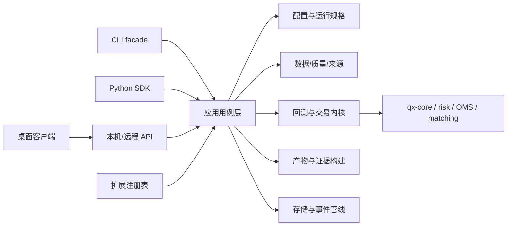

# 牵星 Qianxing — 架构复核与工业级优化重构执行方案

> 日期：2026-10-10  
> 范围：当前工作树代码、用户指定的三份方案、同日竞品分析材料及公开 GitHub 项目文档  
> 目标：把分散建议收敛成一条按正确性、性能、复用、安全与用户体验排序的实施路线  
> 基线说明：当前工作树有未提交代码、文档移动及新增文档；不得把 `git HEAD`、发布产物和工作树混为同一版本。三份输入方案引用的 HEAD 为 `166eca1`，本次实际读取的仓库 HEAD 为 `7e5815e`。数字、行号、wheel 和二进制产物须在每个实施阶段按目标树重测。

---

## 0. 执行结论

牵星已经具备较完整的 Rust 交易与研究底层：定点领域模型、事件账簿、回测撮合、风险与 OMS、数据提供方、存储、Python/C++ worker、CLI、HTTP/WS 读面和大量跨边界约束。当前的主问题不是再增加一组 crate 或再叠一份“终版方案”，而是把已有内核收敛成**可复用的应用能力**，并让可信度主张由可重复的基准、产物契约和外部验收支撑。

重构按以下次序进行：

1. **校准事实与指标**：以实际工作树为基线，复核既有报告中已漂移或与代码不符的主张；建立可复现性能和产物基线。
2. **先修产品可信度**：把撮合假设、数据保真等级、实验数据泄漏风险和产物版本统一体现在运行规格与报告中。
3. **拆出可调用的应用层**：先抽一条稳定的回测用例路径，再逐步抽取数据集、报告、Paper、诊断等用例；CLI 作为兼容 facade。
4. **分层开放 Python/API**：研究读取能力先行；写操作、Paper 和 live trading 分权限、分运行模式开放，不把所有 CLI 子命令等价暴露给所有调用方。
5. **最后选择桌面壳与插件沙箱**：GPUI/Tauri 只负责体验；后端同源接口先稳定，桌面技术通过真实 Windows/中文输入法 spike 决策。

建议的目标形态是：**一个领域与交易内核、一层可复用应用用例、多个有能力边界的适配门面**。不是把 CLI 46 个命令机械映射成 46 个 Python 函数或 HTTP 路由。

---

## 1. 输入文档的对照与收敛

| 输入 | 已经解决的问题 | 本方案的收敛点 |
|---|---|---|
| `牵星Qianxing-Python全能力包与桌面客户端及可扩展性改造方案-2026-10-10.md` | 指出 CLI 装配逻辑锁在 bin crate；提出 `qx-app`、Python 公共 SDK、共享 API 和分层扩展点 | “Python 全能力”需要拆成能力等级与权限面。构建、诊断、报告、回测、Paper、实盘下单的风险和使用环境不同，不能因共用内核就默认获得相同的公开权限。API 应暴露领域用例而非复刻 CLI 命令表。 |
| `gpui-kit桌面端策略研究平台-可行性评估与调研方案-2026-10-10.md` | 正确识别后端可复用面才是桌面瓶颈；要求 GPUI 与 Tauri 通过 spike 对比 | 保留“后端先行、UI 后选”。评估时除渲染、中文 IME、安装包和离线运行，还要测无障碍、崩溃恢复、升级/回滚、Windows 签名、启动耗时与图表大数据量。框架成熟度、具体版本、许可证和 issue 数属于当日快照，立项时重查。 |
| `自研量化框架审计与重构方案-V13.md` | 逐轮记录实现、门禁、变异验证、发布件重建和边界事实，是当前执行台账 | V13 的证据优先于更早规划稿中的概括。计划不得把台账里已经收口的项再次作为新缺陷；每阶段把新问题登记到 V13/能力矩阵，再实现与验收。避免把门禁数量或行数地板本身当产品质量指标。 |
| `docs/competitive-analysis/` 两份同日材料 | 提供架构快照、竞品矩阵、问题优先级和实施草案 | 作为详细问题池使用，不照搬未经当前工作树复核的数字与结论。具体需要纠正的例子见 §2.3 和 §3。 |

### 1.1 目标范围冲突的解决办法

“全部能力”应指**同一应用用例可由多个受支持入口调用**，不等于每个入口均暴露所有特权操作。建议划分：

| 等级 | 能力 | 默认面 |
|---|---|---|
| R（Research） | 数据集检查、配置校验、回测、实验比较、报告和产物复核 | CLI、Python SDK、桌面；本机 API 可选 |
| P（Paper） | 模拟运行、Paper 订单、暂停/恢复、事件查看 | 显式本地配置；操作留审计记录 |
| O（Operator） | worker、调度、恢复、存储和运行状态管理 | CLI / 管理 API；需 operator 身份 |
| L（Live） | 真实账户连接、提交订单、对账 | 单独启用、最小权限、确认与熔断；默认关闭，不能由“全能力包”自动开启 |

每个应用用例有一份能力声明：支持的运行模式、所需权限、幂等策略、是否可取消、数据档位、生成的产物。Python 包可以提供全套类型与 client，但 live 功能要显式 extra/配置、特权校验和独立验收。桌面 UI 根据服务端能力声明禁用/解释操作，不以隐藏按钮代替授权。

---

## 2. 项目架构复核

### 2.1 现有架构值得保留的部分

- `qx-core` 管定点金额、事实事件、账簿和稳定摘要；这是多语言共用语义的正确基础。
- `qx-xingban` 将 Bar、Tick、OrderBook 三档撮合分开，并能把数据档位缺口作为显式失败处理。
- `qx-risk`、`qx-zhenlu`、`qx-execution` 分别覆盖风险、组合/订单逻辑与执行端口；`qx-adapter` 承接交易所协议边界。
- `qx-storage` 已有文件、分段文件、SQLite 及可选 PostgreSQL/NATS 路径；运行时管线有 EventLog 与 Outbox 恢复语义、projection cursor 和 SQLite `read_since` 增量尾读。
- `qx-protocol`、`schemas/`、Python 策略契约和 C ABI 为跨语言边界提供了已有基础。继续扩展这些稳定契约比在门面中复制业务逻辑更合适。
- 已有能力矩阵、运行验收清单、发布流程、wheel 检查与 V13 逐轮记录。将这些作为质量证据源，减少再造一套互相冲突的登记系统。

### 2.2 主要结构性问题

#### A. 应用装配仍集中于 `qx-cli`

`crates/qx-cli` 目前是 bin crate，根模块在 `main.rs` 内装配，回测编排与许多业务入口依赖 `pub(crate)`。这使 Python 进程内调用、桌面/API 复用和内嵌使用很难保持同一条业务路径。通过子进程转发可用于 CLI 兼容和早期本地代理，但不适合作为长期 Python SDK 的默认执行面：取消、结构化错误、进度、产物句柄与嵌套生命周期都会变成额外协议。

#### B. 领域能力与产品能力需要明确边界

应区分：

- **领域层**：定点值、事件、撮合、账簿、风控、数据格式和协议，不依赖 CLI、UI 或 Python。
- **应用层**：`RunBacktest`、`ValidateDataset`、`BuildEvidenceBundle`、`StartPaper` 等完整用例，负责输入验证、权限、事务边界、进度/取消、持久化和错误映射。
- **适配层**：CLI 参数、Python 类型、HTTP 请求/响应、桌面视图模型；只转换输入输出，不实现第二份撮合与指标计算。

`qx-app` 可以作为组合 crate，但应先把用例拆成模块及稳定输入/输出类型，禁止做成新的 50k 行“万能中枢”。避免同时另造与现有 `qx-xingban`、`qx-runtime` 职责重叠的 `qx-backtest` crate；只有所有权和依赖图证明需要时再拆独立库。

#### C. “确定性”和“准确性”还不是一回事

稳定 `result_hash` 能证明同一输入、实现与配置产生相同结果；不能证明数据无偏、撮合逼真、无幸存者偏差、没有前视、费用完整，或该策略能在真实市场盈利。产品需分别报告：

1. **可复现**：代码/配置/数据身份/种子一致，复算摘要一致。
2. **模拟假设**：撮合和延迟模型、市场冲击边界、费用/融资/公司行为处理。
3. **数据适用性**：时间范围、缺失/修订、PIT 与幸存者偏差、交易日历和时区。
4. **验证覆盖**：单测、属性/契约、沙箱/外部链路/生产审批各达到哪一档。

界面与 EvidenceBundle 应把这四类信息分开展示，避免一个“verified”标签掩盖风险。

#### D. 深档撮合的假设必须显式且可对照

竞品分析提出 L2 队列位置、部分成交与延迟建模差距，方向合理。不能简单把“更复杂模型”标成准确：基于 market-by-price 逐笔重放时，队列位置本身是估计；回放市场不能反映订单冲击，吃单数量也可能出现不现实填单。应将 Risk-averse FIFO、概率队列、部分成交等作为具名模型，报告每个模型的假设、输入要求与敏感性结果。缺少足够输入时宁可降档或拒跑，不允许从 L2 深度宣称 L3 队列真实度。

#### E. 事件归档与重放问题需要重定性

部分竞品材料把 EventLog 描述为“无 retention/compaction、每 tick 全量重放、因此 O(n²)”。当前工作树的 `qx-runtime/src/pipeline.rs` 已明文采用**只增长 + 按段归档**策略：封段不可变，换 `log_name` 轮转，避免截断破坏重放与前缀校验；存在 SQLite 增量 `read_since`，不支持尾读或检测到分叉时显式退回整段重建。因此：

- 不应直接把“无归档策略”或“整场回测必为 O(n²)”作为当前事实。
- 仍需量化长期运行的内存投影（Ledger、OMS、事件索引等）随事件增长的斜率、恢复时间和归档读取成本。
- 对“重复重建是否出现在高频路径”按调用图和生产配置逐条核验；全量 `ReplayVerifier` 作为审计/恢复路径本身应保留。
- 是否引入快照/增量归约，取决于实测热点。若引入，快照必须绑定 `seq`、schema 版本、前缀摘要和 reducer 版本，并能与全量重放对拍；不能静默删除历史。

#### F. 门禁数量与文档行号对项目贡献者不够友好

门禁严密适合防止仓库现有契约回退，但文档字符串、精确行号、手工计数和大门禁脚本形成的编辑成本会抑制新贡献者。方向不是削弱关键验证，而是把可机读契约从散文中分离：schema、路由表、能力矩阵、artifact registry 作为源数据，文档由其生成或校验。保留行为测试、协议测试、构建检查和少量必要的文档引用门禁；逐步去掉纯计数型棘轮，新增门禁必须写明它捕获的故障样本。

### 2.3 现有报告需要在实施前重新核对的判断

1. **基线版本不同**：指定方案记载 `166eca1`，本次仓库 HEAD 为 `7e5815e`，工作树又有未提交改动。已有行号和计数不能直接当作新基线。
2. **EventLog 结论需更新**：本次已确认运行时文档中的分段归档/轮转策略、Outbox 游标和 SQLite 增量尾读，详见 §2.2-E。
3. **“50K 行的 qx-cli”是某个提交快照**：拆分问题仍成立，但先重新统计当前工作树生产代码、测试代码及各 crate 依赖，避免把历史数值当作现状。
4. **blessed artifact 版本问题**：竞品清单提到 16 份摘要停在 v1，但同日材料也核实代码侧已到 v5。应以当前 fixture 枚举、实际读者迁移行为和常驻测试重新界定为“旧 fixture 是否有显式兼容/迁移守护”，不要用版本数字直接判定缺陷。
5. **GUI 需求与过往“不做 GUI”决策冲突**：视为新产品方向的重新立项，而非悄然延续旧决策。立项材料需明确用户、支持成本、维护责任与停止条件。

---

## 3. GitHub 竞品研究与可借鉴结论

研究以项目仓库、官方文档和代码入口为主；GitHub 热度不是准确性或生产就绪的证明。许可证、活跃分支、依赖、版本和功能范围在实施选择/分发之前须再查一次。

| 项目 | 值得借鉴 | 不应照搬的部分 |
|---|---|---|
| [NautilusTrader](https://github.com/nautechsystems/nautilus_trader) | 研究、sandbox、live 共用内核；Python 是控制与策略面，PyO3 接 Rust；提供低阶 `BacktestEngine` 与高阶 `BacktestNode` 两层 API；共享数据目录和运行生命周期。适合指导牵星抽应用层与设计 Python 动词面。 | 其复杂度、领域广度和 API 仍活跃演进，不等于牵星应一次复制所有 actor/client/adapter 体系。应挑可迁移的边界，不复制规模。 |
| [hftbacktest](https://github.com/nkaz001/hftbacktest) | 明确 queue model、部分成交、feed/order latency 和 replay 市场冲击假设；模型选择本身属于结果解释。用于细化牵星 L2 假设与敏感性报告。 | 其文档也指出回放不能改变真实盘口，market impact 假设会限制填单真实性；不能把“支持队列模型”理解为准确模拟市场影响。 |
| [QuantConnect LEAN](https://github.com/QuantConnect/Lean) | 数据馈送、算法、交易、结果处理及其 handler 生命周期分别组合；成熟的结果与运行状态输出。借鉴可插拔组件边界与运维可观测性。 | LEAN 的服务端/云工作流和依赖体系与本项目的单机、离线和可审计目标不同；不要为跟齐功能而扩大部署面。 |
| [Qlib](https://github.com/microsoft/qlib) | 研究工作流与运行追踪分开建模；Experiment → Recorder 保存参数、指标和工件；适合借鉴 ExperimentSpec、批量运行追踪与结果比较。 | ML 数据管线和模型寻优会引入新的数据偏差/依赖，不应直接放进撮合内核。先把可复算回测和时间切分做正确。 |
| [vectorbt](https://github.com/polakowo/vectorbt) | 面向研究者的矩阵化参数探索、可视化和短路径 API，是“第一次使用体验”和研究效率的标杆。 | 矩阵化语义与事件驱动执行并不等价；其社区版/商业版边界和许可证需评估。牵星不得为速度牺牲同一交易语义的声明。 |
| [Freqtrade](https://github.com/freqtrade/freqtrade) | 可执行 CLI 工作流、策略模板、Dry-run、Hyperopt 和清楚的回测/实盘操作文档；优化结果应能用相同参数独立回测复验。 | 其工作流围绕加密货币 bot；牵星不能据此推导 A 股、衍生品和多资产的交易日历、费用与市场规则。 |
| [Hummingbot](https://github.com/hummingbot/hummingbot) | Connector、Strategy、Controller、Executor 分层；API client 使 UI/Agent 与交易框架分离，多控制器编排可复用。适合借鉴 adapter conformance 与服务客户端。 | 实时交易优先的架构不是研究证据系统；权限、密钥、真实下单和本机 token 仍需牵星自身设计与安全评估。 |
| [Barter](https://github.com/barter-rs/barter-rs) | Rust 生态中按 data / execution / instrument / integration 拆成多库，展示不必把所有 Rust 能力放进一个 crate。 | 小型模块化不自动解决产品应用层、Python 公共 API 和审计产物问题。 |
| [vn.py](https://github.com/vnpy/vnpy) | Gateway/App/Engine 的适配器与主引擎扩展模式、中文交易生态和分包机制，适合作为国内连接器易用性参考。 | Python 插件/进程内扩展不构成对不受信代码的隔离；不能拿运行时可发现等同安全沙箱。 |

### 3.1 产品差异化建议

不要以连接器总数、GUI 功能数量或参数扫描速度作为主要竞争指标。更适合牵星的可辨识产品承诺是：

> **每个结论都附带可核验的数据来源、模拟假设、运行身份、结果摘要、适用限制与复算步骤。**

围绕此承诺建设 `EvidenceBundle`：保存 RunManifest、summary/equity/fills、数据指纹与质量报告、配置和策略身份、模型假设、软件构建身份、验证级别、未验证清单及离线复算指引。EvidenceBundle 是对现有运行产物的聚合与校验，不应重算指标或成为第二套结果来源。

---

## 4. 目标架构



### 4.1 依赖与所有权规则

- 领域 crate 不依赖 `qx-cli`、HTTP、桌面 GUI 或 Python。
- 新应用层只负责编排已有领域能力；CLI、Python SDK 和 API 可复用同一输入/输出 contract。
- HTTP 仅为远程/桌面进程边界服务；进程内 Python 默认直接调用稳定 native facade，避免多走 localhost。
- UI 仅消费服务端的类型化投影和产物；曲线绘制可以格式化/抽样，但金融指标与成交逻辑由内核计算。
- `qx-plugin` 先做显式静态装配和能力验证；第三方包发现与执行隔离是两个不同问题。

### 4.2 Python SDK 与 HTTP contract

Python 的用户表面应是可组合的高阶对象与函数，例如：

```python
run = qx.backtest(spec)
report = run.report()
run.verify()
```

底层 contract 使用版本化、可序列化的 `BacktestSpec`、`RunHandle`、`BacktestReport`、`ValidationIssue` 和 `ArtifactRef`。提供清晰的同步接口起步，长任务以 run id、进度事件和取消 token 管理；不要把文件路径、JSON 字典和 PyO3 参数直接暴露为主要公共 API。

Python 数据包按 extras 安装可选连接器；基础回测依赖应有明确安装体验和受支持 Python/OS/架构矩阵。若打包原生引擎，先验证 wheel ABI 标签、动态库依赖、平台产物重现性、体积、离线安装和 SBOM；`abi3` 只有在所有绑定/依赖实际兼容时才对外承诺。

### 4.3 本机 Agent 与桌面信任边界

- 绑定 loopback，随机端口，通过本机管道/受保护配置交付短期凭据；不将 token 放在 URL、日志或持久配置中。
- 用 Origin/CSRF 校验、一次性启动授权、token 轮换、请求体大小限制、速率限制和退出清理保护本机边界。
- API 端点按 R/P/O/L 能力授权；“本机”不自动等于可信来源。
- 桌面和 Agent 版本明确协商协议版本；不兼容时安全失败并提示升级，不猜测降级。
- 先复用已有 Web Console 原型/资产探索研究体验，再决定是否维护第二套 GUI 技术栈。

---

## 5. 分阶段实施计划与退出门

这是交付顺序与验收门，不是工时承诺。每一阶段都以当前工作树和实际运行证据更新文档台账。

### 阶段 0：基线与范围冻结

**产出**：一份版本化基线，包含工作树/提交身份、crate 生产/测试规模、依赖图、公开 API、CLI 能力分类、当前产物 schema、wheel/二进制身份、当前门禁与测试集状态。

**动作**：

1. 三份输入报告里的行号/数字标记为对应快照；只修正即将实施的关键结论，不先进行大规模文档翻修。
2. 将 46 个入口映射到 R/P/O/L 及 CLI-only 理由；一个入口若只是开发/构建工具，不要求成为 SDK/API 能力。
3. 记录既有 capability maturity 和外链验收边界；不把 `implementation` 或本机测试写成 production approval。
4. 选择几个可长期固定的回测夹具，收集 `result_hash`、artifact manifest、运行耗时和内存基线。

**退出门**：核心架构主张都引用当前代码或可重复产物；确定性相等断言只用于相同输入、版本、模型与运行环境，不混同准确性。

### 阶段 1：数值、产物、数据质量与撮合可信度

**产出**：统一 RunManifest/EvidenceBundle 最小版；每个模拟档位的假设清单；基准套件和核心市场数据契约。

**动作**：

- 盘点 summary、fills、equity、run manifest、record 和多腿归因的 schema/version 关系；旧产物读取必须走显式迁移或给出具名拒绝原因。
- 确认每种撮合模型的交易时序、费用、滑点、资金费率/分红/公司行为、行情修订和下单延迟来源。
- L2 增加可命名的队列位置/部分成交方案并报告敏感性；逐单记录为何成交/未成交。模型暂不支持的数据输入显式拒绝。
- 建立基准：EventLog append/恢复、pipeline refresh、典型 bar/tick/orderbook 回测、SQLite/分段后端读写、artifact 序列化。固定数据规模、机器、编译 profile、warm/cold 状态和测量工具。
- 用 profiling 找真实热点。性能目标先根据 baseline 设定，禁止先把某条算法复杂度作为验收结论。
- 数据验证报告扩展时间戳单调性、重复/缺失/停牌、交易日历、时区、PIT、幸存者偏差、复权/公司行为和 provider provenance。

**退出门**：同一运行可由 RunManifest 复算；各撮合档都有可见限制；性能工作有前后可比数据；重要摘要都有 artifact schema 测试。

### 阶段 2：应用层抽取与行为等价

**产出**：`qx-app` 初版库和一个非 CLI 调用示例。

**切分顺序**：

1. `ValidateDataset` 与 `RunBacktest`（先 Bar，再按同一接口接入 Tick/L2）。
2. `ReadRunArtifacts`、`BuildReport`、`CompareRuns`。
3. `StartPaper`、`Stop/ResumePaper`、`GetRunStatus`。
4. Operator 运维入口与 Live 控制面用例。

每个用例定义输入 schema、输出 schema、运行权限、幂等键、取消行为、事件/进度、产物清单和错误类别。CLI 保持现有行为，内部改为调用应用服务。

**行为等价门**：在迁移前后的固定输入上比较退出状态、关键诊断结构、产物文件集合、manifest 语义和 `result_hash`。人工可读 stdout 只比较受支持契约字段，不用脆弱的逐字节日志比较代替领域行为检查。

**退出门**：应用 crate 无 CLI/UI 依赖；CLI 的核心研究用例实际调用公共应用接口；至少一个独立 consumer 不通过启动 `qx-cli` 才能完成一次回测并复核产物。

### 阶段 3：Python 包与 API 能力分层

**产出**：稳定的 `qianxing` SDK facade、类型化结果、可选的 Python worker/adapter 集成和 versioned API client。

**动作**：

- 先交付 R 等级（dataset validate / backtest / report / artifact verify）；成熟后交付 P；Operator 与 Live 单独授权和验收。
- 对 Rust/Python 共享的策略输入输出和 API schema 建立单一 schema 源与可重复 codegen。代码生成产物可重建、diff 可审查，不以运行时动态 schema 为主。
- 内核错误映射为有稳定 error code 的 Python exception/API problem detail，提供修复指引和关联 run id；保留底层诊断证据。
- 将 `qianxing_ccxt`、`qianxing_ashare` 作为清晰可选集成；核心安装不隐式安装交易所 SDK、时区数据库或重型 dataframe 依赖。
- 发布矩阵包含 Windows/macOS/Linux（若承诺）、受支持 Python 版本、ABI、架构、wheel 体积、动态链接检查、离线安装、构建身份/SBOM 与签名。
- Live SDK 方法需要明确账户能力、二次确认策略、幂等 client order id、限速、重试/超时和 reconcile；错误重试绝不能隐式重复下单。

**退出门**：新手在干净环境可装包、加载仓库样例、跑一条策略、看到数据限制、打开报告并复算摘要；研究功能不需用户安装 Rust 工具链；可选依赖缺失有准确提示。

### 阶段 4：研究闭环与结果展示

**产出**：`ExperimentSpec`、批次执行/比较、walk-forward/OOS 和 EvidenceBundle 展示。

**实验规格至少包括**：dataset fingerprint、PIT 范围、策略及参数域、交易日历、成本模型、撮合模型、种子、IS/OOS 切分、优化目标、引擎版本、停止条件和资源上限。

**准确性防线**：

- 数据归一化、特征计算和指标不能读取未来数据；增加 no-lookahead 属性测试与边界样本。
- 参数优化只在 IS 或训练窗口选择参数；OOS 保持未参与选择；walk-forward 每个窗口记录时间边界和所用数据版本。
- 报告参数尝试数和选择偏差；PBO/Deflated Sharpe 等只在实现与假设充分时列为统计诊断，不写成盈利保证。
- 所有结果可由单次运行 manifest 重新执行；批次失败/取消不损坏已完成 run。

**退出门**：使用合成泄漏 fixture 的测试能抓住前视；IS/OOS 边界可从产物独立核验；每个最优参数结果链接到其完整底层 run。

### 阶段 5：桌面 spike、决策与上线

**先验收**：编辑器保存/恢复、中文 IME（候选窗、光标、多行、组合键）、大表格与 OHLCV/回撤交互、无障碍键盘操作、离线安装、自动升级/回滚、崩溃恢复、应用签名和冷启动。

GPUI Kit 与 Tauri/Web 两个 spike 使用同一 Agent/API、同一报告 fixture 和相同验收脚本。对编译时间、包体、空闲内存、启动/绘图交互、平台维护能力做实测。框架版本/许可证/支持平台在立项当日复查。

**退出门**：至少两名目标用户完成从新项目到可复算报告的任务；Windows 中文输入法和更新/回滚通过；长期维护者与升级策略明确。任一关键项失败就停止该 UI 壳投入，继续使用 Web Console 或另一候选壳。

### 阶段 6：生态、安全和运营成熟度

- Trusted extension：版本化 manifest、能力声明、兼容矩阵、签名/来源、冲突和弃用规则。
- Untrusted strategy：独立进程/受限 worker 先行，设置 CPU、内存、文件、网络、IPC 和 wall-clock 配额；WASM 只是额外隔离机制，需要持续跟进运行时安全更新，不能替代宿主隔离。
- Adapter conformance suite 覆盖时钟、重连、限速、精度、订单状态、部分成交、取消/拒绝、重复消息和 reconciliation。
- 运维层提供结构化日志、trace/run correlation、关键指标、健康状态、可诊断导出、备份恢复演练和升级回滚方案。
- 跨平台发布建立可复现构建、软件物料清单、签名与漏洞响应流程。

---

## 6. 横切工程细节

### 6.1 错误与取消语义

每个应用用例返回稳定类别（InvalidInput、DataUnavailable、FidelityInsufficient、PermissionDenied、Conflict、Timeout、StorageFailure、InternalInvariant 等）、用户行动提示、可定位 run/request id 和是否安全重试。长回测和研究任务需能取消、持续报告状态且在进程重启后可识别为完成/失败/中断；写订单与外部提交不得因重试产生重复副作用。

### 6.2 金融精度与时间

- 金额/价格/数量使用已定义的定点与精度约束；跨边界拒绝超范围、非法舍入和单位混用。
- 对 `None`/缺报保留缺失语义，不将空值折算为零。
- UTC instant 与交易所本地日历/时区分开处理；夏令时切换、非交易时段、跨午夜 session、退市/上市与公司行为加入契约夹具。
- 收益率、夏普、回撤、滑点和换手等指标在数据不足、基准缺失或样本短时给出“不适用/未计算”与理由，不填零制造确定性。

### 6.3 数据与回测质量

市场数据 provenance 最少包括 provider、原始文件/包摘要、采集时间、交易所时间、时区、修订/复权版本、质量门结果和许可来源。相同文件名不等于相同数据。回测结果标注订单是否可成交、数据是否存在盘口、订单是否超出历史深度、市场冲击未建模等限制。

### 6.4 模块拆分与门禁治理

- 按稳定领域/用例边界拆 crate，不以“文件超过 N 行”作为唯一依据；新 crate 必须有清楚的所有者、消费者和依赖方向。
- `qx-cli` 的测试迁移分批进行，先搬领域行为测试或改成应用契约测试，避免一次搬迁扰动大量基线。
- 对比文档直接读代码的门禁时，优先为关键边界使用解析器/测试/生成检查；新增正则检查必须有正例、反例和失效时的清楚诊断。
- 单独追踪：用户可见回归、生产路径错误、未覆盖能力、构建发布失败。总 PASS 数和门禁数不能作为成熟度替代品。

### 6.5 易用性最短路径

新用户主路径控制为：`init → 获取/导入数据 → validate → backtest → report/verify`。每一步给默认样例、预期输出、常见失败及下一步链接；自动生成的项目配置包含注释与版本。保留专家参数，但用子命令分组和按需帮助降低首次阅读的 46 入口负担。成功页先解释收益图使用的数据档位和假设，再展示指标。

---

## 7. 统一验收矩阵

| 维度 | 验收证据 | 不接受的替代品 |
|---|---|---|
| 复现性 | 固定 manifest 可离线重放，摘要及文件身份一致 | 只比较终端打印或只看利润数字 |
| 模拟诚实性 | 每档具名假设、限制、成交原因和敏感性可见 | 用“L2/高保真”名称直接代替模型验证 |
| 数据质量 | PIT、时区/日历、缺失/修订、公司行为和来源验证 | 数据文件存在就算验证通过 |
| 应用层复用 | CLI 与 Python/API 同一应用用例及 contract 测试 | 所有 facade 分别写一套回测逻辑 |
| SDK 易用性 | 干净环境 quickstart、错误可恢复、包矩阵和离线安装证据 | `cargo build` 后人工把二进制复制到包目录 |
| 权限安全 | R/P/O/L 权限测试、幂等与重复提交用例、密钥不泄漏 | “只绑定 localhost”作为充分授权 |
| 性能 | 固定数据和环境下的吞吐、延迟、RSS、恢复耗时对比 | 未测的“高性能”或事先承诺复杂度修复倍数 |
| 扩展兼容 | manifest schema、能力声明、adapter conformance、版本兼容 | 能 import 就视为兼容或安全 |
| 发布可靠性 | wheel/exe 身份、依赖、签名/SBOM、升级回滚 | 源码测试绿就视为交付包已验证 |
| 用户体验 | 新用户任务观察、可访问性、中文输入与故障恢复验收 | 组件数量、截图或框架 demo |

---

## 8. 建议暂缓或明确不做

1. 不先承诺所有 46 个 CLI 入口都具备 Python/API 等价形态；先按 R/P/O/L 分类和用户需求验收。
2. 不在桌面 UI 中另写引擎、指标、成交规则或数据质量判断。
3. 不因采用 GPUI Kit、Tauri 或 Python entry points 就宣称完成沙箱或生产级安全。
4. 不在数据/撮合可信度尚未表达前大规模做自动寻优；大量参数搜索会扩大过拟合风险。
5. 不默认将 EventLog 截断或压缩。当前 append-only 和分段归档是有意设计；若要快照/状态裁剪，应先定义审计与恢复不变量并通过全量重放对拍。
6. 不把 L3、跨节点 HA、多租户云托管、插件市场和真实账户生产审批塞进桌面 MVP；按已登记的 maturity 状态逐项立项。

---

## 9. 收尾方式与文档治理

- 本方案承担跨文档的顺序、能力分级和验收口径；Python/桌面方案继续承担门面实现细节，V13 继续承担逐轮落地台账，竞品全景和问题清单作为对比与 backlog。
- 决策被实施或被否决时，在对应文档中记录决策、证据、未验证限制和日期；不要复制整段实现日志到多份“终版”文档。
- 每阶段开始先读 V13 最近的交接/未结项；每阶段结束把真实差异、产物构建、门禁结果写回同一个执行记录。
- 清理或归档文档前，先检查 `tools/check_architecture.py`、相互引用、活文档行号门槛和任何门禁读取路径；归档而不是硬删历史依据。

---

## 10. 参考资料

### 仓库内

- [Python 全能力包与桌面客户端及可扩展性改造方案](牵星Qianxing-Python全能力包与桌面客户端及可扩展性改造方案-2026-10-10.md)
- [gpui-kit 桌面端可行性评估与调研方案](gpui-kit桌面端策略研究平台-可行性评估与调研方案-2026-10-10.md)
- [自研量化框架审计与重构方案 V13](自研量化框架审计与重构方案-V13.md)
- [竞品全景图与架构对标](competitive-analysis/竞品全景图与架构对标-牵星Qianxing-2026-10-10.md)
- [架构不合理清单与优化重构方案](competitive-analysis/牵星Qianxing-架构不合理清单与优化重构方案-2026-10-10.md)
- `crates/qx-runtime/src/pipeline.rs`（EventLog 保留策略、运行时恢复与存储路径）
- `crates/qx-core/src/sourcing.rs`（事件序号校验、重放、digest）
- `crates/qx-cli/src/main.rs`、`crates/qx-cli/src/backtests/`、`crates/qx-api/src/lib.rs`

### GitHub 官方项目与文档

- NautilusTrader 架构与 Python/Rust API：[Architecture](https://github.com/nautechsystems/nautilus_trader/blob/develop/docs/concepts/architecture.md)、[Backtesting](https://github.com/nautechsystems/nautilus_trader/blob/develop/docs/concepts/backtesting/index.md)、[Rust](https://github.com/nautechsystems/nautilus_trader/blob/develop/docs/concepts/rust.md)
- hftbacktest [Order Fill、部分成交与队列模型](https://github.com/nkaz001/hftbacktest/blob/master/docs/order_fill.rst)
- QuantConnect LEAN [Engine 组装与 handler 生命周期](https://github.com/QuantConnect/Lean/blob/master/Engine/Engine.cs)
- Microsoft Qlib [Experiment Recorder](https://github.com/microsoft/qlib/blob/main/docs/component/recorder.rst) 与 [项目](https://github.com/microsoft/qlib)
- [vectorbt](https://github.com/polakowo/vectorbt)
- Freqtrade [Hyperopt](https://github.com/freqtrade/freqtrade/blob/develop/docs/hyperopt.md)
- Hummingbot [策略分层](https://github.com/hummingbot/hummingbot-site/blob/main/docs/strategies/index.md) 与 [API client](https://github.com/hummingbot/hummingbot-api-client)
- [Barter Rust 交易生态](https://github.com/barter-rs/barter-rs)
- [vn.py](https://github.com/vnpy/vnpy)

> 竞品能力描述依据其公开仓库/官方文档，访问日期为 2026-10-10。所有热度、版本、许可证和平台支持均为易变信息；实际引入依赖或承诺支持前应重新读取对应项目的 LICENSE、release、平台 CI 与安全公告。
