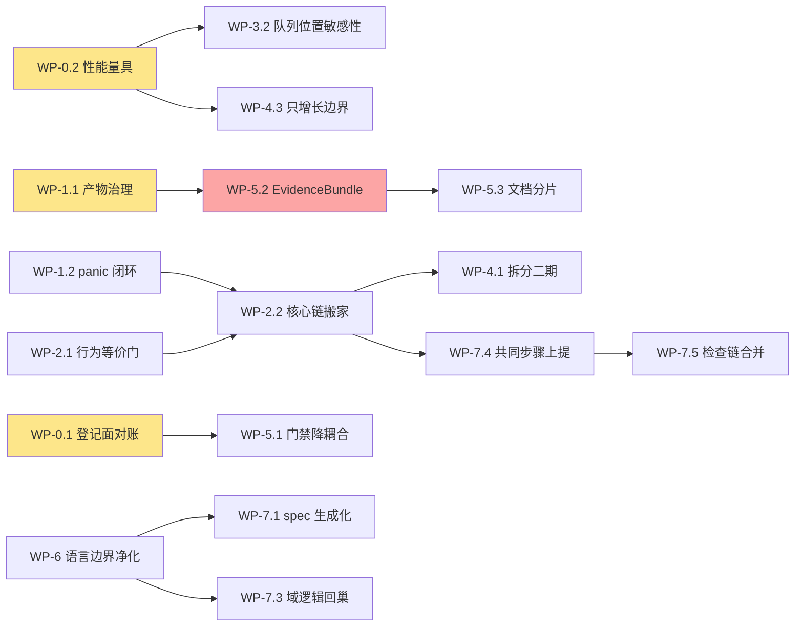

# 牵星 Qianxing — 架构梳理、遗留不合理项与优化重构方案

> 报告日期：2026-10-14 ｜ 分析对象：`D:/aex_work/qianxing`（HEAD `30d8bf82`，2026-10-14 20:07；工作树另有 6 个未提交文件：`maturity/{backtest_acceptance,capability_execution,paper_acceptance}.yaml` 与 `tools/{backtest_acceptance,capability_execution_probe,paper_acceptance}.py`）
> 上游输入：`docs/competitive-analysis/牵星Qianxing-架构不合理清单与优化重构方案-2026-10-10.md`（下称「10-10 清单」，基线 `166eca1`）、`docs/牵星Qianxing-架构复核与工业级优化重构执行方案-2026-10-10.md`、`docs/自研量化框架审计与重构方案-V13.md`（台账至 §9.60）
> 事实口径：仓库内事实为**代码级确认**（文中 `文件:行` 均为当日实测、可落地核验）；门禁与测试读数为当日实测，引用时以 `maturity/gate_snapshot.json` 和门禁收尾打印为准，不抄历史值。

---

## 0. 执行结论

10-10 清单之后，本仓在 4 天内落了 **230 个提交**：应用层 `qx-app` 从 3 个用例长到 23 个，`qx-sdk` 门面与多语言 SDK 成形，实验切分（OOS/走查 + 基准对照）从「schema 说了、执行者没做」变成真算数，`qx-xingban` 的 Bar 撮合完成 `FillModel` trait 化，EventLog 读面改游标增量。

对照 10-10 清单的 12 项架构问题：**3 项已收口**（A2 研究层空白、A4 每 tick 全量重放、A12 dev 边无看守）、**5 项部分收口**（A1 撮合模型、A3 CLI 熵增、A5 门禁耦合、A9 panic 面、A11 文档组织）、**4 项原样在册**（A6 数据平面边界、A7 性能量具、A8 产物版本治理、A10 HTTP 协议缺口）。同时浮现两个新结构性问题：**应用层抽取停在垂直切片，核心回测链双装配并存**；**门禁自身 4 天膨胀 16%（940 → 1096 条判据，脚本 15,605 → 19,829 行），从「资产」变成新的可持续性风险源**。

当前最需要做的事，按次序：**先给性能装上量具（WP-0/2）→ 补产物治理与 panic 边界两处漏水（WP-1）→ 在行为等价门保护下把核心回测链收进 `qx-app`（WP-2）→ 收敛撮合两条路径并补队列位置模型（WP-3）→ 才是继续拆 `qx-cli`、数据平面收敛等结构性工程（WP-4）→ 最后做门禁降耦合与 EvidenceBundle 生态位（WP-5）**。全部阶段共享一条纪律：**不削弱 1096 条判据守住的任何契约，只降耦合、只补证据**。

### Top 10 遗留问题（按严重度）

| # | 问题 | 等级 | 一句话 | 状态 |
|---|---|---|---|---|
| 1 | **性能证据链空白** | 🔴 致命 | 无 criterion、`targets.yaml` 9/9 profile 全 `unmeasured`，稳态 tick 成本已实测出严格线性却无 CI 趋势门——所有性能主张不可证 | 在册（A7） |
| 2 | **深档撮合缺量敏感/队列位置模型** | 🔴 致命 | L2 仍按帧全深度吃单，系统性高估成交；「档位不足即拒」的诚实姿态在「档位够、模型不够」时失灵 | 部分收口（A1） |
| 3 | **应用层抽取停在垂直切片，核心链双装配并存** | 🔴 高 | `cli.rs` 直接调 CLI 自建装配，与 `qx-app` 用例两套编排同一业务路径；CLI 小不下来，复用面拿不到_full 能力 | 新增（A3 当代形态） |
| 4 | **`qx-cli` 单 crate 熵增未解** | 🔴 高 | 一个 crate 47,793 行 src（含测试 77,423 行 ≈ 全仓 46%），生产代码与 83 个测试文件同 crate 混居 | 部分收口（A3） |
| 5 | **门禁膨胀反噬** | 🟠 重要 | 19,829 行判据脚本 / 1,096 条，4 天 +156 条；白名单式盲区已自登记（如枚举变体 142 颗单行扫描盲点），新人「改错一个字就红」 | 加剧（A5） |
| 6 | **产物版本治理漏水** | 🟠 重要 | 16 份 blessed 摘要全部停在 `schema_version: 1`（代码写 5），无用例守护；多腿链无 RunManifest | 在册（A8） |
| 7 | **panic 边界未闭环** | 🟠 重要 | 需确保 worker、API、console 和 CLI 顶层统一包装，保留 panic hook 诊断；参数豁免设棘轮 | WP-1.2 已达退出门，见 V13 §9.69–§9.72 |
| 8 | **只增长集合面无边界** | 🟠 重要 | EventLog 无保留（已升格为「写下来的决定」）；消费者 `processed_ids` 同族。Scheduler 终态历史已有 4096 条限额与逐作业锚点，超时扫描现只遍历 Running ID | 部分收口（V13 §9.325；消费者幂等键边界仍在册） |
| 9 | **登记面与文档债** | 🟡 次要 | `capabilities.yaml` updated_at 停留在 10-10，其后 230 个提交；CHANGELOG 7,990 行；登记文本漂移（如仍写「summary schema v3」） | 加剧（A11） |
| 10 | **数据平面三 crate 边界模糊 / HTTP 缺口** | 🟡 次要 | `qx-data`/`qx-guanxing`/`qx-provider` 同语义域三编译单元；自研 HTTP 协议边界需要按证据收口 | A6 已完成边界评估；A10 三处 gap 已收口，见 V13 §9.75–§9.76 |

**本轮新增深扫（语言边界与重复逻辑，详见 §3.12–§3.15 与 §4.7）**：按「核心逻辑只住 Rust、其他语言仅是门面」原则全仓复查后，**总体合规但有三处实锤违反**：① `tools/validate_core.py`（450 行，CI 第 7 步）用 Python 完整重写了因果队列/PIT/5 个 fill model/确定性重放，且覆盖面与 Rust 不一致（Python 有 `VolumeSensitiveFillModel`，Rust 侧「概率/量敏感成交模型被拒」）；② `python/qianxing_ashare` 手抄复现了 Rust 的 bars FNV 指纹（docstring 自述「复现」）、在公司行为合并里实现了 Rust 没有的业务语义、并把 1e9 定点换算写在 Python；③ `python/qianxing_ccxt` 同样自带 1e9 定点换算与错误分类学。Rust 内部另有多处同形双源（实验 spec 三处同源、bars 指纹两种形状、paper 估值留在 CLI、五条检查链重叠）。

---

## 1. 当前架构梳理（事实基线）

### 1.1 workspace 规模（2026-10-14 实测）

27 个 workspace 成员（26 个 crate + `contract-tests` 纯测试宿主，见 `Cargo.toml:30`、`Cargo.toml:34`、`Cargo.toml:38`），`crates/*/src` 合计 **158,905 行**。按 src 行数：

| crate | src 行数 | 定位 |
|---|---|---|
| qx-cli | 47,793（+src/tests 21,700 +tests/ 7,930） | 唯一 binary：参数解析、派发、worker 入口、部分装配 |
| qx-app | 20,581 | 应用层：23 个用例（`maturity/app_use_cases.yaml:36`） |
| qx-xingban | 17,627 | 撮合内核（Bar/Tick/OrderBook 三档） |
| qx-api | 9,136 | 自研 HTTP/WS 读面 + 控制面 |
| qx-runtime | 9,204 | 运行时管线（EventLog/投影/监督） |
| qx-storage | 9,374 | 文件/分段/SQLite/PostgreSQL/NATS 存储 |
| qx-core | 6,793 | 定点金额、事件账簿、事实事件、契约单点 |
| qx-adapter | 5,217 | 交易所协议边界（Binance 直连 + CCXT） |
| qx-strategy | 4,362 | 内置策略 + C ABI + Python 策略契约 |
| qx-zhenlu | 3,829 | 组合/OMS/订单逻辑 |
| qx-factor | 2,841 | 因子研究桥 |
| qx-data / qx-provider / qx-protocol | 2,511 / 1,677 / 1,322 | 数据摄取 / 多源 provider / 线格式 |
| qx-execution | 4,398 | 执行端口（回测/Paper/Live 三形态） |
| qx-sdk / qx-python / qx-spec | 1,404 / 2,025 / 1,922 | 第三方门面 / PyO3 绑定 / 运行规格 schema |
| 其余（scheduler/risk/scheduler 等 8 个） | 各 449–1,680 | 调度、风控、观测、插件、数据结构等 |

> `qx-cli` 一个 crate 占全仓 `.rs` 的 **46%**（含其测试），这是后文 N1/N2 的量化背景。

### 1.2 分层与依赖纪律

```
领域内核         qx-core（定点/事件/账簿/契约） qx-datastruct qx-protocol
引擎与逻辑       qx-xingban（撮合） qx-zhenlu（OMS） qx-risk（风控） qx-factor qx-strategy
数据与适配       qx-data qx-guanxing qx-provider qx-adapter
运行时           qx-runtime（管线/监督） qx-scheduler qx-control qx-storage qx-plugin
应用层           qx-app（用例编排，仅依赖 7 个领域 crate） qx-spec（运行规格）
门面与入口       qx-sdk（稳定门面） qx-api（HTTP/WS） qx-python（PyO3） qx-cli（CLI） qx-genglu（观测）
测试宿主         contract-tests（12 条 dev path 边在此隔离）
```

依赖纪律由 `layer_dependency_check` 守：十条规划规则 + `LAYER_FORBIDDEN_DEPS`（应用层不得反向依赖门面/适配/执行/存储）+ `LAYER_SOLE_DEPENDENTS`（`qx-app` 的被依赖集合必须点名 `qx-cli`/`qx-api`/`qx-python`/`contract-tests`）。生产依赖图为 DAG；**12 条 dev path 边**（`contract-tests` 8 条 + `qx-adapter→qx-runtime`、`qx-execution→qx-adapter`、`qx-api→qx-data/qx-guanxing/qx-strategy`）由 `dev_dependency_cycle_check`（`tools/check_architecture.py:13004`）三颗判据看守：两条已知环不许回来、全仓不得存在「A --dev--> B 且 B --normal--> A」二点环、迁走的契约用例仍在盘。**10-10 清单 A12/D39 建议的「显式登记 + 牙齿」已落地，本条结案。**

### 1.3 五条主链现状

1. **回测链（双轨，见 N1）**：`qx-cli backtest builtin` → `cli.rs:323` → `backtests/single_strategy.rs:25` 自建装配；另一轨 `qx-app cases/run_backtest` → `qx-xingban`（Bar 走 `FillModel`，`crates/qx-xingban/src/fill.rs:59`、`crates/qx-xingban/src/venue.rs:25`；Tick 转盘口后委托，`crates/qx-xingban/src/tick_backtest.rs:110`；OrderBook 走独立 `OrderBookExecutionModel`，`crates/qx-xingban/src/orderbook.rs:186`）→ `qx-zhenlu` OMS → `qx-core` 账簿/EventLog → 产物。
2. **实验链**：`qx-app run_experiment`（`crates/qx-app/src/cases/run_experiment.rs:19` 引用切分模块）→ `experiment_split.rs:5`（选参只读训练窗、报分读测试窗；权益从产物读回）→ 基准列（buy-and-hold/零信号）。
3. **Paper 链**：scheduler → `qx-cli workers` → paper-execution → ledger；风控门三把尺子已收敛到 `ValuationContext`（V13 R23 口径）。
4. **Live/worker 链**：binance/ccxt worker → `qx-adapter` → `qx-execution` → OMS + 对账；IO 预算与 venue 缓存封顶有判据（fam04）。
5. **门面链**：`qx-api` 约 63 条路由（`crates/qx-api/src/lib.rs:1460` 主 match 45 臂 + `app_surface` 前置分流），`qx-python`/`qx-sdk` 同源；`language_api_contract.yaml:210` 起 23 条契约 × 5 腿（rust/python_native/python_remote/cpp_remote/http）。

### 1.4 工程纪律与开发细节（新贡献者需要知道的一切）

- **门禁**：`tools/check_architecture.py` **19,829 行 / 120+ 个 `*_check()` / 1,096 条判据**（`maturity/gate_snapshot.json:3`：`checks=1096`、`gate_check_floor=1035`），单跑约 30–95s；CI 另有 `cargo fmt --all -- --check` 一道。全量单跑只读源码。
- **行数棘轮**：>500 行的 `.rs` 必须登记 `maturity/line_budgets.yaml` 且**只降不升**；`cli.rs`(670)/`cli_args.rs`(512)/`qx-api/src/lib.rs`(2,862)/`binance.rs`(2,126) 等已顶格，加内容必须先腾行（压缩注释、行尾注释净零手法）。
- **测试地板**：`WORKSPACE_TEST_FLOOR = 1304`（V13 §9.60 读数；其后工作树又有提交，引用时现读）；收尾必须 `cargo test -p qx-cli --offline`（不带 `--bin`，否则漏 16 个集成目标）。
- **变异验证文化**：每颗新判据必须做文本变异证明会红（新增违规/改回违规/登记表过期/合法形态保持绿），脚本还原后按字节断言。
- **CI**：feature 矩阵（sqlite/postgres/nats/组合 + 全关 lint）、`Backend service contracts` 真起 postgres:16 + NATS JetStream 容器、C++ SDK release smoke、Python abi3 wheel 发布。
- **文档治理**：活文档 `path:NN` 引用零落空（`tools/check_architecture.py:11647`），`TOTAL_DOC_CITATION_FLOOR = 465`；V13 台账已按「拆档」先例归档（活面 841 行 + 归档册 3,010 行）。
- **开发节奏**：10-10 至 10-14 共 230 个提交，主力投入在多语言 SDK、多市场深度回测、实验切分、风控敞口修正；`capabilities.yaml` 等登记面未同步再生，是 N11 的成因。

## 2. 10-10 清单对照：收口核验

| 原编号 | 问题（10-10 判定） | 今日状态 | 关键证据 |
|---|---|---|---|
| A1 | 深档撮合缺队列位置/延迟模型 | 🟡 部分收口 | `FillModel` trait + 5 实现落地（`crates/qx-xingban/src/fill.rs:59`），假设披露（`assumption()`/`descriptor()`）进审计输出；但 OrderBook 侧独立 `ExecutionModel` 未统一，队列位置/量敏感模型仍缺（capabilities 登记「概率/量敏感成交模型被拒」） |
| A2 | 研究层空白（无实验规格/OOS/寻优） | ✅ 已收口 | `qx-app` 23 用例含 `run_experiment`；`experiment_split.rs:5` 真做 OOS/走查与基准对照；`maturity/quant_scenarios.yaml:634`（OOS/WFA）、`:642`（基准对照）、`:610`（止损/止盈/跟踪）、`:346`（做市）、`:490`（TWAP）均 `executed`，场景登记 79 条 executed / 1 条 blocked（实盘） |
| A3 | `qx-cli` 50,231 行熵增 | 🟡 部分收口 | 降至 47,793 行；`qx-app`/`qx-sdk` 建立，CLI `app` 子命令与 27 条 `/app/*` 路由同源；但核心 `backtest builtin` 链未切换（N1），测试仍同 crate 混居（N2） |
| A4 | EventLog 每 tick 全量重放 O(n²) | ✅ 读面已收口 / 🟡 写面在册 | `refresh_latest` 三支增量（`crates/qx-runtime/src/pipeline.rs:1127`）、提交就地化 + 失败重放回滚（`crates/qx-runtime/src/pipeline/commit.rs:1`）、SQLite `read_since` 尾读（`crates/qx-storage/src/sqlite.rs:2327`）；但文件后端 `persist` 仍整本重序列化，稳态 tick 成本严格线性（`maturity/capabilities.yaml:115`），保留策略定为「只增长 + 按段归档」（`maturity/capabilities.yaml:116`、`crates/qx-core/src/sourcing.rs:62`） |
| A5 | 门禁与文档强耦合 | 🔴 加剧 | 判据 940 → 1,096，脚本 15,605 → 19,829 行；白名单式盲区自登记（枚举变体 142 颗，`maturity/capabilities.yaml:85`） |
| A6 | 数据平面三 crate 边界模糊 | ✅ 已评估维持分层 | `maturity/data_plane_boundary.yaml` 记录 `qx-guanxing` 市场语义与 PIT、`qx-data` 摄取/目录/存储的不同生命周期；`Bar` 契约不等价，20 个直接消费者使合并产生宽范围 API 迁移，未发现可消除的依赖环或重复实现。复议条件已登记；详见 V13 §9.75 |
| A7 | 无性能基线与量具 | 🟡 量具已落地，profile 仍未测 | Criterion 与稳定 Rust/端到端基准已在 `crates/qx-cli/benches/`、`benchmarks/`；同机基线与 2026-10-15 实测证据在 `benchmarks/results/`、`maturity/evidence/`。九个产品 profile 仍 `unmeasured / unavailable`，代理基准不冒充完整 profile 验收 |
| A8 | 产物版本治理漏洞 | ✅ 已收口 | `maturity/artifact_migration.yaml` 登记显式版本拒绝与 EvidenceBundle v1 迁移；当前 summary v6，report 兼容读取可复核的 v5；`blessed_artifacts_are_current_or_explicitly_refused_with_migration_command` 遍历 16 份摘要，见 V13 §9.63、§9.71、§9.399 |
| A9 | panic 面大 | ✅ 已收口 | CLI worker-entry、API service、console serve 与顶层退出边界统一走 `panic_boundary::catch_panic`；panic hook 保留诊断；子进程失败契约有行为证据；`allow(clippy::too_many_arguments)` 已回落到 13 并由棘轮约束。见 V13 §9.69–§9.72 |
| A10 | 自研 HTTP 缺协议级验证 | ✅ 三处 gap 已收口 | `maturity/http_surface.yaml` 已将 chunked framing、重复 Content-Length、未掩码客户端 WebSocket 帧更新为 covered；缺口数 3 → 0；其余 partial 与 by_design 状态保留。详见 V13 §9.76 |
| A11 | 信息组织膨胀 | 🔴 加剧 | CHANGELOG 7,990 行/956 KB；README 582 行；登记文本漂移（`maturity/capabilities.yaml:196` 仍写「summary schema v3」） |
| A12 | dev 边唯一反依赖面 | ✅ 已收口 | `dev_dependency_cycle_check` 三颗（`tools/check_architecture.py:13004`） |

---

## 3. 架构设计仍不合理的项（N1–N11）

> 编号说明：N# 是本报告的新编号，与 10-10 清单的 A#/D# 并存不合并（避免双轨编号引述风险）；每条给出证据、根因、影响、严重度。

### N1 🔴 应用层抽取停在垂直切片，核心回测链双装配并存

| 项 | 内容 |
|---|---|
| **证据** | `qx-app` 已有 23 个用例（`maturity/app_use_cases.yaml:36`），但 `crates/qx-cli/src/cli.rs:323`、`crates/qx-cli/src/cli.rs:347` 仍直接调 `run_builtin_backtest`/`run_multi_builtin_backtest`，其装配体 `crates/qx-cli/src/backtests/single_strategy.rs:25`（六步：spec 校验→读数据→撮合装配→引擎→重放门→四产物）与 `qx-app cases/run_backtest` 各自实现同一路径。正面例证：`crates/qx-cli/src/multi_leg.rs:1` 已收敛为 re-export 薄壳——证明「收敛」在本仓是可操作的 |
| **根因** | 应用层按用例逐个搬家，每搬一个要先建行为等价门；`backtest builtin` 链带 market spec、A 股制度、成本绑定与跨语言策略，能力面比应用层 Bar 切片大，验证成本最高，被排在后头 |
| **影响** | ①同一业务路径两套装配，风控门注入顺序、产物写入、错误映射存在漂移空间，且没有判据比对两条链的产物等价；②Python/HTTP/桌面复用要么绕道 CLI 子进程，要么只拿到「第二小」的能力面；③`qx-app` 不吞下核心链，`qx-cli` 就小不下来——N2 因此无解 |
| **严重度** | 🔴 高（A3 的当代形态，一切复用地改的前置） |

### N2 🔴 `qx-cli` 单 crate 熵增未解，生产/测试同 crate 混居

| 项 | 内容 |
|---|---|
| **证据** | `qx-cli` src 47,793 行（26 crate 合计 158,905 的 30.1%；含其测试 77,423 行 ≈ 全仓 46%）；`src/tests/` 83 个文件 21,700 行（占本 crate src 的 45%），`tests/` 另有 36 个集成文件；装配块 `strategy_host.rs` 876 / `strategy_contract.rs` 834 / `event_pipeline.rs` 787 / `worker_entry.rs` 579 / `workers.rs` 523 行，均 `use super::*` 依赖 crate 根再导出 |
| **根因** | 「唯一 binary + 装配中枢」定位使编排逻辑天然落 CLI；测试与门禁断言同 crate 的历史形态；迁移收益与行为等价成本赛跑，迁移分批后停滞 |
| **影响** | ①编译与增量成本线性增长；②业务逻辑不可库化复用（N1 的因）；③测试与门禁断言耦合，「改逻辑 = 改用例 = 改文档计数」三连；④多线并行冲突率高 |
| **严重度** | 🔴 高（工程可持续性） |

### N3 🔴 撮合两条路径未收敛，量敏感/队列位置模型缺位

| 项 | 内容 |
|---|---|
| **证据** | Bar/Tick 已 trait 化（`crates/qx-xingban/src/fill.rs:59` 的 `FillModel`，5 实现，带 `assumption()`/`descriptor()` 审计披露）；但 OrderBook 侧是独立参数化的 `OrderBookMatchingEngine + OrderBookExecutionModel`（`crates/qx-xingban/src/orderbook.rs:186`），与 `FillModel` 不是同一可组合面；`maturity/capabilities.yaml` local_backtest 块登记「概率/量敏感成交模型被拒」；README 自述 L2 按帧带全部深度吃单 |
| **根因** | 两档撮合演进路径不同（Bar 先 trait 化，盘口后参数化）；统一需要重新设计 `FillContext` 对盘口状态（各价位挂量、到达序）的表达 |
| **影响** | ①L2 回测系统性高估成交率——「档位不足即拒」的诚实姿态在档位足够时被自己的模型背叛，是对核心价值主张的内部反讽；②Paper 与回测共用一张模型表的目标未达成；③每加一种 fill 模型仍要判「会不会长出第三条撮合分支」 |
| **严重度** | 🔴 致命（对深度档可信度；比 10-10 轻一档，因为假设披露机制已存在） |

### N4 🔴 性能证据链空白

| 项 | 内容 |
|---|---|
| **证据** | 全仓无 criterion、无 `[[bench]]`、无 `benches/`；`maturity/targets.yaml:85` 起 9 个 profile（ashare-research、crypto-paper、multi-venue-arb 等）**全部** `measurement_status: unmeasured` + `evidence: unavailable`，10 个 dimension 无一条 measured；唯一的量具是 `benchmarks/run_baseline.py`（标准库、端到端墙钟）与 `qx-strategy/examples/ring_bench.rs`（传输层微基准）；稳态线性成本已有实测登记（`maturity/capabilities.yaml:115`：N=1000→8000 时 refresh 空转 0.01149→0.09007 s/tick、register_order 追加 0.04560→0.34747 s/tick，每翻倍档倍率 1.90–2.03 严格线性；文件后端 `persist` 整本重序列化，`crates/qx-runtime/src/pipeline.rs:407` 附近实测 N=8000 单文件 0.34309s vs 分段 0.41688s）——但**没有 CI 趋势门** |
| **根因** | 「正确性优先」战略取舍 + 缺「量具先行」纪律：先建判据后改代码的文化没有平移到性能域 |
| **影响** | ①任何「重构提升性能」的主张不可证、不可拦；②稳态线性成本随数据量增长会被用户先发现；③`targets.yaml` 的 10 维目标文本悬空，门禁的 `nonfunctional_targets_check` 只能核「没把目标写成现状」，核不了达成度 |
| **严重度** | 🔴 致命（是 N3 之后所有性能工作的前置） |

### N5 🟠 门禁膨胀反噬与白名单式盲区

| 项 | 内容 |
|---|---|
| **证据** | `maturity/gate_snapshot.json:3`：`checks=1096`（10-10 时 940，4 天 +156）、`gate_check_floor=1035`；脚本 19,829 行（10-10 时 15,605）；自登记盲区：枚举变体单行扫描 142 颗看不见（`maturity/capabilities.yaml:85`）、结构体字段级零读者 `dead_type_surface_check` 看不见（V13 #174 先例）、注释散文可冒充证据（门禁开发史两次实测：YAML 注释替真命令满足判据） |
| **根因** | 「文档即契约」替代「接口即契约」：跨语言 + 跨产物没有统一类型系统承载契约，只能把散文/计数/行号钉成断言；每轮审计用加判据收口，判据只增不减 |
| **影响** | ①贡献门槛：顶格文件加一行都可能红，新人无法判断「哪些字是契约」；②门禁自身是最大单文件且无自动化测试，靠人工变异验证把关；③白名单性质——未登记的新破坏不红（1096 条证明的是「已登记的没坏」） |
| **严重度** | 🟠 重要（独特资产，应降耦合而非降强度） |

### N6 🟠 产物版本治理漏水

| 项 | 内容 |
|---|---|
| **证据** | `deploy/data/**` 16 份 blessed 摘要全部 `schema_version: 1`，代码写出的是 5（`crates/qx-app/src/artifact_store/backtest_summary.rs:307`）；全仓 grep 无任何用例/门禁守护这 16 份的版本与可读性（`blessed` 在 `crates/` 零命中）；多腿链无 RunManifest/record.json（`crates/qx-cli/src/backtests/multi_builtin.rs:264` 只打印哈希对）；`maturity/capabilities.yaml:245` 登记「摘要世代不进文件名」导致的撞名决策欠账（Q66→Q67）；`maturity/capabilities.yaml:196` 登记文本还写「summary schema v3」 |
| **根因** | 版本常量、仓库契约、Python 桥三处同步靠门禁「声明」，存量产物从未纳入同一治理；读侧对旧版本既没有迁移也没有显式拒绝的守护 |
| **影响** | ①归档/回归对比的基线产物不可信；②读旧产物可能静默走错分支；③多腿产物不可复算——直接违反「产物自己说结论压在哪些输入上」的产品承诺 |
| **严重度** | 🟠 重要（护城河在漏水，且数值可验证） |

### N7 🟠 panic 边界未闭环，unwrap/超长参数面回升

| 项 | 内容 |
|---|---|
| **证据** | 生产源码 `catch_unwind` 仅两处：`crates/qx-app/src/cases/guard.rs:29`（用例边界）与 `crates/qx-runtime/src/supervision/supervisor.rs:145`（监督器）；`qx-cli` 的 worker 进程顶层（`worker_entry.rs`）与 `api_service.rs`/`console_serve.rs`（serve 顶层） grep 零命中；src 非测试口径 `.unwrap()` 1,805 / `.expect()` 192（注：该口径含内联 `#[cfg(test)]`，与 10-10 的 1,340 不可直接相比，但热点仍是 storage/api/pipeline/zhenlu）；`#[allow(clippy::too_many_arguments)]` 22 处（10-10 时 13） |
| **根因** | T2-0 只把用例边界收口；进程顶层包装（worker/serve）需要逐个入口改，且与 N2 的 CLI 收敛耦合，被排后 |
| **影响** | ①唯一 binary 的 worker/serve panic = 进程裸死，无四段式错误、无「已落盘 fact 不丢」保证；②长任务取消/重启契约缺最后一块 |
| **严重度** | 🟠 重要 |

### N8 🟠 只增长集合面无边界

| 项 | 内容 |
|---|---|
| **证据** | EventLog 无保留/压缩/淘汰（`crates/qx-core/src/sourcing.rs:62`，策略已升格为「写下来的决定」：`maturity/capabilities.yaml:116`，轮转靠换 `log_name`、归档粒度是封段）；但同族问题在别处仍无边界：`Scheduler` 的 `runs`/`completed` 只增不减且 `dispatch_scheduled_jobs` 每 tick 全量遍历（`maturity/capabilities.yaml:405`）；JobQueue/Outbox/consumers `processed_ids` 无保留策略（storage_consistency_contract 25 条登记）；API 查询读模型 EventLog 无淘汰水位（fam02 唯一未落格） |
| **根因** | 「事件即事实」推到极致后的共同欠账：保留水位要先定「保留多少终态」与「被淘汰对象的血缘锚点由谁承接」——这个定义没人做，于是处处只增 |
| **影响** | ①Paper 长跑内存与账目无界；②调度 tick 成本随运行数线性上升；③`processed_ids` 增长直接影响重复检测成本 |
| **严重度** | 🟠 重要（与 N4 互为因果：都是「没有量具就没有边界」） |

### N9 🟡 数据平面三 crate 边界模糊

| 项 | 内容 |
|---|---|
| **证据** | `qx-data` 2,511 / `qx-guanxing` 577 / `qx-provider` 1,677 行，同属「数据」语义域；质量门、PIT、多源主备、摄取契约共享同一组数据模型却分三个编译单元；25 crate 数字曾被 README 当卖点（A6 原样） |
| **影响** | 跨 crate 类型往返与 `pub(crate)` 边界成本；`qx-guanxing` 577 行独立成 crate 的编译并行收益远小于认知成本 |
| **严重度** | 🟡 次要（改动需同步 README 计数类断言） |

### N10 🟡 自研 HTTP 缺口与路由增长失配

| 项 | 内容 |
|---|---|
| **证据** | `maturity/http_surface.yaml:130`：13 covered / 4 partial / 3 gap / 1 by_design，缺口为 chunked 请求体、重复 Content-Length、WS ping/pong（靠空闲上界收摊）；同期路由从 18 条长到约 63 条（`crates/qx-api/src/lib.rs:1460` 主 match 45 臂 + `app_surface` 分流的 12 条 `/start` 异步路由与 3 条模板化生命周期路由） |
| **影响** | 分块传输/超长头/慢客户端行为只在登记表里被承认、无测试证明；路由面扩大后认证/限流/错误映射面同步扩大，而协议级验证没有跟进 |
| **严重度** | 🟡 次要（仅回环部署，风险可控；但声明与证据的缺口在扩大） |

### N11 🟡 登记面与文档债

| 项 | 内容 |
|---|---|
| **证据** | `maturity/capabilities.yaml:2` updated_at 停留在 2026-10-10，其后 230 个提交；登记文本漂移实例：`:196` 仍写「summary schema v3」（代码 v5）、`quant_scenarios.yaml` 已重生为 79 executed（含 OOS/止损/做市/TWAP）而 capabilities 的 limitation 叙述仍按旧状态；CHANGELOG 7,990 行/956 KB 单文件；README 582 行承担六种职责；`capabilities.yaml` 28 处 limitations 键共 165 条，其中部分已被后续轮次收口但未销记 |
| **根因** | 登记面是手写散文 + 手工 `--snapshot` 刷新；「文档即门禁」文化让每次变更必须逐条记录，累积成不可读流水账 |
| **影响** | ①读者无法区分「登记即现状」与「登记即历史」；②销记/对账没有机制，全靠人记得；③阻碍 N5 的降耦合（先要有清单化登记面，才能让文档由清单生成） |
| **严重度** | 🟡 次要（但是 N5/WP-5 的前置） |

### N12 🔴 语言边界违反：核心语义存在 Rust 之外的实现

用户既定原则：**核心逻辑与核心架构只住 Rust，其他语言仅对外透出接口**。按此原则全仓复查（C++ SDK 干净：示例策略属用户代码、`qianxing_app.hpp` 纯编组；web console 只做展示层 1e9 换算且有判据；回测/实验/对比较小用例全部由 Rust `qx-app` 执行——这些都合规），但有三处实锤违反：

| 违反 | 证据 | 性质 |
|---|---|---|
| **Python 语义双生** | `tools/validate_core.py`（450 行，CI 第 7 步 `.github/workflows/ci.yml:50`，门禁只读其在盘 `tools/check_architecture.py:15314`）：`CausalQueue`(:71)、`DataView`(:125)、`DeterministicRng`(:160)、5 个 fill model（:190/:203/:214/:227/:243）、费率模型（:262/:267）、确定性重放——核心语义整套用 Python 重写。且**覆盖面与 Rust 不一致**：Python 有 `VolumeSensitiveFillModel`(:243)，Rust 侧登记「概率/量敏感成交模型被拒」。它名义是「独立复算交叉验证」（合法用途：差分对拍），但今天不是对拍——没有逐模型同输入同输出断言 | 第二实现的不是外壳而是内核；且双生覆盖面漂移 |
| **ashare 包手抄 Rust 算法** | `python/qianxing_ashare/__init__.py`（1,908 行）：`_qx_data_bars_fingerprint`(:525) docstring 自述「复现 Rust `qx-data::fingerprint_bars` 的稳定 FNV-1a 规则」——FNV 逐字节在 Python 里重写；`reconcile_corporate_actions`(:651) 多源公司行为合并 + 21 字段冲突检测——Rust 侧只有应用语义（`apply_corporate_actions_json`），合并语义只在 Python；定点换算族 `_scaled`(:798)/`_nonnegative_scaled`(:200)/`_ratio_pair_pick`(:240) 带自己的 `SCALE = 1_000_000_000` | 指纹算法、业务合并规则、定点规则三份拷贝 |
| **ccxt 包自带定点与分类学** | `python/qianxing_ccxt/__init__.py`（1,325 行）：又一份 `SCALE = 1_000_000_000`(:27)；`_raw_decimal`/`_signed_raw_decimal`/`_decimal_from_raw`(:67-105) 定点换算；`classify_ccxt_error`(:48) 建立与 Rust `ErrorCode`/`Retryability` 并列的第三套错误分类 | 定点权威与错误分类学双源 |

**根因**：① PyO3 绑定先行的历史路径——为了「纯 Python 可跑」把算法也写了；②「差分对拍」被做成了「平行实现」而不是「同输入对拍」；③ 早期缺少「native 转换入口」，Python 只能自己算 raw。**影响**：改一次 Rust 指纹/撮合/合并规则，要记得同步 Python——不同步就是静默的分叉，而指纹分叉直接破坏「同一数据同一身份」的产品承诺。**严重度：🔴 致命（直接违反既定架构原则，且指纹分叉有静默性）。**

### N13 🟠 同一概念的多点权威：bars 指纹有三种形状

| 落点 | 形状 | 消费者 |
|---|---|---|
| `crates/qx-data/src/fingerprint.rs:34` `fingerprint_bars` | 先 `process_bars` 规范化，再 `StableFnv1a`（len + 每 bar instrument/ts/6 raw） | Rust 权威 |
| `BarFrame::digest`（qx-datastruct） | 直接对帧内序列做摘要，无规范化 | `qx-app cases/validate_dataset` 的 `content_fingerprint` 格式为 `barframe:{:016x}` |
| `python/qianxing_ashare:525` `_qx_data_bars_fingerprint` | 复现第一种 | Python 数据面 |

后果：同一份数据，「CLI `data-validate`」与「`app validate-dataset`」给出的指纹既不同形也不同值（一个经规范化、一个不经），跨入口不可比；Python 复现件与 Rust 权威间无对拍。**严重度：🟠 重要（指纹是身份系统的根）。**

### N14 🟠 契约类型三处同源：qx-spec / qx-app spec / Python dataclass

- `qx-app/src/spec/`（13 个模块）与 `qx-spec/src/experiment.rs`（`ParameterSpace:19`/`SplitPlan:27`/`ExperimentSpec:37`）同形：`ExperimentSplitPlan`↔`SplitPlan`、`EXPERIMENT_BASELINE_NAMES`↔`qx_spec::EXPERIMENT_BASELINES`；早期应用层为避免仅因少量镜像结构体扩大依赖而未直接依赖 `qx-spec`，靠 `experiment_split_plan_check` 逐格钉。WP-2.2 将 RunRecord 写入和工件完整性复核迁入 `qx-app::artifact_store` 后，应用层现因直接消费 RunRecord 契约而精确依赖 `qx-spec`；这没有消除 `ExperimentSplitPlan` 的镜像，后续仍应评估将该类型本身单源化。
- Python `qianxing/app.py` 把同一批类型再写成 dataclass（`ExperimentSplitPlan:734`、`RunExperimentSpec:752`、`RiskParitySpec:860`、`CompareRunsSpec:677`……约 40 个 spec/result 类）——门面侧合法，但 `to_dict()` 里的校验规则若与 Rust Validator 各写一半，就是第三份规则。
- `qx-spec` 内部 EvidenceBundle 就有两份：`evidence.rs:41 EvidenceBundle`（战略版，仍无生产者）与 `run_evidence.rs:150 RunEvidenceBundle`（已产到 L1/L2）。
**严重度：🟠 重要（有判据看守，但每加一字段要同步三处；Python 那层无判据）。**

### N15 🟠 CLI 内重复链与域逻辑滞留

| 重复面 | 证据 | 说明 |
|---|---|---|
| data-validate 双实现 | CLI `data_validate.rs`（500 行：`assess_frame:137`、`verify_existing_manifest:167`、`dataset_fingerprint:219`）vs `qx-app cases/validate_dataset:48`（48 行委托 `BarFrame::from_json` + digest） | 同一「数据集体检」两套实现、两套指纹口径（N13）；旧命令 `data-validate` 未切到应用层 |
| paper 估值留在 CLI | 原 `crates/qx-cli/src/venue_runtime/paper_valuation.rs` 已删除，现统一入口为 `crates/qx-app/src/cases/paper_available_margin_raw.rs:13`；`available_margin_raw` 在 `qx-app` 8+ 调用点各自取值（`run_backtest/strategy_slot.rs:88` 的 `reserved_capital_raw`、`run_multi_leg_backtest.rs:195` 的 `initial_cash_raw`……） | V13 R23 只统一了「算不出即缺席」，三把尺仍三处（`maturity/capabilities.yaml:420` 登记在册）；域层运算滞留在 CLI |
| 五条检查链重叠 | `selfcheck.rs`/`runtime_check.rs`(488)/`live_check.rs`(291 起)/`readiness.rs`(385)/`ecosystem_smoke.rs`(440) 合计约 2,100 行，对配置存在性、拓扑校验、production 闸门、凭据探测重复检查；`ecosystem_smoke.rs:349` 自带合成夹具自装配迷你链 | 检查语义无单一来源，改一处配置规则要问五条链 |
| scheduler 双边 glue | `qx-cli/src/scheduler.rs` 的 `utc_schedule_tick:5`/`civil_from_days:27`（日历换算）、`unsupported_dispatch_shape:135`、`validate_job_owners:227` 与 `qx-scheduler` 的 `CronExpr::validate:25`/`due_jobs:465` 语义相邻 | 纯函数 glue 滞留在 CLI，库侧不可复用/不可单测 |

**严重度：🟠 重要（N1/N2 的燃料：重复面不除，搬家只是把重复搬走）。**

---

## 4. 详细细节改进清单（D1–D22）

按主题分组。「现状→目标」均为代码级结论；「落点」是首个改动位置，不等于唯一位置。

### 4.1 撮合与实验诚实性（对应 N3）

| # | 改进项 | 现状 | 目标 | 落点/证据 |
|---|---|---|---|---|
| D1 | L2 队列位置/量敏感成交模型 | `QueuePositionModel::FifoVolumeEstimate` 已按显式配置推进前置队列，默认禁用；成交量来自可见深度减少的估计，限制进 descriptor | 保持默认不变；不得把深度减少估计包装成真实逐笔成交 | `crates/qx-xingban/src/orderbook.rs`；`orderbook/tests/queue_position.rs`；V13 §9.328–§9.329 |
| D2 | OrderBook `ExecutionModel` 与 `FillModel` 收敛 | 两条路径仍分开：Bar 的 `FillModel` 依赖 OHLC/volume 与随机数；L2 `OrderBookExecutionModel` 消费逐档快照并维护订单队列 | 保留领域边界并共享审计描述/配置投影；只有出现可被两者共用的执行上下文时再统一算法接口 | `crates/qx-xingban/src/fill.rs`；`orderbook.rs`；V13 §9.328–§9.330 |
| D3 | 成交/拒单的模型归因进产物 | Bar/L2、多市场深度与 A 股规则结果走共享 v5 summary；模型含版本、参数与假设来源；A 股报告已绑定 T+1 拒单、费用/规则模型并通过自包含 EvidenceBundle 离线复算 | 保持 A 股规则、成本与成交模型在报告/EvidenceBundle 可追溯；继续核验完整规则分支与生产数据 | `crates/qx-cli/tests/cli_behavior_parity/ashare_report_product.rs`；V13 §9.328–§9.330、§9.340–§9.341、§9.548 |
| D4 | 模型假设分级披露进报告 | HTML、JSON、XLSX、基准 CSV、单轮/多市场 EvidenceBundle 与横向比较 HTML/XLSX 已覆盖；A 股双参数实际运行已生成单轮报告与同输入比较 HTML；便携包复算及离线/移动端结构合同已回归 | 浏览器实际渲染视觉核对仍开放：本机浏览器策略拒绝 `file://` 且明确禁止绕过；比较只接受同标的、同数据集与同指纹 | `report_args.rs` / `report_command.rs` / `report_comparison_command.rs` / `report_credibility.rs` / `report_comparison.rs`；V13 §9.327、§9.336、§9.340–§9.341、§9.548–§9.549 |

RQAlpha 参考裁定：借鉴其按交易日发布盘前、Bar、盘后、结算事件，以及把策略、账户、风控、撮合和分析器作为扩展点的组织方式；不照搬 Python 业务内核或 pickle 单体结果。牵星的 Rust 回测已有事实日志、账簿重放、输入指纹和结构化 RunManifest/EvidenceBundle，报告可再生 JSON/离线 HTML/SVG/CSV，并且比较器会拒绝不同输入。A 股规则回测已复用同一报告与比较路径，不另造一套 A 股报表格式；规则来源、模型假设与拒单原因随单轮结果进入证据链。

RQAlpha 对照的本轮实施映射：官方 [event_source 文档](https://github.com/ricequant/rqalpha/blob/master/docs/source/development/event_source.rst)说明仿真 Mod 生成 `BEFORE_TRADING`、`BAR`、`AFTER_TRADING`、`SETTLEMENT`，事件总线发布对应 PRE/POST 生命周期事件；`sys_accounts`、`sys_risk`、`sys_simulation`、`sys_transaction_cost`、`sys_analyser` 分担账户、事前风控、撮合/事件源、费用和分析产物。牵星保留这种阶段边界与可替换职责：输入校验/身份指纹 → 交易时钟与 Bar → A 股虚拟事件 → 只读已完成历史的策略决策 → 订单准入/撮合 → EventLog/Ledger 事实 → 收益风险分析与报告；渲染不进入撮合热循环，资金变化不允许报告/插件绕过账簿事实。

A 股报告已经支持终端/JSON、独立 HTML/SVG、XLSX、基准收益 CSV、可选 EvidenceBundle，以及 `--against` 多摘要生成 HTML/XLSX 比较；比较入口会拒绝不同标的/数据指纹，基准分析要求 Bar 时间戳对齐。因此 A 股规则分析继续作为公共报告的一节，不另建一套不兼容格式。Rust 内核方面，当前已应用昨收序列预计算、风险指标单向量计算、基准列单遍融合；2026-10-18 列分析微基准在 64k observations 比旧两遍/预建 tuple 路径约快 5.77%，避免约 1,024,000 字节 tuple 载荷，8k 差异仍在噪声范围。该证据只说明局部分析内核改进，不等同完整 A 股回测提速。稀疏公司行为索引缓存候选于 2026-10-19 复测无可归因收益，已撤回；后续按热点画像、等值对拍、成对微基准、端到端复测推进。

### 4.2 性能与内核（对应 N4/N8）

| # | 改进项 | 现状 | 目标 | 落点/证据 |
|---|---|---|---|---|
| D5 | criterion 基准套件 | 已有 `qx-cli/benches/criterion_performance.rs`，覆盖 EventLog append/digest/replay、账簿、撮合、A 股昨收/除权、风险指标、基准列分析、组合 timeline 等微核；A 股报告分析走列式单遍计算，避免中间 tuple Vec；策略 close scratch 与 VWAP 归约已加入配对微核 | 从当前热点画像选型；每项优化先测同输入正确性和微基准，再以完整 profile 验证端到端归因；不得由微基准外推产品档位 | `crates/qx-cli/benches/criterion_performance.rs`；`crates/qx-core/src/performance.rs`；`maturity/evidence/rust-micro-benchmark-relative-columns-2026-10-18.json`；`maturity/evidence/rust-micro-benchmark-relative-fused-2026-10-18.json`；`maturity/evidence/rust-micro-strategy-scratch-vwap-2026-10-19.json`；V13 §9.550–§9.551 |
| D6 | `targets.yaml` 实测化 | 9/9 profile unmeasured；六类市场规格 CLI 代理已重跑并覆盖 1k/8k/64k，仍未冒充 profile 验收 | 每条 profile 有实测值 + evidence 路径；CI 趋势门 ±20% 告警不阻塞 | `maturity/targets.yaml:85`；V13 §9.551 |
| D7 | 文件后端 `persist` 增量写 | v2 活动段只追加尾字节、封段不变；同实例热写复用已验证 manifest 与 EventLog 前缀摘要，段文件先 `sync_all` 后原子发布 manifest；v1 可兼容升级。已补真实 `write()` 路径在追加同步后、manifest 提交前的进程中断恢复回归；热写 1k/8k/64k 单事件 P50 为 3.477/3.858/3.840ms | 保持提交顺序与恢复合同；继续补真实文件系统断电/内核崩溃耐久性及完整 pipeline/profile 性能证据 | `crates/qx-storage/src/segmented_event_log.rs`、`crates/qx-storage/src/segmented_event_log/crash_tests.rs`；证据 `maturity/evidence/rust-segmented-event-log-append-2026-10-19.json`；V13 §9.544、§9.547 |
| D8 | 稳态 tick 线性成本的归因与预算 | EventLog 写入历史成本已通过 D7 热/重开 store 对照；Paper 与 Binance/CCXT 的 MarketData、UserStream、Execution、Reconciler、SpreadRecovery 长驻 worker 及 Paper 行情镜像已接入 ingest 指标；Paper Execution 本机 `/metrics` 单次抓取有证据 | 持续把稳态 tick 成本记入可抓取 metrics；API 按请求只读 pipeline 明确豁免；补 Binance/CCXT venue worker 运行与 scrape 证据及完整 profile 测量 | `maturity/capabilities.yaml`；`maturity/evidence/paper-worker-metrics-scrape-2026-10-17.json`；V13 §9.346 |
| D9 | Scheduler `runs`/`completed` 保留水位 | 已按持久策略最多保留 4,096 条终态明细；活动记录不计入上限；逐 job 血缘锚点承接淘汰历史与成功依赖事实 | 保持限制与锚点校验；补旧状态迁移、淘汰边界和恢复行为证据 | `maturity/retention_policy.yaml`；`crates/qx-scheduler/src/retention.rs`；V13 §9.1019 |
| D10 | `processed_ids` 等只增长集合的边界策略 | JetStream publisher 用稳定 Outbox `event_id` 设置 `Nats-Msg-Id`；EventLog 投影已改为稳定 `log_name` partition，并将 EventLog `seq` 写入 Outbox `sequence`。当前 EventLog 只保证时间/优先级/序号排序及 seq 唯一，未保证 append 顺序上 seq 严格递增；consumer checkpoint 尚未采用 source sequence，旧状态迁移未实现 | 补 EventLog 单调 source sequence/replay identity 契约，设计并验证旧 checkpoint 到稳定 partition 的兼容迁移；完成前不裁剪 processed IDs。死信须有可恢复归档后才可限制热索引 | `crates/qx-storage/src/nats.rs`；`crates/qx-storage/src/lib.rs` `project_event_log_to_outbox` / `ConsumerEngine`；`tools/check_architecture.py::nats_outbox_publish_identity_check` / `eventlog_outbox_source_identity_check`；V13 §9.573 |

### 4.3 产物与契约治理（对应 N6）

| # | 改进项 | 现状 | 目标 | 落点/证据 |
|---|---|---|---|---|
| D11 | 16 份 blessed 摘要治理 | 全 v1、无用例守护 | 显式迁移到 v5 或读侧显式拒绝 + `blessed_artifacts_are_current` 用例 | `deploy/data/**`；`artifacts.rs:307` |
| D12 | 多腿 RunManifest | qx-app 组合产物层已持久化 RunManifest、组合 `result_hash` 与带 SHA-256 引用的 RunRecord；同输入报告导出与 `verify-run --recompute` 已通过 | 保持组合身份、产物引用与离线重算可核对；Rust 测试逐项验证 manifest、record 和四个工件引用 | `crates/qx-app/src/artifact_store/multi_leg_composition.rs`；`crates/qx-cli/tests/multi_leg_quality_manifest.rs`；V13 §9.552 |
| D13 | 摘要世代进文件名或重 bless 命令 | summary 文件名已含 `.v7` 世代；同 stem 的未版本化/v6 旧摘要在列表中被 v7 收敛，独立旧运行仍可读 | 保持 schema 世代与文件名一致并阻止旧世代冒充新运行；同 stem、异 stem 列表行为均有回归 | `crates/qx-app/src/artifact_store/backtest_summary.rs`；`crates/qx-cli/src/backtests/summary_listing.rs`；`crates/qx-cli/tests/unit/backtest_entries.rs`；V13 §9.553 |
| D14 | 产物版本兼容矩阵机读表 | foundation 契约版本处置已登记；本轮补充回测 summary v1-v8 报告可读性、v2-v7 字段世代及 writer/reader 入口 | 每次 schema 升级同步矩阵、生产常量、读取范围和通过/拒绝行为用例，架构门禁交叉核验 | `maturity/artifact_migration.yaml`；`tools/check_architecture.py::artifact_migration_check`；V13 §9.554 |

### 4.4 运行时与可用性（对应 N7）

| # | 改进项 | 现状 | 目标 | 落点/证据 |
|---|---|---|---|---|
| D15 | worker/serve 顶层 panic 边界 | 已覆盖 CLI 进程、worker、API 与 console serve；统一诊断含内部不变量分类、不可重试建议与 correlation id；子进程回归还核验 panic 前 EventLog/Ledger 事实可重放且退出码非零 | 保持 `catch_unwind` 在明确边界且不吞掉 panic hook；不把 `panic=abort` 误说成可捕获 | `crates/qx-cli/src/panic_boundary.rs`；`crates/qx-cli/tests/unit/panic_boundary.rs`；`main.rs` / `worker_entry.rs` / `api_service.rs` / `console_serve.rs` |
| D16 | unwrap 分级白名单 | 已收口当前全仓生产目标：workspace 所有 lib/bin 经 Clippy `-D clippy::unwrap_used -D clippy::expect_used`；三个 `build.rs` 经精确源码检索，均为 0 命中。旧记录的 73 处与 `qx-core::contract` 一处均已过期 | 新生产目标继续由 deny lint 守住；任何豁免必须逐点登记类型、理由及恢复路径，不新增宽泛允许 | `cargo clippy --offline --workspace --lib --bins -j 1 -- -D clippy::unwrap_used -D clippy::expect_used`；`crates/{qx-app,qx-cli,qx-python}/build.rs`；V13 §9.572 |
| D17 | 超长参数函数收敛 | 当前 `clippy::too_many_arguments` 豁免为 13 处，架构门禁设定上限 13；共享多市场 RunManifest 构造已改为具名输入对象 | 保持豁免不超过 13 并逐步参数对象化；新增豁免必须由门禁棘轮拦截 | `tools/check_architecture.py::too_many_arguments_allowance_check`；`crates/qx-app/src/cases/run_multi_market_manifest.rs`；V13 §9.555 |

### 4.5 登记面与文档（对应 N11/N5）

| # | 改进项 | 现状 | 目标 | 落点/证据 |
|---|---|---|---|---|
| D18 | `capabilities.yaml` 与代码对账 | updated_at 10-10、文本漂移（v3/v5） | 逐条 limitation 标「已收口（销记）/在册（带收口判据）/未排期（带原因）」；当日重生 | `maturity/capabilities.yaml:2`、`:196` |
| D19 | limitation 登记的收口判据双向化 | 零读者字段已有双向先例 | 每条 limitation 带「收口判据」字段，代码侧摘登记与登记侧同进同退 | `crates/qx-cli/tests/unit/zero_reader_fields.rs` 先例 |
| D20 | CHANGELOG 分片 + README 拆分 | **已完成（WP-5.3，2026-10-16）**：CHANGELOG 已按 V 轮次分片并保留根索引；README 的安装、模块职责、CI/项目指引分别迁入 `docs/installation.md`、`docs/module-map.md`、`docs/project-guide.md`，入口页保留产品说明、快速开始、设计底线与版本现状；本地链接、必留 wheel 命令及门禁扫描均核验通过 | 保持分片与入口索引同步；新增长篇说明归入对应指南，并由文档门禁覆盖 | `CHANGELOG.md`；`docs/changelog/`；`docs/{installation,module-map,project-guide}.md`；WP-5.3 进度记录（本文件 §5） |
| D21 | 术语双语化 + `qx-cli guide` | **已完成**：`qx-cli guide` 提供研究者/策略作者/运维/集成四类指南与双语术语；模块地图新增 26 个 crate/集成面的英文职能索引，架构门禁核对名册齐全、唯一且内容为英文 | 保持指南命令可复制、英文职能名册与模块表同步；新增模块须同时补齐两处 | `crates/qx-cli/src/guide.rs`；`crates/qx-cli/tests/guide.rs`；`docs/module-map.md`；`tools/check_architecture.py::module_map_english_roles_check`；快照 1,201/1,201 |
| D22 | 错误信息四段式门禁 | **已完成**：clap 用法错误统一由 `usage_errors.rs` 输出阶段、原因、下一步与证据路径；门禁检查真实 CLI 行为断言及用法错误路由覆盖 | 保持四段契约与真实进程用例同步；新增用法错误入口必须经过统一适配 | `crates/qx-cli/src/usage_errors.rs`；`tools/check_architecture.py::error_code_contract_check`；`crates/qx-cli/tests/version_and_usage_echo.rs`；WP-5.4；快照 1,201/1,201 |

### 4.6 跨语言与生态（长尾）

| # | 改进项 | 现状 | 目标 | 落点/证据 |
|---|---|---|---|---|
| D23 | C ABI 长度协商 | 插件数组/字符串两点信任无长度约定（`intents_capacity` 不存在） | ABI 加容量字段或逐个填充协议；头文件与 Rust 两侧同改，既有插件重编译 | `maturity/capabilities.yaml:125`；`crates/qx-strategy/src/c_api.rs` |
| D24 | Python 桥大写枚举名归一 | 构造/反序列化后仍保留大写直到序列化 | 构造时即归一；Python/Rust/schema 四组词表有逐项门禁 | `python/qianxing_bridge/strategy.py`、策略契约门禁 |
| D25 | venue capability matrix + conformance | 无统一声明 | 每 venue 声明市场/订单类型/数据档/对账能力；未声明能力时拒单而非降级 | `qx-adapter`、`contract-tests` |

**D23 进度（2026-10-18）**：C ABI 独立升至 v2，决策 JSON/schema 仍为 v1；intent 数组增加插件声明容量，Rust 在读取前校验 `len <= capacity <= 100,000`；所有由插件返回的 request/strategy/instrument/position_side 字符串增加 UTF-8 字节长度，读取上限 1 MiB，拒绝非法 UTF-8/内嵌 NUL；固定错误缓冲区改为按自身容量扫描。旧 ABI v1 动态库会在回调前拒绝，须按新头文件重编译。头文件/Rust 布局双向门禁及 Rust 容量/字符串拒绝用例已同步；同进程插件仍须 `trusted_native`，容量是 ABI 声明，不能替代 OS 内存沙箱。运行证据记入 V13 §9.461。

**D24 进度（2026-10-18）**：`StrategyIntent` 在创建时即对四种订单枚举执行 ASCII 小写归一，`from_dict` 因而返回规范对象；无效词仍由同一字段验证拒绝。新增门禁从 Rust `validate_for`、Python `STRATEGY_INTENT_ENUMS` 与 JSON Schema 分别摘取 `side`/`position_side`/`margin_mode`/`position_mode` 词表并逐项核对，避免跨语言枚举词表静默漂移。回归把大写 side 与三项衍生品模式走过 Python 对象、JSON 往返。原始外部 worker 直接绕过 Python 桥时，Rust 仍为兼容接受 ASCII 大小写，而 schema 仍要求规范小写；此残余边界已单独登记，C++ worker 的三个字段缺口也仍开放。详见 V13 §9.462。

**D25 进度（2026-10-18，运行时首片）**：`qx-zhenlu::Venue` 与执行端口现有具名市场范围、订单类型、数据档位、撤单/查询/对账及 client-order-id 幂等声明；Paper、Binance Spot、CCXT Process 各有声明。订单类型与撤单能力在 `PortExecutionService`、Venue adapter 两层提交边界 fail-closed，订单能力拒绝发生在 OMS 注册和 Venue 副作用之前；CCXT 未声明幂等，避免把交易所差异默认为已支持。新增反例验证 Limit 未声明时拒绝且无订单注册/提交副作用，撤单能力缺失也拒绝；架构门禁核实所有生产 Venue 均声明能力并经统一边界校验。`qx-execution` 25/25 测试通过（隔离临时目录以绕开 Windows 默认临时目录 ACL）。本轮只落了执行能力合同：market_scope 目前是声明而非通用市场识别器；数据档位为空，查询/对账尚无逐项统一入口行为合同；Binance testnet 与逐交易所 CCXT conformance 仍未验收。故 D25 保持开放，能力矩阵按未认证状态记载，后续需补市场识别、数据 Provider 档位联动和真实/模拟 conformance 证据。详见 V13 §9.463。

**D25 后续（2026-10-18）**：市场范围由字符串改为 VenueMarketScope 枚举，并在共享执行入口实检：Binance Spot 拒绝 A 股与永续标的；CCXT 按配置的交易所标识匹配 InstrumentId（兼容 ccxt- adapter 前缀）。Binance 查询/对账与 CCXT sync_order 入口分别校验声明能力；Paper 明确声明不支持外部对账。qx-execution 26/26、qx-adapter 75/75、SDK 独立消费者 26/26 通过；普通架构门禁刷新待完成。

**D25 最终验证（2026-10-18）**：普通架构门禁完成，1,168 项全部通过（与快照一致）；cargo test --offline -p qx-execution --lib -j 1 26/26、cargo test --offline -p qx-adapter -j 1 75/75、SDK 独立消费者 26/26 通过；cargo fmt --all -- --check、git diff --check 与架构检查器 Python 编译检查通过。D25 仍开放数据档位联动与外部交易所 conformance/testnet 验收。

**D25 Provider 档位联动进展（2026-10-18）**：新增 MarketDataTier（bar/l1/l2）和 ProviderCapability.data_tiers；DataRequest 可声明 required_data_tier，ProviderRegistry 在 I/O 前按档位过滤候选并拒绝“档位与 DataKind/频率不相容”或 Provider 未声明的请求。Provider 深度回测将请求档位与回测规格绑定，避免声明 l1 但按 l2 运行。SDK 公共门面同步导出档位类型。qx-provider 25/25、Provider 深度回测 1/1、API Provider 行为 7/7、SDK Provider 消费者 2/2 通过。Venue 侧实际撮合数据档位 conformance 与 Binance/CCXT 外部 testnet 验收仍开放。

**D25 档位联动门禁验证（2026-10-18）**：普通架构门禁及快照门禁均通过，**1,169 项**；qx-provider 25/25（含 2 条 provenance 集成用例）、Provider 深度回测 1/1、API Provider 行为 7/7、SDK Provider 消费者 2/2 通过。CLI、Python、SDK 相关 crate 离线检查通过。

### 4.7 重复逻辑抽象合并清单（R1–R12，对应 N12–N15）

原则：**同一语义只保留一个权威实现；其他存在要么是对拍夹具（机械断言相等），要么是编组（不含规则）。**

| # | 重复点（现状） | 权威应落在 | 合并形状 | 残留风险 |
|---|---|---|---|---|
| R1 | `validate_core.py` 整套 Python 语义参考（含 Rust 暂不支持的 VolumeSensitiveFillModel） | Rust 内核 | ✅ 已选方案 (b)：保留为设计期参考，明确不代表 Rust 正确性，摘出 CI 主路径 | 若重启 CI 执行，必须先建固定共享夹具与逐模型等价断言 |
| R2 | ashare 指纹复现（`_qx_data_bars_fingerprint:525`）/公司行为合并（`reconcile_corporate_actions:651`）/定点换算族 | `qx-data`/`qx-provider`/native `BarFrame` 构造入口 | native 提供 `fingerprint_bars` 调用与 raw 转换函数；合并语义迁 `qx-provider`（与 `apply_corporate_actions_json` 同库）；Python 只留数据源适配 | 行为等价：迁移前后同输入的指纹/合并结果逐一比对 |
| R3 | ccxt 定点换算（`:67-105`）+ 错误分类学（`classify_ccxt_error:48`） | native BarFrame 构造 / `qx-core::ErrorCode` | Python 只转发原始数值与错误字符串；分类判定唯一地在 Rust | 错误词表变更时 Python 零改动 |
| R4 | data-validate 双实现（**基线已过期**） | `qx-app` | ✅ CLI 现仅做参数适配/呈现；`assess_frame`、已有清单复核与数据集指纹由 `qx-app::validate_dataset_manifest` 持有 | 仍需以 WP-2.1 固定输入行为矩阵复核输出/清单字节等价；CLI 不再保留第二份领域规则 |
| R5 | bars 指纹两种形状（`fingerprint_bars` vs `BarFrame::digest`） | `qx-data::fingerprint_bars` 单出口 | `content_fingerprint` 统一定义与格式；`BarFrame::digest` 若仅为用途保留则登记用途 | 指纹格式变化 = 旧产物不可比，要显式世代 |
| R6 | paper 估值在 CLI（已迁移到 `crates/qx-app/src/cases/paper_available_margin_raw.rs:13`）+ `available_margin_raw` 8+ 调用点各自取值 | `qx-core::valuation.rs` + `qx-app` 单点注入 | valuation 增加 paper 入口；策略上下文可用保证金由应用层一个函数计算后注入 | 与三把尺登记（`capabilities.yaml:420`）同轮销记 |
| R7 | 实验 spec 三处同源（qx-spec / qx-app / Python dataclass） | `qx-spec` 为唯一 schema 源 | qx-app 同形类型改 `build.rs` 生成，或把 `experiment_split_plan_check` 的逐格对拍扩到全部同形对；Python 侧规则只在 to_dict 做形状不做语义 | 生成物可重建、diff 可审查 |
| R8 | EvidenceBundle 两份（`evidence.rs:41` vs `run_evidence.rs:150`） | `qx-spec` 一份 | 合并为单一类型 + 版本字段；L1/L2 产物与 L3/L4 战略版共用 schema 世代管理 | 合并时保住已产物的读取兼容 |
| R9 | 存储后端业务规则各写一遍（sqlite.rs 116 fn / postgres.rs 93 fn / lib.rs 116 fn） | 共享规则模块 + 后端只留 SQL 方言 | 同步控制/分页/冲突判定/迁移规则上提到共享模块；`EventLogStore`/`OutboxStore` 等 trait 的默认实现收纳公共步骤 | trait 默认方法改造要全后端对拍 |
| R10 | binance/ccxt 订单 lifecycle 同形不同协议 | `qx-adapter` 共同 trait 默认实现 | 提交前规格校验、成交去重台账接口、对账触发条件抽默认方法；协议细节留各 venue | 默认方法不得藏 venue 特例 |
| R11 | 五条检查链重叠（约 2,100 行） | 「一次体检 + 分层就绪」 | 公共检查项抽库；`runtime-check` 出全量报告，其余链按 R/P/O/L 分层读取同一报告，不各自重查 | 报告 schema 版本化，旧输出消费者有迁移 |
| R12 | scheduler glue 滞留 CLI（日历换算/dispatch 形状/owner 校验） | `qx-scheduler` | 纯函数迁库；CLI 只留路径 IO 与 process 边界 | 迁移带单测搬家，行为不变 |

---

## 5. 优化改进重构方案（WP-0 … WP-5）

> 排序原则：**量具先行 → 堵漏 → 行为等价门下搬家 → 模型精度 → 结构收敛 → 语言边界净化与契约单源 → 降耦合与生态位**。每个 WP 给退出门；不给人日承诺（本仓纪律：交付顺序与验收门，不是工时表）。

### WP-0（第 1 周）口径对账与量具立项

**WP-0.1 登记面三面对账**：`capabilities.yaml`（165 条 limitation）、`targets.yaml`、`quant_scenarios.yaml` 与当前代码逐条对账——销记已收口项（pg/nats 已有 CI `Backend service contracts` 真起容器、OOS/WFA 已 executed、schema 已 v5）、修正漂移文本、把未收口项标上「收口判据/未排期原因」。把本方案登记进 V13 台账（§9.61 起）。
**验收门**：三份登记面 updated_at 当日；每条 limitation 有明确状态标签；本仓 `sandbox_tested: true` 计数仍为 0（不虚报）。
**门禁注意**：`targets.yaml` 有 `nonfunctional_targets_check`——「unmeasured ⇒ evidence: unavailable」且不许把目标写成现状，改表必须同步判据口径；`capabilities.yaml` 的路径 token 必须真实存在且后面留空格再写中文。

**WP-0.2 性能量具落地**： criterion 4 条微基准（`append_batch`/`digest`/全量 vs 增量重放对拍/L2 撮合吞吐）+ 1 条端到端（固定夹具 N=1k/8k/64k）；`targets.yaml` 9 个 profile 填实测值（哪怕不达标也如实填）；CI 趋势门 ±20% 告警不阻塞。
**验收门**：`cargo bench` 可跑；`targets.yaml` 中 `unmeasured` 计数为 0；产出「单 tick 成本 vs N」曲线，**证明或证伪**线性外推的拐点位置。
**门禁注意**：新 bench 文件不受 500 行棘轮约束（`benches/` 不在扫描集），但别把夹具写进 `src/`。
**WP-0.2 进度**：Criterion 与稳定 JSON 基准、端到端 N=1k/8k/64k 驱动和同机趋势比较已落地；`maturity/evidence/rust-micro-2026-10-15.json` 与 `benchmarks/results/` 有实测产物，稳定管线记录单 tick 随 EventLog 长度的读数。A 股昨收的同进程 Criterion 对照（相同合成分钟 Bar，计时前逐点校验结果一致）显示，逐点反扫/序列预计算的中位耗时分别为：1k 72.64µs/1.70µs、8k 607.55µs/13.17µs、64k 5.152ms/0.329ms；内核计算加速约 42.7×、46.1×、15.7×。这是昨收计算微基准，不等同整轮回测加速；10-15 与当前 CLI 端到端样本不是严格二进制 A/B，不用于因果判断。当前结果在 `benchmarks/results/rust-micro.json` 的 `criterion_records`。A 股及市场规格代理明确不代表完整产品 profile；`targets.yaml` 九档仍 `unmeasured / unavailable`，因此本 WP 不结项，需补完整 profile 场景证据后再更新状态。详见 V13 §9.267–§9.268。
**WP-0.2 追加测量（2026-10-16）**：`qx-xingban` 新增按回测准备期排序/合并的 A 股时段区间索引，热循环从每 Bar 全表扫描改为二分，并复用当根 Bar 的交易状态计算买/卖封板限制。A 股 64k 合成 Bar 规则开启路径，同 Ryzen 7 8700G、同 Bar/日历/公司行为/规则/spec 指纹、各 3 次的 P50/P95 为 593.365/653.719ms → 579.915/584.545ms；两轮 `result_hash` 均为 `71edd838dc772436`。测试夹具 runtime config 内的临时目录路径导致 config SHA 不同，故只记方向性样本、不声称严格同配置 A/B；A 股完整 profile 仍 `unmeasured`。明细见 V13 §9.279 与 `maturity/evidence/ashare-session-index-{before,after}-2026-10-16.json`。

**WP-0.2 复核（2026-10-16）**：按最终源码重新构建 Release 并复跑 64k/3 次，P50/P95 为 589.277/604.547ms，`result_hash` 与五项输入指纹仍一致；临时目录使 runtime config SHA 不同。该次确认未显示可稳定归因的提速，因此不登记提速率，九档 profile 状态保持不变。复核记录：`maturity/evidence/ashare-session-index-final-2026-10-16.json`。`cargo fmt --all -- --check`、相关 crate `cargo check`、Release 构建、全量架构门禁 1,157 项及 `git diff --check` 通过；未运行测试。

**WP-0.2 核心算法优化（2026-10-16）**：Bar 回测虚拟资金费、利息与交割事件原先每 Bar 全量过滤各自的时间表；校验已保证时间戳非递减，现用 `partition_point` 二分定位当前时间戳区间，复杂度由每 Bar O(E) 降为 O(log E + K)，同一时刻多事件仍保持原顺序。该变化针对稀疏虚拟事件调度；A 股吞吐夹具未配置这些事件，不据此声称 A 股整轮提速。`qx-xingban` 格式检查与离线编译通过，未运行测试；性能量具与九档 profile 仍开放。
**WP-0.2 追加优化（2026-10-16）**：A 股公司行为触发点现于每轮开始按 `ts`、登记/支付日及认购起止日构建时间戳索引；Bar 热循环仅取当前时间戳候选事件，保留配置源顺序与既有过滤谓词。配股权利显式失效事件另建时间戳/标的索引，避免每个截止事件再次扫描全量公司行为列表。该改动减少稀疏公司行为路径的候选扫描，不改变事件记账语义；尚无包含大规模公司行为的前后性能证据，不登记提速率。`cargo fmt --all -- --check`、`cargo check -p qx-xingban --offline -j 1`、完整架构门禁 1,157 项与 `git diff --check` 通过，未运行测试；WP-0.2 与九档 profile 仍开放，详见 V13 §9.283。
**WP-0.2 公司行为索引 A/B（2026-10-16，后续复核已撤回其行为等价/提速结论）**：原始交错对照记录 P50 784.691/606.668ms、P95 870.037/678.303ms，输入与二进制摘要仍保留于 `maturity/evidence/ashare-action-schedule-confirm-2026-10-16.json`。2026-10-17 检查发现日期型公司行为为上海午夜时间，旧/新实现都没有把它们映射到分钟 Bar；两版 `result_hash` 相同只反映该负载未触发公司行为，不能用作事件路径等价或提速证据。此历史读数不再用于 WP-0.2 优化结论，当前有效触发负载见 §9.320；`ashare-research` 仍 `unmeasured`。

**WP-0.2 A 股规则开启三档吞吐复测（2026-10-16，后续确认公司行为未在分钟 Bar 上生效）**：旧 Release `qx-cli.exe` 对 1k/8k/64k 合成分钟 Bar 的 P50/P95 为 256.089/320.306ms、291.999/322.793ms、548.397/559.436ms，三档 hash 稳定；规则/成本绑定有输出证据，但日期型分红没有被精确毫秒时间表命中，故这组数不能证明有效公司行为负载。原始证据保留于 `maturity/evidence/ashare-rules-backtest-final-2026-10-16.json`，有效触发后的当前版测量见 §9.320。合成日历与规则分支覆盖仍不足以完成 profile，`ashare-research` 保持 `unmeasured`。

**WP-0.2 A 股公司行为索引终树严格 A/B（2026-10-16，后续复核已撤回提速结论）**：原始对照数值 P50/P95 为 753.886/776.486ms 与 579.192/585.451ms，输入与二进制 SHA 仍保留于 `maturity/evidence/ashare-action-schedule-final-2026-10-16.json`。日期型动作在分钟 Bar 上未触发，因此该比对不是有效公司行为负载的前后 A/B；相同 hash 不能证实动作执行语义。当前有效动作压力结果见 §9.320，不登记此前 -23.17% 为可归因提速；`ashare-research` 仍 `unmeasured`。
**WP-0.2 A 股核心测试恢复（2026-10-16）**：定向编译发现公司行为 schedule 接口变更后，qx-xingban 配股权利/分红/可转债生命周期测试仍用旧调用形状。测试现从其规则构造生产同源索引并显式注入，拆入 `backtest/tests/ashare_virtual_events.rs` 避免超出测试文件行数预算且不污染生产源码扫描。完整 `cargo test -p qx-xingban --offline` 全部通过（129 个库测试、2 个涨跌停锚点、3 个 PIT 集成及余下集成目标），格式/差异检查与全量架构门禁 1,158 项通过。该修复只恢复可编译、可执行的核心回归，不把合成吞吐样本提升为完整 profile 证据。

**WP-0.2 Rust 实时事件查重优化（2026-10-17）**：`LiveEventPipeline::ingest_commit` 原先对每条事件从日志头部线性扫描查重；现以追加/尾部刷新增量维护、启动重放重建的身份索引替代，复杂度降为有序索引查找，同时保持多条身份规则并发命中时选最早日志事件。correlation/source 复合索引按 correlation 分组，避免热路径为每次查重分配字符串。最终代码基准见 `maturity/evidence/rust-micro-event-identity-2026-10-17.json`：同机旧记录与新记录的单次 ingest P50 在 1k/8k/64k 历史规模由 6.7045/8.6612/32.6893ms 变为 3.0066/5.7450/29.5890ms；这是跨日方向性比较而非严格二进制 A/B，不能据此归因具体提速。64k 下仍可见较明显的历史规模成本，完整 ingest 链路 profile 继续开放；详见 V13 §9.317。

**WP-0.2 Rust 账簿索引优化（2026-10-17）**：运行时将现金流/成交产生的 Ledger entry 写为 `LedgerApplied` 事实时，原按 ID 在完整账簿向量中线性查找；`Ledger::entry(id)` 现利用连续 ID 直接索引并再次验证槽位 ID，三条热路径由 O(L) 查找改为 O(1)，事件载荷与账簿次序不变。同一内存账簿末尾 entry 的 Criterion 对照显示，1k/8k/64k 规模索引查询中位数约 1.04/1.06/1.04ns，线性查询约 415ns/3.31µs/38.64µs；仅为合成查找微基准，不外推整轮回测提速。证据见 `maturity/evidence/rust-micro-ledger-entry-2026-10-17.json` 与 V13 §9.324；WP-0.2 仍开放。

**WP-0.2 账簿索引查询扩展至回测核心（2026-10-17）**：生产代码审阅发现 `qx-xingban` 的 Bar/A 股公司行为、资金费、订单簿与共享组合路径仍通过 `entries().iter().find(id)` 线性扫描账簿。现全部改用 `Ledger::entry(id)`，其顺序 ID 到向量槽位直接映射并验证 ID，常数时间取代 O(L)；命令/账簿/事件事实语义未改。底层查询的 Criterion 对照见 V13 §9.324；相关 Rust crates 离线编译和格式检查通过。未运行行为用例或整轮 A/B，完整 profile 仍未测，WP-0.2 不结项；详见 V13 §9.332。

**WP-0.2 Ledger 持仓按账户/标的分层查询（2026-10-17）**：净持仓与 Hedge 持仓由复合键全表结构改为私有分层 BTreeMap；只读按账户/标的借用查询不再构造拥有型 key，也不再扫描其他账户/标的的 Hedge 持仓。写入维持先算后提交；内部展平迭代器按旧复合键顺序供估值/汇总消费，外部账簿事件与哈希形状不变。所有关联核心 crate 编译通过，未运行行为测试和端到端性能对照；不声称整轮回测提速，详见 V13 §9.333。

**WP-0.2 Ledger 现金查询分层索引（2026-10-17）**：现金投影改为账户→币种两级 BTreeMap，`cash_for` 通过借用字符串键定位，去掉回测/Paper 高频只读时构造两个 `String` 的开销；余额列表只遍历目标账户，估值汇总按旧 `(account,currency)` 排序展平。写路径仍 checked add 后提交；所有相关 Rust crate 编译通过。Ryzen 7 8700G 上 Criterion 查询中位数：1k/8k/64k 条目时新索引 97.59/130.53/179.51ns，旧复合键索引 145.63/176.30/217.36ns，全扫描 3.452/25.148/197.912µs；此合成查询基准不能外推整轮回测收益，未运行行为测试，详见 V13 §9.334 与 `maturity/evidence/rust-micro-ledger-cash-lookup-2026-10-17.json`。

**WP-0.2 Scheduler 活动运行索引（2026-10-17）**：Scheduler 的终态保留已限制为 4,096 条；每 tick 超时检查过去仍克隆并扫描全部保留记录。现由不序列化的 `active_run_ids` 派生索引只枚举 Running 作业，反序列化重建且状态校验对账；状态 JSON schema 不变。4096 条终态 + 1 条活动记录的选择微基准中位数为 270.04µs → 37.199ns；只覆盖候选选择，不代表完整 tick，证据见 `maturity/evidence/rust-micro-scheduler-active-runs-2026-10-17.json` 与 V13 §9.325。尚需行为回归核验状态恢复/超时/完成生命周期。
**WP-0.2 EventLog 校验热路径（2026-10-17）**：EventLog 拆至 `qx-core/src/sourcing/event_log.rs`；append 路径增量维护日志有效位与最大事件序号，合法日志 `validate()` 可 O(1) 返回；非法原始追加与异常 `next_seq` 仍走原全量拒绝校验。Windows Ryzen 7 8700G 配对 Criterion 的校验中位数：1k/8k/64k 事件由旧全量校验的 24.801/320.968/3206.315µs 降为 2.686/2.690/2.620ns；只代表合法日志校验快路径，不宣称回测端到端同倍率提速。稳态 pipeline 三档事件摘要与上一版一致。完整记录见 `maturity/evidence/rust-micro-eventlog-validate-cached-2026-10-17.json`。相关 crate 编译、格式检查、差异检查和全量架构门禁 1,165 项通过；未运行测试，端到端回归仍开放。详见 V13 §9.331。
**WP-0.2 分段 EventLog 增量追加推进（2026-10-17）**：同一 `SegmentedEventLogStore` 实例在完整校验并缓存最近 manifest 后，追加通过磁盘 manifest 对账及调用方内存前缀摘要/next_seq 核对提交边界，跳过不可变封存段的历史文件读取与 JSON 反序列化，只核对活动尾段并写尾段/新段与原子 manifest；失败关闭和先写段后发布 manifest 的崩溃恢复顺序保留。冷启动、manifest 改变或布局切换仍完整校验；显式读仍全量校验损坏；热写依赖受管封存段未被进程外改写。D7 的性能测量与保留风险见 V13 §9.338；行为测试未运行，D7 仍待 v1 升级/损坏检测/跨实例并发/崩溃恢复契约证据。
**WP-0.2 EventLog 热追加扫描优化（2026-10-17）**：`EventLog` 新增最近八个长度的有界 prefix summary cache，并在追加时自动保存追加前前缀；同一日志在近期追加后可复用滚动摘要与 next_seq，克隆日志使用独立缓存；热路径从分段首部扫描改为直接切片首个未封存段及新增段。旧两趟前缀扫描与缓存双读经 Criterion 同进程对拍，1k/8k/64k 缓存命中中位数 13.35/12.83/12.16ns，旧双扫描为 131.87µs/1.060ms/8.994ms；八项缓存淘汰后未捕获的旧摘要仍 O(N)，公开 EventLog digest 格式不变。完整数据见 V13 §9.337 与 `maturity/evidence/rust-micro-eventlog-prefix-2026-10-17.json`。该微基准不含磁盘 I/O；行为、崩溃恢复和跨实例并发证据待补，D7 与 WP-0.2 继续开放。

**WP-0.2 分段 EventLog manifest v2（2026-10-17）**：v1 manifest 继续按旧 EventLog digest 校验；v2 改用 EventLog 追加时维护的事件滚动摘要，并按事件数、段大小及固定文件名推导分段，清单不再随历史段数增长；每次追加自动保存追加前摘要，冷读后的首次热写也可复用；显式读取仍全量验证，公开 EventLog digest 和结果 hash 不变。Release 文件基准在 Ryzen 7 8700G / Windows / Rust 1.98.1、段大小 1,024、每档 7 次下，1k/8k/64k 热追加 P50 为 4.813/4.728/4.482ms，新 store 完整读取校验后追加为 6.327/14.671/86.661ms，manifest 为 149–152 bytes；新 store 不是冷盘，操作系统缓存未控制，结果不外推整轮回测。数据见 `maturity/evidence/rust-segmented-event-log-append-2026-10-17.json`。example 离线编译并运行通过，未运行行为测试。随后修复 v2 活动段扩展后、manifest 发布前的中断恢复窗口：读侧只解析旧 manifest 声明的提交事件数；重试仅接纳已提交前缀和当前目标段完全相容的未提交后缀，分叉仍拒绝。该恢复修改已通过 qx-storage 编译、格式与全量架构门禁，但尚无故障注入行为验证。D7 继续开放，待 v1 升级/损坏/并发/崩溃恢复证据；详见 V13 §9.338、§9.347。

**WP-0.2 稳态 ingest 延迟预算 D8（2026-10-17）**：`LiveEventPipeline::ingest` 现累计记录总耗时和最大耗时；Paper 与 Binance/CCXT 的 MarketData、UserStream、Execution、Reconciler、SpreadRecovery 长驻 worker 及 Paper 行情镜像已接入 worker 级增量指标；短生命周期 pipeline 只吸收一次，指标最多每秒发布，正常退出写 `qx_worker_up=0`。API 按请求打开的只读 pipeline 与一次性入口豁免；100ms 是告警预算，不代表实测 p99。新增本机隔离 Paper Execution worker 运行和 `/metrics` HTTP 抓取，ingest attempts/events 为 1/1、failures 为 0、耗时 7.114ms，未提交订单；原文与运行摘要见 `maturity/evidence/paper-worker-metrics-scrape-2026-10-17.{prom,json}`。格式、qx-cli 全功能离线编译、差异检查与全量架构门禁 1,165 项通过；未运行行为测试。D8 仍待 Binance/CCXT venue worker 的真实运行与 scrape 证据及完整 profile 测量，详见 V13 §9.346。
**WP-3 报告可信度分层推进（2026-10-17）**：单轮离线 HTML 保留“可核验的输入与重放记录”“模型选择与估计假设”“回测计算结果（非实盘观测）”区块；`report --json`、单轮及多市场 Bar/Depth EvidenceBundle、每轮比较 JSON 和比较 HTML 共用带 `source_artifact` 根的 fidelity JSON Pointer 分类（观测输入、配置、模型估计、计算结果、缺席字段）；HTML 可展开查看各类字段计数与路径，分类不代表数据或模型已独立认证。EvidenceBundle v3 schema 向后兼容旧包省略该可选字段。实现范围已覆盖，仍待单轮/多市场行为回归、便携证据复算和 HTML 可视化复核；D4 验收未关闭，详见 V13 §9.327、§9.336。
**WP-3 回测模型元数据（2026-10-17）**：Bar 内核从实际 `FillModel` 生成结构化 descriptor；单腿/逐腿 summary 记录模型名、版本、所需数据档、参数和假设，EvidenceBundle 将这些字段拆成具名来源项，HTML 显示同一信息。深度盘口回测现从实际执行配置输出结构化内核/版本、费用、延迟、队列位置模型、市场冲击和限制；CLI summary、app summary、EvidenceBundle 与 HTML 共用该字段，既有自由文本描述保留。现有 fills.csv 列契约不变；相关 crate 编译通过，全量架构门禁 1,165 项通过；尚未跑行为回归和便携证据复算，D3/D4 仍开放，详见 V13 §9.328–§9.329。
**WP-3 多市场盘口模型审计字段（2026-10-17）**：订单簿组合撮合内核在建立各 matcher 时即将实际执行模型 descriptor 写入回测报告；qx-app outcome、API、统一 JSON 产物与 EvidenceBundle 均消费这份内核报告。EvidenceBundle 还按 qx-app 单源规格绑定复核 descriptor 与声明配置一致；旧 outcome JSON 省略字段时仍可反序列化。详见 V13 §9.330。

**WP-0.2 A 股分钟线公司行为触发修正与有效负载基准（2026-10-17）**：Release 实跑发现日期型公司行为时间是上海午夜，而分钟 Bar 从 09:30 开始；原始精确毫秒索引让这些事件未触发。现按同一上海交易日将公司行为/登记/支付/认购节点映射到首根不早于该节点的 Bar；公司行为账簿事实用市场优先级先于本 Bar 策略决策和撮合写入。新增日期型 schedule 单测、静态架构门禁，并强化 512 事件压力基准：多事件结果必须与单事件控制 hash 不同。当前 Release 15 次基线的 1k/8k/64k P50/P95 为 256.78/318.79ms、290.75/321.31ms、562.00/577.24ms；512 事件压力档 5 次为 293.15/294.23ms、324.41/328.24ms、609.81/621.15ms，且每档 action-effect 对照均改变 `result_hash`。证据分别见 `maturity/evidence/ashare-minute-actions-release-2026-10-17.json` 与 `maturity/evidence/ashare-minute-actions-stress-release-2026-10-17.json`。此项修复触发语义并建立当前版测量，不代表完整交易所日历、全部 A 股规则分支或生产行情；`ashare-research` 仍为 `unmeasured`。详见 V13 §9.320。

**WP-0.2 A 股公司行为同 Bar 去重扫描有界化（2026-10-17）**：公司行为调度索引构建中，每个 action 最多五个触发时间可能映射到同一 Bar。原实现在每个触发点扫描该 Bar 已登记的全部 action index 来去重，极端集中时会出现二次增长。现改为每事件至多五格的局部 Bar 时间戳去重数组，按原事件顺序每个目标 Bar 追加一次；去重扫描上界不再依赖同 Bar 事件总量。Release 合成 A 股规则压力档 512 条公司行为、3 次测量的 1k/8k/64k Bar P50/P95 为 292.427/320.271ms、325.578/326.254ms、576.258/606.481ms；与此前记录相比，临时 runtime config 路径指纹及重复次数不同，不作严格 A/B、不登记提速收益。记录 `maturity/evidence/ashare-company-action-dedup-2026-10-17.json`。`cargo fmt --all -- --check`、`cargo check -p qx-xingban --offline -j 1`、Release 构建与全量架构门禁 1,165 项通过；未运行行为用例，完整 A 股 profile/WP-0.2 仍开放。详见 V13 §9.342。

**WP-0.2 L2 队列限价档位二分定位（2026-10-17）**：FIFO 被动限价估算过去对每张订单线性扫描本方盘口。快照入口先验证严格价格次序和唯一性，故已改用买盘降序/卖盘升序的二分搜索，缺档仍按零量处理。新增 Criterion 真实 matcher 负载，计时区仅含 `on_snapshot`，计时外构造订单与盘口；最终 Release helper 版本 16/128/512 档分别处理同数被动订单，P50 为 2.166/16.269/66.011µs。Criterion 重跑未检测到统计显著变化，且没有旧线性搜索二进制严格 A/B，故不外推提速率；数据 `maturity/evidence/rust-micro-orderbook-queue-depth-2026-10-17.json`。`cargo fmt --all -- --check`、相关 crate 编译和 Criterion 基准通过，未运行行为用例；WP-0.2 仍开放，见 V13 §9.343。

**WP-0.2 L2 限价档位查找配对微基准（2026-10-17）**：在同机同一份买盘降序/卖盘升序有序深度上，将原线性 `iter().find` 与生产相同方向 comparator 的二分搜索配对比较；计时前逐项断言返回数量一致，每轮按深度执行全命中反序查询。16/128/512/2,048 档的线性/二分 P50（买/卖）为 70.9/59.8 与 69.4/56.3ns、3.761/0.720 与 3.726/0.726µs、58.143/3.278 与 56.654/3.333µs、896.824/15.811 与 902.618/15.588µs；最大档查找路径约 56.7×/57.9×。这是算法层合成压力测量，不等于订单簿撮合器或整轮回测加速；证据 `maturity/evidence/rust-micro-orderbook-linear-vs-binary-2026-10-17.json`，基准位于 `crates/qx-cli/benches/criterion_performance.rs`，详见 V13 §9.343。

**WP-0.2 A 股有效公司行为整轮压力复测（2026-10-17）**：当前终树 Release `qx-cli` 绑定 A 股规则、成本、周历与 PIT 可见的 512 条现金分红，在 1k/8k/64k 分钟 Bar 各运行 5 次。P50/P95 为 285.563/291.032ms、334.670/338.060ms、566.946/590.906ms；吞吐分别为 3,501.86/23,904.12/112,885.49 Bar/s。各档 hash 重跑一致，且与单事件控制组不同，确认有效公司行为参与结果。完整输入指纹及 Release 二进制 SHA 在 `maturity/evidence/ashare-rules-backtest-final-2026-10-17.json`，详见 V13 §9.350。该合成周历不含交易所节假日，结果不代表真实市场数据或完整 A 股行为覆盖；此轮不是前后严格 A/B，`ashare-research` 仍 `unmeasured`，九档 profile/WP-0.2 不结项。

**WP-0.2 A 股昨收预聚合分支整轮压力运行（2026-10-17）**：将同一规则开启合成负载加密为 4,096 条 PIT 可见现金分红，8k/64k Bars 满足生产自适应分支的 1,024 条动作与 8,000 根 Bar 门槛，1k 仍走逐日扫描回退。1k/8k/64k 的 3 次 P50/P95 为 2,058.938/2,134.791ms、2,672.803/2,769.649ms、3,142.292/3,150.538ms；重复 hash 稳定并且各档改变单事件控制组结果。证据 `maturity/evidence/ashare-rules-backtest-adaptive-stress-2026-10-17.json`，详见 V13 §9.351。这是极高密度合成事件下的端到端可运行性与确定性证据，不是旧/新严格 A/B，不登记优化收益；逐事件账本成本在计时范围内，完整 profile/WP-0.2 仍开放。

**WP-2.1 quickstart 固定路径双回放（2026-10-17）**：真实 CLI 进程清空并复用同一项目路径两次运行 `quickstart`，比较退出码、规范化 stdout、result_hash 多重集及产物文件集合，且确认五步输出和 summary 落盘。由于配置指纹包含项目存储路径，固定回放路径避免把合法 run identity 差异误作不确定性；产物字节哈希含运行观察字段，按方案不强制逐字节一致。`cargo test -p qx-cli --release --offline --test cli_behavior_parity quickstart_replays_the_same_five_step_backtest_contract -j 1` 与 `cargo fmt --all -- --check` 通过，证据用例纳入既有 `cli_behavior_parity_check`。这只补一条入口的固定输入行为，不关闭 WP-2.1 全 CLI 矩阵。

**WP-2.1 `plan --json` 机器读回放（2026-10-17）**：回放发现全局 CLI 横幅污染 canonical JSON，现将 `PlanArgs.json` 纳入统一机读输出判定，并给 `maturity/schema-registry.json` 增加只读真实双目录回放。全 `cli_behavior_parity` 13 项与 researcher guide 2 项 Release 用例通过，验证 JSON 可直接解析且没有文件副作用。指南所指 schema registry 文件也从 JSON Schema 定义修正为实际登记清单 `maturity/schema-registry.json`；架构门禁守住该路由与路径。详见 V13 §9.353；WP-2.1 全 CLI 矩阵仍开放。

**WP-2.1 A 股 fast-backtest 固定输入回放（2026-10-17）**：复制部署输入并隔离重定向各 runtime 的 data_dir，对单作业 A 股快速回测清单清空后按同一绝对路径运行两次；并行 stdout 先逐行排序，再比较退出码、规范化输出、result_hash 多重集和相对产物文件集合，确认数据来源标识以及 summary/equity/fills/RunManifest 生成。新增统一 CLI 回放通过，既有 `fast_backtest_manifest` 5 项也通过。后者曾写系统临时目录并在当前 Windows runner 上遭 ACL 拒绝，已改写到仓库 `target/` 隔离目录。单作业 A 股回放详见 V13 §9.354。

**WP-2.1 多 venue fast-backtest 双回放（2026-10-17）**：新增 Binance/OKX 两作业并行 manifest 的固定路径双回放，比较退出码、排序后的 stdout、结果指纹多重集和相对产物集合，确认两个作业均完成并分别落下摘要与 RunManifest；另对空 jobs manifest 双次执行，稳定退出码 2、诊断说明数量限制且无业务产物。定向 Release 用例及 fmt 检查通过，详见 V13 §9.355；其他坏输入和全 CLI 矩阵仍开放。

**RQAlpha 回测产品参考（2026-10-17）**：参考其 `sys_simulation` 与 `sys_analyser` 的职责分离：前者声明撮合类型、涨跌停/成交量约束、滑点等执行语义；后者收集订单、成交、组合、持仓并计算风险指标，提供 CSV、图表与可从持久化结果重新生成报告的入口。牵星现有 A 股链以固定规则描述子和 T+1 拒单落实执行语义，并通过 v5 summary、CSV、HTML/SVG、EvidenceBundle、同输入报告比较覆盖分析产物；回归证据见 V13 §9.316。后续应继续验证执行规则完整度和生产数据 profile，不因文档种类已齐备就推断规则或数据质量已等价。参考：[RQAlpha 系统回测模块](https://github.com/ricequant/rqalpha/blob/master/rqalpha/mod/rqalpha_mod_sys_simulation/README.rst)、[RQAlpha 策略分析模块](https://github.com/ricequant/rqalpha/blob/master/rqalpha/mod/rqalpha_mod_sys_analyser/README.rst)。

**WP-0.2 多市场行情可见性查询优化（2026-10-16）**：共享账户 Bar 回测的下单准备阶段将各市场“决策时刻之前最后一根 Bar”从每次全表反扫改为二分定位；输入质量门已拒绝乱序/重复时间戳，因此语义等价，复杂度 O(B) → O(log B)。三市场 8k Bars 错开时间轴产品 A/B 交错各 5 次，优化前后 P50 为 4546.782/4566.779ms（+0.44%）、结果 hash 相同，未显示可归因端到端提速；完整记录在 `maturity/evidence/multi-market-visible-lookup-ab-2026-10-16.json`，可复跑驱动为 `benchmarks/compare_multi_market_visible_lookup.py`。格式、相关 crate 编译、Release 构建、差异检查及 1,157 项架构门禁通过；WP-0.2 未结项。详见 V13 §9.296。

**WP-0.2 追加 Rust 查询优化（2026-10-16）**：`BacktestReport::issuer_capital_at` 利用已校验的有序股本快照，以二分定位最近生效项，查询从 O(S) 降为 O(log S)，重复时间戳保留原查询选择语义。尚无独立基准，不记录实测提速或更新 profile；详见 V13 §9.286。
**WP-0.2 Bar 输入链优化与观测（2026-10-16）**：Bar 引擎现在对借用输入只执行一次质量扫描与内容指纹计算，不再为临时 `DataView` 克隆整份 Bar 序列并重复校验/哈希；策略历史按已校验的严格递增时间戳直接借用前缀，保持原 as-of 可见性语义。相关 crate 离线编译、格式/差异检查及全量架构快照和普通门禁 1,157 项通过。Release 终树以固定合成 A 股工作负载测得 1k/8k/64k Bar 的五次运行 P50/P95 为 277.468/280.023ms、323.723/356.283ms、564.618/608.292ms，哈希稳定且记录二进制 SHA-256；该驱动临时路径导致 runtime config 指纹不同，故不作前后因果归因、不更新九档 profile。证据 `maturity/evidence/ashare-rules-backtest-borrowed-bars-2026-10-16.json`，详见 V13 §9.292。

### WP-1（第 2–3 周）护城河补水：产物治理 + panic 闭环

**WP-1.1 产物治理**：16 份 blessed 摘要三条路选一——(a) 重 bless 到 v5；(b) 读侧对 v1 走显式迁移函数；(c) 读侧显式拒绝并给迁移命令。任选一条都要新增 `blessed_artifacts_are_current` 用例读全部 16 份。多腿链补 RunManifest + `result_hash` + `record.json`。
**验收门**：`git grep '"schema_version": 1' -- '*.summary.json'` 在新治理下返回 0 或有显式拒绝路径；`backtest multi-builtin` 产物目录含 `*.run.json` 且 `report` 能重算摘要。
**门禁注意**：迁移函数要登记进 `maturity/artifact_migration.yaml`（`artifact_migration_check` 核「登记了迁移就必须有在盘的迁移函数」）。

**WP-1.2 panic 边界闭环**：把 `guard.rs` 的形状推广到 `worker_entry.rs`/`api_service.rs`/`console_serve.rs` 顶层；panic hook 不静默（排障线索不能丢）；补 `panic_boundary_check`（三处顶层入口必须经过统一包装）+ 行为用例（注入 panicking worker：退出码≠0、stderr 四段式、Ledger `verify` 仍绿）。
**验收门**：注入用例全绿；`allow(too_many_arguments)` 从 22 降回 ≤13 并设棘轮。
**风险**：`catch_unwind` 兜不住 `panic = "abort"`/double panic/跨 FFI unwind——写进模块文档，不假装万能。

**WP-1.1 进度**：✅ blessed 摘要采用具名拒绝或 v5 接受；16 份范围有常驻遍历用例；多腿单腿及组合级 v5 产物现均有 RunManifest/RunRecord，report 复核链覆盖三份 summary。迁移登记见 `maturity/artifact_migration.yaml`，实现记录见 V13 §9.63、§9.71。
**WP-1.2 进度**：✅ worker-entry、API service、console serve 与 CLI 顶层已统一 panic 包装，保留默认 hook 诊断；参数豁免为 13 项并受静态棘轮约束，子进程非零退出契约有行为用例及 V13 §9.69–§9.72 运行证据。完整方案其他工作包仍开放。

### WP-2（第 4–7 周）CLI → qx-app 收敛（行为等价门先行）

**WP-2.1 先建等价门**：`cli_behavior_parity_check`——对全部 CLI 入口（含 21 条二级入口）在固定输入上比对 `(exit_code, 规范化 stdout, 产物文件集合与 result_hash 多重集)`；人工可读 stdout 只比受支持契约字段，不做逐字比较。
**WP-2.2 搬家**：`backtests/single_strategy.rs` + `multi_builtin.rs` 的装配改调 `qx-app`（先在 `qx-app` 补 market spec/A 股制度/成本绑定/跨语言策略四项能力，再切换 CLI 派发臂）；`multi_leg.rs:1` 的薄壳模式逐模块复制。策略宿主族（`strategy_host.rs`/`strategy_contract.rs`，合计约 1,710 行）评估迁 `qx-app`；`event_pipeline.rs` 迁 `qx-runtime` 评估。

**WP-2.2 进度（2026-10-16）**：多内置双腿 qx-app 用例已返回组合加权收益和完整归因/闭合事实；CLI 不再重复构造归因分组或核对费用、裸腿和逐腿成交量。共享组级聚合、FIFO 桶归因、成本 bps、资金费估算与逐腿完整性均改用 checked 算术并在溢出时拒绝。单策略内置配置到应用规格的转换已下沉 qx-app，并完整保留名义金额、可用保证金、波动率与 Kelly sizing 参数；双腿字段进入单标的入口时明确拒绝。该单一转换也接入 legacy builtin 回测入口，消除第二处只复制数量和信号窗口的局部映射。策略目标仓位→组合目标→再平衡意图→OMS Order 的纯装配也已移入 `qx-app::build_strategy_target_order`，CLI 在该用例之后保留运行时 RiskGate。CLI 仍负责运行时配置文件解析、市场/A 股/成本/撮合绑定及兼容摘要/证据产物，single_strategy 的完整装配、策略宿主迁移和 WP-2.1 全入口等价门仍开放。实现记录见 V13 §9.216–§9.220、§9.309。
**WP-2.2 追加迁移（2026-10-16）**：A 股规则快照解析、公司行为/交易日历合并及启用校验已迁入 `qx-app::bind_ashare_backtest_rules`；CLI 仍通过唯一文件读取漏斗读取 JSON，以保留路径提示，并负责 runtime 路径解析及入口拒收。`cargo check -p qx-app -p qx-cli --offline -j 1`、格式检查与全量架构门禁 1,157 项通过；尚未运行行为等价测试，完整单策略装配与策略宿主迁移仍开放。详见 V13 §9.287。
**WP-2.2 单策略宿主追加迁移（2026-10-16）**：新增 `qx-app::initialize_native_builtin_strategy`，把内置 Rust 策略实例构建、NativeBarStrategy 包装及初始化从 CLI 移入应用层；CLI 保留 runtime 字段转换、标的校验、上下文和信号来源投影。`qx-app`/`qx-cli` 离线编译、格式检查及全量架构门禁 1,157 项通过；尚未做行为等价验收。详见 V13 §9.288。
**WP-2.2 BacktestSpec 装配迁移（2026-10-16）**：`qx-app::assemble_strategy_backtest_spec` 接收显式的 `StrategyBacktestBindings`，统一写入单策略的市场、保证金、费用、A 股、风控、撮合及账户绑定；CLI 保留 runtime schema 到应用类型的解析/转换。CLI 逐字段重复装配已删除。离线编译、格式检查及全量架构门禁 1,157 项通过；未运行行为等价测试，详见 V13 §9.289。
**WP-2.2 market spec 绑定迁移（2026-10-16）**：CCXT/冻结产品规格的形状识别、精度校验、产品规格构造与保证金档位归一化已迁入 `qx-app`；CLI 保留唯一 JSON 文件读取漏斗、路径错误上下文和旧执行 trait 适配。策略回测及 worker 仍共用同一规格读取语义。离线编译及架构门禁复核后记录在 V13 §9.290；未运行行为等价测试。
**WP-2.2 策略 intent→Order 纯转换下沉（2026-10-16）**：将 side/持仓与保证金模式解析、轮次派生幂等 client_order_id、market-spec 数量步长/最小量、OMS Order 构造与 Order 结构校验从 CLI `strategy_contract.rs` 迁入 `qx-app::build_strategy_order_from_intent`；应用层输入命名为 `StrategyOrderInput`，避免与 SDK 的 `qx_strategy::StrategyOrderIntent` 混淆。配置/ABI DTO 的翻译和 Paper/Live/回测共用 RiskGate 仍由 facade/运行时接线负责。编译、格式检查、差异检查与全量架构门禁 1,157 项通过，未运行测试。Python/C ABI 宿主、账户 EventLog 上下文和 worker 配置装载仍在 CLI，策略宿主族的完整搬迁/端口化评估未关闭。详见 V13 §9.297。
**WP-2.2 单策略初始上下文迁移（2026-10-16）**：内置单策略回测的空持仓、结算币现金、可用保证金、as-of 与 `backtest-verified` 风险上下文现在由 `qx-app::initialize_native_builtin_strategy_for_backtest` 统一构造并校验；CLI 仅交付已解析账户/venue/数据指纹/资金。离线编译、格式检查、全量架构门禁 1,157 项和差异检查通过，未运行测试。runtime 文件解析、报告产物和策略宿主族仍开放，详见 V13 §9.298。
**WP-2.2 撮合绑定类型化（2026-10-16）**：CLI `bar_fill_model` 解析结果现携带 qx-app 的 `BacktestFillModel` 和 one-tick 已校验 tick；单策略、builtin 与多腿应用装配直接消费同一类型，删除配置字符串的重复映射，并把仅供 `BacktestConfig` 兼容装配的 `FillModel` trait 对象延迟到真正使用处构造。默认/全特性 `qx-cli` 编译、格式检查、差异检查与全量架构门禁 1,158 项通过；不据此声称有已测端到端性能提升。详见 V13 §9.308。
**WP-2.2 RunManifest 持久化追加迁移（2026-10-16）**：CLI 的回测清单落盘薄壳现调用 `qx-app::artifact_store::persist_run_manifest`，由应用层统一清单安全命名、读回幂等和内容冲突裁定；并发相同清单可幂等成功，不同内容冲突拒绝。默认/全特性离线编译、格式检查和全量架构门禁 1,158 项通过，门禁标签摘要不变；未运行测试。详见 V13 §9.310。
**WP-2.2 DatasetBundle 组件规则追加迁移（2026-10-16）**：Bar 组件与已摄取 DatasetManifest 的身份核对、组件到策略输入的绑定、JSON/Arrow manifest 指纹与行数核对、日历/公司行为特殊规范化及通用 JSON canonicalization 统一移至 `qx-app::dataset_bundle`；CLI 保留逐组件文件读取与部署路径错误提示，通过 payload 回调调用应用规则。runtime-check 与回测共用同一 Arrow 身份实现。全特性编译、格式检查与全量架构门禁 1,158 项通过，门禁标签摘要不变；未运行测试。详见 V13 §9.311。
**WP-2.2 成本模型绑定迁移（2026-10-16）**：`qx_app::ExecutionCostBinding` 现在统一管理已解析费率规则、FeeModel/LatencyModel 投影及来源 provenance；runtime schema 读取、相对路径解析和成本文件读取仍由 CLI 唯一入口执行，随后把规则与路径交给应用对象。qx-app 不依赖 qx-runtime，Paper 与 Bar 回测继续同源消费。离线编译通过；架构门禁刷新结果记录于 V13 §9.291，未运行行为等价测试。
**WP-2.2 单策略运行身份与可搬运 EvidenceBundle 复算闭环（2026-10-16）**：不同参数轮次获得不同 run_id；身份 SHA 基于保留相对依赖名的策略配置，实际执行仍用解析路径，配置/market spec 作为摘要声明输入进入 EvidenceBundle。相对 RunRecord/summary/manifest/input/config 路径规范化后可校验，导出包路径改写为包内相对路径。Release 产品流程生成 v5 summary、权益/成交 CSV、JSON、离线 HTML/SVG、EvidenceBundle 及同输入比较 JSON/HTML；两份可搬运包各自 `evidence verify-run --recompute` 成功，hash 与源运行相同、run_id relocation 前后相同，比较排名 1/2。证据 `maturity/evidence/ashare-multi-report-comparison-2026-10-16.json`。`cargo check -p qx-cli --offline -j 1` 与 Release 构建通过；按本轮执行约束未运行测试。数据为仓内 6 根 A 股示例 Bar，只验证链路互通，不代表生产行情效果；WP-2.1 全入口行为等价门、single_strategy 剩余装配与 host 迁移仍开放。
**WP-2.2 内置单策略应用用例收敛（2026-10-17）**：新增 `qx-app::run_native_builtin_strategy_backtest`，统一把 `BuiltinStrategyConfig` 投影为 `BuiltinStrategySpec`、构造并校验 `backtest-verified` 初始上下文、初始化 NativeBarStrategy、执行回测及重放核验。CLI 不再替换 `BacktestSpec.strategy` 或编排初始化与执行，只保留 runtime/行情/市场输入解析、信号 provenance 播报和原有 v5 工件持久化。完整 qx-app 用例通过；CLI 行为矩阵复跑 11/11 通过（MSVC 调试记录兼容设置）；全量架构门禁 1,160 项通过，并把规格映射归属断言更新为 qx-app 用例。此项只迁移 native built-in 执行块，不代表 single_strategy runtime 装配/跨语言 host 全部迁完，见 V13 §9.319。
**WP-2.2 风控审计版本随执行结果返回（2026-10-17）**：新增 qx-app outcome 入口，将 replay-verified report 与审计版本一并返回；版本直接读取装入本轮 `BacktestConfig` 的实际 `RiskGate`。原有两个公开回测入口仍返回 `BacktestReport`，兼容既有调用方；CLI 明确采用 outcome 入口，不重建 gate，也不按 spec 独立推导标签。qx-app 行为测试实际执行四种风控配置并断言 outcome 标签，CLI A 股多文档/对比行为矩阵 11/11 通过，既有产物契约保持不变。全量架构门禁和快照复核结果见 V13 §9.322。single_strategy 其余 runtime 装配、策略宿主迁移及 WP-2.1 全入口等价门仍开放。
**WP-2.2 跨语言策略上下文投影下沉（2026-10-17）**：新增 `qx_app::build_strategy_context`，负责 native 策略上下文字段映射与校验；CLI 只把 RuntimeConfig/StrategyContractInput 的已解析值交给 qx-app，内置策略回测也复用同一入口。账户 EventLog 恢复、market spec 文件读取和 buying-power 估值仍属 CLI 运行时绑定。qx-app strategy_engine 用例 4/4、CLI 行为回归 11/11 通过；架构快照和普通全量门禁 1,165 项通过，详见 V13 §9.323。此项不代表 Python/C ABI process host 已迁移。

**WP-2.3 测试外迁第一批**：`src/tests/` 中领域行为用例迁 `contract-tests` 或 `tests/`（分批，每批 ≤10 文件，跑全量绿了再下一批）。
**验收门**：`backtest builtin` 链 CLI 侧只剩参数解析 + 派发；等价门在搬家前后逐入口零差异；一个不启 `qx-cli` 的独立 consumer 能跑完 builtin 回测并复核产物（G2 扩展）。
**门禁注意**：`cli.rs`(670)/`cli_args.rs`(512) 顶格——新命令走「参数结构单独成文件」+ 派发臂单行；`src/tests` 文件数变化要同步 `module_mount_check` 的挂载声明；`--snapshot` 只在净增 >500 行文件时重生成。

**RQAlpha 报告对照进度（2026-10-16，见 V13 §9.280、§9.282、§9.290、§9.293 及本方案 WP-2.2 追加记录）**：A 股 BarFrame 单轮 JSON/CSV、离线 HTML/SVG、EvidenceBundle、同输入多轮 HTML/JSON 对照和可搬运包离线结果复算均用 Release 产品命令串接实跑；比较前重算输入身份，校验标的、输入种类、数据集版本和指纹，排名/风险数据直接投影 Rust summary。已修复单策略运行身份重复、摘要缺 runtime config/market spec、证据包相对路径以及 config_hash 随绝对路径漂移的问题。结果仅使用仓内 6 根 A 股示例 Bar，证据留在 `maturity/evidence/ashare-multi-report-comparison-2026-10-16.json`；不声称生产行情有效性。参数实验继续提供有界候选排名和 OOS 分析；Rust 索引/二分优化仍以完整 A 股 profile 测量为准。

**WP-2.1 进程回放追加（2026-10-16）**：新增 `dataset-ingest` 固定 A 股 BarFrame 双目录重放，逐项比较退出码、规范化 stdout、result_hash 多重集、落盘文件集合及字节指纹，并断言数据集清单与规范化 BarFrame 均生成；同时将 `ecosystem --json` 纳入纯本地双目录矩阵，核验结构化报告和零文件副作用。两项 Release 定向进程用例通过，格式/差异检查及全量架构门禁 1,158 项通过，标签快照未变。此项只增加两个顶层入口的行为证据，全部 CLI（含二级入口）行为元组矩阵仍未闭合；RQAlpha 报告比较链及 Rust 核心优化的完整生产规模画像也不因本项关闭。

**WP-2.1 报告证据链追加（2026-10-16）**：`run_umbrella_chain` 现通过真实 CLI 进程从一次回测生成 JSON 报告与 EvidenceBundle，运行 `evidence verify-run --recompute`，再 `evidence export-run` 为自包含目录，并在导出目录中复核与复算；源摘要、原证据包与搬运后证据包的 `result_hash` 均逐字相同。集成进程固定 TEMP/TMP 到隔离工作目录，避免依赖 Windows 用户临时目录权限。Release profile 未启用时 MSVC debug-record 编译失败，禁用测试/开发调试符号后定向用例通过；格式检查与完整架构门禁 1,158 项通过。该进展补足单策略报告、离线复算和可搬运证据的 CLI 行为链，不代表 WP-2.1 全部 CLI 行为元组矩阵闭合。详见 V13 §9.315。

**WP-2.1 A 股多文档/比较进程回归（2026-10-16）**：新增固定 A 股 BarFrame 的真实 CLI 回归：两种参数分别运行 `strategy backtest` 并确认 A 股规则描述子、T+1 拒单、v5 摘要与 equity/fills CSV；随后分别生成 JSON、离线 HTML 和权益/成交/月度 SVG，并确认 EvidenceBundle 已生成；最后以 `report --against --json --html` 生成相同标的/同数据身份的双轮排名 JSON 与离线比较 HTML，校验两轮排名及唯一 run_id/result_hash。`cli_behavior_parity` 全部 11 项通过，格式、脚本语法、差异检查及完整架构门禁 1,158 项通过。此项证明该固定合成 A 股输入上的产品命令链，不代表真实市场收益或全 CLI 行为矩阵完成。详见 V13 §9.316。

**WP-2.1 A 股回测别名进程对拍（2026-10-17）**：对同一固定 runtime、BarFrame 与市场规格，在同一隔离工作目录依次运行顶层 `backtest <runtime> <bars> <spec>` 和 `run backtest <runtime> <bars> <spec>`；退出码、规范化 stdout、result_hash、落盘文件集合、权益/成交 CSV 和 RunManifest 均一致，v5 summary 的结果 hash、指标、A 股规则描述子与 T+1 拒单原因一致。完整 record/summary 字节不作比较，避免把含观测封套的字段纳入入口行为契约。定向回归通过；全 CLI 行为矩阵仍未闭合，详见 V13 §9.318。
**WP-2.1 离线失败路径进程证据（2026-10-17）**：`command_surface` 现以真实 CLI 子进程固定七条离线拒绝契约：Binance 公共探针非法网络名、无 PostgreSQL feature 的 schema 认领，以及无 NATS/PostgreSQL feature 的 Outbox、worker、consumer 和 DLQ 命令；均以退出码 2 和稳定诊断 fail-closed，不访问外部服务。完整 `command_surface` 5 项通过。该补充不代表全 CLI 固定输入行为矩阵完成。完整快照和普通架构门禁均通过，1,163 项；详见 V13 §9.321。

### WP-3（第 8–12 周）撮合收敛与模型精度

**WP-3.1 路径收敛**：`FillModel` trait 与 OrderBook `ExecutionModel` 二选一——统一为单一可组合面（`FillContext` 扩充盘口状态表达），或显式登记「两条路径」的理由、边界与防分枝判据（`fill_model_single_dispatch_check`：撮合分支只有一个定义点）。
**WP-3.2 队列位置模型**：`QueuePositionModel`（先进先出假设 + 成交量前推的**估计**，不是事实）；默认 `fifo` 不变、显式 flag 开启；`result_hash` 零变化守护（默认行为不破坏）；同一 L2 数据集两模型的成交率差异写入报告；敏感性数字（如 ±18% fill rate）随 `descriptor()` 进产物。
**验收门**：17 个内置策略在默认模型下 `result_hash` 不变；queue-position 模式的假设与敏感性在报告可见；`deploy/` 新增 fill-model 示例模板并通过登记。
**风险**：触及确定性内核——全量重放对拍 + 变异验证（新判据必须四向变异：新增违规红/改回违规红/登记过期红/合法形态绿）。

**执行状态更新（2026-10-15）**：WP-3.1 已选择并登记双路径边界（`maturity/fill_model_paths.yaml`）：Bar `FillModel` 与 Tick/L1/L2 `OrderBookExecutionModel` 保持分开，防止把 OHLCV 伪造成盘口事实；单一撮合 dispatch 判据守住边界。WP-3.2 已实现显式 `Disabled` / `FifoVolumeEstimate`，仅对被动 L2 限价单使用同价位显示深度减少估算队列推进，描述子披露隐藏流动性与撤单不可观测；默认模型的结果 hash 有固定断言，敏感性报告校验同一输入和撮合参数，并记录两模型的结果 hash、限价成交率与基点差。4 快照确定性夹具从 Disabled `0 bp` 到 FIFO `10,000 bp`；13 个单腿与 4 个双腿策略的默认 hash、部署模板及应用端参数接线已有证据。详见 V13 §9.73–9.74。以上关闭队列模型缺位及双路径未说明的问题，不代表这项估算等同真实成交量，也不代替九个 profile 的实测。

### WP-4（第 10–16 周）结构收敛

- **WP-4.1 `qx-cli` 拆分二期**：WP-2.2 未搬完的装配块继续；先拆 crate 根全局再导出（`use super::*` 的依赖要先解开）。
- **WP-4.2 数据平面收敛评估**：✅ 已完成书面收益/成本评估，决定维持 `qx-guanxing` 与 `qx-data` 分层；README 已同步职责与转换边界。理由及复议条件见 `maturity/data_plane_boundary.yaml` 与 V13 §9.75。
- **WP-4.3 只增长集合边界**：✅ 已定义统一保留决策：EventLog 只增长并按段归档；Scheduler 最多保留 4,096 条终态记录，活动记录不占额度，水位和摘要链承接淘汰血缘。实现与迁移见 `maturity/retention_policy.yaml`、V13 §9.77。
- **WP-4.4 HTTP 缺口**：✅ chunked framing、重复 Content-Length、未掩码客户端 WebSocket 帧均已拒绝并有错误判据；`http_surface.yaml` gap 3 → 0，partial/by_design 保持如实登记。见 V13 §9.76。
**WP-4 现状**：WP-4.2–4.4 的退出交付已有代码/登记/文档证据；WP-4.1 仍开放。2026-10-16 将 86 个 `qx-cli` 单元测试模块从 `src/tests/` 移至 `tests/unit/`，由 `main.rs` 通过 `#[cfg(test)]` 与显式 `#[path]` 继续作为二进制 crate 的单元测试挂载，以保留私有模块访问；架构门禁、成熟度清单与行数预算路径已同步。当前 `crates/qx-cli/src` 低于 35,000 行生产代码。最新继续拆分策略宿主：`strategy_host.rs` 不再通过 `use super::*` 读取 crate 根的全局导入，所有库类型、标准库依赖和宿主内辅助函数在 `strategy_host/imports.rs` 明确汇集；原本只供测试使用的根级导入限定在 `#[cfg(test)]`。C ABI 信任门显式依赖 `StrategyRuntimeConfig`，策略绑定模块、行情桥、CCXT 事实解析器和路径解析模块也已从根级通配导入改为逐项导入各自的策略宿主、运行时配置、账户事件日志、行情、记账与路径类型。现有共享环清理、信任门、策略信号读点、账户日志身份、CCXT 持仓诚实性和路径入口唯一性判据守住六处模块不恢复根级通配导入，门禁总数不增加。随后 `configured_backends.rs` 的控制面/命令队列/作业队列装配也改为仅依赖其直接使用的运行时、存储、调度与标准库类型；后端装配的无根级通配导入约束合并进原路径入口唯一性判据。`live_check.rs` 现显式导入运行时、存储一致性、worker 与 venue 类型，并从 crate 显式引用 doctor/配置/路径/凭证辅助函数；限制并入原 live-check 入口唯一性判据。`worker_shutdown.rs` 现只导入 `RuntimeSupervisor` 与其所需的标准库线程/时长类型；停机模块的显式依赖约束并入原 panic payload 判据。`project_manifest.rs` 也改为显式依赖运行时配置、项目规格和两项数据集身份辅助函数；其约束合并进现有 ProjectManifest 初始化/首跑证据判据。`init_guidance.rs` 现在显式导入运行时配置、路径与程序名模块；约束并入现有策略初始化入口唯一性判据。累计十一处边界且不增加门禁总数。WP-2.2 尚未搬完的装配块仍需继续收敛，因此不据此关闭 WP-4.1；详见 V13 §9.227–§9.234。
**WP-4.1 追加进度（2026-10-16）**：`worker_entry.rs` 也移除 crate 根通配导入，显式引用运行时/venue/adapter 类型、worker runtime 两个入口与 worker 装配 helper；`main.rs` 移出不再使用的 `supervise_workers` 导入，但保留 `worker_runtime` 原有模块出口。显式依赖约束并入现有 worker panic 边界判据，累计十二处边界，架构门禁总数保持不变。详见 V13 §9.235。
**WP-4.1 追加进度**：`cli.rs` 移除 crate 根通配导入，显式依赖 clap 派发调用点、根内业务函数与支持模块；命令分派边界并入原 clap 命令表/显式派发一致性判据。累计十三处边界，门禁总数保持不变。详见 V13 §9.236。
**WP-4.1 追加进度**：`scheduler.rs` 显式导入调度、运行时、存储与 crate 内装配依赖，`main.rs` 移出仅该模块使用的调度类型；无根级通配约束合并进 `dispatch_scheduled_jobs` 原入口唯一性判据。累计十四处边界，不增加门禁条目。详见 V13 §9.237。
**WP-4.1 追加进度**：`pipeline_metrics_report.rs` 显式导入运行配置、pipeline 类型和 Prometheus/worker 指标写入辅助函数；其限制合并进现有 runtime-check 健康快照判据。累计十五处边界，不增加门禁条目。详见 V13 §9.238。
**WP-4.1 追加进度**：`readiness.rs` 显式导入运行/策略配置、研究快照、API 就绪模型、worker 角色及路径/健康辅助函数；边界合并进研究快照事件证据复核判据，累计十六处，不增加门禁条目。详见 V13 §9.239。
**WP-4.1 追加进度**：`report_credibility.rs` 显式导入摘要读点与 HTML 转义函数，并纳入既有报告可读性模块清单；无根级通配约束合并进模块挂载判据，累计十七处，不增加门禁条目。详见 V13 §9.240。
**WP-4.1 追加进度**：`quickstart.rs` 显式导入 CLI 程序名模块及 doctor/init/backtest/report/status 入口；约束并入 WP-5.4 指南复现既有判据，累计十八处，不增加门禁条目。详见 V13 §9.241。
**WP-4.1 追加进度**：`market_spec.rs` 移除 crate 根通配导入，显式依赖规格、保证金与 CCXT 定点解析类型/函数；将约束并入既有链路入口唯一性判据，累计十九处，门禁条数和标签不变。`cargo fmt --all -- --check`、`cargo check -p qx-cli --offline -j 1`、门禁脚本语法检查、`git diff --check` 通过；全量架构门禁 1,157 项通过且快照未变。详见 V13 §9.242。
**WP-4.1 追加进度**：`report_html.rs` 移除 crate 根通配导入，改为直接依赖摘要读点、SVG、可信度面板和构建身份模块；将约束并入结果可读性模块原有挂载判据，累计二十处，不增加门禁条目。详见 V13 §9.243。
**WP-4.1 追加进度**：`strategy_live_state.rs` 显式导入标的、BarFrame、策略运行配置、时间框架/新鲜度判定与路径类型；约束合入既有 worker fail-closed 判据，累计二十一处，不增加门禁项。格式、qx-cli 编译、脚本语法及差异检查通过。详见 V13 §9.244。
**WP-4.1 追加进度**：`spread.rs` 显式导入控制命令、恢复 worker、执行入口、运行态配置和多腿组存储依赖；约束并入既有 worker fail-closed 判据，累计二十二处，不增加门禁项。详见 V13 §9.245。
**WP-4.1 追加进度**：`workers.rs` 聚合模块删除无用 crate 根通配导入；约束并入同一 worker 边界判据，累计二十三处。详见 V13 §9.246。
**WP-4.1 追加进度**：回测 `config_declarations.rs` 与 `risk_binding.rs` 改用显式配置/风控依赖；无根级通配约束并入原风控绑定判据，累计二十五处。详见 V13 §9.247。
**WP-4.1 追加进度**：回测 `ashare_binding.rs` 显式依赖 A 股规则、配置扫描、JSON 读取及路径解析函数；边界并入 A 股规则单点解析判据，累计二十六处。详见 V13 §9.248。
**WP-4.1 追加进度**：多腿回测 `leg_funding.rs` 显式依赖账户基数、产品规格、Bar 与配置读取；约束并入多腿本金拒收既有判据，累计二十七处。详见 V13 §9.249。
**WP-4.1 追加进度**：`fast_backtest.rs` 显式导入清单读取、部署路径重定位和策略回测入口；约束并入该命令现有唯一性判据，累计二十八处。详见 V13 §9.250。
**WP-4.1 追加进度**：`run_record.rs` 显式依赖摘要版本读点、RunRecord 规格类型与路径；约束并入 RunRecord 产物写入/重算既有判据，累计二十九处。详见 V13 §9.251。
**WP-4.1 追加进度**：`account_base.rs` 显式依赖 RuntimeConfig、Money 与配置读入口；约束并入默认本金唯一来源判据，累计三十处。详见 V13 §9.252。
**WP-4.1 追加进度**：`signal_binding.rs` 显式依赖内置信号配置、信号来源记录和策略类型；约束并入内置链包装入口既有唯一性判据，累计三十一处。详见 V13 §9.253。
**WP-4.1 追加进度**：`ccxt_builtin.rs` 显式依赖 CCXT RPC 客户端/协议、Python 解释器和共享回测入口；约束并入回测命令唯一性判据，累计三十二处。详见 V13 §9.254。
**WP-4.1 追加进度**：`fill_model.rs` 显式依赖策略配置扫描、market spec 和撮合模型构造；约束并入 Bar 撮合模型单点构造判据，累计三十三处。详见 V13 §9.255。
**WP-4.1 追加进度**：`worker_runtime.rs` 显式依赖运行时、WorkerRole、worker 实现和装配辅助函数；约束并入 worker panic 包装既有判据，累计三十四处。详见 V13 §9.256。
**WP-4.1 追加进度**：`runtime_check.rs` 显式依赖 runtime health、doctor 共享检查和配置引用校验；约束并入 runtime-check 入口既有唯一性判据，累计三十五处。详见 V13 §9.257。
**WP-4.1 追加进度**：`runtime_check/references.rs` 显式依赖路径解析、配置字段校验、worker/策略类型与 dataset manifest 读点；约束并入 API 准入配置校验既有判据。随后 `strategy_host/ring_arguments.rs` 移除父模块通配导入，只依赖策略传输、共享环容量和路径类型；`workers/scheduler_worker.rs` 移除父模块通配导入并按需导入调度/运行时依赖；`workers/strategy_worker.rs` 也显式导入作业/控制队列、策略宿主、执行与存储类型，旧 worker 通配导入转接表随之删除；`backtests/multi_builtin/app_adapter.rs` 显式依赖 qx-app 装配所需的输入、绑定与账簿换算函数；`strategy_contract/execution_spec.rs` 显式依赖策略执行所需配置、市场规格与唯一 loader；`strategy_contract/account_context.rs` 显式依赖只读 EventLog、账户余额推导和 Venue 类型；`api_service/api_service_builder.rs` 显式依赖服务装配、账户投影、就绪报告、控制队列和限流存储，相关导入从 CLI 根入口移出；`run_evidence_experiment_recompute/multi_market_pack.rs` 显式依赖多市场规格辅助函数、证据包文件/清单操作和 JSON 路径类型；`backtests/builtin_app.rs`、`backtests/strategy_backtest.rs`、`backtests/multi_builtin.rs`、`backtests/single_strategy.rs`、`backtests/depth.rs`、`backtests/artifacts.rs`、`backtests/multi_composition_verify.rs`、`backtests/multi_artifacts.rs` 与 `backtests/mod.rs` 已移除父模块通配依赖，分别显式列出 legacy builtin 装配、策略回测输入身份/Bundle/分发、多腿绑定/qx-app 分发/归因产物、单策略配置/策略 adapter/qx-app 分发/兼容产物、深度数据/撮合/配置绑定/产物、共享输入复核/风险比率/产物写入、多腿输入/收益/manifest 复核和清单/摘要/RunRecord 写入、共享装配依赖显式列举；多腿适配子模块直接从 crate 内稳定入口导入类型，不再借父模块转接。以上边界并入既有共享环守卫、调度节拍、多腿规格、market spec 链、Venue 消费者登记和 panic 边界判据；累计五十三处，不增加门禁标签。对照 RQAlpha `sys_analyser` 后确认，牵星已有 Rust 产出的 summary/equity/fills/RunRecord、文本/JSON 报告、离线 HTML+SVG 以及同标的/同数据指纹的回测比较；同输入回测横向比较现已可输出 JSON、离线 HTML 与 XLSX；提供基准 BarFrame 时还可输出基准分析 CSV，并在 HTML/XLSX 中展示 benchmark 对齐口径和主动收益指标。详见 V13 §9.258–§9.277。
**验收门**：`qx-cli` src ≤ 35,000 行或给出停止条件；数据平面有书面结论；`http_surface.yaml` 的 gap 计数下降或理由充分。

**WP-4.1 追加进度（2026-10-16）**：`strategy_contract.rs` 移除 crate 根通配导入，逐项依赖 RuntimeConfig、策略宿主、市场/账本/订单、策略合同消息、API TLS 与 worker 生命周期接口；被移动到策略契约模块的依赖同步从 `main.rs` 根导入中移出。既有链路入口唯一性判据现在同时守护该模块不恢复 `use super::*`，未新增门禁标签。`cargo fmt --all -- --check`、`cargo check -p qx-cli --offline -j 1` 与 Python 门禁语法检查通过；WP-4.1 仍开放。详见 V13 §9.285。
**WP-4.1 追加进度（2026-10-16）**：`init_project.rs` 已改为显式依赖部署查找、路径解析、项目清单、runtime 配置和初始化引导模块；无剩余消费者的 `project_manifest::*` crate 根重导出也已删除。该边界并入现有 ProjectManifest 初始化判据，快照刷新后全量架构门禁 1,157 项通过，`qx-cli` 编译、格式和差异检查通过。随后 `config_commands.rs` 也已改成逐项列出运行时、报告、健康检查、Paper/Live 和路径依赖，删除 `use super::*`；Paper 检查子模块 `paper_check.rs` 也改为显式依赖静态诊断、运行时和执行入口，并纳入既有 Paper 增量诚实性判据。`portable_bundle.rs` 和 `multi_leg_bundle.rs` 现在分别显式列出回算 helper 与包内文件/清单依赖，子模块不再通过通配导入转接。新增专门静态判据守住两层边界，快照已刷新、1,158 项全量门禁通过。累计五十八处显式模块边界，`qx-cli/src` 直接 `use super::*` 项降至六处。详见 V13 §9.299–§9.302；WP-4.1 仍开放。
**WP-4.1 追加进度（2026-10-16）**：`api_service.rs` 删除 crate 根 `use super::*`，显式列出账户事件日志/路径/panic helper、API 与账户快照类型、账簿事件和标的类型、运行时配置、存储及标准库依赖；API 装配对子模块也改用 `crate::api_algo_execution` 指向兄弟模块。约束并入既有 CLI/API/worker panic 边界判据，累计五十九处显式模块边界，生产代码直接通配导入余五处（console、ecosystem smoke、event pipeline、runtime wiring、selfcheck），架构门禁总数仍为 1,158。`cargo fmt --all -- --check`、`cargo check -p qx-cli --offline -j 1`、门禁脚本语法、`git diff --check` 与全量门禁均通过；未运行测试。WP-4.1 继续开放，详见 V13 §9.303。
**WP-4.1 追加进度（2026-10-16）**：`selfcheck.rs` 去除 crate 根通配导入，显式依赖 doctor/runtime/Paper/Live 报告、生态 smoke 回测演示 helper、构建身份、回放/manifest、插件和 Bar 质量类型与映射集合；相应未使用的核心/行情/插件导入从 `main.rs` 移出。边界合并进既有 CLI/API/worker panic 判据，累计六十处显式模块边界，顶层生产 `use super::*` 余四处（console、ecosystem smoke、event pipeline、runtime wiring），门禁总数保持 1,158。格式、`qx-cli` 编译、脚本语法、差异检查及全量静态门禁通过；未运行测试。WP-4.1 仍开放，详见 V13 §9.304。
**WP-4.1 追加进度（2026-10-16）**：`ecosystem_smoke.rs` 删除根级通配导入，明确列出回测演示装配、provider/factor/scheduler/control/API、OMS 与 Paper venue 类型；从 `main.rs` 移除已归属演示模块/selfcheck 的导入。为守住拆分模块低于 500 行的门槛，将 provider capability 与打印格式 helper 下沉至独立显式依赖子模块，父文件现为 498 行。其无通配约束合并进现有边界判据，累计六十一处显式模块边界，顶层生产通配导入余三处（console、event pipeline、runtime wiring），门禁总数维持 1,158。格式、`qx-cli` 编译、脚本语法、差异和全量静态门禁通过；未运行测试。WP-4.1 仍开放，详见 V13 §9.305。
**WP-4.1 追加进度（2026-10-16）**：`console_serve.rs` 移除根级通配导入，显式依赖 API 服务、配置、worker 桥接、panic 与运行时类型，控制台 resolver 保留本模块；不再使用的 TcpListener/AtomicBool 导入已移出 `main.rs`。约束合入既有入口边界门禁，累计六十二处显式模块边界，顶层生产通配导入余两处（event pipeline、runtime wiring），门禁总数仍为 1,158。`cargo fmt --all -- --check`、`cargo check -p qx-cli --offline -j 1`、门禁脚本语法、差异检查及全量静态门禁通过；未运行测试。WP-4.1 继续开放，详见 V13 §9.306。
**WP-4.1 追加进度（2026-10-16）**：`runtime_wiring.rs` 与 `event_pipeline.rs` 现均显式列出直接依赖；runtime wiring 的 PostgreSQL 类型受 feature 门控，event pipeline 的 NATS/SQLite/PostgreSQL 类型按实际 feature 组合导入，相关命令入口也改由 `cli/imports.rs` 显式接入。只属于这些接线模块的消息/存储导入从 `main.rs` 移出。边界检查合入既有判据，累计六十四处显式模块边界，生产模块顶层 `use super::*` 归零（测试局部 glob 保留）；门禁仍为 1,158 项。默认与 `--all-features` 离线编译、格式、脚本语法、差异检查及全量静态门禁均通过，未运行测试。WP-4.1 不因通配导入归零而关闭，剩余结构/迁移仍开放，详见 V13 §9.307。

### WP-5（第 12 周起，与 WP-4 并行）降耦合与生态位

- **WP-5.1 门禁降耦合试点**：端点表/命令表从「断言文档文本」改为「机读清单生成 + 生成物 ≡ 仓库文件」校验（两步走：先加生成物校验可并行，再删旧断言）；新判据必须带它捕获的故障样本说明。
  **进度（2026-10-16，完成）**：CLI 命令与 HTTP 路由均由现有参数/路由源生成机读 JSON，并有逐字节新鲜度检查；两条门禁均写明「代码新增/改名但不刷新生成物」的故障样本。HTTP 路由检查已移除 README 手写表逐行解析与 manifest 比对，保留动态路由登记和未知路径 404 契约；因此人工说明表不再复制机器路由名册。命令面 R/P/O/L 分类表仍作为独立机器声明，与 clap 命令集合逐项核对。门禁脚本 Python AST 解析通过；CLI/HTTP 生成清单与参数/路由源逐字节对齐，更新分类表补入 evidence 父命令后，1,148 项全量架构门禁通过；WP-5.1 完成。
- **WP-5.2 EvidenceBundle 产品化**：`run_evidence_bundle` 从 L1/L2 推进到 L3/L4（第三方离线复算 + Ed25519 验签）；`unverified.json` 由 `capabilities.yaml` 自动生成并由 CI 防漂移。`qx-cli evidence sign|verify` 签验 L3/L4 venue EvidenceBundle；`verify-run` 核验工件 SHA-256、RunManifest 与输入指纹，`export-run` 可搬运证据、配置和输入；匹配构建复算覆盖 BarFrame、L1/L2 depth-frame、双腿 multi-builtin 与多市场 Bar/depth。EvidenceBundle schema v3 统一 venue/run v1 与 v2；多市场 run bundle 登记任意市场组件并支持逐市场输入复核/导出。Bar/depth 多市场实验与多腿实验均持久化版本化身份 sidecar、支持内置候选整网格复算；多腿及多市场 Bar/depth 现均支持便携实验包，包含报告、原始身份规格、便携规格、输入和成功候选产物，逐文件 SHA-256 校验，`verify-multi-leg-experiment` 与 `verify-multi-market-experiment --recompute` 从包内输入重跑完整网格并比对候选结果与回放。仓内 venue L3 producer 已从真实 testnet/sandbox 验收窗口生成候选 EvidenceBundle；外部策略构建材料、L3/L4 无网独立复算与 L4 mainnet producer 仍待实现。不得将本地 L1/L2 包升级标成 L3/L4；详见 V13 §9.203–§9.215、§9.223。
- **WP-5.2 追加进度（2026-10-16）**：多腿及多市场 Bar/depth 实验均已支持便携包。包内纳入报告、原始身份规格、便携规格、原始输入以及成功候选的运行摘要和 RunManifest，并对登记文件逐一计算 SHA-256；`verify-multi-leg-experiment` 与 `verify-multi-market-experiment` 均支持 `--recompute`，校验构建身份、实验矩阵及候选回放，并从包内输入重跑完整网格。多市场包在搬运规格中只改写输入路径和 output_dir，核验时会逐字段对照身份规格。运行证据 `export-run` 已纳入显式 Python `.py` 策略源，并核对 Python/外部进程/C ABI 工件声明的 SHA-256；配置依赖 canonicalize 后若经符号链接逃出配置目录即拒绝导出。无法定位源码的 Python import 模块名 fail-closed，且不会把解释器或依赖环境误称为包内内容。导出会按目标 RunManifest 选策略并以源配置路径复算有效 config_hash；搬运后 runtime 配置与依赖逐件做 SHA-256，路径重定位导致的绝对路径指纹差异单独报告。单标的策略、深度和双腿复算子进程现在会移除敏感凭据与代理环境变量，但尚不构成 OS 级断网。`verify-run --recompute` 按目标 RunManifest 的 run_id 选取策略结果，不再把多策略配置的最后一个 hash 当成目标；匹配本机构建可重跑包内可执行策略发布物，但不验证第三方构建可重现性或独立无网执行环境。新增 `qx-cli evidence pack-venue-acceptance`，只接受本仓 Binance testnet / OKX sandbox 验收脚本记录的通过、带凭据且真实发单窗口，逐阶段要求提交/幂等重试/恢复/对账/status 成功；dry-run、Paper、本地回测与失败记录不能产出 L3。验收脚本新增 epoch 毫秒窗口，bundle 绑定验收结果、status 和脱敏配置摘要，不复制阶段原始输出；签名仍需独立 operator key，且签名不代替真实 venue 事实核验。本轮没有执行交易所验收，也没有把 `sandbox_tested` 翻真。尚未完成的是第三方策略构建材料、L3/L4 无网独立复算以及 L4 mainnet producer；本地 L1/L2 证据不得升级标成 L3/L4。经证据路径修正后的全量架构门禁 1,157 项通过；`cargo fmt --all -- --check`、`cargo check -p qx-cli --offline -j 1`、验收脚本 `py_compile` 与 `git diff --check` 通过。详见 V13 §9.212、§9.214–§9.215、§9.221–§9.225。
- **WP-5.2 构建材料追加（2026-10-16）**：`evidence export-run --build-attestation <PATH>` 接受并校验第三方策略构建材料证明，必须带 `--runtime-config`，且证明绑定 RunManifest 策略身份与配置声明的 artifact SHA-256。证明要求源码修订、目标三元组、构建命令、工具链及 source/dependency_lock/build_recipe/toolchain 四类带摘要材料；拒绝未知键、路径逃逸、摘要不符及命令中疑似明文凭据。Rust 严格解析器和架构门禁共同约束其字段、材料角色、相对路径与摘要。导出会搬运并逐件登记材料与证明文件，`verify-run` 再核对材料名册和运行时策略身份。Unix 导出将源文件权限收敛为可执行 0755 / 普通 0644，保留外部策略可运行性而不传播 setuid/setgid 与宽松写权限。该机制记录并绑定第三方声明，不等于实际重现构建；OS 级断网复算及 L4 mainnet producer 仍未完成。发现嵌套 Clap 帮助在 Windows 主线程栈上溢出后，CLI 命令树改在 32 MiB 有界栈线程中执行；`evidence export-run --help` 现已实跑成功并显示新参数。当前宿主无已注册 WSL 发行版或容器/沙箱运行时，故本机断网演练尚未具备环境。尚无真实第三方 attestation 的端到端样例。
- **WP-5.3 文档分片**：CHANGELOG 按 V 轮次分片 + 索引；README 拆分（先查引用门禁与 `wheel_builder_check` 的必留文案，再动）。**进度（2026-10-16，文档结构已拆且门禁通过）**：原 CHANGELOG 的 84 个二级版本条目按 V13/V12/V11/V10-V9/早期发行记录分入 `docs/changelog/`，无版本前缀的近期条目单列；根 `CHANGELOG.md` 改为索引。分片前后以脚本对原文和重组载荷 SHA-256 对拍一致。README 的安装步骤、模块职责表、CI 作业与文档地图分别移入 `docs/installation.md`、`docs/module-map.md`、`docs/project-guide.md`，入口页保留产品说明、快速开始、设计底线与版本现状；审阅了 `wheel_builder_check` 的 README 命令扫描，快速开始中的 PowerShell Bypass 入口仍在。架构用户文档扫描覆盖面已扩展到三个新指南。新入口与分片的本地 Markdown 链接均已检查，脚本语法与 `git diff --check` 通过；门禁扫描范围已纳入尚未跟踪的指南、CHANGELOG 分片和本方案文件，避免文档拆分暂时逃过行号引用检查；全量架构门禁通过，WP-5.3 完成。
- **WP-5.4 易用性收口**：`qx-cli guide` 角色分流 + 术语双语化 + 错误四段式门禁（D21/D22）。**进度（2026-10-19）**：`guide` 提供 researcher / strategy-author / operator / integrator 四类五步可复制操作指南，研究者首跑命令有真实子进程生成报告并复读同一 `result_hash` 的用例；clap 用法错误按阶段、原因、下一步、证据路径四段表达并有门禁与行为用例。模块地图新增 26 个 crate/集成面的英文职能索引，`module_map_english_roles_check` 校验完整名册、唯一行与英文 ASCII 文本。架构门禁 **1,201/1,201** 通过并刷新快照；本轮未运行 Rust 行为测试。
**验收门**：试点判据的「生成物校验」在盘；新贡献者能按 guide 在 ≤5 步内跑出第一份可复算报告；门禁条数不降（只降耦合）。

### WP-6（第 4–10 周，与 WP-2 并行）语言边界净化（对应 N12/N13，R1–R3/R5）

**WP-6.1 指纹单源**：全仓 bars 指纹收敛到 `qx-data::fingerprint_bars` 一个出口；`grep '0xCBF29CE484222325' python/` 归零（native 常量再导出可以、算法复写不行）；`content_fingerprint` 定义与格式统一（R5）。
**WP-6.1 进度（2026-10-16，完成）**：全仓内容指纹出口审计确认 `qx-data::fingerprint_bars` 是唯一规范 Bar 内容哈希，`fingerprint_bar_frame` 只做适配委托；数据集 ingest/provider、qx-app 回测与校验、CLI 产物和 A 股 Python manifest 均接入该出口，Python 不含 FNV 偏移常量或重复算法。`BarFrame::digest` 经全仓调用审计确认为帧本地身份：它有意纳入 `source` 并保留行序，只用于变换身份、策略快照失效等，不再作为发布数据集的 `content_fingerprint`；此语义已写入 API 文档并由 `tools/check_architecture.py` 的委托与 native digest 判据守护。EvidenceBundle 明确区分纯内容 `dataset.content_fingerprint` 与 RunManifest 合成身份 `dataset.composed_fingerprint`，前者来自摘要 `input.fingerprint`，后者才与 `run.data_fingerprint` 对等。设计期 `tools/validate_core.py` 的 FNV 仅计算其参考模型事件摘要，按 WP-6.4 决策不代表产品 bars 指纹，且不在 CI 执行。代码与既有架构判据的全仓审阅满足本工作包边界；详见 V13 §9.65、§9.90、§9.93。
**WP-6.2 ashare 下沉**：✅ Rust native 提供 raw 定点转换、公司行为校验/合并、日历校验及精确源字节 SHA-256；Python A 股层保留数据源字段适配、JSON 规范化与 manifest 组装。manifest 来源摘要调用 `qx-data::sha256_hex_bytes`，不再在 A 股包重复实现 `hashlib.sha256`。完成情况见 V13 §9.66、§9.466。
**WP-6.3 ccxt 分类学单源**：✅ `ErrorCode`/`Retryability` 是唯一分类定义，Python 转发分类字符串，Rust worker 判定重试资格；七类异常真实 worker 路径矩阵和请求预算/退避证据已落地。见 V13 §9.67、§9.92、§9.94。
**WP-6.4 validate_core.py 定位改造**：✅ 已完成方案 (b)：脚本头部标明设计期 Python 参考模型，不证明 Rust 正确性；GitHub Actions 不调用它；`tools/check_architecture.py` 门禁持续要求说明文案与 CI 无引用。Python 中 Rust 暂不支持的 `VolumeSensitiveFillModel` 只属于参考模型，不构成产品能力。若未来要恢复 Python 执行门禁，必须先建立固定共享夹具并逐模型对拍。见 V13 §9.68。
**验收门**：`python/` 中 `SCALE = 1_000_000_000` 只剩 native 常量再导出；FNV 偏移常量在 `python/` 零命中；固定共享对拍腿或“设计期参考且退出 CI”的决策在盘并受门禁看守；指纹出口收敛到 1 个权威实现 + n 个委托。
**门禁注意**：新增对拍判据必须做四向变异；`python/tests` 里引用 ashare 指纹的用例同轮更新（预期值变化要显式）。

### WP-7（第 8–14 周）契约单源收敛（对应 N14/N15，R4/R6–R12）

**WP-7.1 spec 生成化**：`qx-spec` 为唯一 schema 源，`qx-app` 同形类型 `build.rs` 生成（先例：`experiment_split_plan_check` 的逐格对拍先扩到全部同形对，再换生成）；Python dataclass 保持形状镜像、剥离语义校验。
**WP-7.1 进度（2026-10-16，完成）**：`maturity/spec_type_pairings.yaml` 盘点了 qx-spec 全部公开规格类型与 qx-app/Python 的同形、关联及无镜像边界。源码引用审阅确认，除 `qx-spec::SplitPlan` → `qx-app::ExperimentSplitPlan` 外，没有其他跨 crate 的同形 Rust 类型；该同形类型已由 `qx-app/build.rs` 从 qx-spec 生成。Python `ExperimentSplitPlan` 保持字段镜像且只序列化；现有 `experiment_split_plan_check` 逐项核对其字段与校验词表。实验参数部分也已核对：Python `RunExperimentSpec.baselines` 词表由门禁逐值校验，数据类只序列化；qx-app `ExperimentParameterSpace` 与 Python 字段/整数网格词表受同一门禁约束；`qx-spec::ParameterSpace` 是 `Vec<String>` 通用候选集合，与整数策略参数网格不是同形类型；`RunExperimentSpec` 是执行用例输入，与持久化 `ExperimentSpec` 职责不同。其余 foundation 文档均无 qx-app/Python 类型副本；EvidenceBundle 内的 `RunEvidencePayload` 是 run 世代负载，不是第二份顶层 bundle。详见 V13 §9.159、§9.186、§9.190。
**WP-7.2 EvidenceBundle 合一**（R8）：✅ `qx-spec::EvidenceBundle` 是唯一顶层文档，`EvidenceGeneration::{Venue, Run}` 区分两类负载；`run_evidence.rs` 只定义 `RunEvidencePayload`，不再定义第二份 bundle。venue/run v1 与旧统一 v2 在同一读入口迁至 schema v3，compatibility 的 `FoundationKind::RunEvidence` 也读写同一类型；已产 L1/L2 兼容和世代混淆拒绝契约在盘。源码单一定义及兼容边界见 V13 §9.228。
**WP-7.3 域逻辑回巢**（R6）：✅ Paper 估值已归入 `qx-core::Ledger::valuate_paper`，`qx-app::paper_available_margin_raw` 统一授权、校验、panic 边界与错误关联；Paper worker 与回测策略初始购买力分别经应用层入口/共享 `strategy_available_margin_raw` 计算，CLI 专用 `paper_valuation.rs` 已删除。与 WP-6.1 一并复核后，确认两条链的可用资金不是同一估值上下文：Paper 风控对共享账本按全部非零持仓的冻结规格、标记价与 FX 估算 equity，再计算 available；单腿 Bar 策略只暴露已结算现货现金，衍生品保证金没有认证的自由资金快照时保持 `None`；多市场 Bar 策略按交易顺序共享现金，并先扣待计资金费。静态架构判据守住三种明确口径，避免把 Paper 的估值权益误当成回测可用现金，也避免将未认证衍生保证金伪造成预算。详见 V13 §9.229。
**WP-7.4 共同步骤上提**（R9/R10）：存储后端共享规则模块（同步控制/分页/冲突）；适配器订单 lifecycle 抽 trait 默认实现。
**进度（2026-10-17，部分落地）**：同步控制前缀、消费者游标单调性、Outbox/dead-letter/控制命令分页排序与队列租约 claim 判据已共享；`OutboxStore`、`EventLogStore`、`ConsumerStateStore`、`ControlCommandQueueBackend`、`JobQueueBackend` 的协议无关默认步骤已接入三后端；Outbox、控制命令与任务队列幂等冲突判据统一，Consumer processed-event 按消费组/event_id 跨后端一致；本轮进一步将文件后端 dead-letter append 与 append+checkpoint 原子提交的去重扩展到同一消费组所有 topic/partition，使其 `(group_id,event_id,attempts)` 幂等键与 SQL 唯一约束一致；fencing token 溢出时 fail-closed；任务队列 `(trading_day, run_id)` 候选排序现由 File/SQLite/PostgreSQL 共用 `job_queue.rs` 比较器。SQLite/PostgreSQL 已具名版本迁移序列：v1 初始结构、v2 队列索引；版本标记与迁移 DDL 在单事务中原子提交，未支持/缺失/损坏的版本及“无台账但已有业务表”均 fail-closed。SQLite v1→v2 成功、失败回滚和未登记旧表拒绝均有运行时测试；另提供 `qx_storage::adopt_legacy_sqlite_schema` 显式认领入口，只接受精确匹配的已知 v1/v2 schema，结构漂移不写台账，认领后的 v1 由正常迁移器升级。PostgreSQL 加入隔离 schema 集成契约，挂在 CI 现有 `--ignored` 服务后端作业中，覆盖升级、DDL 回滚和拒绝自动认领，本机因无 DSN 未实跑；现提供 `qx_storage::adopt_legacy_postgres_schema(dsn, schema)` 显式入口，在单事务中按迁移脚本生成 v1/v2 参照结构并严格对拍表、列、约束、索引、触发器与策略，已登记 schema、结构漂移及未知结构均拒绝认领；`qx-cli storage-adopt-postgres --schema <名称> [--dsn-env QX_POSTGRES_DSN]` 提供运维入口，连接串只从环境变量读取。PostgreSQL 迁移与认领运行时契约仍待 CI 服务后端执行。Binance Spot/CCXT 的 `OrderLifecycle` 默认方法统一订单规格、提交状态、取消可操作性、成交身份和对账触发判据；两适配器均先将本地终态撤单当作幂等空操作，并在共享规则判定 `Unknown` 后于外部 I/O 前升级对账。已验证两后端提交前拒绝、Binance 重复用户成交事件幂等和 CCXT 重放 trade_id 去重；CCXT 恢复身份冲突已 fail-closed；近期真实 venue 用例覆盖 Binance/CCXT 的 Unknown 撤单在外部 I/O 前拒绝、四种终态撤单无 I/O 幂等、CCXT 恢复幂等与双向身份冲突拒绝，以及 Binance 与 CCXT 终态缓存退场时 remote id/trade 去重级联清理（CCXT 同时清除累计成本），并纳入共享架构判据；控制命令排序和幂等冲突、任务队列交易日与 run_id 顺序增加 File/SQLite 运行时对拍；PostgreSQL EventLog+Outbox 新增唯一数据名下的事务冲突回滚与幂等重试契约；消费者投影身份冲突复用隔离 scope 的失败反例，验证 processed 标记/checkpoint/projection 均回滚，File/SQLite 定向四项通过，PostgreSQL 实际数据库执行待 CI 服务作业。适配器协议其余状态矩阵待闭环，架构门禁最近记录为 1,165 项通过。待完成：剩余存储 trait 冲突/事务语义逐项盘点对拍、CI PostgreSQL 迁移/认领/队列/Outbox 运行时结果及适配器其余协议状态矩阵；WP-7.4 和整体方案仍开放。详见 `docs/自研量化框架审计与重构方案-V13.md` §9.160–§9.183、§9.187–§9.202、§9.344。
**WP-7.5 检查链合并**（R11）：五链并为「一次全量体检报告 + R/P/O/L 分层就绪读取」；`scheduler` glue 纯函数迁 `qx-scheduler`（R12）。**进度（2026-10-16，部分落地）**：UTC tick/交易日换算、运行时不支持 JobSpec 形状判定及 owner 到启用 Strategy worker 的纯路由校验均已从 CLI 移入 `qx-scheduler::runtime_support`，装配校验与 worker 领取使用同一 `claimable_by` 判据。`runtime-check` 与 `live-check` 复用 `doctor` 的配置/路径/拓扑检查，再分别附加运行健康项和 production 闸门；doctor schema 升为 v2、runtime-check/live-check 升为 v3，报告增加 R/P/O/L `readiness_layers`。R 反映静态研究预检；CLI runtime-check 的 O 只在快照为 Ready 时通过，API 的 O/L 则合并请求时依赖检查；L 只表示静态 production 预检通过且明确不等于账户连接；真实 Live 账户就绪仍不由这些静态报告证明。仓内版本断言与部署消费者说明已同步。API `/ready` 输出 schema v2 的 `readiness_layers`，服务构建时读取同一静态诊断，请求时将控制存储、研究证据、生产交易安全资产和 worker 指标结果合并到 O/L；投影健康在最终响应处也会同步阻断 O/L。新增 `runtime_diagnostics_unavailable` 固定原因，L 通过只代表 production API 依赖就绪，不代表 Venue 连通或真实订单验证。`paper-check --json` 复用共享 doctor 报告并执行 Scheduler → Strategy → Paper Execution 主链路，本轮有新增订单时 P=`pass`，同日幂等重放因未重新执行而为 `not_assessed`，链路故障为 `blocked`；JSON 与退出码口径已补入 CLI 帮助和部署文档。CLI 编译及格式/差异检查通过。API `/ready` 的顶层 ready 仍服务于 HTTP 探针，同时通过分层字段暴露证据；`all --json`、`verify --json`、`ecosystem --json` 现输出同 schema 的 R/P/O/L 报告，把实际覆盖的合成自校验及本地 PaperVenue smoke 列为 check；PaperVenue 组件 smoke 不冒充 `paper-check`，因此 P/O/L 等未覆盖就绪层保持 `not_assessed`；断言失败输出 `blocked` 报告且退出非零；1148 项全量架构门禁通过。WP-7.5 继续开放。`all` 已改为统一编排 doctor、runtime-check、paper-check、live-check 与确定性自校验，文本输出给出 R/P/O/L 汇总，`--json` 输出包含组件原始证据的单一报告；Paper 采集器可返回报告供上层合并，组件不会污染 JSON stdout。Paper 重放未产生新订单时 P 仍为 `not_assessed`，L 仍只表示 production 静态预检，未连接 Venue。`cargo check -p qx-cli --offline -j 1` 通过；全量架构门禁 1,148 项通过。全量报告已在隔离配置目录执行：stdout 可被单次 JSON 解析器直接读取，五份组件报告齐备；R=`pass`、Paper 主链路产生 1 个新订单且 P=`pass`、O=`not_assessed`，未配置发布锁/证书/凭据的 production 样例使 L=`blocked` 并令命令非零退出，符合 fail-closed 口径。该运行仅写入 `target/` 下临时数据目录，未触碰仓库默认 Paper 数据。
**WP-7.6 data-validate 合一**（R4）：✅ 旧 `data-validate` 命令现为 CLI 薄适配器，调用 `qx-app::validate_dataset_manifest`；宽松 BarFrame 解析、重复/乱序/缺口诊断、规范/退化指纹、清单生成与幂等复核/冲突拒绝均只有应用层一份实现。CLI 保留文本/JSON 输出与退出行为。迁移证据包含 qx-app 用例、CLI 进程级行为契约、双隔离目录结果重放，以及静态判据确认诊断规则归属 qx-app；见 V13 §9.87、§9.108。该工作包完成，方案其余工作仍开放。
**验收门**：`qx-cli/src/venue_runtime/paper_valuation.rs` 消失（估值回 `qx-core`）；检查链生产文件数下降且五链行为用例全绿；同形对有生成器或有判据 100% 覆盖；`qx-spec` 只有一份 EvidenceBundle。
**门禁注意**：`paper_valuation` 搬家触及 paper 风控路径——ValuationContext 已有四条派发等价性用例先例，同轮补 paper 入口对拍；检查链合并会动 `runtime_check`/`readiness` 的输出 schema，`command_surface`/`http_surface` 相关判据同轮核对。

### 5.1 依赖与排序



关键路径：`WP-0.2 → WP-3.2`（模型精度需要量具）与 `WP-2.1 → WP-2.2 → WP-4.1`（等价门是拆分的安全带）。WP-0/WP-1 三件可以并行，都是低垂果实。

---

## 6. 风险与非目标

### 6.1 主要风险

| 风险 | 等级 | 缓解 |
|---|---|---|
| WP-2/WP-3 触及确定性内核与 CLI 对外行为，引入难察回归 | 🔴 高 | 行为等价门先建后动；默认模型/默认路径 `result_hash` 零变化；任何哈希变化必须显式、可解释、有对拍用例 |
| WP-2 搬家途中「文档与代码短暂不一致窗口」 | 🟠 中 | 等价门是机械判据不是人 review；每批搬家独立提交、跑全量门禁 + 全量测试再合 |
| WP-5.1 门禁降耦合削弱既有契约 | 🟠 中 | 只降耦合不降强度：判据条数不许降；先加生成物校验、后删旧断言；删除的判据要留下它曾捕获的故障样本记录 |
| WP-0.2 基准数据被当成产品质量指标 | 🟡 低 | CI 趋势门只告警不阻塞；`targets.yaml` 如实填 unmeasured 到 measured 的迁移理由 |
| 登记面对账（WP-0.1）误销记未真收口项 | 🟠 中 | 每条销记必须附代码级证据（文件:行或判据名），对账结果进 V13 台账接受复核 |
| 多线并行（SDK/深度回测仍在高频提交）与本节结构工程冲突 | 🟠 中 | WP-0 先冻结事实基线；每个 WP 开工前重读 V13 最近未结项 |

### 6.2 明确的非目标（继承 10-10 口径 + 新增）

1. 不接真实外部凭据、不做 live 真单编排（`sandbox_tested`/`production_approved` 维持全 false 直至有外部 evidence）。
2. 不把向量化研究路径替代 L1/L2 事件撮合（破坏延迟、盘口与因果语义）。
3. 不为「连接器数量」放宽凭据、未知回报、市场规格与对账门禁。
4. 不引入前端工程 / 不自研重 GUI（报告与 console 保持「只读投影 + 单写面」）。
5. 不做运行时热插拔插件（保持启动期静态装配 + 签名）。
6. 不默认将 EventLog 截断或压缩——当前 append-only + 按段归档是**写下来的决定**；若要快照/裁剪，先定义审计与恢复不变量并通过全量重放对拍。
7. **不为了削减门禁条数而删除关键契约判据**；门禁的问题是耦合度不是强度。
8. **不让核心语义在非 Rust 语言里长住**：Python/C++/JS 只做编组、适配与用户侧代码；差分对拍只能是「同输入同输出」的夹具，不能是无人比对的平行实现。
9. 不用 stars/社区规模替代正确性判断；不把门禁 PASS 数当成熟度。

---

## 7. 附录 A：实测读数与复核方法

| 读数 | 值 | 复核方式 |
|---|---|---|
| workspace 成员 | 27（26 crate + contract-tests） | `Cargo.toml:30`、`Cargo.toml:34`、`Cargo.toml:38` |
| `crates/*/src` 合计 | 158,905 行 | `find crates -name '*.rs' -path '*/src/*' \| xargs wc -l` |
| `qx-cli` | src 47,793 / src/tests 21,700 / tests 7,930 | 同上分目录 |
| 门禁判据 / floor / 脚本行数 | 1,096 / 1,035 / 19,829 | `maturity/gate_snapshot.json:3`；`wc -l tools/check_architecture.py` |
| targets.yaml unmeasured | 9/9 profile | `grep -c 'measurement_status: unmeasured' maturity/targets.yaml` |
| blessed 摘要版本 | 16 份全 `schema_version: 1`；代码写 5 | `find deploy/data -name '*.summary.json'`；`crates/qx-app/src/artifact_store/backtest_summary.rs:307` |
| capabilities | 29 块、sandbox 0/29 true、28 处 limitations 键 165 条 | `grep -c` 于 `maturity/capabilities.yaml` |
| levels | L0=1 / L1=10 / L2=11 / L3=L4=0 | `maturity/levels.yaml:14`（诚实牙齿仍成立） |
| scenarios | 79 executed / 1 blocked | `maturity/quant_scenarios.yaml` |
| dev path 边 | 12 条（contract-tests 8 + 4 条 crate 间） | `grep -A8 'dev-dependencies' crates/*/Cargo.toml` |
| unwrap/expect（src，含内联 cfg(test)） | 1,805 / 192 | grep 口径见 N7 注 |
| `allow(too_many_arguments)` | 22 | grep 全仓 |
| CHANGELOG / README | 7,990 行 956 KB / 582 行 63 KB | `wc` |
| 10-10 以来提交数 | 230 | `git log --oneline --since=2026-10-10 \| wc -l` |
| 非 Rust 语言规模 | `python/` 98 个 .py（不含 .venv/build），其中 `qianxing/app.py` 3,421 / `qianxing_ashare` 1,908 / `qianxing_ccxt` 1,325 / `qianxing_bridge/native.py` 604；`tools/validate_core.py` 450（CI 第 7 步）；`cpp/` 1,582 行（示例属用户代码） | `find python -name '*.py' -not -path '*/.venv/*' -not -path '*/build/*'` |
| 指纹实现点 | `qx-data fingerprint_bars`（权威）/ `BarFrame::digest` / Python `_qx_data_bars_fingerprint`（复现）共 3 处 | `crates/qx-data/src/fingerprint.rs:34`；`python/qianxing_ashare/__init__.py:525` |
| `SCALE = 1_000_000_000` 拷贝 | Python 侧 ≥3 处（ashare/ccxt/validate_core）+ Rust `qx-core/src/numeric.rs` + JS 展示层 | grep `SCALE = 1_000_000_000` |

> 口径提醒：本报告所有「非测试」计数如未剥 `#[cfg(test)]` 内联项，均高于 10-10 清单的同名读数；两代数字不可直接相减，比较时以本报告附录为基线。

## 8. 附录 B：与既有文档的关系

| 文档 | 本报告的处理 |
|---|---|
| `docs/competitive-analysis/牵星Qianxing-架构不合理清单与优化重构方案-2026-10-10.md` | 作为问题母本逐条核验（§2 对照表）；已收口项不再展开，仍在册项更新证据后进入 §3/§4 |
| `docs/牵星Qianxing-架构复核与工业级优化重构执行方案-2026-10-10.md` | 其阶段划分（基线→可信度→应用层→分层开放→桌面）继续有效；本报告 §5 是其「阶段 1/2」的当化细分，不新开编号宇宙 |
| `docs/自研量化框架审计与重构方案-V13.md` | 逐轮执行台账；本报告的每个 WP 落第几轮、哪些判据会红，以 V13 新增章节记录，本文件只做战略层 |
| `docs/牵星Qianxing-多语言SDK全能力升级与重构实施方案-2026-10-11.md` 及两份 10-12 记录 | SDK 面事实来源（`language_api_contract.yaml` 23×5 腿）；本报告不重复其门面细节 |
| `docs/qianxing-架构设计与工业级优化改进方案-2026-10-06.md` | P0/P1/P2 编号体系不合并；其 §13.x 裁定（如 JobSpec 三格不删）继续有效 |

---

> 本文件的所有 `文件:行` 引用在 2026-10-14 工作树实测可落地；门禁条数、地板、测试数为当日读数，引用时现读。若本文件被 `git add`，`doc_citation_reachability_check` 将逐条核对文中引用——改动被引文件行号前，先同步本文。

**WP-0.2 A 股昨收除权调整按交易日预聚合（2026-10-17）**：昨收序列增加了按门槛启用的公司行为预聚合：公司行为数≥1,024 且 Bars≥8,000 时，对每事件一次排序合并并用单调游标应用，复杂度 O(N + A log A)；其他负载保持逐日扫描。4,096 条合成动作配对 Criterion 在 8k/64k Bars 观察到约 49.8%/53.4% 的昨收准备耗时下降，短样本不宣称提速；计时前锚点逐 Bar 相等。完整数据与限制见 `maturity/evidence/rust-micro-ashare-ex-rights-sweep-2026-10-17.json` 和 V13 §9.348–§9.349。此为高密度合成微基准，不代表整轮回测或完整 A 股 profile；未跑行为用例，`ashare-research` 继续 `unmeasured`，WP-0.2 未结项。

**WP-0.2 D7 分段 EventLog 恢复契约（2026-10-17）**：新增五条 qx-storage 文件层契约，覆盖活动尾段/孤儿新段的中断状态重启恢复、分叉未提交后缀拒绝、legacy v1 manifest 读取并追加升级 v2、独立 store 实例的并发分叉写入。Release 下 qx-storage 全量用例通过：23 个单元用例及集成用例合计 29 个（新恢复契约 5 个）；格式与差异检查通过。该状态模拟验证 manifest 提交边界，不等同真实进程强杀或断电耐久性；后续仍需覆盖文件 flush/rename 故障点与 D7 完整耐久性边界，详见 V13 §9.356。

**WP-7.4 File/SQLite 共用存储语义复核（2026-10-17）**：`cargo test -p qx-storage --features sqlite --release --offline -j 1` 全部 83 项通过，涵盖 File/SQLite 的队列、Outbox、EventLog、snapshot、消费者投影与状态信封契约；PostgreSQL feature 的全套测试目标 Release 离线编译通过。当前工作机无 PostgreSQL DSN 或本地服务，不能把编译替代数据库运行验收；实际 PostgreSQL 迁移/认领/队列/Outbox 契约仍待 CI 服务作业，WP-7.4 继续开放。详见 V13 §9.357。

**WP-2.2 风控转换复用及 CLI 测试迁移（2026-10-17）**：单策略、内置策略与多策略回测入口已共用 runtime→app 风控规则映射；风险来源定向用例通过，`qx-cli` Release 检查通过，`cli_behavior_parity` 16/16 通过。CLI 单测树从 345 个编译错误修复到可运行；首次串行运行 376 项为 363 通过，逐项修复 13 个接口/指标/产物/capability 断言漂移后，重建普通 Release CLI 并隔离 TEMP/TMP 复跑，最终 **376/376 通过**；全量架构门禁 **1,165 项通过**。详见 V13 §9.358；WP-2.2 与 WP-2.1 继续开放。

**WP-2.2 回测分析指标下沉（2026-10-17）**：参考 RQAlpha 分析器职责，把 Sharpe、Sortino、Calmar、胜率及收益因子从 CLI 产物模块移至 `qx-core`，CLI 原模块保留薄适配；summary v5 指标键、缺失值和同输入比较契约不变。减少 Sortino 临时数组分配，但尚无独立性能基准，不宣称量化提速。`qx-core` Release 单元/集成用例 112 passed / 1 ignored、CLI Release 编译、`cli_behavior_parity` 16/16 及格式/差异检查通过。详见 V13 §9.359；WP-2.2 与 WP-2.1 继续开放。

**WP-2.2 保证金默认与做空政策收敛（2026-10-17）**：把产品默认保证金模式与做空许可规则移入 `qx-core` 单点；CLI 仍负责解析 RuntimeConfig 并交付已解析值。现货/Cash 禁空、其他产品默认 Cross、衍生品默认允许做空及显式配置优先级保持原义。新增核心边界用例 2 项、回测与 Paper 共用风控门禁行为用例、qx-cli Release 检查、格式检查及全量架构门禁 **1,165 项**通过。详见 V13 §9.360。

**WP-0.2 SQLite EventLog 追加重哈希消除（2026-10-17）**：SQLite `append_batch` 原先虽只写新增事件，却在 manifest 更新时重算旧格式 `EventLog::digest()`（长度前缀令其无法增量续算），每次 tick 仍扫描全量历史。现以带 `v2:` 前缀的 rolling event digest 存入既有 TEXT 列；旧纯数字摘要兼容读取并在第一次成功写入后惰性升级，完整读取校验版本对应的摘要，公开旧 digest 结果保持不变。Release/SQLite 全套 qx-storage 用例 84 项及新增旧 manifest 升级/篡改拒绝契约均通过。配对 Criterion：旧摘要 1k/8k/64k 中位数 131.278µs/1.052ms/8.841ms，rolling digest 标量访问 0.603/0.605/0.606ns；该微基准不代表 SQLite I/O 或端到端倍率。当前完整 ingest 曲线 2.899/4.938/20.190ms（105 tick/档）只作为当前读数，不与跨运行基线作因果比较。证据 `maturity/evidence/rust-micro-sqlite-rolling-digest-2026-10-17.json`，V13 §9.366。

**WP-0.1 登记面对账完成（2026-10-17）**：用当前工作区重建 CLI 并重新执行量化场景探针，登记为 79 executed / 0 declared_not_executed / 0 missing / 1 blocked（实盘缺 CCXT 与凭据），`sandbox_tested: true` 仍为 0；修复错选 Cargo 测试目标、Bollinger/止损样本及场景证据路径，并为多腿场景采集实测腿数、成交和拒单数字。能力清单 165 条未收口限制现均带显式状态、验收门及未排期原因；已由 CI 启动 PostgreSQL/NATS 服务覆盖的旧本机 Docker 限制已销记。目标台账更新至当日，九档 profile 仍为 `unmeasured / unavailable`。架构门禁 1,165 项通过。详见 V13 §9.368；WP-0.2、WP-2.1/2.2 及其余未完成工作包继续开放。

**WP-0.2 A 股昨收高密度路径行为对拍（2026-10-17）**：补入 8,000 Bars / 1,024 条跨 19 个除权日交错分布的现金分红的集成回归，越过生产自适应分支门槛；逐 Bar 对拍批量昨收与旧单点计算，并覆盖事件合并、价格档位舍入及显式昨收覆盖优先级。定向用例及 `cargo test --offline -p qx-xingban` 全 crate 通过。这里只证明该昨收优化分支的行为等价，不代表完整 A 股规则或生产数据 profile；WP-0.2 继续开放。详见 V13 §9.369。

**WP-2.2 回测风险指标单向量优化（2026-10-17）**：指标核心保留收益向量，在一次汇总遍历中计算离散度、下行风险、胜率和收益因子，取消 downside 临时向量与多次遍历。新旧五项指标逐项相等；Release Ryzen 7 8700G Criterion 的 1k/8k/64k 周期 P50 从 10.98/87.76/690.89µs 降至 8.23/63.83/502.16µs（约 25.0%/27.3%/27.3%），完整记录在 `maturity/evidence/rust-micro-backtest-risk-metrics-2026-10-17.json`。该微基准不代表整轮 A 股回测收益或 profile 达标；WP-2.2、WP-2.1 与 WP-0.2 继续开放。详见 V13 §9.370。

**A 股回测报告与对照（2026-10-17）**：按 RQAlpha `sys_analyser` 的“执行事实与分析/呈现分层”复核现有产品链：A 股运行可落 JSON summary、equity/fills CSV、RunManifest；`qx report --json --html --evidence` 可生成 JSON/离线 HTML、三种 SVG 与运行证据，`--against` 可输出同输入多运行 JSON/HTML 排名对照。现有真实 CLI 行为用例覆盖双次 A 股回测、文件生成、指纹校验与排序。尚缺独立 benchmark 序列及超额收益/基准相对指标、整表 CSV/XLSX 报告；等交易日/复权对齐合同确认后再扩展，不把同输入策略比较误称为指数基准分析。RQAlpha 对照和差距见 V13 §9.371。

**WP-2.1 `verify --json` 进程双回放（2026-10-17）**：在两个干净目录启动真实 CLI，比对 JSON、退出码、结果哈希与产物集合；断言 schema v2、KernelOnly 检查结果、R=`pass`、P/O/L=`not_assessed`、无网络/发单和零文件副作用。完整 `cli_behavior_parity` 22/22 通过；新增用例名及权限/副作用断言已接入架构门禁，最终全量架构门禁 1,165 项通过。此项只关闭 `verify --json` 的行为契约，全 CLI 矩阵继续开放。详见 V13 §9.372。

**A 股报告与 RQAlpha 分析流程对照（2026-10-17）**：官方参考显示 RQAlpha 以交易日事件源驱动策略/账户/订单，再由 `sys_analyser` 收集组合、持仓、成交并导出 CSV/图表；牵星保持 Rust 执行与事实流，将呈现作为可重建读面。新增 A 股真实 CLI 行为对拍，要求顶层 `report` 与 `run report` 返回相同 JSON 且生成字节一致的 HTML 与三张 SVG，架构门禁检查该合同。完整 `cli_behavior_parity` 22/22 通过；修正静态判据 token 后，全量架构门禁 1,165 项通过。已有多文档和同输入策略比较；基准时间序列/超额收益与全表 CSV/XLSX 尚未实现，需先确定基准来源、交易日对齐和复权缺失合同。风险指标 Rust 汇总优化配对结果见 V13 §9.370；流程及产品差距见 §9.373。

**WP-0.2 当前终树 A 股规则性能基线（2026-10-17）**：以本工作树重建 Release `qx-cli`，在 1k/8k/64k Bar 上运行三档 A 股规则/成本/日历/PIT 合成回测，每档绑定 512 条现金分红并重复三次。P50/P95 为 303.323/306.074ms、330.974/351.309ms、580.958/623.565ms，三档重放 hash 稳定，单动作控制组均产生不同 hash；证据 `maturity/evidence/ashare-rules-backtest-current-2026-10-17.json`，V13 §9.374。该基线不代表真实数据质量或前后优化倍率，`ashare-research` 与九档 profile 仍为 `unmeasured`，WP-0.2 未结项。

**D7 原子文件写失败边界（2026-10-17）**：文件临时写入、flush helper 和原子替换支持私有故障注入；写/flush/替换前错误清理临时文件并保留旧目标，替换成功后错误则暴露“提交可能已发生”的新目标。POSIX 替换后同步父目录；Windows 以写权限句柄执行 `sync_all`，使用 `MoveFileExW` write-through 替换。新增 4 项 Release 故障用例，与分段 EventLog 5 项恢复/并发契约一同由 `cargo test --offline -p qx-storage --release -j 1` 全量通过（27 个单测，分段恢复 5/5）；Linux Release target 交叉编译检查通过。当前未执行真实断电/内核崩溃或 Linux 文件系统运行测试，部署环境耐久性仍需验证；D7 仍开放，见 V13 §9.375。

**A 股基准相对分析初版（2026-10-17）**：`report --benchmark-bars` 与 `run report` 已支持输入原始收盘价 BarFrame；权益/基准必须精确按时间戳对齐，报告包含基准收益、累计超额、每 Bar 主动收益、跟踪误差与信息比率，并标明来源、指纹和未复权口径。`--benchmark-csv` 输出自描述逐 Bar 收益序列；`--xlsx` 汇总摘要、权益、成交、月度收益和可选基准序列。Run Evidence 将基准作为独立报告分析输入登记 SHA-256/数据指纹，便携导出并在验签时重算，不改变回测结果哈希。复权和交易日缺失处理仍待完成。详见 V13 §9.376–§9.377。

**同输入回测对照 XLSX（2026-10-17）**：`report --against ... --xlsx <PATH>` 现在可导出 Overview/Ranking 工作表，含运行名次、收益/回撤、风险指标、费用、换手、成交数、结果哈希与摘要路径；数值精度敏感的原始金额和哈希按文本保留。单轮工作簿保留既有逐 Bar 持仓，并将基准相对指标放入 Overview。该工作簿只比较完全相同输入身份与指纹下的多次运行。JSON 模式声明 `generated_artifacts.xlsx` 且保持 JSON 输出纯净；HTML/XLSX 和摘要输入路径冲突会被拒绝。详见 V13 §9.378。

**A 股 XLSX 持仓与基准读面（2026-10-17）**：工作簿 Equity 页读取原始 `position_raw`，摘要页列出基准收益、主动收益、每 Bar 跟踪误差/信息比率；权益 CSV 解析和 OpenXML 编码拆成独立模块以符合 500 行门槛。Release 编译、格式检查、差异检查及 1,165 项架构门禁通过；本轮未运行产品测试，持仓列的行为断言待补充。详见 V13 §9.379。

**报告导出路径预检（2026-10-17）**：落盘前比较单轮 HTML/基准 CSV/XLSX 与所有输入产物路径，比较报告也预先阻止 XLSX 覆盖输入摘要；路径处理兼容词法别名、`..` 和不存在的输出文件。路径策略已从 CLI 报告命令拆出。详见 V13 §9.380。

**报告伴随文件命名单源（2026-10-17）**：权益、成交和默认 HTML 文件名统一由 `report_output_paths.rs` 构造，HTML、基准分析、XLSX 和覆盖预检都复用该结构，避免多个报告模块各自拼接后缀。详见 V13 §9.380。

**Rust Ledger 逐笔提交优化（2026-10-17）**：`Ledger::apply_entry` 取消每笔流水前的全账本 clone，改为先校验并暂存受影响状态、再一次提交。Windows Ryzen 7 8700G Release Criterion 对 64/256/1,024 条合成流水测得约 19.1/67.6/225.0 倍局部加速；8k/64k 直接提交 P50 为 1.5172/14.793ms。证据 `maturity/evidence/rust-micro-ledger-entry-commit-2026-10-17.json`。此合成微基准不代表端到端回测或九档 profile；详见 V13 §9.381。

**WP-0.2 重放所有权转移优化（2026-10-17）**：`ReplayVerifier::replay_owned(Vec<Event>)` 让多市场 Bar/深度及实验/多腿重算的已解析事件直接移入 EventLog，避免逐条克隆整条 Event；和 Ledger 同时保留的 entry 仍按需复制。与借用 API 对照，合成 1k/8k/64k 账簿事件 P50 分别从 1.2878/11.959/104.25ms 降至 1.1984/10.623/95.546ms（约降 6.9%/11.2%/8.3%），计时前两条路径的 EventLog、账簿和现金投影相同。证据 `maturity/evidence/rust-micro-ledger-replay-2026-10-17.json`；不代表端到端 A 股或九档 profile。详见 V13 §9.382。

**WP-2.2 event pipeline 运行循环下沉（2026-10-17）**：Outbox relay/NATS consumer 的 polling、batch、heartbeat 和 stop-aware wait 由 `qx-runtime::messaging_workers` 承担；CLI 继续装配 config、backend、进程 handler 和 metrics 文件。毫秒→租约秒换算合为无 feature 门控的 `qx-runtime::lease_clock`。CLI `event_pipeline.rs` 从 811 行降至 715 行，新增运行时循环模块 122 行；默认/all-features Release 编译、格式与差异检查通过，全量架构门禁 **1,165 项通过**。未运行测试，不据结构迁移宣称行为回归或 profile 完成。详见 V13 §9.383。

**WP-2.2 worker 指标归约下沉（2026-10-17）**：Outbox/consumer 指标计数与 Prometheus 文本生成移至 `qx-runtime::messaging_workers`；CLI 仅负责标签转义和 metrics 文件写入。`event_pipeline.rs` 从 715 行降至 622 行，运行时循环/指标模块 211 行。默认/all-features Release 编译、格式与差异检查通过，全量架构门禁 **1,165 项通过**；未运行行为测试，指标行为等价仍待运行验证。详见 V13 §9.384。

**R12 Scheduler 声明规则下沉（2026-10-17）**：JobSpec JSON 的业务解析/派发形状拒绝，以及声明集与持久状态的新增、修改、删除、重名漂移检查移到 `qx-scheduler`；CLI 留文件读取并委托。未提高 1,420 行预算。默认/all-features Release 编译、格式/差异检查及全量架构门禁 **1,165 项通过**；未运行状态行为测试，等价验收仍开放。详见 V13 §9.385。

**R12 Scheduler RunManifest 构造下沉（2026-10-17）**：调度 tick 的运行清单字段由 `qx-scheduler::scheduler_manifest` 单点构造，CLI 只注入 build revision/runtime version。默认/all-features Release 编译、格式检查与全量架构门禁 **1,166 项通过**；新增判据并刷新门禁快照，未运行字段级测试。详见 V13 §9.386。

**R12 实时策略作业构造下沉（2026-10-17）**：每根闭合 Bar 对应的 JobSpec/JobRun 与秒域 deadline 移到 `qx-scheduler::live_strategy_job`；CLI 只从 runtime 配置取值、归一交易日并执行单源 lease_clock 换算。默认/all-features Release 编译、格式/差异检查和全量架构门禁 **1,166 项通过**；秒域门禁指向 runtime 构造与 CLI 委托，没有增加判据。未运行行为测试，字段等价验收仍开放。详见 V13 §9.387。

**WP-2.2 策略传输协议归属迁移（2026-10-17）**：`StrategyTransport` 枚举由 `qx-runtime` 配置 schema 移至 `qx-strategy::transport`；运行时保留兼容重导出，现有配置和 CLI 使用不变。格式检查与 qx-strategy/qx-runtime/qx-cli Release 编译通过，未运行行为测试。该项仅调整协议类型归属，不代表策略宿主生命周期和验证逻辑已迁移，详见 V13 §9.388。

**WP-2.2 跨语言策略 wire 契约迁移（2026-10-17）**：策略输入/输出 DTO、字段与版本校验、JSON 解码、共享内存列式编码现由 `qx-strategy::contract` 持有；`qx-runtime` 保留原根级兼容出口，再平衡扩展留在运行时以隔离 `qx-zhenlu` 依赖。Release 编译、格式/差异检查及全量架构门禁 **1,166 项通过**；schema 生产者和读侧版本登记已改指 SDK，拒绝用例继续由 runtime 消费测试核对。未运行测试；Python/C ABI 进程宿主仍未迁移。详见 V13 §9.389。

**WP-2.2 Python worker 响应解封迁移（2026-10-17）**：`{ok, output/error}` 响应封套解析及输出校验改由 `qx-strategy::StrategyContractOutput::from_python_response` 承担，CLI 保留进程诊断上下文。qx-strategy/qx-runtime/qx-cli Release 编译、格式检查和全量架构门禁 **1,166 项通过**；未运行测试。worker spawn、stdio/ring 生命周期与 Python 路径仍在 CLI，详见 V13 §9.390。

**WP-2.2 策略 worker 环境安全策略下沉（2026-10-17）**：敏感变量和非法键值规则、父进程环境白名单及子进程环境构造现由 `qx-runtime::strategy_environment` 单点维护，RuntimeConfig admission 和启动边界复用相同校验。默认/all-features Release 编译、格式/差异检查与全量架构门禁 **1,166 项通过**，未运行测试。worker spawn 与生命周期尚在 CLI，详见 V13 §9.391。

**WP-2.2 策略 worker 管道诊断迁入 runtime（2026-10-17）**：有字节上限的逐行读取、stderr 中断记录及固定容量尾部窗口现由 `qx-runtime::strategy_process_diagnostics` 提供，CLI 两个泵调用点保持不变，策略 worker 管道的输入上限判据继续看守原两处接线。默认 Release 编译、格式/差异检查与全量架构门禁 **1,166 项通过**。未运行测试；worker 进程与泵线程仍留在 CLI，详见 V13 §9.392。

**WP-2.2 策略 worker spawn 下沉编排层（2026-10-17）**：`qx-orchestrator::spawn_strategy_process` 现统一执行最小环境白名单、共享内存传输下 stdin/stdout 关闭和策略子进程启动；CLI 继续解析 Python 解释器来源、准备共享环并持有协议泵/诊断。异常管道启动路径复用编排层唯一的限时 kill/try_wait 回收实现。qx-orchestrator/qx-cli Release 编译、格式/差异检查和全量架构门禁 **1,166 项通过**；未运行测试。stdio 泵、请求超时与 ring 文件生命周期仍在 CLI，宿主迁移尚未完成，详见 V13 §9.393。

**WP-2.2 策略 worker stdio 泵下沉编排层（2026-10-17）**：有界 stdout JSONL/FramedJson 响应泵、统一帧/行字节上限，以及记录 stderr 读中断的固定容量尾部泵现由 `qx-orchestrator::strategy_pipes` 管理；CLI 只把返回的响应接收器和 stderr 诊断窗口接入请求超时与错误说明。架构门禁随所有权迁移至编排 crate，并继续约束单槽背压队列、两条读取字节闸和唯一委托点。qx-orchestrator/qx-cli Release 编译、格式/差异检查和全量架构门禁 **1,166 项通过**。未运行测试；协议请求/超时和 ring 生命周期仍留 CLI，详见 V13 §9.394。

**WP-2.2 策略 shared ring 生命周期下沉编排层（2026-10-17）**：新增 `qx-orchestrator::StrategySharedRings`，负责进程内唯一编号、输入/输出 mmap 文件创建、创建失败清理守卫，以及正常关闭时先释放映射再删除临时文件。CLI 不再创建 ring writer/reader、不拼临时文件名、不持有第二份清理逻辑；仅读取两条路径与进程 ID 生成 Python worker 参数，并在请求时访问 ring。qx-orchestrator/qx-cli Release 编译、格式/差异检查通过；全量架构门禁 **1,166 项通过**并已刷新门禁/行数快照。未运行行为测试，进程 shutdown 与请求超时仍需迁移/等价验收，详见 V13 §9.395。

**WP-2.2 策略 worker 有界退出回收（2026-10-17）**：CLI `PythonStrategyClient::Drop` 不再无期限 `Child::wait()`；它把子进程与 stdin 交给 `qx-orchestrator::stop_strategy_process`，共用唯一的 kill + `try_wait` 有界回收循环，预算为策略 timeout 的 1–1000ms。预算到期时输出 worker 身份与回收错误，避免 CLI 线程永久卡住。Release 编译、格式/差异检查通过；全量架构门禁 **1,166 项通过**，门禁标签/行数快照已刷新。未运行行为测试；请求写/读超时仍在 CLI 适配逻辑，底层写预算工具暂留 adapter 以避免 adapter→runtime 反向依赖，详见 V13 §9.396。

**WP-2.2 进程管道写预算归属收敛（2026-10-17）**：新建无业务依赖的 `qx-process-io`，唯一实现 `write_all_within`；CCXT/event consumer 继续经 adapter 兼容重导出，策略 worker 改经 orchestrator 重导出，避免 orchestrator 依赖 adapter 或 adapter 反向依赖 runtime。adapter 已删除重复实现，只保留原测试和公开兼容入口。四个相关 crate Release 编译、格式/差异检查通过；全量架构门禁 **1,166 项通过**，门禁与行数快照已刷新。策略请求 orchestration 仍在 CLI，详见 V13 §9.397。

**WP-2.2 策略 worker 请求往返迁入 orchestrator（2026-10-17）**：新增 `StrategyWorkerProcess` 与 `StrategyWorkerSpawnConfig`，集中托管 spawn、三类传输的请求/响应、共享环访问、共用单次请求 deadline、超时打断、帧校验、诊断与有界收尾；CLI 回到策略契约转换薄适配。更新现有静态边界判据，随当时全量架构快照 **1,166 项通过**。qx-orchestrator/qx-cli Release 编译、格式和架构门禁通过；未运行行为测试，策略 host 真实 worker 等价仍开放，详见 V13 §9.398。

**WP-0.2 A 股公司行为权益与发行人股本报告读面（2026-10-17）**：回测 summary v6 增加 `ashare_analysis`，从已完成账簿读取配股权利、待支付股息和可转债利息余额，并读出运行窗口内发行人股本快照及结束时有效快照；raw 定点值以字符串保存。HTML 和 XLSX 报告新增相应表格/工作表，v5 读侧继续兼容。Summary 文件名增加 `.v6` 世代后缀，防止与同一 RunManifest 的旧 v5 工件冲突；最新摘要列表隐藏同身份旧版本副本。Release 编译、格式检查与 1,165 项架构快照通过；行为测试未运行，公司行为实盘/沙盒数据验收仍开放，详见 V13 §9.399。

**WP-0.2 微基准计时分辨率修正（2026-10-17）**：`performance.rs` 对纳秒级内核操作做 10ms 自适应批量计时，写出每操作 ns/ms，并移除缓存 EventLog 摘要不成立的“事件吞吐”值。统一证据 `maturity/evidence/rust-micro-calibrated-2026-10-17.json` 含 19 条负载记录和 56 条 Criterion 记录；64k 输入追加/重放/L2 撮合中位数分别 31.34/46.44/50.70ms，缓存摘要约 6ns/次。它们是内核微基准，不是九档 profile；完整产品画像仍按 `targets.yaml` 保持 `unmeasured`。Criterion 数据读取路径改为 qx-cli 包实际输出目录以避免旧样本。详见 V13 §9.400。

**WP-0.2 Rust 单事件追加与重放热点优化（2026-10-17）**：EventLog 的 owned 单事件追加直接校验并移动事件，移除临时集合与二次克隆；同机 Criterion 借用/所有权重放在 1k/8k/64k 合成账簿上分别快约 3–11% / 6–10%，计时前验证事件、账簿和现金投影相同。统一校验 helper 内联后按当前复测记账，未沿用更高的先前样本。完整区间、测量限制及编译/架构检查见 V13 §9.401 和 `maturity/evidence/rust-micro-replay-owned-append-2026-10-17.json`。九档产品 profile 仍为 `unmeasured`，WP-0.2 不结项。

**RQAlpha Bar 成交参与率约束（2026-10-17）**：新增可选 `strategy.max_bar_volume_participation_bps`，对每个 Bar 时间戳的多订单总成交量共享比例预算，未成交数量滚动至后续 Bar；该规则仅声明 OHLCV 市场容量上限，不伪造盘口/队列。模型/基点及假设进入摘要 descriptor，深度回测入口拒绝不适用配置。相关 crate Release 编译与全量架构门禁 **1,165 项通过**，格式/差异检查通过；行为测试未运行，跨 Bar 挂单语义仍需运行验收；详见 V13 §9.402。RQAlpha 来源为 `sys_simulation` 对 `volume_limit`/`volume_percent` 的模块合同。

**WP-0.2 基准相对指标单遍归约（2026-10-17）**：逐期主动收益仍为报告导出保留；Rust 指标内核在生成该序列时，以 Welford 归约同步计算均值和样本方差，移除均值/跟踪误差各自的后续全序列扫描。跟踪误差保持每观测期样本标准差，不擅自年化。qx-core/qx-cli Release 编译、格式和差异检查通过；未运行行为测试或性能基准，不登记提速率，指标数值/产物字节行为仍需运行验收。详见 V13 §9.403。

**WP-2.1/报告基准交易日历覆盖（2026-10-17）**：`report`/`run report` 新增可选 `--benchmark-calendar`，载入具备 `source`、`calendar_id` 与有序交易日列表的现有 A 股日历契约；启用后以摘要 `clock_start/clock_end` 为界，要求组合和基准在回测完整时钟窗口内每交易日恰有一条日线，并继续通过精确时间戳对齐。拒绝窗口首尾/中间漏日、非交易日、重复日及日内多条序列。报告记录日历 SHA-256，EvidenceBundle 与便携导出携带原文件，`verify-run` 离线复算。`qx-spec`/`qx-cli` Release 编译、格式、EvidenceBundle JSON 解析、差异检查和全量架构门禁 **1,165 项通过**；未运行行为测试。此合同不做复权或多频率转换，也不证明外部日历的权威性；详见 V13 §9.404。

**WP-2.1/基准指标周期标签（2026-10-17）**：显式日历日线分析改用 `*_per_trading_day` 指标字段，HTML、XLSX、终端摘要统一标注每日/每交易日；无日历 Bar 报告保留 `*_per_bar` 契约。Release `qx-spec`/`qx-cli` 编译、格式和全量架构门禁 **1,165 项通过**，未运行行为测试。详见 V13 §9.405。

**WP-2.1/日历基准行为验收（2026-10-17）**：新增真实分析函数级回归，构造日线权益、基准、summary 时钟范围和 A 股 schema v1 交易日历；验证输出 `*_per_trading_day` 与 HTML“每日”标签，并分别缺失窗口首日/末日确认报告拒绝。定向 Release 用例 **2/2 通过**。本地 Windows 系统临时目录拒绝写入，夹具现落于仓库 `target/` 隔离目录。详见 V13 §9.406。

**WP-2.1/A 股规则 CLI 行为回归（2026-10-17）**：`ashare_builtin_backtest` 夹具迁入 workspace `target/` 隔离目录，避免当前 Windows 系统临时目录 ACL 阻断真实子进程验收；Release 定向运行 **5/5 通过**，覆盖整手、费用规则替换、无效规则配对拒绝和无规则钩子路径拒绝。详见 V13 §9.407。

**WP-3.2 RQAlpha Bar 成交量参与率行为验收（2026-10-17）**：`qx-xingban` 回归验证两个挂单共享单 Bar 的 25% OHLCV 容量、未成交数量留待下一 Bar，以及下一 Bar 容量重置。Release 定向用例 **1/1 通过**，详见 V13 §9.408。该合同不模拟盘口队列或证明市场成交真实性；九档完整产品 profile 继续保持 `unmeasured`。

**WP-2.2 策略 worker Framed JSON 往返运行验收（2026-10-17）**：新增真实 Python worker 端到端测试，显式走 FramedJson 并通过迁入 `qx-orchestrator` 的 `StrategyWorkerProcess` 完成版本化请求/响应；Release 定向用例 **1/1 通过**。这只覆盖 FramedJson 单一管道协议；JSONL、共享内存 JSON/Columnar、失败超时与清理的完整宿主矩阵仍开放。详见 V13 §9.409。

**WP-2.2 共享内存策略 worker 跨传输往返验收（2026-10-17）**：编排层 ring 文件支持调用方指定目录，CLI 生产路径保持系统临时目录缺省；当前 Windows 系统 TEMP ACL 拒绝访问时，真实进程回归把 ring 放入 workspace 隔离目录。Python worker 的 SharedMemoryJson 与 SharedMemoryColumnar 两种协议均完成版本化请求/响应，Release 定向用例 **1/1 通过**；完整错误注入、超时和子进程回收矩阵仍开放。详见 V13 §9.410。

**WP-2.1/WP-2.2 qx-cli Release 行为回归全集（2026-10-18）**：修正两条过时的报告契约断言后，在 workspace 隔离 TEMP/TMP 下先重建产品 CLI、再串行运行单元/集成测试 **377/377 通过**。新增策略 worker FramedJson、SharedMemoryJson/Columnar 往返，以及四种传输超时/回收真实 Python 覆盖；共享 ring 创建/释放顺序与可选路径也有边界检查。移除重复 worker 启动转发后，too-many-arguments 豁免数回到 13 项上限；全量架构门禁 **1,165 项通过**。该全集不等价于 WP-2.1 对所有 CLI 顶层及二级命令的固定输入行为元组矩阵；更广宿主失败注入仍开放。详见 V13 §9.409–§9.412。

**WP-2.2 策略 worker 四种传输超时与回收验收（2026-10-18）**：真实 Python 慢策略分别走 JSONL、FramedJson、SharedMemoryJson、SharedMemoryColumnar；四种传输均按 100ms 请求预算返回响应超时，释放 worker 后共享 ring 文件可删除。Release 定向用例 **1/1 通过**。同步清除重复的 worker 启动转发层，too-many-arguments 豁免回到方案上限；qx-cli 全集 **377/377**、架构门禁 **1,165 项**通过。这验证正常超时 kill/drop 与 Windows mmap 句柄回收，不覆盖 OS 强杀、启动失败、畸形帧和竞态；宿主故障矩阵继续开放。详见 V13 §9.412。

**WP-2.1 A 股基准报告中间交易日缺失拒绝（2026-10-18）**：显式交易日历回归分别移除组合权益与基准行情的区间中间日，报告均拒绝并点明缺失一侧及交易日；连同首尾缺失和有效日历标签共 **3/3 Release 用例通过**。详见 V13 §9.413。

**WP-2.1 A 股报告改动后的 CLI 全量回归（2026-10-18）**：隔离 TEMP/TMP、重建 Release CLI 后串行执行，新增交易日历用例在内共 **378/378 通过**。详见 V13 §9.414。

**WP-2.2 策略响应分帧 fail-closed 分支覆盖（2026-10-18）**：响应校验单点覆盖合法 Response/Error、错序、错误 kind 与非 UTF-8；编排层 Release 全 crate **28/28**、CLI 四传输往返 **3/3**，格式/差异检查与全量架构门禁 **1,165 项**通过。物理 pipe 的损坏头/CRC/故障子进程注入仍开放。详见 V13 §9.415。


**WP-2.2 StrategyWorkerProcess 物理 pipe 损坏帧注入（2026-10-18）**：真实子进程 stdout 分别输出错误 Framed JSON magic 与 CRC，Rust 编排读侧均 fail-closed；子进程仍存活时错误包含未退出诊断，Drop 在 1 秒内完成 kill/reap。`qx-orchestrator` Release **29/29**、全量架构门禁 **1,165 项**、格式和 `git diff --check` 通过。关闭这两类物理 pipe 解析故障覆盖；启动失败、OS 强杀及超时竞态仍开放。详见 V13 §9.416。


**WP-2.2 StrategyWorkerProcess 启动失败清理验收（2026-10-18）**：共享内存模式下指向不存在的 worker，真实 `spawn` 错误点名策略标签和诊断程序，且预创建的 input/output ring 文件全部回收。`qx-orchestrator` Release **30/30**、架构门禁 **1,165 项**、格式与差异检查通过。该项关闭 spawn 失败后的 ring 泄漏缺口；spawn 后管道配置故障、OS 强杀和超时竞态仍需验收。详见 V13 §9.417。


**WP-2.2 真实父进程强杀后的共享内存 worker 退场（2026-10-18）**：测试以 OS 强杀持有 worker 的真实 harness 父进程，再确认无 stdin EOF、无宿主 Drop 的情况下 Python shared-memory worker 通过 PID 存活探针自行退出。策略合同用例 **13/13**、仓库根完整 Python 测试 **162/162**、Python 语法编译和全量架构门禁 **1,165 项通过**。这关闭 Python 共享内存协议的父进程强杀覆盖；其他语言宿主和 OS 级进程树收容仍需逐项验证。详见 V13 §9.418。


**WP-2.2 C++ shared-memory worker 父进程强杀验收（2026-10-18）**：C++ verifier 新增真实 harness 父进程及 OS 强杀，用于 JSON/Columnar 两协议；不靠关闭 ring 或 stdin 让 worker 退出。Windows Visual Studio Release 构建成功，两协议进程验收均通过，C++ CTest **2/2**、Python 语法和架构门禁 **1,165 项**通过。系统 TEMP 的本机权限问题通过 workspace 隔离目录解决；自定义 worker 与 OS 进程树收容仍开放。详见 V13 §9.419。

**WP-2.2 StrategyWorkerProcess 首请求前异常退出诊断（2026-10-18）**：真实 worker 在首请求前写入 stderr 并以退出码 7 退出；首请求错误保留 worker 标签、退出码和 stderr。`qx-orchestrator` Release **31/31**、架构门禁 **1,165 项**、格式与目标差异检查通过。启动后其他管道初始化故障和超时竞态仍开放。详见 V13 §9.420。

**A 股回测数据质量报告接入与行为验收（2026-10-18）**：策略回测可选传 `--dataset-manifest`，fast-backtest 各 job 可选声明 `dataset_manifest`；两者核对源 BarFrame 内容 SHA-256、数据集身份、标的、范围及按清单 `interval_ms` 重算的缺口数。真实 CLI 用例 **2/2 通过**：策略回测生成的 summary、HTML、XLSX 与 EvidenceBundle 携带同一质量字段；篡改缺口数会在创建产物前被拒；fast-backtest 清单输入复跑保持稳定。旧 v2 无间隔清单仍可读但不接受作为独立复核证据；builtin/depth/多腿/多市场尚未接入。详见 V13 §9.421、§9.423。

**WP-2.2 风险指标无分配方案性能回退裁定（2026-10-18）**：两遍扫描虽可把临时内存降为 O(1)，但 1k/8k/64k 周期上比旧双向量路径慢约 17.2%/18.2%/16.9%，因此恢复单收益向量实现。最新配对 Criterion P50 为 8.763/68.896/526.678µs，对比双临时向量 11.395/88.233/771.468µs，局部核快约 30.0%/28.1%/46.5%；精确对拍用例 1/1 通过。证据 `maturity/evidence/rust-micro-risk-metrics-algorithm-selection-2026-10-18.json`。该项不代表整轮 A 股回测或九档产品 profile，详见 V13 §9.422。

**WP-2.1 A 股 builtin 数据质量清单 fail-closed（2026-10-18）**：`backtest builtin` 新增可选 `--dataset-manifest` 并复用策略回测校验，绑定 BarFrame 身份、内容 SHA、样本范围与 interval 缺口；通过时 stdout 展示复核字段，篡改缺口在回测前拒绝。有效/篡改清单真实 CLI A 股场景随 `ashare_` 定向用例 **2/2 通过**。legacy builtin 的摘要仍为临时产物，质量块尚未进入持久报告/EvidenceBundle；depth、多腿、多市场入口也未接入。详见 V13 §9.424。

## 2026-10-18 执行进展：builtin A 股报告链

按本方案继续落地后，A 股单标的 `backtest builtin` 已迁入持久回测产物链：写入规范化 runtime snapshot，并复用 `strategy backtest` 的 summary、质量报告和导出入口。因此该入口可继续生成 JSON/HTML/XLSX/EvidenceBundle，并参与现有同数据身份比较。Release 真实 CLI 用例覆盖成交/拒单规则、费用模型、DatasetManifestV2 报告字段一致性；A 股 builtin 5/5、`ashare_` CLI 2/2、CCXT builtin parity 1/1 通过。

CCXT builtin 仍沿用原兼容路径；depth、多腿、多市场的质量报告/比较以及完整 CLI 行为矩阵仍未完成。本段是执行进展，不回写或替代 2026-10-14 的历史基线结论。详细实现记录见 `docs/自研量化框架审计与重构方案-V13.md` §9.425。

**2026-10-18 执行进展：回测运行身份与不可变产物**：单策略回测原有 artifact stem 未覆盖数据帧内容和外部 market spec 变化，同一 runtime 的第二种输入会撞旧路径。现将已复核数据身份、输入来源、规格、撮合描述、质量声明、费用/风控来源和结果 hash 纳入短指纹后缀；runtime config 的 `config_hash` 语义保持不变。新增同目录改变 market spec 的回归。Release qx-cli 单元测试 379/379、A 股 builtin 5/5、A 股报告/快速回测 2/2、fast-backtest manifest 5/5 通过；`run backtest` alias 与直达命令产物一致。详见 V13 §9.426。

补充验收口径：Release 379/379 与 A 股 builtin/报告/manifest 回归是在初版身份后缀下通过；移除调用入口路径后，最终代码的同目录 market spec 与 direct/run A 股报告对比用例在 Debug 各 1/1 通过。最终全量架构门禁 1,165 项通过，格式/差异检查通过。

**2026-10-18 后续实现：L1/L2 深度数据质量证据链（待行为验收）**：新增深度 DatasetManifestV2 生成/复核用例与 `data-validate-depth`，并给 `backtest book` 接入 `--dataset-manifest`。深度回测读侧按源文件 SHA-256、标的、档位、时间范围与显式采样间隔复核；清单进入 summary 质量块和 RunManifest 配置身份，复用现有报告读面。`cargo check -p qx-cli`、格式检查与全量架构门禁 **1,165 项**通过；生成、清单篡改拒绝及报告导出行为矩阵尚未运行，故不销记质量证据缺口。详见 V13 §9.427。

**2026-10-18 后续实现：多市场 Bar 数据质量与 CLI 入口**：每个市场可声明 DatasetManifestV2 路径；运行前核对 BarFrame 指纹、文件 SHA-256、标的/范围/行数、interval 和重算缺口，清单篡改在产物生成前拒绝；指纹进入 RunManifest 输入组件。补齐此前缺少的 `app multi-market-backtest` 命令，并使 EvidenceBundle 收录逐市场清单与摘要，`verify-run` 可离线复核；多市场实验便携包搬运清单、重定位路径并完成 `--recompute`。qx-app 回归 **3/3**、qx-cli CLI/EvidenceBundle/实验包回归 **1/1**、qx-cli all-targets 与全量架构门禁 **1,165 项**通过。详见 V13 §9.431。

**2026-10-18 后续实现：多市场 Depth 质量清单、报告与证据链**：逐市场可绑定 L1/L2 DatasetManifestV2；撮合前重算深度输入指纹、文件摘要、档位、范围、快照数、间隔与质量统计，篡改清单不产生回测产物；质量指纹进入 RunManifest。补齐 `app multi-market-depth-backtest`，并贯通 EvidenceBundle、离线复算、逐市场质量 HTML/XLSX 及同输入运行对照。qx-app 多市场深度回归 **5/5**，qx-cli 质量/EvidenceBundle/报告/对照/离线复算 **1/1**。详见 V13 §9.432。九个产品性能 profile 仍未测量。

**2026-10-18 后续实现：应用层双腿 Bar 质量证据绑定**：`MultiLegBacktestSpec` 支持成对提供主腿与对冲腿 DatasetManifestV2。回测前逐腿复核 BarFrame 指纹、源文件 SHA-256、标的/样本范围/interval/质量统计；清单内容指纹参与数据身份，产物保存两侧清单和质量报告。篡改质量报告在创建产物前拒绝，qx-app 双腿行为回归 **11/11** 通过。此项覆盖 qx-app 应用层自定义双腿入口，不等同于 CLI 多腿 EvidenceBundle 及报告/比较矩阵已收口。详见 V13 §9.444。

**2026-10-18 后续实现：多腿质量 EvidenceBundle 便携复算修复**：实际运行 CLI 质量报告矩阵时发现 EvidenceBundle 对双腿组件要求质量清单路径与 SHA-256 成对出现，但构建器此前只填指纹和质量报告，导致真实多腿回归失败。现补齐路径/SHA 聚合、便携导出搬运与路径重定位，并使离线复算重新核验和传入两腿清单。真实 CLI 回归 **1/1** 通过，覆盖 HTML/XLSX、同输入比较、EvidenceBundle 校验、导出包以及导出后的离线重算；A 股报告/比较用例 **1/1** 通过。能力登记同步更正旧的多腿“尚未接入”描述。当前保留的质量登记缺口为 CCXT builtin 的 provider 数据集身份合同；T1-3 仍缺订单尝试级成交/未成交原因归因。详见 V13 §9.445。

**RQAlpha 分析流程与 A 股性能基线（2026-10-18）**：按 `sys_simulation → sys_accounts → sys_analyser` 的事实生产与分析读面分层核对 A 股产物；JSON/CSV/HTML/SVG/XLSX/EvidenceBundle 和同输入策略对比复用同一份 Rust 回测事实及 RunManifest，基准相对收益和交易日历规则亦已进入报告链。修正 A 股吞吐驱动器的注册表身份隔离与 Windows 摘要绑定观察逻辑，Release 合成规则路径基准 1k/8k/64k Bars、512 条有效 PIT 分红、5 次重复的 P50 为 268.593/306.120/603.794ms，P95 为 280.307/319.789/606.705ms；三档绑定和结果稳定性已核验，证据 `maturity/evidence/ashare-rules-backtest-2026-10-18.json`。该样本不是完整真实数据 profile，不改变九档 `unmeasured / unavailable`。Rust 风险指标单向量归约的局部性能和等值对拍见 V13 §9.422；本次流程对照与证据边界见 §9.433。

**数据验证与指纹重复项复核（2026-10-18）**：当前 `app validate-dataset` 和 CLI `data-validate` 均由应用层/`qx-data` 规范实现负责；应用测试逐字对拍 canonical BarFrame 内容指纹，CLI 真实命令测试确认入口委托及 JSON/冲突合同。`BarFrame::digest` 只用于含 source/行序的帧内变换身份，未作为数据集 `content_fingerprint` 输出。V13 §9.434 记录代码与测试依据；原审计 N13/N15、R4/R5 的这条重复实现缺口已收口，其他 Python/Rust 语义重复与 WP-2.1 全入口矩阵仍需逐项审计。

**WP-2.2 / N12 CCXT 定点转换单源（2026-10-18）**：新增 Rust `qx-core::parse_decimal_exact` 与 PyO3 exact parse/format，CCXT Python 价格、数量、余额转换不再用 Python `Decimal` 重算 raw；超九位有效精度或 i128 越界时拒绝，保持非负与 signed fee 两种入口语义。Rust 精度/边界用例 **qx-core 2/2、qx-python 1/1** 通过；当前源码 wheel 隔离构建后，Python native smoke **4 项通过**，语法/格式/差异检查通过。费率、保证金率等转换及 qx-ashare 的剩余数值路径尚未迁移；详见 V13 §9.435。

**WP-2.2 / N12 CCXT 数值归一化继续下沉（2026-10-18）**：`qx-core::parse_decimal_scaled_integer` 与 PyO3 桥接承接 max leverage 整数识别、保证金率、资金费率及杠杆档位的整数基点转换；输入不能精确落到整数单位即失败关闭，CCXT Python 不再导入 `Decimal`。qx-core、qx-python 定向用例各通过，当前 wheel 上 CCXT **21/21** 回归通过，全量架构门禁 **1,165 项通过**。qx-ashare 剩余数值路径仍待处理；详见 V13 §9.436。

**WP-2.2 / N12 A 股 raw 整数字段解析下沉（2026-10-18）**：新增 `qx-core::parse_decimal_integer_exact` 与 PyO3 桥接，将 A 股已定点金额/数量字段及规范化公司行为比例分子/分母解析迁入 Rust；分数输入不再被 Python `int()` 截断，且保留完整 i128 整数范围。qx-core/ qx-python 定向用例各 1/1、当前源码 wheel 上 A 股测试 19/19 通过。A 股字段别名、空值语义与其余比例组合仍待继续收口，详见 V13 §9.437。

**WP-2.2 A 股送股/转增比例组合下沉（2026-10-18）**：`qx-xingban::ashare::combine_share_ratio_parts` 接管合并算法；通过 PyO3 调用，保持原有顺序和每步向下取整合同。qx-xingban 算法 1/1、qx-python 桥接 1/1、源码 wheel 上 A 股回归 20/20、全量架构门禁 1,165 项通过。详见 V13 §9.438。

**WP-2.2 / N12 A 股公司行为业务校验下沉 Rust（2026-10-18）**：Python `AshareCorporateAction` 保留证券代码/日期/公告/raw payload 适配，业务动作、必填字段及非负 raw 数值校验委托 `qx-xingban::ashare::validate_corporate_action_json` 和既有规则加载器；Rust 同时补齐停牌共有数字字段及认购、配股到期、回购、转股数量的负值拒绝。qx-xingban 定向验证 1/1、源码 wheel A 股回归 21/21、A 股 CLI 多文档及同输入比较回归 1/1、架构门禁 1,165 项通过。详见 V13 §9.439。

**WP-2.2 / N12 A 股多源公司行为合并迁入领域 Rust（2026-10-18）**：把 `qx-python` 内的 21 字段合并/冲突算法移入 `qx-xingban::ashare`；PyO3 仅做调用转发，合并键、字段补齐、冲突记录、来源去重与 raw payload 合并沿用原合同。qx-xingban 全套 135/135、qx-python 4/4、当前源码 wheel 上 A 股回归 21/21、全量架构门禁 1,165 项通过。详见 V13 §9.440。

**WP-2.2 A 股交易日历组件指纹单源（2026-10-18）**：将 Python 与 qx-app 各自维护的日历 canonical JSON/SHA-256 算法收敛到 `qx-data::calendar_component_fingerprint_from_json`；PyO3、A 股 Python、应用层和 CLI 都调用同一实现，保持旧版缺 `sessions` 语义与已登记摘要字节。Rust 指纹夹具 2/2、CLI 日历回归 3/3、源码 wheel A 股回归 21/21、架构门禁 1,165 项通过。详见 V13 §9.441。

**WP-2.2 / N12 A 股交易日历模型校验下沉 xingban（2026-10-18）**：将 `AshareTradingCalendar.validate()` 的非空 ID/交易日、升序唯一及 session 起止校验委托 `qx-xingban::ashare::validate_ashare_calendar_json`；保留运行时老日历排序/去重装载合同。qx-xingban 定向 1/1、qx-python 4/4、源码 wheel A 股 Python 22/22、全量架构门禁 1,165 项通过。详见 V13 §9.442。

**WP-2.2 / N12 A 股公司行为比例优先级下沉 Rust（2026-10-18）**：provider 别名提取和定点解析仍由 Python 做适配，送股/转增合成及显式 share/rights/conversion 比例回退规则统一委托 `qx-xingban::ashare::resolve_corporate_action_ratios_json`，移除 Python 中重复的业务优先级分支。qx-xingban 全套 138/138、qx-python 4/4、当前源码 wheel A 股回归 23/23、全量架构门禁 1,165 项通过。详见 V13 §9.443。

**CCXT builtin 数据身份与持久报告链（2026-10-18）**：CCXT OHLCV 现按 exchange/source、market、timeframe、请求窗口与规范化帧内容生成不可变快照及 DatasetManifestV2；返回 instrument/窗口/timeframe 先经 Rust 校验，月线固定间隔无法复核时拒绝。下载后复用 builtin/strategy 的持久摘要、质量报告和比较/导出读面，移除临时帧兼容回测分支。离线进程契约 **1/1** 通过，覆盖请求窗口、持久 summary、质量 interval 和 source lineage。真实交易所 profile 仍未执行；不将离线 worker 夹具等同于外部行情验收。详见 V13 §9.447。

**WP-2.1 深度数据校验入口回放（2026-10-18）**：新增 `data-validate-depth` 的真实进程双目录对拍，固定 L1/L2 两份部署样例，逐档核验退出码、规范化 stdout、质量清单文件集合与 SHA-256。单项 1/1、完整 `cli_behavior_parity` 当时 23/23、架构门禁 1,164 项通过；当前生成命令清单为 52 个顶层、50 个二级入口。后续 §9.452 为 `evidence` 14 个叶子入口补上缺失输入失败路径双回放；其余命令家族与有效输入组合的全矩阵仍开放。详见 V13 §9.449、§9.452。

**WP-0.2 Scheduler 活动运行索引生命周期验收（2026-10-18）**：新增回归验证派发热路径的派生活动 ID 索引可从存盘 Running 运行重建，且在失败/重试/成功/超时转换中随 `runs` 保持一致；索引不改变持久化 JSON schema。`qx-scheduler` 单元及两个集成目标共 24 项通过，架构门禁与格式检查通过。该项关闭 §9.325 留下的索引生命周期回归缺口，不外推端到端提速，WP-0.2 九档 profile 仍开放。详见 V13 §9.450。

**CCXT builtin 报告与证据包离线复算（2026-10-18）**：真实进程回归扩展覆盖质量字段进入 JSON/HTML/XLSX、EvidenceBundle 清单路径与 SHA-256、原包重算，以及便携 `export-run` 后再次离线复算。首次复算揭示 locator 路径进入稳定回测产物 ID；现将输入和清单路径从身份摘要中移除，保留内容/质量指纹与结果事实。builtin 快照改用数据目录内相对行情引用，支持证据包自包含搬运；单项 CCXT parity **1/1** 通过。能力台账已清除“CCXT 未绑定质量清单”的过期陈述；真实交易所 profile 与九档产品性能画像仍开放。详见 V13 §9.451。

**WP-2.1 Evidence CLI 叶子入口失败回放（2026-10-18）**：对当前命令清单里的 14 个 `evidence` 二级入口分别用固定缺失输入运行两次，核对退出码、stdout/stderr、产物集合与文件摘要，要求稳定拒绝且不留下部分产物。`cli_behavior_parity` 现 **24/24 通过**；架构门禁把生成命令清单中的全部 `evidence` 叶子名与该进程回放用例逐项对账。此项锁住无效输入路径，不代表各包型的有效导出、签名、实验复算成功矩阵已覆盖，也不关闭 52 个顶层/50 个二级入口的 WP-2.1 全矩阵。详见 V13 §9.452。

**WP-2.1 Evidence 签名有效路径进程回放（2026-10-18）**：新增 L3 testnet venue 证据夹具，以固定测试种子运行 `evidence sign`，用其公钥运行 `evidence verify`，并篡改签名后的 operator 字段确认验签失败且不输出成功 JSON。两轮隔离目录产物、Ed25519 签名、公钥与结果输出一致，签名种子未进入 stdout。`cli_behavior_parity` **25/25 通过**。该项只覆盖 venue 签名成功/内容篡改拒绝合同，其他 Evidence 有效包型及全 CLI 行为矩阵继续开放。详见 V13 §9.453。

**WP-2.1 venue 验收打包拒绝 skipped 记录（2026-10-18）**：将仓库里真实留档的无凭据 testnet `outcome=skipped` 结果与状态/配置文件放入隔离目录，通过真实 `evidence pack-venue-acceptance` 进程运行两次，确认稳定退出码 2、诊断点明 `outcome=pass` 前置条件且不产出 venue EvidenceBundle。该测试保护 L3 证据等级，不能用离线或缺凭据记录升级能力；真实凭据、真实提交与恢复对账窗口仍需外部验收。详见 V13 §9.454。

**WP-0.2 Rust 回测账户现金快照借用查询（2026-10-18）**：Bar、共享 Bar 与订单簿回测的只读策略刷新路径改用 `Ledger::cash_balances_for_ref`，不再每个决策时点先分配并构造一份临时现金 `BTreeMap`；保留拥有式 API 供需要持有/修改快照的调用方。Criterion 配对基准计时前逐项核对两个接口返回完全相同，1/8/64 币种快照 P50 估计约 65.598/287.260/2849.800ns（owned）与 4.969/5.208/5.316ns（borrowed）。该基准只量快照查询，不外推整轮回测；StrategyContext 仍保留自身快照副本，且未启 allocator 计数。证据 `maturity/evidence/rust-micro-ledger-cash-snapshot-2026-10-18.json`，详见 V13 §9.455；九档产品 profile 仍未测量。

**WP-2.1 `all --json` 全量就绪报告回放（2026-10-18）**：新增真实 CLI 双进程固定目录回放，核对 R/P/O/L 四层、五个组件、schema、退出码、网络/下单标记及 Paper 冒烟产物清单。该完整命令会在本地生成 audit、control-plane、queue/outbox 等 Paper 产物；测试用隔离目录并确认两轮状态与产物路径集合稳定，报告标记 `network_accessed=false`、`orders_sent=false`。当前 L 层因生产快照、发布锁、TLS 文件和凭据缺失而阻断，命令按合同以退出码 1 返回结构化报告。CLI 行为回放全集 **27/27 通过**，全量架构门禁 **1,164 项通过**，格式和门禁脚本语法检查通过。详见 V13 §9.456；这只补齐 `all --json` 入口合同，52 个顶层/50 个二级入口的 WP-2.1 全矩阵及九档产品性能画像仍开放。

**WP-2.1 Provider 与可选后端拒绝路径双回放（2026-10-18）**：将两个未配置数据源的 Provider 回测入口、Binance 公共探针非法网络参数以及无 PostgreSQL/NATS feature 的认领、outbox、worker、consumer、DLQ 命令统一升级为同输入两次进程运行，逐字比较退出码/stdout/stderr；均在外部网络/数据库初始化前稳定拒绝。`command_surface` **5/5 通过**，其中仍逐进程检查 52 个顶层与全部二级命令的 help；普通全量架构门禁 **1,165 项通过**。详见 V13 §9.457。本项只证明这些入口的 fail-closed 拒绝合同，不代表完整 CLI 成功路径矩阵或九档性能 profile 已完成。

**A 股多轮回测共同基准对照（2026-10-18）**：`report --against` 现在可与 `--benchmark-bars`、`--benchmark-calendar`、`--benchmark-csv` 同用；每轮独立对齐组合权益与同一基准序列，JSON/HTML/XLSX 展示基准收益、主动收益、跟踪误差和信息比率，并提供独立主动收益排名；合并 CSV 用 `run_id` 标识逐 Bar 记录。CLI 真实用例验证两轮 A 股回测、主动收益名次 1/2、23 个对齐区间/轮和 47 行合并 CSV；完整 `cli_behavior_parity` **27/27**、全量架构门禁 **1,169/1,169**。支持同输入策略研究报告导出与对比，不替代行情复权、日历或外部行情质量验收；九档完整行情性能 profile 仍未测量。详见 V13 §9.458。

**WP-2.2 A 股半偶舍入统一到 Rust 核心（2026-10-18）**：把 `qx-python` 公司行为桥接层中重复的定点 decimal parser/银行家舍入实现迁至 `qx-core::parse_decimal_half_even`，维持旧 provider 输入语义，同时继续让回测核心精确量走拒绝超精度的 `parse_decimal_exact`。qx-core 定向用例 **1/1**、qx-python A 股公司行为桥 **3/3** 通过；数值路径只剩一个 Rust 实现，字段别名/日期适配和其余 N12 项继续开放。详见 V13 §9.464。

**RQAlpha 思路下的保护性退出热路径优化（2026-10-18）**：保留事件驱动与因果决策次序，单标的保护性退出不再在每根 Bar 临时复制方向键集合；改为借用迭代并原地清理空仓状态。`qx-xingban` **139/139** 单测通过；Criterion 64k 次方向枚举微核在一/两方向下约快 **14.2×/11.0×**，该比例仅限此枚举路径，不等于 A 股端到端提速。详见 V13 §9.465。

**WP-0.2 多市场 Bar 时间线 k 路归并（2026-10-18）**：利用各市场输入已经通过时间顺序质量检查，将合并从全量排序 `O(N log N)` 改为按当前事件最小堆归并 `O(N log K)`（N 为总 Bar 数，K 为市场数）；保留时间戳、优先级和标的顺序，输出仍占 `O(N)` 内存。qx-xingban 离线编译、格式检查、差异检查和架构门禁 **1,169 项通过**；本轮未运行行为测试或基准，不登记实测提速。详见 V13 §9.467；九档产品 profile 仍未测量。

**WP-0.2 多市场时间线事件索引化（2026-10-18）**：时间线每市场只保留一份 `InstrumentId`，拥有式事件改存市场索引、Bar 序号与时间戳；移除原先每根 Bar 克隆并保留标的字符串及 Bar 内容副本的做法，公开事件结构不变。qx-xingban 离线编译与格式检查通过；本轮未运行行为测试或内存/时间基准，不登记实测节省量。详见 V13 §9.468；WP-0.2 九档产品画像仍开放。

**WP-0.2 回测时间轴线性合并（2026-10-18）**：移除共享 Bar 回测的 `BTreeSet` 时间戳排序与去重向量；主循环直接归并有序 Bar 事件游标和资金费结算游标，复杂度由 `O((N+S) log(N+S))` 降为 `O(N+S)`，不再分配中间时间戳集合/向量，结算仍先于同刻 Bar 处理。为满足单文件 500 行预算，报告验证方法拆到子模块；session 主文件为 496 行。qx-xingban 编译、格式和差异检查及架构门禁 **1,169 项通过**；本轮未运行行为测试或基准，不登记实测数值。详见 V13 §9.469。

**WP-0.2 共享 Bar 回测历史游标索引化（2026-10-18）**：将每市场已处理 Bar 数由 `BTreeMap<InstrumentId, usize>` 改为按市场索引寻址的 `Vec<usize>`，每个 Bar 事件不再为历史游标执行树查找、插入和键复制。qx-xingban 离线编译、格式检查通过；未运行行为测试或基准，不报告端到端提速。详见 V13 §9.470。

**WP-0.2 共享 Bar 运行时市场索引化（2026-10-18）**：匹配器集合由 `BTreeMap<InstrumentId, RuntimeMarket>` 改为按输入市场顺序保存的 Vec；时间线事件通过 `market_index` 直接访问，不再逐 Bar 克隆标的和查询运行时树。订单路由仍经 InstrumentId 索引表，风险预留累计保持原标的排序顺序。qx-xingban 离线编译与 crate 格式检查通过；本轮未运行行为测试或基准，不登记实测提速。详见 V13 §9.471。

**WP-0.2 多市场时间线双路归并与堆顶热路径（2026-10-18）**：两市场走线性双指针归并，多市场堆循环改为 `peek_mut` 替换堆顶并单次下沉，减少每 Bar 一次 pop+push；两路均保留 market/bar 索引及既定排序。Release Criterion 64k 合成 Bar：2/8/32/64/128 市场候选均值 **0.563/1.080/1.434/2.055/1.824ms**，对照全量排序 **0.764/1.335/1.914/2.523/3.452ms**，均值约少 **26%/19%/25%/19%/47%**。64 市场区间较宽，作方向性解读。计时前逐事件对拍；完整置信区间、机器与限制见 `maturity/evidence/rust-micro-portfolio-timeline-kway-2026-10-18.json` 和 V13 §9.472。该微基准不代表端到端 A 股回测提速，九档产品画像仍未测量。

**WP-0.2 同刻多市场时间线基准（2026-10-18）**：补测所有市场共享时间戳、交替优先级的 64k Bar 对齐场景，并在计时前对拍完整排序及原 Bar 引用。2/8/32 市场候选均值 **0.532/1.548/2.770ms**，对照排序并输出索引 **1.259/2.043/2.985ms**，约快 **58%/24%/7%**；32 市场差距较小。该证据覆盖同刻排序分支，但仍为合成构造微基准，不替代 A 股端到端画像。明细见 `maturity/evidence/rust-micro-portfolio-timeline-aligned-2026-10-18.json` 和 V13 §9.473。

**WP-2.2 策略输出归一化迁入 qx-runtime（2026-10-18）**：C ABI 与内置 Rust 策略返回的 `StrategyDecision` 统一由 `qx-runtime::native_decision_to_contract_output` 转成共享 `StrategyContractOutput`，集中回填 request/strategy 身份、单标的 instrument 及无 intents 时的当前目标仓位，并按输入契约验证。CLI 宿主现在直接委托运行时实现，保留动态库信任和宿主生命周期。qx-runtime/qx-cli 离线编译与格式检查通过；未运行行为测试，不代表策略宿主全量迁移或 WP-2.1 全 CLI 矩阵完成。详见 V13 §9.474。

**WP-0.2 共享 Bar 成交投影复用归约结果（2026-10-18）**：`fill_application::apply` 返回已归约成交后，session 直接将返回值放入按标的投影，不再从总成交列表尾部额外克隆一次。总成交及按标的双重报告语义保留，每笔成交少一次显式 Fill/InstrumentId 克隆。qx-xingban 格式和离线编译通过；未跑行为测试或基准，不登记端到端提速。九档产品画像继续开放，详见 V13 §9.475。

**WP-0.2 共享 Bar 市值投影复用标的键（2026-10-18）**：fills 投影对市场 InstrumentId 借用查找；市值与时间戳表命中时原位更新，仅每个市场第一次出现时拥有并插入标的键，避免每根 Bar 重复克隆标的字符串。BTreeMap 键序和估值时点不变。qx-xingban 格式、离线编译通过；未跑行为测试或基准，不报告端到端提速。九档 profile 仍开放，详见 V13 §9.476。

**WP-0.2 撮合器缓存待成交资金预留（2026-10-18）**：Bar 撮合器从每次读取时遍历挂单求和，改为提交/部分成交/完全成交时维护精确 `u128` 汇总，常态 getter 为 O(1)，保留旧 `i128` 饱和口径及极端溢出回退。qx-xingban 格式与离线编译通过；未运行撮合行为测试或基准，不登记实测提速。九档 profile 继续开放，详见 V13 §9.477。

**WP-0.2 组合 session 增量维护多市场待成交资金预留（2026-10-18）**：策略可用现金不再每次决策扫描全部市场，订单准入也通过组合缓存扣除本市场预留；订单提交与撮合前后以增量更新全市场总额，溢出时按旧饱和语义回退重算。正常路径将每次决策/准入 O(K) 汇总降为 O(1)，单市场 matcher 内的挂单总额亦由 §9.477 缓存。qx-xingban 格式与离线编译通过；行为测试和端到端基准未跑，不报告实测提速。九档 profile 仍开放，详见 V13 §9.478。

**WP-0.2 同可见时点订单准入复用 marks（2026-10-18）**：同一外层时间戳内，相邻订单批次共享 `visible_ts` 时复用已构造的可见行情快照，避免重复扫描所有市场、二分查找历史 Bar 并克隆行情键；遇到不同可见时点仍重新生成，缓存仅存最近一份。qx-xingban 格式和离线编译通过；未跑行为测试或基准，不登记实测提速。九档 profile 继续开放，详见 V13 §9.479。

**WP-0.2 marks 快照复用配对微基准（2026-10-18）**：新增 `portfolio_visible_marks_aligned` Criterion 组，计时前核对同一 `visible_ts` 的重复构造结果；2/8/32/64 市场，旧式每批重建与缓存复用均值为 489/248ns、5.992/0.860µs、111.772/4.116µs、436.061/8.420µs。64 市场组件路径约快 98.07%；证据 `maturity/evidence/rust-micro-portfolio-visible-marks-cache-2026-10-18.json` 记录区间及限制。该微核不外推端到端 A 股/组合回测，九档产品 profile 状态保持不变。

**WP-0.2 组合资金预留缓存读取配对微基准（2026-10-18）**：新增 `portfolio_funding_reservation_decision_reads` Criterion 组，计时前逐市场核对缓存组合总额和剔除本市场后的金额与旧饱和扫描一致；场景为 2/8/32/64 市场、每市场 16/256 笔挂单。64 市场 × 256 笔挂单时，逐决策全扫 P50 均值 2.136ms、缓存读 87.57ns。此值只衡量每轮策略决策/准入的金额汇总，缓存更新和其余回测计算不在计时内，不作为端到端提速率。证据 `maturity/evidence/rust-micro-portfolio-funding-reservation-cache-2026-10-18.json`；九档 profile 仍未测量。

**WP-0.2 共享 Bar 组合保证金准入快照（2026-10-18）**：同一外层时间戳的准入批次共享只读账本和可见行情；四个及以上标的时，一次计算组合杠杆保证金贡献，后续用总额减目标贡献，避免重复查询持仓与重算保证金。两/缺行情/溢出/配置异常走既有逐标的计算。合成微核计时前对拍；8/32/64 市场重复计算均值 480.95ns/8.257µs/34.240µs，快照 103.56ns/318.39ns/613.31ns；2 市场快照更慢（45.09ns 对 24.11ns），故生产阈值设为至少四个配置标的。详细区间与限制见 V13 §9.481 及 `maturity/evidence/rust-micro-portfolio-margin-snapshot-2026-10-18.json`；不外推为端到端 A 股提速，九档 profile 仍未测量。

**WP-0.2 保证金贡献快照按市场索引存储（2026-10-18）**：将 §9.481 的 `InstrumentId → margin` BTreeMap 改为按 RuntimeMarket 索引寻址的 Vec，避免为快照克隆键并移除一次目标贡献树查找。当前 Release 复测 8/32/64 市场重复计算均值为 483.97ns/8.198µs/33.572µs，快照 102.20ns/312.82ns/617.29ns；2 市场快照为 43.83ns，对照 24.90ns 更慢，生产仍只在至少四个配置市场启用。详见 V13 §9.482 和 `maturity/evidence/rust-micro-portfolio-margin-snapshot-indexed-2026-10-18.json`；仅为合成快照微核，不代表端到端回测提速。另一次 Ledger 三项持仓查询合并实验在 8/32/64 市场均回退，已撤销候选代码，不留公开 API。

**WP-2.2 单策略回测运行身份迁入 qx-app（2026-10-18）**：`qx-app::strategy_backtest_run_id` 现在单源实现策略/标的/配置/数据身份、market spec、质量与模型事实、result hash 的规范编码及摘要截断；CLI 只传唯一读点已复核的输入和本轮实际执行事实，再沿用现有 RunManifest/工件持久化。字段和命名格式沿用旧口径。qx-app/qx-cli 格式检查与离线编译通过，未跑行为回归；A 股固定输入双回放需后续确认身份字节级不变。此项只移动运行身份规则，single_strategy 装配其余部分、EvidenceBundle 构造和报告持久化仍开放，WP-2.1 全入口矩阵仍开放。详见 V13 §9.483。


**WP-2.2 单策略 RunManifest 装配迁入 qx-app（2026-10-18）**：新增 `qx-app::build_backtest_run_manifest`，单策略 CLI 和标准应用层 Bar 回测统一经 qx-app 构造清单；运行时版本仍按入口传入，保持 `runtime-schema-{schema_version}` / `qx-app-{version}` 原有差异，组件指纹仍完整保留。qx-app/qx-cli 格式化与离线编译通过，未跑行为回归；清单序列化与固定输入回归待复核。详见 V13 §9.484；单策略其他装配、EvidenceBundle/报告持久化和 WP-2.1 全入口矩阵仍开放。

**RQAlpha 对照复核（2026-10-18）**：旧段落称 HTML 横向对照仍属后续建议，与当前实现不符，已按 `report compare` 现状修正：同输入回测可产出 JSON/HTML/XLSX；可选基准输入另有 CSV 和主动收益分析。报告只读已复核 summary 中的指标，基准结果声明价格、对齐和期间口径。当前实现见 `crates/qx-cli/src/report_comparison_command.rs`、`report_comparison.rs` 与 `report_xlsx/comparison.rs`；RQAlpha 的事件驱动 simulation / analyser 分层用于参考职责边界，不搬用 Python 核心执行。

**WP-2.2 单策略身份与 RunManifest 合为 qx-app 单入口（2026-10-18）**：CLI 由先算 run_id、再拼 RunManifest 两次调用改为 `build_strategy_backtest_run_manifest` 一次性生成身份与清单；CLI 传入本轮解析事实后仅持久化。保留身份字段/命名、配置数据指纹、组件指纹和两种 runtime_version 原口径。qx-app/qx-cli 离线编译、格式、差异检查与门禁脚本语法检查通过；全量架构门禁 1,169/1,169 通过。新增静态边界还要求 CLI 单策略只调用统一入口、不得拆开调用 run_id 编码器与清单 builder。未跑行为回归，字节级等价待复核；single_strategy 其余装配、EvidenceBundle/报告持久化与 WP-2.1 全 CLI 矩阵仍开放，详见 V13 §9.486。

**WP-2.2 A 股公司行为摘要读面迁入 qx-app（2026-10-18）**：把 CLI 中从 Ledger/发行人股本事实构造 `ashare_analysis` 的逻辑迁入 `qx-app::ashare_analysis_json`；CLI 产物写侧只负责嵌入应用层读面，HTML/XLSX 仍从持久 summary 取数。权益分组改为借用键 BTreeMap，避免逐事件线性找键和复合 key 克隆；保留 entitlement 行排序、action kind 顺序、字段和值类型。qx-app/qx-cli 离线编译与格式检查、门禁脚本语法检查及架构门禁 1,169/1,169 通过；未跑 A 股行为回归，summary 字节级等价待确认。详见 V13 §9.487；其他 summary/RunRecord/EvidenceBundle 持久化和全 CLI 矩阵仍开放。

**WP-2.2 RunRecord 写入与完整性复核迁入 qx-app（2026-10-18）**：`qx-app::artifact_store` 现负责从 RunManifest 生成 Completed/Verified/L1 RunRecord、摘要规范化读回、四个工件的 SHA-256 与报告侧逐引用完整性复核；CLI `run_record.rs` 仅薄重导出。字段/文件名/错误合同沿用既有行为。为消费 qx-spec 契约，应用层精确依赖清单加入 `qx-spec`，同步架构依赖门禁及 1,169 条标签快照。qx-app/qx-cli 离线编译、格式、脚本语法与 diff 检查通过，完整门禁 1,169/1,169 通过；本轮未跑行为回归。详见 V13 §9.488；rich summary/EvidenceBundle 与 WP-2.1 全入口矩阵仍开放。

**WP-2.2 RunManifest 摘要对账迁入 qx-app（2026-10-18）**：报告读面核对 summary 声明的 `run_manifest` 指针、读取清单并对比 `result_hash` / `input_data_hash` 的规则迁入 `qx-app::artifact_store::verify_declared_run_manifest`；CLI 只薄重导出并继续编排输入重算与 RunRecord 复核。错误合同与比对字段不变。qx-app/qx-cli 离线编译、格式、diff 检查与门禁脚本语法检查通过；架构门禁 1,169/1,169 通过，门禁静态约束已要求生产复核链使用应用层实现。本轮未跑行为回归；rich summary/EvidenceBundle 与 WP-2.1 全入口矩阵仍开放，详见 V13 §9.489。

**WP-2.2 rich summary 工件写入迁入 qx-app（2026-10-18）**：v7 summary 组装、重放前置校验、权益/成交 CSV、幂等写入与 RunRecord 创建现由 `qx-app::artifact_store` 持有；CLI 留下输入读取/身份重算和薄委托，并继续服务多个入口。单策略本金与信号参数载体迁至应用层，CLI `risk_ratios` 重复适配删除。qx-app/qx-cli 离线编译、全工作区格式检查、脚本语法和 diff 检查通过；全量架构门禁 **1,169/1,169** 通过。未跑行为回归，summary 字节级等价仍需既有多格式/输入复核用例确认；EvidenceBundle、WP-2.1 全入口矩阵仍开放，详见 V13 §9.490。

**WP-2.2 EvidenceBundle 规范化序列化单源迁入 qx-app（2026-10-18）**：single-run、多市场 Bar、多市场深度三条 run 证据写侧统一委托 `qx-app::artifact_store::serialize_verified_evidence_bundle` 完成 JSON 编码、qx-spec 读回和对象相等核验，保留各入口既有 mismatch 诊断。行为证据聚合与 export-run/venue 世代仍在 CLI；qx-app/qx-cli 离线编译、全工作区格式与差异检查通过，架构门禁 **1,170/1,170** 通过；未运行行为回归，详见 V13 §9.491。

**WP-2.2 EvidenceBundle 摘要规则迁入 qx-app（2026-10-18）**：summary 必填读取、假设/未验证列表和可信度分类由 qx-app 单源实现，`report`、`report compare` 与 EvidenceBundle 共用 fidelity 分类；CLI 保留文件/路径适配、SHA-256 和事实收集。离线编译、格式检查通过，架构门禁 **1,171/1,171** 通过；未运行行为回归，证据文件与组件聚合仍开放，详见 V13 §9.492。

**WP-2.2 run EvidenceBundle 负载装配迁入 qx-app（2026-10-18）**：`qx-app::artifact_store::assemble_run_evidence_payload` 统一从已核验运行事实组装 run/dataset/identity/fidelity/recompute 负载；CLI 继续适配磁盘、路径、哈希、BarFrame 与基准输入，再交应用层装配并经统一 schema 读回。架构门禁新增边界约束，禁止 CLI 恢复本地字段拼装。qx-app/qx-cli 离线编译、全工作区格式、门禁脚本语法检查通过；全量架构门禁 **1,172/1,172** 通过并更新快照。未运行行为回归；产物字节/字段顺序等价待确认。组件事实收集、`export-run` 编排、WP-2.1 全 CLI 行为矩阵仍开放，详见 V13 §9.493。

**WP-2.2 EvidenceBundle 路径与质量清单适配归 qx-app（2026-10-18）**：通用输入路径规范化、单输入质量清单路径解析及原始字节 SHA-256 摘要读取迁入 `qx-app::artifact_store`，删除 CLI 专属重复 helper；多腿清单/BarFrame 与基准输入的文件事实仍由 CLI 适配。架构门禁增加所有权约束。qx-app/qx-cli 离线编译、格式、门禁脚本语法和差异检查通过，完整架构门禁 **1,173/1,173** 通过并更新快照。未运行行为回归。详见 V13 §9.494。

**WP-2.2 EvidenceBundle 工件引用与基准输入组装迁入 qx-app（2026-10-18）**：RunRecord 工件引用规范化、运行配置/MarketSpec/质量清单 SHA 引用收集、多腿组件质量字段投影，以及 benchmark/交易日历事实映射迁入 `qx-app::artifact_store`；CLI 继续读取清单/记录和解码多腿 BarFrame。离线编译、格式、差异、门禁脚本语法检查通过；完整架构门禁 **1,173/1,173** 通过。未运行行为回归，详见 V13 §9.495。

**WP-2.2 EvidenceBundle 身份清单读取迁入 qx-app（2026-10-18）**：读取 summary 引用的 RunManifest 和 RunRecord 文件、解析规范对象的职责迁至 `qx-app::artifact_store::load_run_evidence_identity_files`；CLI 保留回测输入帧解码及调用顺序。qx-app/qx-cli 离线编译、格式、语法与差异检查通过；架构门禁 **1,173/1,173** 通过。未运行行为回归，详见 V13 §9.496。

**WP-2.2 export-run 基础便携包计划归 qx-app（2026-10-18）**：基础工件、输入/组件质量清单、benchmark/日历的 SHA 核验与路径重定位、离线复算输入更新，以及跨平台文件复制迁入应用层；CLI 留下 RuntimeConfig 依赖、MarketSpec、构建证明和 staging 最终提交。qx-app/qx-cli 离线编译、格式、差异和门禁脚本语法检查通过，完整架构门禁 **1,174/1,174** 通过。行为回归未运行，详见 V13 §9.497。

**WP-2.2 export-run staging 与 EvidenceBundle 目录提交归 qx-app（2026-10-18）**：暂存目录创建、计划文件复制、attestation 序列化文件落盘、最终 EvidenceBundle 写入及原子目录 rename 统一由应用层提交器执行。CLI 只准备运行时/市场规格/构建证明事实并提交计划。离线编译、格式、差异和门禁脚本语法检查通过；架构门禁 **1,174/1,174** 通过。未运行行为回归，详见 V13 §9.498。

**WP-0.2 报告 CSV 写入减少逐记录分配（2026-10-18）**：权益曲线与成交明细生成改为直接格式化写入输出缓冲区；成交行的可选 `signal_id`、`intent_id` 也不再先 `to_string()`。保留列顺序、UUID Display 格式与换行，消除逐记录临时字符串分配。qx-app/qx-cli 离线编译、全工作区格式检查、差异检查与全量架构门禁 **1,174/1,174** 通过；未跑行为测试或基准，不登记报告或端到端性能提升。详见 V13 §9.499。

**WP-0.2 共享 Bar 准入提交使用市场索引（2026-10-18）**：获准订单暂存和提交不再逐笔克隆 `InstrumentId` 并重新查索引，直接沿用本次准入批次已解析的 `market_index`；接受事件和提交次序、预留金额更新不变。qx-xingban 格式检查和离线编译通过，未跑行为测试或基准，仅登记已消除的逐订单克隆/查找，不报告实测吞吐收益。详见 V13 §9.500。

**WP-0.2 多市场订单准入移除临时单标的行情表（2026-10-18）**：共享账户风险估值直接使用已生成的组合 marks/specs 快照，不再为每笔订单额外建一个单标的 `BTreeMap`；`MaxNotional` 在途名义额也改为接收已知可见参考价，旧 qx-risk map 接口保留兼容并委托该实现。qx-risk 与 qx-xingban 离线编译、格式检查通过；未跑行为测试或基准，不登记实测收益。详见 V13 §9.501。

**WP-0.2 MaxNotional 在途订单查询改为借用 OMS（2026-10-18）**：共享 Bar 准入不再调用 `Oms::all_orders()` 克隆完整订单 Vec，再按候选账户/标的过滤；新增借用迭代器，qx-risk 汇总复用相同过滤和名义额算法，旧拥有式接口保持。qx-risk/qx-zhenlu/qx-xingban 离线编译与格式检查通过；未跑行为测试或基准，仅确认全量订单克隆已移除。详见 V13 §9.502。

**WP-2.2 portable export runtime 文件校验迁入 qx-app（2026-10-18）**：把运行配置依赖路径的相对路径检查、canonicalize、符号链接越界拒绝和策略工件 SHA-256 声明值比对从 CLI 实现迁至 qx-app；CLI 只传运行时配置给出的引用、摘要及策略错误上下文，不依赖 qx-app 引入 qx-runtime。错误诊断保持，行为回归待确认；详见 V13 §9.503。

**WP-2.2 策略构建证明通用校验迁入 qx-app（2026-10-18）**：严格 schema、材料角色/路径/摘要校验、命令/工具链敏感信息拒绝、材料文件核验/便携路径重写，以及 EvidenceBundle 材料 ArtifactRef 与 attestation 清单的完整性/逐项一致性校验迁至应用层；CLI 只保留磁盘读取及与 RuntimeConfig 的策略身份/工件摘要绑定。qx-app/qx-cli 离线编译、全工作区格式检查、门禁脚本语法与差异检查通过；完整架构门禁 **1,174/1,174** 通过并更新快照。未跑行为回归，详见 V13 §9.504。

**WP-2.2 单策略运行身份与 RunManifest 持久化合并为应用入口（2026-10-18）**：新增 `qx-app::artifact_store::persist_strategy_backtest_run_manifest`，在同一调用内由已完成的报告和解析输入生成稳定 run_id、构造 RunManifest 并通过应用层幂等持久化；CLI 不再分开调用 builder 与 writer。Rust/CLI 离线编译、全工作区格式、门禁脚本语法与差异检查通过；完整架构门禁 **1,174/1,174** 通过并更新快照。未运行行为回归，详见 V13 §9.505。

**WP-0.2 A 股报告时间戳借用输入 Bar（2026-10-18）**：单策略和多腿 Bar 报告原先为 equity CSV 另分配完整 `Vec<u64>` 并复制每根 Bar 的时间戳；报告 writer 现接受时间戳视图，可直接从借用的 Bar 序列读取，深度报告继续借用 snapshot 时间戳切片。A 股单轮去除一份 `8 × Bar 数` 字节的时间戳缓冲区。qx-app/qx-cli 离线编译、全工作区格式、门禁脚本语法与差异检查通过；架构门禁 **1,175/1,175** 通过并更新快照。未运行行为测试或基准，未据此声称端到端提速，详见 V13 §9.506。

**WP-2.2 export-run EvidenceBundle 附加工件编排迁入 qx-app（2026-10-18）**：RuntimeConfig/依赖、MarketSpec、构建 attestation 的 ArtifactRef、复算输入清单与 verified-artifact 计数现由 `attach_portable_run_evidence_supplements` 统一写入应用层计划；构建证明序列化和摘要也归应用层。CLI 继续负责 RuntimeConfig 读取/身份核对、文件摘要与源路径解析，再提交规范化补充事实。qx-app/qx-cli 离线编译、全工作区格式、门禁脚本语法与差异检查通过；完整架构门禁 **1,175/1,175** 通过并更新快照。未运行 Evidence 行为回归，详见 V13 §9.507。

**WP-2.2 runtime 配置依赖清单计划迁入 qx-app（2026-10-18）**：CLI 仅从 RuntimeConfig 提取依赖引用数组，应用层负责配置目录内路径解析、包内相对路径投影、重复依赖去重、SHA-256 与 `runtime_dependency_N_name` ArtifactRef/source 生成；以有序 HashSet 将路径重复检查从线性扫描改为期望 O(1) membership，保持首次出现顺序和命名。qx-app/qx-cli 离线编译、格式、门禁脚本语法与差异检查通过；架构门禁 **1,175/1,175** 通过并更新快照。未运行 Evidence 行为回归或单独基准，详见 V13 §9.508。

**WP-2.2 portable export 普通附件 source 与摘要准备归 qx-app（2026-10-18）**：runtime.json、market-spec 与 runtime dependency 复用 `prepare_portable_run_evidence_file`，应用层统一绑定源路径、包内相对路径、SHA-256 和 ArtifactRef；CLI 不再直接读取这两类文件摘要或手写 ArtifactRef。Rust/CLI 离线编译、全工作区格式、门禁脚本语法及差异检查通过；完整架构门禁 **1,175/1,175** 通过并更新快照。未运行 Evidence 行为回归，详见 V13 §9.509。

**WP-0.2 RQAlpha 事件驱动启发下的组合 Bar 订单分组优化（2026-10-18）**：共享账户同刻订单批次改用已解析 `market_index` 作为分组键，移除每笔订单对 `InstrumentId` 的字符串克隆及排序时反向查索引；批次仍按 market priority、规范标的 ID、可见时间排序，撮合和回放语义不变。`qx-xingban` 离线编译、格式检查通过；未运行行为测试或基准，不报告实测吞吐提升。RQAlpha 分阶段事件执行/分析采集仅作为架构参考，未复制其实现；现有 A 股报告已支持 JSON、HTML、XLSX、逐 Bar CSV、同输入多轮对比及共同基准主动收益分析。详见 V13 §9.510。

**WP-0.2 原生策略多决策订单转换复用输出缓冲区（2026-10-18）**：新增 `StrategyDecision::append_orders`，将成交回调排队决策与当前 Bar 决策直接追加进同一订单 Vec，避免每个决策单独创建并随后释放临时 Vec；单次 `to_orders` 保留并委托同一转换规则，追加失败会回滚至调用前长度。转换实现拆至 `qx-strategy/src/decision.rs`，将 `lib.rs` 从 559 行降至 490 行（预算上限 547）。配对 Criterion 对拍输出后测得 1/4/16 个决策批次 P50 分别为 286.13/975.99/4,282.04ns（旧路径）与 269.04/887.37/3,903.73ns（共享缓冲），微核快约 5.97%/9.08%/8.83%；这不代表整轮 A 股回测提速，也未统计 allocator 级分配。编译、格式与完整架构静态门禁 **1,175/1,175** 通过；未运行行为测试。证据 `maturity/evidence/rust-micro-strategy-decision-buffer-2026-10-18.json`，详见 V13 §9.511。

**WP-2.2 多腿数据质量事实归 qx-app（2026-10-18）**：双腿 manifest 指纹构建和质量报告聚合迁入 `qx-app::multi_leg`，CLI 仅保留兼容导入。输出字段、数值合计、usable tiers 字典序去重、时区混合标记和公司行为覆盖双侧 AND 语义保持原样。`cargo check --offline -p qx-app -p qx-cli -j 1` 通过；未跑行为测试，JSON 等价待现有多腿产物和复核用例回归确认。详见 V13 §9.512。

**WP-2.2 多腿组合权益归约迁入 qx-app（2026-10-18）**：两腿权益逐时点 checked 求和、组合初始/最终权益及最大回撤现由 `qx-app::multi_leg_combined_equity_metrics` 单源计算；CLI 继续负责组合 summary 的 JSON 投影和文件写入。时间长度校验、空曲线和溢出拒绝保留，字段及回撤公式不变。qx-app/qx-cli 离线编译、相关 Rust 格式与差异检查通过；未运行行为测试，数值和摘要字节等价待既有多腿产物/复核用例回归确认。详见 V13 §9.513。

**WP-2.2 双腿组合摘要与持久化编排迁入 qx-app（2026-10-18）**：RunManifest 组件身份、组合级 summary/input/quality 投影、分析指标、权益/成交 CSV 和 RunRecord 统一由 `qx-app::artifact_store::persist_multi_leg_composition_artifacts` 持有。CLI 只解析配置并通过唯一 BarFrame Provider 身份读点复核两腿输入，再提交应用层所需事实。文件命名、字段与 CSV 列沿用既有合同；单腿缺少质量清单的非法形状由 panic 改为具名错误。qx-app/qx-cli 离线编译、格式和差异检查通过；未跑行为测试，字节级/便携 EvidenceBundle 等价待现有多腿 CLI 用例回归确认。详见 V13 §9.514。

**WP-2.2 run EvidenceBundle 最终写入迁入 qx-app（2026-10-18）**：运行 EvidenceBundle payload 装配、`EvidenceBundle::run` 包装、schema 规范化读回、报告分析文件名选择和幂等提交现由 `qx-app::artifact_store::persist_run_evidence_bundle` 单入口负责。CLI 仍读取并复核摘要引用的身份文件、输入、多腿 BarFrame 及环境构建身份，再传入应用层；`--evidence` 仍排在 report 的完整性复核之后。离线编译、目标文件格式检查、门禁脚本语法检查、`git diff --check` 与全量架构门禁 **1,175/1,175** 通过，已刷新门禁标签快照。未运行行为测试；固定输入的 EvidenceBundle 字节和文件命名等价待 CLI 行为回归确认。详见 V13 §9.515。

**WP-2.2 A 股基准分析职责迁入 qx-app（2026-10-18）**：主动收益/跟踪误差指标投影、逐期 JSON 序列、交易日历交易日覆盖与日线约束现由 `qx-app::report_analysis::benchmark_analysis` 单源实现；CLI 仅读取 summary、权益 CSV、基准 BarFrame 与日历输入，并保留 HTML/CSV 呈现。qx-app/qx-cli 离线编译、格式/差异与门禁脚本语法检查通过；新增职责判据后，全量架构门禁 **1,176/1,176** 通过。未运行行为测试，日历缺首尾/中间日、每日与每 Bar 字段以及 EvidenceBundle 基准投影的等价性待既有报告回归复核。详见 V13 §9.516。

**WP-0.2 基准分析直接消费 BarFrame 列式输入（2026-10-18）**：新增 `qx-core::benchmark_relative_metrics_from_columns`，与兼容 tuple API 共用相同指标归约；A 股分析不再为 `ts`/`close_raw` 构造全量 `(timestamp, close)` Vec，逐期报告和日历覆盖直接读原始列。Criterion 计时前逐字段比对两 API。1k/8k/64k P50 tuple/列式为 16.815/15.682µs、128.380/126.844µs、1.327/1.034ms，列式局部核改善 6.74%/1.21%/22.07%；64k 避免约 1.024MB tuple payload。8k 区间重叠；不外推整轮回测倍率。配对证据 `maturity/evidence/rust-micro-benchmark-relative-columns-2026-10-18.json`。Criterion bench 与 qx-core/qx-app/qx-cli 编译、格式/差异检查通过，全量架构门禁 **1,176/1,176** 通过。详见 V13 §9.517。

**WP-0.2 基准相对指标归约单遍融合（2026-10-18）**：将时间戳/正价格验证、基准起止价读取、逐期主动收益计算和 Welford 风险汇总合并为 qx-core 一次扫描，继续保留报告需要的逐期主动收益序列。计时前与原两遍 tuple 算法逐字段对拍后，预建 tuple 旧算法/融合列式 P50 在 1k/8k/64k 为 18.793/146.825/1,140.264µs 与 17.464/147.640/1,074.469µs，改善 7.07%/-0.56%/5.77%；每档 95% 区间重叠，结论仅作方向性局部证据。64k 避免约 1.024MB tuple payload，不推断端到端提速。Criterion、相关 crate/bench 编译通过；新增单遍 reducer 判据后全量架构门禁 **1,176/1,176** 通过，快照已更新。详见 V13 §9.518 与 `maturity/evidence/rust-micro-benchmark-relative-fused-2026-10-18.json`。

**WP-2.2 同输入回测比较规则迁入 qx-app（2026-10-18）**：比较条目/基准模型、summary 读面字段投影、标的/输入种类/数据集 ID/版本/重算指纹严格一致校验，以及原始收益与基准主动收益排名现由 `qx-app::report_analysis::comparison` 单源持有；`summary_block/number/text` 基础解析也由 qx-app 单源实现，CLI `report_readout` 只保留薄委托。CLI 仍读/解析 RunManifest、装配基准分析文件事实并写 HTML/XLSX/CSV。字段/序列化顺序、缺席指标语义和 tie-break 口径保持不变。qx-app/qx-cli 离线编译和相关文件格式检查通过；新增架构门禁锁定应用层唯一实现和 CLI 委托，全量门禁及快照 **1,177/1,177** 通过；尚未运行原始/主动收益排名及报告产物行为回归。详见 V13 §9.519。


**WP-2.2 多腿归因产物持久化迁入 qx-app（2026-10-18）**：归因 JSON 序列化、两腿结果哈希文件命名和工件写入从 CLI 移至 `qx-app::artifact_store::persist_multi_leg_attribution_artifact`，CLI 留下事实传递和路径播报；既有内容、命名与写入冲突语义保持。qx-app/qx-cli 离线编译通过；qx-app/qx-cli 离线编译、格式检查和完整架构门禁 **1,178/1,178** 通过并刷新快照；行为回归未运行，字节级与路径等价待确认。详见 V13 §9.520。


**WP-2.2 多腿组合摘要 schema 投影迁入 qx-app（2026-10-18）**：schema v2 组合归因摘要由应用层统一投影，CLI 只传递已核实事实并保留终端/文件适配；原字段、嵌套和值类型不变。qx-app/qx-cli 离线编译、格式检查和完整架构门禁 **1,179/1,179** 通过并刷新快照；行为回归未运行，归因 JSON 字节级等价仍待确认。详见 V13 §9.521。


**WP-2.2 run EvidenceBundle 事实准备迁入 qx-app（2026-10-18）**：清单/工件/质量引用、基准读面、dataset 路径和 recompute input 由 `prepare_run_evidence_assembly` 统一组合；CLI 只解码多腿输入帧并传递构建身份等外部事实，且移除了模块根通配导入。qx-app/qx-cli 离线编译、格式检查、门禁脚本语法和完整架构门禁 **1,179/1,179** 通过并刷新快照；未运行行为回归，EvidenceBundle 字节等价待验证。详见 V13 §9.522。

**WP-0.2 共享 Bar 同刻准入批次连续化（2026-10-18）**：共享组合回测把策略订单批次从 `BTreeMap` 改为连续 Vec 与索引表，保留 `(market_index, visible_ts)` 合并键以及 market priority、规范标的 ID、可见时间排序；减少临时树结构，不宣称已测得提速。qx-xingban 离线编译、格式检查、差异检查和完整架构门禁 **1,179/1,179** 通过。未运行行为回归或基准，顺序等价仍待验证，详见 V13 §9.523。

**WP-2.2 data-validate 职责现状复核（2026-10-18）**：方案初始基线称 CLI 约 500 行、qx-app 仅 48 行；当前 `crates/qx-cli/src/data_validate.rs` 已是参数适配与输出层，质量评估、清单一致性复核、dataset fingerprint 由 `qx-app::cases::validate_dataset_manifest` 实现。本轮未重复搬迁，只校准 R4 状态；WP-2.1 固定输入行为/清单字节复核仍待完成，详见 V13 §9.524。

**WP-2.2 A 股单策略费用来源组合迁入 qx-app（2026-10-18）**：A 股规则提供费率、成本文件仍提供延迟时，报告同时标注两份来源的优先级语义现由 `qx-app::ExecutionCostBinding::source_with_ashare_rules` 单源实现；CLI 仅传入规则路径。相关 crate 离线编译、目标文件格式检查、门禁脚本语法检查和差异检查通过，全量架构门禁 **1,180/1,180** 通过。未运行行为回归或报告字节对比，详见 V13 §9.525。

**WP-2.2 内置信号 provenance 归 qx-strategy（2026-10-18）**：策略核心现在按统一旋钮清单计算 `source`、实际生效 knobs 和 `declared_unused`；CLI 只从 RuntimeConfig 提取声明项并委托，`single_strategy` 与其他配置绑定路径复用结果。相关 crate 离线编译、目标文件格式检查、门禁脚本语法和全量架构门禁 **1,181/1,181** 通过。未运行行为回归，stdout/summary 标签等价待固定输入复核，详见 V13 §9.526。

**WP-2.2 单策略 Bar 成交参与率纳入应用绑定（2026-10-18）**：CLI 不再在应用装配后直接修改 `BacktestSpec.max_bar_volume_participation_bps`，改为通过 `StrategyBacktestBindings` 传递，由 qx-app 装配器写入规格。qx-app/qx-cli 离线编译、格式检查、门禁脚本语法、差异检查和完整架构门禁 **1,182/1,182** 通过并刷新快照。未运行行为回归，成交序列与摘要字段等价待固定输入核对，详见 V13 §9.527。

**WP-0.2 分段 EventLog 活动尾段编码优化（2026-10-18）**：事件 JSONL 改为 `serde_json::to_writer` 写入连续缓冲区，活动尾段恢复校验复用新编码的已提交字节前缀，避免逐事件临时 JSON 字符串及前缀重复序列化；换行与字节比较合同保持。qx-storage/qx-runtime 离线编译与目标文件格式检查通过。未运行行为回归、全量门禁或基准，字节等价与收益待验证，D7/WP-0.2 继续开放，详见 V13 §9.528。

**WP-2.1 Bar data-validate 进程回放（2026-10-18）**：新增真实 CLI 固定输入双目录回归，比较退出码、JSON 清单 stdout、产物集合与内容摘要，并验证同目录幂等复核。首次回放发现 `data-validate --json` 漏列在 `machine_output()`，导致 banner 污染 JSON stdout；现已修复并由回归和门禁约束。定向回归 **1/1**、格式与脚本语法检查、完整架构门禁 **1,182/1,182** 通过并刷新快照。其他 CLI 家族及完整有效/拒绝路径矩阵仍开放，详见 V13 §9.529。

**WP-2.1 Binance public probe 无效网络拒绝路径（2026-10-18）**：`binance-public-probe` 对不支持网络的 CLI 拒绝路径新增真实进程双目录回放，核对退出码、支持网络诊断、无产物与完整失败观察一致；参数校验失败不访问外网。定向回归 **1/1**、完整架构门禁 **1,182/1,182** 通过并刷新快照，门禁锁定用例存在。有效网络/仪器组合和其余命令矩阵仍开放，详见 V13 §9.530。

**WP-0.2 分段 EventLog JSONL 字节等价复核（2026-10-18）**：对 §9.528 的连续缓冲 JSONL 编码优化补上固定字节回归，增量追加场景下每个段文件都与既有逐事件紧凑 JSON + LF 编码逐字节相等，并保留读回摘要。分段恢复/并发/旧清单升级与字节用例 **6/6**、格式检查、完整架构门禁 **1,182/1,182** 通过并刷新快照。未运行微基准，未登记性能收益；D7 其余故障与部署持久性证据仍开放，详见 V13 §9.531。

**WP-0.2 分段 EventLog 编码配对微基准（2026-10-18）**：新增 Release 对照基准，以逐字节相等为前提比较旧式逐事件 JSON String 拼接与当前连续缓冲写法。最新一轮在 1/64/1,024 事件段测得旧/新 P50 461/513ns、31.664/17.811µs、484.625/263.550µs；64/1,024 档方向性改善，单事件档绝对差约 52ns，独立复跑方向一致但大段倍率波动。证据 `maturity/evidence/rust-segmented-event-log-encoding-2026-10-18.json`，只代表内存序列化微核，不外推整轮回测；完整架构门禁 **1,182/1,182** 通过。详见 V13 §9.532。

**WP-2.1 顶层 init 真实进程回放（2026-10-18）**：补齐 `init` 只有 help、没有真实执行证据的缺口；固定路径清理重建两次并比较规范化输出、产物集合和摘要，另验证已有产物时重复不带 `--force` 均稳定退出 2 且不改写文件。完整 `cli_behavior_parity` **30/30** 通过，架构门禁源码约束与快照 **1,182/1,182** 通过。其余命令矩阵仍开放，详见 V13 §9.533。

**WP-2.1 可选存储/消息后端拒绝路径（2026-10-18）**：对 PostgreSQL adoption 与 NATS/PostgreSQL-NATS relay、worker、event-consumer、DLQ replay 共六条命令路由，在默认不含可选 feature 的 CLI 中做隔离目录双进程回放；逐项验证退出码 2、缺失 feature 诊断稳定、无产物，并剥离 DSN/部署/Python 环境变量。定向用例与完整 `cli_behavior_parity` **31/31**、架构门禁源码约束及快照 **1,182/1,182** 通过。启用 feature 的 DB/NATS 成功链和剩余 CLI 矩阵仍开放，详见 V13 §9.534。

**WP-0.2 当前源码 A 股规则回测吞吐复测（2026-10-18）**：使用当前源码重建 `qx-cli` Release（`cargo build --release --offline -p qx-cli -j 1`，binary SHA-256 `7968f303748941bc6e3c21e0e4ea0782d068d56a070244b695b16b86e84888d0`），按固定驱动运行 1k/8k/64k 合成分钟 Bar、每档 512 条 PIT 可见现金分红、5 次重复。P50 为 **300.580/331.929/646.226 ms**，对应 **3,326.90/24,101.53/99,036.58 bars/s**；P95 为 311.122/364.879/667.911 ms。三档均跨重复确定性、规则/成本绑定可见、公司行为相对单条控制产生结果影响。原始证据：`maturity/evidence/ashare-rules-backtest-current-2026-10-18.json`。本证据仅为合成输入端到端吞吐观测，不证明完整 A 股规则分支、交易所假期、Paper 生命周期或券商集成；不据此更新 `ashare-research` 或其他 profile 的 `measurement_status`。未与旧二进制构成严格 A/B，因此不归因提速。完整架构门禁未因本次只新增证据与记录而重跑。详见 V13 §9.535。

**WP-0.2 共享 Bar 同刻批次连续化顺序回归（2026-10-18）**：为 §9.523 的 Vec/索引表优化新增真实 `PortfolioBarEngine` 回归；两个市场回调在同一可见时点向同一目标市场下单，断言同批订单均成交且回调归属顺序保留，最终账簿可重放验证。定向用例 **1/1** 通过，crate 格式检查和 `git diff --check` 通过；未跑性能基准、不登记提速。详见 V13 §9.536。

**WP-2.1 A 股多文档/同输入比较当前源码回归（2026-10-18）**：在当前工作树重跑 `cli_behavior_parity` 全集 **31/31**；真实 A 股命令用例 **1/1** 核验 HTML/SVG、XLSX、权益/成交 CSV、EvidenceBundle、A 股模型/T+1/数据质量字段，以及同一数据身份下两轮结果的 run_id、result_hash、排序和离线比较 HTML/XLSX；顶层与 `run` alias 报告产物字节一致。`qx-xingban` crate 全套 140 单测、18 条集成测试通过；全量架构门禁及快照 **1,182/1,182** 通过。此证据是固定仓内样例行为验收，不代表真实市场 profile 或所有 CLI 命令矩阵均关闭。详见 V13 §9.537。

**WP-0.2 共享 Bar 对齐批次直接索引与复用（2026-10-18）**：配对 Release 微核证实每事件 HashMap 路径比原 BTreeMap 慢，已改为同一撮合时间内 visible_ts 对齐时使用可复用 Vec/市场索引与订单缓冲；错位可见时间走有序树 fallback。`OrderAdmissionInput` 改为借用订单 Vec 并 drain，保留容量。36 组新旧输出相等；对齐的 18 组直接索引路径快 **2.24–26.76×**（只代表内存分组/排序微核，不外推整轮回测）。`qx-xingban` 141 单测 + 18 集成测试通过；另有 CLI 回放 31/31、Release 构建、架构门禁 **1,182/1,182** 通过，并新增非对齐可见时间的实际引擎回退回归。详见 V13 §9.538 和 `maturity/evidence/rust-shared-bar-admission-batch-2026-10-18.json`。

**WP-2.2 基准日历覆盖与交易日指标回归（2026-10-18）**：补齐 §9.516 留下的行为缺口，实际运行 qx-app 基准分析并核对显式日历身份、精确对齐、逐交易日风险字段和非年化声明；固定日历测试锁住缺首日/中间日/末日、同日分钟重复及日期倒序拒绝。定向 **3/3** 与 qx-app 全套 **31 单测 + 131 集成测试**通过，CLI `cli_behavior_parity` **31/31**、完整架构门禁 **1,182/1,182** 通过。该回归不替代真实指数来源/复权口径验证。详见 V13 §9.539。

**WP-2.2 基准日历进入 EvidenceBundle 的哈希投影回归（2026-10-18）**：核对应用层对 benchmark 与交易日历文件的路径规范化、按字节 SHA-256 绑定、日历 analysis JSON 保留，以及未声明日历时不生成可选引用。定向用例 **1/1**、qx-app 全套 **32 单测 + 131 集成测试**通过。详见 V13 §9.540。

**WP-0.2 / D7 活动段追加写与恢复验证（2026-10-19）**：v2 活动段在已提交前缀之后直接追加新 JSONL 字节并 `sync_all`，随后原子提交 manifest；读侧只解析 manifest 声明的事件数，因此半行/非 UTF-8 未提交尾部不会影响旧提交。精确兼容的部分追加可续写，分叉尾部拒绝；封存段不变。分段恢复 **10/10**、`qx-storage` 全包通过，架构门禁 **1,184/1,184** 锁定追加同步先于 manifest 的顺序。Ryzen 7 8700G Release 实测同实例 1k/8k/64k 历史的单事件追加 P50 为 **3.477/3.858/3.840ms**；重开后全量验证路径仍为 **5.382/14.930/84.888ms**。证据：`maturity/evidence/rust-segmented-event-log-append-2026-10-19.json`、V13 §9.544。热写历史长度近似恒定只代表存储层；断电/内核崩溃耐久性、完整 pipeline 成本和九档产品 profile 仍开放。

**WP-2.1 plan 规格入口拒绝路径回放（2026-10-19）**：新增未知类型、坏 Project JSON、缺失文件三条真实进程拒绝合同，双目录重放确认退出码、标准 banner、输入产物和空结果哈希保持稳定；完整 CLI 行为回放 **32/32**、架构门禁/快照 **1,184/1,184** 通过。该证据仅覆盖 plan 入口，不代表全 CLI 矩阵完成，详见 V13 §9.545。

**WP-0.2 A 股稀疏动作查表候选复测（2026-10-19）**：在 64k 合成分钟 Bar/512 条有效 PIT 分红上比较动作事件阶段间缓存索引切片与现有查表路径，前后 result_hash、拒单数、动作生效控制和绑定观察一致；P50 600.442→603.271 ms，P95 610.649→617.469 ms，且隔离目录导致 config SHA 不同，不能归因性能。没有可测收益，候选已撤回；证据 `maturity/evidence/ashare-action-index-cache-trial-2026-10-19.json`，详见 V13 §9.546。

**WP-0.2 / D7 manifest 提交前实际追加中断恢复（2026-10-19）**：新增线程局部测试故障注入，通过公开 EventLog `write()` 真正追加并同步活动段后、原子提交 manifest 前注入中断；验证旧 manifest 与已提交前缀保留，重开后隐藏未提交追加，并可对同一目标内容重试完成提交。`qx-storage` 全包 **62 项通过**，完整架构门禁 **1,185/1,185** 通过，`git diff --check` 通过。此进程级注入不等同真实断电或内核崩溃；部署文件系统耐久性、完整 pipeline 与九档 profile 仍开放，详见 V13 §9.547。

**WP-3 / A 股便携报告复算与路径稳定身份（2026-10-19）**：真实 CLI A 股报告回归覆盖多文档、同输入排序、T+1 拒单与模型归因，并对两轮结果分别执行 EvidenceBundle 校验、`export-run` 自包含导出和包内 `--recompute`，确认原始与便携 `result_hash` 相同。复算揭示本机规则文件路径被纳入 run_id；现运行身份只保留费用来源类别，实际费率/延迟与 A 股规则仍由模型描述子绑定，原始路径继续显示在报告来源字段。应用层 run_id 身份单测与 A 股端到端回归通过，`qx-app` 全包通过、CLI 行为回放 **32/32**、完整架构门禁 **1,185/1,185**。HTML 内容结构已检查，浏览器渲染视觉复核与真实市场 profile 仍开放，详见 V13 §9.548。

**RQAlpha 参考与 Rust 策略热路径减分配（2026-10-19）**：RQAlpha 官方仓库展示了可扩展回测框架、按 Mod 组织账户/风控/模拟撮合/分析器，以及分析器输出 CSV 与图表的方式；牵星沿用事件驱动和模块边界思路，保持 Rust 作为业务内核。现有 A 股链已覆盖 HTML/SVG、XLSX、权益/成交 CSV、EvidenceBundle、同输入横向 HTML/XLSX 比较及离线复算（见 D3/D4 与 §9.537/§9.548）。本次内核优化为 `BuiltinStrategy` 复用收盘价 scratch buffer，避免每根 Bar 新建 close Vec；VWAP 信号直接迭代归约，避免收集临时 Bar Vec。`cargo check --offline -p qx-strategy -j 1` 通过；未运行行为测试、基准或全量架构门禁，因此暂不声明输出等价回归或性能提升数值，下一步配对基准及信号等价证据仍开放。

**D16 CLI 生态/自检错误传播（2026-10-19）**：生态冒烟的因子目录、QIFI、Provider 故障切换、调度器、控制面、API 路由与基础规格检查均由 `unwrap/expect` 改为上下文错误；JSON 报告现在携带实际失败原因。真实合成回测与 Paper 冒烟助手返回 `Result` 并由 `all`/`verify`/`paper`/`ecosystem` 命令边界传播；自检插件注册、排序和重放哈希差异也显式失败。生产 workspace Clippy（lib/bin）从此前 174 降至 **146**；其中 qx-cli 当前 20 处（含 3 个 build.rs，源码 17 处），`ecosystem_smoke.rs`、其 `chain.rs` 子模块与 `selfcheck.rs` 均为 0。`cargo check --offline -p qx-cli --bin qx-cli -j 1`、修改文件 rustfmt、`git diff --check` 通过；架构门禁 **1,199/1,199** 通过。未运行行为测试；剩余 qx-cli 17 个源码位置及其他 crate 条目仍按风险分批处理。

**D16 qx-strategy 生产 panic 点清理（2026-10-19）**：内建信号计算从 `builtin.rs` 拆到 `builtin/signal.rs`，指标访问、窗口、索引与算术路径改为带上下文的 `Result` 错误；C ABI 必需回调校验及固定头字段读取取消 `expect`，环形缓冲截断字段改为显式结构化错误。生产 workspace Clippy（lib/bin）`unwrap_used + expect_used` 命中从 146 降至 **102**，qx-strategy 为 0；`cargo check --offline -p qx-strategy -j 1`、本 crate Clippy、修改 Rust 文件格式检查和差异空白检查通过。为保持存档事实引用有效，将 V11 的 C ABI 用例锚点更新到现行测试文件。架构门禁复核通过 **1,199/1,199**。未运行行为测试；其余 102 个生产命中仍待按风险分批清理。

**D16 A 股报告与筛选 panic 点清理（2026-10-19）**：A 股 BarFrame 筛选不再假定解析器必定提供非空 close/ts，空帧现在作为具名无效输入返回；多市场深度比较对内部 `markets`/`instrument` 读取改为显式校验，JSON 形状异常通过错误链返回，不再 panic 或折叠成普通指纹不匹配。summary CSV 直接写入 `String` 的格式化出口不再用 `expect` 转成 panic（`String` 的格式化写入合同不会失败，显式忽略该不可发生错误且避免逐行分配）。全仓生产 workspace Clippy（lib/bin）命中从此前 **102** 复核为 **88**，qx-cli 为 17、qx-app 为 16；`qx-api` 与 `qx-strategy` 维持 0。qx-app/qx-cli 离线编译、相关 crate Clippy 和修改 Rust 文件格式检查通过；未运行行为测试。架构门禁本轮待最终复核；其他 crate 的生产命中仍待分批处理。

**D16 A 股时间轴解析 panic 点清理（2026-10-19）**：`timestamp_text_to_ms` 的上海偏移、显式时区偏移和日内毫秒类型转换不再使用 `expect`；超出目标整数范围时返回对应解析错误，不触发 panic。`qx-xingban` 离线编译、该模块 Clippy（该文件命中为 0）和格式检查通过。全仓生产 workspace Clippy（lib/bin）当前 **85** 处，qx-xingban 由 15 降至 12；本轮未运行行为测试。完整架构门禁 **1,199/1,199** 通过。详见 V13 §9.568。

**WP-0.2 L2 逐快照工作区复用（2026-10-19）**：`OrderBookMatchingEngine` 复用待处理订单、买卖档位剩余量、队列前置量及估算成交量预算的容量；撮合顺序、价格/数量运算和 Fill 构造逻辑未改。现有 `l2_matching` Criterion 工作负载在同一 Ryzen 7 8700G/Windows/Rust 1.98.1、每档 10 个样本下，复用前后 1k/8k/64k 快照的中位估计为 571.60/5.0404/41.925ms 与 517.15/4.2943/36.481ms，方向性改善约 9.53%/14.80%/12.99%。运行顺序串行而非交错，未计 allocator 调用数，也未作旧/新逐输出哈希对拍；不外推完整 A 股回测提速。证据 `maturity/evidence/rust-micro-orderbook-scratch-reuse-2026-10-19.json`。`qx-xingban` 离线编译、基准及完整架构门禁 **1,199/1,199** 通过；本轮未运行行为测试。

**WP-0.2 / RQAlpha 策略热路径配对基准（2026-10-19）**：`criterion_performance` 新增 close 临时收集/复用缓冲区与 VWAP 临时 `Vec<&Bar>`/直接迭代归约两组配对微核；每档基准前核对完整 close 序列及 VWAP 加权和/成交量相等。Ryzen 7 8700G / Windows / Rust 1.98.1、Criterion 每档 10 样本下，close 32/128/512/1024 项中位估计为 31.579/48.706/306.19/569.80ns 与 7.026/27.060/266.83/529.36ns；VWAP period 16/64/256 的 collect/direct 为 72.769/40.742ns、211.46/163.33ns、671.57/664.73ns，256 档区间重叠，不登记收益。运行非交错、未计 allocator 调用数、只对拍中间值而非完整策略决策，也不外推整轮 A 股回测提速。证据 `maturity/evidence/rust-micro-strategy-scratch-vwap-2026-10-19.json`；两组 Release Criterion 命令、格式/差异检查及完整架构门禁 **1,199/1,199** 通过。

**D16 qx-xingban 组合回测 panic 路径清理（2026-10-19）**：共享 Bar 组合回测和共享订单簿组合回测中的时间线 Bar 索引、历史尾项、可见标价缓存、保证金市场映射、拒单/成交投影及终态时钟读取改为显式 `QxError::Invariant`，不再因装配状态失配 panic；Bar 会话的运行时校验与资金预留辅助函数归入 `runtime` 模块。qx-xingban 的生产 Clippy `unwrap_used + expect_used` 归零；全仓 lib/bin 从 **85** 降至 **73**。本轮 qx-xingban 离线编译、crate Clippy（该 crate 未新增 `unwrap_used`/`expect_used` 命中）及修改文件格式检查通过；完整架构门禁 **1,199/1,199** 通过。未运行行为测试。

**D16 qx-core 权益账簿与摘要路径清理（2026-10-19）**：账簿 apply 路径的权利余额、现金分红权益及可转债利息权益不再用 `expect` 解包标的；共用 `required_instrument` 对缺失标的返回具名 `QxError::Invariant`，原始拒绝条件和入账顺序不变。`EventLog::digest` 保留 prefix-cache 快路径；若完整长度前缀意外不可用，则直接按同一长度前缀格式重算摘要，移除 `expect` 而不改变摘要定义。`cargo check --offline -p qx-core -j 1` 与目标 crate Clippy 通过，后者剩余一处静态契约矩阵序列化 `expect`；格式检查、`git diff --check` 及完整架构门禁 **1,199/1,199** 通过。未运行行为测试。

**D16 / D17 qx-app 报告编排收口（2026-10-19）**：多市场 Bar/Depth、单市场 Depth、Provider Depth、算法拆单和多腿报告/订单投影路径的 `expect` 改为缺项时返回 `AppError` 或明确 `Result`；RunManifest 输入组件读取经唯一 fingerprint accessor 校验，prepared fee/margin 缺失不再 panic。`qx-app/build.rs` 将 Cargo 环境、源文件读取、生成解析和输出错误作为构建失败向 Cargo 返回，不再用 `expect`/`panic!`。`bind_execution` 改为 `Result<ExecutionBinding, AppError>`，调用方传播 OneTick market-spec 缺失与参与率参数错误。多市场 RunManifest 九参数函数改用 `MultiMarketManifestInput`，Clippy 的该项超长参数告警归零。多市场深度回测对空帧保留明确不足样本错误，并将实现压回登记的单文件行数预算内。`cargo check --offline -p qx-app -j 1` 和目标 crate Clippy 通过；`qx-app` 本体无 `unwrap_used`/`expect_used` 命中；完整架构门禁 **1,199/1,199** 通过，`git diff --check` 通过。未运行行为测试。

**D16 qx-cli 生产 panic 点清理（2026-10-19）**：清除 qx-cli 构建脚本及二进制中的 17 个 `unwrap/expect` 命中。deploy 模板构建现将环境变量、目录遍历、模板读取与生成文件写入错误返回 Cargo；Bar 撮合绑定缺失 tick、空 BarFrame、workspace 路径、report HTML 输出路径、规格夹具 JSON 形状、命令清单、签名结果序列化和 Binance 对账 JSON 均改为可传播错误或显式缺项处理。`config_commands` 中的生成命令清单读取拆至 `run_usage.rs`，保持 CLI 错误提示单源并满足行数预算；架构门禁更新为要求撮合构造返回 `Result`，并仍核对单点构造/装配绑定。`cargo check --offline -p qx-cli --bin qx-cli -j 1`、qx-cli bin/build-script Clippy（`unwrap_used + expect_used` 命中为 0）、格式检查和 `git diff --check` 通过；全量架构门禁 **1,199/1,199** 通过。仅压缩两处测试文件重复注释以恢复行数棘轮，未改测试逻辑，也未运行行为测试。

**N14 / WP-5.4 实验切分契约单源化（2026-10-19）**：消除 `qx-app/build.rs` 从 `qx-spec` 文本生成 `ExperimentSplitPlan` 和实验基线常量的镜像；应用层现直接重导出 `qx_spec::SplitPlan` 与 `EXPERIMENT_BASELINES`，切分形状校验由 `SplitPlan::validate` 唯一定义，qx-spec 读入和 qx-app 执行均调用它。Bar ordinal 折窗算法仍属于应用执行逻辑。架构判据现验证直接别名、无第二份 validator、双入口调用及 Python 形状镜像边界，同时保留 OOS 隔离和现有六条行为用例判据。workspace `cargo check --offline --workspace --lib --bins -j 1` 与 qx-spec/qx-app 生产目标 Clippy 通过；全量架构门禁 **1,199/1,199** 通过并刷新快照；行数预算保持单调，`git diff --check` 通过。行为测试未运行。

**WP-0.2 多市场资金费事件去重借用键（2026-10-19）**：共享 Bar session 的历史资金费事件预处理，改用输入事件中的 `InstrumentId` 借用键建立重复事件与标的集合，移除每条事件在两组索引中的所有权克隆；结算输出仍拥有自己的键，常量费率/历史事件冲突判定与 BTree 顺序不变。`cargo check --offline -p qx-xingban -j 1`、`cargo fmt --check -p qx-xingban` 及完整架构门禁 **1,199/1,199** 通过。未跑行为测试或配对基准，故只登记减少事件数相关键克隆的结构性变化，不报告性能提升；九档产品画像仍未测量。

**WP-3.2 L2 FIFO 缺失限价档位的数据充分性（2026-10-19）**：有限深度快照未列出委托限价档位时，FIFO 估算现记录 `queue_baseline_unavailable`、不将缺档解释为零深度、清除旧基线并暂停估算；同价位档位重现后先重建基线，再由后续快照估算显示量减少。默认 Disabled 与非 FIFO 撮合路径不变。模型描述升为 `fifo_volume_estimate@v2` 并披露此限制，敏感性比较可读取 v1/v2 旧新描述。qx-xingban、qx-app、qx-cli 离线编译，格式检查、能力登记生成物复核及架构门禁 **1,199/1,199** 通过。行为回归/基准未运行，档位缺失、消失重现和零变化边界仍待验证；对应能力继续标为未收口。

**WP-0.2 Bollinger 标准差单遍归约（2026-10-19）**：`qx-strategy::builtin::stddev` 由“构造平方差 Vec 后再归约”改为 checked 单遍累加平方和，保持逐项算术顺序和溢出拒绝合同，消除每次 Bollinger 信号计算的一次临时堆分配。qx-strategy 离线编译、格式检查及生产 lib panic lint 通过；未运行行为测试或配对基准，不报告性能数值。

**WP-0.2 EMA 交叉信号合并前值/当前值扫描（2026-10-19）**：`ema_cross` 快慢线现在各用一次递推同时计算前一 Bar 与当前 Bar EMA 值，将原先快慢线各扫描两次改为各扫描一次；初始化、定点递推/截断顺序与 checked 溢出语义保持。qx-strategy 离线编译、格式检查及生产 lib panic lint 通过；未运行行为回归或配对基准，不报告吞吐提升。

**当前 Release A 股规则吞吐基线（2026-10-19）**：以本工作树重建 `target/release/qx-cli.exe`，在 Ryzen 7 8700G / Windows 11 上运行 1k/8k/64k 合成分钟 Bar，每档 512 条 PIT 现金分红并重复五次；P50/P95 为 304.459/313.926ms、350.769/353.258ms、616.956/672.753ms。三档重复 hash 稳定，单动作控制组均改变结果 hash。该测量只代表 A 股规则绑定的合成吞吐路径，不证明真实行情质量、每个制度分支或完整产品 profile；九档目标继续 `unmeasured / unavailable`。证据 `maturity/evidence/ashare-rules-backtest-release-current-2026-10-19.json`。

**D16 全仓生产 unwrap/expect 清零复核（2026-10-19）**：当前 workspace 全部生产 lib/bin 以 `cargo clippy --offline --workspace --lib --bins -j 1 -- -D clippy::unwrap_used -D clippy::expect_used` 强制拒绝两类调用，实跑通过。另对仓内 3 个 `build.rs` 做精确源码检索，未发现 `.unwrap()` 或 `.expect()`。先前记录的 73 个生产命中及 qx-core 静态矩阵序列化 expect 已过期；当前生产闭集命中为零，不存在待按锁/解析/序列化分类的残余项。D16 收口。未运行行为测试；新生产代码由 workspace deny lint 持续守护。
