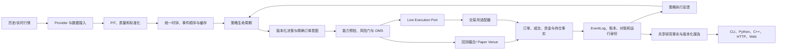
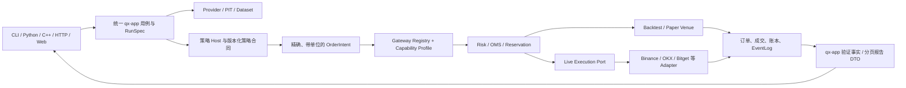

# 牵星 Qianxing：竞品对比、项目架构与优化重构总方案

> 复核日期：2026-10-26
> 目标：把公开竞品的成熟做法映射到牵星的当前代码边界，明确架构优劣、剩余不合理项、改造顺序和发布验收口径。
> 状态：这是面向后续实施的方案，不代表所有项目能力已完成发布或外部验收。
> 配套文档：[竞品与架构决策主方案（10-25）](牵星Qianxing-GitHub竞品与架构重构决策主方案-2026-10-25.md)、[深度复核及逐轮记录](牵星Qianxing-GitHub竞品与架构深度复核及优化重构方案-2026-10-25.md)、[标准策略接口对比](牵星Qianxing-标准策略接口经典框架对比与改进方案-2026-10-25.md)、[模块地图](module-map.md)。

## 1. 结论与架构决策

牵星的优势在于 Rust 交易与回测核心、确定性事件与账本、PIT 数据语义、精确数值类型、跨语言策略入口，以及逐步形成的运行身份和研究产物核验。短板主要是产品旅程偏长、跨入口合同较多、交易所能力与验收范围仍需按维度表达，以及模块数量和历史兼容面使维护成本上升。

建议坚持以下方向：

1. **模块化单体，按事实所有权分层。** 暂不拆微服务；保持进程边界只用于隔离策略、执行器或故障域。
2. **Backtest、Paper、Live 共享策略语义和订单/账本合同。** 环境差异由时钟、撮合、网络、持久化和外部交易所端口表达，不能承诺回测与实盘完全等价。
3. **保留窄端口，组合成用户可理解的 `ExchangeGateway` facade。** 执行、行情、账户、产品规则、私有流和对账是不同能力，不塞入一个巨型 trait。
4. **策略核心合同保持语言无关。** Rust `Strategy`、Python `BaseStrategy`、Python 文件策略、C/C++ ABI 都映射到同一套版本化事件、决策、执行更新和精确数量语义；各语言可以提供易用 helper。
5. **先归并入口和事实，再做优化。** CLI、HTTP、Python、C++、Web 调用同一应用用例和报告事实，不在入口重算交易结果。
6. **研究能力与实盘能力分开发布。** 实盘支持按交易所、产品、账户类型、持仓模式、订单类型、查询/撤改单分别登记；本地离线测试不能替代供应商沙盒验收。

## 2. 复核范围与证据边界

本轮查看了当前 Cargo workspace、`docs/module-map.md`、`qx-strategy`、`qx-execution`、`qx-adapter`、Python 策略基类和已有架构方案，并查阅了下列项目的公开仓库及官方文档。workspace 当前为 29 个 package，其中 28 个 `qx-*` crate 和 `contract-tests`。仓库工作区存在大量既有改动；本方案描述的是当前本地源码形态，不把它说成已提交版本。

本轮未做同机性能对照、完整构建验收、外部交易所沙盒验收或生产批准。因此容量、供应商真实行为和发布状态仍应以 `maturity/` 证据登记与对应运行记录为准。

证据状态应分别记录：

| 状态 | 能支持的结论 |
|---|---|
| `implemented` | 源码存在对应实现。 |
| `code_tested` | 本地契约、集成或构建证据覆盖指定行为。 |
| `packaged` | 指定平台和 Python/Rust/C++ 消费方式通过干净安装验收。 |
| `sandbox_tested` | 指定供应商、产品、账户及订单范围完成真实沙盒往返和恢复验收。 |
| `production_approved` | 生产范围经过独立的凭据、权限、操作和回滚审批。 |

## 3. GitHub 竞品对照

比较按公开定位和接口设计进行，不是性能排名。各框架的市场范围、撮合假设和运行目标并不相同。

| 项目 | 强项 | 需要谨慎的边界 | 牵星值得吸收的做法 |
|---|---|---|---|
| [NautilusTrader](https://github.com/nautechsystems/nautilus_trader) | Rust 核心、Python/Rust API、事件驱动；Backtest、Sandbox、Live 共享系统组件；文档明确数据与撮合的先后、订单回报、恢复边界。 | 抽象与配置多，上手成本高；相同策略代码仍无法消除延迟、交易所行为和外部状态差异。 | 统一生命周期、数据/执行边界和确定性事件顺序；提供高层便捷入口与低层控制 API。[架构](https://github.com/nautechsystems/nautilus_trader/blob/develop/docs/concepts/architecture.md) · [回测流程](https://github.com/nautechsystems/nautilus_trader/blob/develop/docs/concepts/backtesting/execution-flow.md) |
| [Freqtrade](https://github.com/freqtrade/freqtrade) | 加密交易工作流完整；指标、入场/出场、参数搜索和回测路径清晰；提供 lookahead 与 recursive 分析。 | 主要面向加密交易机器人；OHLCV 研究便利不能替代深度撮合、跨市场账本或供应商实测。 | 策略文件安装即跑、回测结果可导出、偏差检查和参数搜索融入同一旅程；信号函数与运行时回调明确分层。[策略回调](https://github.com/freqtrade/freqtrade/blob/develop/docs/strategy-callbacks.md) · [策略与指标](https://github.com/freqtrade/freqtrade/blob/develop/docs/strategy-customization.md) · [Hyperopt](https://github.com/freqtrade/freqtrade/blob/develop/docs/hyperopt.md) |
| [Jesse](https://github.com/jesse-ai/jesse) | 加密策略研究入口紧凑；公开项目包含策略优化、研究 API、交互式交易图、规则显著性与 Monte Carlo 分析等研究能力。 | 适合对标策略研究产品体验；其公开介绍不能证明覆盖牵星要求的跨交易所账户账本、Rust/C++ 多语言协议及逐操作供应商门控。 | 借鉴从 Python 脚本调用回测/优化/诊断、结果回看与稳健性检查的连贯路径；候选仍由牵星事件内核复算，且保存数据、参数、成本和时间切分身份。[官方仓库与 Research API](https://github.com/jesse-ai/jesse) |
| [Hummingbot](https://github.com/hummingbot/hummingbot) | 聚焦加密资产交易；Connector 统一不同交易所 REST/WebSocket 接口；Strategy V2 将长期运行的 Script/Controller 与有明确结束条件的 Executor 分开，并可由 Controller 管理多个交易对/子策略。 | 连接器抽象不消除每家交易所的产品能力差异；Executor 是运行时交易工作流，不等同于牵星逐事件回测撮合、跨账户账本、运行证据或供应商验收。 | 吸收“策略编排器管理可恢复/可观测的有限执行单元”的组织方式；牵星可把 TWAP、网格、分批开仓/对冲等实现为受 Risk/OMS 约束的 execution algorithm，而不是把策略直接连接器调用包装成通用 Gateway。[Strategy V2](https://github.com/hummingbot/hummingbot-site/blob/main/docs/strategies/v2-strategies/index.md) · [Executors](https://github.com/hummingbot/hummingbot-site/blob/main/docs/strategies/v2-strategies/executors/index.md) · [Connector overview](https://github.com/hummingbot/hummingbot/blob/master/README.md) |
| [VeighNa / vn.py](https://github.com/vnpy/vnpy) | 中文交易开发者熟悉；Gateway、事件引擎、CTA 模板及 `on_init/on_start/on_bar/on_tick/on_order/on_trade/on_stop` 容易理解。 | Gateway 能力随具体接口、产品和账户而变；Python 回调形态本身不证明高吞吐或外部链路已验收。 | 采用简洁、可发现的策略基础回调和账户/订单通知；把连接器能力和状态暴露给用户。[CTA 模板](https://github.com/vnpy/vnpy/blob/master/docs/community/app/cta_strategy.md) · [引擎策略装载](https://github.com/vnpy/vnpy_ctastrategy/blob/main/vnpy_ctastrategy/engine.py) |
| [Backtrader](https://github.com/mementum/backtrader) | `prenext/nextstart/next` 解决指标未预热阶段；`notify_order/notify_trade` 反馈简单明确；Analyzer/Observer 可组合。 | 经典 Python 引擎的生态和运行模型有年代感，复杂实时恢复、多账户执行治理需由应用补足。 | 明确 warmup 状态、订单与成交反馈，提供独立分析器接口，不让策略作者手工重建通用统计。[策略实现](https://github.com/mementum/backtrader/blob/master/backtrader/strategy.py) · [策略文档](https://github.com/backtrader/backtrader-docs/blob/master/docs/strategy.rst) |
| [vectorbt](https://github.com/polakowo/vectorbt) | 向量化和广播对大量参数/标的组合预筛很有效；研究输出适合快速可视比较。 | 参数矩阵回测不等同逐事件撮合，尤其在共享资金、队列、部分成交、保证金和跨腿故障上。 | 加入“快筛 → 事件引擎复算 → 样本外检验”的两段研究流程，不把向量化结果当最终执行结果。[研究与特性](https://github.com/polakowo/vectorbt/blob/master/docs/docs/getting-started/features.md) |
| [RQAlpha](https://github.com/ricequant/rqalpha) | Python API 简洁；以事件和 Mod 组织扩展；支持多标的研究和回测分析。 | Python 扩展与特定数据/产品生态有自己的边界；抽象短不代表跨语言、精确单位和交易所行为天然一致。 | 降低新策略的最小概念集合；让扩展点由稳定合同管理，而不是把内部实现直接暴露给策略。[仓库](https://github.com/ricequant/rqalpha) · [事件与 Mod](https://github.com/ricequant/rqalpha/blob/master/docs/source/development/event_source.rst) |
| [LEAN](https://github.com/QuantConnect/Lean) | 多资产、研究/回测/优化/实盘覆盖面广；项目、算法、数据与运行配置有相对完整的工作流。 | 能力依赖具体 brokerage、data feed、市场规则和运行环境；功能广度不等于每种连接器/资产都具有同等验收等级。 | 借鉴“创建项目→运行→优化→报告”的可发现入口和算法模板；保留牵星自己的明确精度、EventLog、账本与能力证据边界。[仓库](https://github.com/QuantConnect/Lean) |

### 3.1 竞品对照后的定位

牵星适合形成“**研究和生产共享交易事实核心，Python 做研究控制与策略开发，Rust 管确定性执行边界**”的定位。对比之下，牵星可在多语言、精确交易合同、事件/账本复核和多账户研究上形成差异；应优先补足安装即用、参数研究、报告交互和可验证的适配器能力，而不是追求功能列表比竞品更长。

## 4. 当前架构与主链

### 4.1 代码分层概览

| 层 | 代码入口 | 责任边界 |
|---|---|---|
| 领域与统一协议 | `qx-core`、`qx-guanxing`、`qx-spec`、`qx-protocol` | 标的/账户/场所身份、精确数值、市场事件、PIT 可见性和版本化协议。 |
| 数据与持久化 | `qx-data`、`qx-provider`、`qx-datastruct`、`qx-storage` | 数据源、目录、质量、列式结构和耐久工件。 |
| 策略与仿真 | `qx-strategy`、`qx-xingban`、`qx-factor`、`qx-risk` | 策略事件/决策、撮合/费用/保证金模型、因子和风险规则。 |
| 执行和对账 | `qx-zhenlu`、`qx-execution`、`qx-adapter`、`qx-genglu` | 风控准入、OMS、执行端口、Venue 报文映射、订单恢复与对账。 |
| 用例和运行时 | `qx-app`、`qx-service`、`qx-runtime`、`qx-orchestrator`、`qx-control`、`qx-scheduler` | 研究用例、服务装配、worker 生命周期、控制与调度。 |
| 对外消费面 | `qx-api`、`qx-cli`、`qx-sdk`、`qx-python`、`python/`、`cpp/`、`web/console/` | 参数适配、授权、绑定、展示和用户操作；不另造账务真相。 |

### 4.2 目标调用主链



行情和执行环境可以不同，但策略所收到的规范事件、意图、回报身份和账务单位必须一致。Live 连接器不得绕过风险、OMS、EventLog 和账本；回测结果不得将模拟成交描述为供应商能力证据。

### 4.3 已具备且应保留的设计

- Rust workspace 为核心域划分了稳定 crate，包含数据/PIT、仿真、策略、执行、存储、应用用例和用户适配面。
- `qx-strategy::Strategy` 已有 `on_init`、历史预热声明、`on_warmup_complete`、`on_start`、`on_event`、执行更新、订单状态和诊断快照入口。
- Python `qianxing_strategy.BaseStrategy` 为 Bar、Tick、OrderBook、Timer 提供可选分派 helper；策略决策最终回到 Rust 校验与风险/OMS 链。
- `qx-execution` 以 `VenuePort` 和 `VenueRouterPort` 定义窄执行协议；`qx-adapter` 负责具体 Venue 映射。该接口不声称自己已经覆盖行情、账户查询和产品元数据。
- 精确十进制、订单能力检查、策略身份、事件/运行身份和报告核验是良好基础，避免退化成“策略直接拼交易所 API”。
- 已有 Python、C/C++、CLI、HTTP 和 Web 消费面，可将其收敛到共享用例，而非再造一套服务。

## 5. 架构和开发细节中的不合理项

| 优先级 | 问题 | 影响 | 建议决策 |
|---|---|---|---|
| P0 | 策略生命周期与更新合同在 Rust trait、Python callback、Python 文件协议和 C ABI 之间分段演进。 | 相同策略在不同宿主收到的状态类别、字段和停机原因可能不一致；作者难以判断哪些回调可依赖。 | 用一个版本化语言无关 `StrategyEvent/StrategyUpdate/StrategyDecision` 作为事实合同，各语言 helper 只做类型分派；建立宿主×事件类型覆盖表。 |
| P0 | `VenuePort` 只代表执行能力，数据订阅、账户读、合约/精度规则、私有流和对账仍分布在其他接口或 worker。 | 若把 `VenuePort` 改成巨型 `ExchangeGateway` 会产生高耦合；若不提供组合视图则应用层装配复杂。 | 保留窄 ports，新增可组合 `ExchangeGateway` facade/registry，由 Data、Execution、AccountQuery、InstrumentCatalog、OrderStream、Reconciliation、CapabilityProfile 等端口按需组成。 |
| P0 | 多账户联合与跨交易所套利容易被误读为共享账户或原子提交。 | 资金、持仓、费率、保证金和故障恢复按交易账户隔离；跨 Venue 一腿成交而另一腿失败是常态边界。 | 组合层做意图分配，账户层分别记账；跨 Venue 用持久化 saga、补偿、超时和对账，不承诺跨所原子性或共用购买力。 |
| P0 | 小币种数量、价格、报价币预算、最小名义与步进精度合同横跨 Python/JSON/Rust/交易所字符串。 | float、错误 scale 或步进舍入可能让模拟和实单请求不同。 | Schema 明示单位/scale/currency，金额用 decimal string 或整数原始单位；从交易所规则建立版本快照并在 submit 前校验，禁止静默舍入。 |
| P1 | 用户面对多种回测、文件策略、实验、报告和 API 入口，第一次跑通需要掌握太多对象。 | 代码能力强但产品上手成本高，安装包难以形成直达价值。 | 提供一个 Quick Research 用户旅程：装包 → 指定策略文件 → 预检 → 跑基线 → 搜索/诊断 → 对照 → 导出报告。命令面只装配 qx-app 用例。 |
| P1 | 参数搜索结果易过拟合，预热/未来数据/滚动递归偏差诊断还需要形成统一流程。 | 单次回测的最高收益不是可信的最佳策略；搜索跨资产/窗口会产生多重比较偏差。 | 搜索产物必须含数据版本、搜索空间、目标函数、随机种子、训练/验证/测试区间、候选与淘汰理由；最终策略做样本外/滚动验证和偏差诊断。 |
| P1 | 报告 schema、事件分页、单市场/多市场/多腿/多账户读链按运行类型逐步增长。 | 报告字段、跨入口一致性、兼容升级和前端开发成本持续增加。 | 统一 `ResearchRunReport` 核心事实和有界分页接口；特定运行只扩展 typed section。将事实计算留在 qx-app，页面只展示已计算事实。 |
| P1 | 能力状态会被误解成“交易所支持”。 | 代码实现、离线测过、供应商沙盒测过与生产批准不是一个结论。 | 发布能力按 venue×product×account mode×position mode×operation×order type 登记证据；命令先做 capability preflight 并指出缺哪个 scope。 |
| P2 | crate 分层良好但 workspace 的概念数量多，部分 application/use case、report、CLI 目录较复杂。 | 改一项功能可能需多处注册和 DTO 转译；新开发者需要大量架构导航。 | 先拆 `qx-app`、`qx-cli`、适配器内部模块和 schema 生成工作流，不急于新增 crate；只有依赖方向和独立演进明确时才拆包。 |
| P2 | 容量和性能印象可能由合成基准外推。 | 不能确定多市场、深度、多策略、多账户和报告一起运行时的内存/延迟边界。 | 以真实工作负载做容量画像：输入行数、市场/策略/账户数、事件密度、报告体量、并发任务、峰值内存和 p50/p95 时间；优化前后相同机器与数据集对照。 |

## 6. ExchangeGateway 和 BaseStrategy 的建议形态

### 6.1 ExchangeGateway：面向装配的 facade，不是巨型 trait

现有 `VenuePort`/`VenueRouterPort` 是执行端口，职责窄且方向正确。建议在应用装配层以 `ExchangeGateway` 命名一个组合对象/registry：它只暴露某连接在当前 scope 具备的接口和能力；端口仍按职责拆分。

```text
ExchangeGateway
├── MarketDataPort       # 历史行情、订阅、市场时间/序列
├── InstrumentCatalog    # 合约规格、精度、最小数量/名义、杠杆/持仓能力
├── AccountQueryPort     # 余额、权益、保证金、持仓、开放订单
├── VenueExecutionPort   # 下单、撤单、修改；现有 VenuePort 的延续
├── PrivateOrderStream   # 订单/成交/资金/仓位推送
├── ReconciliationPort   # REST 快照、差异分类、恢复游标
└── CapabilityProfile   # 以上能力按产品/账户/操作和证据状态声明
```

`ExchangeGateway` 的装配工厂应拒绝缺失必需端口、冲突市场规则或过期产品规格。策略只能通过 `StrategyContext` 与返回的 intent 交互，不能拿到 gateway。回测 gateway 适配 `qx-xingban` 撮合器，Paper gateway 适配 PaperVenue，Live gateway 才绑定外部连接器；三者共享 capability 验证和订单单位。

2026-10-26 代码切片：`qx-service::exchange_gateway` 已有按 `(venue_id, account_id)` 隔离的 worker 路由注册表；公共行情 worker 可按 venue 复用，私有执行/用户流/对账/恢复仍是分立 worker。账户 EventLog 身份、能力目录 profile 摘要和冻结 `InstrumentRulesV1` 指纹已纳入装配；真实执行的 submit/cancel/account-read 仍由精确 scope preflight 授权。API `/ready` 的 O 层已增加 `exchange_gateways` 诊断，按账户分别输出进程心跳 `status` 与业务探针 `business_status`。Binance/CCXT 行情与用户流 worker 在处理有效业务数据后更新探针；Binance/CCXT 对账 worker 对账户余额查询和对账轮次分别发布业务状态；Binance/CCXT 长驻 Execution worker 在 `Venue::submit/cancel` 返回后发布业务状态，成功为 healthy，确定性拒绝为 degraded，结果未知/需对账/内部不变量错误为 unhealthy。完整对账无差异为 healthy，有差异为 degraded，轮次失败为 unhealthy；账户查询在首次有效响应前失败为 unhealthy，已有有效查询但轮次未完成为 degraded。尚无执行调用的端口、one-shot 入口和未接线 connector 保持 `unobserved`。它仍是 worker 状态投影，不是一个持有全部端口对象的进程内客户端；动态能力目录热更新、操作级错误码、connector 覆盖和真实账户连通性仍有独立边界。

### 6.2 BaseStrategy：最小生命周期 + 可选类型 helper

建议保留 Rust 的统一 `on_event` 作为 wire/ABI 级核心；Python、Rust SDK helper 提供熟悉的 typed hook。必要函数按如下语义统一：

| 函数 | 语义 |
|---|---|
| `on_init(context)` | 每次 run 实例化后初始化内存状态，不下单、不读未来行情。 |
| `StrategySpec/manifest.parameters` / 可选 `validate_config(config)` | 由唯一版本化 schema 声明参数类型、范围、默认值和 choices；validator 只做确定性的跨参数校验，供 CLI/UI/搜索复用。 |
| `history_requirements()` | 声明 Bar/周期/指标预热需要；数据由 host 按 PIT/as-of 提供。 |
| `on_start(context)` / `on_warmup_complete(...)` | 分别表示运行开始和每标的预热完成，二者不能混为 ready。 |
| `on_bar/on_tick/on_order_book/on_timer(...)` | 易用层 typed market hooks；默认 no-op。返回 signal/order intent，不能直接发单。 |
| `on_order_status_update/on_trade(...)`、`on_account(...)`、`on_positions_snapshot/on_position(...)` | 订单/成交与完整账户/持仓快照使用有序、版本化事实；账户更新不改账本，回调 context 不暴露较新的账户状态。 |
| `on_stop(context=None, reason="host_stop")` / `on_error(...)` | Rust 已有版本化 stop context、C ABI 有可选 v2 JSON 回调且旧策略可回退；Bar 与 Tick/L2 backtest 将完成/取消/失败传到策略，Runtime worker shutdown 与统一 `on_error` 生命周期仍需接通。 |
| `diagnostic_state()` | 只读、确定性诊断快照；不得冒充可恢复 checkpoint。 |

策略意图 helper 可逐步提供 `buy/sell/short/cover/close/target_position/set_stop/exit_policy`，但这些 helper 只能创建 typed intent/policy。由 Risk、OMS、交易所能力、精度/金额规则和账户可用资金校验后才可路由。向量化 `populate_indicators/populate_entry_trend/populate_exit_trend` 可作为 Bar 研究适配器，不作为 L2/部分成交/资金费/杠杆保证金的最终结果。

2026-10-27 实施更新：Python Runtime Strategy worker 通过显式 `python_strategy_spec` 接入 `BaseStrategy`，完整 manifest 参数和 validator 在构造前校验；四种传输共用适配器，未配置 class spec 的模块级 `on_event(request)` 保持兼容。该进程支持 Bar、显式 Runtime Tick、L2 OrderBook、调度 Timer、订单/成交和绑定账户的余额/持仓快照；Strategy input v8 承载可持久回放的盘口事实和 exact price/quantity sidecar。Timer 由 `strategy.live_timeframe` 划分的稳定时间桶触发：worker 首次观察到新桶时，使用策略配置、源码摘要和时间桶生成幂等指纹并入队；每个 Timer job 以其 `request_id/as_of` 派发一次 `Timer{name="scheduler", ts=as_of}`，跨桶滞后作业按既有 staleness gate 拒绝。不引入独立墙钟；Timer 的 manifest/runtime `data_level` 必须一致且 `warmup_bars=0`。账户事实按 `(account_id, venue)` 过滤并与订单/成交共用 durable EventLog cursor/checkpoint，重复交付去重；每批最多 10,000 条账户事实，超量时按 EventLog 水位分页，游标只提交已消费区间。account callback 的 `context` 隐去请求中较新的 positions/cash/margin/risk/research targets；策略只读当前快照参数。类策略 JSON `snapshot_state()/restore_state()` 与策略身份、版本、更新游标和行情 cursor 一起提交；恢复语义为 at-least-once，不承诺 exactly-once。CCXT 实时 OrderBook 当前由 REST 快照轮询驱动，不代表 WebSocket 增量盘口或高频能力。

现有标准函数和宿主覆盖细节已记录在[标准策略接口对比方案](牵星Qianxing-标准策略接口经典框架对比与改进方案-2026-10-25.md)，实施时应先按该文档逐项登记兼容性，不另创同义 lifecycle hook。

**面向策略作者的收敛口径：**只要求策略提供一个实际市场决策入口；Bar 策略通常只需 `on_bar`。生命周期、预热完成通知、订单/成交反馈为可选项。核心跨语言合同以 `on_event` 和版本化 DTO 为准，typed hooks 是各语言的便捷分派；向量化 `populate_*` 另属研究适配器。具体函数、经典框架取舍及当前实现边界见上述方案 §10.4。

## 7. 分阶段改造方案

### P0：合同一致与交易链安全

1. 建立策略宿主合同表：Rust callback、Python SDK callback、Python 文件 worker、C ABI、C++ SDK；逐项记录 lifecycle、market event、order status、fill、account/position 更新、取消/重投语义。
2. 固定跨语言的事件顺序、去重键、`event_seq`、请求幂等键、取消/拒绝/未知状态及错误恢复合同；采用兼容版本升级，不直接改坏旧策略。
3. 为 ExchangeGateway registry 建立 capability profile，覆盖交易所、现货/永续/交割、单向/双向持仓、账户模式、订单类型、杠杆、reduce-only、精度和查询/撤单能力。
4. 统一 quantity/price/quote-budget/contract-multiplier/fee/funding 的单位与精度；基于交易所规则做订单预检，明确拒绝还是按明确 policy 量化，不静默修数。
5. 将联合账户/跨 Venue 组合执行定义为 saga：每腿状态可恢复、重启后幂等、差异进入对账；失败时明确补偿/减仓/暂停策略。

**P0 完成条件：**同一份策略事件和意图在各语言宿主映射到相同核心 DTO；任何不支持的产品/订单 scope 在网络提交前失败；跨 Venue 故障注入后可查询每腿状态且可恢复；策略无法越过 Risk/OMS 直接提交。

### P1：研究与易用性闭环

1. 将 Python 包的第一条路径收敛为“本地策略文件 → 自动识别参数与预热 → 数据/能力预检 → 运行基线 → 输出 HTML/JSON”。
2. 给 `optimize` 定义明确搜索空间与预算；首轮快速筛选可用向量化或简化模型，候选必须由完整事件引擎重算。
3. 每次搜索输出 walk-forward/时间切分、训练与测试区间、随机种子、成本/滑点假设、交易数和目标函数，避免只显示一条 top score。
4. 接入 lookahead、warmup/recursive stability、数据质量/缺失、基准收益、滚动波动/回撤、参数扰动和策略间对比诊断。
5. 为研究报告增加统一报告 shell：收益/回撤、逐笔交易、持仓/资金曲线、费用/资金费、参数与偏差诊断、标的/账户/市场拆分；大事件列表仍走分页。
6. 安装包提供最小可运行策略、加密多标的合约策略、A 股策略，以及同一策略配置对应的 CLI/Python 使用示例。

**P1 完成条件：**新用户无需了解 crate 结构即可从安装包运行策略文件并读懂结果；搜索有样本外结果及可复算身份；报告与 CLI/SDK 读取同一份事实。

### P2：模块治理、容量与发行

1. 为 schema、CLI 命令、HTTP 路由、策略更新和能力矩阵建立单一来源或可核对生成物，避免手工多处登记漂移。
2. 报告和 API 统一 reader/DTO，杜绝入口重复实现收益、回撤、交易数或资金曲线口径。
3. 对 `qx-app`、`qx-cli`、`qx-adapter` 按职责继续拆内部模块；新增 crate 必须有独立依赖边界与消费者收益。
4. 建立基准工作负载：Bar、Tick/L2、多标的、多账户、多策略、参数搜索及大报告；记录数据规模、硬件、编译版本、并发、耗时和峰值内存。
5. 只对 profile 找到的热点优化 Rust 热循环；重点审查不必要克隆/分配、事件编码、报告全量聚合、数据重复加载和跨语言拷贝。
6. 发行流水线验证 Python wheel、Rust SDK 消费者、C++ SDK 和 CLI 的安装/运行示例；发布说明按证据成熟度明确 real-live 尚需的 vendor scope。

**P2 完成条件：**容量画像可重跑并能解释机器需求；优化有前后同口径对照；声明支持的平台包能在干净环境执行 quickstart。

## 8. 发布验收矩阵

| 验收面 | 最低检查结果 |
|---|---|
| 回测一致性 | 固定输入、版本、参数、时钟和成本重复运行，关键身份、订单/成交、资金与研究摘要可重现。 |
| 多交易所与小数位 | 对每个 scope 核验 tick/step/min-notional/contract size/quote budget；不支持的订单在 submit 前被拒。 |
| 多账户/多腿 | 账户资金和持仓隔离；部分成交、拒绝、网络未知、重启重放与 saga 补偿有可查记录。 |
| 策略开发 | Rust/Python/C++ 契约例子可运行；预热、订单回报、停止原因和诊断字段有稳定版本。 |
| 研究有效性 | 参数搜索可重算，有时间切分、偏差诊断和参数稳定性；最终结果由事件引擎重跑。 |
| 报告与入口 | CLI、Python SDK、HTTP/Web 读取同一研究事实；事件明细分页且 report schema 可核验。 |
| 容量与安装 | 指定代表工作负载有机器、耗时和峰值内存说明；发行包 quickstart 在干净环境通过。 |
| 实盘成熟度 | 代码实现、离线测试、供应商沙盒和生产批准逐项区分。没有对应外部证据的能力不得标记为已验收。 |

发布时应分别给出 Research release 和 Live capability ledger。通过回测和安装验收不能自动提升供应商验收级别。

## 9. 实施顺序和依赖

```text
策略/交易 DTO 与能力矩阵（P0）
              ↓
ExchangeGateway 装配、精度预检、Saga 恢复（P0）
              ↓
共享 RunSpec/研究 reader/策略文件 quick research（P1）
              ↓
偏差诊断、样本外搜索、交互报告（P1）
              ↓
容量画像、热点优化、发行包验收（P2）
```

先落实合同和事实归属，再扩展用户体验和吞吐能力。每个改造切片都要注明新增事实的唯一 owner、跨语言 schema 版本、旧入口兼容策略、证据范围、失败行为和恢复方式。

## 10. 外部参考资料

- [NautilusTrader Architecture](https://github.com/nautechsystems/nautilus_trader/blob/develop/docs/concepts/architecture.md)
- [NautilusTrader Backtest Execution Flow](https://github.com/nautechsystems/nautilus_trader/blob/develop/docs/concepts/backtesting/execution-flow.md)
- [Freqtrade Strategy Callbacks](https://github.com/freqtrade/freqtrade/blob/develop/docs/strategy-callbacks.md)
- [Freqtrade Strategy Customization](https://github.com/freqtrade/freqtrade/blob/develop/docs/strategy-customization.md)
- [Freqtrade Hyperopt](https://github.com/freqtrade/freqtrade/blob/develop/docs/hyperopt.md)
- [Jesse Research API、优化和分析](https://github.com/jesse-ai/jesse)
- [Hummingbot Strategy V2](https://github.com/hummingbot/hummingbot-site/blob/main/docs/strategies/v2-strategies/index.md)
- [Hummingbot Executors](https://github.com/hummingbot/hummingbot-site/blob/main/docs/strategies/v2-strategies/executors/index.md)
- [Hummingbot Connector Overview](https://github.com/hummingbot/hummingbot/blob/master/README.md)
- [VeighNa CTA Strategy](https://github.com/vnpy/vnpy/blob/master/docs/community/app/cta_strategy.md)
- [Backtrader Strategy](https://github.com/backtrader/backtrader/blob/master/backtrader/strategy.py)
- [vectorbt Research Features](https://github.com/polakowo/vectorbt/blob/master/docs/docs/getting-started/features.md)
- [RQAlpha Event Source](https://github.com/ricequant/rqalpha/blob/master/docs/source/development/event_source.rst)

## 11. R1 便携多账户证据复算进展（2026-10-26）

已将本方案中的“运行身份、输入证据、失败恢复和跨入口可核验”先落到多账户 Bar Evidence：manifest v2 将每个账户的输入路径与 SHA-256 绑定；部分失败账户的输入文件或缺失状态随包保存；`verify-multi-account-run --recompute` 在隔离目录复算并对拍父 RunManifest、批次摘要和子账户身份。成功与部分失败两种搬迁场景均在删除 source workspace 后通过回归，篡改输入摘要或复活缺失文件会拒绝。

本轮验收：两个便携复算集成用例和一个 CLI 缺输入行为用例通过；Schema JSON、定点格式、差异检查通过；架构 `--fast` 覆盖 226 项且无重复。边界仍为全失败批次没有父级 RunManifest，旧 v1 部分失败包缺少失败输入材料，均不伪称可重算；其他 RunType 的 portable/recompute、Research 发布门、供应商验收和容量画像仍需继续实施。

## 12. R1 策略文件参数默认值与组合校验（2026-10-26）

策略 manifest 声明的默认值现在会在策略文件单次运行的数据集预检前绑定到目标配置；搜索运行在每个候选实例化时重新绑定，避免候选值覆盖、默认遗漏或回测配置与策略实例不一致。可选模块函数 `validate_config(config)` 在单次运行预检前及每个搜索候选 factory 调用前执行，收到只读的已解析参数映射；异常拒绝运行，返回非 `None` 也拒绝。多市场运行按目标策略 ID 绑定，未选策略槽保持不变。

验收：策略参数 manifest 测试 18/18、策略文件 CLI 测试 13/13、BaseStrategy 测试 16/16 通过；修改文件 Python 编译检查与定向 `git diff --check` 通过。范围仍限于策略文件 manifest；直接 Python SDK 调用尚不自动运行参数 schema 预检，validator 的外部副作用约束由接口文档规定，供应商验收、其他 run type 的可移植复算、容量画像和 Research 发布门仍开放。

本轮后续切片：策略文件可显式导出 `STRATEGY_CLASS`，并在该类上声明与模块级完全相同的 `STRATEGY_MANIFEST` 及 `validate_config(config)`。`inspect-strategy`、默认参数绑定、单次运行预检和每个搜索候选工厂复用原 manifest 路径；模块级与类级 manifest 内容冲突，或两处同时声明 validator 时均拒绝。仓库 SMA 策略示例已改为 `BaseStrategy` 子类，通过 `on_bar` 与 intent builder 演示这一入口，并将研究参数限定为 Rust 严格规格允许的 `fast_window/slow_window`。真实 CLI 检查和回测通过，单市场 6 个、联合多市场 8 个搜索候选均成功且产生 OOS 报告。直接 `run_backtest_with_strategy(...)` SDK 调用仍是低层 callback 接口，不因此宣称拥有文件策略的 manifest preflight。验收：manifest/类策略示例/真实 Rust 回测 26/26，策略文件 CLI 13/13、BaseStrategy 17/17，Python 全量测试 389 项通过/3 项跳过，架构门禁四片覆盖 227 项且无重复。

## 13. 本轮代码级复核增补

以下是对当前工作树中入口、模块清单、关键接口和成熟度登记的结构复核。文件规模仅用于定位复杂度热点，不单独作为拆 crate 的理由；本节不代表全量构建、性能压测或供应商验收。

| 复核项 | 当前证据 | 结构判断与改进方向 |
|---|---|---|
| Workspace / 发布口径漂移 | 本轮发现并修复：根 `Cargo.toml` 有 29 个成员（28 个 `qx-*` 包和 `contract-tests`），README 曾写 25；现 README 已同步，并由 `workspace_inventory_check` 把数量和成员类型纳入架构门禁。 | Workspace 数量漂移已关闭；CLI 命令、HTTP 路由、示例模板、能力证据仍应保持生成或同源校验，README 不再保留过期 workspace 快照。 |
| App 与 Facade 的事实所有权 | `docs/module-map.md` 声明 `qx-app` 拥有研究事实和报告复核；但同一模块地图仍把成交归因指向 `qx-cli`。`qx-app/src/report_read.rs` 约 90 KB，`qx-cli/src/report_multi_market.rs`、`report_multi_account.rs` 分别约 79 KB、78 KB；API 另有多类报告 adapter。 | 成交归因、收益/回撤、费用等领域计算应有唯一 owner。CLI/API/Python/Web 只把稳定 DTO 投影成文件或页面。先做逐字段归属表和跨入口金样对照，再按责任拆文件，避免搬文件时复制口径。 |
| 用例与报告变体增长 | `qx-app/src/cases/` 按单腿、多腿、多市场、多账户、Depth、实验继续分型；报告 schema 和 `app_surface` adapter 也随运行形态增长。 | 共用运行身份、质量、收益、分页、诊断、谱系等基本块；运行特定差异放到具名 section，不以一个含大量可选字段的万能 DTO 取代类型边界。分页游标应带 Run 身份与 schema 版本。 |
| CLI 聚合边界 | `qx-cli` 是单一 binary、组合根；`crates/qx-cli/src` 内报告 HTML/XLSX、命令、worker 装配和校验逻辑并存，若干报告文件超过 60 KB。它直接依赖多个领域 crate，同时也依赖 `qx-app` 和 `qx-service`。 | 组合根保留，但禁止 CLI 成为新业务事实 owner。后续 CLI 只做参数解析、用例调用、路径/终端适配；报告 renderer 可先拆成内部模块并依赖统一报告 DTO，确有独立消费者后再评估 crate。 |
| Live / Backtest / Paper 语义 | README 明确说明回测有 Bar/L1/L2 撮合模型，PaperVenue 使用 quote 首档 touch，二者不是同一撮合机；`qx-service` 分别装配 Binance 与 CCXT 执行、行情、用户流和对账 host。 | “同策略”只能承诺策略事件/意图合同可复用，不能承诺撮合、时序、延迟、部分成交或网络故障结果等价。按环境×数据档位×订单类型列出模型能力及偏差提示。不同连接器须通过同一套精度/能力/订单状态契约对拍。 |
| ExchangeGateway 组合边界 | `qx-execution` 暴露 `VenuePort` 等稳定窄端口；`qx-adapter` 含 Binance 传输和 Venue 适配；`qx-service` 注册账户级端口，并从 worker metrics 生成 `/ready` O 层健康视图。 | 配置路由和进程心跳不能证明 connector 业务请求或账户私有读成功；Gateway 仍是 worker composition/read model，不是持有全部端口对象的运行态客户端。 | 继续按窄接口接入业务级健康信号；明确区分 configured、worker healthy、private query verified、sandbox-tested；目录/profile 变化不得绕过 operation scope preflight。 |
| 交易精度与合约规格 | Rust 领域有 `ExactDecimal`、精确订单金额与能力预检；策略上下文仍有 `cash`、`positions` 等 raw 整数映射；连接器接收的交易所规则还需跨市场保持一致。 | 所有 raw 数值必须能追溯到币种/标的、scale、tick/step/minimum、合约乘数、结算币和规则快照版本。金额预算、base 数量、合约张数不得共用一个无单位字段；只在明示量化规则时舍入，默认拒绝非法数量。 |
| 策略合同演进 | Rust strategy、Python `BaseStrategy`、Python 文件 manifest、C ABI 分别有版本常量与 callback 映射；Bar 与 Tick/L2 backtest 已按终态传 stop reason，Runtime worker shutdown 等服务路径仍使用通用 `host_stop`。 | 建立语言无关的合同矩阵：init/start/warmup、Bar/Tick/Book/Timer、order/trade/account/risk、stop/error、intent 和诊断。新增字段用版本兼容升级；先兼容旧宿主再统一 helper，不靠多份手写说明维持一致。 |
| 供应商证据状态 | `maturity/capabilities.yaml` 中交易能力的 `sandbox_tested` 与 `production_approved` 仍为 false；README 也声明无真实账户往返证据。 | 代码路径、离线契约、wheel 安装、demo/testnet 往返和生产批准分别登记。用户当前选择先实现实盘代码、不做供应商验证，因此本阶段只能发布为 `implemented` / 有明确覆盖时的 `code_tested`，不能标成 sandbox 或 production 已验收。 |
| 容量与优化证据 | 已有 [容量与资源画像](容量与资源画像-2026-10-23.md)，包含多市场、多账户、L2、搜索、报告和 API 样本；文档也明确九档完整产品 profile 均为 `unmeasured / unavailable`，并指出证据涉及不同构建指纹/合成负载。 | 保留已有有效测量，不重复造基线；下一步补齐目标产品 profile 的完整组合链和同一 Release/机器口径，特别是多交易所、多账户、合约与完整报告链。微基准和合成输入不能外推成生产容量承诺。 |

### 13.1 最重要的架构结论

当前总体方向合理：Rust 模块化单体负责确定性交易事实和端口，Python/C++/CLI/API/Web 是消费面；数据 PIT、精确数值、能力预检与可复算工件值得保留。主要问题不是缺更多 crate，而是**用户旅程分散、事实 owner 的文字和实现边界需持续对齐、跨语言协议需单一版本治理、Venue 的能力拼装不够产品化、研究/Live 证据成熟度需要更明确地呈现**。

因此本方案不建议微服务化，也不建议重写内核。先锁定合同和事实 owner，再把易用 API 与 renderer 建在共同事实上；只在有独立依赖边界、独立消费者和可验证发布收益时拆包。

## 14. 从 GitHub 竞品吸收的具体设计

公开实现只用于吸收工作流和接口设计，不表示牵星已具备相同功能，也不据此作速度排名。

| 竞品做法 | 对牵星的映射 | 具体改进 |
|---|---|---|
| NautilusTrader 以共享 Kernel 组织数据、风险、执行、Portfolio、策略和 cache；回测执行流程明示“先让已有订单面对新行情，再调用策略，最后结算新命令”。 | 牵星有 EventLog、策略、风控、OMS、回测撮合和 Live host，但 Paper 与回测撮合模型有意不同。 | 把事件同时间戳的排序、已挂单撮合/策略回调/新委托撮合、timer settle、延迟命令规则写成可读的“运行时序规范”；Backtest/Paper/Live 各自实现同一订单事实接口，并显示环境差异。参考：[NautilusTrader 架构](https://github.com/nautechsystems/nautilus_trader/blob/develop/docs/concepts/architecture.md)、[回测执行顺序](https://github.com/nautechsystems/nautilus_trader/blob/develop/docs/concepts/backtesting/execution-flow.md)。 |
| Freqtrade 将 `populate_indicators` / entry / exit 信号与动态回调区分，并把回测、Hyperopt、lookahead 和 recursive 检查放在同一用户旅程。 | 牵星有事件策略、策略文件、manifest、搜索、未来数据与预热诊断，但新手仍需理解多个命令与产物。 | 提供高层 `qianxing research` 流程：发现参数与 warmup → 数据/策略预检 → 基线 → 偏差诊断 → 有预算搜索 → OOS 复算 → 交互报告。快筛可向量化，但最终候选由事件引擎重算。参考：[Freqtrade callbacks](https://github.com/freqtrade/freqtrade/blob/develop/docs/strategy-callbacks.md)、[Hyperopt](https://github.com/freqtrade/freqtrade/blob/develop/docs/hyperopt.md)、[Lookahead analysis](https://github.com/freqtrade/freqtrade/blob/develop/docs/commands/lookahead-analysis.md)、[Recursive analysis](https://github.com/freqtrade/freqtrade/blob/develop/docs/recursive-analysis.md)。 |
| Hummingbot Strategy V2 将 Script 用于简单策略和快速试验，将 Controller 用于可配置的多策略编排，并用有生命周期的 Executor 承接有限交易任务。 | 牵星已有 Strategy、订单意图、execution capability、Risk/OMS 和多腿 RunType，但“持续策略决策”和“有限执行算法”在用户级入口仍不够清楚。 | 引入明确的 `StrategyController → ExecutionAlgorithm/Executor → OrderIntent` 分层：例如 TWAP、分批建仓、跨所对冲必须有持久状态、超时、取消、部分成交、失败补偿和归因；所有命令仍经同一能力门、Risk、OMS、EventLog 和账户账本。Executor 的状态不能替代最终订单/成交事实。参考：[Hummingbot Strategy V2](https://github.com/hummingbot/hummingbot-site/blob/main/docs/strategies/v2-strategies/index.md)、[Executors](https://github.com/hummingbot/hummingbot-site/blob/main/docs/strategies/v2-strategies/executors/index.md)。 |
| vn.py 将 `on_init/on_start/on_stop/on_tick/on_bar/on_order/on_trade` 作为可发现的策略回调，并区分初始化完成与允许交易；RQAlpha 用事件总线和 Mod 承接扩展。 | 牵星 BaseStrategy 的 typed hooks 是合适的易用层，但需与 Rust/Python 文件/C ABI wire contract 同步。 | 把 warmup 完成与开始交易显式拆成两个状态；基础 helper 默认 no-op；订单、成交和拒绝/撤单状态可追踪；扩展用注册/清单声明，不让策略 import 私有 host internals。参考：[vn.py CTA 回调](https://github.com/vnpy/vnpy/blob/master/docs/community/app/cta_strategy.md)、[RQAlpha event source / Mod](https://github.com/ricequant/rqalpha/blob/master/docs/source/development/event_source.rst)。 |
| vectorbt 通过广播和矩阵运行快速比较大量信号与参数组合；它提供的是研究/仿真选择，不自动成为事件级 Venue 撮合证据。 | 牵星参数搜索需要更快的候选预筛，同时仍保留精确账务和资金共享。 | 引入两阶段 evaluator：轻量筛选（声明简化假设、保留预算和候选身份）→ 完整 Rust 事件回测 → 滚动/样本外复算；快筛结果标签不可与完整回测排名混用。参考：[vectorbt Portfolio / broadcasting](https://github.com/polakowo/vectorbt/blob/master/vectorbt/portfolio/base.py)。 |
| LEAN CLI 将 project create、research、backtest、optimize、live 收敛为开发者能够记住的入口。 | 牵星命令面和不同脚本入口积累较多。 | 在保留低层 CLI 的前提下增加带模板、doctor 和默认目录的研究级门面；同一 RunSpec 被 Python SDK 和 CLI 共用，不复制参数解析及结果口径。参考：[LEAN GitHub / CLI workflows](https://github.com/QuantConnect/Lean)。 |

## 15. 目标结构和核心合同



目标结构约束如下：

1. **`ExchangeGateway` 是组合 facade + registry。** 它按连接会话绑定 `MarketDataPort`、`InstrumentCatalog`、`AccountQueryPort`、`VenueExecutionPort`、`PrivateOrderStream`、`ReconciliationPort` 和 `CapabilityProfile`；每个端口可单独声明不支持。实现侧保持窄 trait，策略侧不得持有 Gateway。
2. **OrderIntent 是跨环境交易合同。** 至少包含 account、venue、instrument、product、side、position side、quantity kind、数量/预算、价格、TIF、reduce-only、margin/leverage policy、幂等键、策略/run 身份；以版本化 schema 序列化，禁止把 `float` 当作金额真相。
3. **`BaseStrategy` 是语言 helper，不是强制 ABI。** 底层统一为 `StrategyEvent`、`StrategyUpdate`、`StrategyDecision`；Rust/Python/C++ 可以采用自己的惯用接口，适配层必须映射成相同 DTO。市场 callback 返回 intent，不直接调交易所 API。
4. **时序和恢复均是合同。** 事件按 `(event_time, sequence, phase)` 排序；订单网络超时后进入 `unknown`，查询/对账确定状态前不得盲目重发；重启恢复以持久化订单事实与幂等键为准，不以策略内存猜测。
5. **账户资金仍按结算账户隔离。** 多账户联合是组合器分发和聚合报告；跨 Venue 套利是持久化 Saga，不承诺多所原子成交。每条腿独立记录 intent、reservation、submit、ack/fill、补偿和 reconcile。
6. **报告有一个领域事实 owner。** `qx-app` 负责核验、收益/成本事实和版本化报告 DTO；CLI 输出静态 HTML/XLSX，API 提供授权与分页，Python 暴露对象，Web 提供交互。各 facade 不得再算一份净值或胜率。

## 16. 可执行的重构工作包

| 工作包 | 优先级 | 落地范围 | 交付物 | 完成门 |
|---|---|---|---|---|
| W0：事实与证据基线 | P0 | Cargo/workspace 元数据、入口清单、报告事实 owner、能力 scope、schema registry。 | 一份可生成的模块/入口/能力/产物清单；校正 README 与目录文档的包数；每个成熟度状态带可定位证据。 | 从源码生成的清单与 README/门禁一致；`implemented/code_tested/packaged/sandbox_tested/production_approved` 无歧义；没有供应商证据的 Live scope 明确未验收。 |
| W1：精确数值与 Venue 能力 | P0 | 标的规则快照、币种/合约单位、能力 operation scope、下单/撤单/修改/查询的 preflight。 | 统一 `InstrumentRulesVn` 与 `CapabilityProfileVn`；Gateway registry 接口；适配器 operation 映射表；错误原因码。 | Binance/OKX/Bitget 的声明 scope 在 connector 创建/网络请求前拒绝不匹配；不同数量语义不会被混算；规则文件可追踪来源和版本。 |
| W2：策略语言协议 | P0 | Rust/Python callback、Python 文件策略、C ABI/C++ 的启动、warmup、事件、intent、订单回报、停止/错误合同。 | 合同覆盖矩阵、兼容迁移表、canonical JSON/schema、跨语言 DTO 示例。 | 同一输入事件和策略输出在各宿主归一化后相同；不支持的事件、字段或 ABI 版本明确失败；旧策略迁移有兼容路径。 |
| W3：Live 订单状态和恢复 | P0 | 多账户、现货/合约、单向/双向、杠杆、未知提交结果、部分成交、撤单竞态、恢复与 Saga。 | 明确状态机和 durable operation log；每腿 Saga 报告；故障/重启恢复说明。 | 离线故障注入可验证幂等、禁止盲重发和可追溯补偿。按用户当前要求先做代码级实现；无沙盒运行记录就维持未验收。 |
| W4：Quick Research 与参数可信度 | P1 | 本地策略文件、Python package API、参数 manifest、偏差诊断、搜索预算、样本外。 | 一条 `load → preflight → run → diagnose → optimize → compare` 路径；RunSpec/Run identity；搜索候选数据结构。 | 安装包中示例能从路径直接跑；搜索报告输出训练/验证/OOS 区间、目标、成本假设、随机种子、候选及淘汰原因；最终候选经完整事件引擎复算。 |
| W5：交互研究报告和读面 | P1 | 单次/多市场/多腿/多账户的研究 DTO、事件分页、HTML/JSON/API/Web。 | 统一 report shell + typed sections；本地可离线查看的交互图表；带身份的 cursor pagination。 | 相同 Run 在 CLI/Python/API/Web 的核心指标一致；报告包含输入身份、PIT/数据质量、成本、交易、回撤、参数、偏差、市场/账户分解；大事件流有限分页。 |
| W6：文件/模块治理 | P2 | 先在 `qx-app`、`qx-cli`、`qx-api` 内按 facts/use case/transport/render 拆分较大模块，清理重复 DTO 映射。 | owner map、单一 schema/命令/路由/清单生成流程；迁移删除重复实现。 | 依赖方向检查确认 facade → app → domain/ports；拆分前后同一输入生成同一 DTO/摘要；不因行数目标引入无消费者 crate。 |
| W7：容量、性能与发行 | P2 | 组合回测、深度、搜索、报告、CLI/Python/C++ 包。 | 可复跑容量数据集与机器记录；profile；wheel/CLI/C++ 消费者安装指南；Research/Live 发布矩阵。 | 输出 p50/p95、吞吐、峰值 RSS、磁盘与数据尺寸；优化前后同机同数据比较；声明支持平台能在干净环境运行示例。 |

依赖顺序：`W0 → W1/W2 → W3`；`W0/W2 → W4 → W5`；`W5 → W6`；`W0 → W7`。W1/W2 与 W4 的实现可以局部并行，但 schema 和 Run identity 必须先稳定再做报告/搜索跨入口绑定。

## 17. 三轮审查方式与发布决策

### 第一轮：静态边界审查

- 核对 crate 依赖方向、事实 owner、schema 版本和 API/CLI/Python/C++ 映射。
- 核对市场规则、decimal scale、产品类型、position side、杠杆/保证金单位和 capability scope。
- 输出问题台账，每项包含 `证据路径 → 用户影响 → 唯一 owner → 修复切片 → 可观察验收`。

### 第二轮：核心链路审查

- 逐条模拟 Bar 回测、L2 回测、Paper、Live 订单生命周期及多账户多腿分支。
- 对照输入 → 预热 → 策略事件 → 决策 → 风控 → reservation → submit → ack/fill/cancel/unknown → ledger/EventLog → reconcile → report。
- 重点检查被拒、超时、断连、重复/乱序回报、部分成交、进程重启和其中一条套利腿失败；每一步必须有明确终态、持久化事实或显式待恢复状态。

### 第三轮：发布可用性与证据审查

- 从干净 Python 环境和 CLI 安装入口运行策略示例；核对平台支持表、依赖和产物路径。
- 复算搜索冠军并核对 OOS、lookahead、warmup、成本、数据指纹和报告分页。
- 对照能力目录和外部运行记录。按当前“先完成实盘代码、不做供应商验证”的决定，不把 Live 升级为 `sandbox_tested`；未来真要提升证据档位，再单独补 Testnet/Demo 范围验收。

发布按两个产品线作决定：

- **Research release**：策略文件、确定性回测、研究诊断、搜索和离线报告达到安装与复算门槛后可单独发布。
- **Live code profile**：执行器、精度、能力门、状态恢复和离线故障场景实现完成可发布代码；供应商范围继续标记未沙盒验收，不能由本机 mock 或离线测试替代。

本轮未对同机容量、全量测试矩阵、干净环境安装或任何供应商账户进行验收；以上工作包的完成状态必须以对应证据更新，不从文档存在推导实现已完成。

## 18. P0 执行能力 operation 独立门控进展（2026-10-26）

已把原来“能 submit 就可沿用同一能力检查 cancel”的隐式假设改成 operation 明确授权：`maturity/capability-matrix.yaml` 的每个真实 `execution_scope` 独立列出 `operations`；生成器校验只接受非空、无重复的 `submit` / `cancel` 列表，并同步输出 API、Python JSON 和 Markdown 目录。

Rust `qx-app` 增加 cancel 专用 capability evaluator，精确复用 venue/product/account/margin/position/order-shape scope，再核对 `cancel` operation。`qx-service` 增加撤单入口 gate；Binance 与 CCXT 队列撤单均在创建真实 connector 前解析能力，不允许提交能力自动推导撤单能力。`qx-api` 能按 `operation=cancel` 查询对应声明范围；生成目录 facets 和 Web 表单也已提供 operation 候选及筛选。控制命令 `validate_as` 先对照服务端授予权限，再校验命令 payload，防止无权调用因 malformed cancel payload 先得到 400。README workspace 数量已修正为 29，架构门禁现在直接将 Cargo workspace 成员与 README 数字对账。

本地验收：四个 crate 单元测试 352/352 通过；架构 `--fast` 四片完整覆盖 227 项、无重复；能力目录 `--check` 和 Web 控制台 JavaScript 语法检查通过。外部证据未改变：Binance/CCXT 的 scope 仍为 `implemented-unverified`，本轮没有使用凭据、连接沙盒或生产账户，不能声称供应商撤单已验收。

此切片关闭“submit 隐含 cancel”这一具体 P0；修改/改单、条件单、订单 unknown 恢复及真实沙盒仍按各自 operation 和运行证据继续登记，不能因 cancel 门控完成而整体关闭交易能力 P0。

## 19. W1 ExchangeGateway 路由组合与冻结规则快照进展（2026-10-26）

新增 `qx-service::exchange_gateway`，按 `(VenueId, account_id)` 构建 `ExchangeGatewayRegistry`：同一交易所的多个账户保持各自 EventLog 和 worker 集合；公开行情 worker 按 venue 绑定并共享给该 venue 的账户视图；Execution、UserStream、Reconciler、SpreadRecovery、InstrumentCatalog 与 AccountQuery worker 分别登记。注册表可按 venue/account 查询，也可核验 worker 是否属于已装配的 gateway。CapabilityProfileV1 绑定生成能力目录摘要、fingerprint 与 scope 数量，但只是诊断/身份信息，不作为授权结论。

新增 `InstrumentRulesV1`，从既有 worker 冻结 market-spec resolver 加载规则，验证 worker/account/venue/instrument 一致、执行 `TradingInstrumentSpec::validate` 并固定规则 fingerprint。真实 submit/cancel preflight 已改用该快照 fingerprint，保留现有 qx-app operation scope evaluator 作为授权唯一口径。`venue_worker` 解析入口也必须先通过 GatewayRegistry worker binding；私有 worker 绑定会进一步按登记端口定位账户 gateway，核对账户确实拥有该端口且当前 worker 正是该端口的登记目标，不以“同账户有任一 worker”代替精确绑定。

本地验收：账户查询/对账/执行探针接线后 `cargo test -p qx-service --lib --quiet` 83/83、CLI binary 全量 430/430、架构 `--fast` 四片 227/227 均通过且无重复。CLI `worker_observability` 20/20、`strategy_worker_entries` 9/9、`pipeline_metrics_surface` 7/7 也通过。Gateway 用例覆盖多账户/venue 隔离、共享行情、缺失身份拒绝、规则篡改、各端口 fresh/stale/missing 状态以及 AccountQuery 的部分覆盖降级；执行探针单测覆盖 Venue submit 边界发布及成功、确定性拒绝、未知结果分类。Windows 默认 TEMP 路径 ACL 拒绝部分用例写入，设为仓库隔离 TEMP/TMP 后测试通过。未连接真实交易所。VenueExecution 目前覆盖 Binance/CCXT 长驻 worker 的 submit/cancel；one-shot 与未接线 connector 无 worker 探针，动态 capability catalog 刷新、更多操作级错误码、规则有效期和更细 venue scope 仍未完成。探针不等价于供应商验收。

## 20. 文件级问题台账与重构切片

本节把架构判断落到源码位置。文件规模用于寻找维护热点，不以“文件超过某行数”作为拆 crate 的理由。改造前先写清字段/事实 owner，再通过兼容 DTO 和金样验证逐步搬迁。

| 优先级 | 代码位置与当前事实 | 不合理处/风险 | 改进切片 | 可观察完成门 |
|---|---|---|---|---|
| P0 | `crates/qx-strategy/src/lib.rs` 定义 Rust `Strategy`；`python/qianxing_strategy/base.py` 提供 Python typed hooks；C ABI/C++ 与 Python 文件策略各有适配协议。Python `on_order_update` 保持 fill-only，订单状态另由 `on_order_status_update` 分派；Python stop hook 可接可选 context/`host_stop`，Rust `StrategyStopContextV1` 与可选 C ABI v2 JSON callback 已增加，当前 host 仍传通用 `host_stop`。 | 业务概念相同但宿主 hook 和 wire DTO 不同，策略作者会误把某一宿主独有能力当成公共合同；粗暴改签名会破坏已有策略。 | 先建立 `StrategyEvent / StrategyUpdate / StrategyDecision` 版本矩阵和兼容映射；列出 init、配置校验、历史预热、warmup 完成、start、Bar/Tick/Book/Timer、订单状态、成交、账户/持仓/风险、stop/error、diagnostic/checkpoint 是否支持及因果顺序；优先以适配器吸收差异，不先扩张所有宿主的 API。 | 同一组规范 JSON 夹具在 Rust/Python 文件策略/Python SDK/C ABI/C++ 归一化后得到同一决策和更新；旧策略在兼容版本下保持原行为；没有能力的宿主会返回明确 unsupported。 |
| P0 | `crates/qx-execution/src/application.rs` 的 `VenuePort`/`VenueRouterPort` 是窄执行端口；`crates/qx-service/src/exchange_gateway.rs` 绑定账户 route，并从 worker metrics 派生 `/ready` 状态。 | worker heartbeat 只能证明进程仍发布指标，不能证明该端口的 connector 业务调用成功、私有账户读取成功或供应商已验收。 | 保留窄端口；把配置、进程健康、业务健康、能力目录身份和供应商证据分别投影；任何 submit/cancel/account-read 继续由 operation scope evaluator 最终授权。私有账户、行情数据源和对账应各自提供具名业务健康信号。 | `/ready` 已分别输出端口 `status` 与 `business_status`；行情、私有用户流、账户查询/对账和 Binance/CCXT 长驻 Execution worker 已发布业务探针。执行结果未知时为 unhealthy，拒绝时为 degraded，未观察到请求时为 unobserved；缺失及过期证据不显示为业务 healthy。one-shot 与未接线 connector 仍需按各自生命周期登记证据。 |
| P0 | 市场数值分布在 `qx-core` 精确类型、`qx-strategy` 上下文/intent、`qx-protocol`、Python CCXT、Rust adapter、订单/账本和报告 DTO；当前部分交易链仍受 raw 刻度及 1e-9 范围约束。 | base quantity、quote budget、contract count、乘数、价格 tick、fee/funding currency 若只以整数或字符串字段名表达，跨语言转换容易丢失单位/scale；局部高精度类型不能证明整条链支持该精度。 | 为每个交易数值声明单位、币种、scale、范围和舍入模式；以带版本的 `InstrumentRules` 固定 tick/lot/minimum/contract multiplier/settlement currency；从行情解析、策略意图、reservation、connector 请求、成交恢复到报告做 round-trip 对拍。扩精度必须贯通撮合、资金、持仓和恢复，未完成前明确拒绝超界输入。 | Binance/OKX/Bitget 的现货、线性/币本位合约与小数位边界测试均能逐字段保真；不合步进、超范围、单位不明和规则版本漂移均在网络请求前失败；不得静默舍入。 |
| P0 | `qx-zhenlu`、`qx-execution`、`qx-genglu`、`qx-storage` 与 `qx-service` 分别承载风险、订单端口、对账和恢复；多账户/跨 venue 由 worker 与 saga 组合。 | 交易流程跨模块且异步；submit timeout、部分成交后重启、撤单竞态、乱序私有流、双向持仓净额等容易出现“订单不确定但重复下单”或账务等待无终态。 | 以 durable operation log 为提交事实，定义状态机和唯一 idempotency key；`unknown` 只能查询/对账，禁止盲重试；每条套利腿独立持久化状态、补偿量和账户账本；持仓模式和产品单位从明确账户配置读取并 fail-closed。 | 离线故障注入覆盖超时前后、重复 ack/fill、部分成交、cancel/fill 竞态、进程重启、单腿失败和恢复重复运行；每个终态可从 EventLog 重放，未决项有明确 reconcile 状态。 |
| P1 | `crates/qx-app/src/report_read.rs` 当前约 2,400 行/90 KB，持有多个版本化 reader、验证和事件分页；`qx-cli/src/report_multi_market.rs`、`report_multi_account.rs` 均约 1,500 行并含富 HTML/XLSX 投影；`qx-api` 另有报告 adapter。 | 核心事实已有 qx-app reader，但历史报告变体和展示投影并存，继续增加 run type 会放大 schema 与 renderer 的耦合；inline HTML/JS 也提高局部改版和测试成本。 | 先固定 `ResearchRunReportV1` 的共享事实块和 typed sections，再在 qx-app 内按 report type 拆 reader/verifier/pagination；CLI 内按 JSON/HTML/XLSX renderer 拆模块；Web/API 只分页读取同一报告事实，不自己计算收益、回撤或交易口径。 | 同一 Run 的 Rust reader、CLI JSON、HTML、XLSX、HTTP/API、Python 读取核心指标一致；大事件/成交用受限游标分页；旧 schema 有兼容读策略和 fixture。 |
| P1 | `python/qianxing/app.py` 提供大量同步/异步、多 RunType 的显式方法；策略文件 manifest/`validate_config` 与 `BaseStrategy` class API 参数声明并非一个统一 schema。 | Python API 很完整，但入口数量和重复 wrapper 增加新手选择成本；manifest 默认值、SDK 参数、CLI/UI/search 各自适配时容易出现默认参数不一致。 | 建立一个稳定 `RunSpec`、`StrategySpec`、`RunHandle` Python façade；同步方法调用同一核心 use case，异步仅负责调度；用单一带版本的参数 schema 绑定默认值、范围、choices、warmup 和 validator。保留现有方法作为兼容别名并给出迁移周期。 | CLI 和 Python 针对同一 strategy file/config/data 生成同一规范 RunSpec、参数摘要和 run identity；sync/async 共享结果 DTO；新手路径有模板和明确错误提示。 |
| P1 | 未来数据/预热偏差诊断、参数搜索、样本外复算和交互报告已有部分实现，但现有方案仍将 Quick Research、可信搜索和统一报告列为 W4/W5。 | “最佳参数”容易被读成稳定的最佳策略；若搜索只报单次最优值，用户无法区分训练拟合、参数敏感性、成本假设与样本外表现。 | 统一 `load → preflight → baseline → diagnose → bounded search → event-engine replay → rolling/OOS → compare/report` 用例；记录数据 fingerprint、搜索空间、目标、种子、预算、切分、淘汰原因及诊断状态；候选快筛不能冒充完整事件回测。 | 一条安装后可直接运行的命令生成 baseline、偏差诊断、搜索排名、OOS 结果和 HTML；冠军可凭 run identity 从冻结输入复算，超预算/缺数据/偏差检测失败时不生成“最佳”结论。 |
| P2 | `docs/module-map.md`、Cargo workspace、能力目录、Schema、CLI clap 命令、API routes 与 Web 表单有多种目录或生成/对账门禁。 | 新增 feature 仍需多处登记；手工索引会过期，模块地图和实际代码容易再次漂移。 | 将可机器提取的 crate/路由/命令/schema/capability/策略事件清单改为生成或双向校验；模块地图只保留职责、owner、依赖方向和用户入口，不复制动态数量。 | 构建门禁能从代码生成或核对所有清单；缺一端映射的命令、路由、schema、能力或策略事件会给出单项错误，不靠人工审查查漏。 |
| P2 | `maturity/targets.yaml`、`maturity/levels.yaml` 和 `maturity/capabilities.yaml` 分别记录容量目标、证据等级和产品能力；当前容量目标中多个产品 profile 为 `unmeasured / unavailable`。 | 合成基准、单次采样和代码测试不等价于完整产品容量；若 README/安装包把目标值写成资源承诺，会给多市场、多策略和深度场景错误预期。 | 固定 workload schema 与机器/Release 指纹；分别测 Bar、L1/L2、并发账户/策略、搜索、长时稳定性和完整报告；报告 p50/p95、peak RSS、吞吐、输入/输出大小与限制，并保留原始 evidence。 | 每个宣称的资源档位有可重跑脚本、硬件与数据来源；未测量档位显示 unknown/unmeasured，不从其它 profile 外推。 |

### 20.1 问题修复排序

1. **先锁事实和跨语言合同（W0/W2）**：策略事件、交易单位、run identity、报告事实 owner；否则后续各入口继续分叉。
2. **再闭合交易运行态（W1/W3）**：Gateway 运行健康、规则版本、operation preflight、持久化状态和多腿补偿；本轮先以离线故障注入验代码，不提升供应商证据等级。
3. **再收敛研究体验（W4/W5）**：固定参数 schema 和报告 DTO，再扩参数搜索、偏差诊断和交互页面。
4. **最后做模块拆分、容量和发行（W6/W7）**：仅在责任边界稳定后拆大文件/内部模块；同一输入同一 Release 指纹比较拆分前后结果；profile 以后才做热点 Rust 优化。

### 20.2 明确不采用的重构方式

- 不把 `ExchangeGateway` 做成同时拥有网络、行情、账户、规则、风控、订单和恢复逻辑的 mega-trait；不把配置文件中的 worker 存在误认为连接健康。
- 不为“看起来像竞品”把 Freqtrade 的向量化策略函数变成唯一策略 ABI；它只作为 Bar research adapter，最终执行事实仍由统一事件/订单合同承载。
- 不把 Backtest、Paper、Live 包装成相同撮合语义；共享策略和订单事实合同，同时公开时钟、数据粒度、撮合与网络风险差异。
- 不因 crate/文件数量或行数直接拆服务/拆 crate；先给出独立事实 owner、依赖方向、消费者和可测收益。
- 不把本地离线用例、匿名公共行情可达、单机基准当作沙盒成交/账户对账、生产批准或普遍容量保证。

## 21. 当前方案状态与发布判断

| 范围 | 当前判断 | 进入下一发布阶段需要补的证据 |
|---|---|---|
| 架构方向 | Rust 模块化单体、窄交易端口、共享事实层和多语言消费面是合理基线；暂不建议重写或微服务化。 | 对实际 crate 依赖、核心 owner 和所有用户入口持续跑架构门禁，并修正代码/文档不一致。 |
| 策略接口 | Rust/Python 已具备 init/warmup/start/market/update/stop 的主要骨架；typed hooks 和 ABI/update 边界仍不完全同构。 | 跨宿主合同矩阵和同输入规范夹具通过；stop/error、账户/持仓更新支持状态清楚。 |
| Gateway | 已有按账户/交易所隔离的配置路由、能力目录摘要、冻结规格指纹，以及 `/ready` 中分离的进程和业务端口状态；行情、私有用户流、Binance/CCXT 对账账户查询/轮次和长驻 Execution worker submit/cancel 已发布探针，one-shot 和部分 connector 尚未覆盖。 | 所有连接器端口业务健康、故障传播、动态能力变化和 operation scope 能在统一 query 上解释；未观测的端口保持显式状态。 |
| 研究及报告 | 有事件回测、多个策略/组合入口、参数/偏差研究和版本化报告 reader；用户旅程和报告变体仍复杂。 | Quick Research 安装示例、可信 OOS、交互报告、跨入口相同指标及可移植复算完成。 |
| 交易所实盘代码 | 可实现范围继续按 Binance/OKX/Bitget 以及 Spot/Derivatives/position mode/order operation 分项登记。 | 按当前用户决策，本方案阶段只要求代码与离线合同门；`sandbox_tested` 和 `production_approved` 仍须真实供应商窗口，不能由本轮方案或离线测试升级。 |
| 容量与性能 | 存在画像基线，但多个完整产品组合尚未测量。 | 完整产品 profile 的同机同构建 p50/p95/RSS/吞吐证据；有证据后针对 profile 热点做 Rust 优化。 |

因此当前适合继续按 W0→W7 分阶段交付，不适合把整份方案、已有工作树或单个 Gateway 切片宣称为“全部发布完成”。每个工作包需分别更新代码状态、对应验收记录和 capability/maturity 等级；研究发布、Live code 发布、外部供应商验收是三个不同判断。

## 22. 2026-10-26 竞品与源码二次复核

本节补充本轮对照的公开一手资料，以及对当前工作树的文件级复核。文件大小和代码行数仅用于找到耦合热点，不作为重写或拆 crate 的理由；没有同一构建、同一数据和同一机器的测量，不对牵星与竞品作速度排名。公开资料核对日期为 2026-10-26。

### 22.1 从竞品吸收什么，以及不照搬什么

| 对照点 | 竞品已有的清晰做法 | 牵星当前基础 | 建议吸收与边界 |
|---|---|---|---|
| 事件时序和回测/实盘共核 | NautilusTrader 文档将回测拆为“已有订单先面对新市场状态、策略再收事件、随后结算新命令”，并用共享系统组件覆盖 backtest/sandbox/live。 | qx-core EventLog、qx-runtime 因果优先级、qx-xingban 撮合与独立 Paper/Live host 已存在；README 已明示 Paper 与回测撮合不等价。 | 将时序写成可执行规范和事件夹具；回测、Paper、Live 共享领域事件/订单状态事实，不强求撮合模型等价。不能把同一策略代码当成外部时延、盘口队列或交易所行为等价的证明。[架构](https://github.com/nautechsystems/nautilus_trader/blob/develop/docs/concepts/architecture.md) · [回测执行流程](https://github.com/nautechsystems/nautilus_trader/blob/develop/docs/concepts/backtesting/execution-flow.md) |
| 策略易写和研究闭环 | Freqtrade 把指标/入场/出场信号函数与运行时回调分开，并将 Hyperopt、lookahead 和 recursive 分析纳入同一策略开发流程。 | qx-strategy 与 Python `BaseStrategy` 提供生命周期、typed market hooks、预热和订单更新；策略文件参数、偏差诊断和搜索已有独立入口。 | 为 Bar 策略提供更简洁的研究层抽象和一个 Quick Research 工作流；继续让其输出规范 StrategyDecision，最终候选用事件引擎复算。不得让方便的向量化函数绕开风控、精确单位、订单状态或跨市场资金约束。[回调](https://github.com/freqtrade/freqtrade/blob/develop/docs/strategy-callbacks.md) · [Hyperopt](https://github.com/freqtrade/freqtrade/blob/develop/docs/hyperopt.md) · [Lookahead analysis](https://github.com/freqtrade/freqtrade/blob/develop/docs/commands/lookahead-analysis.md) · [Recursive analysis](https://github.com/freqtrade/freqtrade/blob/develop/docs/recursive-analysis.md) |
| 标准策略类与预热 | vn.py 的 CTA 模板用 `on_init/on_start/on_stop/on_tick/on_bar/on_order/on_trade` 表达常见交易循环；Backtrader 用 `prenext/nextstart/next` 显示指标预热完成前后阶段。 | Python `BaseStrategy` 已有主要 hooks；Rust 已有版本化 stop context，C ABI 有可选 v2 回调，当前 host 仍使用通用 `host_stop`；终态细分、订单状态和账户更新仍有宿主差别。 | 保留简洁回调作易用层，统一到版本化事件和更新 DTO；将 `initialized`、`started`、`warmup_complete`、`trading_enabled` 分成不同状态。避免简单复制竞品无参回调，丢掉牵星的账户、instrument、run 和精确金额身份。[vn.py CTA](https://github.com/vnpy/vnpy/blob/master/docs/community/app/cta_strategy.md) · [Backtrader Strategy](https://github.com/backtrader/backtrader-docs/blob/master/docs/strategy.rst) |
| 参数矩阵和交互研究 | vectorbt 通过数组广播、NumPy/Numba 批量比较信号和参数组合，提供很短的探索路径。 | 牵星有事件回测、网格/自适应候选搜索和研究报告事实 reader；多账户、多腿、保证金、资金费场景必须保持逐事件记账。 | 引入明确标注假设的快筛 evaluator，输出候选身份和预算使用；完整排序由事件回测、时间切分与 OOS 复核决定。交互图表只读 qx-app 事实，不再在前端推导收益。[VectorBT Portfolio](https://github.com/polakowo/vectorbt/blob/master/vectorbt/portfolio/base.py) |
| 扩展点和平台工作流 | RQAlpha 用事件源/Mod组织回测和扩展；LEAN CLI 将项目、回测、优化、部署组织成可发现的开发者流程。 | qx-plugin 提供启动期清单与静态装配；CLI/API/Python/Web 已覆盖多种入口，但高层策略研究路径仍需串联。 | 吸收“扩展声明可发现”和“从项目到结果的一条主旅程”，不把运行时动态加载、特定商业云或数据服务当成必须前提。[RQAlpha Event Source](https://github.com/ricequant/rqalpha/blob/master/docs/source/development/event_source.rst) · [LEAN](https://github.com/QuantConnect/Lean) |

据此评估，牵星的主要优势是 Rust 确定性核心、多语言策略接入、精确数值/单位意识、PIT 数据、可复核 EventLog/运行身份、多账户和多腿账务模型。主要短板不是缺少框架概念，而是“能力实现、安装可用、外部验证”三者之间仍有距离：研究入口分散；报告呈现层体量大；策略合同跨宿主未完全同构；供应商级证据和完整组合容量证据不足。竞品在策略教程、默认工作流、可视化和特定场景生态方面更易发现；这不等价于在牵星所强调的跨语言订单合同、精确账务或审计复算方面更优。

### 22.2 当前源码中的具体维护热点

| 位置与可核对事实 | 风险判断 | 重构切片与事实 owner |
|---|---|---|
| `crates/qx-api/src/lib.rs` 约 166 KB / 3,966 行；同目录已有 `app_surface`、`connections`、`control_reads`、`transport`、`ws` 等模块，但服务状态、查询端口、路由和数据类型仍有部分聚集在根文件。 | 大文件本身不是缺陷；根文件承接多个边界会让 API 路由变化、状态 DTO 和授权规则难以局部审阅。 | 分批把 API 类型/state、query handlers、control/admission、readiness、transport 装配分别移入现存子模块。HTTP contract 和授权 owner 留在 qx-api，领域指标与回测事实仍归 qx-app；每批保持路由/JSON wire 行为不变。 |
| `python/qianxing/app.py` 约 194 KB / 4,831 行；包内已有 `client/core/data/experiments/live/paper/reports` 子包。 | 公共 Python 用户面集中且包含多种 RunType 方法；新增入口容易继续扩大门面并重复同步/异步适配。 | 以兼容 import 为先，将业务类别逐步委托至已有子包；稳定 `RunSpec/RunHandle/StrategySpec` 高层 façade。Python 只做装配与类型投影，报告数字由 Rust/qx-app reader 提供。 |
| `crates/qx-app/src/report_read.rs` 约 90 KB / 2,403 行；`crates/qx-cli/src/report_multi_market.rs` 约 79 KB / 1,486 行，`report_multi_account.rs` 约 78 KB / 1,559 行。 | 研究报告既要验证来源，也要重放/分页/汇总，还要生成多种展示；随着 run type 增加，schema、reader 与 renderer 的修改面扩大。 | qx-app 内按报告类型拆 verifier/reader/pagination，但维持一个共享核心事实 schema；CLI 文件仅按 JSON/HTML/XLSX 渲染模块拆分。以同一 Run 的收益、回撤、费用、成交和分页游标对拍为迁移门。 |
| `crates/qx-adapter/src/binance.rs` 约 127 KB / 3,214 行；`ccxt.rs` 约 64 KB / 1,514 行。CCXT 已有 exact-sync/restore 子模块，Binance 文件中行情解析、规则解析、submit/cancel、恢复/对账仍同处一个实现文件。 | Venue 协议差异、规则来源和订单状态转换在长文件中交错；复制 Binance 实现扩展其他交易所可能产生适配器间行为漂移。 | 按 market data、instrument rules/precision、execution mapping、account/reconcile、transport 分内部模块；公共执行事实、能力 preflight 和订单生命周期分别由 qx-execution/qx-app/adapter contract 所有。以 connector 共用精度、幂等、未知态及状态转换夹具守住行为。暂不以“统一基类”抽掉交易所真实差异。 |
| `crates/qx-service/src/exchange_gateway.rs` 约 45 KB / 1,161 行；它是按 venue/account 绑定 worker 的 registry 与健康投影，不是持有全部客户端端口的单一运行时对象。 | 名称 `ExchangeGateway` 容易让调用方误以为 market/account/execution/reconcile 已可经一个完整客户端统一调用；探针覆盖也不等于所有 connector/one-shot 的业务可用性。 | README、API 与能力目录明确列出 facade、route registry、实际端口、已观测端口和未观测状态。后续采用窄端口组合，不把该 registry 扩成 mega-trait；one-shot 与 connector probe 按实际调用边界逐个登记。 |
| 本轮发现 `crates/qx-genglu/src/lib.rs` 与 `docs/module-map.md` 曾把研究成交归因错误归给 qx-cli；`qx-app/src/multi_leg.rs` 实际实现 `multi_leg_group_attributions`，CLI 的 `multi_leg.rs` 说明其只保留 facade。 | 文档职责与代码事实冲突会误导新代码落点；即使归因已经集中，开发者仍可能在 facade 新算一份。 | 已将 qx-genglu 和 module-map 的归因 owner 改为 qx-app，并在架构门禁增加 D22，核对模块职责、真实函数和 CLI facade 文档，防止漂移。其他账务/绩效字段仍按唯一 owner 台账逐项治理。 |
| `maturity/capabilities.yaml` 和 README 明确没有 `sandbox_tested` / `production_approved` 证据；`maturity/targets.yaml` 中多档完整组合仍为 `unmeasured`。 | 代码覆盖广容易被理解为“外部已接通”或“资源需求已确定”。 | README、安装说明、能力 API 分开显示 code-tested、packaged、sandbox-tested、production-approved、unmeasured。用户已要求本阶段实盘只做代码，不做供应商验证，因此发布不提升真实交易证据档位。 |

上述体量来自本轮工作树的文件字节数和文本行数，只用于确定复核顺序，不是质量评分。牵星有模块多、门禁细的优点；当前需要把架构规则进一步落到唯一 owner 和生成式清单，不能让维护者靠阅读历史总方案判断每个字段的归属。

### 22.3 方案补强后的落地顺序

| 顺序 | 执行切片 | 交付与完成条件 |
|---|---|---|
| 1. 事实归属和文档收敛 | 先裁决 qx-app/qx-xingban/qx-genglu/qx-runtime/qx-cli 对净值、费用、成交、现金和对账事实的唯一 owner；同步 module-map、README、API 文档和成熟度清单。 | 每个对外指标有一个计算者；模块地图的职责与实际调用一致；新增 facade 不能实现第二份收益/成交计算。 |
| 2. 策略合同与时序 | 定义语言无关 StrategyEvent/Decision/Update 的 schema 与生命周期状态；固定事件相同时间戳顺序、warmup 抑制规则、订单回报和 stop/error 语义。 | Rust/Python/C++ 同一组规范夹具规范化后相同；每种宿主对不支持事件有明确拒绝；回测/Paper/Live 差异作为环境能力展示。 |
| 3. Gateway/Connector 真实边界 | 以 venue/account/product/mode/operation 声明能力；instrument rules 记录来源、版本、规则 hash；按 connector 业务调用区分进程和业务健康。 | 不支持 scope 在网络前拒绝；数值单位和精度 round-trip；unknown submit 不盲重发；未连通、未探测、已离线测试、沙盒验收在产品读面可区分。 |
| 4. Python Quick Research | 在现有子包上新增面向新手的单一高层流程，复用现有 app use case，不再复制业务。 | 策略文件经 `preflight → baseline → diagnose → optimize → OOS replay → compare` 生成相互关联的 run 身份；最终候选由事件内核复算，缺输入或过预算时说明未完成而不产出“最佳”。 |
| 5. 报告与模块拆分 | 先稳定 qx-app report shell/typed section/cursor，再拆 reader、API adapter 和 CLI renderer；迁移现有 HTML/XLSX/JSON 表现。 | 单一报告样本跨 CLI/Python/API/Web 核心字段相同；大事件量有界分页；旧版本有兼容读或显式拒绝。 |
| 6. 容量与 Rust 性能 | 为 Bar、L1/L2、多标的、多账户、参数搜索和报告定义固定工作负载；先 profile，再改热循环/分配/序列化。 | 记录同机器、同 Release、同输入下的吞吐、p50/p95、峰值 RSS、I/O 和结果 hash；改动须改善瓶颈且维持输出一致，不以小型微基准外推整机容量。 |

不建议当前执行全量 crate 重分层、拆成微服务、重写策略 API 或追求竞品命令名称一致。先解决 owner 冲突、合同漂移和最短研究路径，再对已定位的内部热点做兼容拆分；新增 crate/进程必须同时具备稳定边界、独立消费者和可观测收益。

## 23. R1 多账户联合 Bar 证据便携与复算（2026-10-26）

已为多交易所联合账户 Bar 回测增加 `pack-multi-account-joint-run` 和 `verify-multi-account-joint-run [--recompute]`。父包绑定联合结果、portable spec、RunManifest/RunRecord、联合组合/权益/成交文件，以及每个账户的多市场 EvidenceBundle；验证器校验账户与标的身份、文件摘要、子包规则、父级研究报告，再由受限 ArtifactReader 将源报告引用映射到包内文件。复算使用当前构建 revision 和包内行情，结果及 RunManifest 必须与冻结证据对拍。

端到端场景覆盖 OKX 账户 1 个标的与 Binance 账户 2 个标的：封装后搬迁目录并删除源行情/结果/运行目录，仍可报告验证和全量复算；改动子账户 EvidenceBundle 后验证必须因摘要不符而拒绝，父级工件路径尝试 `../` 越界也必须在读取前拒绝。过程中修复了验证器把账户目录误按普通文件检查的问题，并加入越界目录检查。该包目前是便携、可校验的离线证据，CLI 明示 `signed: false`，不代表供应商沙盒验收或密码学签名。

- 验收：`cargo test -p qx-cli --test multi_account_joint_evidence -- --nocapture --test-threads=1` 1/1；`cargo test -p qx-app --test multi_account_joint_backtest -- --test-threads=1` 4/4；证据命令固定输入回放 1/1；`project_commands` 47/47（将 `TEMP/TMP` 指向仓库 `target/qx-test-temp`，系统 Temp 在本机返回 access denied）；架构门禁 `--fast` 四片 227 项无重复通过；schema JSON/registry 对应项、CLI 生成清单、修改 Rust 文件格式和本轮文件尾空格检查通过。
- 边界：此切片只覆盖多账户联合 Bar Run；签名、其它 RunType 的便携复算、外部交易所验收、整仓发布门仍未完成。后续仍按 W0→W7 与本方案发布矩阵核验，不因该切片通过而宣称整体方案已落地。

## 24. R1 全失败多账户批次的便携失败证据（2026-10-26）

`multi-account-run` 现在有明确端到端证据表明：即使所有账户因输入缺失而失败，也可将批次结果、规格和每账户“输入缺失”状态打包；搬迁并删除来源目录后，`verify-multi-account-run` 仍可验证批次和缺失状态。验收同时确认 `--recompute` 会拒绝该包，因为它没有数据集型父 RunManifest，也没有可绑定源运行代码版本的成功运行身份；失败报告只被验证为失败结果，不升级成回测成功或同版本复算声明。

- 验收：`app_three_entrypoints::multi_account_entrypoints::all_failed_multi_account_package_relocates_and_verifies_without_claiming_recompute` 1/1；覆盖两个账户均缺 BarFrame、manifest v2 缺失标记、搬迁/删除来源和复算 fail-closed。
- 边界：这关闭全失败批次的便携验证缺口，不关闭其独立重算；若未来要重算失败批次，先定义单独、版本化的失败运行身份合同，不伪造普通 RunManifest。

## 25. P0 策略成交回调 EventLog 序号合同（2026-10-26）

策略作者需要知道一次成交回调对应哪条已经提交的 EventLog 事实，才能跨重试识别重复通知。此前 Bar/Depth 回测把 fill 作为旧 `StrategyUpdate` 传给策略，回调缺少稳定事件序号；策略自行用订单号或时间戳去重会混淆同一订单的多笔部分成交。

新增 `StrategyFillUpdateV2`，携带 `schema_version`、`event_seq`、成交 `ts`、订单快照和 fill。Bar/Depth 的成交应用路径在 append authoritative `Filled` 事件时保留其序号，再通过 `on_strategy_fill_update_v2` / `on_fill_with_event_seq` 送至 Rust 策略；Python callback SDK 增加 `BaseStrategy.on_fill_update(context, update)`。未升级的 Rust 策略通过默认方法得到旧 fill JSON；Python bridge 检查 V2 callback 并在缺失时投影旧 `on_order_update`。`BaseStrategy` 默认也把 V2 事件投影回现有 `on_order_update`/`on_trade`，旧策略无需改写。

Bar 和订单簿路径的回归用例校验 callback 序号与 EventLog 中匹配成交的序号相同。schema 和 golden fixture 登记为 `strategy-fill-update-v2`。本节记录的首轮实现尚未接入 C ABI fill V2；后续 C ABI/C++ 动态插件扩展见 §26。Python/外部策略文件 worker 的 EventLog v2 投递仍只表示订单状态，尚未增加 fill 流。position/account/lifecycle 更新也仍未形成公共事实流。

- 验收：`qx-strategy` 57 个单元测试、4 个集成测试通过；`qx-xingban` 全量 162 个单元测试及集成/文档测试通过，随后新增的订单簿 EventLog 序号断言定向用例 1/1 通过；`qx-python` 5/5；Python `test_strategy_base.py` 19/19；修改的 Rust 文件 `rustfmt --check` 通过；schema、fixture 和 schema registry JSON 解析通过。
- 边界：这是 Rust 回测和 Python callback SDK 的成交去重合同，不代表所有宿主一致支持 fill、position/account/lifecycle，也不代表真实供应商验收。W2 跨语言 golden matrix 仍需继续完成。

## 26. P0 C ABI/C++ 策略成交回调 V2（2026-10-26）

为补齐宿主合同矩阵，C ABI 动态策略现在可选导出 `qx_strategy_on_fill_update_v2`，接收与 Rust/Python callback 相同的 `StrategyFillUpdateV2` JSON（schema v2、EventLog `event_seq`、事件时间、订单快照和成交）。新符号通过动态库加载器单独探测，不改变 `QxStrategyVTable` 布局。若插件未导出该符号，Rust host 将 V2 映射回旧 fill-only `on_order_update` payload；插件可通过 `supports_fill_updates()` 查询可消费的路径。公共 C++ 头文件声明了 callback 和 schema 版本，示例插件实际解析并记录序号。

验证同时覆盖 CAbiStrategy 静态 callback 的 V2 JSON、schema/序号检查及旧 vtable 回退；C++ 示例动态库经当前 loader 加载后，Rust integration 触发订单状态 V2 和 fill V2，诊断快照确认收到 `event_seq=24`。C++ contract target 与共享库均在 Windows Visual Studio 工具链下编译成功。旧 ABI/vtable 无字段重排，缺少 optional fill V2 export 的插件行为继续兼容。

- 验收：`cargo test -p qx-strategy --quiet`：58 个单元测试、4 个集成测试通过；C++ 插件宿主用例显式取消 ignored 后 1/1 通过；CMake `qianxing_strategy_example` 和 `qianxing_strategy_update_contract` 目标构建成功。
- 边界：策略文件 worker 尚无独立 fill stream；C++ fill callback 使用版本化 JSON，不是 typed fill struct；position/account/lifecycle facts、全部宿主共用 golden matrix 和真实供应商回报仍未完成。

## 27. 竞品复核与策略合同断点补充（2026-10-26）

本节根据本轮工作树再次核对，并吸收 NautilusTrader、Freqtrade、vn.py、Backtrader、vectorbt、RQAlpha、Hummingbot 与 LEAN 的公开设计。竞品链接和适用边界见 §3、§10、§14；这里将可借鉴点落实到当前代码和下一批切片，不把上游功能描述等同于牵星已实现。

### 27.1 竞品优点应映射为牵星自己的边界

| 竞品设计 | 可吸收的具体优点 | 对牵星的落点 | 不应照搬的部分 |
|---|---|---|---|
| NautilusTrader：Backtest/Sandbox/Live 共用交易内核和策略生命周期，环境差异由时钟、数据、执行组件承接。 | 明确回测因果顺序、生命周期资格、订单反馈和恢复行为；高层批处理与底层控制 API 分开。 | 固定 qx-runtime EventLog 顺序和跨宿主 golden fixtures；维持 `qx-xingban`、Paper、Live 执行环境各自不同的撮合/网络实现。 | 不承诺相同策略代码意味着相同成交；不为追求“统一”把 connector 或运行时细节塞入策略对象。 |
| Freqtrade：向量化指标/信号入口、显式交易回调、超参搜索和 lookahead/recursive 诊断协同。 | 让单标的 Bar 研究从策略文件到参数筛选和偏差报告更快；诊断成为策略运行的常规步骤。 | 在 Python Quick Research facade 加载策略文件并生成 RunSpec；快筛候选后必须进完整事件引擎复算，再做 OOS/walk-forward。 | dataframe 全历史计算不作为实时安全证明；不可将高收益候选直接称为“最佳策略”；不能用 Bar 信号替代资金共享、部分成交和合约保证金记账。 |
| vn.py CTA / Backtrader：`on_init/on_start/on_bar/on_tick/on_order/on_trade` 易理解，Backtrader 明确 `prenext/nextstart/next` 预热阶段。 | 回调命名容易发现，warmup 前、完成时和可交易期语义清楚。 | Python `BaseStrategy` 继续保留 typed hooks 和无操作默认实现；对外文档用最小策略模板，只要求策略作者实现所用市场入口。将 initialized、started、warmup-complete、trading-enabled 分开建模。 | 不直接把历史框架中隐式状态和无身份回报搬进公共协议；保持账户、标的、Run 身份和 `event_seq`。 |
| vectorbt：广播参数和向量计算适合大量候选的快速探索，交互图表易比较。 | 在资源预算内快速淘汰低潜力参数/市场组合。 | 研究层新增可选 `screening evaluator`，记录模型假设、候选数、预算和淘汰理由；胜出候选由确定性事件引擎重新计算。 | 向量化结果不作为最终订单撮合、盘口队列、组合保证金或跨账户 PnL 的账务事实。 |
| RQAlpha / Hummingbot / LEAN：扩展组件和用户旅程相对可发现，复杂运行可组织为有限执行单元。 | 扩展能力可枚举、策略任务和执行算法可独立观测；从项目初始化到回测、优化、报告有直接路径。 | 继续使用 qx-plugin 静态 capability manifest；将 TWAP/分批/套利腿实现为受 risk/OMS 管理且可恢复的 execution algorithm；增加一个默认 Quick Research 旅程。 | 不为了概念齐全先引入动态插件市场或微服务；策略不能直接持有 Gateway/connector 来绕开风险和订单账本。 |

### 27.2 当前策略基础函数的统一口径

当前 Rust `Strategy` 和 Python `BaseStrategy` 已包含 `on_init`、history/warmup 声明、`on_start`、市场事件、订单状态、成交、停止和诊断等方法；跨宿主可用性仍不等价。Python callback SDK 的 `on_fill_update` 已有 EventLog 序号，C ABI/C++ 已有可选 V2 成交导出。Python 文件/外部进程策略走另一份 `StrategyInput → on_event(request)` 协议；它收到一整个输入对象，不会自动调用 Python callback SDK 的 `BaseStrategy.on_fill_update`。worker 完成 V3 投递后，文件策略可在同一 request 的 `execution_updates` 与 `fill_updates` 中按 event_seq 处理；如希望复用 BaseStrategy，仍需一个明确的 class-to-process adapter，不能假定两个协议已经合一。

建议把策略函数分成三层，而不是让每个宿主都实现所有方法：

1. **必需决策层：**版本化 `on_event(context, event)` 核心入口。语言 SDK 可把 Bar/Tick/OrderBook/Timer 分派到 typed hook。Bar 入门策略通常只需覆写 `on_bar`；其余 market hook 默认 no-op。
2. **生命周期与数据准备层：**`validate_config/StrategySpec`、`history_requirements`、`on_init`、`on_warmup_complete`、`on_start`。配置、参数范围和预热声明来自同一 schema；host 负责 PIT-safe 历史，策略不得在初始化时自行请求未来数据。
3. **可选执行观察层：**`on_order_status_update`、带 `event_seq` 的 `on_fill_update`、`on_stop(context, reason)`、`on_error`、只读诊断快照。Account/Position/Risk callbacks 暂缓作为稳定公共事件，直到来源、时序、版本和所有宿主覆盖有明确合同。

**进程策略适配边界：**JSONL 文件策略当前的公共入口是模块级 `on_event(StrategyInput)`，输出 `StrategyOutput`；研究 callback SDK 的入口是实例级 `on_event(context, MarketEvent)` 与 typed hooks。P0 先保证两类宿主的 wire facts/decision 语义一致，P1 再提供显式 `BaseStrategy` 文件适配器，把 lifecycle/event/status/fill 转成同一 callback 顺序；不要在 worker 里按类名或函数名做隐式猜测。

`populate_indicators/populate_entry_trend/populate_exit_trend` 只作为 Bar 向量研究适配器；`buy/sell/short/cover/close/target_position` 只生成 intent，不直接下单。所有输出必须经过同一 Decision 校验、风险、OMS、能力/精度预检和 ledger。该口径复用 §6.2 与标准策略接口对比方案，不再新增同义 hook。

### 27.3 本轮源码发现的直接断点和改造顺序

| 优先级 | 源码证据 | 尚存问题 | 下个实现切片与验收 |
|---|---|---|---|
| P0（worker 接线与故障边界已覆盖） | `execution_updates.rs` 从账户/venue EventLog 重放状态和 `Filled`，保留事件序号和成交前订单快照；strategy worker 将状态与成交更新绑定到持久化 cursor range；`strategy_binding` 选择 V1/V2/V3；C ABI 可选回调按事件时间、账户、标的、seq 和事件优先级排序。共享六事件 fixture 覆盖 paper/paper-b、Binance/OKX、同 timestamp、同 seq 状态/成交顺序和一笔订单连续两次 partial fill，并供 Rust typed contract、qx-cli sort、Python callback/进程输入及 C++ 动态插件宿主共同消费。 | worker 级故障用例已证明：策略进程失败时游标不前进；游标写入后 ack 失败时冻结范围仍留在队列；重启会重放原范围；成功 ack 后再次重启不会重复投递。Strategy Input V3 仍将 status/fill 分成两个数组，JSONL 策略自行读取；重试语义为 at-least-once，消费端仍需按账户/订单/`event_seq` 去重，宿主不承诺跨进程 exactly-once。 | 后续补充消费端幂等示例和显式 `BaseStrategy` process adapter 的 merged callback parity；继续验证多 worker 并发争用和游标/队列存储故障。发布前仍需记录实际加载的插件版本和跨宿主 golden 运行结果。 |
| P0（协议与门禁已完成） | `strategy-api-input-v3.json`、schema registry、Rust contract validator、Python bridge 与 `tools/check_architecture.py` 已声明并核对 V3 的必需非空 `fill_updates`、可选 `execution_updates` 和字段集合。 | schema 拒绝坏输入已有覆盖；P0 剩余项转为跨宿主内容对拍，而非继续重复新增协议版本或字段。 | Rust schema 测试、Python round-trip/进程 worker 测试、版本拒绝测试和 architecture fast gate 已通过；后续若改变字段，必须同步 registry、迁移声明、Python bridge 和架构门禁。 |
| P1 | `crates/qx-app/src/report_read.rs` 与 CLI 多市场/多账户报告 renderer 仍承载较多读取/展示职责；`qx-api`、Python、Web 是多个消费面。 | 新增诊断和搜索结果可能逐入口重复计算或形成无法分页的大报告。 | 稳定统一 report shell 与 typed sections，事件/成交用身份化 cursor；同一 Run 的 JSON/HTML/XLSX/Python/API/Web 核心字段必须对拍，前端只读事实。 |
| P1 | Python app 既有多类 RunType 方法，策略文件 manifest 与 BaseStrategy 参数声明需要保持同源。 | 用户仍可能需要先了解多个 API 才能运行文件策略、找参数和比较策略。 | 以一个 `load → preflight → baseline → diagnose → optimize → OOS replay → compare` 路径组装现有 qx-app use case；相同策略/参数/data 生成一致的规范 RunSpec 和身份。 |
| P2 | 多个 crate 与大文件按功能继续生长；已有 module map 及 architecture gates 可供治理。 | 直接拆 crate 会扩大依赖/迁移面，按文件行数拆分也无法保证事实 owner 正确。 | 先在 `qx-app/qx-api/qx-cli/qx-adapter` 内按 owner/use case/transport/render 拆模块；每批先写唯一 owner、旧 wire 行为、迁移 fixture 和回滚点，再考虑 crate 边界。 |

实现依赖顺序：`StrategyEvent/Update/schema V3 → EventLog worker replay → binding/host dispatch → 跨语言 golden → 统一报告消费 → Quick Research`。并行开发只能发生在 schema owner 和 run identity 已冻结之后；不能先在 Python 和 Web 各自做“临时可用”的 fill/result 解释。

### 27.4 竞品吸收后的发布判断

本轮公开资料支持的方向是：NautilusTrader 的 shared core、ports/adapters 和明确执行时序；Freqtrade 的策略易用、参数搜索和偏差分析工作流；vn.py/Backtrader 的可发现生命周期和 warmup；vectorbt 的快速参数筛选；RQAlpha/Hummingbot/LEAN 的扩展与产品旅程。牵星应将这些优点映射到现有 Rust EventLog、Run identity、Risk/OMS、PIT 和精确金额合同上，不应复制各竞品的资产范围或声称能力等价。

本轮已将 fill V3 接入 live strategy worker 的 EventLog 回放、进程策略输入和可选 C ABI 回调；它仍不表示全部宿主的 golden matrix、全部报告统一、容量测量、供应商验收或发布门已完成。相关成熟度仍以对应测试、干净安装、供应商运行记录和容量画像为准。

新增复核资料：

- [NautilusTrader Architecture](https://nautilustrader.io/docs/latest/concepts/architecture/)
- [NautilusTrader Design Principles](https://nautilustrader.io/docs/latest/developer_guide/design_principles/)
- [Freqtrade Strategy Callbacks](https://www.freqtrade.io/en/stable/strategy-callbacks/)
- [Freqtrade Lookahead Analysis](https://www.freqtrade.io/en/stable/lookahead-analysis/)
- [Freqtrade Recursive Analysis](https://www.freqtrade.io/en/stable/recursive-analysis/)
- [vectorbt Features](https://github.com/polakowo/vectorbt/blob/master/docs/docs/getting-started/features.md)
- [vn.py CTA Strategy](https://github.com/vnpy/vnpy/blob/master/docs/community/app/cta_strategy.md)
- [RQAlpha](https://github.com/ricequant/rqalpha)

### 28. 本轮策略成交更新链路实施状态（2026-10-26）

本轮将 §27.3 的前两项从“待实现”更新为“代码接线已完成，跨宿主等价仍待验收”。live strategy worker 按配置的 execution worker 找到账户/venue EventLog，从持久化 seq cursor 构建有界区间；匹配策略订单的状态更新和 Filled 事件按 EventLog 原始 seq 重放。成交 payload 使用成交前订单快照，避免 OMS 应用 fill 后再读取而失去成交前剩余量等事实。作业输入引用冻结区间，成功处理后推进持久 cursor，失败重试复用原区间。

Strategy Input V3 要求非空 `fill_updates`，可选携带 `execution_updates`；Python 文件策略 worker 已把两类数据交给 `on_event(StrategyInput)`。C ABI 通过新增的可选导出符号接收带 `event_seq` 的成交 JSON，不改变旧 vtable 布局；未升级插件保持旧回调路径。若同一事件同时产生状态与成交更新，调度固定状态先于成交。策略 callback SDK 的 `BaseStrategy` 与文件 worker JSONL 协议仍是两个明确适配面，尚未提供自动 class-to-process adapter。

验证证据：执行更新 replay 单测 5/5；同 EventLog seq 的状态/成交回调顺序 1/1；V3 schema integration 8/8；Rust 不支持 schema 版本拒绝用例通过；Python strategy contract 28/28；架构 `--fast` 四片 227 项无重复。修正 `pipeline_metrics_open_sites` 对已重命名函数 `execution_updates_for_ranges` 的登记并同步出口模块文档后，定向门禁 1/1 通过，`cargo test -p qx-cli --bin qx-cli` 全量 432/432 通过（186.43 秒）。第一轮全量运行的 10 个失败中，9 个由 `target/debug/qx-cli.exe` 比当前源码旧触发；另 1 个是上述过期函数名。重建当前 CLI 后复跑全量，失败全部消除。

边界：当前证据证明本地代码路径、schema 兼容与离线测试，不证明交易所供应商验收、账户/持仓/lifecycle 所有更新统一、callback BaseStrategy 自动适配或发布版本已构建。跨宿主 golden 与发布流程仍是后续门槛。

### 29. P0 跨宿主策略执行更新矩阵与冻结区间重试（2026-10-26）

扩展共享 fixture `crates/qx-strategy/tests/fixtures/strategy-execution-sequence-v1.json` 为六条更新：同一时间戳下包含 `paper/BTCUSDT.BINANCE` 和 `paper-b/ETHUSDT.OKX`，两个账户的 EventLog 可出现相同 seq；第一账户同一订单经历两次 partial fill。每个 Filled seq 同时有状态事实（成交后订单快照）和 fill 事实（成交前订单快照），规范排序按 `(ts, account, instrument, event_seq, status-before-fill, order_id)` 固定。Rust/CLI callback 排序、Python `BaseStrategy` callback 和 JSONL `StrategyInput V3` 双数组、C ABI 动态插件测试均读取 fixture；schema registry 将其登记为共同 golden 来源。C++ 示例插件诊断快照记录最后接收的订单状态 seq。

另增冻结区间重试回归：事件区间 `[2, 3]` 包含两次部分成交，第一次处理后 EventLog 又追加 seq 4；按原 range 重试仍只返回原两次状态/fill 更新，且 typed updates 与第一次逐字段一致。该测试验证 bounded replay 和幂等作业身份的输入基础，不将策略的 at-least-once 回调冒充 exactly-once。

验收：Rust shared matrix 1/1；qx-cli callback sort 1/1；冻结 cursor 重试 1/1；Python `test_strategy_base` 与 `test_strategy_contract` 合计 48/48；SDK/schema layering 39/39；Windows CMake 构建 C++ example 与 typed contract target 成功；C ABI 动态加载 C++ 插件消费六条更新 1/1；旧 C ABI fill projection fallback 1/1；C++ typed update CTest 1/1；架构快检四片覆盖 227 项、无重复。Rust 格式检查和 schema registry / fixture JSON 解析通过。

边界：此切片覆盖多账户/venue、同 timestamp 排序、同 seq 事件优先级、连续 partial fill 和固定区间重试的离线合同；process JSON 协议仍保留两个数组，不自动提供 Python `BaseStrategy` 实例回调。消费端重复事件的恢复/去重策略、进程崩溃注入、供应商验收和 release packaging 仍未完成。

### 30. P0 Strategy worker 游标/确认故障边界（2026-10-26）

新增真实 Strategy worker 级恢复用例，Python 进程检查并接收 `submitted → accepted → partially_filled → filled` 状态序列及两笔部分成交。第一次回调注入失败，验证游标保持未推进、队列保留带冻结区间的作业；第二次在策略成功返回后删除当前租约，注入 cursor 已持久化但队列 ack 失败；下一次 worker 重启仍从队列作业的固定区间重放并成功确认；确认后再重启，Python 回调次数不再增加。

该用例发现并修复 `collect_pending` 的尾部边界错误：成功处理后 `next_seq = tail + 1` 是正常“已追平”状态，旧逻辑先按 `tail < cursor` 报错，导致每次后续 worker 重启失败。现在仅在 `cursor == tail + 1` 时返回无待办；`cursor > tail + 1` 仍以日志截断错误失败关闭，`checked_add` 溢出也显式失败。

同一故障注入还暴露队列重试问题：worker 重启会按同一稳定 `run_id` 重建作业，但 `JobRun` 的时间戳已不同，旧队列校验因此拒绝相同的 `JobSpec` 和冻结区间。队列现按相同 `JobSpec`、`run_id`、`job_id`、交易日及 manifest digest 识别幂等重入，并保留队列已有的状态、重试字段、时间戳与租约；身份或作业规格不一致仍拒绝。

验收：队列 idempotent enqueue 回归 1/1；worker 故障注入 1/1；此前 worker 子集 26/26。`qx-cli` 全量 434 项测试在修复后通过 425 项，另 9 项被既有子 CLI 新鲜度门禁挡下；重建子 CLI 后，受影响组 1/1、6/6、19/19 均通过。该矩阵覆盖进程回调失败、游标已写后 ack 失败、固定范围重放、成功 ack 和 ack 后重启；不构成数据库损坏、并发双 worker、供应商回报或 exactly-once 的证明。

## 31. 标准策略类函数收敛与 Runtime class adapter（2026-10-26）

### 31.1 策略作者需要实现哪些函数

标准策略不应要求实现一长串空函数。普通策略只需提供一个实际使用的市场决策 hook；Python `BaseStrategy` 可在 `on_bar/on_tick/on_order_book/on_timer` 中选用。工厂、参数校验、生命周期、warmup、订单/成交回报是不同职责，不应混成一个入口。

| 函数组 | 标准函数 | 作者必须实现 | 当前语义 |
|---|---|---:|---|
| 实例与参数 | `create_strategy(spec)`、`STRATEGY_MANIFEST`、可选 `validate_config(config)` | 框架必须能创建新实例；validator 可选 | manifest 声明参数类型、范围、默认值和 choices；validator 只做纯确定性跨字段检查。运行策略 worker 已复用这套规则。 |
| 生命周期 | `on_init(context)`、`on_start(context)`、Python `on_stop(context=None, reason="host_stop")` | 否 | init 建本地状态，start 表示宿主开始运行，stop 清理资源；Rust 有版本化 context/reason，Bar 与 Tick/L2 backtest 提供终态 reason，C ABI v2 可选并兼容旧回调；Python worker shutdown 仍传通用 `host_stop`，且兼容旧无参 stop。 |
| 历史准备 | `history_requirements()`、`on_warmup_complete(context, instrument, observed_bars)` | 否 | 以每标的可见 Bar 计数；宿主在 ready 前抑制订单意图，不能把 `on_start` 当成所有标的已 ready。 |
| 市场决策 | wire 层 `on_event(context,event)`；Python typed hooks `on_bar/on_tick/on_order_book/on_timer` | 选一个实际决策 hook | 返回 decision/intent；Runtime class worker 支持 Bar、显式 Tick、持久 OrderBook 和 scheduler Timer；盘口以 input v8 从 Runtime EventLog 重放。 |
| 执行反馈 | `on_order_status_update` → `on_order`；`on_fill_update` → 兼容 `on_order_update` → `on_trade` | 否 | 只消费 OMS/EventLog 已提交事实；按 `event_seq` 做幂等，不能在策略侧重复记账。 |
| 辅助与恢复 | `decision(...)`、`order_intent(...)`、`diagnostic_state()`、`snapshot_state()`、`restore_state()`、`on_restore(context)` | 否 | decision/intent 只构造声明式 DTO；诊断快照不等于恢复快照。Python Runtime class worker 已用独立 schema v1 checkpoint 保存用户状态与 adapter 游标，最大 64 KiB，并与 EventLog cursor 同一原子文件快照提交。 |

`before_trading/open_auction/after_trading` 仅在交易日历能提供权威 session 事件后加入，适合 A 股，不应用本机墙钟模拟；24×7 数字资产使用引擎时钟。Python Runtime class worker 已用 input v7 接入 `on_account/on_positions_snapshot/on_position`；Rust `Strategy` trait 与 C ABI/C++ optional `qx_strategy_on_account_update_v1` 现接收版本化、账户/venue 绑定的完整快照，旧 C ABI vtable 未改变。Freqtrade 的 `populate_indicators/populate_entry_trend/populate_exit_trend` 归独立的向量化研究 adapter，不并入实时事件策略类。

### 31.2 经典接口优点的吸收方式

- Freqtrade 将整表指标/入出场计算与按需 runtime callbacks 分开，并围绕预热、偏差诊断和搜索形成研究流程；牵星沿用职责分层，最终候选进入 Rust 事件引擎和 OOS 复算。
- Backtrader 以 `prenext/nextstart/next` 清楚表达未就绪/首次就绪/正常决策，并独立通知订单和成交；牵星用宿主 warmup gate 与订单状态/fill DTO 承接，不要求策略作者重复维护阶段状态。
- VeighNa 的 `on_tick/on_bar/on_order/on_trade` 命名贴近交易工作流；牵星保留 typed helper 名称，但底层都映射到带身份和序号的版本化 DTO。
- RQAlpha 的 `before_trading/open_auction/after_trading` 表达 A 股交易日阶段；牵星只在日历事件合同就绪后吸收，不对加密市场强加日历阶段。
- 所有框架里方便的 `buy/sell/close` 不改变牵星的治理边界：策略只能输出意图，最终经过产品能力、精度、Risk、OMS、执行和 ledger。

### 31.3 本轮已落地的代码接线和边界

Bar 类策略现补入 Backtrader 风格兼容 hook：适配器检测到策略继承默认 `on_event/on_bar` 时，预热阶段逐 Bar 调用 `prenext` 并忽略其决策；首次达到 warmup 的 Bar 先触发 `on_warmup_complete`，再调用 `nextstart`，默认 `nextstart` 转发至 `next`；之后的 Bar 调用 `next`。显式覆写 `on_bar` 或 `on_event` 的策略维持原分派顺序。Runtime worker 现另支持显式 Tick；运行状态语义仍为 at-least-once。

`python_strategy_spec` 显式开启 Python Runtime Strategy worker 的 `BaseStrategy` adapter；调用 `create_strategy(spec)` 或 `STRATEGY_CLASS(spec)`，复用完整 manifest 默认值/参数类型范围/`validate_config`，调用生命周期和 warmup，按事件顺序分派订单、成交、账户和持仓更新。策略实现 `snapshot_state()/restore_state()` 后，worker 可通过 input v4-v7/输出 checkpoint 保存状态；默认实现保存 JSON 兼容的实例属性，恢复后调用 `on_restore(context)`。checkpoint 与执行事实和行情游标、身份绑定和已提交 run marker 写入同一原子快照，重启时验证 strategy id/version 后恢复；旧模块级 `on_event(request)` 未配置 class spec 时保持原合同。策略 `.py` 文件可导入同目录 helper。Runtime process adapter 支持 Bar、显式 Tick、scheduler Timer 与账户/持仓更新；Tick 用 `python_strategy_spec.data_level="tick"`，Timer 用 `"timer"`，二者 manifest/runtime level 必须匹配且 `warmup_bars=0`。Timer 由每次调度作业携带的 `request_id/as_of` 派生，统一交付 `Timer{name="scheduler", ts=as_of}`，Bar 快照仍可通过 PIT portal 读取。OrderBook 暂未接入 Runtime worker；EventLog 尚无持久盘口深度事实，不能只在 Python 适配器伪造可恢复盘口输入。四种传输均走同一 class adapter；远端 provider 仅限 JSONL/framed JSON。

此前验收记录：Python BaseStrategy/process adapter 32/32；Rust→Python class worker 四种 transport/checkpoint 端到端 1/1；v4 schema integration 9/9；checkpoint+cursor 原子提交、cursor backup 恢复各 1/1；相关 Rust 文件 rustfmt 与 `git diff --check` 通过。全仓 `qx-cli` 单测此前 386/436，未全绿；失败主要落在本机 OS 临时目录 ACL/旧 CLI fixture，另有一项既有 job queue shared-contract 架构门禁失败。

Runtime Tick 使用 Strategy input v6，账户/持仓快照使用 input v7；二者均可携带 checkpoint、订单/成交事实和 exact OHLCV，v7 还可组合 v6 Tick 输入。事件范围、策略 checkpoint 与 cursor 一起提交；v1-v6 序列化形状保持兼容。本轮只做源码接线与静态编译/契约检查，不等于多宿主 golden、供应商或发布包验收。

仍需完成：更广泛的 Rust/Python/C++ golden matrix；跨多 worker/持久介质故障的恢复矩阵；OrderBook Runtime 输入（需先为 L2 快照建立权威 EventLog 事实与游标）；A 股 session calendar hooks；真实供应商验收及发布包验证。Rust/C ABI/C++ account/position snapshot hook 已接通并由 C++ 动态插件端到端验收；它尚未形成覆盖所有市场/生命周期/更新事件的全量跨宿主 golden。Timer Runtime hook 已按 scheduler job 接入，并新增 Rust/Python C ABI 共读 fixture 与 C++ ABI 字段合同测试，且动态 C++ 插件端到端 Timer 回调已通过；Runtime 故障矩阵和全部策略事件的跨宿主 golden 仍待完成。当前 Python class worker 恢复为 at-least-once，不承诺 exactly-once；用户快照为 64 KiB 内 JSON 对象，旧游标已前进但没有 checkpoint 时 fail closed。

### 31.4 Timer 市场事件跨宿主金样（2026-10-26）

新增 `strategy-market-timer-event-v1`，将 Python/Rust 的 tagged `Timer{name, ts}` wire 形状登记到 `maturity/schema-registry.json`。Rust `MarketEvent` 集成测试和 Python `BaseStrategy.on_timer` 测试共读一份 JSON fixture；C ABI host 单测验证同一事件映射为 `QX_MARKET_TIMER + timer_name + ts`；C++ contract CTest 固定对应 enum 与字段布局。

验收：Rust fixture 1/1、C ABI fixture 1/1、Python BaseStrategy 26/26、Windows C++ contract CTest 1/1；C++ 示例 DLL 由 Rust 动态宿主加载并消费同一 Timer fixture 1/1。此处不代表远程 Runtime provider 已验收或所有策略事件已完成跨宿主等价。

## 32. P0 Python class worker 多账户/多 Venue 更新去重修复（2026-10-26）

复核共享 `strategy-execution-sequence-v1.json` 时发现，策略进程 class adapter 用单个全局 `event_seq` 游标去重；不同账户/venue 的 EventLog 序号允许重复，所以它会丢弃第二个账户/venue 的状态和成交。更新回调的 context 也一直带主请求账户/标的身份，可能误导多账户策略。

现在游标按 `(account_id, venue)` 分离，状态/成交排序与宿主的 `(ts, account_id, instrument, event_seq, status-before-fill, order_id)` 一致；同一 scope 同序号的订单状态先于 fill，重复输入按 kind 去重。回调 context 使用更新自己的账户、venue 和 instrument。共享六事件 fixture 的策略进程测试将相同 `account_id` 放到 Binance 与 OKX，并验证两个 venue 的同序号更新都送达、重复请求不重复分派。

验收：Python BaseStrategy/StrategyContract/进程 adapter 59/59；Rust→Python 类策略四种传输端到端 1/1。该段记录的是 checkpoint 落地前状态；当前状态由 §31.3 和 §33.3 更新。边界仍包括多 worker、持久介质损坏和供应商事实恢复未验收。

## 33. 竞品与当前架构的开发级复核补充（2026-10-26）

### 33.1 本轮口径

本节按 2026-10-26 可访问的官方 GitHub 仓库/官方文档对照，并静态检查当前工作树的 Rust/Python 模块边界。它是架构与开发路线评估，不是吞吐排名：没有统一机器、输入、编译选项和撮合模型的同条件测量，不推断竞品性能优劣；公开功能也不代表牵星已达到相同交付成熟度。外部交易所连接、沙盒往返和生产批准不在本轮范围内。

### 33.2 竞品优缺点对照与牵星取舍

| 维度 | 可确认的竞品做法 | 牵星当前相对强项 | 牵星当前短板与吸收方式 |
|---|---|---|---|
| Rust 事件核心与回测/实盘连续性 | NautilusTrader 把 backtest、sandbox、live 放进共享系统核心，并同时提供 Python 与 Rust 运行路径；文档明确提醒网络、外部时序、持久化和对账会造成环境差异。 | 牵星也有 Rust 确定性内核、EventLog、策略/执行分层与 Rust/Python/C++ 消费面，并明确区分模拟与实盘事实。 | 策略生命周期、事件和更新尚未形成所有宿主完全一致的 golden 覆盖；类策略状态恢复仍未耐久化。吸收共享事件语义与明确环境差异，不宣称相同策略代码就等于相同成交。[Nautilus overview](https://github.com/nautechsystems/nautilus_trader/blob/develop/docs/concepts/overview.md) · [Live differences](https://github.com/nautechsystems/nautilus_trader/blob/develop/docs/concepts/live.md) |
| 加密交易上手与参数诊断 | Freqtrade 把策略回调、回测、Hyperopt、lookahead 和 recursive analysis 放在同一工作流；Jesse 公开提供 Research API、优化、显著性与 Monte Carlo 等研究入口。 | 牵星有 Rust 回测、数据/PIT 语义、策略文件、参数搜索和报告核验的基础，研究结果可以绑定运行身份。 | 用户仍需组合多个入口和产物。吸收“从策略文件直接运行”的高层门面、搜索前诊断、搜索后 OOS 复算和可视对比；不能把 top score 当成有效策略，也不能省略成本和时间切分。[Freqtrade backtesting](https://github.com/freqtrade/freqtrade/blob/develop/docs/backtesting.md) · [Freqtrade Hyperopt](https://github.com/freqtrade/freqtrade/blob/develop/docs/hyperopt.md) · [Jesse](https://github.com/jesse-ai/jesse) |
| 连接器与长期执行任务 | Hummingbot 将 connector、controller 与有状态 executor 分层，executor 可表达网格、仓位、套利和 TWAP 等有完成/失败状态的工作单元。 | 牵星的风险、OMS、账户账本、运行身份和多账户 worker 已有独立边界，适合对执行进行严格治理。 | `ExchangeGateway` 目前是按 venue/account 路由 worker 与状态的 registry，不是包办行情、账户、执行、规则、私有流和对账的完整客户端；connector 的能力也不能跨产品推断。吸收有限执行算法的状态机与可观测性，继续由窄端口组成，不创建 mega-trait。[Hummingbot strategies](https://hummingbot.org/strategies/) · [Hummingbot repository](https://github.com/hummingbot/hummingbot) |
| 多资产与开发者工作流 | LEAN 的公开入口贯穿 project、research、backtest、optimize 和 live；Qlib 强调可复现的研究/实验流程；vectorbt 提供向量化批量探索。 | 牵星在同一仓库内覆盖研究、A 股与数字资产规则、实时执行和多语言 SDK。 | 核心对象和用户路径比“创建项目→跑策略→看报告”更难发现。吸收简洁 CLI/安装体验和候选快筛；向量化只作预筛，精细撮合、共享资金和跨账户事实最终由事件引擎复算。[LEAN](https://github.com/QuantConnect/Lean) · [Qlib workflow](https://github.com/microsoft/qlib/blob/main/docs/component/workflow.rst) · [vectorbt features](https://github.com/polakowo/vectorbt/blob/master/docs/docs/getting-started/features.md) |
| 策略 API 和扩展性 | Backtrader 暴露预热阶段与 order/trade 通知；RQAlpha 用事件源/Mod 扩展；vn.py CTA 回调贴近交易事件。 | 牵星已有版本化 DTO、Rust trait、Python typed hooks、C ABI 和 manifest。 | 同一策略概念仍要面对多种宿主覆盖范围；Python Runtime class adapter 已支持 Bar/Tick/Timer、account/position 更新与 durable checkpoint/cursor，Rust/C ABI/C++ 现增加版本化账户/持仓快照回调并兼容旧 vtable。Timer 由 scheduler `live_timeframe` 时间桶触发；OrderBook Runtime 持久化输入与全宿主更新矩阵仍未齐备。吸收可发现的回调名和显式 warmup，不复制竞品 API 作为新 wire contract。[Backtrader](https://github.com/mementum/backtrader/blob/master/backtrader/strategy.py) · [RQAlpha](https://github.com/ricequant/rqalpha) · [vn.py CTA](https://github.com/vnpy/vnpy/blob/master/docs/community/app/cta_strategy.md) |

**综合判断：**牵星的差异化应落在“可复算研究 + 精确多市场账务 + 可治理执行 + 多语言扩展”这个组合上。当前竞品更明显的优势在于教程、默认工作流、研究报告与特定加密连接器体验。牵星不宜用继续增加入口和 crate 数量来追功能清单；优先把已有能力变成一个清楚、能复算、能展示边界的旅程。

### 33.3 架构与开发细节问题台账

| 优先级 | 当前证据/位置 | 主要问题 | 改造边界与建议 |
|---|---|---|---|
| P0（首版已落地，扩展验收未完） | `python/qianxing_strategy/class_adapter.py`、`python/qianxing_strategy/worker.py`、`qx-cli` strategy worker | Python class worker 的策略状态、adapter 更新游标、EventLog 执行事实范围和队列成功收口必须在进程崩溃后保持一致。 | 已增加 Strategy Input v4 checkpoint、策略身份/version binding、64 KiB JSON 状态限制、checkpoint+cursor+run marker 原子快照和重启成功收口；保留 at-least-once，不承诺 exactly-once。旧游标已推进而缺 checkpoint 时 fail closed。下一步扩展到多 worker/存储损坏故障注入，并用稳定 intent id 或对账处理“订单效果已提交、checkpoint 未提交”的不确定窗口。供应商与 third-party sandbox 尚未验收。 |
| P0 | `qx-core` 精确数值、`qx-execution`、`qx-adapter`、`python/qianxing_ccxt`、`qx-xingban`；见 `docs/crypto-live-core-audit-2026-10-23.md` | 精确 decimal 已进入部分 live request/恢复路径，但高于 1e-9 的撮合/Paper 路径、一些旧策略/ABI 输入仍受旧 raw scale 限制；多币种费用、合约张数与 base quantity 不能只靠字段名约定。 | 先统一 `Price/Quantity/QuoteBudget/ContractCount/Fee` 的单位、币种、步进和舍入合同，再把 exact path 从订单意图贯穿 reservation→撮合→成交→持仓→账簿→报告；未贯通的路径明确拒绝超尺度值。为 Binance/OKX/Bitget 的现货、线性/币本位、单向/双向范围登记 independent scope。 |
| P0 | `qx-service::exchange_gateway`、`qx-execution`、`qx-adapter`、`maturity/` | Gateway registry/worker heartbeat 不是所有账户端口的业务可用证明；缺能力的操作、产品规则过期、未知提交结果和跨所单腿失败必须使用不同状态。 | 维持 data/account/execution/catalog/private stream/reconcile 窄端口；能力按 venue×product×account mode×position mode×operation×order type 预检。未知状态只走查询/对账，不盲目重发。跨账户组合以持久化 saga 逐腿记账、补偿和恢复，不共享资金或承诺原子提交。 |
| P1 | `qx-app` 的 search/report use cases、`qx-cli`、`python/qianxing`、`web/console` | 运行和研究入口分散；参数搜索、预热/未来数据诊断、OOS 复算和图表对比尚未成为一个低门槛产品流程。 | 增加薄的 Quick Research facade：`discover → preflight → baseline → diagnose → search → OOS replay → compare/export`。搜索输入/随机种子/预算/分区/成本全部写入 RunSpec；最终排序使用事件回测结果，搜索不足时返回明确状态而不编造最佳值。 |
| P1 | `qx-app/src/report_read.rs`、`qx-api/src/app_surface/research_artifacts.rs`、`qx-cli/src/report_multi_market.rs`、`report_multi_account.rs`、`report_html.rs` | 研究事实与产物核验已有 qx-app owner，但不同 RunType 的 verifier、分页、HTTP DTO、CLI HTML/XLSX 展示仍在扩展，容易出现缺类型、全量读取和口径漂移。 | 把报告拆为共享 envelope + typed sections + 有界 artifact/event readers；qx-app 单独计算指标，CLI/Web 只渲染。交互报告覆盖跨策略/标的/账户的收益、回撤、费用、funding、交易样本和参数稳定性，并对大事件分页、对报告 hash。 |
| P2 | `qx-api/src/lib.rs` 约 162 KB、`qx-api/src/app_surface/research_artifacts.rs` 约 166 KB、`qx-app/src/cases/run_experiment.rs` 约 128 KB、`qx-adapter/src/binance.rs` 约 124 KB、`python/qianxing/app.py` 约 190 KB（当前工作树文件体量快照） | 维护热点职责多，但文件大不是拆分充分条件；跨语言 schema、模块地图和能力矩阵也存在人工同步成本。 | 按事实 owner 逐块拆模块：API transport/query/control/readiness；app 用例与报告 verifier；adapter market-data/rules/execution/reconcile；Python facade 委托现有子包。每片保持公开 wire 不变并以依赖方向和唯一计算者验收；不为缩短文件而重写或新增 crate。 |
| P2 | `maturity/`、性能脚本和发版包 | 已有多项定向离线证据，但“多标的×账户×策略×订单簿×报告×搜索”同时运行的容量轮廓、干净环境多语言安装矩阵和供应商沙盒证据仍须独立登记。 | 固定代表负载和硬件，发布输入规模、并发、P50/P95、RSS、I/O、结果 hash；安装测试覆盖 Python wheel、Rust SDK、C ABI/C++、CLI。外部供应商范围只按实际凭据和沙盒证据升级，不由离线代码测试代替。 |

以上 KB 为 2026-10-26 当前工作树中项目自有源文件的字节级快照；未把 Python 虚拟环境、临时构建目录或 vendored CCXT 列为架构热点。数值仅用于安排审阅顺序，不作为模块质量评分或性能结论。

### 33.4 收敛后的实施顺序

| 阶段 | 工作包 | 依赖 | 完成口径 |
|---|---|---|---|
| P0-A 合同封口 | 整理 StrategyEvent/Decision/Update、账户/标的 scope、事件排序、精确交易单位、schema 与 capability profile 的单一事实来源。 | 现有各语言协议、market rules、成熟度清单 | 同一规范 fixture 在 Rust/Python/C ABI/C++ 可支持范围内归一化一致；不支持字段和 operation 明确拒绝；所有金额/数量能说明单位和舍入。 |
| P0-B 崩溃恢复与多账户安全 | worker cursor/checkpoint 原子提交；订单 unknown/reconcile；多腿 saga 故障恢复和每账户隔离。 | P0-A | 故障注入覆盖 submit timeout、重复/乱序 status/fill、部分成交、重启、单腿失败；可以查询、重放和补偿且不会盲目重复下单。 |
| P0-C exact trade path | exact quantity 从 market spec、策略输入、风控 reservation、Backtest/Paper/Live adapter、ledger 到报告贯通。 | P0-A 与现有各市场撮合/适配器 | 最小步进、最小名义额、合约乘数、手续费币种等边界 round-trip；超界时网络请求前拒绝，路径间不静默截断。 |
| P1-A 研究闭环 | 策略文件 quick-run、manifest/参数发现、数据预检、偏差诊断、自适应搜索、OOS 复算。 | qx-app use cases 和 RunSpec | 一条 CLI/Python 路径产出可重算 runs；预算/区间/参数空间/seed 可见；搜索候选通过事件内核复算后才排名。 |
| P1-B 交互研究报告 | 统一 report envelope 和 typed sections，提供可筛选/比较/可导出的前端图表和有界明细。 | P1-A、qx-app reader | CLI/Python/API/Web 的核心统计逐字段一致；多 Run/标的/账户可比较；大文件有分页；HTML/JSON 工件绑定输入与生成版本。 |
| P2-A 模块拆分与容量画像 | 根据唯一 owner 拆大文件，建立代表工作负载基线并按 profile 处理热点。 | P0/P1 主要合同稳定 | 每个拆分前后 wire 与结果 hash 相同；性能报告可重复，改动有明确吞吐/内存/延迟收益；不做无 profile 的全仓搬迁。 |
| P2-B 发行收口 | 包装与消费者 clean-install 示例、多语言样例、能力成熟度与迁移说明。 | P0/P1 产品流程稳定 | 新环境按 quickstart 可运行；Research release 与 Live scope ledger 分开；没有沙盒证据的供应商能力明确标记未验收。 |

**建议发布节奏：**先发布可离线复算的 Research candidate；P0 代码和本地恢复证据齐备后再发布 Live-capable code candidate，但不称为供应商已验证；Binance、OKX、Bitget 的 sandbox scope 经授权往返后才能升级外部验收状态。每个版本说明列出支持范围、剩余阻断项与可复现命令。

### 33.5 P0-C 行情精确数量事实通路第一片（2026-10-26）

- `QuoteTick`、运行时市场事件、EventLog 与 Paper 行情桥新增可选 `bid_qty_exact` / `ask_qty_exact` sidecar。CCXT REST/Pro ticker 与 Binance bookTicker 保留原始十进制数量；旧 `Quantity` 字段仍按 1e9 向零投影，事件入口校验 sidecar 与兼容投影一致。精确数量参与事件 digest，并能从 EventLog 恢复。
- 定向证据：Rust workspace 相关 crate `cargo check` 通过；Binance 子纳米挂单量解析、Runtime EventLog sidecar 恢复、Paper 行情镜像精度回环用例通过；CCXT ticker/stream 三个 Python 用例通过。
- **本节证据只覆盖行情事实输入。** 后续 P0-C 的 Paper L1 exact 成交与恢复进展见 §33.6；Bar exact 回测、研究产物/报告回环和完整路径矩阵仍须分别验收，不能由 L1 Paper 成交推断为已完成。

### 33.6 P0-C Paper L1 精确撮合与跨重启补偿（2026-10-26）

- `PaperVenue` 已支持带冻结 `TradingInstrumentSpec` 的 exact 订单：入单时校验精确数量、价格/参考价或报价预算和产品规则；L1 撮合使用精确买卖价与可成交数量，按数量步长向下取整，产生成交、费用和结算币种事实。无冻结规格时拒绝接收 exact 订单。Paper quote 入口校验精确 sidecar 的正值、兼容 raw 投影与 bid/ask 顺序。
- Paper 策略行情 replay、spread recovery、execution submit 与 smoke 路径改用可返回错误的 `try_on_quote`。spread 恢复为 exact 原腿及补偿腿预先解析并绑定各自冻结规格；成交回报按相同规格入账。
- 修复恢复幂等判断：补偿单身份只比较不可变委托字段；精确 `filled` / `quote_filled` 是成交累计值，不属于请求身份。此前首轮撮合后第二轮恢复会把已变化的累计成交误判为同 ID 异单并将组置为 `ReconcileRequired`。新增跨恢复验收覆盖子纳米原腿部分成交、冻结规格恢复、补偿成交和组状态收敛。
- 验收：`cargo test -p qx-zhenlu -p qx-execution -p qx-service --lib` 共 171 项通过；`cargo check -p qx-zhenlu -p qx-execution -p qx-service -p qx-cli` 通过；针对 exact spread recovery 的用例单独通过；相关 Rust 文件 `rustfmt` 与 `git diff --check` 通过。
- 边界：以上是本地代码和离线 Paper 证据，不代表供应商实盘/沙盒验收，也未证明 Bar exact 撮合、所有回测入口的资金/费用一致性或研究报告 exact round-trip。P0-C 仍按完整链路验收，未宣告整体完成。

## 33.7 本地策略开发与服务器隔离执行（2026-10-26）

策略作者本机默认使用 Python 包和 `BaseStrategy`，通过 `STRATEGY_CLASS` 或 `create_strategy(spec)` 导出类，再覆盖所需的 `on_bar/on_tick/on_order_book/on_timer`。本地 `run-strategy/search-strategy` 与 Runtime worker 默认直接在本地 Python 环境执行，不要求安装沙箱依赖；策略文件继承当前用户权限，因此适用于本人编写和可信代码研究，不等于隔离。

多租户、用户上传策略或需要故障/资源边界的服务端部署，由宿主策略配置强制隔离。E2B 是服务器持久 worker 的建议首选，由部署者显式设置 `QX_PYTHON_STRATEGY_EXECUTION_MODE=e2b`；Microsandbox local microVM 适合自有 Linux/KVM 主机，OpenSandbox 适合已有自建生命周期服务。provider 均由宿主显式选择，启动/请求失败时 fail closed，不自动切换到另一种安全边界，也不退回本机。`llm-sandbox` 目前未接入牵星 provider。独立的 `remote-research` 批量研究命令当前仍默认 E2B。远程只传策略 bundle 与允许的数据，provider key 保留在宿主；运行时仍由宿主 Rust 风控、OMS、账本和执行网关持有。

该架构可支持远程服务器执行，但不能将“代码已集成”说成真实供应商已验收。上线前仍需在目标服务器对隔离和网络策略、CPU/内存配额、并发容量、session 续租、故障恢复、请求延迟和费用进行实际验收；禁止把策略作者本机默认直跑用于不可信多租户任务。

## 33.8 raw 与 scale-aware 权益估值统一派发（2026-10-26）

架构快检发现 exact 权益原语仍被 Bar、共享多市场、OrderBook 组合回测和报告复核直接调用。现新增 `ExactValuationContext` 与 `Ledger::valuate_exact`，在 `qx-core::ledger::query` 内按冻结规格/精确标记价统一派发；调用方只组装上下文。`Ledger::valuate` 继续唯一负责 raw 路径。架构门禁现在分别枚举 raw 与 exact 参数化原语，要求每组只在对应中心派发，并扫描其余生产代码禁止直接调用。`backtest-equity-csv-v3` 已补入 schema registry。

验收：qx-core valuation 12/12、qx-xingban library 193/193、多市场 exact 报告复核 1/1；schema registry 路径检查通过。完整架构快检结果待本轮终验。
