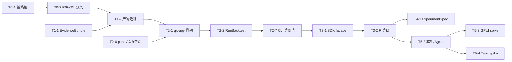

# 牵星 Qianxing — 详细开发计划与实施路线图

> 计划日期：2026-10-10 ｜ 计划编号：QX-DEV-PLAN-2026-10-10
> 基线：工作树 HEAD = `7e5815e`（V13 R31，门禁 950 项 / floor 892）＋ **16 项未提交改动**
> 权威顺序：本文件承担**交付顺序、WBS 与验收门**；[`架构复核与工业级优化重构执行方案`](牵星Qianxing-架构复核与工业级优化重构执行方案-2026-10-10.md) 承担能力分级与验收口径；[`Python 全能力包与桌面客户端及可扩展性改造方案`](牵星Qianxing-Python全能力包与桌面客户端及可扩展性改造方案-2026-10-10.md) 与 [`gpui-kit 可行性评估`](gpui-kit桌面端策略研究平台-可行性评估与调研方案-2026-10-10.md) 承担门面实现细节；[`自研量化框架审计与重构方案-V13`](自研量化框架审计与重构方案-V13.md) 承担逐轮落地台账。
> **工时口径声明**：本文的人日数是**规划估算**，不是承诺；每阶段开始前按当轮实测重估。所有行号、计数、wheel 与二进制身份必须按目标树重测。

---

## 0. 计划总览

### 0.1 一句话

**用 7 个阶段把「内核齐全但装配锁在 bin crate」的现状，收敛成「一个领域内核 + 一层可复用应用用例 + 多个有能力边界的适配门面」，并把产品承诺从「可复现」升级为「可核验」——`EvidenceBundle` + R/P/O/L 能力分级是两条主线。**

### 0.2 阶段地图

```
阶段 0 基线与范围冻结 ......... 8 人日   ── 无前置
      ↓
阶段 1 数值·产物·数据质量·撮合可信度 ... 30 人日   ── 前置：阶段 0
      ↓
阶段 2 应用层抽取与行为等价 .... 25 人日   ── 前置：阶段 1 的产物契约
      ↓
阶段 3 Python 包与 API 分层 ..... 30 人日   ── 前置：阶段 2 的 qx-app
      ├──→ 阶段 4 研究闭环与结果展示 ... 22 人日   ── 前置：阶段 3 的 R 等级
      └──→ 阶段 5 桌面 spike·决策·上线 .. 30 人日   ── 前置：阶段 3 的契约 + Agent
              ↓
阶段 6 生态·安全·运营成熟度 ...... 35 人日   ── 前置：阶段 4/5 各自收口
```

**合计 ≈ 180 人日（规划估算）**。其中**阶段 0–2 的 63 人日是公摊前置**：无论最终选哪个门面与 UI 壳都必须做，且不做完它们，阶段 3/4/5 全是空谈。

### 0.3 关键路径（P0 关键链）



**单点风险最高的三处**：`T1-2 产物迁移`（旧产物读取语义）、`T2-7 CLI 等价门`（46 入口行为不变）、`T5-5 双壳决策门`（Windows 中文 IME 可能否决整条桌面投入）。

---

## 1. 基线冻结与事实校准（阶段 0 前置说明）

### 1.1 必须先生效的四条校准

| # | 已漂移的主张 | 校准结论 | 出处 | 动作 |
|---|---|---|---|---|
| **C1** | 「EventLog 无保留/压缩/归档策略，只有增长没有上限」 | **部分不成立**。`crates/qx-runtime/src/pipeline.rs` 的模块文档（第 12–22 行）明文定义保留策略为「**只增长 + 按段归档**」：册内截断/淘汰/压缩**被有意禁止**（`EventLog` 不得新增此类入口）；轮转靠换 `log_name`；归档粒度是封段且段清单带摘要校验。**仍然成立的是**：稳态「每 tick 整本重放」的开销未量化 | `pipeline.rs` 模块文档；`deploy/README.md` 第 1204/1221 行是**当时**的过渡表述 | 改为「保留策略有意只增长 + 按段归档；**稳态重放成本待实测**」；`T1-5` 量化热点斜率；**不得**把「无归档策略」或「整场回测必为 O(n²)」当现状写入任何交付 |
| **C2** | 「`qx-cli` 50,231 行，占全仓 37.9%」 | 属**某一提交快照**。拆分问题成立，但数值须按当前工作树重测 | 前序报告 | `T0-1` 重测生产/测试代码分列 + 依赖图；`T0-5` 回写 |
| **C3** | 「16 份 blessed 产物停在 `schema_version: 1`，代码已到 5」 | **不得用版本数字直接判定缺陷**。应重新界定为「旧 fixture 是否有**显式兼容/迁移守护**」 | 架构复核 §2.3-4 | `T1-2` 按 fixture 枚举 + 实际读者迁移行为 + 常驻测试三件事重新判定 |
| **C4** | 「本仓已两次决策不做 GUI」 | **成立**，但 GUI 需求属**新产品方向的重新立项**，不是悄然延续 | `docs/archive/竞品对比与易用性改进优化计划-V1.md` §7；`docs/qianxing-项目结构与GitHub竞品对比及优化方案-2026-10-06.md` §8 | `T5-0` 立项材料须明确用户、支持成本、维护责任与**停止条件** |

### 1.2 基线包内容（T0-1）

| 项 | 内容 |
|---|---|
| 版本身份 | 工作树/提交身份、未提交改动清单、每阶段开始时的 `HEAD` 与 `git status` 摘要 |
| 规模 | 逐 crate 生产/测试代码分列、workspace 成员数、依赖图（含 dev 边） |
| 公开 API | 各 crate 的 `pub` 面清单（尤其 `qx-xingban` / `qx-core` / `qx-api`） |
| 产物 | 当前 summary / equity / fills / run manifest / record / 多腿归因的 schema 与版本枚举 |
| 身份 | wheel 名与 ABI 标签、`qx-cli` 二进制身份、`_qianxing_native` 符号表 |
| 门禁 | 当前门禁条数、地板值、测试用例地板、CI 矩阵 |
| 能力 | `maturity/capabilities.yaml` 四档证据状态、外链验收边界 |

---

## 2. WBS：任务、交付、依赖与验收

> 记号：`T<阶段>-<序号>`；来源列标注该任务出自哪份输入文档。

### 阶段 0：基线与范围冻结（8 人日）

| ID | 任务 | 交付 | 来源 | 人日 |
|---|---|---|---|---|
| T0-1 | 生成版本化基线包（§1.2 七项） | `docs/archive/baseline/2026-10-10-*.md`（只读快照） | 复核 §5 阶段 0 | 3 |
| T0-2 | 46 入口 → R/P/O/L 分类表 + CLI-only 理由 | 分类表（机读 yaml + 人读表） | 复核 §1.1 | 1.5 |
| T0-3 | 能力成熟度与外链边界登记（不得把 `implementation` 写成 production approval） | 登记表 | 复核 §5 阶段 0 | 0.5 |
| T0-4 | 冻结回测夹具，采集 `result_hash` / artifact manifest / 耗时 / 内存基线 | 夹具目录 + 基线 JSON | 复核 §5 阶段 0 | 2 |
| T0-5 | 已漂移结论更正（C1–C4）并回写 V13 | V13 一轮记录 | 复核 §2.3 | 1 |

**退出门 G0**：核心架构主张全部引用当前代码或可重复产物；确定性相等断言**只**用于相同输入/版本/模型/环境，不混同准确性。
**不做**：不在本阶段做大规模文档翻修。

---

### 阶段 1：数值、产物、数据质量与撮合可信度（30 人日）

| ID | 任务 | 交付 | 来源 | 人日 |
|---|---|---|---|---|
| T1-1 | `EvidenceBundle` 最小版：聚合 RunManifest / summary / equity / fills / 数据指纹与质量报告 / 配置与策略身份 / 模型假设 / 软件构建身份 / 验证级别 / 未验证清单 / 离线复算指引。**只聚合与校验，不重算指标** | `qx-app` 侧 bundle 构建器 + schema | 复核 §3.1 | 5 |
| T1-2 | 产物 schema/version 关系盘点；旧产物读取**必须走显式迁移或给出具名拒绝原因**（校准 C3） | schema 关系图 + 迁移表 + 常驻测试 | 复核 §5 阶段 1；前序 A8 | 4 |
| T1-3 | 每档撮合具名模型（Risk-averse FIFO / 概率队列 / 部分成交）：假设清单 + **逐单记录为何成交/未成交** + 输入不足时**显式拒绝或降档** | 模型文档 + 逐单归因字段 + 敏感性报告 | 复核 §2.2-D；竞品 hftbacktest | 6 |
| T1-4 | 性能基准套件：EventLog append/恢复、pipeline refresh、Bar/Tick/OrderBook 回测、SQLite/分段后端读写、artifact 序列化。**固定数据规模、机器、编译 profile、warm/cold、测量工具** | `benches/` + 基线报告 | 复核 §5 阶段 1；前序 P1-3 | 4 |
| T1-5 | profiling 找真实热点；量化稳态重放斜率（校准 C1）；**禁止预先承诺某条算法复杂度修复倍数** | 热点报告 + 回归曲线 | 复核 §2.2-E、§5 阶段 1 | 3 |
| T1-6 | 数据验证报告扩展：时间戳单调性、重复/缺失/停牌、交易日历、时区、PIT、幸存者偏差、复权/公司行为、provider provenance | 质量报告 v2 + 夹具 | 复核 §5 阶段 1、§6.3 | 4 |
| T1-7 | 四类可信度**分离**报告：可复现 / 模拟假设 / 数据适用性 / 验证覆盖。**禁止单一 `verified` 标签** | 报告模板 + UI/CLI 展示契约 | 复核 §2.2-C | 2 |
| T1-8 | 基准与产物契约的 CI 化（夹具守门） | CI 腿 + 门禁判据 | 本项目 | 2 |

**退出门 G1**：同一运行可由 RunManifest **离线复算**；各撮合档都有**可见限制**；性能工作有**前后可比数据**；重要摘要都有 artifact schema 测试。

---

### 阶段 2：应用层抽取与行为等价（25 人日）

> **纠偏声明**：本阶段**不**新建与 `qx-xingban` / `qx-runtime` 职责重叠的 `qx-backtest` crate；`qx-app` 是**组合 crate**，按用例拆模块，**明确禁止做成新的 5 万行「万能中枢」**。

| ID | 任务 | 交付 | 来源 | 人日 |
|---|---|---|---|---|
| T2-0 | panic 边界与错误类别（前置：错误模型是应用层 contract 的一部分） | 稳定错误枚举 + 边界测试 | 前序 P1-2、复核 §6.1 | 3 |
| T2-1 | `qx-app` 骨架：用例模块 + 稳定输入/输出类型（`BacktestSpec` 级）；依赖规则 = 领域 crate 不依赖 CLI/HTTP/GUI/Python | 新 crate + 依赖方向门禁 | 复核 §2.2-B、§4.1 | 4 |
| T2-2 | `ValidateDataset` + `RunBacktest`（先 Bar） | 两个用例 + contract 测试 | 复核 §5 阶段 2 | 4 |
| T2-3 | Tick / L2 接入**同一接口** | 三档共用入口 | 复核 §5 阶段 2 | 2 |
| T2-4 | `ReadRunArtifacts` / `BuildReport` / `CompareRuns` | 三个用例 | 复核 §5 阶段 2 | 3 |
| T2-5 | `StartPaper` / `Stop/ResumePaper` / `GetRunStatus` | 四个用例 + 审计 | 复核 §5 阶段 2 | 3 |
| T2-6 | Operator 运维入口用例 | 用例组 | 复核 §5 阶段 2 | 2 |
| T2-7 | CLI 改 thin facade + **行为等价门** | 等价门判据 + 迁移后 CLI | 复核 §5 阶段 2；前序 cli_behavior_parity | 3 |
| T2-8 | 一个非 CLI consumer 示例（不启动 `qx-cli` 完成回测并复核产物） | 示例 + 集成测试 | 复核 §5 阶段 2 | 1 |

**每个用例必须定义九项**：输入 schema、输出 schema、运行权限、幂等键、取消行为、事件/进度、产物清单、错误类别、能力等级（R/P/O/L）。

**行为等价门的比较项**（**不**用脆弱的逐字节日志比较代替领域行为检查）：退出状态、关键诊断**结构**、产物文件集合、manifest 语义、`result_hash`。

**退出门 G2**：`qx-app` 无 CLI/UI 依赖；CLI 的核心研究用例**实际调用**公共应用接口；至少一个独立 consumer 不通过启动 `qx-cli` 即可完成一次回测并复核产物。

---

### 阶段 3：Python 包与 API 能力分层（30 人日）

| ID | 任务 | 交付 | 来源 | 人日 |
|---|---|---|---|---|
| T3-1 | `qianxing` SDK facade + 类型化 contract：`BacktestSpec` / `RunHandle` / `BacktestReport` / `ValidationIssue` / `ArtifactRef`。**不把文件路径、JSON 字典、PyO3 参数当主要公共 API** | 新包 + `py.typed` | 复核 §4.2 | 5 |
| T3-2 | **R 等级**：dataset validate / backtest / report / artifact verify | R 能力 + quickstart | 复核 §5 阶段 3 | 5 |
| T3-3 | 单一 schema 源 + 可重复 codegen（Rust / Python / API 三侧）；生成物可重建、diff 可审查 | codegen 流水线 + 门禁 | 复核 §5 阶段 3 | 4 |
| T3-4 | 内核错误 → 稳定 error code + 修复指引 + 关联 run id；保留底层诊断证据 | 错误映射表 + 测试 | 复核 §5 阶段 3、§6.1 | 2 |
| T3-5 | 打包矩阵：maturin/abi3 ABI 标签、动态库依赖、体积、离线安装、构建身份/SBOM、签名；**`abi3` 只在绑定与依赖实际兼容时才对外承诺** | 多平台 wheel + 验证报告 | 复核 §4.2、§5 阶段 3 | 5 |
| T3-6 | 可选集成清晰化：`qianxing_ccxt` / `qianxing_ashare` 走 extras；核心安装**不隐式安装**交易所 SDK、时区库或重型 dataframe | pyproject + 契约测试 | 复核 §5 阶段 3 | 2 |
| T3-7 | **P 等级**（Paper）：显式本地配置 + 操作留审计 | P 能力 + 审计记录 | 复核 §1.1 | 3 |
| T3-8 | **O / L 等级**独立授权：L 默认关闭；二次确认、幂等 client order id、限速、重试/超时、reconcile；**错误重试绝不隐式重复下单** | 授权层 + 安全测试 | 复核 §5 阶段 3 | 4 |
| T3-9 | 版本化 API client + R/P/O/L 端点授权（`/research` 命名空间） | API client + 授权测试 | Python 方案 §4.3 | —（并入 T5-2） |

**退出门 G3**（新用户全链路）：干净环境**装包 → 加载仓库样例 → 跑一条策略 → 看到数据限制 → 打开报告 → 复算摘要**；研究功能**不需**用户安装 Rust 工具链；可选依赖缺失有准确提示。

---

### 阶段 4：研究闭环与结果展示（22 人日）

| ID | 任务 | 交付 | 来源 | 人日 |
|---|---|---|---|---|
| T4-1 | `ExperimentSpec`（**十项必填**）：dataset fingerprint、PIT 范围、策略及参数域、交易日历、成本模型、撮合模型、种子、IS/OOS 切分、优化目标、引擎版本 + 停止条件与资源上限 | spec schema + 校验 | 复核 §5 阶段 4 | 4 |
| T4-2 | 批次执行与比较（幂等；批次失败/取消**不损坏**已完成 run） | 批次引擎 + 比较 API | 复核 §5 阶段 4；竞品 Qlib Recorder | 5 |
| T4-3 | walk-forward / OOS：每窗口记录时间边界与所用数据版本 | 引擎 + 产物 | 复核 §5 阶段 4 | 5 |
| T4-4 | **no-lookahead 属性测试 + 合成泄漏 fixture**（能抓住前视） | 测试套件 | 复核 §5 阶段 4 | 3 |
| T4-5 | 报告参数尝试数与选择偏差；PBO/Deflated Sharpe **仅作统计诊断**，不写成盈利保证 | 报告字段 | 复核 §5 阶段 4 | 2 |
| T4-6 | `EvidenceBundle` 展示（四类信息分开呈现） | 展示契约 | 复核 §3.1 | 3 |

**退出门 G4**：合成泄漏 fixture 的测试**能抓住**前视；IS/OOS 边界可从产物**独立核验**；每个最优参数结果**链接**到其完整底层 run。

---

### 阶段 5：桌面 spike、决策与上线（30 人日）

| ID | 任务 | 交付 | 来源 | 人日 |
|---|---|---|---|---|
| T5-0 | **立项材料**：用户、支持成本、维护责任、停止条件（校准 C4） | ADR | 复核 §2.3-5 | 1 |
| T5-1 | 后端同源接口稳定（依赖 G2/G3） | 契约冻结 | Python 方案 §8 | —（依赖） |
| T5-2 | **本机 Agent**：loopback + 随机端口 + 本地管道/受保护配置交付短期凭据（**不进 URL/日志/持久配置**）+ Origin/CSRF + 一次性启动授权 + token 轮换 + 请求体大小限制 + 速率限制 + 退出清理 + 协议版本协商（不兼容时安全失败，不猜降级） | `qx-agent` + 安全测试 | 复核 §4.3；Python 方案 §4.3 | 8 |
| T5-3 | **GPUI Kit spike**：H1–H12 假设 + **无障碍** + 崩溃恢复 + 自动升级/回滚 + Windows 签名 + 冷启动 | spike 工程 + 度量数据 | gpui-kit 方案 §8；复核 §5 阶段 5 | 8 |
| T5-4 | **Tauri/Web spike**：同一 Agent / API / 报告 fixture / 验收脚本 | spike 工程 | 复核 §5 阶段 5 | 5 |
| T5-5 | **双壳对比决策门**（G1–G7 + 至少两名目标用户完成任务） | 选型 ADR | gpui-kit 方案 §8.5 | 2 |
| T5-6 | 选定壳的 MVP 上线 + 更新/回滚 | 可安装产物 | 复核 §5 阶段 5 | 6 |

**必测清单（两壳同脚本）**：编辑器保存/恢复、**中文 IME**（候选窗/光标/多行/组合键）、大表格与 OHLCV/回撤交互、无障碍键盘操作、离线安装、自动升级/回滚、崩溃恢复、应用签名、冷启动、编译时间、包体、空闲内存。

**退出门 G5**：至少两名目标用户完成「从新项目到可复算报告」；**Windows 中文输入法与更新/回滚通过**；长期维护者与升级策略明确。
**停止条件**：**任一关键项失败即停止该 UI 壳投入**，继续用 Web Console 或另一候选壳。

---

### 阶段 6：生态、安全和运营成熟度（35 人日）

| ID | 任务 | 交付 | 来源 | 人日 |
|---|---|---|---|---|
| T6-1 | **Trusted extension**：版本化 manifest、能力声明、兼容矩阵、签名/来源、冲突与弃用规则 | manifest schema + 校验 | 复核 §5 阶段 6 | 6 |
| T6-2 | **Untrusted strategy**：独立进程/受限 worker 先行，设 CPU/内存/文件/网络/IPC/wall-clock 配额 | worker 沙箱 | 复核 §5 阶段 6 | 8 |
| T6-3 | WASM 作为**附加**隔离机制（跟进运行时安全更新，**不替代宿主隔离**） | WASM 宿主 + 版本锁 | 复核 §5 阶段 6；竞品 extism/wasmtime | 6 |
| T6-4 | **Adapter conformance suite**：时钟、重连、限速、精度、订单状态、部分成交、取消/拒绝、重复消息、reconciliation | conformance 套件 | 复核 §5 阶段 6；竞品 hummingbot | 6 |
| T6-5 | 运维可观测性：结构化日志、trace/run correlation、关键指标、健康状态、诊断导出、备份恢复演练、升级回滚 | 运维工具集 | 复核 §5 阶段 6 | 5 |
| T6-6 | 跨平台发布：可复现构建、SBOM、签名、漏洞响应流程 | 发布流水线 | 复核 §5 阶段 6 | 4 |
| T6-7 | **外部链路验收执行**（见 §4） | 结果包 + `sandbox_tested` 翻转 | 外链验收方案 | 见 §4 |
| T6-8 | **门禁治理**：把可机读契约（schema/路由表/能力矩阵/artifact registry）从散文中分离，由其生成或校验文档；逐步去掉**纯计数型棘轮**；新增门禁**必须写明它捕获的故障样本** | 治理方案 + 迁移 | 复核 §2.2-F、§6.4 | —（横切，见 §5） |

**退出门 G6**：各条都有可执行验收证据；扩展兼容有 manifest 与 conformance；发布有身份与回滚。

---

## 3. 横切线程（贯穿所有阶段）

| 线程 | 要求 | 落点阶段 |
|---|---|---|
| **X1 错误与取消语义** | 每个用例返回稳定类别（`InvalidInput`/`DataUnavailable`/`FidelityInsufficient`/`PermissionDenied`/`Conflict`/`Timeout`/`StorageFailure`/`InternalInvariant`）、用户行动提示、可定位 run/request id、是否安全重试；长任务可取消、持续报状态、**进程重启后可识别为完成/失败/中断**；写订单与外部提交**不得因重试产生重复副作用** | T2-0、T3-4、T5-2 |
| **X2 金融精度与时间** | 定点与精度约束；跨边界拒绝超范围/非法舍入/单位混用；**保留 `None` 缺失语义，不折算为零**；UTC instant 与交易所本地日历/时区**分开**处理；DST 切换、非交易时段、跨午夜 session、退市/上市、公司行为入夹具；指标在数据不足/基准缺失/样本过短时给出**「不适用/未计算」与理由，不填零** | T1-6、T2-2、T3-1 |
| **X3 数据与回测质量** | provenance 至少含 provider、原始文件/包摘要、采集时间、交易所时间、时区、修订/复权版本、质量门结果、许可来源；**相同文件名不等于相同数据**；结果标注订单是否可成交、是否有盘口、是否超历史深度、市场冲击未建模 | T1-6、T1-7 |
| **X4 模块拆分与门禁治理** | 按稳定领域/用例边界拆 crate，**不以「文件超过 N 行」为唯一依据**；新 crate 必须有清楚的所有者、消费者与依赖方向；`qx-cli` 测试**分批**迁移（先搬领域行为测试或改成应用契约测试）；新增正则检查必须有正例、反例与失效诊断；**单独追踪**用户可见回归/生产路径错误/未覆盖能力/构建发布失败 —— **总 PASS 数与门禁数不能作为成熟度替代品** | T2-1、T2-7、T6-8 |
| **X5 易用性最短路径** | 主路径固定为 `init → 获取/导入数据 → validate → backtest → report/verify`；每步给默认样例、预期输出、常见失败与下一步链接；自动生成的配置含注释与版本；保留专家参数但用子命令分组与按需帮助降低 46 入口负担；**成功页先解释收益图用的数据档位与假设，再展示指标** | T2-4、T3-2、T5-6 |

---

## 4. 外部链路验收的独立轨道（T6-7）

**当前状态**：`maturity/capabilities.yaml` 中所有 `sandbox_tested` 仍为 `false`；本轮（D4 决策）不下发凭据、不触碰真实交易所。

| 段 | 动作 | 失败即 |
|---|---|---|
| 离线安全门禁 | `runtime-check` → `live-check`，断言 `network_accessed=false`、`orders_sent=false` | 中止，不进入触网步骤 |
| 只读探测 | `binance-public-probe testnet`、`binance-private-probe` | 中止（退出码 2） |
| 单次受控下单 | `binance-submit-order ... submit-order.json`；**同一 `request_id` 再提交必须被拒** | 中止；**未知结果不得自动重发** |
| 断线恢复 | 杀进程使停在 `Submitted/Unknown` → `binance-worker --once` 必须给 `ReconcileRequired` 而**不是自动补单** | 中止 |
| 对账与终态 | `reconcile` → `status --json` | 中止 |

**第二交易所（CCXT/OKX）**：`ccxt-submit-order` 已于 2026-10-10 落地（与 binance 同形，多一个 CCXT 配置路径参数），验收脚本已参数化 `--venue okx`。**在该入口落地前，任何「第二交易所沙盒已通」的表述都是虚假声明**（现已解除）。

**翻转规则（脚本与文档同口径）**：`outcome=pass` 且除 `live-check` 外全部阶段退出码为 0 → 手工置 `sandbox_tested: true` 并**把结果包目录一起提交**；**没有结果包的路径不得翻转**；`skipped`/`fail` 一律保持 `false`。

**wheel 跨平台腿**：CI 已覆盖 ubuntu / macos / windows；本机验证需 `QX_PYTHON` 指向真实解释器（Windows 上裸 `python` 是坏桩）。

---

## 5. 能力分级矩阵（R / P / O / L）

> 原则：**「全部能力」= 同一应用用例可由多个受支持入口调用，≠ 每个入口暴露所有特权操作。**

| 等级 | 能力 | 默认面 | 验收要求 |
|---|---|---|---|
| **R** Research | 数据集检查、配置校验、回测、实验比较、报告与产物复核 | CLI、Python SDK、桌面；本机 API 可选 | 干净环境 quickstart + 可复算摘要 |
| **P** Paper | 模拟运行、Paper 订单、暂停/恢复、事件查看 | 显式本地配置 | 操作留审计记录 |
| **O** Operator | worker、调度、恢复、存储与运行状态管理 | CLI / 管理 API | 需 operator 身份 |
| **L** Live | 真实账户连接、提交订单、对账 | 单独启用、最小权限、确认与熔断 | **默认关闭**，不能由「全能力包」自动开启；独立验收 |

**每个应用用例一份能力声明**：支持的运行模式、所需权限、幂等策略、是否可取消、数据档位、生成的产物。
**桌面 UI 按服务端能力声明禁用/解释操作，不以隐藏按钮代替授权。**

### 5.1 交付顺序

```
T3-2 R 等级 ──→ T3-7 P 等级 ──→ T3-8 O 等级 ──→ T3-8 L 等级（独立授权 + 独立验收）
```

---

## 6. 统一验收矩阵

| 维度 | 验收证据 | **不接受的替代品** |
|---|---|---|
| 复现性 | 固定 manifest 可离线重放，摘要与文件身份一致 | 只比较终端打印或只看利润数字 |
| 模拟诚实性 | 每档具名假设、限制、成交原因与敏感性可见 | 用「L2/高保真」名称直接代替模型验证 |
| 数据质量 | PIT、时区/日历、缺失/修订、公司行为与来源验证 | 数据文件存在就算验证通过 |
| 应用层复用 | CLI 与 Python/API **同一应用用例**及 contract 测试 | 各 facade 分别写一套回测逻辑 |
| SDK 易用性 | 干净环境 quickstart、错误可恢复、包矩阵与离线安装证据 | `cargo build` 后人工把二进制复制到包目录 |
| 权限安全 | R/P/O/L 权限测试、幂等与重复提交用例、密钥不泄漏 | 「只绑定 localhost」作为充分授权 |
| 性能 | 固定数据与环境下的吞吐、延迟、RSS、恢复耗时对比 | 未测的「高性能」或事先承诺复杂度修复倍数 |
| 扩展兼容 | manifest schema、能力声明、adapter conformance、版本兼容 | 能 import 就视为兼容或安全 |
| 发布可靠性 | wheel/exe 身份、依赖、签名/SBOM、升级回滚 | 源码测试绿就视为交付包已验证 |
| 用户体验 | 新用户任务观察、可访问性、中文输入与故障恢复验收 | 组件数量、截图或框架 demo |

---

## 7. 里程碑与检查点

| 里程碑 | 完成标志 | 计划人日（累计） | 依赖 |
|---|---|---|---|
| **M0 基线冻结** | G0 通过；C1–C4 已校准并回写 V13 | 8 | — |
| **M1 可信度可见** | G1 通过；`EvidenceBundle` 最小版可用；三档撮合假设成文 | 38 | M0 |
| **M2 应用层可复用** | G2 通过；独立 consumer 不启动 CLI 完成回测并复核产物 | 63 | M1 |
| **M3 SDK 可用** | G3 通过；干净环境首次跑通 R 等级 | 93 | M2 |
| **M4 研究闭环** | G4 通过；泄漏 fixture 能抓前视；IS/OOS 可独立核验 | 115 | M3 |
| **M5 桌面选型定案** | G5 通过；双壳 spike 数据齐；**或**明确否决并回退 Web Console | 145 | M3 |
| **M6 生态与运营就绪** | G6 通过；外链验收结果包落地 | 180 | M4、M5 |

---

## 8. 风险登记

| # | 风险 | 概率 | 影响 | 触发信号 | 应对 | 停止/回退条件 |
|---|---|---|---|---|---|---|
| R1 | `T1-2` 产物迁移破坏既有读取语义 | 中 | 🔴 高 | 旧 fixture 读取出现静默兜底 | 先立「显式迁移或具名拒绝」判据再改代码 | 无法枚举全部旧版本 → 冻结为「具名拒绝 + 迁移指引」 |
| R2 | `T2-7` 46 入口行为等价门挡不住隐性回归 | 中 | 🔴 高 | 等价门绿但用户可见行为变 | 先建门禁再改代码；比较项含产物集合与 manifest 语义 | 等价门无法建立 → 暂停 CLI 瘦身，只做新增用例 |
| R3 | Windows 中文 IME 不可用 | 中 | 🔴 高（否决桌面） | T5-3 的 IME 用例失败 | H1+H2 最小探针**先行**（3 人日 fail-fast） | 组字被抢占/候选窗闪烁 → **停止该 UI 壳** |
| R4 | 目标机器无 GPU / VM / RDP 下起不来 | 中 | 🔴 高 | T5-3 在 VM/RDP 失败 | 三类环境矩阵测试 | 物理机失败 → 停止该 UI 壳 |
| R5 | 原生扩展体积与 ABI 承诺失控 | 中 | 🟠 中 | wheel 体积超预算 / abi3 tag 不对 | 扩展保持薄；必要时拆 core/full 两变体 | 体积不可控 → 只保留核心 R 能力在扩展内 |
| R6 | 权限分级被绕过（L 能力被 R 面调用） | 低 | 🔴 高 | 权限测试出现越权 | R/P/O/L 端点授权 + 幂等/重复提交用例 | 无法证明隔离 → 关闭 L 面，只保留 R/P |
| R7 | 门禁治理被误解为「放宽」 | 中 | 🟠 中 | 新增门禁无故障样本说明 | 治理原则写死：新增门禁必须写明捕获的故障样本 | 出现契约回退 → 回滚治理改动 |
| R8 | 阶段 5/6 范围蔓延（把 L3、HA、多租户塞进桌面 MVP） | 高 | 🟠 中 | 桌面 backlog 出现内核级需求 | §9 非目标列表作为约束 | 范围蔓延 → 砍回最小验收清单 |

---

## 9. 建议暂缓或明确不做

1. 不先承诺**所有 46 个 CLI 入口**都具备 Python/API 等价形态；先按 R/P/O/L 分类与用户需求验收。
2. 不在桌面 UI 中**另写引擎、指标、成交规则或数据质量判断**。
3. 不因采用 GPUI Kit、Tauri 或 Python `entry_points` 就宣称完成**沙箱或生产级安全**。
4. 不在数据/撮合可信度尚未表达前大规模做自动寻优（会扩大过拟合风险）。
5. **不默认截断或压缩 EventLog**——当前 append-only 与分段归档是**有意设计**；若要快照/状态裁剪，须先定义审计与恢复不变量并通过**全量重放对拍**。
6. 不把 L3 队列真实度、跨节点 HA、多租户云托管、插件市场与真实账户生产审批塞进**桌面 MVP**。
7. 不新建与 `qx-xingban` / `qx-runtime` 职责重叠的 `qx-backtest` crate；不把 `qx-app` 做成新的 5 万行中枢。
8. 不新增**没有正例/反例/故障样本**的门禁；不把门禁数量或行数地板当产品质量指标。

---

## 10. 需求追踪矩阵（任务 → 来源文档）

| 来源文档 | 覆盖任务 |
|---|---|
| 架构复核与工业级优化重构执行方案 | T0-1…T0-5、T1-1…T1-8、T2-0…T2-8、T3-1…T3-8、T4-1…T4-6、T5-0…T5-6、T6-1…T6-8 |
| Python 全能力包与桌面客户端及可扩展性改造方案 | 框架被 T2-1/T3-1/T5-2 采纳；**其「抽 `qx-backtest` 独立库」表述已按复核 §2.2-B 修正为「`qx-app` 组合 crate，不另造重叠 crate」** |
| gpui-kit 桌面端可行性评估与调研方案 | T5-3、T5-4、T5-5（H1–H12 / G1–G7）；**其「EventLog 无保留策略」表述已按校准 C1 修正** |
| 自研量化框架审计与重构方案 V13 | 作为执行台账：每阶段开读最近未结项，结束回写真实差异、产物构建与门禁结果（T0-5 起） |
| competitive-analysis 两份 | 作为详细问题池与 backlog；**具体数字须按校准 C1–C3 复核后才可引用** |
| 工业化易用性收口指南 | X5 线程（最短路径 5 步 + 成功页先解释档位与假设） |
| 外部链路验收执行方案 V1 + 凭据与测试信息清单 | T6-7 独立轨道（三段链路 + 结果包 + 翻转规则 + `--venue okx`） |

---

## 11. 文档治理规则（本计划生效后）

1. **顺序与验收口** → 本文件；**能力分级与验收口径** → 架构复核方案；**门面实现细节** → Python/桌面方案；**逐轮落地台账** → V13。
2. 决策被实施或被否决时，**在对应文档中记录决策、证据、未验证限制与日期**；**不复制整段实现日志**到多份「终版」文档。
3. 每阶段开始先读 V13 最近的交接/未结项；每阶段结束把真实差异、产物构建与门禁结果写回**同一个**执行记录。
4. 清理或归档文档前，先检查 `tools/check_architecture.py`（含 `ACCEPTANCE_DOC` 直接读取的路径）、相互引用、活文档引用地板（当前 272，实测 297）与任何门禁读取路径；**归档而非硬删**历史依据（本仓库 2026-10-10 已按此执行 6 份归档）。

---

## 12. 立即行动清单（本计划批准后 5 个工作日内）

| 序 | 动作 | 输出 | 人日 |
|---|---|---|---|
| 1 | 生成 M0 基线包（T0-1） | `docs/archive/baseline/2026-10-10-*.md` | 3 |
| 2 | 46 入口 → R/P/O/L 分类表（T0-2） | 分类表 | 1.5 |
| 3 | 冻结回测夹具并采集基线（T0-4） | 夹具 + 基线 JSON | 2 |
| 4 | **Windows + 中文 IME 最小探针（T5-3 前置，3 人日 fail-fast）** | 探针结论 | 3 |
| 5 | C1–C4 校准回写 V13（T0-5） | V13 一轮记录 | 1 |

> 第 4 项刻意**前置**到 M0：它是成本最低的 fail-fast 点——若 Windows 中文输入法或渲染在目标机器上不可用，整个桌面方向的投入（含 T5-2 的 8 人日与 T5-3 的 8 人日）可以立即止损，而不必等到 145 人日之后。

---

## 13. 参考

仓库内：本文件同目录下的[架构复核方案](牵星Qianxing-架构复核与工业级优化重构执行方案-2026-10-10.md)、[Python/桌面改造方案](牵星Qianxing-Python全能力包与桌面客户端及可扩展性改造方案-2026-10-10.md)、[gpui-kit 方案](gpui-kit桌面端策略研究平台-可行性评估与调研方案-2026-10-10.md)、[V13 台账](自研量化框架审计与重构方案-V13.md)、[外链验收执行方案](外部链路验收执行方案-V1.md)、[外链验收凭据清单](外部链路验收-凭据与测试信息清单.md)、[竞品全景](competitive-analysis/竞品全景图与架构对标-牵星Qianxing-2026-10-10.md)、[架构不合理清单](competitive-analysis/牵星Qianxing-架构不合理清单与优化重构方案-2026-10-10.md)；代码入口 `crates/qx-runtime/src/pipeline.rs`（保留策略与恢复）、`crates/qx-core/src/sourcing.rs`（事件序号/重放/摘要）、`crates/qx-cli/src/main.rs` 与 `crates/qx-cli/src/backtests/`、`crates/qx-api/src/lib.rs`。

GitHub 官方项目：NautilusTrader（研究/sandbox/live 共用内核、两层 API）、hftbacktest（队列模型与部分成交假设）、QuantConnect LEAN（可插拔组件边界与可观测性）、Qlib（Experiment/Recorder 运行追踪）、vectorbt（研究者短路径体验）、Freqtrade（可执行工作流与可复验优化）、Hummingbot（Connector/Strategy/Controller/Executor 分层与 API client）、Barter（多库拆分）、vn.py（网关/应用分包）。

> 竞品能力描述依据其公开仓库/官方文档，访问日期 2026-10-10。**热度、版本、许可证与平台支持均为易变信息**；实际引入依赖或承诺支持前须重新读取对应项目 LICENSE、release、平台 CI 与安全公告。
