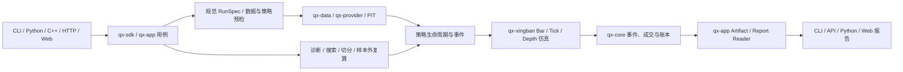
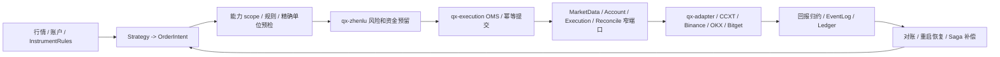

# 牵星 Qianxing：项目架构与 GitHub 竞品深度复核及优化重构总方案

> 复核日期：2026-10-26
> 文档性质：架构审计、竞品对照、开发级改造方案；不是代码完成证明或外部供应商验收报告。
> 复核对象：当前本地工作树中的 Rust workspace、Python、C++、Web、Schema、能力与成熟度登记。
> 版本边界：本地工作树包含大量未提交改动，结论描述当前源码快照，不代表已合并或已发布版本。
> 相关材料：本文件用于综合决策；已有专题方案和逐切片进度仍是各工作包的详细实施记录。

## 1. 结论摘要

牵星当前最有价值的技术路线是：**以 Rust 确定性事件和账本为核心，采用模块化单体，给研究和交易流程设定窄端口、多语言适配器及统一事实合同**。不建议重写为微服务，也不建议继续横向增加大量入口而不收敛身份、结果、数值和生命周期合同。

项目的相对优势在于研究回测、组合账本、执行治理、多交易所接入、多语言入口和可复算产物都在一个体系内；当前短板主要是能力宽、入口多，端到端合同仍需收口。源码中存在某项能力，不能自动推出对应交易所、产品、订单类型、账户模式已完成外部验收。

近期改造顺序建议为：

1. **先保证交易和研究事实正确**：精确数值单位、InstrumentRules、事件因果序、订单幂等恢复、策略执行更新、Run 身份和报告事实一致。
2. **再缩短用户研究旅程**：策略文件预检、基线回测、未来数据/预热诊断、受约束搜索、样本外复算、结果对比和交互报告形成单一主流程。
3. **再治理模块和交付面**：报告 reader/renderer 分层、命令/API/Schema/能力登记生成或双向校验、多语言包安装示例一致。
4. **最后基于画像优化性能**：在同一机器、构建和数据集上测量完整用户场景，再针对热点优化 Rust 和存储路径。

本方案把 Research、Live Code、Live External Acceptance 看成不同证据阶段。离线验收可以证明代码路径符合合同；它不能证明交易所沙盒/生产账户上的请求、回报、撤单、重启恢复和对账已经通过。

## 2. 复核范围、方法与边界

### 2.1 本地复核口径

- `Cargo.toml` 中有 29 个 workspace 成员：28 个 `qx-*` crate 和 `contract-tests`。
- 对照 `docs/module-map.md`、`docs/project-guide.md`、Cargo workspace、核心 Rust crate、Python 策略/SDK、C++ 头文件和 Web 控制台。
- 查看了 RunSpec、ArtifactReader、Gateway、窄执行端口、策略类接口、精确数值和报告模块的实际落点。
- 文件行数只用于发现维护热点，不作为架构缺陷判定，也不作为自动拆 crate 的阈值。

### 2.2 结论边界

- 本方案不做竞品与牵星的同机性能对比，因此不作绝对吞吐或内存排名。
- 公开仓库的功能描述只说明该项目公开提供的设计或工作流，不代表牵星达到同一产品成熟度。
- 不把本地单测、模拟盘或公开行情连接等同于供应商沙盒验收。
- 本方案只做架构与改造决策；交易所 API 的行为仍需以具体版本官方文档和后续外部验收为准。

## 3. GitHub 竞品对照

按使用场景比较，不按功能数量、星数或单机速度排名。

| 项目 | 主要强项 | 主要边界/代价 | 牵星应吸收的具体做法 |
|---|---|---|---|
| [Freqtrade](https://github.com/freqtrade/freqtrade) | 加密货币策略模板、策略回测、Hyperopt、结果导出，以及 lookahead/recursive 诊断形成可发现的工作流。 | 主要面向加密交易机器人；Bar 级策略假设不能替代 A 股交易制度、订单簿撮合或供应商回报验证。 | 为策略文件提供短路径：加载、预检、基线、偏差检查、参数搜索、复核、结果比较。把策略批量计算与逐事件交易回调分开。[Backtesting](https://github.com/freqtrade/freqtrade/blob/develop/docs/backtesting.md) · [Hyperopt](https://github.com/freqtrade/freqtrade/blob/develop/docs/hyperopt.md) · [Lookahead analysis](https://github.com/freqtrade/freqtrade/blob/develop/docs/lookahead-analysis.md) · [Recursive analysis](https://github.com/freqtrade/freqtrade/blob/develop/docs/recursive-analysis.md) |
| [NautilusTrader](https://github.com/nautechsystems/nautilus_trader) | Rust 核心；Rust/Python 路径；Backtest、Sandbox、Live 共用大量领域和运行组件；提供高层 Node 与低层 Engine API。 | 领域概念和配置面较完整，学习成本也较高。共用策略代码不会消除实盘网络超时、外部事件顺序和恢复差异。 | 共享事件及订单语义，明确区分 backtest 与 live 事实；提供面向新手和高级用户两层 API。[Overview](https://github.com/nautechsystems/nautilus_trader/blob/develop/docs/concepts/overview.md) · [Backtesting](https://github.com/nautechsystems/nautilus_trader/blob/develop/docs/concepts/backtesting/index.md) · [Live](https://github.com/nautechsystems/nautilus_trader/blob/develop/docs/concepts/live.md) |
| [QuantConnect LEAN](https://github.com/QuantConnect/Lean) / [LEAN CLI](https://github.com/QuantConnect/lean-cli) | 把项目、研究、回测、优化和 Live 纳入清楚的开发旅程；多资产、多语言算法 API 体系成熟。 | 数据、经纪商和部署环境存在独立限制；入口统一不代表每种本地环境都能使用所有外部能力。 | 提供单一项目入口和统一 run 产物；命令、API、UI 复用同一应用用例与能力预检。 |
| [RQAlpha](https://github.com/ricequant/rqalpha) | Python 策略 API 简明；事件源、事件总线和 Mod 扩展点易理解。 | Python 生态边界和数据/交易接入决定可用面；API 简洁不等于执行、精度或多语言合同相同。 | 减少策略作者的必学概念；用易发现的初始化、行情、下单、查询、收尾函数包装稳定底层合同。[Event Source](https://github.com/ricequant/rqalpha/blob/master/docs/source/development/event_source.rst) |
| [vn.py / VeighNa](https://github.com/vnpy/vnpy) | 国内 Gateway、事件引擎和 CTA 生态；`on_tick`、`on_bar`、订单及成交回报的策略生命周期直观。 | Gateway 与账户/产品的支持范围要按具体实现判断；统一接口不能替代能力验证。 | 给 Python 策略作者提供简短模板和明确的订单/成交通知；Gateway 保持可组合，能力按 scope 说明。[CTA Strategy](https://github.com/vnpy/vnpy/blob/master/docs/community/app/cta_strategy.md) |
| [Hummingbot](https://github.com/hummingbot/hummingbot) | Connector 及 V2 Controller/Executor 让简单策略逐步发展为可复用、可管理订单生命周期的执行单元。 | 重点是持续运行的数字资产机器人，不提供通用的 A 股 PIT 研究与可复算组合回测语义。 | 简单策略与执行算法分层；执行器可以管理订单，但所有副作用仍由牵星风险、OMS 和 EventLog 约束。[Strategy V2](https://hummingbot.org/strategies/v2-strategies/) |
| [Microsoft Qlib](https://github.com/microsoft/qlib) | 研究工作流、模型训练、实验记录和产物追踪；实验组件可独立配置。 | 研究/机器学习流水线不等同于交易所执行、保证金、部分成交和对账系统。 | 让数据、模型、参数、fold、评估和产物共用 Run 身份，实验结果可追溯、可重跑。[Workflow](https://github.com/microsoft/qlib/blob/main/docs/component/workflow.rst) |
| [vectorbt](https://github.com/polakowo/vectorbt) | 矩阵/向量计算适合快速筛选大量策略参数、资产与周期，图表探索体验强。 | 快速批量筛选不能替代带资金约束、事件顺序、滑点、部分成交和费用结算的事件仿真。 | 作为候选预筛层；筛选出的候选必须交给牵星事件引擎重算并进行样本外验证。 |

### 3.1 牵星当前相对优势

- **领域覆盖广**：Rust 内核、A 股与数字资产研究、Bar/Depth 仿真、风险/OMS、交易所适配、多账户、多语言客户端在同一仓库协同演进。
- **强调可复核结果**：EventLog、账本、Run identity、数据质量/PIT、Evidence/Artifact Reader 等构成可重放和核验的基础。
- **交易治理设计较完整**：风险准入、交易所能力门控、对账与恢复被作为领域问题，而非只实现一个下单 API。
- **适合组合研究**：有多市场、多账户、多腿以及结果报告方向，目标范围比单市场/单策略 bot 更广。
- **边界意识较好**：已有 `ExchangeGateway` 路由组合和窄端口方向；策略基础类作为语言适配，而不是强制跨语言继承。

### 3.2 牵星当前相对短板

- 新用户需要理解的配置、运行类型、命令和产物概念仍多，策略文件从安装到完整分析还要进一步收敛。
- 同一领域事实经过 Rust、Python、C++、Schema、JSON、CLI/API/Web 多次转换，单位、缺省值、精度和兼容性仍有漂移风险。
- RunSpec、报告 reader、证据包已按运行类型推进，但用户入口、报告类型和复算路径仍需以覆盖矩阵逐项闭环。
- 多账户/多交易所的状态机天然异步；“本地收到超时”不能说明交易所没有接收，必须以持久幂等和查询对账收敛未知状态。
- 研究中的参数最优值、诊断和 OOS 结果需要更明确地并列，避免样本内冠军被理解为有效实盘策略。
- 多个高变更模块和脚本的维护面较大；按事实 owner 拆文件、生成目录和代码级文档比增加新的抽象层更重要。
- 容量和性能数字必须绑定完整 workload 与机器环境；单个 Criterion 基准不能代表多标的、L2、搜索、报告或常驻 Live 运行。

## 4. 当前架构和关键链路

### 4.1 模块层次和事实所有权

| 层 | 主要模块 | 唯一事实 owner / 应承担责任 |
|---|---|---|
| 领域合同与确定性内核 | `qx-core`、`qx-guanxing`、`qx-spec`、`qx-protocol` | 身份、精确单位、时间/事件合同、订单与账本事实、市场数据语义和版本化跨边界类型。 |
| 数据与持久化 | `qx-data`、`qx-provider`、`qx-datastruct`、`qx-storage` | 数据源和质量、PIT 数据集、列式结构、EventLog、快照和事务持久化。 |
| 策略与研究 | `qx-strategy`、`qx-factor`、`qx-xingban`、`qx-risk`、`qx-app` | 策略生命周期、指标/因子、撮合模型、风险规则、应用用例、研究产物身份和核验报告事实。 |
| 执行和治理 | `qx-zhenlu`、`qx-execution`、`qx-genglu`、`qx-adapter` | 风险准入、OMS、窄外部端口、订单状态归约、Venue 协议映射、回报和对账。 |
| 运行和组装 | `qx-runtime`、`qx-orchestrator`、`qx-service`、`qx-scheduler`、`qx-control`、`qx-plugin` | 运行拓扑、worker 生命周期、路由装配、调度、权限/审计及静态能力组合。 |
| 用户和语言边界 | `qx-api`、`qx-cli`、`qx-sdk`、`qx-python`、`python/`、`cpp/`、`web/console/` | 输入转换、授权、语言绑定、易用门面和结果展示；不自行重算领域事实。 |

目前的主要结构是**模块化单体 + 明确 worker/进程边界**，不是服务网格。crate 数量不少，但这本身不是问题；真正的判定标准是依赖方向、领域状态所有权、跨边界类型和副作用是否唯一且可审计。

### 4.2 研究链路



研究主路径应统一为：策略文件/参数 → Schema 与 PIT/质量预检 → 基线运行 → 未来数据与预热诊断 → 预算约束搜索 → 冠军候选事件引擎复算 → 滚动/样本外评估 → 对比报告 → 冻结输入验证或便携复算。

### 4.3 真实交易链路



跨交易所订单组只能提供可恢复 Saga/补偿，不可能提供多家交易所间的原子成交或共享购买力。超时后的订单状态必须标记未知并查询/对账，不能盲目重发。

## 5. 架构设计中应保留与需收敛的部分

### 5.1 保留

1. Rust 负责确定性领域计算、精确类型、订单账本和性能敏感路径。
2. `qx-app` 负责应用用例、研究事实和经过验证的报告读取；CLI/API/Python/Web 做适配和呈现。
3. 交易所内部实现通过窄端口组合，外部协议差异保留在 Adapter 层。
4. 用 EventLog、Run identity、schema version 和回放证据支持重启恢复与离线复算。
5. 保持 Research、Paper、Live 的策略与领域合同尽量共享，同时公开数据、时间、成交、外部副作用的差异。

### 5.2 不采用

- 不将 `ExchangeGateway` 做成同时处理网络、行情、规则、账户、风控、订单、持久化和恢复的超级 trait。
- 不让各语言共享一种继承树；统一 versioned strategy protocol，语言层各自提供自然的 helper/adapter。
- 不把 Backtest、Paper、Live 说成撮合语义完全一致的三个配置项。
- 不因为大文件或 crate 数量机械拆服务；拆分必须有单一事实 owner、依赖收益、迁移边界和行为对拍。
- 不让向量化预筛结果直接作为最终报告或“最佳策略”结论。

## 6. 具体问题台账与开发级改造

| ID / 优先级 | 当前风险与代码落点 | 详细改造内容 | 完成判定 |
|---|---|---|---|
| A1 / P0 | 精确数量、价格、报价金额、合约张数、乘数和费用涉及 `qx-core`、`qx-strategy`、`qx-execution`、`qx-zhenlu`、`qx-adapter`、Python CCXT、Schema 及报告 DTO。`ExactDecimal` 的局部支持不证明全路径无损。 | 固定 `Price`、`BaseQuantity`、`ContractQuantity`、`QuoteAmount`、`Money<Currency>` 等单位语义；`InstrumentRules` 快照包含 tick/lot/minimum/notional/multiplier/settlement currency 和版本指纹；明确每一处舍入模式；从行情 → 策略意图 → 风控/预留 → Venue request → 成交/费用 → 账本 → 恢复/报告全链路保真。 | Binance/OKX/Bitget 的现货、线性/币本位合约和小数边界 golden fixtures 跨 Rust/Python/C++/JSON 对拍；超界、不合步进、单位冲突和规则漂移均在网络写入前拒绝。 |
| A2 / P0 | 多账户多 Venue 的异步订单与多腿恢复涉及 `qx-execution`、`qx-zhenlu`、`qx-storage`、`qx-service` 和 Adapter。真实网络副作用后的响应丢失、成交/撤单竞态及多腿故障恢复仍可能让本地状态与 Venue 分歧。 | 统一 `OrderOperationId`、幂等键、提交尝试、Venue order id、reservation、leg 状态、外部事实、补偿动作和人工终态；未知状态先查询/对账；把 partial fill、撤单竞态、断流、重复回报和进程退出都建成状态转换。`CancelPending` 在外部撤单副作用前持久化；在途期间到达部分成交时累计数量/账务但保持取消状态，直到权威撤单结果到达，避免恢复时误判为普通活动单。重复 `client_order_id` 必须绑定完整 immutable submission identity，精确请求单位也纳入比较。 | 离线故障注入可从 EventLog 重放每条路径；重复恢复不会重复下单或记账；单腿失败后的敞口和补偿可见；没有“静默成功”的终态。已覆盖 CancelPending 部分成交/重启重放、共享 SQLite 撤单并发、首腿 Venue 副作用后响应丢失时的多腿持久栅栏与队列重试，以及通用提交/算法子单/多腿补偿对完整订单身份的复用校验。仍需真实网络副作用后故障、跨节点并发压力和完整多腿补偿验证。 |
| A3 / P0 | Python、Rust、C ABI/C++ 的策略生命周期和订单/成交/状态更新协议有适配层。`python/qianxing_strategy/base.py` 是方便层，不应变成其他语言的硬性 ABI。 | 固定 versioned `StrategyEvent` / `StrategyUpdate` / `StrategyDecision`，列清 `init/configure/warmup/ready/start/market/timer/order-status/fill/account/position/risk/stop/error/checkpoint` 的签名、触发时机、状态持久化和因果序；旧版本通过 adapter 映射。账户/持仓快照按 EventLog 序号绑定，Rust typed hook 与 C ABI optional symbol 保持旧 vtable 兼容；精确盘口必须经带版本的跨语言事件传递。 | 同一规范事件序列在 Rust、Python class/file、C ABI/C++ 中产生一致的归一化意图和状态更新；不支持 hook 明确拒绝；旧策略仍可按版本兼容运行。账户/空持仓共享金样已由 Python adapter 与 C ABI/C++ 动态宿主消费。DepthFrame v2 精确盘口现在通过 C ABI v3 sidecar 到 C++ 插件，缺 v3 的旧插件遇到精确盘口明确拒绝；scale 12 价格和 scale 18 数量已由 Rust/Python/C++ 共同消费金样。全事件生命周期/状态 golden matrix、旧宿主能力声明与拒绝行为仍需验收。 |
| A4 / P0 | `qx-service` 已有按 `(VenueId, account_id)` 路由的 `ExchangeGatewayRegistry`；`qx-execution` 有窄端口。配置 worker 存在或心跳正常不能证明业务请求成功。 | `ExchangeGateway` 保持组合 facade；内部按行情、规则、账户查询、下单/撤单、用户流、对账定义窄端口。Capability 以 venue × product × account mode × position mode × operation × order shape 为 key；记录配置态、worker 态、业务态、外部验收态，写操作必须在送网前做最终 scope 评估。 | `/ready` 能区分 `unobserved/degraded/unhealthy/healthy`，依据端口业务事件而非心跳；能力查询可解释拒绝原因和证据阶段；未登记操作 fail closed。 |
| A5 / P0 | RunSpec、RunRecord、Artifact、ReportReader 和便携复算按运行类型逐步拓展，落点在 `qx-spec`、`qx-app/artifact_store`、`qx-app/report_read.rs`、Schema 和各入口。 | 固定影响结果的策略代码/参数、数据版本/fingerprint、日历、时区、seed、费用/滑点/撮合假设、规则版本、执行器、软件构建和时间范围。Logical ArtifactId 与本机路径分离；Schema 迁移/拒绝规则版本化；API/CLI/Python/Web 均委托同一 reader。 | 同输入同 Run identity；移动或导出 bundle 后仍能校验；同一 run 通过 JSON/HTML/XLSX/HTTP/Python 读取出的事实一致；未来 schema 给具名错误。 |
| A6 / P1 | 策略文件入口、CLI、Python SDK、Web 控制台均可启动不同运行类型，研究步骤可能被用户分散执行。 | 设计高层 `research(strategy, data, objective, budget)` 或 CLI 等价入口，内部编排策略预检、基线、lookahead/recursive/warmup、adaptive/grid search、OOS fold、冠军复算和报告；保留低层用例供高级用户。所有参数共用一个 versioned StrategySpec/JSON Schema。 | 用户从安装包运行一个策略文件，得到可解释错误、输入摘要、基线与分析报告；命令与 Python 生成一致的 CanonicalRunSpec；没有 OOS 时清晰标识样本内发现。 |
| A7 / P1 | 参数搜索与“最佳”排序存在过拟合和预算风险；代码涉及 `qx-app/cases/run_experiment*`、Python experiments、CLI 和 report。 | 记录搜索空间、算法/版本、seed、评价目标、fold、成本模型、失败淘汰原因、计算预算；向量化只预筛，候选按原始冻结输入交给事件引擎复算；报告展示参数敏感度、fold 分布、交易数和样本内/外指标。 | 对任一候选可以复跑并核对身份；搜索停止条件有预算上限；没有数据/诊断证据时不产出“最佳有效策略”声明。 |
| A8 / P1 | 报告事实已向 `qx-app` reader 收敛，但 `qx-api`、`qx-cli/report_*`、Python reports 和 Web 仍有多种组装/渲染逻辑。 | 将报告拆为统一 shell + typed sections；事件/成交按身份和游标分页；CLI 内 JSON/HTML/XLSX renderer 分开；前端只取服务端核验事实；交互图表使用服务端提供的指标和索引。 | 一个 run 的核心收益、回撤、费用、持仓、成交和账户口径在所有入口逐字段一致；大结果分页有边界和稳定游标。 |
| A9 / P1 | 交易账户查询、策略查询、分析读接口易因账户身份和凭证边界不清而扩散。 | 所有账户读请求走统一 `AccountQueryPort` 和明确 Principal/account scope；密钥只在私有运行面使用；报告、搜索和 UI 输出经过 redaction；账户查询能力按 endpoint scope 计算而非单个布尔值。 | 每个读接口均能说明调用身份和账户绑定；无权限、不完整覆盖、过期凭据分别返回明确状态；敏感值不会写入工件和诊断日志。 |
| A10 / P2 | 大型文件与入口模块体量增加维护成本，例如 `qx-api/src/lib.rs`、`qx-app/src/report_read.rs`、`qx-execution/src/lib.rs`、`qx-zhenlu/src/lib.rs`、`web/console/app.js`。 | 先按 owner/use case/transport/render 拆同一 crate 的内部模块；搬移前列出旧 DTO/行为/错误边界和依赖；禁止跨层复制领域计算。只有独立发布或运行隔离需求时才拆 crate/进程。 | 每次拆分都有行为对拍和稳定公共 API；领域 owner 唯一；依赖图无反向边；代码审查粒度变小且变更范围可解释。 |
| A11 / P2 | 命令、路由、Schema、能力目录、语言 API 和文档存在多处登记。 | 对可机器提取的清单生成或双向校验：CLI 命令 ↔ dispatch/help、HTTP 路由 ↔ API manifest、能力 ↔ operation scope、Schema ↔ SDK DTO、strategy hooks ↔ 所有宿主、workspace ↔ module map。 | 新增入口或 capability 缺少任一登记时由单项门禁定位；生成产物可重复且无 drift；不依赖人工逐页搜索。 |
| A12 / P2 | 容量基线可能只覆盖局部 benchmark，无法支持多市场、L2、搜索和报告 workload 的机器建议。 | 固定机器、OS、Rust/Python 构建、数据 fingerprint、账户/标的数量、Bar/Tick/L2 密度、策略数、候选数和报告规模；分别测冷/热启动、吞吐、p50/p95、峰值 RSS、磁盘、排队时间和稳定性。 | 每个资源档位有可复跑脚本及原始证据；没有测的场景显示 `unmeasured`；Rust 热点优化前后用同一 profile 和结果正确性对拍。 |
| A13 / P2 | 多语言发行包与开发环境可能给用户造成“已支持”的错觉。 | 分别维护 Python wheel/纯 Python fallback、Rust CLI、C++ SDK/示例的干净环境安装矩阵；每个包明确平台、Python/Rust/C++ ABI、可用 RunType、外部依赖和快速入口。 | 发布包在干净环境从安装到示例报告成功；包内能力和 capability catalog 一致；失败可诊断且不会误报某交易所已通过外部验收。 |

## 7. ExchangeGateway 与 BaseStrategy 的最终形态

### 7.1 ExchangeGateway：面向用户的组合门面

可以对用户和装配层提供一个名字清晰的 `ExchangeGateway`，但它由窄端口组成，不拥有全部逻辑：

```text
ExchangeGateway(account, venue)
  ├─ MarketDataSource
  ├─ InstrumentRulesProvider
  ├─ AccountQueryPort
  ├─ OrderExecutionPort (submit/cancel/modify/query)
  ├─ UserStreamPort
  └─ ReconciliationPort
```

每个端口拥有自己的 worker 生命周期和业务探针；Gateway Registry 负责账户/venue 路由、端口装配与 scope 查找。风险检查、OMS 状态机、EventLog 和能力授权仍由各自领域 owner 管理。各操作按产品、账户模式、持仓模式、订单类型、数量精度和 instrument 规则分别 gate。

### 7.2 BaseStrategy：提供经典策略类易用性，不替代统一合同

参考经典框架的 initialize/start、行情事件、订单回报和收尾生命周期，Python `BaseStrategy` 作为用户层可选的标准类。它保留 `on_event(context, event)` 统一入口，并将其分发到常用类型化 hook；策略文件通过 `STRATEGY_CLASS` 或 `create_strategy(spec)` 注册，参数、默认值和范围由 versioned `STRATEGY_MANIFEST`/StrategySpec 约束。

| 函数/hook | 当前状态 | 作用与边界 |
|---|---|---|
| `validate_config(config)` | 可选校验入口 | 预检和搜索前校验交叉参数；字段默认值/范围来自 Manifest。没有独立 `configure()` 生命周期；`create_strategy(spec)` 始终接收完整 spec，直接导出的 `STRATEGY_CLASS` 可用无参构造或接收完整 spec。 |
| `on_init(context)` / `on_start(context)` | 已支持 | 分别在实例初始化和首个事件前调用；不直接操作 Gateway 或提交交易所请求。 |
| `history_requirements()` / `on_warmup_complete(...)` | 已支持 | 声明 Bar 预热数量并收到每个标的的预热完成通知；预热期订单意图被抑制。 |
| `on_bar(...)` / `on_tick(...)` / `on_order_book(...)` / `on_timer(...)` | SDK 已支持 | 处理 Bar、L1 Tick、盘口快照和模拟/运行时时钟事件；可见数据级别必须由运行合同声明。Python Runtime class worker 已支持 Bar、Tick、OrderBook、Timer；OrderBook 由 durable Runtime EventLog 输入并通过 checkpoint/cursor 去重，exact 盘口 sidecar 按 schema v8 保留。 |
| `prenext(...)` / `nextstart(...)` / `next(...)` | 已补入 Python 类策略适配器 | Bar 策略可采用 Backtrader 风格：预热期调用 `prenext` 且抑制意图；首个就绪 Bar 调用 `nextstart`（默认转发到 `next`）；后续 Bar 调用 `next`。显式覆盖 `on_bar` 或 `on_event` 的现有策略继续走原有事件回调。 |
| `on_order_status_update(...)` / `on_order(...)` | 已支持 | 收到已提交的 OMS 状态变化；更新带 EventLog `event_seq`，重复投递需按序号幂等处理。 |
| `on_fill_update(...)` / `on_order_update(...)` / `on_trade(...)` | 已支持 | 分别提供带序号成交、兼容成交更新和经典成交 hook；成交已由宿主写入账簿，策略不可重复记账。 |
| `diagnostic_state()` | 已支持 | 返回有大小上限的确定性偏差诊断快照；不等同持久化 checkpoint。 |
| `snapshot_state()` / `restore_state(...)` / `on_restore(context)` | Runtime class worker 已支持 | 状态与执行游标按版本原子保存/恢复；SDK callback 和其它语言宿主的恢复能力须独立登记。 |
| `on_stop(context=None, reason="host_stop")` | 已支持 | Python 保留旧无参 override；本地回测传 `completed/cancelled/failed` 和最终上下文，Runtime 持久策略会话在正常 EOF/worker 级帧或流故障时传 `shutdown/failed`，直接 adapter 关闭默认 `host_stop`。Runtime durable `JobRun` 是同一策略会话内的事件批次，不逐批触发 stop；单条请求解码/回调错误以请求错误返回，成功解码后的回调错误调用 `on_error` 并回滚，不结束会话。Rust `StrategyStopContextV1` 与 C ABI v2 同样保留旧 callback 兼容。 |
| `on_account(...)` / `on_positions_snapshot(...)` / `on_position(...)` | 已支持 | 消费带 EventLog 序号的完整账户余额或持仓快照；空持仓快照也会先回调整体 hook，再逐条回调持仓。它们只是观测事件，不会修改宿主账簿。是否收到取决于运行宿主和输入合同。 |
| `on_error_v1(error)` / legacy `on_error(context, error)` | Rust、C/C++、Python 均能观察版本化 callback 错误；Python 保留原接口兼容 | Python `StrategyErrorV1` 与 Rust/C ABI DTO 使用相同字段和共享 golden fixture；Python 本地 BaseStrategy、Runtime class worker 与模块函数 worker 在具备准确阶段时发出 v1 DTO，同时继续运行 legacy `on_error`。Rust Bar/Tick/原生 OrderBook/DepthBar 和 qx-cli C ABI 入口均报告 callback 失败；观察器返回错误或 Rust panic 不覆盖主错误。W3 全生命周期四宿主 golden matrix 仍开放。 |

`buy()`、`sell()`、`short()`、`cover()`、`close_position()` 只构造精度明确的订单意图；Rust 核心仍拥有风险检查、OMS、执行、账簿和事件重放。Rust trait、Python 类、策略文件函数和 C ABI/C++ 最终归一到版本化 `StrategyEvent/Decision/Update`。Checkpoint 必须带策略身份/版本并与 EventLog 游标绑定。经典框架的命名可以做薄适配，但不可产生第二套订单或持仓语义。

### 7.3 策略执行模式：本地可信代码默认直跑，部署隔离按需启用

- 桌面、本地开发和单用户研究默认 `local`：安装 Python 包后直接从本机加载 `.py` 策略，由 Rust 宿主管理的本机 Python worker 执行回测、搜索与研究；不要求容器或 sandbox。当前 `qianxing run-strategy` / `search-strategy` / `research` 已走这一路径；`BaseStrategy` 和 `create_strategy(spec)` 都可用。可信策略开发者可以先直接运行策略、看错误、调参数、生成研究报告，不需要创建沙箱账户或配置沙箱密钥。
- 本地模式只适用于用户自己信任的策略源码。Python worker 子进程继承本机用户权限；“启动了 worker 子进程”本身不构成安全沙箱。框架执行实际订单时，策略只返回受验证的意图，Rust 核心继续拥有 Risk、OMS、撮合/执行、Ledger 和报告；策略代码仍可通过普通 Python 能力读写本机文件或访问网络。
- 多租户服务、外部用户上传策略或大型服务器部署由部署策略显式要求 sandbox，不改变本地默认。**E2B 是服务器持久策略 worker 的建议首选**，由宿主显式设置 execution mode；自有服务器可选择 Microsandbox local microVM，已有自建生命周期控制面可选 OpenSandbox。Microsandbox 当前本地平台文档列出 macOS、Linux、Windows；具体 SDK 版本和目标服务器的本机虚拟化支持需在部署前验收。Cloud 仍为申请制 private beta，BYOC 需与供应方确认可用性和部署条件。批量 `remote-research` 是不同执行路径，也默认 E2B。用户提到的 `lm-sandbox` 按 `vndee/llm-sandbox` 接入远程 Docker TLS worker；它是强化配置的容器执行路径，不等价于微虚机，也不能代替真实隔离验收。
- 所有供应商适配都放在 `StrategySandboxProvider` 之后，框架内部只依赖统一的创建、传入只读策略包/输入、执行或流式通信、限额、收集产物和销毁合同。Provider 由宿主部署配置选择，不能由用户策略 spec 自行降级；E2B SDK/API Key 是服务端执行配置，绝不交给策略代码。
- 回测/研究优先采用批任务：宿主冻结 StrategySpec、源码/依赖锁定、数据 fingerprint 和预算，将策略包及最小数据范围送入沙箱；结束后收回报告/工件，绑定 run/source/data hash，并由宿主现有报告 reader 复核。禁止每根历史 Bar 都向远端 Cloud 发一次网络请求；如果宿主 Rust 核心与策略分处两边，必须先实现持久双向帧协议并测量 p95 延迟和吞吐。
- 实盘策略使用持久沙箱与版本化事件流：宿主 Gateway、交易所凭据、Rust 风险、OMS、执行和账簿留在可信控制面；沙箱只收允许的行情/账户投影与已提交订单更新，并回传 `StrategyDecision/Intent`。所有意图在宿主重新做权限、数量精度、风险和账户范围校验；连接中断、超时、输出越界或 provider 故障都应有明确状态，强制沙箱策略不得静默回退为本地执行。
- Sandbox policy 至少固定 CPU、内存、墙钟时限、并发/队列、磁盘与输出上限、只读源包/临时目录、依赖镜像 digest、网络出口默认拒绝和显式 allowlist、秘密注入范围、进程取消与租约清理。沙箱输出要做 schema/身份校验；不把隔离执行称为确定性计算证明，也不把策略代码本身视为可信。
- `local` 与 `sandbox` 是信任执行边界，不是回测/实盘业务模式。没有真实 OS/微虚机隔离、资源/网络限制、强制终止和越权尝试证据前，不得把任意子进程执行标记为 `sandbox_tested`。
- 经典策略函数按职责分为生命周期、数据/预热、市场事件、订单/成交反馈、参数与诊断。订单助手只构造决策意图；`buy` / `sell` / `short` / `cover` / `close_position` 不直接调用 Gateway 或交易所，Hedge leg 由显式 `position_mode`/`position_side` policy 标记，避免同一个策略在 Backtest/Paper/Live 的风控和订单语义分叉。

落地顺序：本地直跑、BaseStrategy 生命周期/意图助手和 Quick Research 入口沿用当前实现；`remote-research` 默认 E2B，并可显式选择 Microsandbox 或 OpenSandbox。持久 Python 策略 worker 支持 E2B、Microsandbox、OpenSandbox 和 `llm-sandbox`（远程 Docker TLS）。策略 worker 部署环境可通过 `QX_PYTHON_STRATEGY_EXECUTION_MODE=e2b` 强制创建 E2B 会话；未设置时保持本地，配置错误、网络失败、超时和沙箱到期均不回退本地。JSONL/Framed JSON 通过一个长期运行的远端 Python worker 转发；共享内存传输明确拒绝。session 临近租约上限时，下一请求必须携带宿主持久 checkpoint 才允许轮换；BaseStrategy class worker 与声明了 `snapshot_state/restore_state` 或 `STRATEGY_STATELESS = True` 的模块函数均可恢复，无状态声明的旧模块函数以及未附 checkpoint 的请求 fail closed。宿主等待远端策略模块初始化完成后才转发首事件；队列租约按策略请求上限与远程启动预算加长，避免远端创建期间重复领取。源文件、静态 Python 导入、声明输入、spec、数据和 Qianxing 包版本在上传/启动前绑定或核验；provider 凭据只经过宿主专用通道，guest 使用清洁环境并关闭互联网。E2B 持久 worker 核验实际 CPU/内存；`llm-sandbox` 通过远程 Docker API 核验镜像 digest 对应 image ID、CPU/内存/pids、deny-all 网络、只读根目录、非 root UID、临时文件系统与无附加 capabilities；Microsandbox 使用 digest 固定镜像与无网络 microVM。fake SDK 回归不等于目标 Docker daemon / 供应商实测。长会话断流恢复、真实供应商、资源/成本/容量以及网络/凭据越权测试仍未完成，不能标为 `sandbox_tested` 或生产批准。

供应商选型依据与当前状态（2026-10-26）：

| 候选 | 适合位置 | 部署/成熟度边界 |
|---|---|---|
| E2B（服务器首选） | 多租户/不可信策略的托管沙箱 worker；独立远程研究批任务也默认使用 E2B。 | 官方 [Python SDK](https://github.com/e2b-dev/E2B/blob/main/packages/python-sdk/README.md) 提供创建、命令、文件和生命周期操作；[Cloud、BYOC、Embed](https://e2b.dev/) 有公开产品路径。选 Cloud 前要评估代码/行情数据出域、保留期、可用区和费用；BYOC/Embed 的合同、运维和容量由部署方继续验收。 |
| Microsandbox（自建备选） | 持久 Python 策略 worker 与显式选择的批量 `remote-research`；在本机 microVM 或已配置的 Cloud backend 中隔离策略，宿主继续持有 Gateway、密钥、Rust Risk/OMS/账簿。 | 按锁定 SDK 和目标服务器验收本地虚拟化、资源、网络出口；Cloud/BYOC 可用性按账户和部署实测，不视为已验收的通用远程集群。 |
| OpenSandbox（备选） | 希望自建统一生命周期 API、连接 Docker/Kubernetes 和多语言 SDK。 | 公开[控制面](https://github.com/opensandbox-group/OpenSandbox/blob/main/docs/architecture/control-plane/server.md)支持远端 SDK/服务端；隔离强度取决于所选 runtime，Docker/Kubernetes 容器配置与 Fast Sandbox/microVM 路径必须分开验收。 |
| LLM Sandbox（备选） | 若部署方已有受控远程 Docker Host，可运行持久 Python 策略会话。 | 若此处 `lm-sandbox` 指 [`vndee/llm-sandbox`](https://github.com/vndee/llm-sandbox)，牵星当前持久 worker 适配仅使用远程 Docker TLS 与持久 IPython session。策略容器强制非 root、deny-all 网络、只读根目录、CPU/内存/pids 限额及 digest image 检查；它仍是容器后端而非微虚机，仍需实际 Docker daemon 验收。 |

E2B、Microsandbox、OpenSandbox 与 `llm-sandbox` 均已接入持久 Python 策略 worker；前三者也可用于批量 `remote-research`，默认 provider 为 E2B。Microsandbox 批研究覆盖 local/cloud backend、digest 固定镜像、deny-all guest 网络、host-only 凭据、请求审计和归档校验，详见 §13.27。`llm-sandbox` 只接远程 Docker TLS；它的交互 SDK、Docker HostConfig 检查和策略请求已用 fake SDK 覆盖，但尚未连接真实 Docker daemon。provider 源码与 fake SDK 回归不构成真实供应商验收；四种远端执行器仍缺实际认证、隔离/越权、资源限制、容量/费用、断流恢复和端到端 Live 交易证据。

#### 2026-10-26 后续实现增补：E2B 模板资源门控

E2B 持久策略 worker 的部署配置现在必须提供正整数 `QX_E2B_EXPECTED_CPU_COUNT` 与 `QX_E2B_EXPECTED_MEMORY_MB`。创建 sandbox 后，worker 在策略文件上传、依赖检查和 Python 进程启动之前读取 E2B `get_info()` 的 CPU 与 `memory_mb`；SDK 不支持读取、资源字段缺失或资源值与宿主配置不一致时，worker 会清理 sandbox 并失败关闭。E2B 资源由 template 构建时确定，环境变量必须填写模板的真实配置，不能用该环境变量动态扩容。

样例 `2 CPU / 2048 MB` 只用于开发配置。验证结果：E2B 持久 worker 用例 **19/19**；E2B、研究任务、Microsandbox 与 OpenSandbox 四个定向文件 **38/38**；BaseStrategy、策略进程适配器与 E2B worker **63/63**。这些测试使用 fake SDK，仅验证调用顺序、失败清理与门控逻辑；未连接 E2B 账户，也不构成供应商隔离、容量、费用或生产验收。

## 8. 分阶段优化和重构工作包

### W0：事实合同冻结与完整性审计（P0）

- **范围**：订单/成交/账户/合约单位，策略事件，CanonicalRunSpec，能力 scope 和报告事实。
- **交付**：一张字段/单位/owner 矩阵；策略跨宿主事件矩阵；RunType × 入口 × reader × export/recompute 覆盖矩阵；交易 operation capability 矩阵。
- **规则**：只保留一个领域 owner；兼容字段和 legacy projection 必须写明方向、舍入和退场条件。
- **完成门**：所有重要边界有 schema、版本、错误类型、owner 和 golden fixture；未知 scope 明确拒绝。

### W1：精确数值与 InstrumentRules 贯通（P0）

- 在 Rust domain 中定义带单位数值和可审计 Decimal 舍入；禁止策略层/Adapter 层静默截断。
- 从三家交易所市场元信息生成冻结规则快照；快照内容和指纹进入 Run/订单提交身份。
- 打通行情量/价格、订单数量/报价预算、数量步进、最小金额、合约乘数、手续费币种、资金费、持仓和报告。
- 为极小数量、小数报价、反向合约、多币种组合和 step/tick 边界准备跨语言 fixture。
- **完成门**：请求前校验，无损往返，恢复/报告保持同值；任何未支持路径显式返回 capability/precision error。

### W2：订单状态机、Gateway 和多账户恢复（P0）

- 明确 submit/cancel/modify/query 各自的 operation scope，request idempotency、Venue order id 和 unknown 状态。
- 补全 private stream、REST 查询、对账、EventLog、Ledger、策略更新间的因果关系。
- 每条套利腿保存账户、方向、数量、已成交/未成交、费用币种、补偿订单和恢复游标。
- 用故障注入覆盖发送前/后超时、部分成交、重复/乱序回报、撤单成交竞态、数据库重启、用户流中断。
- **完成门**：同一订单组可重复恢复而无重复资金变更；未决状态可解释；不假设跨所原子性。

### W3：策略合同跨语言收敛（P0）

- 规范生命周期、事件 payload、时间戳和数据可见性。
- 统一策略参数 schema 与文件/class 注册方式；类继承只作为语言内 convenience。
- Python `on_order_update`、状态回调与 fill 回调语义固定；C ABI/C++ 的长度/版本协商明确；Rust Strategy 无隐藏宿主特例。
- **完成门**：规范 fixture 在四种宿主归一化后相同；错误和不支持 hook 可定位；旧 schema 兼容策略明确。

### W4：研究入口收敛与有效性诊断（P1）

- 做一条 Quick Research 路径：`load → preflight → baseline → diagnose → bounded search → replay → OOS → compare → report`。
- 未来数据偏差按信号/标的/时间给出诊断；预热偏差报告最早有效数据区间和递归指标稳定性。
- 自适应搜索记录预算、seed、目标函数、参数域、停止原因和候选筛选来源。
- 搜索冠军用事件引擎重算；提供 expanding/rolling/walk-forward 对照和成本敏感度。
- **完成门**：安装后单命令从策略文件生成可复算研究包；样本内排名和 OOS 结论分开标记。

### W5：统一可交互报告与产物读取（P1）

- 以 qx-app reader 作为唯一报告事实源，统一摘要、账户/标的/订单/成交/权益曲线 typed section。
- 提供图表联动、区间筛选、交易明细、参数/fold 比较、成本归因和数据质量诊断。
- 报告大表使用稳定 cursor、分页和限制；bundle 对指标、事件和输入指纹可离线校验。
- **完成门**：CLI/HTTP/Python/Web/HTML/XLSX 的事实字段逐项一致，页面不重算策略结果。

### W6：模块热点治理与生成式目录（P2）

- 在 `qx-api`、`qx-app`、`qx-execution`、`qx-zhenlu`、`qx-adapter`、Python app/CCXT、Web 中先按职责拆内部模块。
- 生成或校验 CLI/API/Schema/capability/language hooks/module map 的交叉目录。
- 保留 crate 边界，只有独立运行/部署/依赖治理证据充分才考虑 crate 或进程拆分。
- **完成门**：模块图由依赖和 owner 证据驱动；变更前后关键行为对拍；目录 drift 在 CI 中可定位。

### W7：容量画像和 Rust 性能改进（P2）

- 定义至少四类 workload：Bar 多标的、Tick/L2 撮合、多账户多交易所、策略搜索/交互报告。
- 测冷/热启动、吞吐、延迟分位、峰值 RSS、磁盘、队列、worker 稳定性。
- 先 profile 后优化；关注反复 Decimal 转换、事件分配、数据拷贝、Report 全量聚合、重复指标重算和文件 I/O。
- **完成门**：对优化前后结果做正确性对拍；性能差异绑定同机、同数据、同 build 和原始测量文件。

### W8：多语言发行包和发布门（P2）

- Python wheel、CLI 二进制、C++ SDK 示例各自在干净环境安装并跑最短示例。
- 用户示例从本地策略文件启动回测/搜索，生成报告并支持复算；连接器示例只声明已登记范围。
- 发布能力矩阵区分 `implemented`、`code_tested`、`packaged`、`sandbox_tested`、`production_approved`。
- **完成门**：对应平台安装矩阵通过；未外验能力不显示为已验收；发布说明列出范围和限制。

### W9：远程策略沙箱执行（P1，按部署策略启用）

- 本地 Python 单用户体验继续默认直接导入运行；沙箱 SDK 不进入基础依赖，只有部署启用 sandbox provider 时才安装和配置。
- 定义宿主强制的 `SandboxExecutionPolicy` 与 `StrategySandboxProvider`：运行镜像 digest、源码/依赖包摘要、只读输入、CPU/内存/时限/并发/输出限制、网络策略、租约/销毁与审计身份均有版本化记录。
- `remote-research` 批任务已支持默认 E2B、显式 Microsandbox 和 OpenSandbox；持久 worker 已接这三家 provider，支持 JSONL/Framed JSON，并拒绝不支持的共享内存传输。宿主已增加 `QX_PYTHON_STRATEGY_SANDBOX_REQUIRED=true` 启动门：默认不设置时本地直跑不变；设置后 provider 缺失或为 `local` 会在 worker 执行策略前失败关闭。OpenSandbox 持久 worker 与批研究均显式提交有界 CPU/内存资源限制并把请求值写入 metadata；Microsandbox worker 与批研究在创建 microVM 时提交有界 CPU/内存值。OpenSandbox 与 Microsandbox 的宿主入口现在都拒绝可变 tag，要求 OCI `repository@sha256:<64 hex>` 镜像引用。此代码门和请求值仍需真实服务验收以确认服务端实际执行资源、镜像身份和网络策略。provider-neutral `python-strategy-sandbox-audit-v1` 已接入 E2B/OpenSandbox/Microsandbox 批研究与持久 worker，记录 guest 生命周期和策略数据/输出摘要；审计文件写入失败会在联系 provider 前失败关闭。记录不含供应商凭据或原始策略 payload，也不签名或证明供应商实际执行隔离策略。E2B 持久 worker与批研究核验资源；Microsandbox/OpenSandbox 审计记录创建请求资源，仍需连接服务确认服务端执行。Microsandbox Cloud/BYOC 可用性和支持的策略 image 需按账户与服务部署实测。
- **完成门**：无 E2B 密钥时本地 run/search/research 完全可用；远程任务有端到端 source/spec/data 指纹；超时/崩溃/输出越限都能终止并清理；被部署策略要求沙箱的 run 永不回退到本地；实盘策略回传意图由宿主 Rust 核心重新校验；目标 workload 有吞吐、延迟、容量、费用和越权/网络边界证据。当前 required 启动门已覆盖未配置回退风险；fake SDK 覆盖已验证创建、输出流、超时、checkpoint 轮换与清理，但断流恢复仍未验收；真实 E2B、容量成本及隔离边界仍通过前，不可宣称服务器 Live 沙箱达到发布条件。

#### 2026-10-27 provider-neutral 审计记录增补

`qx-cli strategy-worker` 与 Bar `ContractBarStrategy` 在远程 provider 模式为每次 Rust 宿主执行生成独立 JSONL 审计路径，传给本机 provider bridge；路径不会进入远程 guest 环境。E2B、Microsandbox 和 OpenSandbox 统一追加 schema v1 生命周期事件及每个已完成策略请求的 `data_fingerprint`、策略身份和响应 SHA-256。记录还绑定宿主 worker、策略入口/传输包/spec 摘要、Qianxing 版本、镜像或模板引用、资源限制、deny-all 网络策略与运行状态；记录不包含 API key、原始策略输入或响应。每个文件有连续序号和 `previous_record_sha256` 链，便于发现文件内部编辑或截断。2026-10-27 已将相同审计合同接入 E2B、Microsandbox 与 OpenSandbox `remote-research` 批任务；远程任务记录 bundle/spec/data 指纹、响应包摘要和 provider 生命周期，审计路径不可写时不会创建 sandbox。E2B 批任务核验实际资源值匹配宿主声明；Microsandbox/OpenSandbox 记录资源请求值，仍需连接服务确认服务端执行。审计没有数字签名或外部不可变存储，不能单独证明供应商端隔离策略生效。Schema 登记册为 registry v12。策略、适配器、provider、批研究审计与诊断组合验证见 changelog；真实 provider 与安全验收仍未完成。

## 9. 发布与验收矩阵

| 证据层 | 必须具备 | 可得结论 |
|---|---|---|
| `implemented` | 生产代码、版本化 schema、明确入口和错误边界。 | 源码存在该实现。 |
| `code_tested` | 单元/契约/集成/故障注入覆盖明确链路。 | 本地代码符合覆盖到的合同。 |
| `packaged` | 干净环境安装包和用户示例验收。 | 指定平台的安装交付可运行。 |
| `sandbox_tested` | 指定交易所、产品、账户/持仓模式及操作完成下单、回报、撤单、查询、恢复和对账。 | 该 scope 完成沙盒验证。 |
| `production_approved` | 明确账户授权、风控/运维、应急处置和生产审批。 | 该 scope 经生产流程批准。 |

各阶段只能向上升级自己的证据；公共行情成功、mock venue、Paper 成交、API key 解析通过或离线单测均不能替代后两项。

## 10. 实施顺序、依赖与停止条件

```text
W0 合同/owner 冻结
  ├─ W1 数值与 InstrumentRules ──┐
  ├─ W2 订单、恢复与 Gateway ────┼─> W8 发行和按 scope 发布门
  └─ W3 策略事件合同 ────────────┘
       └─> W4 Quick Research -> W5 交互报告
             └─> W6 模块/生成目录 -> W7 容量与性能
```

- W1/W2/W3 共享合同必须先冻结后并行实现，禁止各语言或各 Adapter 独立发明临时 payload。
- W4 的搜索可以先做候选筛选，但在 W1/W3 之前不能将高精度合约结果或策略更新回路宣称完整。
- W6 只有在事实 owner 清楚后再拆；若搬移引入重复计算、复制状态或跨层依赖，应停止并重画边界。
- W7 未有真实 workload profile 前，不做以行数/主观感觉驱动的性能重写。
- 任意外部交易能力在代码门、包门、供应商沙盒门和生产审批门中分别登记；缺证据时显示“未验证”或“不可用”。

## 11. 近期执行优先级

若以最短路径提高真实可用性，按以下顺序排期：

1. 补齐精确数值从行情到成交/账本/恢复/报告的端到端覆盖矩阵，优先小币种精度、合约张数/乘数、报价预算、费用币种。
2. 对 Binance、OKX、Bitget 的 Spot / Linear / Inverse、单向/双向、逐 operation 建立 capability 和规则 fixture。
3. 通过故障注入完成多账户提交、unknown、部分成交、撤单竞态和重启恢复闭环。
4. 固定策略事件/成交/订单状态更新的跨宿主 golden protocol。
5. 把策略文件、参数搜索、偏差诊断、OOS 和研究报告合成一个普通用户入口。
6. 最后整理大文件、目录生成、性能画像和发行矩阵。

## 12. 官方公开参考资料

- Freqtrade: [Repository](https://github.com/freqtrade/freqtrade), [Backtesting](https://github.com/freqtrade/freqtrade/blob/develop/docs/backtesting.md), [Hyperopt](https://github.com/freqtrade/freqtrade/blob/develop/docs/hyperopt.md), [Lookahead analysis](https://github.com/freqtrade/freqtrade/blob/develop/docs/lookahead-analysis.md), [Recursive analysis](https://github.com/freqtrade/freqtrade/blob/develop/docs/recursive-analysis.md)
- NautilusTrader: [Overview](https://github.com/nautechsystems/nautilus_trader/blob/develop/docs/concepts/overview.md), [Architecture](https://github.com/nautechsystems/nautilus_trader/blob/develop/docs/concepts/architecture.md), [Backtesting](https://github.com/nautechsystems/nautilus_trader/blob/develop/docs/concepts/backtesting/index.md), [Backtest execution flow](https://github.com/nautechsystems/nautilus_trader/blob/develop/docs/concepts/backtesting/execution-flow.md), [Live trading](https://github.com/nautechsystems/nautilus_trader/blob/develop/docs/concepts/live.md)
- LEAN: [Repository](https://github.com/QuantConnect/Lean), [LEAN CLI](https://github.com/QuantConnect/lean-cli)
- RQAlpha: [Repository](https://github.com/ricequant/rqalpha), [Event source and extension points](https://github.com/ricequant/rqalpha/blob/master/docs/source/development/event_source.rst)
- vn.py: [Repository](https://github.com/vnpy/vnpy), [CTA strategy lifecycle](https://github.com/vnpy/vnpy/blob/master/docs/community/app/cta_strategy.md)
- Hummingbot: [Repository](https://github.com/hummingbot/hummingbot), [Strategy V2](https://hummingbot.org/strategies/v2-strategies/), [Executor lifecycle](https://github.com/hummingbot/hummingbot-site/blob/main/docs/strategies/v2-strategies/executors/index.md)
- Microsoft Qlib: [Repository](https://github.com/microsoft/qlib), [Workflow](https://github.com/microsoft/qlib/blob/main/docs/component/workflow.rst)
- vectorbt: [Repository](https://github.com/polakowo/vectorbt)

## 13. 2026-10-26 当前源码复核补充

本节把本轮直接检查到的实现边界写入主方案，避免将“领域类型已支持”误认为“所有回测/执行路径均已贯通”。这是源码静态复核；本节没有新增测试，也不构成供应商验收结论。

### 13.1 架构判断：保留模块化单体，按事实 owner 做内部拆分

当前 workspace 的主要层次合理：Rust 承担领域合同、账本、撮合和执行状态；`qx-app` 拥有用例与研究事实；`qx-api`、`qx-cli`、Python、C++ 和 Web 提供适配与呈现；交易所 worker 通过窄端口接入。`qx-service::exchange_gateway` 已能按 `(venue, account)` 注册端口、规则快照和健康投影。这个 registry 仍是装配与状态视图，不能代替真实业务探针、逐操作能力预检、账户查询、外部对账或供应商验收。

本轮观察到的维护热点以文件为单位，而不是 crate 边界失效：

| 文件 | 当前体量 | 改造判断 |
|---|---:|---|
| `crates/qx-api/src/app_surface/research_artifacts.rs` | 4,309 行 | 按报告类型的输入适配、授权/路径读取、应用 reader 调用和 HTTP 投影拆内部模块；指标和成交事实继续由 `qx-app` 计算。 |
| `crates/qx-api/src/lib.rs` | 3,966 行 | 按路由组、查询/控制/readiness 和传输装配拆分；保持统一授权和错误映射。 |
| `python/qianxing/app.py` | 4,831 行 | 作为兼容 facade 逐步委托到按场景组织的 SDK 子模块；不新增另一套报告或回测计算。 |
| `crates/qx-adapter/src/binance.rs` | 3,220 行 | 按公共行情、私有账户、下单/撤单、规则、恢复与报文映射拆分；共享签名、限流和错误合同。 |
| `crates/qx-app/src/report_read.rs` | 2,403 行 | 按报告事实类型和分页 reader 拆文件，维持单一核验入口和稳定 reader API。 |

这些体量只用于确定审查顺序。建议先做同 crate 内部拆分、清楚 owner 和双向合同检查；不因文件长度、crate 数量或“未来可能扩展”拆微服务。每个搬移切片要保持公共 DTO、错误类型、身份和事件结果不变，并有对应行为对拍。

### 13.2 P0 源码断点：Bar 回测的 exact quantity 尚未贯通

当前 Bar 路径的边界可在下列位置直接定位：

截至 2026-10-26，本断点已经完成一段可运行的单账户 Bar 垂直切片，剩余边界仍按未完成管理：

1. `NativeBarStrategy` 不再把 exact order 投影并清除 sidecar；`StrategyContext` 现在带 `positions_exact`、`cash_exact`、`available_margin_exact`，Bar 回调会读取账本精确快照，exact Fill 回调也会精确更新策略持仓并校验 1e-9 投影。
2. `BarMatchingEngine` 与内置 FillModel 已支持 exact 数量评估、部分成交、共享 Bar 成交量上限、exact 手续费和 ExecutionAttempt 数量/价格 sidecar。Bar 费用模型输出币种会随精确成交传入账簿，exact fees 不再因缺少 currency 被拒；没有声明 exact 能力的 legacy FillModel 在排队前失败关闭。
3. `order_admission.rs` 已接 exact 数量、lot/tick/最小名义校验、精确现货卖出余额、exact 费用与现金预留、保守 raw 资金投影、reduce-only 和 `ExactOrderRiskFacts`。Bar 单市场现货 quote-budget 市价买入会按冻结参考价和 lot step 换算基础币数量，舍入向下且不超过预算。组合预算按策略与标的分别用 ExactDecimal 跟踪持仓/挂单；共享账户多标的会基于各自冻结规格、可见价格和保证金规则汇总资本，同计价币种下与 1e-9 raw 预算保守比较；同标的多笔在途订单保留最高参考价，避免后续低价订单覆盖先前的高价预算占用；TieredMargin exact 路径按向上投影的名义额选档。计价币种不一致时明确拒绝订单。组合内主策略与附属策略预算现支持 ExactDecimal 配置，raw 字段必须等于向零投影；订单准入和成交复核使用 exact 预算。跨计价币种换算尚未闭合。
4. `fill_application.rs` 会对 exact Fill 调 `validate_exact_fill`，然后沿 OMS、账本和 EventLog 结算。quote-budget 部分成交记录精确计价成本；lot step 留下的预算余数由最后成交的完成标记收敛 OMS，策略收到终态更新，事件重放保持一致。端到端用例覆盖子纳米数量和 quote-budget 两条 Bar 路径。

单市场 Bar 报告已补精确成交额和按币种费用汇总：应用摘要、研究报告 DTO、Python 研究 HTML 和 Web Console 都输出精确字符串；既有 `fees_raw` / `turnover_raw` 继续保持 1e-9 兼容投影，不能单独作为子纳米成本结论。2026-10-26 新增 BarFrame v2 `exact_ohlcv` sidecar：数据帧摘要/指纹、JSON Bridge、CCXT Provider、实验切分/实时快照、native Rust Bar 策略事件和 Bar 精确撮合会保留来源精度；跨进程 Python StrategyInput v5 与 C ABI 可选 `qx_strategy_on_market_event_v2` 也已贯通 exact OHLCV，并有 Rust↔C++ 动态插件对拍；raw-only 旧协议仍保留兼容投影，C ABI v1 插件遇到 exact Bar 会失败关闭。A 股的 AkShare、Baostock、easy_tdx 共用 Python `normalize_bar_rows`，现也会从 provider 返回值的十进制文本生成 BarFrame v2 sidecar，并按向零截断规则核对兼容 raw 投影；若上游交付的是浮点对象，只能保留 Python 可观察到的十进制表示，不能宣称还原供应商原始报文数字。对应离线 A 股 Python 套件 25/25 通过。剩余环节：其余历史行情 Provider 尚未全部产出 v2 精确源值；主/子策略预算配置支持 exact coefficient/scale，并在 Bar 与 Depth 执行预算门使用 exact 值；多标的预算支持同计价币种 exact 敞口汇总，不同币种换算尚未支持；逐标的子纳米现金/持仓归因及多市场精确报告已贯通；跨重启恢复、通用导出和批次比较合同仍未完成。多市场 exact 报告离线验收通过不代表交易所实盘请求已经全链路贯通。

Paper L1 exact 成交、精确行情 sidecar 和 exact ledger 能力不能推导出 Bar 全链路 exact 成立。当前状态是：单账户、单市场、基础币 exact 数量及现货 quote-budget 买入的 Bar 主链已贯通至 OMS、账本、策略更新、EventLog 重放和单市场报告指标，并有离线验收；同币种多市场策略预算和多市场 exact 报告聚合已完成离线验收；跨币种预算、恢复/导出和高精度 Bar 市场数据仍未完成。不支持 exact 的旧撮合/费用扩展必须明确拒绝该输入，不能静默投影。

2026-10-26 补充：单标的 Bar `BacktestSpec` 新增严格 v2 初始资金合同 `initial_cash_exact`，以 coefficient 字符串和 scale 表示金额，`initial_cash_raw` 固定为向零投影。v2 入金写入带 exact sidecar 的 Adjustment LedgerEntry，参与 EventLog 重放；报告从精确权益曲线计算精确初始/期末权益、收益和回撤，并继续输出 legacy raw 指标。raw 曲线无法表示 exact 值时权益 CSV 升为 schema v2，保留原三列并增加 `equity_exact`；RunRecord 校验并登记对应版本，Python 交互研究报告校验及展示该列。v1 输入与重放身份保持兼容。v2 schema 已登记，并向 Provider Bar、MultiAccount Bar 和实验输入的嵌套 BacktestSpec schema 开放。MultiBuiltin 的两腿本金由定资规则生成，会明确拒绝 v2 exact 本金，避免字段被忽略。定向 Rust 规格/账户/MultiBuiltin 链 **26 项通过**（规格 16、账户 2、MultiBuiltin 8），Python SDK/schema/报告套件此前 **56 项通过**；本轮最新 `qx-app`/`qx-sdk` 编译检查和 3 份相关 schema 检查通过。它没有关闭多市场/多腿本金、杠杆风控内部 raw 投影、跨币种精确预算、恢复与通用导出，也未覆盖 C++ DTO；组合策略预算 exact 精度已于 2026-10-27 补齐，见 §13.16；W1 仍未达到完成门。

2026-10-26 补充（二）：单市场 Bar 核心的 `return_bps` 与 `max_drawdown_bps` 改为从 scale-aware exact equity 计算；训练窗最大回撤剪枝也使用同一精确曲线，raw 权益和 `max_drawdown_raw` 继续作为兼容投影。回归用例覆盖精确初始权益 `0.0000000019` 到 `0.0000000020`：精确收益为 526 bps，legacy raw 投影会给出 10,000 bps。`qx-xingban` 完整测试通过，`qx-app` 账户/规格相关测试 18 项通过，`qx-app`/`qx-sdk` 编译检查通过。该修复当时未覆盖 MultiMarket、MultiLeg 和 Depth 报告的同类 raw 基点路径；当日记录的组合预算精度缺口已于 2026-10-27 按 §13.16 补齐；多市场/多腿本金、跨币种预算、恢复/通用导出及 C++ DTO 仍未关闭。

2026-10-26 补充（三）：多市场共享账户 Bar 的 `return_bps` 与 `max_drawdown_bps` 已改为使用报告中的 `equity_exact` 曲线；删除了不再使用的 raw 最大回撤 helper。回归用例验证子纳米收益为 526 bps、从峰值回撤到初始值为 500 bps。qx-app 库级回归 **156/156 通过**（本机需关闭 Cargo dev 调试符号以绕过 MSVC `ring` 构建的 D8050）。多腿和 Depth 的同类 raw 基点路径仍待处理；这不关闭预算/本金/跨币种/恢复导出/C++ DTO 等 W1 缺口。

2026-10-26 补充（四）：qx-app 回归发现 Provider Depth 回测写出的 indexed equity CSV（`index,ts,equity_raw,position_raw`）未被 RunRecord 的 schema 识别，导致真实产物链在 RunRecord 写入前中断。现将该表头登记为 equity CSV schema v3，并在 RunRecord v2 元数据复核中接受版本 3；新增 schema 文件与表头单测。修复后 qx-app 库级回归 **156/156 通过**。该问题属于多场景 RunRecord 工件契约断链，不改变 Depth 原始指标的精度状态。

2026-10-26 补充（五）：复核确认 MultiLeg 腿级收益从 raw Position/费用/资金费率推导，组合收益和最大回撤使用 raw equity；尽管共享 Bar 报告已有 exact equity sidecar，这条指标链仍未接入。OrderBook Depth 与 MultiMarket Depth 核心报告只持有 raw equity，按 raw Ledger valuation 计算收益/回撤，不存在可直接接入的 exact 曲线；小于 1e-9 的成交/价格在更早的行情、撮合和估值合同也无法保真。后续必须先扩展 Depth 的 exact 市场数据、成交和估值事实，再统一收益/回撤指标；仅在 API 或 HTML 重新计算无法修复。

2026-10-26 补充（六）：随后完成两类 MultiLeg 指标链。共享账户策略型 MultiLeg schema v5 持久化 exact 权益曲线和逐腿 exact PnL，reader 从 exact 事实复核收益与回撤；独立账户 MultiBuiltin 组合从两份 `BacktestReport.equity_exact` 合并权益，使用 exact 初始/期末权益计算组合收益，并从含初始权益的曲线计算最大回撤。组合摘要新增 `metrics_exact.equity` 和逐账户 exact 本金/期末权益，权益 CSV schema v4 在保留两腿 raw 列和组合 `equity_raw` 的同时增加 `equity_exact`；RunRecord 识别并校验 v4 表头，组合复核会将 exact 账户权益与腿级摘要及 exact 曲线的收益/回撤对拍。子纳米回归覆盖组合收益 526 bps、回撤 500 bps；本轮 `qx-app` 库测试 158/158、MultiBuiltin 8/8、共享账户 MultiLeg 11/11 通过，Rust 编译/格式通过；CLI 实际生成的 v7 摘要和 60 行 v4 权益 CSV 均经 JSON Schema 校验。Depth 与 MultiMarket Depth 仍未拥有 exact 成交、估值和曲线，仍需先补核心事实；恢复/通用导出、跨币种组合与 C++ DTO 等 W1 缺口未关闭。

2026-10-26 研究报告复核补充：Python 单市场实验报告现展示并导出 fills CSV v2 的 `qty_exact`、`price_exact`、`exact_fees_json`；多市场报告在核对 sidecar 与 EventLog 一致后，将 Rust `ExactDecimal` 的 coefficient/scale 还原为十进制字符串用于明细和 CSV 导出，并保留原始 Fill 数据。非法精度 wire shape 会使报告失败关闭。交互报告专项测试 **16/16 通过**。这只关闭研究报告成交精度的一处漏列，不代表 W5 的 CLI/HTTP/Python/Web/HTML/XLSX 全字段一致性矩阵已完成。

2026-10-26 补充（七）：单市场 OrderBook/Tick Depth 与共享账户 MultiMarket Depth 已在核心回测报告中增加平行 `equity_exact` 曲线；`return_bps`、`max_drawdown_bps` 从精确权益计算，raw 曲线保留兼容。单市场 Depth 摘要写入 `metrics_exact.equity`，indexed equity CSV 新增 schema v5（含 `equity_exact`），RunRecord 接受并登记版本 5。MultiMarket Depth 产物升为 v3，写入精确权益 sidecar；完整报告 reader 校验 sidecar 与主产物、raw 时间轴、初始资金及精确收益/回撤，交互读数也展示 exact equity。验证：`qx-xingban --lib` 179/179、`qx-app --lib` 158/158、单市场 Depth 10/10、多市场 Depth 8/8 通过。该改动只让已有深度输入/账本事实的估值和指标保留更多算术精度；`BookLevel`、`OrderBookSnapshot` 和订单簿撮合当前仍使用 1e-9 `Price`/`Quantity`，精确订单金额被撮合器拒绝，因此无法恢复行情导入前已经丢失的小币种位数。完成小于 1e-9 的深度成交还需继续贯通精确盘口/容量、订单匹配、execution attempt、Fill 和 exact ledger。预算/本金、跨币种组合、恢复/通用导出及 C++ DTO 仍未关闭；未发布、未做真实供应商验收。

### 13.3 P0-C 的实现顺序与完成条件

按完整垂直切片推进，避免只改策略适配器或只让撮合器生成 exact Fill：

1. **固定单位和规则快照。** 明确基础币数量、合约张数、报价币预算、价格、费用及结算币种；Bar 运行将 `TradingInstrumentSpec` 和规则指纹绑定到撮合器/Run 身份，舍入仅允许按 lot/tick 规则显式发生。
2. **扩展撮合合同。** 提供 exact Bar 数量、价格、成交量和容量事实；内置 FillModel 声明 exact 能力并实现精确部分成交/费用。第三方 legacy FillModel 缺少 exact 能力时，在订单提交前失败关闭。
3. **贯通订单准入和预留。** 卖出可用持仓、数量步长/最小名义、现货资金、合约保证金、reduce-only 和同计价币种的多标的策略预算已支持 exact 运算；raw 快捷路径仅用于可证明等价的兼容情形。跨计价币种换算、多账户共享预算仍须单独闭合。
4. **贯通成交与策略可见状态。** exact 成交经 `validate_exact_fill`、OMS 累计、账本、费用、组合预算、EventLog 和策略更新；StrategyContext 提供明确单位的 exact positions/cash 投影，避免策略把真实非零持仓读成零。
5. **贯通报告与恢复。** 单市场 Bar 的精确费用币种和成交额已从 Fill 聚合到应用摘要、报告 schema、Python 研究 HTML 和 Web Console；单账户 spot quote-budget 的准入、lot step sizing、部分成交成本和 OMS 完成语义已有端到端覆盖；同计价币种多标的策略预算和 tiered margin 已有端到端覆盖；逐标的 exact 现金/持仓归因与子纳米多市场报告已完成；恢复/导出仍待完善。
6. **按入口做 golden 覆盖。** 已完成基础单账户 spot 的子纳米数量与 quote-budget 买入→撮合→OMS/Ledger/EventLog→策略状态和重放用例，以及 exact 部分成交、共享 Bar 容量、币种费用汇总、预算余数收敛、单市场与同币种多标的 exact 策略预算、tiered margin 档位、旧 raw 投影和 legacy FillModel 拒绝用例；多市场 exact 贡献和账簿终值复核已有覆盖。后续仍需覆盖 spot/linear/inverse 的完整 exact 风险/结算、资金不足、跨币种预算、跨重启恢复和通用导出，再扩展多账户组合。

只有当订单意图 → 预留 → 撮合 → Fill → Ledger/OMS → 策略状态 → 恢复/报告全链路无损，且所有旧扩展都 exact-safe 或 fail closed，才可将 Bar exact 标记为 `code_tested`。该状态仍不代表外部交易所沙盒通过。

### 13.4 从竞品吸收具体设计，而不是复制整套框架

| 竞品公开设计 | 牵星应吸收的落点 | 不应推导的结论 |
|---|---|---|
| NautilusTrader 说明了数据进入后先处理现有挂单、再调用策略、再结算本轮新命令的顺序；Backtest/Live 共用核心同时明确外部传输和对账差异。 | 把 Bar/Tick/Depth 的时序、同时间戳订单资格、回调触发和费用结算做成可读的执行时序合同与跨路径 fixture。 | 共享事件类型不代表两种环境的价格、延迟、撮合结果相同。 |
| Freqtrade 把策略信号计算、运行回调、回测、参数搜索、lookahead 和 recursive 诊断组合成清楚的研究路径。 | 做 `load → preflight → baseline → diagnose → bounded search → event replay → OOS → compare/report`；诊断和结果报告一起保存 Run 身份。 | OHLCV 上的偏差分析或参数分数不等于跨账户/深度撮合的有效性证明。 |
| Hummingbot 将长期运行的 Controller 与有终态的 Executor 分开，Executor 管理特定订单工作流。 | 把 TWAP、分批开仓、对冲等表达为带状态、超时、补偿和持久身份的 execution algorithm；通过 OMS/Risk/Capability 执行。 | Executor/Controller 不能绕过牵星账本和风险门，也不能让跨交易所多腿具备原子性。 |
| vn.py、RQAlpha 的策略回调和事件扩展较直观。 | 提供最小可发现的初始化、warmup、市场事件、订单/成交通知；基础方法可选默认，不要求策略作者实现无用空函数。 | Python callback 名称不应成为 C ABI/JSON/Rust 的硬编码继承合同。 |
| vectorbt 的向量化适合广域候选筛选。 | 参数搜索先快速筛候选，再由完整事件引擎重放、计入共享资金/成本并做时间切分验证。 | 向量化收益曲线不等于有部分成交、资金约束和恢复状态的最终回测事实。 |

### 13.5 当前重构优先级与架构停止条件

**P0：**补齐 exact Bar 垂直链；封口 Rust/Python/C ABI/C++ 的策略事件和更新 golden；订单未知结果先查询/对账；能力和规则按 venue、产品、账户/持仓模式、操作和订单形状逐项 fail closed；多账户组合按账户账本和可恢复 Saga 管理。

### 13.6 P0-A2 撤单在途事实持久化（2026-10-26）

统一执行网关原先仅在收到交易所撤单结果后写 `Cancelled`，请求超时会写 `ReconcileRequired`，但发送撤单请求前没有持久的 `CancelPending`。如果进程恰在网络副作用后、收到响应前退出，EventLog 会把订单保留成 Accepted/Working；恢复 worker 可能把它当普通活动单继续执行。

现已将 `CancelPending` 加入 Rust 执行事件、RuntimeExternalEvent 与 append-only `EventKind`；Gateway 在检查订单路由/状态和 Venue readiness 后，先以 `control` 来源持久化撤单意图，再调用 Venue。控制命令的稳定 `command_id` 与本地订单号共同形成操作关联号，同一操作重放可去重，不同操作遇到既有在途撤单会失败关闭。EventLog 重放恢复 `CancelPending`；取消请求失败或空响应转为 `Unknown`；处于 `Unknown` 的订单必须先由 reconciliation 确认，不能直接继续撤单。经对账后到达的 `Cancelled` 确认仍可把 `Unknown` 收敛到终态。API 事件 scope、报告订单关联、CLI 事件名称以及 Python 策略订单状态更新都识别该中间态。

2026-10-26 本轮补充：`qx-runtime` 子进程故障注入用例现在先把模拟交易所订单状态写成 `cancelled` 并记录唯一一次撤单副作用，然后在响应返回前退出。重启后 EventLog 恢复为 `CancelPending`，再次调用网关在对账前被拒且撤单计数仍为 1；模拟远端查询读到 `cancelled` 后，经正常 `RuntimeExternalEvent::Cancelled` 入口落库，最终终态重开 EventLog 后仍为 `Cancelled`。回归证据：`qx-runtime --lib` 94/94、`qx-execution --lib` 36/36、跨 crate `contract-tests --test recovery_and_replay` 2/2。Windows 本机默认 TEMP 目录在批量测试的文件原子替换处返回 ACCESS_DENIED；本轮将 TEMP/TMP 指向仓库 `target/test-temp` 后重跑通过。策略输入版本拒绝用例也从错误地把已支持的 v7 当成未来版本，改为真正未支持的 v8，并检查当前支持范围 1–7。

2026-10-26 补充：提交网关现把**任何已存在**的 `PendingSubmit`、`Submitted`、`Unknown` 或 `CancelPending` 订单视为有歧义的远端状态，追加 `ReconcileRequired` 并在触网前拒绝重发。新订单仍先经过 `LiveEventPipeline` durable registration，再调用 Venue。跨 crate 故障注入在 fake Venue 记下唯一一次远端副作用后模拟进程退出；重开磁盘 EventLog 恢复为 `Submitted`，重投同一 client order id 只收敛到 `Unknown`/待对账，远端调用计数仍为 1。另有执行端口用例覆盖非 Runtime 存储留下旧 `PendingSubmit` 的恢复边界，防止适配器把它误判为“肯定未发出”。

提交/撤单故障注入都在共享 EventLog 与模拟 Venue 上验证恢复安全，不是 Binance/OKX/Bitget 网络请求的供应商验收。A2 仍未完成：真实连接器/网络栈已产生外部副作用后断开、跨节点同时写入压力，以及完整多腿补偿组合验证均待补。撤单在途期间的部分成交现在由单测验证会保留 `CancelPending`，成交账务和 EventLog 重放保持一致；若撤单已成为本地终态后又收到新的成交，适配器仍按状态分歧进入对账，不会改写终态。该机制没有替代统一 `OrderOperationId` 和所有 Venue 的远端幂等保证。

2026-10-26 并发补充：新增两个独立 SQLite `LiveEventPipeline` worker 同时撤销同一 Accepted 订单的端到端用例；两个 worker 从 barrier 同时进入，假 Venue 在唯一获胜调用期间延迟返回，最终断言只有一次 Venue 副作用、一条 `CancelPending`、一条 `Cancelled`，重开 EventLog 后 OMS 为 `Cancelled`。`cargo test -p qx-runtime --features sqlite --lib -- --test-threads=1` **99/99 通过**。此证据验证同机共享 SQLite 下的 worker 并发收敛，不证明多进程/跨节点故障压力、Postgres 集群行为或真实交易所请求幂等。首腿副作用后的多腿崩溃窗口已由 §13.13 的离线故障注入和持久化栅栏覆盖；A2 仍需跨节点压力、真实网络故障与完整多腿补偿验证。

### 13.7 P0-A1 DepthFrame 精确盘口输入合同（2026-10-26）

原 DepthFrame v1 只有 `Price`/`Quantity` 的 1e-9 raw 字段。回测报告增加 `equity_exact` 只能保留账簿之后的算术精度，不能恢复导入时已经截掉的盘口位数。现为 `BookLevel` 增加可选 `price_exact`/`qty_exact`；`BookLevel::from_exact` 生成向零投影的 legacy raw 字段，快照顺序、交叉检查和兼容投影都校验精确值。DepthFrame v2 要求所有盘口档位提供精确价格/数量，v1 对精确字段失败关闭；Provider Depth 冻结会把全量 exact payload 写成 v2，混合精度在冻结前拒绝；输入 hash 对 legacy v1 保持原字节序列，对 v2 绑定 coefficient/scale。L1 Tick adapter 和旧逐档 matcher 当前显式拒绝 exact levels，防止默默消费 raw 投影。新增 `schemas/depth-frame-v2.json` 和精度样例并登记 schema registry。

本节最初只记录数据合同；随后完成的单市场执行链见 §13.8，共享账户多市场 exact Spot/同结算衍生品执行链见 §13.9。远程供应商验收和跨语言 golden 仍不能由本地回测覆盖推导为已完成。

**P1：**将策略文件的预检、基线、未来数据/预热诊断、受预算约束搜索、样本外复算、交互比较收敛到一个 Quick Research facade；报告核心事实只由 `qx-app` 提供，前端和渲染器消费有界、带身份的读模型。

**P2：**拆分上表中的内部热点，生成或校验路由/命令/schema/策略 hook/能力/module map 清单；补完整场景容量画像和干净安装矩阵；只有 profile 证明热点后才优化 Rust 热路径。

架构层面保留模块化单体和窄端口；只在依赖方向、部署/故障隔离或独立演进确有收益时调整 crate/进程。任何方案若造成第二套订单账本、在 CLI/API/前端重算研究结果、让策略直接持有交易所私有客户端、把配置/心跳误报成供应商已验收，均应停止并重新划分事实 owner。

### 13.8 P0-A1 单市场 DepthFrame v2 精确 Spot/合约执行链（2026-10-26）

在 §13.7 的输入合同之后，单市场 OrderBook 回测现允许声明 `supports_exact_orders()` 且实现 exact position hooks 的策略消费 DepthFrame v2。Spot 支持基础币数量和 §13.10 的计价币预算买入；永续/期货支持线性与反向合约的精确数量订单。订单校验、风险事实、现货现金/库存预留、衍生品持仓/在途订单/候选订单的组合初始保证金与手续费投影、盘口数量步进与容量消费、exact `ExecutionAttempt`/`Fill`、结算币手续费、账簿/EventLog 重放和策略持仓/现金上下文均沿用 ExactDecimal。队列位置估算仍不支持，启用队列模型时在准入处记录拒绝，不会等到后续快照才中断整次回测。未实现 exact hooks 的旧策略、旧精度盘口和无精确规格均失败关闭。

`OrderBookBacktestReport` 与单市场深度摘要现在同时输出精确权益、按原生币种累计的手续费、精确成交额及其币种；`fees_raw`/`turnover_raw` 仅是兼容投影，不能用作小于 1e-9 费用的存在性判断。精确 Native 成交反馈也会同步更新 exact 与 raw 持仓，避免旧 1e-9 成交把策略上下文留在不一致状态。共享账户多市场 DepthFrame v2 exact Spot 与同结算线性/反向衍生品订单已另行贯通，范围与限制见 §13.9。

自定义策略适配器也已补齐生命周期与类型化更新透传：`history_requirements`、`on_start`、`on_warmup_complete`、`on_strategy_update`、`on_strategy_fill_update_v2`、订单状态、诊断快照及 `on_stop` 都委托到用户策略；exact position/cash 进入 `StrategyContext`，成交后由宿主同步 exact/raw 持仓，再把 fill update 生成的订单排入下一快照边界。深度策略现在能消费 exact `OrderBookLevel`，并可在精确限价等受支持形状下提交子纳米数量。

本轮定向验收：`qx-xingban --lib` **199/199 通过**；`qx-app --lib` **159/159 通过**；`qx-app --test custom_depth_strategy` **5/5 通过**；`qx-app --test depth_backtest` **10/10 通过**；Python 策略基类、本地进程适配、策略文件 CLI、研究沙箱 bundle、E2B/Microsandbox/OpenSandbox worker 的 mock 验收 **116/116 通过**。架构静态门禁 **4 个分片、228 项具名检查、无重复**。单市场 exact derivative 新增成交滑点后的保证金复核与线性/反向保守价格对照见 §13.11。DepthFrame v2 原生精确盘口会在订单准入处拒绝 legacy 1e-9 数量；exact queue-position 模型仍在准入处拒绝，避免错误延后到 matcher 中止整次回测。以上本机代码与 mock SDK 验收不表示 E2B/Microsandbox/OpenSandbox 已连接服务验收，也不表示 Binance/OKX/Bitget 实盘调用验收。W1 仍未关闭：跨币种估值、跨重启恢复/导出、所有语言入口 golden、供应商 sandbox 隔离/容量验收、完整容量画像和发行包矩阵仍未闭合。共享多市场同结算币种线性/反向合约 exact Depth 已于 §13.9 补齐；资金费率深度模型和外部逐笔对拍仍待完成。

### 13.9 P0-A2 共享账户多市场 DepthFrame v2 精确 Spot/衍生品与报告读回（2026-10-26）

共享多市场 L2 引擎支持多市场同时使用 DepthFrame v2、冻结 `TradingInstrumentSpec.exact_rules` 及实现 exact order/position hooks 的策略。Spot 组合支持基础币数量和 quote-budget 订单，并按市场优先级共享精确现金/库存预留。衍生品组合支持同结算币种的线性或反向永续/期货：仓位按杠杆汇总，活动订单和候选订单按各自市场费用与保守参考价汇总，逐市场精确标记权益；每次实际成交后，再按成交价复核新仓、剩余订单、手续费预留和共享权益。策略上下文中的可用保证金也从这份组合投影导出。订单、盘口消费、精确手续费、成交额和逐币种 Ledger 继续使用 ExactDecimal；报告按精确市场 mark 计算共享账户权益。Legacy DepthFrame/策略路径继续保留 1e-9 投影，不能与 exact 盘口静默混算。

共享多市场 artifact 升至 schema v4，直接保存 `metrics_exact` 的权益、成交额币种、按币种手续费及 raw 兼容投影。完整研究报告 reader 校验精确权益指标与 sidecar 重算值一致，按成交和绑定的市场规格重算 turnover/fees，按 Ledger 费用 entries 再核对费用，并拒绝被篡改的精确指标。兼容 raw 投影明确保留为审计字段，不能代替精确事实。Exact 支持范围为基础币数量/quote-budget Spot 和单一结算币种的同类线性/反向永续、期货组合；现货与衍生品混合组合、跨结算币种抵押物换算和 queue-position estimation 继续 fail closed。Legacy v1 输入保留其 1e-9 投影行为。

新增回归以 1e-9 USDT 初始资金让两个 exact 市场竞争同一现金余额，验证只有优先级获准的一笔子纳米成交、精确权益/成交额/手续费被报告读取，并确认改写 artifact turnover 后报告 reader 返回 Conflict。验证：`qx-core --test valuation` **12/12**、`qx-xingban --lib` **190/190**、`qx-xingban --test depth_frame_hash` **5/5**、`qx-app --lib` **159/159**、`qx-app --test multi_market_depth_backtest` **9/9** 通过；`qx-app --lib` cargo check 通过。此为本地离线代码验收，不表示外部交易所或沙箱供应商验收。W1 其余跨产品/跨币种/恢复/导出/跨语言 golden 和部署验收仍开放。

2026-10-26 补充：共享账户多市场现已扩展到同一结算币种下的线性/反向永续与期货。组合精确保证金包含已有各市场仓位、所有有效在途订单和当前候选；费用按每市场费率汇总，线性/反向按保守方向估值；实际成交价引起的保证金不足会在写入成功报告前被拒绝。策略可用保证金、order risk facts 与研究报告均走共享 exact projection。新增 App 端到端用例分别验证线性 USDT 与反向 BTC 结算组合资金只允许一笔订单成交，报告 reader 成功读回；另覆盖成交跳价超出保证金时回测失败，以及混合 Spot/衍生品和跨币种组合被拒绝。`qx-app --test multi_market_depth_backtest --offline -j 1` **12/12 通过**。这不覆盖混合抵押物 haircuts、跨币种 FX 风险、Funding 资金费率深度模型、队列位置估算或外部交易所逐笔对拍。

### 13.12 P0-A2 CancelPending 期间部分成交与 EventLog 重放（2026-10-26）

交易所撤单请求已持久化后，部分成交回报可能先于撤单确认到达。该回报需更新成交账务和累计数量，同时继续保留取消操作在途状态；若改成普通 `PartiallyFilled`，进程恢复后会把订单误认为可操作状态，并可能重复发送撤单。

OMS 对 legacy raw 与 ExactDecimal 成交都在部分成交时保留 `CancelPending`，完整成交仍迁成 `Filled`；Binance executionReport、CCXT raw reconciliation 与 exact sync 使用同一取消语义。确认撤单后进入 `Cancelled` 并保留成交量。状态机明确不允许裸的 `CancelPending -> PartiallyFilled`，因为那会丢失取消意图。撤单成为本地终态后又收到新的、非重复成交属于外部事实矛盾，进入对账而不改写终态。

EventLog 回归覆盖：订单接受 → `CancelPending` → 部分成交 → 重启回放 → 重复成交去重且不重复记账 → 撤单确认 → 再次重启；另有 Binance 私有流 fixture、CCXT raw/exact reconciliation 与 OMS raw/exact 用例。验收：`qx-adapter --lib` **96/96**、`qx-runtime --lib` **96/96**、`qx-zhenlu --lib` **56/56**、`qx-core` 状态迁移用例 **1/1**、`contract-tests --test recovery_and_replay` **3/3**，定向 rustfmt 与 `git diff --check` 通过。

本地模拟不证明 Binance/OKX/Bitget 网络栈在所有真实回报排序下的行为。A2/P0 仍未闭合：请求已触网后进程故障、跨 EventLog 节点写入压力和完整多腿补偿尚待验收。

### 13.10 P0-A1 DepthFrame v2 exact Spot quote-budget 下单（2026-10-26）

单市场与共享多市场订单簿回测已支持计价币预算市价买入。订单按冻结的 exact rules 和参考价换算为不超过预算的基础币数量，先预留预算与手续费缓冲；逐档撮合时累计真实 quote cost、尊重盘口容量和 lot step，跨档/跨快照的未成交预算继续预留。达到预算或剩余预算不足一个 lot 时，成交写入 `quote_budget_complete`，OMS 收敛到终态并释放剩余资金。共享账户在多标的准入时把 quote budget 和费用一起纳入 exact cash reservation，避免同币种账户现金被重复占用；报告 reader 复核精确权益、手续费与成交额。

验收：单市场 quote-budget 定向回归 **3/3 通过**（价格变动下的预算碎额、多档累计、跨快照部分成交）；`qx-app --test multi_market_depth_backtest --offline -j 1` **9/9 通过**，其中包含多市场共享现金/费用/turnover 的 exact 报告复核。队列位置估算仍拒绝 exact 订单；此项只支持 Spot，不代表线性/反向合约深度撮合、跨币种预算或真实交易所订单已验收。

### 13.11 P0-A1 单市场 DepthFrame v2 exact 线性/反向合约（2026-10-26）

单市场精确盘口撮合不再把永续/期货订单误按现货现金模型处理。精确订单只接受冻结 exact rules 和有效 `OrderPolicy`；合约 quote-budget 被拒绝。开仓手续费按 `settlement_currency` 记账，合约 Fill 的 `quote_cost` 保持缺席。订单准入前由 RiskGate 获取一个精确组合投影：当前 Net/Long/Short 持仓沿用账簿持仓杠杆比例并向上保守修正 1e-9 比例误差，所有活跃在途订单和当前候选按各自杠杆计算初始保证金，手续费按合约名义额累加；线性订单按较高标记/限价估算名义额，反向订单按较低价格估算。精确标记权益扣除手续费预留后与组合初始保证金比较。每笔成交入账后还会以实际成交价复核持仓、剩余订单、手续费和权益；滑点造成超保证金时回测明确失败，不会生成欠保证金报告。Exact derivatives 不填充 lossy raw margin facts，避免小于 1e-9 的数量因 raw 投影为零而被错误放行。该节记录单市场完成时的共享多市场初始边界；后续支持范围见 §13.9。

回归覆盖线性合约子纳米数量成交、反向合约 BTC 结算/手续费币种、已有持仓 + 活跃订单 + 候选订单的杠杆汇总、raw 数量投影为零时的精确保证金拒单，以及下单后跳价导致成交保证金不足时 fail-closed。qx-app 自定义策略通过应用入口运行，完整 exact summary、fees/turnover 和 `read_depth_run_report_v1` 均通过；对应测试与核心 crate 完整验收见本节更新记录。此为本地离线验收，未覆盖供应商数据/沙箱连接或实盘下单。共享多市场线性/反向 exact 组合现已完成首片，见 §13.9；资金费率深度模型和真实交易所逐笔对拍仍未完成。

### 13.13 P0-A2 多腿首单响应丢失与队列恢复（2026-10-26）

策略会把跨账户/跨 Venue 多腿命令同时持久化到执行队列。此前首腿在 Venue 副作用后、同步到共享组快照前发生进程退出时，组仍可能显示 `Planned`，另一账户 worker 会把剩余腿当作可直接提交。现由 `SpreadOrderGroup` 持久化 `submission_in_flight_order_id`；统一 Gateway 在 EventLog 注册和 Venue 副作用之前原子记录该意图。不同腿遇到未决意图会得到 `RETRYABLE`，Binance、CCXT、Paper 队列保留控制命令和队列项，不回写终态失败，待 30 秒队列租约过期后重新尝试。

每个执行尝试会先从当前账户/交易所的 EventLog 恢复该组的在途腿快照。Accepted/终态事实释放提交栅栏；只有 Submitted/PendingSubmit 时保留栅栏，并由原命令重放进入对账保护，Unknown 则由 `ReconcileRequired` 阻止其他腿。此顺序覆盖“崩溃在提交标记后、OMS 注册前”以及“远端事实已写入、组快照尚未同步”的恢复路径；另一账户 worker 不会用自己的 EventLog 推断首腿结果。

故障注入让 Fake Venue 记录一次副作用后立即 panic，模拟请求已触网但本地没有收到响应。重启视角读取同一组文件时，第二腿没有登记/触网而保持可重试；收到首腿 Accepted 快照后栅栏解除，跨账户同步用例确认只接受匹配账户与 Venue 的 EventLog。验收：`qx-execution --lib` **38/38**、`qx-service --lib` **85/85**、`qx-zhenlu --lib` **56/56**，`cargo check -p qx-service --tests` 与修改文件 rustfmt 检查通过。

该实现依赖当前文件型 `SpreadOrderGroupStore` 和现有 30 秒队列 lease；它不声明跨节点共享文件竞争、Postgres 集群、各 Venue 的 client-order-id 幂等或真实网络中断已验收。多腿 partial-fill 补偿故障注入、跨节点恢复压力和真实供应商验收仍是 A2 发布门槛。

### 13.14 P0-A3 C ABI/C++ 精确 OrderBook 策略事件（2026-10-26）

Rust `MarketEvent::OrderBook` 的 `price_exact`/`qty_exact` 此前只存在 Rust trait 和进程 JSON 中；C ABI `QxBookLevel` 只有 1e-9 raw 投影，导致 native C/C++ 插件拿到精确 DepthFrame v2 后可能按截断价格/数量计算信号。新增可选 `qx_strategy_on_market_event_v3` envelope：嵌入原 v2 事件，并附带与原始 bids/asks 顺序及长度相同的 exact decimal sidecar。v3 优先级高于 v2，旧 v1/v2 struct 与 vtable 不变；精确盘口遇到没有 v3 callback 的插件会失败关闭。旧 raw-only 盘口仍可由 v1/v2 插件接收。

共享金样以 `ALTUSDT.BINANCE` 表达 raw 盘口价格 12、数量 0 对应的精确价格 coefficient/scale 12345/12、数量 5/18；Rust 直接校验 sidecar，Python `BaseStrategy` 接收同一 JSON，C++ ABI 布局合同与动态 DLL 验证量价及小数位。定向验收：Rust C ABI **1/1**、Rust MarketEvent golden **2/2**、Python 策略基类 **27/27**、Windows C++ contract 程序通过、动态加载 C++ 插件 **1/1**。该切片关闭小币种 OrderBook 事件在 native C/C++ 边界被 1e-9 静默截断的问题；它不证明所有原生策略都已用精确 decimal 完成指标/信号运算，A3 的生命周期、故障恢复、账户/订单/成交更新全量对拍仍未闭合。

### 13.15 本地 Python wheel 策略回测验收与 exact position 形状兼容（2026-10-27）

本地 Rust → Python callback 以 `ExactDecimal { coefficient, scale }` 对象传入 `StrategyContext.positions_exact`；持久 Python class worker 的 `StrategyInput` 则使用规范十进制字符串。此前 `BaseStrategy.position_qty()` 只解析字符串，策略建立非零精确持仓后会在下一 Bar 失败。helper 现在按规范 wire 校验并解析 coefficient/scale 对象，同时继续接受 worker 十进制字符串；浮点及其他模糊类型拒绝。`close_position()` 复用同一 helper，保留子纳米 quantity 的精确系数。

本地 Windows x64 / CPython 3.13.13 验收：`test_strategy_base.py` **28/28**；wheel `qianxing-0.2.2-cp310-abi3-win_amd64.whl` 干净构建后在新 venv 以 `--no-index --no-deps` 安装；安装后的 `qianxing doctor` 确认 Rust 原生扩展和应用用例可用；`qianxing run-strategy python/examples/strategy_file_sma.py ...` 成功执行 70 Bars，记录 1 笔成交和 70 点权益曲线。wheel、Run summary/manifest SHA-256 及结果身份保存在 `maturity/evidence/python-wheel-local-strategy-smoke-2026-10-27.json`。该证据只覆盖 Windows/Python 3.13 本地研究一条路径，不覆盖其他平台 wheel、PyPI 发布、optional extras、沙箱供应商或实盘验收；W8 发行矩阵仍开放。

### 13.16 组合策略预算 exact 配置与执行门贯通（2026-10-27）

单市场组合主策略和附属策略新增可选 `primary_reserved_capital_exact` / `reserved_capital_exact`，多市场各策略槽可提供 `reserved_capital_exact`。ExactDecimal 使用 coefficient/scale 编码；相邻 raw 字段必须等于向零投影到 1e-9 的结果，raw-only 输入仍按原值解释。组合总额校验以 exact 数值累计，并在 `initial_cash_exact` 存在时与精确本金比较。Bar 和 Depth 构建器将精确额度传进策略槽；订单准入、成交价复核、活动订单和持仓敞口检查均比较 exact budget。16 份公开 JSON Schema 的 portfolio definition 与 Python SDK 序列化同步增加相同可选字段和投影条件。

定向用例证明 1.2e-9 的预算 raw 投影为 1e-9 时能正确容纳 1.1e-9 名义需求，而只有 1e-9 额度时拒绝；单市场 portfolio 也拒绝两个 0.6e-9 预算超过 1e-9 raw 初始资金，并验证 exact 字段通过 pinned schema round-trip；多市场组合拒绝 raw 投影相同但 exact 总额超过本金 0.5e-9 的配置。验收：`qx-xingban --lib` **200/200**；组合规格、Bar portfolio、多市场、Depth 回测和 sizing 集成测试 **25/25**；Python SDK/schema layering **39/39**；qx-app、qx-api、qx-sdk 所有测试目标 `--no-run` 编译通过，qx-app/qx-xingban 离线编译检查通过；架构 fast 四片 **228/228**、无重复（109.15 秒）。

这轮还修复了一个组合 Depth 策略上下文同步问题：DepthBarStrategy 现在和 native 策略一样，在账本快照更新时同时刷新 exact cash 与 exact available margin，避免 raw 账户现金已更新而策略 exact cash 仍保留初始化预算。验证由同账户 L1/L2 多策略集成回归覆盖。MultiMarket Bar 初始本金 raw-only 缺口已于 §13.17 补齐；跨计价币种预算转换、组合恢复/通用导出、完整跨语言 golden、真实 sandbox 与容量验收仍未关闭，W1 不能据此标记完成。

### 13.17 MultiMarket Bar 精确初始本金 v2 贯通与 walk-forward 上下文修复（2026-10-27）

`MultiMarketBacktestSpec` 保持 v1 raw 输入兼容，新增 v2 `initial_cash_exact`；`initial_cash_raw` 是向零投影到 1e-9 的兼容字段，正 exact 本金可投影为 raw 0。v2 校验把 exact 策略预算总额与 exact 账户本金比较，并将该值传入 `PortfolioBarSessionConfig`；共享账簿以 `Ledger::deposit_exact` 入金，报告保留 exact/raw 本金、权益曲线、逐标的贡献、收益和回撤。报告读取器要求并校验 v2 exact 权益 sidecar，同时逐点复核 raw 投影；CanonicalRunSpec 与 artifact spec 保留 exact 字段。多市场参数实验 base 接受 v1/v2，Python DTO 和 registry v2 schema 同步更新。

定向回归覆盖 `100000.0000000005` 本金、子纳米预算累计、账簿入金/回放/报告复核，以及 `0.0000000005` 正本金投影为 raw 0 的实际运行。扩大 walk-forward 与自适应搜索回归时定位到 `TradeStartGate` 只转发 raw 快照、遗漏 exact cash/margin 的断链，现已改为完整转发。

验收：`qx-xingban --lib` **200/200**；`qx-app --test multi_market_backtest` **10/10**；`qx-app --test multi_market_experiment` **9/9**；`qx-app --lib multi_market` **17/17**；`qx-app --test multi_account_joint_backtest` **4/4**；Python multi-market DTO/schema 与实验合同定向用例通过；qx-app/qx-xingban/qx-sdk 测试目标 `--no-run` 编译通过；`python tools/check_architecture.py --fast` 四片 **228/228**、无重复（113.14 秒）。全部 Python 套件与发行矩阵未运行；工作区 `cargo fmt --all -- --check` 仍因现存格式差异失败，未对大范围脏文件执行格式化。本次为未发布工作区代码验收，机器可读记录见 `maturity/evidence/multi-market-exact-principal-2026-10-27.json`。

边界：此切片关闭的是 MultiMarket Bar 初始本金与主运行/报告链精度缺口。MultiMarket Depth、MultiLeg 精确本金及跨计价币种预算仍未闭合；恢复/通用导出、所有语言入口 golden、sandbox 供应商隔离和容量/费用验收仍开放，W1 保持未完成。

### 13.18 MultiMarket Depth 精确初始本金 v2 与共享账簿报告贯通（2026-10-27）

`MultiMarketDepthBacktestSpec` 保留 v1 raw-only 输入并新增 v2 `initial_cash_exact`；`initial_cash_raw` 必须等于精确本金向零投影到 1e-9 的结果，正的子纳米本金可投影到 raw 0。共享订单簿引擎新增精确本金入口：v2 将本金作为 exact Ledger adjustment 写入并以 exact 余额进行组合估值，raw 权益曲线逐点从 exact 权益向零投影；v1 继续保留原始入金与 raw 估值路径。策略启动上下文同步收到 exact cash 和可用保证金。

完整报告读取器从 v2 spec 重建精确初始权益，要求 exact equity sidecar，并校验每个 exact 值与 raw 曲线投影一致；CanonicalRunSpec/artifact 身份包含本金版本和值。Schema registry 新增 `multi-market-depth-backtest-spec-v2`，深度参数实验的 base 接受 v1/v2，Python SDK DTO 对 v2 的本金、scale、raw 投影执行校验。

端到端回归以 `1.3e-9` 本金（raw 投影 `1e-9`）验证两笔各 `0.6e-9` 的 quote-budget 成交可被同一账户精确容纳，报告核对初始本金、成交额和费用；另以 `0.5e-9` 本金（raw 投影 0）完成无成交运行与精确报告读回。报告读取器逐点检验精确/兼容曲线；现有 v1 深度回测测试继续覆盖 legacy 行为。

验收：`qx-xingban --lib` **200/200**；`qx-app --test multi_market_depth_backtest` **13/13**；`qx-app --lib multi_market_depth` **3/3**；Python SDK/schema 合同 **1/1**；qx-app/qx-sdk、qx-api 与 qx-cli 测试目标 `--no-run` 编译通过；三份深度相关 JSON Schema 通过 Draft 2020-12 schema 校验；架构 fast 四片 **228/228**、无重复（109.76 秒）；`git diff --check` 通过。机器可读记录见 `maturity/evidence/multi-market-depth-exact-principal-2026-10-27.json`。

边界：本切片关闭 MultiMarket Depth 初始本金和兼容权益投影缺口；MultiLeg exact 本金、跨计价币种抵押物换算、资金费率深度模型、持久恢复/通用导出、全语言 golden、真实 sandbox 与容量/费用验收仍未关闭。当前为未发布本地离线验收。

### 13.19 MultiLeg 双腿精确初始本金与 v2 实验链贯通（2026-10-27）

**问题。** MultiLeg 共用一个 `PortfolioBarEngine` 账户，但输入 v1 只接收两腿 `*_initial_cash_raw`。小币种或子纳米精度本金在 raw 1e-9 表示上可能被截断，组合本金求和、策略启动账户快照、逐腿收益分母和完整报告读回无法表达真实本金。参数实验 base 也只登记了 v1 schema。

**方案与实现。**

1. 保留 `MultiLegBacktestSpec` v1 路径和原 artifact v5 行为；并行增加 v2，提供两腿独立 `ExactDecimal` 本金字段。每个兼容 `*_raw` 字段必须等于各自精确本金向零投影到 1e-9 的结果；两腿 exact 本金必须同时提供且为正。exact 值求和后再次校验其 raw 投影边界，不以两腿 raw 的和替代精确总额。
2. 共享账户以精确合计本金执行 `Ledger::deposit_exact`。即使一腿或总本金 raw 投影为 0，也保留正 exact 余额；v2 策略上下文收到 exact cash / 可用保证金。v1 不增加 exact 启动快照，以免改变历史策略输入。
3. v2 逐腿收益使用 exact PnL 除以对应腿 exact principal，组合收益使用 exact 合计本金。v6 artifact 显式记录组合、主腿与参考腿本金；报告 reader 要求 artifact v6 与 spec v2 一一匹配，复核 exact 权益曲线、raw 向零投影、ExactDecimal 初值、双腿回报和重放账户摘要。交互研究报告的账户摘要与控制台账户指标保留 exact 期初本金，raw-only 消费者仍可继续读取兼容 raw 值。
4. 新增 `multi-leg-backtest-spec-v2.json`、`multi-leg-backtest-artifact-v6.json` 与 registry entries；参数实验 v1 schema 的 base 定义同时接受严格 v1/v2 本金合同。Python `MultiLegBacktestSpec.with_initial_cash_exact()` 接受字符串/整数/`Decimal`，规范化 coefficient/scale 并计算 raw 兼容投影。
5. 端到端覆盖各腿本金 `0.0000000002`、合计 `0.0000000004`、raw 总投影 0；实验候选写入 v6 artifact 后由报告 reader 复核。v1 原始合同测试维持不变。

**验收状态。** MultiLeg backtest **12/12**、实验 **9/9**、规格合同 **17/17**，Python SDK/schema layering **39/39**；MultiLeg v1/v2 与实验 JSON Schema 通过 Draft 2020-12 检查。此项是本地离线验收，没有发布版本或访问外部供应商。

**仍开放。** 跨计价币种的抵押品折算与 haircut、跨腿独立风险额度（当前依然是共享购买力池并按收益报告归因）、持久化恢复/通用导出、全语言 golden matrix、真实 sandbox 隔离与容量验收仍属于后续项；本切片不能将 W1 或发布门整体关闭。

### 13.20 P0 订单号与完整提交身份绑定（2026-10-27）

**问题。** 通用 `PortExecutionService::submit` 发现已存在订单时只看 `client_order_id` 和当前状态。若调用方错误地复用订单号并改变账户、标的、方向、数量或执行策略，原实现可能把它报告为已处理，未区分真正重放和被篡改/冲突的提交。算法子单恢复的 `same_child_identity` 也没有比较 `exact_amounts`，精确小币种数量或报价预算变化可能被错误视为同一子单。

**实现。** 在 `qx-core::Order` 新增 `same_submission_identity`，集中比较 client ID、账户、标的、方向、legacy 数量/限价、策略追踪、执行策略及精确数量、限价、报价预算和市价风控参考价。状态、legacy/exact 累计成交量与 quote 已成交额属于生命周期投影，不参与 immutable request identity。通用订单提交在返回“已处理”或转入对账前校验身份冲突；算法子单恢复和多腿补偿改用同一比较。身份不一致时在 EventLog/OMS/Venue 写入前拒绝。

**验收。** `cargo test -p qx-execution --lib` **39/39**；新增契约用例覆盖 legacy 数量冲突、精确数量冲突、已推进状态/累计成交仍匹配和触网前拒绝。`cargo test -p contract-tests --test recovery_and_replay -- --test-threads=1` **3/3**，包括远端副作用后模拟进程退出、重启及防重发。Windows 默认 TEMP 路径下出现文件锁权限错误；将 `TEMP`/`TMP` 指向 `target/test-temp` 后用例通过。机器证据见 `maturity/evidence/client-order-submission-identity-2026-10-27.json`。

**仍开放。** 这项修复加强本地身份幂等合同，不证明交易所端 client ID 幂等、真实网络断连恢复、跨节点写入压力或全套多腿补偿已完成；A2/P0 与发布门继续开放。

### 13.21 P0 深度合约资金费率结算（2026-10-27，代码贯通并完成定向离线验收）

**问题。** 单市场 L1/L2 和共享多市场深度引擎已有线性/反向合约杠杆与保证金模型，却没有周期性资金费结算。回测净值、保证金可用额和小币种现金精度因此会偏离合约账单。

**实现。** 单市场深度规格新增常量 `funding_bps` 与历史 `FundingRateEvent` 两种互斥输入；共享多市场按标的配置相同字段。常量费率仍在默认 UTC 8 小时边界结算；历史事件时间由数据源提供，不强制套用 8 小时网格，并可逐事件声明 `funding_interval_ms` 以限制标记价最大年龄，缺省沿用 8 小时。L1 Tick、单市场 L2 和共享账户多市场 L1/L2 在策略时点前调度结算；使用结算前最近可用标记价，标记过期即失败关闭。`TradingInstrumentSpec::funding_payment_exact` 保留 exact quantity/price/contract size；Ledger 与 EventLog 保存精确 cashflow、exposure 和 mark，重放哈希绑定生效结算。单市场产物记录费率/事件数/结算时间点，多市场 exact metrics 与交互研究报告输出按币种现金流和资金费输入摘要。深度 JSON Schema 已同步放开资金费字段与多市场合约规格。

**当前验证。** 精确子纳米/反向/正负方向资金费 **1/1**；`qx-xingban` funding 过滤回归 **23/23**，覆盖历史事件、UTC 常量费率、共享多市场双标的 exact 结算、过期标记 fail-closed 及 exact Ledger/EventLog/replay；`qx-app --test depth_backtest` **10/10**；`qx-app --test multi_market_depth_backtest` **13/13**。`cargo check -p qx-core -p qx-xingban -p qx-app --tests`、三份深度 JSON Schema 解析、修改 Rust 文件 rustfmt 与 `git diff --check` 通过。

**仍开放。** 本地离线验收已覆盖正负方向、线性/反向精确金额、非 8 小时网格历史时间戳、逐事件周期与过期标记 fail-closed、共享多市场结算、Ledger/EventLog 重放与报告摘要；尚未与 Binance/OKX/Bitget 的历史 funding bills 逐笔对拍。默认周期与常量费率仍按 UTC 8 小时合同处理，provider v2 可带每条历史事件周期；真实供应商数据对齐、产品日历和特殊费率边界仍属于发布前验收。此代码切片不关闭 W1 或发布门。

### 13.22 P0 历史资金费时间戳和逐事件周期对齐（2026-10-27）

**问题。** Binance 可对特定合约调整 funding interval，Bitget 也声明少数合约使用不同周期；历史 funding API 给出的 settlement timestamp 是实际结算时间。此前所有历史事件都必须整除固定 8 小时，且 freshness 检查也固定为 8 小时，真实 1/2/4 小时产品或非标准时间戳可能被拒绝，或用过宽的标记价年龄继续回测。

**实现。** FundingRateEvent 增加向后兼容可选 funding_interval_ms（1 分钟至 24 小时）；历史 settlement_ts 现在是权威事件时间，不要求落在 UTC 8 小时网格，资金费 scheduler 在该时间结算，并按事件周期拒绝过期标记价。未填写周期时沿用 8 小时默认。常量 funding_bps 保留既有 UTC 8 小时调度合同。MultiLeg Provider 同时接受旧 funding_8h 和通用 funding 查询频率；Provider payload v1 保持原形，payload v2 必须提供资金周期。多腿产物事件摘要保留 v2 周期，规格、payload 和 artifact schemas 同步更新，schema registry 升至 v14。

**验证。** Core 周期边界与无效 JSON 类型拒绝 2/2；qx-xingban --lib funding 23/23，其中包含非整除 8 小时的历史时间戳、1 小时周期标记过期拒绝和 UTC 8 小时常量费率；Provider v1/v2 lineage 用例 1/1；qx-app --test depth_backtest 10/10、multi_market_depth_backtest 13/13、multi_leg_backtest 12/12；Python/Rust schema 与共享应用入口 2/2。Python SDK 合同拒绝 bool、float、string 周期类型。相关 Rust crate cargo check --tests、Python py_compile 和 JSON 证据解析通过。完整运行结果见 `maturity/evidence/funding-event-intervals-2026-10-27.json`。

**仍开放。** 没有实现 Binance/OKX/Bitget 专用 funding 取数和 conformance adapter，也没有与其历史资金账单逐笔对拍；provider v2 周期目前由数据源调用方提供，不会自动从交易所产品元信息推导。不同 venue 的实际 funding 日历、断档率和费率舍入仍需要外部数据验收。

### 13.23 P0 C ABI 策略停止回调 reason 接线（2026-10-27，代码贯通并完成离线验收）

**问题。** Rust 已有版本化 `StrategyStopContextV1` 和 C ABI 可选 v2 callback，但 C ABI 无参 `on_stop()` 只触发旧 v1 回调，v2 插件拿不到默认 `host_stop`；动态库包装器也没有在自身停止入口区分进程/宿主 shutdown。Python Runtime worker 在正常 EOF 和输入/协议异常时又都把停止原因压成 `host_stop`。

**实现。** `CAbiStrategy::on_stop()` 现在构造 `StrategyStopContextV1::host_stop(None)` 并优先发送 v2 JSON callback；未导出 v2 的插件仍调用原 v1 callback，且 vtable 布局不变。`DynamicCAbiStrategy::on_stop()` 发送 `StrategyStopReason::Shutdown`；显式 `on_stop_with_context` 仍透传回测或调用方给出的 `completed/cancelled/failed` 等原因。Python Runtime worker 的正常 EOF 发送 `shutdown`，stdin/帧协议处理异常发送 `failed`；直接 adapter close 仍默认 `host_stop`。Python callback 现在读取 Rust 策略共享的 stop-context v1 金样。新增回归用例覆盖默认 `host_stop`、显式 `shutdown`、Runtime EOF 与输入失败。架构检查对 CCXT ticker、orderbook 和 OHLCV 三个独立轮询通道的重连预算计数也同步更新。

**验证。** C ABI 停止 reason 用例 **1/1**；`cargo test -p qx-strategy --lib -- --test-threads=1` **71/71**；Rust stop-context golden **2/2**；Python 共享金样消费者 **1/1**，Runtime process adapter **21/21**；Python 编译通过；架构 `--fast` 四片完整覆盖 **228/228**。Windows 默认临时目录在本环境不可写，设置 `TEMP`/`TMP` 到工作区 `.tmp` 后 Rust 临时文件测试通过。完整结果见 `maturity/evidence/strategy-cabi-stop-lifecycle-2026-10-27.json`。

**仍开放。** Runtime worker 能区分进程级 `shutdown/failed`，但宿主尚未把单次运行的 `completed/cancelled` 作为终态消息传给 worker。远程 E2B/Microsandbox/OpenSandbox 服务验收、真实交易所和发布门仍未关闭；工作区全量 rustfmt 检查也仍被既有跨模块格式差异阻断。

### 13.24 Runtime `STRATEGY_CLASS` 无参构造对齐本地策略文件入口（2026-10-27）

**问题。** 本地 `run-strategy` 已允许 `STRATEGY_CLASS()` 和 `STRATEGY_CLASS(spec)`，持久 Runtime worker 却只调用 `STRATEGY_CLASS(spec)`。同一策略文件在本地研究可运行、部署为 Runtime worker 后无法启动，阻碍快速从研究迁移到服务器试运行。

**实现。** Runtime worker 现在按类构造函数签名选择无参或规范化 spec 构造，回滚重建也复用此工厂。显式 `create_strategy(spec)` 继续始终收到完整规范化 spec。同步更正 Python README 中 Runtime OrderBook 输入尚未接入的旧说明：现在可按 durable Runtime EventLog 重放并以 checkpoint/cursor 去重，exact 价格/数量 sidecar 保留。

**验证。** `python -m unittest tests.test_strategy_process_adapter` **22/22**；改动 Python 文件 `py_compile` 与相关文件 `git diff --check` 通过。完整结果见 `maturity/evidence/strategy-class-constructor-modes-2026-10-27.json`。

**仍开放。** 这只对齐类构造入口，不代表 provider 真实服务验收、sandbox 越权/容量/成本验收或交易所实盘验收已完成；Runtime strategy session 仍按持久 worker 生命周期收 `shutdown/failed`，不把每条队列 JobRun 误当成一次策略 stop。

### 13.25 Runtime `on_stop` 按持久会话收口，而不是按队列批次重复触发（2026-10-27）

**边界澄清。** Runtime Strategy worker 为一个已部署策略保持持久 Python class session；durable `JobRun` 只承载本轮新增的市场/订单/账户事件，策略状态通过 checkpoint 跨 JobRun 延续。若每批都发送 `completed` 并调用 `on_stop`，会把仍在运行的策略误判为终态，破坏 `on_start` 与 `on_restore` 的生命周期含义。

**合同与实现。** 有限 Bar/Tick/OrderBook 回测在结束、取消或失败时发送 `completed/cancelled/failed` 与最终上下文。Runtime class worker 在干净 EOF 收到 `shutdown`，worker 级帧/流故障收到 `failed`；单条请求解码错误会返回该请求错误，已解码请求的策略回调失败会调用 `on_error` 并回滚，都不终止整个持久会话。`on_stop` 在 Runtime session 退出时只调用一次，终态 context 取最后一次请求。该粒度对本地和 E2B/Microsandbox/OpenSandbox 持久 worker 一致。

**验证。** 新增 Runtime 会话回归：两条不同 `JobRun` 请求只调用一次 `on_start`，分别收到 Timer 事件，EOF 后只调用一次 `on_stop(shutdown)`，并传递最后一条请求上下文。`python -m unittest tests.test_strategy_process_adapter` **23/23**；Python 编译与 evidence JSON 校验通过。完整结果见 `maturity/evidence/strategy-runtime-session-lifecycle-2026-10-27.json`。

**仍开放。** 不新增“每个 JobRun 的 on_stop”控制消息；若将来需要停止某个持久策略而不退出 Strategy worker，必须设计独立、持久且有确认的策略级终态命令，并处理未完成 JobRun 的取消/恢复。当前 E2B/Microsandbox/OpenSandbox 真实服务和容量/安全验收仍未完成。

### 13.26 深度回测资金费率、精度 Provider 与 Python 旧位置参数对齐（2026-10-27）

**问题。** 全量 Python 验收发现 `DepthBacktestSpec` 与 `MultiMarketDepthBacktestMarket` 的 Rust 合约已经有 `funding_bps` / `funding_events`，Python DTO 和 ProviderDepth 嵌套 schema 尚未同步；Quote Provider 一律输出 DepthFrame v2，raw-only 的合法快照因缺少 exact sidecar 被拒；`BacktestSpec` 将新加的 `initial_cash_exact` 放到 seed 前，破坏既有位置参数调用。

**实现。** Python 深度 DTO 增加资金费率输入，省略默认零值并按 `FundingRateEvent` 的类型格式序列化；ProviderDepth schema 的嵌套 DepthBacktestSpec 同步资金费率属性。Quote Provider 对全 raw-only 快照输出 legacy DepthFrame v1，对每档都带 exact price/quantity 的快照输出 v2，对 raw/exact 混合快照 fail closed，避免丢精度或制造非法 v2。Python `BacktestSpec` 保留旧的位置参数顺序：第 8、9 个参数仍为 `seed` 与 `schema_version`，exact 本金字段排在其后。

**验证。** `cargo build -p qx-python` 通过；定向合同、Rust 扩展 Provider 和旧参数回归 **50/50**；完整 `python/tests` **517 通过、10 跳过、0 失败**。新增 sub-nano Quote Provider 测试覆盖 raw 投影为 0 时 exact 价格/数量仍以 DepthFrame v2 保留。Python 编译、schema JSON 解析、`rustfmt --check crates/qx-python/src/provider_bridge.rs` 与本次涉及文件的 `git diff --check` 通过。机器记录见 `maturity/evidence/python-rust-depth-provider-contract-2026-10-27.json`。

**仍开放。** 这次关闭的是 Python/Rust 深度规格合同与本地 Provider 规范化缺口；真实交易所历史资金费率逐笔对拍、E2B/Microsandbox/OpenSandbox 连接服务的隔离/容量/成本验收、实盘供应商验收与发布门仍未完成。

### 13.27 Microsandbox 批量远程研究 provider（2026-10-27，代码贯通并完成 fake SDK 验收）

**问题。** 持久 Runtime 策略 worker 已支持 Microsandbox，但批量 `remote-research` CLI 只能选择默认 E2B 或 OpenSandbox；自有服务器需要以 microVM 隔离执行参数搜索、样本外复核和候选偏差诊断时，只能将数据交给 E2B 或另行搭建 provider。

**实现。** 新增 `MicrosandboxStrategySandboxProvider`，将同一 bundle/spec/data 指纹审计、有界输入和结果归档合同复用到 Microsandbox local/cloud backend。镜像强制使用 OCI digest；Sandbox 使用 `Network.none()`，guest 命令通过清洁环境启动；API key/profile/url 仅用于宿主 SDK backend，不传入 guest。CPU、内存、最长运行时间有边界，结果必须通过既有归档路径校验；失败时销毁 microVM 并返回错误，不回退 E2B 或本地。因 SDK backend scope 是进程级状态，同一进程的 Microsandbox 批研究调用串行执行；`remote-research --provider microsandbox` 支持 backend/image/resource 参数和环境变量配置，默认仍为 E2B。异步服务不能直接在活动 event loop 中调用同步 provider，应把研究提交到独立 worker 进程。更新多语言策略指南和本 changelog。

**验证。** `python/tests/test_sandbox_execution.py`、`test_microsandbox_strategy_worker.py`、`test_cli_strategy_file.py` 定向组合 **65/65**；完整 Python 套件 **526 通过、10 跳过、0 失败**；新增 fake SDK 覆盖创建配置、云端凭据隔离、无网络、研究输入/输出、审计 hash chain、销毁与传输失败关闭。`qianxing remote-research --help` 展示 `e2b/microsandbox/opensandbox` 和 local/cloud backend。机器记录：`maturity/evidence/microsandbox-remote-research-2026-10-27.json`。

**仍开放（本段记录时）。** 当时只证明本机代码和 fake SDK 行为。未连接 Microsandbox Cloud 或目标服务器的真实 microVM；服务端资源是否兑现、镜像一致性、网络越权、容量/费用和长任务恢复仍需外部验收。`llm-sandbox` 在本段记录时未集成；后续接入与验收边界见 §13.45。真实 provider 验收和发布门继续开放。

### 13.28 BaseStrategy 本地参数研究、候选诊断与 HTML 报告端到端贯通（2026-10-27）

**问题。** 新建 wheel 虚拟环境后，`doctor` 和本地 `run-strategy` 可用，但 `research --html` 先后暴露原生扩展漏登记 Quick Research 入口、Python 报告校验把 Rust 新写的 fills schema v2 错判为 v1、诊断 worker 只接受 `create_strategy(spec)` 且没有给策略提供 point-in-time Bar data portal 等断链。结果是标准 `STRATEGY_CLASS(BaseStrategy)` 可以运行回测，却无法完整完成逐候选诊断和研究报告。

**实现。** Python 原生桥补齐 `app_prepare_quick_research_spec_v1` 导出；报告 reader 接受 Rust RunRecord 约定的 fills v1/v2/v3 兼容集合，并要求 v2 工件有 exact quantity/price/fees 列；诊断 worker 与本地 CLI 一样识别 `STRATEGY_CLASS` 子类、按构造器签名传入规范化 spec，并在每个事件时点挂载 `StrategyDataPortal(as_of=event.ts)`，使类策略通过标准 history/current helper 读取不晚于当前时点的数据。本地策略研究仍直接由安装包启动，不依赖沙箱；远端/多租户执行模式不变。

**验证。** 诊断和 HTML 定向测试 **32/32**；完整 Python 套件 **529 通过、10 跳过、0 失败**。以当前源码构建 Windows x64 stable-ABI wheel `qianxing-0.2.2-cp310-abi3-win_amd64.whl`，安装到全新 CPython 3.13 虚拟环境，无依赖离线安装通过，`doctor` 显示 native extension 与应用用例可用。调用安装后的 `qianxing research` 执行 `python/examples/strategy_file_sma.py`，6 个参数候选全部成功；未来数据/预热诊断覆盖 `complete`（6/6、0 失败），交互 HTML 成功生成并包含逐候选诊断行及精确成交列。最终 wheel SHA-256 `bb81d48f968b7245d36f73a0de794325df03563b327a2fc66e08063a65aa41ad`。证据见 `maturity/evidence/python-wheel-local-research-smoke-2026-10-27.json`。

**仍开放。** 这里只证明 Windows x64 / CPython 3.13 wheel 与仓库 Bar 示例数据的本地研究链；不代表策略有收益，也不代表其他系统/解释器 wheel、PyPI 发布或真实交易验收。E2B、Microsandbox、OpenSandbox 的真实隔离、资源执行、网络边界、容量/费用和长任务恢复仍未验收，发布门保持开放。

### 13.29 模块函数策略错误观察钩子（2026-10-27）

模块式 Python 策略现在可选导出 `on_error(request, error)`。worker 在已解码请求的策略回调、输出校验、诊断或 checkpoint 处理失败时调用该钩子；无法解析请求本身时不调用。钩子只用于观察错误，若钩子自身异常，worker 记录诊断并保留原始请求错误；模块函数未声明 `on_error` 时仍直接使用原 handler，既有策略兼容。

验收：相关策略回归 **78/78**；完整 `python/tests` **530 通过、10 跳过、0 失败**。新增故障注入覆盖原始错误与请求身份传入、错误钩子抛错后原始失败仍为响应；class worker 回滚语义继续由既有用例覆盖。Rust trait 与 C ABI 的统一错误 DTO 仍未闭合。

### 13.30 BarFrame 单遍解码与回测输入向量复用（2026-10-27）

64k Bar release 画像发现 Rust `qx-datastruct::BarFrame::from_json` 曾先解析完整 `serde_json::Value`，再转换为强类型列；`qx-data` 严格 schema 路径也先分配旧 DTO 列，再重复解析严格 DTO。改为单遍反序列化到列向量，未知字段仍由 `IgnoredAny` 收集并按旧版/版本化输入原合同处理；Provider 与帧逐列对拍通过后，将其已验证行直接映射为回测 `Bar`，避免先另建并丢弃一份同长度向量。回测有效期及样本量检查直接使用已校验时间戳列。

**验证。** `qx-datastruct` **8/8**、`qx-data` **39/39**、`qx-app` 回测工作流/用例/执行绑定 **24/24**；Rustfmt 定向检查通过。随后 `cargo test --workspace --offline --quiet` 全工作区通过，唯一忽略项为需 C++ 共享库 fixture 的 SDK CI 测试。修改前后的结果 hash 在 A 股、国内期货、全球股票、FX/CFD、Crypto Spot、Crypto Perpetual 六组 64k Bar 负载全部一致。Release 端到端 P50 与峰值 RSS 没有稳定改善：RSS 基线约 **233.1–238.9 MiB**，候选约 **234.0–239.9 MiB**；同一候选二进制、同输入的独立测量轮之间 P50 漂移约 **-10.2% 到 +5.4%**，大于可归因于代码的效果。机器对拍见 `maturity/evidence/profile-market-backtest-parse-optimization-review-2026-10-27.json`。

**结论与边界。** 本切片减少重复 JSON 解码及临时行向量，但当前端到端采样不能证明有稳定墙钟或 RSS 收益，故不发布性能提升声明，也不翻转 `maturity/targets.yaml` 的任何 profile。需要 stage-specific CPU/allocator 测量与完整产品场景后才能确认 W7 容量目标；九档产品 profile 继续 `unmeasured / unavailable`。

### 13.31 Rust/C ABI 版本化策略错误观察合同（2026-10-27）

**问题。** Python class 与模块函数已有 `on_error`，Rust `Strategy` 仅把错误作为裸 `String` 返回，C/C++ 插件也没有可选错误观察 callback；宿主无法向原生策略提供一致的失败阶段、策略版本、时间、标的和消息上下文。

**实现。** 新增 `StrategyErrorV1` 与 `strategy-error-v1` JSON Schema/registry v15，字段只包含策略身份、阶段、时间、标的和有界错误消息，不复制账户余额或持仓。Rust `Strategy::on_error` 保持默认无操作；C ABI 通过独立可选符号 `qx_strategy_on_error_v1` 传递 JSON，不改变 vtable 或 ABI 版本。Bar adapter 与 qx-cli C ABI 执行入口在初始化、行情、订单/成交/账户更新等可观察 callback 失败时通知；hook 返回错误或 Rust panic 都不能覆盖主错误。C++ 示例插件消费该 DTO，缺少符号的旧插件兼容运行。

**验证。** `qx-strategy` **72/72** 与 golden DTO **1/1**；`qx-xingban` 全包 **216/216** 单测及集成项通过；`qx-cli` cargo check 与所有测试目标编译通过。Windows C++ Release 示例构建成功，CTest **3/3**；Rust 宿主加载新 DLL 并通过可选错误符号发送 DTO **1/1**。随后 `cargo test -j 1 --target-dir target/rust-workspace-error-v1 --workspace --offline --quiet` 全 workspace 通过，退出码 **0**；唯一 ignored 项是需要 C++ 共享库 fixture 的 SDK CI 用例，本轮用动态插件集成测试覆盖了新错误回调路径。五个变更 Rust 文件的定向 rustfmt 检查通过；仓库级 rustfmt 检查仍报告工作区其它文件的格式差异，本轮未做全局重排。

**后续收敛。** 该 13.31 切片完成时 Rust Tick/OrderBook 直接 adapter 尚未接入通知；13.32 已补齐基于 Rust `Strategy` 的原生适配器，13.33 为 Python 增加同 DTO。该 callback 只做观测，不提供策略状态回滚；远程 provider 的隔离/容量和实盘发布门不受此实现替代。

### 13.32 Rust Tick/OrderBook 原生策略错误观察接线（2026-10-27）

**问题。** 13.31 增加了共享错误 DTO 与 Bar/C ABI 通知，但 Rust `NativeTickStrategy`、`NativeOrderBookStrategy`、`DepthBarStrategy` 仍直接用 `?` 传播 init、生命周期、市场事件和成交更新错误，标准策略在这些数据档位下看不到失败阶段。

**实现。** `qx_strategy::notify_strategy_callback_result` 统一构造 `StrategyErrorV1` 并原样返回原失败；它复用隔离 panic 的 `notify_strategy_error`，所以错误观察器的 `Err` 不覆盖 callback 错误。Tick、OrderBook 和 DepthBar 的初始化、历史需求、start、warmup-complete、stop、市场决策与成交更新入口现在都使用该路径；策略意图的宿主校验失败也带相应决策阶段报告。普通旧式 `TickStrategy`/`OrderBookStrategy` 不具备共享 Strategy identity/context，不假造版本化 DTO。

**验证。** `cargo test -p qx-xingban --offline -j 1 --target-dir target/rust-workspace-error-v1` 单测 **219/219**、集成测试 **24/24** 通过；新增回归确认 Tick 行情、原生 OrderBook/DepthBar 行情与成交更新错误均包含正确阶段、时间、标的和原错误文本，即使错误观察器返回错误也不改变回测主错误。

**后续收敛。** 13.33 已让 Python class/模块函数可接收相同 v1 DTO，并保留旧 Python exception hooks。W3 的四宿主全生命周期 golden/错误矩阵与完整策略事件合同仍未关闭；该切片不覆盖实盘交易回调、账户更新回调或远程 provider 安全/容量验收。

### 13.33 Python/Rust 版本化策略错误 DTO 对齐（2026-10-27）

**问题。** Rust/C/C++ 已使用 `StrategyErrorV1`，Python `on_error(context, error)` / `on_error(request, error)` 仍只收原生异常，没有跨语言可比的阶段、身份、时间、标的和消息合同。

**实现。** Python SDK 新增并导出 `StrategyErrorV1`，字段、stage 枚举、UTF-8 消息 16 KiB 上限与 `schemas/strategy-error-v1.json` 对齐。新增兼容的 `on_error_v1(error)`：BaseStrategy 本地回测、Runtime class worker 和模块函数 worker 都会在可确定失败阶段时发送同 DTO；旧 `on_error` 保持原参数与原异常。两个观察器分别运行，任何诊断钩子异常均不覆盖主错误。错误详情只发送策略身份、阶段、时间、标的和有界消息，不夹带账户状态或密钥。

**验证。** Python DTO 与 Rust golden fixture 完全相等；消息 UTF-8 边界和双 hook 失败行为通过；`test_strategy_base.py` **32/32**、`test_strategy_process_adapter.py` **25/25**、`test_strategy_error_v1.py` **3/3** 通过。覆盖本地 callback、Runtime class 事件/stop、模块函数 worker 和 legacy hook 兼容。

**仍开放。** Python history-requirements 阶段和独立诊断 worker 的失败尚未形成统一 callback 事件来源；四宿主全生命周期 golden matrix、C++/Python 错误钩子的真实外部部署和完整 W3 策略合同仍未关闭。

### 13.34 Python history-requirements 与独立候选诊断错误链闭合（2026-10-27）

**问题。** 13.33 已对齐 Python/Rust 错误 DTO，但 `history_requirements()` 在 callback 对象构造期间运行，尚无完整请求身份/时间/标的可用于 `StrategyErrorV1`；独立候选诊断 worker 也没有统一调用错误观察器，且其 `STRATEGY_CLASS` 路径只直接调用 `on_event`，没有复用经典预热生命周期。

**实现。** 本地 `BaseStrategy` 与 Runtime class adapter 延后执行 `history_requirements()`，直到初始化 callback 已有策略身份和市场上下文；异常以 `stage=history_requirements` 通知 v1 与 legacy observer，钩子异常不会覆盖原错。CLI manifest warmup binding 可选择延后冲突检查到 callback 初始化。候选诊断 worker 的 `BaseStrategy` 路径改用正式 `BaseStrategyProcessAdapter`，先裁切主/peer BarFrame 到 `as_of`，再按策略类生命周期执行 `on_init/on_start`、warmup、`prenext/nextstart/next`、诊断快照和 `on_stop`；执行失败时通知 class/module error hook。非 BaseStrategy 文件仍保留原模块式回放路径。

**验证。** `test_strategy_process_adapter.py` **26/26**、`test_strategy_base.py` **33/33**、`test_callback_strategy_diagnostics.py` **16/16**、`test_cli_strategy_file.py` **22/22**；定向合计 **97/97**。新增覆盖 Runtime/local/诊断三处 history-requirements 失败 DTO、原始异常保留、经典 warmup 时序及诊断输出最新可见 Bar。随后完整 `python/tests` **538 通过、10 跳过、0 失败**，修改文件 `py_compile` 通过。证据见 `maturity/evidence/strategy-history-diagnostics-error-v1-2026-10-27.json`。

**边界。** 这闭合的是 Python 本地、Runtime 与候选诊断三条策略宿主切片，不关闭 W3 四宿主全生命周期 golden matrix；导入失败且模块尚不可用时无法调用模块级或实例级 hook。Runtime 构造器失败时模块级 observer 的缺口见 13.35。真实 E2B/Microsandbox/OpenSandbox 服务、容量/安全、实盘与完整发布门仍开放。

### 13.35 Runtime 策略构造错误通知模块级 hook（2026-10-27）

**问题。** `create_strategy(spec)` 或 `STRATEGY_CLASS` 构造器在实例创建前失败时，没有实例可供调用 `BaseStrategy.on_error_v1`；Runtime worker 也没有像候选诊断 worker 一样通知模块级 observer，导致初始化错误在标准错误合同之外。

**实现。** Runtime worker 现在捕获 factory/class 构造异常和非 `BaseStrategy` 返回值，以 `stage=initialization` 调用模块 `on_error_v1(StrategyErrorV1)`，身份优先来自运行 spec、manifest 和模块常量。模块 observer 失败只记录诊断信息，继续抛出原构造错误。导入失败时 module 尚未构造，无法调用其 observer。

**验证。** `python/tests/test_strategy_process_adapter.py` **28/28**；覆盖构造失败通知、策略身份/版本、初始化阶段以及 observer 再抛错不覆盖原错。`worker.py` 和测试文件 `py_compile` 通过。机器记录见 `maturity/evidence/strategy-runtime-constructor-error-v1-2026-10-27.json`。

**边界。** 该修复只补 Runtime class worker 构造阶段错误观测；W3 四宿主完整生命周期 golden、真实 E2B/Microsandbox/OpenSandbox 服务、资源/隔离/容量/费用和发布门仍开放。


### 13.36 P0 C ABI/C++ StrategyContext exact sidecar（2026-10-27）

**问题。** Rust `StrategyContext` 已保存 ExactDecimal 持仓、现金和可用保证金，但既有 C ABI `QxStrategyContext` 只有 1e-9 raw 投影。动态 C/C++ 策略因此可能收到与 Rust/Python 不同的账户快照，小币种持仓或现金在进入策略前即被抹成零。

**实现。** 增加可选 `qx_strategy_on_context_v2` 导出，携带稳定的 v1 context 投影及逐项 exact position/cash、exact available margin sidecar（coefficient + scale）。宿主在所有接收 StrategyContext 的 C ABI 策略回调前刷新 v2 context，包括 init/start、行情、warmup、订单、成交、订单状态和账户更新。旧插件继续适用于 exact 值可由 raw 无损表示的请求；发现子纳米值无法投影且插件没有 v2 导出时，在调用策略 callback 前拒绝执行，绝不静默降精度。新增 JSON Schema、shared golden fixture 和 schema registry v16；C++ 示例插件与 Rust 动态加载宿主对拍 18 位小数持仓/现金/保证金。

**验证。** `qx-strategy` 精度与旧插件失败关闭定向测试 **1/1**；Windows C++ SDK contract target 与示例插件 Release 构建通过，策略更新合同 CTest **1/1**；Rust host 加载实际 C++ 动态插件的 ignored 集成用例 **1/1**，对完整事件序列收到 16 次 exact context 更新并核对子纳米值；旧插件有损投影和 v2 context callback 拒绝两种场景都证明策略 `on_init` 不会被调用。完整 `qx-strategy` crate 回归 **83 项通过、0 失败、1 项 C++ fixture 测试忽略**；全仓 architecture `--fast` 四片 **228/228** 通过且无重复。测试需将 `TEMP/TMP` 指向仓库下目录，以适配当前 Windows 进程对系统 Temp 目录的写权限限制。

**边界。** 该切片关闭 C ABI 策略账户上下文的 exact DTO 断点，不代表所有 C++ 数字合同、多语言全生命周期 golden、ExactDecimal 跨币种换算、恢复/通用导出或 provider 原始精度已经完成；W1/W3 和真实交易所/沙箱验收门仍开放。证据见 `maturity/evidence/strategy-cabi-exact-context-v2-2026-10-27.json`。

### 13.37 Python/Rust 策略进程账户精度贯通（2026-10-27）

**问题。** C ABI 的 StrategyContext 已有 exact sidecar，但进程策略 `StrategyContractInput` 仍只有 `cash` 与 `available_margin_raw`。小币种现金或保证金在 Rust ledger 已有精度时，Python `BaseStrategy`、诊断回调和远程 E2B/Microsandbox/OpenSandbox worker 仍只能看到 1e-9 投影。v9 Schema 由盘口 v8 派生时还错误地把 `market_order_books` 留作必填，不能表达只有 exact 账户事实的输入。

**实现。** 输入协议 v9 增加逐币种 `cash_exact` 与 `available_margin_exact`，缺任一 exact sidecar 时仍序列化旧输入形态；携带 exact 账户事实时自动选 v9，且能与已有 Bar/Tick/账户/盘口字段并行组合。Rust CLI 从账户 ledger/venue free balance 读取 exact 值并核对 raw 投影，Python `StrategyInput`、BaseStrategy helper、Runtime class adapter、诊断 worker 与 native strategy context 都保留相同数值。scale 大于 9 的 exact 金额按向零规则校验兼容投影；v9 不要求 L2 盘口。更新 Rust/Python/schema registry 和架构门禁。

**边界。** exact sidecar 仅说明宿主已取得并传递的金额精度；若交易所/账本来源只有 raw 值，不会凭空恢复更高精度。此输入合同不扩展远程策略 worker 当前支持的数据级别，不代表 E2B、Microsandbox、OpenSandbox 的真实服务、隔离/容量/费用或 Live 执行已经验收；发布门仍开放。

**验收记录（2026-10-27）。** Python 策略契约与基类回归 66/66；Rust 输入 schema 12/12、Runtime 合同 8/8、ExactDecimal 精度 1/1、CLI 账户上下文 1/1；CLI 测试目标编译通过；触及 Rust 文件的 `rustfmt --check`、`git diff --check` 通过；全仓架构 `--fast` 四片 228/228、无重复。证据：`maturity/evidence/strategy-api-input-v9-exact-cash-margin-2026-10-27.json`。本验收不覆盖外部沙箱服务或实盘环境。

### 13.38 C++ 策略衍生品订单策略字段成熟度纠偏（2026-10-27）

**现状复核。** 成熟度登记曾把 `cpp_strategy_worker_does_not_cover_every_strategy_schema_field` 列为未完成；实际实现已通过稳定 vtable 外的可选 `qx_strategy_get_order_policy_v1` 按 intent 返回 `margin_mode`、`position_mode`、`leverage`，并由 [`c-strategy-order-policy-v1.json`](../schemas/c-strategy-order-policy-v1.json) 限定版本与字段。C++ 示例插件返回 cross/hedge/3x，Rust 动态宿主的集成测试逐字段核验，故这条缺口是陈旧登记，不需改动旧 `qx_order_intent` ABI 布局。

**改进。** 在 `strategy_intent_three_language_check` 追加 C ABI header、C++ 示例、policy schema、Rust 解析/合并和动态宿主断言的静态连通检查；将上述 C++ 能力迁入 `maturity/capabilities.yaml` 的证据区并移除过期 limitation。此举只关闭 C++ 订单策略字段的跨语言表达/回读缺口，不关闭 A3 全事件生命周期、状态持久化和四宿主 normalized golden matrix。

**验收。** Windows C++ Release 的 `qianxing_strategy_update_contract` 和 `qianxing_strategy_example` 构建通过，CTest **1/1**；`qx-strategy` 完整 crate **83/83**，另单独运行 `cargo test -p qx-strategy --test cpp_plugin_host -- --ignored` **1/1**，真实加载当前构建的动态库并核对 `position_side=long`、`margin_mode=cross`、`position_mode=hedge`、`leverage=3`；新增架构判据定向检查通过。更新成熟度来源后已重建 API/Python/Markdown 能力目录；架构 `--fast` 四片 **228/228**、无重复（140.60 秒）。机器记录见 `maturity/evidence/cpp-strategy-order-policy-cross-language-2026-10-27.json`。

### 13.39 P0 策略生命周期与更新回调跨宿主归一化金样（2026-10-27）

**问题。** Rust Strategy trait、Python `BaseStrategy` 与 C ABI/C++ 原本分别断言不同夹具或只检查计数，缺少跨宿主统一的归一化期望值；特别是 Bar 预热顺序、订单/成交序列、账户与持仓快照、盘口、Timer、错误和 stop 回调容易各自通过、整体错位。

**实现。** 扩展 `strategy-lifecycle-matrix-v1.json`，除 Bar 预热外统一引用订单/成交、账户/空持仓快照、精度盘口、Timer、版本化错误和 stop 夹具，并定义各场景归一化 callback 序列。Rust Strategy trait 与 Python Runtime `BaseStrategy` 分别消费适用场景；Python 的 Bar 生命周期矩阵现在从真实 `.py` 文件加载 `STRATEGY_CLASS`，验证文件注册与进程 adapter 共用同一 lifecycle。Python Runtime checkpoint 金样覆盖首次批次完整状态、重启后的 Bar 去重、预热状态保持、账户 EventLog 游标恢复和新快照继续派发；新增故障注入，在策略修改自身状态后抛错，验证错误响应不携带前移的 checkpoint、adapter 丢弃失败批次内存状态，并从上次已提交 checkpoint 重放同一请求得到原金样结果。Rust Strategy worker 将 checkpoint、EventLog cursor ranges 和 committed run id 写成一个可恢复快照；新增持久层故障注入，验证提交失败后内存/磁盘仍是旧快照且临时文件被回收。主 cursor 原子替换成功后，旧 `.bak` 清理失败按已提交处理，避免磁盘前进而内存仍停在旧版本。共享 unsupported 场景验证 Rust/Python 拒绝未定义的 `Trade` 市场事件，C ABI 插件缺少精确盘口 v3 callback 时返回明确能力错误且不降级为 raw。实际加载 C++ 示例 DLL 的 Rust C ABI 宿主校验覆盖 Bar、Book、Timer、error、订单/成交、账户和 stop 的完整 trace。C++ 示例诊断 trace 有 128 项上限，避免测试观测本身无界增长。

**验证。** `qx-strategy` crate **86 项通过、0 失败、1 项 C++ fixture 测试忽略**；Rust 生命周期、执行、账户、行情事件、错误及停止金样共 **9/9**；Python `test_strategy_base.py` 与 `test_strategy_process_adapter.py` **64/64**；Python checkpoint Bar/账户游标重启和失败回滚 **2/2**；Rust `qx-cli` checkpoint/cursor 正常原子快照及写盘失败回滚 **2/2**；未知 `Trade` 事件在 Rust/Python 共 **2/2** 拒绝，精确盘口旧 C ABI v3 缺失拒绝降级 **1/1**；Windows C++ Release 合同/示例构建通过，CTest **3/3**；动态加载当前 C++ DLL 的 ignored 宿主用例 **1/1**；相关 Rust 文件 `rustfmt --check`、能力目录和 `git diff --check` 通过；架构 `--fast` 四片 **228/228**、无重复（117.22 秒）。机器记录见 `maturity/evidence/strategy-lifecycle-warmup-matrix-2026-10-27.json`。

**边界。** 本节提交时 checkpoint 恢复、游标重放和回调失败重试只在 Python Runtime class worker 上验收；Python 模块函数补齐见 §13.41。Rust/C ABI/第三方进程持久状态合同、多 worker 竞争、逐项声明所有宿主的 hook 能力及每个回调在所有宿主对上的对拍仍属于 W3 开放项。现有 unsupported 金样只覆盖未知事件 tag 和精确盘口 C ABI 版本边界。C++ 证据基于仓库示例 DLL，不代表第三方插件兼容；真实 E2B/Microsandbox/OpenSandbox 服务验收和发布门仍开放。

### 13.40 P0 Strategy Job 多进程 lease owner 与失租收口（2026-10-27）

**问题。** JobQueue 的 claim 允许相同 owner 续租；多个进程若复用配置中的 Strategy worker ID，就会被队列视为同一 lease owner，共享 fencing token。Strategy worker 另在整轮处理开始时固定 `lease_now`，长时间策略调用后仍使用旧时间确认或写 checkpoint，可能在 lease 已过期/被接管后继续改写状态；失租错误还可能把仍由新 owner 处理的 JobRun 标记为 Failed。

**实现。** Strategy Job 使用“配置 worker ID + 进程实例 nonce”作为队列 owner，策略路由仍使用稳定配置 ID。策略评估后、cursor/checkpoint 提交前和失败收口前使用当前 lease 时钟重新 claim/续租；已提交 run 的恢复收口先确认当前 lease。实时行情过期确认也先按当前 wall clock 重新 claim，并使用返回的 fencing token ack。若已失租，当前进程不会把新 owner 的作业写成 Failed；作业留给持有有效 lease 的 worker。ControlCommand queue 未纳入这次 Strategy Job 改动。

**验证。** 相同配置 worker ID 的两个进程 owner 在文件队列上无法共享活动 lease **1/1**；快照变化、快照缺失、输入时效、不匹配配置、过期租约接管与 ack 失败等闸门用例 **6/6**；策略回调期间另一 owner 接管租约后，旧 worker 在 cursor/checkpoint 提交前退出、保留新 owner 的 fencing token 且不吞掉待处理事件 **1/1**。`qx-cli` 首次完整二进制测试为 **404 通过、50 失败**；失败项归因为 Windows 默认临时目录不可写及测试使用的 CLI 二进制落后于源码。将 `TEMP/TMP` 指向工作区测试目录、重建 CLI 后，原 50 个失败用例（将旧的 ack 注入用例替换为上述并发接管用例）逐项复跑 **50/50 通过**；完整 454 项未在修正环境下再次整体重跑。全仓架构 `--fast` 四分片 **228/228**、无重复（137.02 秒）；相关 Rust `rustfmt --check`、门禁脚本 `py_compile` 与 `git diff --check` 通过。机器证据见 [`strategy-lifecycle-warmup-matrix-2026-10-27.json`](../maturity/evidence/strategy-lifecycle-warmup-matrix-2026-10-27.json)。

**边界。** 这关闭了 Strategy Job 同进程 ID 跨进程误共享 lease 的代码断点，并让写 cursor 前的 owner 校验使用当前 lease 时钟；不构成 lease 与跨节点 checkpoint 文件的单事务，也未完成 SQLite/PostgreSQL 并行 worker 压力与崩溃注入。Python 模块函数状态恢复见 §13.41；Rust/C ABI/第三方进程 checkpoint 状态合同、全 hook 能力拒绝矩阵、真实沙箱服务和发布门仍开放。

### 13.41 P0 Python 模块函数策略的持久状态恢复合同（2026-10-27）

**问题。** 持久 Strategy worker 原先只要求 Python `BaseStrategy` 类返回 checkpoint。旧式 `on_event(request)` 模块函数可以在一次回调中改变全局状态并推进 EventLog 游标，却没有标准快照/恢复协议；进程重启后可能从新游标继续、内存状态却回到初始值。

**实现。** 模块函数可选择导出成对的 `snapshot_state() -> dict` / `restore_state(state)`，或声明 `STRATEGY_STATELESS = True`。策略快照是有限 JSON 对象，完整 checkpoint 限制为 64 KiB；策略身份/版本、状态模式和策略状态均写入现有 `StrategyCheckpointV1`。持久 Python worker 首次发出 bootstrap checkpoint，并在推进 EventLog cursor 的同一可恢复快照中提交函数状态；失败回调恢复至上次提交状态。未声明模式的模块函数在持久 worker 首次调用前失败关闭。无状态 one-shot 本地回测/研究仍兼容旧模块函数；`BaseStrategy` 类生命周期不变。

**验证。** `python/tests/test_strategy_process_adapter.py` 新增的 4 项模块函数状态用例全部通过；`test_strategy_base.py` 与进程适配器合计 **68/68**。`strategy_worker_rejects_lost_lease_before_cursor_commit_and_replays_updates` **1/1** 通过，验证持久模块 worker bootstrap、租约接管后旧 worker 在提交前退出；触及 Rust 文件 `rustfmt --check` 通过。能力目录生成检查通过；全仓 architecture `--fast` 四片 **228/228**、无重复（113.34 秒）。机器结果并入 [`strategy-lifecycle-warmup-matrix-2026-10-27.json`](../maturity/evidence/strategy-lifecycle-warmup-matrix-2026-10-27.json)。

**边界。** 此变更覆盖持久 Python 模块函数，不表示 Rust/C ABI/外部进程状态恢复已统一，不构成跨节点存储事务、真实 E2B/Microsandbox/OpenSandbox 服务验收或发布许可。E2B 仍为服务器隔离执行首选，Microsandbox 与 OpenSandbox 保持显式备选；`lm-sandbox` 当前没有 Qianxing provider 实现，未列入已支持能力。

### 13.42 P0 远端 Python 模块策略 checkpoint 续租轮换（2026-10-27）

**问题。** §13.41 为持久模块函数新增了 `snapshot_state/restore_state` 与显式无状态 checkpoint，但 E2B、Microsandbox、OpenSandbox 的 session 轮换仍有旧保护：只要策略没有 `QX_STRATEGY_SPEC_JSON`，就按“模块函数没有可恢复状态”拒绝轮换。无状态声明或有状态模块即使每个请求都携带合法 checkpoint，也会在会话 TTL 逼近时停止。

**实现。** 三个 provider 统一只依据当前请求是否携带宿主持久 checkpoint 决定能否轮换，不再以 class/spec 是否存在替代状态能力判断。轮换仍发生在发送下一事件之前；若已有请求处理过、下一请求没有 checkpoint，则保留当前 session 并失败关闭，避免状态丢失；有 checkpoint 时先有序终止旧 session，再创建新 session 并原样转发含 checkpoint 请求。错误文案改为通用 Python strategy checkpoint。

**验证。** E2B、Microsandbox、OpenSandbox fake SDK worker 定向套件 **40/40**；新增覆盖无 `strategy spec` 的模块函数 bootstrap → 保存状态 checkpoint → session 轮换和恢复请求转发，以及三个 provider 缺少 checkpoint 时拒绝状态丢失式轮换。完整 Python 测试集 **553 通过、10 跳过、0 失败**。qx-cli 完整测试首轮 **445/454 通过**，9 项仅因 `cargo test --bin` 未重链 CLI 二进制触发新鲜度护栏；单独 `cargo build -p qx-cli` 后 9 项逐项 **9/9** 通过。架构 `--fast` **228/228**、四片无重复（126.09 秒）；能力目录 `--check`、受影响 Python `py_compile` 和 `git diff --check` 通过。机器记录见 [`strategy-lifecycle-warmup-matrix-2026-10-27.json`](../maturity/evidence/strategy-lifecycle-warmup-matrix-2026-10-27.json)。

**边界。** 目前验证仍使用 fake SDK，不证明真实 provider 续租、网络中断后的 session 恢复、容量/费用、隔离策略或实盘链路。每次策略响应与 Rust cursor/checkpoint 原子提交仍以当前 worker 请求生命周期为界；provider session rotation 不替代跨节点持久存储事务或人工接管协议。

### 13.43 P0 C ABI 策略状态恢复与本地直跑边界（2026-10-27）

**问题。** Python class/module worker 已将策略 checkpoint 与 EventLog cursor 一起持久化，C ABI 插件先前只推进 cursor。进程重启后 native strategy 的内存状态无法恢复，可能出现策略状态回到初值但事件游标已前进。经典策略类和“默认本地直跑、服务器显式隔离”的总体方案可行，但每种宿主都必须声明其持久状态能力，不能把可加载误报成可恢复。

**实现。** C ABI vtable 布局保持不变；动态库可选择成对导出 `qx_strategy_checkpoint_snapshot_v1` 与 `qx_strategy_checkpoint_restore_v1`。宿主限制 JSON object 大小并绑定策略 ID/version 与已验签插件 SHA-256；每次事件前先恢复最近提交状态，成功产出后快照，再与 EventLog cursor/committed run marker 一起原子保存。只提供其中一个导出、恢复失败、策略摘要变化或旧状态无法恢复时均 fail closed。旧版 C ABI 插件继续兼容原执行接口，但不获得状态恢复能力；一旦该 worker 已有 checkpoint，不能切回不支持恢复的插件继续消费事件。

**执行模式结论（本节记录时）。** 桌面、本地开发和单用户研究可保持 Python 包安装后直接加载策略、由本机 Rust 宿主管理 Python worker 执行，不必配置沙箱。此模式运行的是用户信任的代码，worker 子进程不是安全边界。远程多租户/上传策略部署应由服务端显式强制 sandbox；E2B 作为当前持久 Python worker 首选，Microsandbox 与 OpenSandbox 为已有 provider 备选。C ABI 是经摘要/签名准入的可信 native 代码，不可放进同进程路径来替代远程隔离。`llm-sandbox` 在本节记录时仍未集成；后续的远程 Docker 适配与边界见 §13.45。策略 API 继续统一生命周期和意图合同，Risk、OMS、Execution、Ledger 由 Rust 核心持有。

**验证。** `qx-strategy` 全部 **74/74** 通过（将 `TEMP/TMP` 指向工作区可写测试目录）；C ABI checkpoint 成对导出、bounded JSON 往返定向测试通过；qx-cli 的 C ABI 摘要绑定、Python checkpoint/cursor 原子提交和写盘失败恢复用例 **3/3** 通过；`cargo check -p qx-cli --bin qx-cli --offline` 通过。真实第三方 C ABI checkpoint 插件、E2B/Microsandbox/OpenSandbox 供应商账户和远程环境仍需单独验收。

**边界。** 此协议关闭 C ABI 单进程重启后的内存状态断点，不等于 checkpoint 文件与外部订单命令跨存储的全局事务，也不覆盖 `external_executable` 任意进程策略的持久状态协议。旧插件可继续做无状态策略；有状态策略须实现两个导出。远端 sandbox 的 provider 故障、限额与供应商隔离验收及完整发布门仍开放。

### 13.44 P0 独立进程策略 checkpoint 及跨重启恢复（2026-10-27）

**问题。** `external_executable` 与 Python 共用 JSONL/Framed JSON 输入输出合同，但持久 Strategy Worker 之前没有要求外部进程回传 checkpoint。它可能消费请求并改变进程内状态，宿主却推进 EventLog cursor；worker 重启后外部程序从初态继续，状态和游标分叉。

**实现。** 持久 external worker 现在必须配置 `strategy_artifact_sha256`，宿主验证可执行文件并将文件摘要、可执行入口及启动参数纳入策略 checkpoint 绑定；启动参数只进入不可逆摘要，不写入 checkpoint 文件。每个请求携带最近提交的 `StrategyCheckpointV1`；进程响应必须返回身份/版本匹配、最大 64 KiB 的 JSON checkpoint，宿主与 EventLog cursor 一起提交；策略无状态时也需回传空对象 checkpoint。缺少发布物摘要、启动参数/发布物变化、恢复 state mode 不匹配、响应缺 checkpoint 或 checkpoint/cursor 写盘失败都不推进状态。策略凭证不得放在命令行参数或外部策略环境中。单次本地外部策略调用仍支持旧 JSONL 无 checkpoint 形状。

**示例和验证。** C++ JSONL 示例已消费输入 checkpoint，并在标准 `{ ok, output, strategy_checkpoint }` envelope 中递增并返回 `processed_requests`；输出 schema 固定为 StrategyContractOutput v1，不再错误继承输入版本。策略响应 parser 测试 **1/1**；artifact SHA 与游标绑定/插件替换 fail-closed 测试 **1/1**；qx-cli checkpoint 绑定与原子提交回归 **4/4**，`qx-strategy` 全量单测 **75/75**。Windows C++ Release JSONL 示例编译成功；通过两次独立进程启动验证 `processed_requests` 从 4 恢复递增到 5、再到 6，证明状态随请求 checkpoint 恢复而非依赖进程内存。

**边界。** 仓库 C++ 示例证明参考进程实现符合协议，不代表第三方进程语言已一致实现或经过端到端故障注入。external process 仍在本机用户权限下执行，子进程隔离不等于 sandbox；远程沙箱 provider 的真实服务、外部命令效果与 cursor/checkpoint 的全局事务、完整四宿主 hook matrix 和发布门仍开放。

### 13.45 P1 `llm-sandbox` 远程 Docker 持久策略 worker（2026-10-27）

**场景。** 保持桌面/单用户策略默认本机直跑；需要远程容器的部署者可通过 `QX_PYTHON_STRATEGY_EXECUTION_MODE=llm-sandbox` 显式选择 provider，配合 `QX_PYTHON_STRATEGY_SANDBOX_REQUIRED=true` 让服务器缺失 provider 或配置错误时在策略执行前退出。此适配只使用 TLS 远程 Docker Engine 与持久 IPython session；它不接管 Risk、OMS、Execution、Ledger，也不改变 E2B 为首选远程方案的决策。

**隔离配置。** Worker 通过 mTLS Docker 客户端连接远程主机，image 必须是 `repository@sha256:<digest>`，并把解析出的 Docker image ID 与 RepoDigests 和容器 inspection 绑定。容器要求 `network_mode=none`、固定 CPU/memory/swap/pids、无额外 Linux capabilities、`no-new-privileges`、UID/GID `65532:65532`、只读根文件系统和受限 `/tmp`/`/workspace` tmpfs。策略 bundle 要能放入受限 workspace；guest 仅得到清理后的策略运行环境，Docker endpoint、TLS 文件和任何 provider 凭据留在宿主 bridge。Qianxing 与 IPython 必须预装在固定镜像中，以支持断网运行。会话轮换仅在下一请求带有宿主持久 checkpoint 时继续，否则 fail closed。

**验证。** `python/tests/test_llm_sandbox_strategy_worker.py` 与 provider-neutral audit 用例 **10/10**；Rust sandbox execution policy 用例 **4/4**；完整 Python 回归 **560 通过、10 跳过、0 失败**；架构 `--fast` **228/228**，能力目录摘要、Python Ruff、Rustfmt 和差异检查通过。Fake SDK 覆盖 TLS 端点拒绝、image digest/ID 核验、container HostConfig 验证、guest-owned bundle staging、审计、checkpoint session rotation 和 no-local-fallback。未连接远程 Docker Engine；本机验收不证明 daemon 实际隔离、TLS 配置正确、资源/容量/费用或策略越权边界。

**边界。** 该 provider 是 Docker 容器，不是 microVM。对敌对用户多租户负载仍建议采用 E2B 或已验收的 microVM 隔离；真实 Docker host 的启动、长会话、异常清理、宿主/guest 越权、并发容量、计费和 Live 链路尚未验收，因此不记为 `sandbox_tested` 或生产批准。
